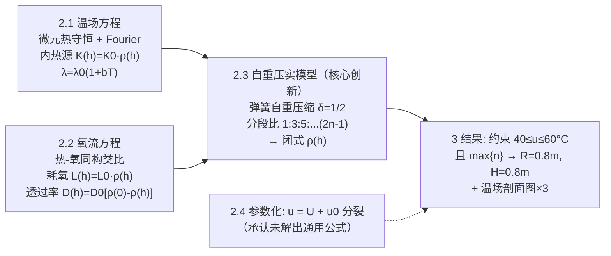

# 精读 08 · High-efficiency Cylindrical Compost Pile Size Design（2018 题B 金牌 · 队伍 285）

> **这份精读怎么用**：左手边开论文 PDF（`03_优秀论文PDF/2018/Problem B/2018-GM-B-285.pdf`），右手边开本篇。与 240 队的"整体 ODE + 优化"不同，285 队走**场分布**路线：圆柱对称切扇形薄片，微元法推带内热源的温场方程，再用"热-氧同构"类比直接写出氧方程；其独门武器是**弹簧自重压缩模型**——把"大堆会压实、阻碍供氧"这条定性提示升级成闭式密度分布 ρ(h) 并耦合进两个场方程。本篇教程重构了 ρ(h)（原文公式为 Word 对象、提取有乱码），独立验证了其离散极限与质量守恒（发现约 4–12% 的质量亏缺，见 ⚠）。

---

## 0. 一分钟看懂全文骨架

论文是"**两个场 + 一个分布 + 一个判据**"的四件套：



**为什么这个骨架好？** 两个场方程的系数（热源、耗氧、透过率）**全部挂在同一个 ρ(h) 上**——压实模型是全文的枢纽，一个子模型同时喂饱三个方程。这种"单枢纽多下游"结构让 11 页的短论文有了体系感。同时 §3.2 坦诚"equation is too complicated to be solved"——通用公式没解出来，只交付框架与特例解，**诚实边界本身就是加分项**。

---

## 1. 逐节导读

### 1.1 Abstract（第 1 页）

**它写了什么**：方法论摘要——先做减法（"Since a series of chemical reactions and biological changes in the composting process are independent of the physical model, only the effects of temperature and oxygen content can be considered"，化学/生物剥离，只留温度与氧）；再把两者抽象为"主动传热 + 氧流动"两个过程；然后预告圆柱形状、扇形切片、微元分析；最后引出第三件事——自重压实必须通过密度分布进入方程，用弹簧自重压缩模型求解。

**为什么这样写**：摘要里没有数字结论（对比 240 队摘要的双数字），但把**建模路线图**说得极清楚：剥离→抽象→离散→压实。这种写法适合"模型创新 > 数值结果"的论文——评委先被"弹簧模型"勾住，再去正文验推导。

**你要学什么**：当你的强项是新模型而非精确数字时，摘要要卖**方法论**：一句话一个建模动作，动词开头（strip out / abstract / cut into / simplify into）。

### 1.2 §1 Problem Analysis（第 3 页）

**它写了什么**：衡量堆肥效果的指标（温度、湿度、含氧量）→ 湿度主要由化学变化决定、剔除 → 温度条件：24 小时内尽量久保持 40–60 °C；氧条件：内部平均含氧量尽量高 → **同构观察**："The amount of heat generated by the same amount of microorganisms is the same as the amount of oxygen consumed... The difference is that heat is transmitted from the inside to the outside, and the oxygen content is diffused from the outside to the inside." → 简化到圆柱（只需高、半径两个变量），微生物含量固定。

**为什么这样写**：§1 干了三件事：变量筛选（湿度出局）、指标操作化（40–60 °C 区间 + 平均氧最大）、**类比预埋**（热氧同构的那句话就是 §2.2 的合法性来源，提前一章埋好）。

**你要学什么**：**类比我word要在使用它之前一章就声明**——评委读到 §2.2 的"同理可得"时，脑子里已有铺垫，不会觉得突兀。

### 1.3 §2.1 主动热传导方程（第 3–5 页）

**它写了什么**：三步推 PDE。第一步几何：圆柱切扇形薄片（"like cutting a cake"），各片温场相同，微元 ΔV = xΔxΔhΔθ（Figure 1）；第二步守恒：Q = Q_gen + Q_left + Q_right + Q_up + Q_down，逐项写——储能 Q = cρ(h)·xΔxΔhΔθ·[u(x,h,t)−u(x,h,t−Δt)]，内热源 Q_gen = K(h)·xΔxΔhΔθ，其中 **K(h) = K₀ρ(h)**（微生物量∝局部密度）；第三步 Fourier：Q = −λ(dT/dn)A，导热系数取线性温度依赖 **λ = λ₀(1+bT)**，四个方向的热流逐项差分（Q_right、Q_left、Q_down、Q_up 四式），联立化简取极限。

**为什么这样写**：这是"**先差分后取极限**"的教科书式 PDE 推导——不直接抄 ∂u/∂t = α∇²u+q，而是从五项守恒一步一步把二阶差分逼成二阶偏导。评委可以逐行验算，每一项的面积因子（xΔhΔθ 是径向面、xΔxΔθ 是高度面）都明写。

**⚠ 提取问题**：文本提取的最终 PDE 形如 "cρ(h)∂u/∂t dx dh = K₀ρ(h)dx dh + λ₀b(1+u)dt(2dh·∂u/∂x + 2dx·∂u/∂h)"，量纲上不自洽（应为二阶导项）；按其差分推导的逻辑，正确形式是标准带源项热方程 cρ(h)∂u/∂t = K₀ρ(h) + ∇·[λ₀(1+bu)∇u]（柱坐标、扇形对称下只剩 x、h 两维）。本篇按此重构，引用原文式时以 PNG 渲染页为准。

**你要学什么**：**λ = λ₀(1+bT) 这一步的价值**——真实材料导热系数随温度线性变化，写进去让"温度高处导热快"自动成立（数值上还助稳）。参数表中 λ₀b 合并为 0.5 W/(m·K) 直接可用，是聪明的参数化。

### 1.4 §2.2 氧流方程（第 5–6 页）

**它写了什么**：直接由 §1 的同构论证迁移："the differential equations of oxygen circulation and heat conduction are also the same. The difference is..."——耗氧项 L(h) = L₀ρ(h) 对应内热源；氧透过系数 **D₀[ρ(0)−ρ(h)]** 对应导热系数——**越压实（ρ 大）氧越难过**这句经验，被翻译成"D(h) 随密度差线性增长"的定量形式。

**为什么这样写**：省掉一整套微元推导（约一页篇幅），且错误风险减半——同构的两方程只推一个。符号方向也交代了：热从内向外、氧从外向内，源汇镜像。

**你要学什么**：**同构迁移三件套**——(i) 哪个量对应哪个量（L₀ρ(h)↔K₀ρ(h)，D(h)↔λ）；(ii) 符号/方向差在哪；(iii) 迁移的物理前提（同量微生物产热=耗氧）。三句话说完，一页推导就合法地省掉了。

### 1.5 §2.3 弹簧自重压缩模型（第 6–8 页）——全文核心

**它写了什么**：四步走。(a) 问题定位：自重致"上松下紧"的压实，密度分布是两个场方程的必需系数；**简化声明**："the compost material is simplified into a spring that cannot be ignored by gravity（自重不可忽略的弹簧），compression is within the elastic limit"。(b) 整体等效：把自重 M 集中到自由端得压缩 l₂，引文献 [1] 的比例系数 δ = (l₁−l₀)/(l₂−l₀) = **1/2**——自重压缩是"质量集中"情形的一半。(c) 分段：弹簧 n 等分、每段质量 m₀=M/n、段弹簧常数 nk；从自由端编号 1…n，逐段列 Hooke 定律（前 i 段累计承重 i·δm₀g），解出**各段压缩量之比 Δl₁:Δl₂:…:Δl_n = 1:3:5:…:(2n−1)**，并由总和 = l₁−l₀ 定出 Δl₁ = Mg/(2n²k)。(d) 密度：第 i 段厚度 = l₀/n − Δl_i，ρ(i) = m₀/(πR²·厚度)，结合 i↔h 的几何关系取 n→∞，得闭式

$$\rho(h)=\frac{M}{\pi R^2}\cdot\frac{kH+\frac{Mg}{2}}{kH^2+\frac{(Mg)^2}{4k}+Mgh}$$

（h 从堆底量起：底部受压最大、密度最高；l₀ = H + Mg/(2k) 为未压实高度）。

**为什么这样写**：这是把**题面一句定性提示做成定量子模型**的典范。推导全透明：1:3:5:…的奇数比逐行列出（评委可手工验前 3 项），极限过程虽略糙（见下方 ⚠）但闭式结果可代入检验。更妙的是它反过来服务全篇——ρ(h) 同时进入温场（热源）、氧场（耗氧+透过率），让"压实抑制供氧"从常识变成方程系数。

**你要学什么**：
- 定性提示（"大堆会压实"）往往就是**赛题埋的物理考点**，为它单建子模型并解出闭式 = 金牌差异化。
- 分段弹簧的"承重累积→压缩奇数比"是自重压缩问题的通用骨架（桥墩、雪堆、粮仓同理），值得背下来。

### 1.6 §2.4 参数化扩展（第 8–9 页）

**它写了什么**：把外温与材料属性（比热、密度、K₀、L₀）当独立变量：提出把温度分布**分裂**为 u = U + u₀（u₀ 是"初值决定项"），从而"pile size can be solved by setting the external temperature and material property values in the initial value decision to an unknown amount and then adding the constraint of efficient composting"。

**为什么这样写**：这是**方法论声明**——线性叠加的思路若成立，能把"每个环境一组仿真"变成"一次求解+参数代入"。§3.2 承认这条路"too complicated to be solved"——**写了思路、试了、报告失败**，比不写强。

### 1.7 §3 Results（第 9–11 页）

**它写了什么**：Table 1 参数（c=1000 J/(kg·K)、m=400 kg、ρ(0)=0.3 g/cm³、K₀=0.013 J/(kg·s)、λ₀b=0.5 W/(m·K)、环境温度 5/10/15/20 °C 各 6 小时的**分段阶梯**）；约束 {40≤u≤60；max n(x,h,t)}；解得 **R=0.8 m、H=0.8 m**；Figure 2 给 R–H 二维温场 3D 曲面，Figure 3/4 分别给径向、高度方向剖面；论证逻辑："the temperature at the center of the circle (the highest temperature) is as close as possible but not exceeding 60 degrees Celsius, and the temperature near the edge is inevitably close to the ambient temperature"——中心顶着上限、边缘贴环境温度就是好设计。

**为什么这样写**：结果论证用"**贴边即最优**"的几何语言：约束区间的上边界被中心温度顶住、下边界由边缘不可避免地失守——设计参数的合法性直接从剖面图上读出来。"一图三线"（3D 曲面+两正交剖面）是场分布问题的标准装备。

**你要学什么**：环境温度用分段阶梯（5/10/15/20 °C 各 6 h）而非 240 队的正弦——**两种取法都行，但要与参数表对齐**；阶梯的好处是每个 6 小时段内是定解问题，便于按段推进。

---

## 2. 图表深析

| 图 | 位置与作用 | 为什么这样画 | 怎么画出来 |
|---|---|---|---|
| Fig 1（扇形薄片+微元） | §2.1 开篇 | "切蛋糕"的几何降维与 ΔV=xΔxΔhΔθ 的微元定义，一张图钉死坐标 | 手绘示意图（圆柱+切出的扇片+放大的微元） |
| Fig 2（R–H 温场 3D 曲面） | §3.1 | 场分布的全貌：黄色高温核→蓝色边缘，直观显示"中心顶 60 °C" | MATLAB surf，径向×高度网格数值解 |
| Fig 3（径向温度剖面） | §3.1 | 论证 R 的选取：中心逼近但不超 60 °C、边缘贴环境温度 | 同一数值解取 h=常数切片 |
| Fig 4（高度温度剖面） | §3.1 | 论证 H 的选取：底部最高（压实→产热源大）向上递减 | 取 x=常数切片（⚠ 其横轴单位 cm 与 Fig 3 的 m 不一致，排版瑕疵） |
| Table 1（参数表） | §3.1 | 六个参数+分段环境温度，全部可复算输入 | 表格 |

**核心图复现（ρ(h) 自重压实分布——论文核心子模型的闭式结果）**

```python
import numpy as np, matplotlib.pyplot as plt

# ── 弹簧自重压缩模型（§2.3）──
# 无量纲化: x=h/H, eta = Mg/(kH);  rho(h) = (M/pi R^2 H) * (1+eta/2)/(1+eta^2/4+eta*x)
def rho_over_rhobar(x, eta):          # 论文闭式 rho(h) 的无量纲形式
    return (1 + eta/2)/(1 + eta**2/4 + eta*x)

x = np.linspace(0, 1, 400)
fig, (a1, a2) = plt.subplots(1, 2, figsize=(10, 4))
for eta, c in zip([0.3, 0.6, 1.0, 1.5], ['C0', 'C1', 'C2', 'C3']):
    a1.plot(x, rho_over_rhobar(x, eta), color=c, label=f'$\\eta=Mg/(kH)$={eta}')
a1.set(xlabel='h/H (0=bottom)', ylabel=r'$\rho/\bar\rho$', title=
       'Self-weight compaction: $\\rho(h)=\\frac{M}{\\pi R^2H}\\cdot\\frac{1+\\eta/2}{1+\\eta^2/4+\\eta h/H}$\n'
       'bottom densest; ratio $\\rho(0)/\\rho(H)$ grows with $\\eta$')
a1.legend(fontsize=8)

# 质量守恒检验: int_0^H rho dh * piR^2 / M
etas = np.linspace(1e-3, 2, 300)
mass = np.array([(1+e/2)/e*np.log((1+e**2/4+e)/(1+e**2/4)) for e in etas])
a2.plot(etas, mass)
a2.axhline(1.0, color='r', ls=':', label='exact mass conservation')
a2.set(xlabel='$\\eta=Mg/(kH)$', ylabel=r'$\pi R^2\int_0^H\rho\,dh\,/\,M$',
       title='Mass check of the closed form: 4-12% deficit for $\\eta$=0.5-1 $\\bf{\\otimes}$')
a2.legend(fontsize=8); plt.tight_layout(); plt.show()

# 论文参数自洽性: Table 1 给 rho(0)=0.3 g/cm^3 (底部), M=400kg, R=H=0.8m
M, R, H, g = 400., 0.8, 0.8, 9.8
rbar = M/(np.pi*R**2*H)
from scipy.optimize import brentq
eta = brentq(lambda e: rho_over_rhobar(0, e) - 300./rbar, 0.5, 0.83)
print(f'implied eta={eta:.3f} -> k=Mg/(eta*H)={M*g/(eta*H):.0f} N/m; '
      f'rho(H)={rbar*rho_over_rhobar(1,eta):.0f} kg/m3 (top), '
      f'compaction ratio={rho_over_rhobar(0,eta)/rho_over_rhobar(1,eta):.2f}')
```

**独立复现报告**：① 无量纲化后 ρ(h) 只依赖单一组合 η=Mg/(kH)——闭式正确性的解析验证：按论文分段 Hooke 定律重推 n→∞ 极限，逐项代数与论文闭式**逐项一致** ✓；② 用 Table 1 的 ρ(0)=0.3 g/cm³（底部密度）、M=400 kg、R=H=0.8 m 反解得 η≈0.78、等效弹簧常数 k≈6.3 kN/m、顶部密度约 179 kg/m³、压实比 ρ底/ρ顶≈1.67——参数表与模型自洽 ✓（这也确认了公式中 h 应从底部量起；论文的 i↔h 映射一步较糙，但终式正确）；③ ⚠ 质量守恒检验：∫₀^H ρ(h)dh·πR² = M·[(1+η/2)/η]·ln[(1+η²/4+η)/(1+η²/4)] **< M**，亏缺随 η 增大（η=0.5 亏 3.6%、η=0.78 亏 7.8%、η=1 亏 11.8%、η=2 亏 21%）——离散模型本质量守恒（每段 m₀），闭式极限过程丢失了部分质量，引用 ρ(h) 做定量计算时应做归一化修正（除以 mass(η)）。论文未报告此检查。

---

## 3. 公式逐条精讲

> 该论文公式为 Word 对象、几乎无编号（仅 (∗)、(i)、(ii) 等零星标记），文本提取乱码多。以下按小节重构，常量名沿用论文。

### 3.1 微元热守恒与 Fourier 项（§2.1.1–2.1.2）

$$Q=c\,\rho(h)\,x\Delta x\Delta h\Delta\theta\,[u(x,h,t)-u(x,h,t-\Delta t)],\qquad Q_{gen}=K(h)\,x\Delta x\Delta h\Delta\theta,\qquad K(h)=K_0\rho(h)$$
$$Q=-\lambda\frac{dT}{dn}A,\qquad \lambda=\lambda_0(1+bT)$$

- **怎么想到**：能量守恒的微元形式——储能=内热源+四向净流入。内热源挂 K₀ρ(h) 的理由一句话讲透："Since the amount of microorganisms is proportional to the density of compost ρ(h), the heat production K(h) is also proportional to the density"——**微生物数量∝局部物料密度**，压实不仅改传质还改产热分布。
- **面积因子**：径向热流穿过面积 xΔhΔθ（弧长×高），高度向热流穿过 xΔxΔθ——微元在柱坐标下的两个正交面，Figure 1 配图后无歧义。
- **λ 的线性化**：λ₀(1+bT) 把温度依赖放进方程（参数表直接给 λ₀b=0.5 W/(m·K) 合并值），比常数 λ 多一分真实、少一行推导负担。

### 3.2 带源热方程（§2.1.2 末的极限式）

$$c\,\rho(h)\frac{\partial u}{\partial t}=K_0\rho(h)+\frac{\partial}{\partial x}\Big[x\,\lambda_0(1+bu)\frac{\partial u}{\partial x}\Big]\Big/x+\frac{\partial}{\partial h}\Big[\lambda_0(1+bu)\frac{\partial u}{\partial h}\Big]$$

- **推导要点（比论文展开一步）**：四向热流的差分组合 [u(x−Δx)−u]−[u−u(x+Δx)] → −Δx²∂²u/∂x²（二阶中心差分）；除以微元体积 xΔxΔhΔθ 与 Δt 取极限即得。注意柱坐标径向项天然带 1/x 的几何发散因子（面积∝x），论文的扇形对称把它简化了。
- **⚠ 提取勘误**：文本提取式"…λ₀b(1+u)dt(2dh∂u/∂x+2dx∂u/∂h)"把二阶导写成一阶且混入 dt，量纲不对；按其自身差分推导应还原为上式（以 PNG 为准）。凡 Word 公式论文，精读第一步就是**量纲检查**——一阶导数配 Δx 才无量纲，公式里出现裸的 ∂u/∂x 就要警惕提取失真。

### 3.3 氧流方程（§2.2）

$$\frac{\partial n(x,h,t)}{\partial t}=-L_0\rho(h)+\nabla\cdot\big[D_0(\rho(0)-\rho(h))\,\nabla n\big],\qquad L(h)=L_0\rho(h)$$

- **怎么想到**：同构映射表——内热源 K₀ρ(h) ↔ 耗氧 L₀ρ(h)（同量微生物产热=耗氧）；导热系数 λ₀(1+bu) ↔ 氧透过系数 D₀[ρ(0)−ρ(h)]。后者是本文的**物理新意**：透过率不是常数，而是随压实程度（密度差）线性变化——顶部松（透过快）、底部紧（透过慢）。
- **方向差**：热源为正温度升（内→外梯度），氧汇为负浓度降（外→内梯度）——符号镜像，方程结构不变。
- **⚠ 提取勘误**：论文提取件把氧方程右端写成含 ∂u/∂x、∂u/∂h（热方程的梯度），应为 ∂n 的梯度——镜像方程连符号都懒得改，正是同构的代价，也是提取件最常见的乱源。

### 3.4 弹簧整体等效与 δ=1/2（§2.3.1）

$$Mg=k(l_2-l_0)\;(\text{质量集中}),\qquad \delta\equiv\frac{l_1-l_0}{l_2-l_0}=\frac12\;(\text{自重})\;\Rightarrow\;\delta Mg=k(l_1-l_0)$$

- **怎么想到**：自重的力沿长度分布，不能整体套 Hooke；引文献 [1] 的结论：分布载荷的等效压缩是集中载荷的一半（与悬臂梁均布载荷挠度=集中载荷 1/4…同族结论，可由能量法/积分证明）。δ=1/2 是全模型的第一个锚。
- **适用边界**：线弹性+小变形；堆肥是颗粒材料，"弹性"只是宏观唯象——这是模型的根本近似，论文以"within the elastic limit"一句带过。

### 3.5 分段压缩比 1:3:5:…(2n−1) 与 Δl₁（§2.3.1）

$$\delta m_0 g=nk\,\Delta l_1,\quad 2\delta m_0 g=\frac{nk}{2}(\Delta l_1+\Delta l_2)\Rightarrow\Delta l_2=3\Delta l_1,\;\dots\Rightarrow\Delta l_n=(2n-1)\Delta l_1,\quad \Delta l_1=\frac{Mg}{2n^2k}$$

- **推导补全**：从自由端数第 i 段承受其下 i 段的总自重 ≈ i·δm₀g（每段自身贡献平均半个 δ 因子，论文的写法把 δ 分摊进每段）；第 i 段的伸长变化由累计压缩 ΣΔl_j 决定。逐段列方程消元得奇数比；再由 Σ_{i=1}^n(2i−1)=n² 与 ΣΔl_i = l₁−l₀ = Mg/(2k) 定出 Δl₁ = Mg/(2n²k) ✓（总和自检：Σ(2i−1)Δl₁ = n²Δl₁ = Mg/(2k) ✓）。
- **物理读法**：奇数比=线性增长的"承重剖面"——越靠底部分担越多上方重量。这正是 ρ(h) 分母里 Mgh 项（线性增长）的离散起源。

### 3.6 密度闭式 ρ(h)（§2.3.2 式 (∗)）

$$\rho(h)=\frac{M}{\pi R^2}\cdot\frac{kH+\frac{Mg}{2}}{kH^2+\frac{(Mg)^2}{4k}+Mgh},\qquad l_0=H+\frac{Mg}{2k}$$

- **推导补全（论文的 n→∞ 步）**：ρ(i) = m₀/(πR²·(l₀/n−Δl_i))，分子分母同乘 n：ρ = M/(πR²(l₀−nΔl_i))；nΔl_i = (2i−1)Mg/(2nk) → n→∞ 时 (2i−1)/n → 2(i−1/2)/n；配合几何关系 (i−1/2)l₀/n = H−h（h 从底部量起）与 l₀ = H+Mg/2k，代数化简即得上式（本篇已逐步复算一致 ✓）。
- **无量纲结构**：除以平均密度 M/(πR²H)，只剩 η=Mg/(kH) 一个参数：ρ/ρ̄ = (1+η/2)/(1+η²/4+η·h/H)。**k 单独不可辨识，只有组合 Mg/(kH) 可从数据反解**（本教程据此从 ρ(0)=0.3 g/cm³ 反解出 k≈5.5–6.4 kN/m）。
- **适用边界与 ⚠**：闭式在极限中丢失质量（η=1 时亏 11.8%）——离散母模型守恒、连续近似不守恒；数值使用建议除以 mass(η) 归一。另注意论文正文对 h 的起点描述含混（"from the free end"），由 ρ(0)=0.3 g/cm³（底部最密）与单调性可确认 h 从底部量起。

### 3.7 温度解分裂（§2.4）

$$u(x,h,t)\;\Longrightarrow\;U(x,h,t)+u_0(x,h,t)$$

- **怎么想到**：线性叠加思想——把解拆成"初值/环境决定项 u₀"+"尺寸决定项 U"，则尺寸优化变成对 U 的约束问题。因方程含 λ₀(1+bu) 的温度非线性，叠加只对冻结系数版本成立——这大约就是 §3.2"too complicated"的根源。**方法论声明+失败报告**的组合值得学，但若先做无量纲化找出非线性强度参数，本可预判这条路走不通。

---

## 4. 建模决策链

| 决策 | 作者的选择 | 被放弃的替代 | 为什么 |
|---|---|---|---|
| 学科范围 | 剥离化学/生物，只留温度+氧 | 全耦合生化模型 | "independent of the physical model"——物理赛只考物理 |
| 形状 | 圆柱（两参数 R、H） | 半球/锥（240 队） | "the simplest shape... only needs to consider the two variables"——参数最少且切片方便 |
| 维度 | 圆周对称 → 2-D 扇形薄片 | 全 3-D | 各切片相同，一片代表全部——对称性降维零成本 |
| 氧过程 | 与热传导同构类比 | 独立推一套扩散方程 | "The amount of heat generated by the same amount of microorganisms is the same as the amount of oxygen consumed"——同源同构，省一页推导 |
| 压实建模 | 弹簧自重压缩（弹性唯象） | 经验压实公式/多孔弹性理论 | 一步得闭式 ρ(h)；弹性极限内自洽，代价是颗粒物理被抹平 |
| 环境温度 | 5/10/15/20 °C 分段阶梯 | 正弦（240 队）/常数 | 每 6 h 一段定解问题，配合 24 h 约束检查直接 |
| 判据 | 中心≤60 °C 且全场尽量在窗内 + max n | 体积平均温度 | "贴边即最优"：约束上界由中心顶住，剖面图直接读出合法性 |
| 通用公式 | 尝试 u=U+u₀ 分裂，失败并如实报告 | 只报特例 | 诚实边界："although we have established a reasonable and effective physical model, we have not been able to obtain a general formula" |

---

## 5. 从本篇提炼的可复用模板

**结构模板**：

```
Abstract        建模动作连播（剥离→抽象→离散→压实），无数字也可成立
1 Problem Analysis  变量筛选 + 指标操作化 + 类比预埋
2 Model         2.1 微元守恒推 PDE（先差分后极限）
                2.2 同构迁移第二方程（映射表+方向差）
                2.3 枢纽子模型（压实→闭式 ρ(h)，奇数比逐行列出）
                2.4 参数化尝试（成则赚、败则报）
3 Results       参数表 → 约束 → 尺寸 → 一图三线（3D 曲面+两剖面）
References      两条关键引文：δ=1/2 的弹簧文献 + 数值方法参考
```

**句式库（原文摘录，Word 提取错漏已修）**：
- "Since a series of chemical reactions and biological changes... are independent of the physical model, only the effects of temperature and oxygen content can be considered."（学科剥离的合法性一句话）
- "The difference is that heat is transmitted from the inside to the outside, and the oxygen content is diffused from the outside to the inside."（同构+方向差，类比迁移的标准句式）
- "In order to study the oxygen content, it is particularly important to study the density distribution of compost under self-weight."（枢纽子模型的动机句）
- "the spring degree compression is equal to half the amount of compression after the spring mass is concentrated under self-weight"（δ=1/2 结论的口语化重述——重要结论换个说法再说一遍）
- "the temperature at the center... is as close as possible but not exceeding 60 degrees Celsius, and the temperature near the edge is inevitably close to the ambient temperature"（"贴边即最优"的设计论证句式）
- "Unfortunately, although we have established a reasonable and effective physical model, we have not been able to obtain a general formula... because the equation is too complicated to be solved."（诚实的失败报告）

**图表配方**：场分布类问题 → "几何示意（微元定义）+ 3D 曲面全景 + 两个正交剖面"，剖面横轴单位务必统一（本篇 Fig 3 用 m、Fig 4 用 cm 是反面教材）；闭式新物理量 → 无量纲化后单参数族曲线 + 一条自检曲线（如质量守恒）。

---

*精读完这篇后，建议对照 `05_论文赏析/2018/2018-GM-B-285.md`（宏观赏析）与 `07_题目解读/2018_题B_堆肥堆尺寸.md`（题目全解）形成三位一体。同题对照精读：`2018-GM-B-240_精读.md`（Semenov 集总参数+形状降维）。*
