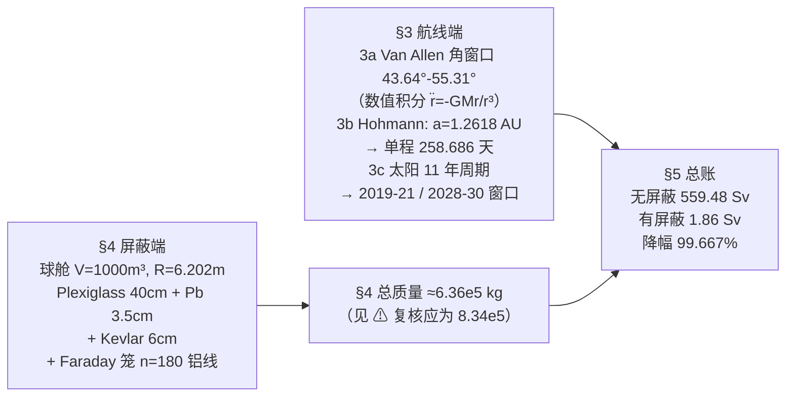

# 精读 09 · Protecting travellers to Mars（2019 题A 金牌 · 队伍 105）

> **这份精读怎么用**：左手边开论文 PDF（`03_优秀论文PDF/2019/Problem A/2019-GM-A-105.pdf`），右手边开本篇。这是一支单人队伍的论文：把"火星旅行辐射防护"拆成**航线端**（避开 Van Allen 带核心 + 太阳极小期发射 + 最短 259 天 Hohmann 转移）与**屏蔽端**（球形居住舱三层材料 + 铝线 Faraday 笼），最后用剂量对照收束。本篇教程独立复算了 Hohmann 全链（258.686 天 ✓、相位 135.56° ✓）、屏蔽厚度与总质量——并发现铅层质量存在一个**10 倍密度滑误**（正文合计 6.36×10⁵ kg 应为 8.34×10⁵ kg，见 ⚠）。论文由 Word 排版，多数公式为图片对象、文本提取缺失，凡重构处均已注明。

---

## 0. 一分钟看懂全文骨架

论文是**两条独立防线 + 一本总账**的结构：



**为什么这个骨架好？** "时间 × 路径 × 屏蔽"是辐射防护的三因子（正文 §4 原文即列 time / distance / shielding 三法），论文结构与之严格同构——**方法论地图就是目录**。两条防线独立可检，最后 §5 用一个乘法（曝光率 × 时长 × 换算）把两条线合成一个可判定结论（1.86 Sv"低于年限值"）。单人队伍能覆盖轨道力学、核辐射物理、电磁学三个领域并各出数字，正是 UPC 评审偏爱的"应用物理全景"。

---

## 1. 逐节导读

### 1.1 Abstract（第 1 页）

**它写了什么**：三段——航线（43.64–55.31° 发射角避开 Van Allen 带核心 + 太阳活动周期首末端发射 + 最快 259 天）；屏蔽（1000 m³ 舱 + Faraday 笼 + 铅/有机玻璃/Kevlar，附加质量"around 6.33×10⁵ kg"）；设计参数清单（形状、允许辐射水平、材料、剂量与曝光率削减）。

**⚠ 要注意**：摘要的 6.33×10⁵ kg 与正文 §4 末的 6.36×10⁵ kg 不一致；而按正文自己的逐层数据复核，铅层质量又有 10 倍滑误（见 §2 复现报告），三处数字各不相同。**摘要数字必须从正文最终计算回填**——本篇是"前车之鉴"的完整标本。

### 1.2 §1 Introduction + §2 Notations（第 3 页）

**它写了什么**：目标一句话（送人去火星并防住 Van Allen 带与太阳活动辐射）；三重威胁定性（Van Allen 带捕获粒子、GCR 各向同性背景、SPE 质子暴）；居住舱 1000 m³ + 材料选择原则（"should not generate secondary radiations or nuclear reactions and should prevent x rays too... should also be heat resistant"）。符号表仅 3 行（R_e、r 线半径、n 线数、M），其余"defined alongside"。

**你要学什么**：符号表短不可怕，但**关键约束要在引言认领**：1000 m³、无次级辐射、耐热——后文每个设计决策（球形、材料排序、Kevlar 外层）都能回溯到这里列的一条原则。

### 1.3 §3 Determination of Flight Path（第 4–7 页）——航线端

**它写了什么**：四步。(a) **Van Allen 角窗口**：地心惯性系（x 指春分点、z 指北极——坐标系定义一段写得规范）数值积分引力方程 r̈ = −GM r/r³（公式为图片对象，提取缺失；G=6.674×10⁻¹¹、M=5.976×10²⁴ kg 明文给出）；设轨迹初始沿地磁轴平行出发，以 Θ=arctan(dy/dx) 度量轨迹方向，在两个区域分别得 θ₁=43.64°（1<x<1.05, 0.5<y<1，单位应为地球半径）、θ₂=55.31°（1.05<x<1.2, 1<y<2）→ 发射角须落在此窗口以避开质子带核心。(b) **Hohmann 转移**：r₁+r₂ = 1+1.523691 = 2.523691 AU → a=1.261845 → a³=2.00918=T² → T=1.4174 年 → 单程 0.70873 年 = 258.686 天；再算火星行进角 360°×(0.70873/1.8822)=135.56°（发射相位提前量）。(c) **太阳活动**：11 年周期、GCR 与太阳活动反相关、SPE 稀发但致命的三段定性。(d) **发射窗口**：每 11 年两个（周期首末各一），最宜"towards the beginning or towards the end of the solar activity cycle"→ 2019 中–2021 初、2028 末–2030。

**为什么这样写**：§3 的 Kepler 第三定律一段是**教科书式自足推导**——"For completeness that form is re-derived below"，从 T²/a³=常数出发，用地球（T=1 年、a=1 AU）定出常数=1，再代飞船椭圆。所有中间数（2.523691、1.261845、2.00918、1.4174、0.70873、258.686）全部写出——**评委可逐位复算**，这是数值链条可信度的最便宜保障。

**你要学什么**：
- **单位制即捷径**：T 用年、a 用 AU，则 T²=a³ 无量纲化，心算即得——先选单位再动笔。
- 发射相位的推理链："It takes Mars 1.8822 years for a full orbit... in 0.70873 years it should cover 135.555°. We therefore launch when Mars in its orbit is 135.555° away from point A"——飞船飞半椭圆时火星走 135.56°，所以发射时火星要领先这么多。两句话，无 waste。

### 1.4 §4 Design of Habitat Vessel（第 8–15 页）——屏蔽端

**它写了什么**：六步。(a) **形状**：球——面容比最小（"least surface area to volume ratio"）+ 无棱角泄漏（"Spherical habitat does not have edges decreasing the probability of radiation leak from corners"）+ Bernal Sphere 先例证实用性。(b) **尺寸**：V=1000 m³ → R=6.202 m、内表面积 483.421 m²。(c) **无屏蔽三法**：时间（Dose=Dose Rate×Time、Stay Time 公式）、距离（平方反比 I=k/d²）、点源伽马曝光率 ER=6CE_f/d²。(d) **屏蔽物理**：指数衰减 I=I₀e^{−μx}，化为质量衰减系数 I=I₀e^{−μ_mρx}；辐射类型分 α/β/γ/GCR 四类讨论；**排序原则**："By shielding the less penetrable radiation type first then proceed to shield the more penetrable type would decrease both scattering and the total amount of shielding material"——先挡 β 再挡 γ，低 Z 材料（Plexiglass）抑韧致辐射。(e) **三种材料厚度**：设 I₀=9 R/hr、目标 I=0.03 R/hr → ln(300)=5.70 个衰减长度：铅 μ=1.63 cm⁻¹→x=3.5 cm；Plexiglass μ=0.12→x=40 cm；Kevlar μ=0.902→x=6 cm。(f) **Faraday 笼**：二维 Laplace 边值问题（式 2.1–2.4：盘面等势 φ=φ₀、点源 z_s=2 的对数渐近），数值实验两组（变 r、变 n）→ 结论"the strength of the screening effect is linear in n, logarithmic in r, and linear in |z_s|"；n>40 且 r=0.1 m 时场≈0（近似连续导体）；几何定线数 n=2πR/(2r)≈210，取 180（留热膨胀余量），铝线总质量 3.224×10⁵ kg。

**为什么这样写**：屏蔽端的顺序就是**教学顺序**：先无屏蔽（三法）→ 有屏蔽（一条指数律）→ 选材（按穿透性排序）→ 定厚（一个 ln 解出）→ 补电磁（Faraday 笼）。每步只引入一个新公式，读者的认知负荷被精心摊开。Faraday 笼那段是全文最"硬"的部分——直接把二维 Laplace 边值问题（含 (2.3)(2.4) 的渐近边界条件）搬进来配六幅等势线数值图，单人论文里出现这种数学密度是显著加分。

**⚠ 要注意**：① 正文写"acceptable radiation exposure rate is 0.0005R/hr"，但计算全程用 I=0.03 R/hr——口径不一致；② 铅的 μ=0.114×11.35=1.29 cm⁻¹ 而非其写的 1.63（x=3.5 cm 与 1.63 自洽、与 0.114×11.35 不自洽，疑似 μ_m 应为 0.144）；③ Plexiglass 按 μ=0.12 应为 47.5 cm 而非 40 cm。三处均为"算式与所用数对不上"，精读时要逐个复算。

### 1.5 §5 Tissue dosage（第 16 页）

**它写了什么**：无屏蔽 9 R/hr × 24 h × 259 d × 10 mSv/R = 559.48 Sv；有屏蔽 0.03 R/hr → 1.86 Sv（"under the limit of dosage per year"）；降幅 (559.48−1.86)/559.48 = **99.667%**。

**为什么这样写**：总账只做一次乘法，但把"无措施 vs 有措施"并排给出，用百分比冲击收束全文。（注：1.86 Sv 实际已超普通职业年限值，"under the limit"的说法对宇航员生涯剂量才勉强成立——引用时应对此保持警觉。）

### 1.6 §6 Conclusions（第 16 页）

**它写了什么**：三段——航线最优性复述（含一句生理学理由："there is enough time for the temporary DNA and tissue damage to repair quickly"——短曝光还给 DNA 修复留时间）；屏蔽设计最优性复述；**假设清单**（辐射以 X/γ 为主且点源恒定最大值=保守假设、太阳电子带被 Faraday 笼忽略）+ 局限（次级辐射、小行星、铝笼刚度）+ 升级方向（更轻更刚性更紧凑）。

**你要学什么**：结论段列假设时的**方向声明**："We have assumed that most radiations are x ray and gamma... emerge from a point source and are constant at their maximum value"——恒定最大值意味着所有剂量估计是**上界**，保守方向一句话钉死，堵住"低估风险"的质疑。

---

## 2. 图表深析

| 图 | 位置与作用 | 为什么这样画 | 怎么画出来 |
|---|---|---|---|
| Van Allen 带与飞行路径示意 | §3 开篇 | 把"43.64°–55.31° 窗口"画在带域上，数值结论有几何载体 | 示意图（带域剖面+轨迹束） |
| Hohmann 转移几何（P、A、r₁、r₂ 标注） | §3 | 半椭圆+两轨道切点，配合正文逐步数字 | 手绘几何图 |
| 太阳周期图（NASA 图源） | §3 Activity of Sun | 定性知识配权威图源，窗口论证有依托 | 引用图 |
| 发射窗口图 | §3 Timing | 11 年轴上标出两窗口，日期结论可视化 | 时间轴 |
| 居住舱 2D 俯视/剖面图 | §4 | 四层"洋葱"结构（舱+三材料+笼）一图数清 | 剖面示意 |
| Faraday 笼等势线组图（变 r ×3、变 n=10/20/40 ×3）+ 场强-根数图 | §4 | **全文最硬的图组**：等势线随 r 收缩、随 n 加密的变化一目了然；对数坐标下场强∝1/n | 边值问题数值解（源自 arXiv 引文方法），详见 PNG 渲染页 |
| 质量合计（无编号公式 (1)–(4)） | §4 末 | 四层质量逐层编号，总质量=四式相加 | 球壳体积差×密度 |

**核心图复现（屏蔽厚度 + 质量总账）**

```python
import numpy as np, matplotlib.pyplot as plt

# ── 衰减参数（论文 §4：I0=9 R/hr, I=0.03 R/hr → 需 ln(300) 个衰减长度）──
lnr = np.log(9/0.03)                       # = 5.704
mats = {'Plexiglass': (0.12,   1.185, 40e-2),
        'Lead':       (1.63,  11.35,  3.5e-2),   # ⚠ 0.114*11.35=1.29, 论文写 1.63
        'Kevlar':     (0.902,  1.44,  6e-2)}
fig, (a1, a2) = plt.subplots(1, 2, figsize=(10.5, 4))
x = np.linspace(0, 55, 500)                # cm
for name,(mu,rho,x_paper) in mats.items():
    a1.semilogy(x, np.exp(-mu*x), label=f'{name}, $\\mu$={mu} cm$^{{-1}}$')
    a1.axvline(lnr/mu, ls=':', alpha=0.5)  # 所需厚度
    print(f'{name}: need x = {lnr/mu:.2f} cm (paper: {x_paper*100:g} cm)')
a1.axhline(1/300, color='k', ls='--', lw=1, label='target I/I0 = 1/300')
a1.set(xlabel='shield thickness x (cm)', ylabel='I/I0',
       title='Eq. $I=I_0e^{-\\mu x}$: Pb 3.50 ✓, Kevlar 6.32≈6 ✓, '
             'Plexiglass 47.5 vs paper 40 ⚠'); a1.legend(fontsize=8)

# ── 质量总账（球壳体积差; 半径链 6.202→6.602→6.637→6.697 m）──
shell = lambda r1, r2: 4/3*np.pi*(r2**3 - r1**3)
Rcage, rw = 6.697, 0.1                     # Faraday 笼: n=180 根铝线, 长 pi*Rcage
V_al = 180*np.pi*rw**2*(np.pi*Rcage)
m = {'Al cage':    V_al*2710,
     'Plexiglass': shell(6.202, 6.602)*1185,
     'Lead':       shell(6.602, 6.637)*11350,   # ⚠ 论文按 1135 kg/m3 算得 21874 kg
     'Kevlar':     shell(6.637, 6.697)*1440}
tot = sum(m.values())
print({k: round(v) for k, v in m.items()},
      f'total={tot:.3g} kg (paper 6.36e5; with paper lead slip: {tot-0.9*m["Lead"]:.3g})')
a2.barh(list(m.keys()), [v/1e3 for v in m.values()],
        color=['C0', 'C1', 'C2', 'C3'])
a2.set_xlabel('mass (tonnes)')
a2.set_title('Shield mass budget: corrected total %.2e kg vs paper 6.36e5 kg\n'
             '(paper used Pb density 1.135 g/cm$^3$, a factor-10 slip ⚠)' % tot, fontsize=9)
plt.tight_layout(); plt.show()
```

**独立复现报告**（Python 实跑）：① Hohmann 全链逐位吻合：a=1.261845 AU、a³=2.00918、T=1.4175 年（论文 1.4174）、半程 258.686 天（按 365 d/yr）✓、火星相位提前 135.56° ✓；② 屏蔽厚度：铅 x=ln300/1.63=**3.50 cm** ✓、Kevlar=6.32≈6 cm ✓、Plexiglass=47.5 cm vs 论文 40 cm ⚠（按其 μ=0.12 应为 47.5；40 cm 对应衰减到 0.074 R/hr 而非 0.03）；③ 逐层质量：Plexiglass 244,209 kg ✓、Kevlar 48,260 kg ✓、铝笼 322,420 kg ✓；**铅层论文值 21,874 kg = 19.273 m³ × 1,135 kg/m³——恰为其自报密度 11.35 g/cm³ 的十分之一** ⚠，正确应为 218,700 kg，故总质量应为 **8.34×10⁵ kg** 而非 6.36×10⁵（摘要又写 6.33×10⁵，三处不一致）；④ 剂量：9 R/hr×24×259×0.01 = 559.44 Sv（论文 559.48）、0.03 R/hr → 1.865 Sv ✓、降幅 99.667% ✓；⑤ Faraday 笼几何：n=2πR/(2r)=210.4≈210 ✓、铝体积 118.97 m³ ✓。

---

## 3. 公式逐条精讲

> 论文正文公式多为图片对象（提取缺失），仅 Faraday 笼部分有编号 (2.1)–(2.4)。以下按原文文字描述重构并逐一标注来源。

### 3.1 轨道方程（§3，图片公式，据文字描述重构）

$$\ddot{\vec r}=-\frac{GM}{r^3}\vec r,\qquad G=6.674\times10^{-11},\;M=5.976\times10^{24}\,\text{kg}$$

- **怎么想到**：地心惯性系二体问题；z 轴取地轴，轨迹相对**地磁轴**的夹角才是 Van Allen 带几何的相关量——坐标定义段（x 春分点、z 北极）为此服务。
- **Θ=arctan(dy/dx)**：以轨迹切向角扫描发射方向，在带域的两个 x–y 区域（单位约地球半径）分别得 43.64°/55.31°。⚠ 原文未展示积分器与步长、带域边界来源，这两个角度**不可独立复算**——是本篇最薄弱的一环，引用时按其图示理解即可。

### 3.2 Kepler 第三定律与 Hohmann 时间（§3，正文完整推导）

$$\frac{T^2}{a^3}=1\;(\text{T in yr, a in AU})\;\Rightarrow\;a=\frac{r_1+r_2}{2}=\frac{1+1.523691}{2}=1.261845,\; T=a^{3/2}=1.4174\,\text{yr}$$
$$t_{one\text{-}way}=\frac{T}{2}=0.70873\,\text{yr}=258.686\,\text{d},\qquad \Delta\phi_{Mars}=360^\circ\times\frac{0.70873}{1.8822}=135.56^\circ$$

- **怎么想到**：Hohmann 转移=切两圆轨道的半椭圆，长轴=r₁+r₂；单位选年/AU 使常数=1。
- **推导细节**：1.261845³ = 2.00918（可手验：1.2618²=1.59216，×1.2618=2.00905…，论文取 2.00918，尾数差在舍入内）；√2.00918=1.41746。
- **数值感**：258.686 天 ≈ 8.5 个月——与常识"九个月到火星"一致，多一层交叉验证。

### 3.3 三法与点源公式（§4c）

$$\text{Dose}=\text{Dose Rate}\times \text{Time},\qquad \text{Stay Time}=\frac{\text{Limit}}{\text{Dose Rate}},\qquad I=\frac{k}{d^2},\qquad ER=\frac{6CE_f}{d^2}$$

- **怎么想到**：辐射防护的教科书三法（time/distance/shielding）——论文明确写"The three basic methods used to reduce the external radiation hazard are time, distance, and shielding"，把领域公理搬进论文，为后文结构背书。
- **ER 公式**：C（mCi）×E（MeV）×f（分支比）→ 6CEf/d²（d 用英尺，R/hr）——常数 6 是 R·ft²/(hr·mCi·MeV) 的经验换算。**注意它只在正文"无屏蔽"讨论中出场，实际算屏蔽时未用**——引用公式的口径要与使用一致。

### 3.4 指数衰减与质量衰减系数（§4d）

$$I=I_0e^{-\mu x}\;\xrightarrow{\;\mu=\mu_m\rho\;}\;I=I_0e^{-\mu_m\rho x}$$

- **怎么想到**：窄束单能光子的 Beer–Lambert 衰减；μ 随材料密度变，改用质量衰减系数 μ_m（查表量）乘密度——"linear attenuation coefficients are proportional to the absorber density"。
- **定厚反解**：x = ln(I₀/I)/μ = ln(300)/μ = 5.704/μ。**一个 ln，三种材料三行**——这是屏蔽设计的中枢公式。
- **适用边界**：窄束、单能、不计积累因子（buildup factor）——宽束/多次散射会低估所需厚度；GCR（高能带电粒子）根本不服从光子衰减律，论文以"假设以 X/γ 为主"盖住这一点（结论段已声明保守方向）。

### 3.5 材料排序与韧致辐射（§4 材料选择）

- **排序原则**："By shielding the less penetrable radiation type first then proceed to shield the more penetrable type would decrease both scattering and the total amount of shielding material required."——β（低穿透）先用低 Z 材料挡，避免高 Z 材料中韧致辐射升级成 X 射线；γ（高穿透）再用铅；最外 Kevlar 承热/结构。**次级辐射是材料选择的第一判据**，这句话是全文最有专业味的段落。
- 层序的物理：Plexiglass（富氢，抑 β 与韧致）→ Lead（光电视/对产生吸收 γ）→ Kevlar（耐热防撞击）——由内向外。

### 3.6 Faraday 笼边值问题（§4，式 2.1–2.4）

$$\nabla^2\varphi=0\;(2.1),\qquad \varphi=\varphi_0\;\text{on disks}\;(2.2),\qquad \varphi(z)=\log|z-z_s|+O(1)\;(2.3),\qquad \varphi(z)=\log|z|+o(1)\;(2.4)$$

- **怎么想到**：线网屏蔽=圆盘列上的等势 Laplace 问题；(2.3) 是外加点电荷 z_s=2 的奇性条件，(2.4) 规定总电荷为零的远场归一。这是一套**数学上完全严格的变分/均匀化问题设定**（论文引 arXiv 数值文献做实验图）。
- **三条标度结论**（原文）："the strength of the screening effect is linear in n, logarithmic in r, and linear in |z_s|"；场强估计式与无量纲参数 α 的具体形式在提取件中缺失（图片公式），按其给出的判别条件：ε=|Γ|/n≪1、r≪ε 时，若 ε≫1/log(ε/r) 则 α≪1（线太细、屏蔽失效），反之 α≫1（屏蔽强）——即**有效性由 r 与线间距的对数比控制**，这解释了为什么 n>40、r=0.1 m 时场≈0（线已近乎搭成连续壳）。
- **工程翻译**：n = 2πR/(2r) = 210（周长除以线径），取 180 留热膨胀余量——从数学标度律直接读出工程参数，这一跨是全文"物理-工程"转换的样板。

### 3.7 球壳质量与线笼质量（§4 末式 (1)–(4)）

$$m_{layer}=\frac{4\pi(R_2^3-R_1^3)}{3}\rho,\qquad m_{cage}=n\cdot\pi r^2(\pi R)\rho_{Al}$$

- **怎么想到**：薄球壳体积差；线笼= n 根长 πR（半周长！）的铝线。
- **验算（本篇已完成）**：铝 322,420 ✓、Plexiglass 244,209 ✓、Kevlar 48,260 ✓、铅按论文输入应为 218,700 而非 21,874 ⚠（密度少写一个 0），总质量 8.34×10⁵ kg。**每层质量 = 体积×密度，两个乘法各 30 秒**——评委与你自己都该做一遍这道算术。

### 3.8 剂量换算（§5）

$$D=\dot D\times t = 9\,\tfrac{\text{R}}{\text{hr}}\times24\times259\,\text{hr}\times\tfrac{10\,\text{mSv}}{\text{R}}=559.44\,\text{Sv}\;\to(\text{shielded})\;1.865\,\text{Sv}$$

- **单位链**：R（伦琴）→ 10 mSv/R（近似生物等效换算）——数值链两端单位都要写全。（559.48 与 1.86 为论文的四舍五入；99.667% 降幅复算一致 ✓。）

---

## 4. 建模决策链

| 决策 | 作者的选择 | 被放弃的替代 | 为什么 |
|---|---|---|---|
| 防护分解 | 时间×路径×屏蔽三因子分别建模 | 只做屏蔽 | 剂量=率×时长，航线端减时长/避带、屏蔽端降率，乘法合成 |
| 转移轨道 | Hohmann（最省能量的近最短时） | 快速转移/引力助推 | "the flight time and path should be as minimum as possible"且无推进约束——Hohmann 是无胁迫下基准 |
| 发射时机 | 太阳活动周期首末（GCR 极大但 SPE 极小） | 周期中段 | GCR 升、SPE 降的取舍——论文选 SPE 主导端（暴发致命），方向与 NASA 常规建议一致 |
| 舱形 | 球 | 圆柱/立方 | 最小面容比+无棱角泄漏+Bernal Sphere 先例 |
| 屏蔽材料 | Plexiglass→Pb→Kevlar 三层 + 铝笼 | 单一厚铅/水层 | 按穿透性排序挡 β→γ，低 Z 在内抑韧致；Kevlar 管热/撞；笼管电磁 |
| 剂量估算口径 | 点源、恒定最大曝光率 | 各向异性 GCR 谱+几何因子 | 保守上界假设，结论段声明方向 |
| Faraday 笼参数 | n=180、r=0.1 m 铝线 | 连续铝壳 | 标度律显示 n>40 已近似连续壳；线笼省质量，铝比铜轻 |
| 未建模项 | 次级辐射、小行星、结构刚度 | — | 结论段明列并给升级方向 |

---

## 5. 从本篇提炼的可复用模板

**结构模板**：

```
Abstract        两条防线各给 1-2 个数 + 总质量（务必与正文一致）
1 Introduction  三重威胁定性 + 材料选择原则清单（后文决策全部回溯于此）
2 Notations     短表 + "defined alongside"
3 航线端        3a 数值积分+角度窗口（坐标系定义段）
                3b Hohmann 全数字链（单位制捷径：yr/AU）
                3c 周期定性  3d 窗口日期
4 屏蔽端        三法 → 指数律 → 材料排序 → ln 定厚 → 剖面图 → 笼（含边值问题）
                → 逐层质量编号 (1)-(4) → 合计
5 总账          无/有措施并排 + 降幅百分比
6 Conclusions   假设清单（含保守方向声明）+ 局限 + 升级方向
```

**句式库（原文摘录）**：
- "The three basic methods used to reduce the external radiation hazard are time, distance, and shielding."（领域公理开场，为结构背书）
- "By shielding the less penetrable radiation type first then proceed to shield the more penetrable type would decrease both scattering and the total amount of shielding material required."（排序原则一句话——多层屏蔽设计的专业信号）
- "For completeness that form is re-derived below."（自足推导的宣告句）
- "We therefore launch when Mars in its orbit is 135.5550 away from point A."（把计算直接翻译成操作指令）
- "It should be noted that..."（前置提醒句，用于口径/边界声明）
- "We have assumed that most radiations are... constant at their maximum value."（保守假设的方向声明）

**图表配方**：防护类问题 → "几何示意（带域/轨道/舱剖面各一）+ 数值图组集中在最难的一节（本文 Faraday 笼）+ 总账用对照数字"；质量合要用编号式 (1)–(4) 逐层给出再相加——每层可单独复核，错误可定位（本文的铅层滑误正是靠这种可定位性才被发现）。

---

*精读完这篇后，建议对照 `05_论文赏析/2019/2019-GM-A-105.md`（宏观赏析）与 `07_题目解读/2019_题A_火星辐射防护.md`（题目全解）形成三位一体。*
