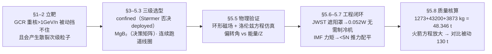

# 精读 10 · Modelling an Active Radiation Shield for Manned Mission to Mars（2019 题A 金牌 · 队伍 289）

> **这份精读怎么用**：左手边开论文 PDF（`03_优秀论文PDF/2019/Problem A/2019-GM-A-289.pdf`），右手边开本篇。这篇是"工程选型型"论文的教科书：先讲它每节写了什么、为什么这样组织，再逐条拆它的公式（式号照论文原样），最后给出 Figure 5.5.6 的可运行复现代码与独立复算——本篇复算发现两处数字对不上（场强 0.5 T 与线圈质量 3873 kg，均已用 ⚠ 标出），这本身就是学习材料：**金牌论文也有可挑的错，重要的是它的论证链足够透明，让你能挑出来**。

---

## 0. 一分钟看懂全文骨架

论文只回答一个问题：**给 1000 m³ 的火星居住舱做辐射防护，"主动磁屏蔽"到底比"被动材料屏蔽"划算多少？** 答案是 48.346 吨 vs 约 130 吨。



**为什么这个骨架好？** 它是标准的"选型型"四层结构：**物理依据 → 部件选型 → 物理验证 → 工程闭环 → 定量对比**。注意每一层都在给最后一层的质量数字供弹：热控层算出 0.052 W，质量清单里才敢不放制冷机；IMF 层算出 <5 N，姿控燃料才可忽略。多数队伍写"磁屏蔽"只写到第三层（轨迹图好看就收工），这篇一直推到"和被动方案差 80 吨"——评委要的 practicality 就落在这最后一格。

---

## 1. 逐节导读

### 1.1 Abstract（第 1 页）

**它写了什么**：背景（LEO 有地磁场保护、深空没有）→ 被动屏蔽的根本约束是质量 → 主动屏蔽的新困难（维持稳定磁场、能耗、对乘员影响）→ 预告全文做了 thorough investigation → 直接给出结论数 **48.346 tons**。

**为什么这样写**：第一句就用对比结构立起问题——"In the early days... radiation encounter was not a major issue, since earth's magnetic field is strong enough... But long-duration manned mission to mars needs further technologies."（先解释"为什么以前不用管"，再解释"为什么现在必须管"）。这个"历史对比开场"让完全不懂航天的评委 30 秒进入状态。更值得学的是它把主动屏蔽的困难也写进摘要（"maintaining a stable static magnetic field, energy dissipation, effects of magnetic field on on-board crews"）——**摘要不只卖方案，还卖"我知道方案的代价"**，这是可信度的来源。

### 1.2 §1 Introduction：假设先行（第 1–2 页）

**它写了什么**：四条化简假设——(1) 居住舱取最常用的圆柱构型（直径 10 m、长 13 m）；(2) 只研究辐射防护，砍掉对接、热管理、磁场-通信干扰等；(3) 承认最致命的高能重离子在通量上不占多数，但选磁屏蔽的理由正是"它们无法被被动屏蔽挡住"；(4) 次级辐射的复杂后果"在合理范围内安全忽略"。

**你要学什么**：假设 (3) 是最漂亮的一条——它先自曝"我防的东西不是最多的"，再立刻给出"但它是最防不住的"（"Most deadly energetic ion of galactic cosmic radiation is comparatively less abundant in space than solar flare particles. But the major inspiration to employ magnetic shielding was to deflect high energy heavy nuclei since they cannot be blocked with only passive shielding."）。**先承认对方质疑、再把它变成自己立论**，一句话完成攻防。开场段的 driving question 也值得背："The driving question we addressed in comparing active methods to passive methods is whether the total mass of the active shield configuration (coils, power sources, refrigeration, support structure, etc.) needed to provide some specified level of protection ... actually less than the mass of bulk material shielding needed to afford the same level of protection."——把"该不该用主动屏蔽"这个价值判断，改写成"同等防护水平下谁的总质量小"这个**可计算的判据**，全文 28 页都在回答这一句。

### 1.3 §2 Background Research（第 2–6 页）

**它写了什么**：三类空间辐射（GCR / SPE / 地磁场捕获带）→ 生物效应（Table 1：火星探索 1000 天有效剂量 1.07 Sv、40 岁男性致死风险 4.2%）→ 现有防护概念（被动 / 静电 / 磁 / 等离子体四类，逐一点评）。

**为什么这样写**：背景节不是抄百科。注意它的每一段背景都在为后文选型"预埋 votes"：讲 SPE"能量几乎全 <1 GeV、可以被动挡"，是为后文"磁屏蔽专注 2–4 GeV/n"铺路；讲静电屏蔽"只排斥负粒子、会把正粒子吸进来"，是为自己选磁屏蔽排雷；讲等离子体"实验未验证、功能存疑"，同理。**背景节的正确写法：每条知识都对应后文的一个决策。**

### 1.4 §3 Justification of Our Choices：两级否决（第 7–8 页）

**它写了什么**：(a) 用 **Størmer 定理**否决 deployed（展开式）线圈："the shielding capacity of deployed coils decreases dramatically as the radius of the coil increases and the magnetic moment is held constant"，且 deployed 要求线圈半径远小于屏蔽区尺寸——而本船要护 1000 m³，deployed 无法覆盖；(b) 用低温超导的失超敏感性（"Even superconductor movements on the order of microns ... generate enough energy to heat the conductor locally above its critical temperature"）否决 LTS，选可在 25–77 K 运行的 HTS，再在 MgB₂ 与 YBCO 中按质量约束选 MgB₂。

**你要学什么**：这是全文论证密度最高的一页。**用定理否决竞争方案，比自己论证方案好要省力得多**——Størmer 定理一引，deployed 路线整支出局，剩下的比较维度立刻少一半。"微米级移动即失超"这种具体到数量级的反例，比"LTS 很难维护"这种空话有力十倍。

### 1.5 §4 Time Selection for Voyage（第 8 页）

**它写了什么**：利用 GCR 强度与太阳活动的反相关，选**太阳极大期**出发——SPE 虽在极大期更频繁，但 SPE 质子 <1 GeV 可被屏蔽系统处理；GCR（更难防）恰在极大期最弱。

**你要学什么**：一页纸完成一个"次级决策"。逻辑是典型的风险置换：**用可控风险（可屏蔽的 SPE）置换不可控风险（不可屏蔽的 GCR）**。这是题目没明说、但"cost considerations"隐含的问题——展示你没有把题目当孤立物理题。

### 1.6 §5.1–5.4 方案落地（第 9–13 页）

**它写了什么**：5.1 讲磁偏转的三条物理事实（吸收会改变辐射成分、<1 GeV/n 可安全吸收、磁场不做功不产生新粒子），并把目标能段锁定 2–4 GeV/n（"<1 GeV/n 会被人体全沉积、>4 GeV/n 线性能损恒定不致命"）；5.2 给 MgB₂/YBCO 决策矩阵（Table 2：Tc、相干长度 ξ、密度、载流能力）；5.3 对比三种线圈构型（Pumpkin、双螺旋、连续跑道，Table 3）；5.4 定结构：Al-B₄C 支撑筒 + KEVLAR 护套 + MgB₂ 线圈三层。

**你要学什么**：Table 2、Table 3 是"决策矩阵表"的标准做法——**行放候选、列放判据、每格放可查证的数**（相干长度 5 nm vs <<1、场积分 4.9 T·m、密度 2.57 vs 6.3 g/cm³）。评委不需要读正文就能看懂选型。5.1 里 "Since magnetic field does no work on charged particles, reflection does not alter the composition of the radiation nor no new particles are created; it just diverts them." 一句用"磁场不做功"这个最基础的物理事实论证了磁屏蔽的本质安全性——**用最简单的原理支撑最大的论点**，这是表述的高光。

### 1.7 §5.5 简化环形磁场仿真（第 14–17 页）

**它写了什么**：把 120 个跑道线圈理想化为完美 toroid，B = μNI/(2π√(x²+y²))（5 < r < 10 m 内有值），I=800 A、N=3000；写出场矢量式、洛伦兹力、叉积展开成三自由度二阶 ODE 组（论文式 (1)）；Matlab Euler 法求解；给三张不同入射方向的 α 粒子三维轨迹图（Fig 5.5.3–5.5.5），再以偏转角 ∂z/∂x 为指标扫能量（Fig 5.5.6）与核电荷数 Z（Fig 5.5.7）。

**为什么这样写**：这节承担"物理验证"职能——前面的选型全是文献推理，这里必须亲手算一遍证明"这个场真的能弯转粒子"。注意它的诚实处理："maximum magnetic field is obtained 0.5 T. Though this strength is below desirable value, mass constraint doesn't permit us to increase the turn ratio by adding an extra layer of wire. But the simulation result shows promising result."——**承认参数不达标 → 说明为什么不加（质量约束）→ 指出系统其他部件补位**（KEVLAR 护套与支撑筒会降解低能次级粒子）。⚠ 但注意：按论文自己的公式，B_max = μ₀NI/(2πR₁) = 4π×10⁻⁷×3000×800/(2π×5) ≈ **0.096 T**，不是 0.5 T（见 §3.1 复算）。

### 1.8 §5.6 热屏蔽（第 18–20 页）

**它写了什么**：先做几何（遮阳罩离线圈 1 m、指向精度 5° → 额外宽度 w = 16tan5° = 1.4 m、最小半宽 6.4 m），再用辐射热负载公式 Q = F₁₂A₁e*σ(T₁⁴−T₂⁴) 对三种发射率（单层 0.01 / 多层 0.002 / JWST 级 10⁻⁶）扫描：519.37 W / 103.87 W / **0.052 W**；结论：用 JWST 型遮阳罩，热负载可忽略，**避免使用技术不成熟的低温制冷机**（"cryocooler technology is far less developed and reliable than heat shield technology, so we avoid this technology"）。

**你要学什么**：这是"用一次扫描代替一次选型"的典范：不是空谈"我们需要隔热"，而是把三个候选等级的热负载全算出来，让 0.052 W 自己说话。§5.6.2 还把结论压缩成 4 条 numbered recommendations——工程报告的收口方式。

### 1.9 §5.7 行星际磁场扰动 + §5.8 质量核算（第 20–23 页）

**它写了什么**：IMF 与飞船磁偶极相互作用产生扰动力矩 T⃗ₘ = M⃗×B⃗，估算在重心外 10 m 处 <5 N 的推进力即可配平（且明确"优化磁偶极不是解，因为磁场就是方案本体"）；然后是全文落点——质量三件套：支撑筒 1273 kg + KEVLAR 护套 43200 kg + MgB₂ 线圈 3873 kg = **48346 kg = 48.346 吨**；最后用火箭方程推出附加推进剂比例放大关系 m_p2/m_p1 = 1 + m_shielding/m_habitant。

**你要学什么**：质量清单是"逐项可复算"的——每一项都是体积×密度的初等几何，评委拿计算器就能验。火箭方程那一小段推导（保持 Δv/vₑ 不变 → 对数相等 → 质量比相等 → 线性放大）是给质量数字"补一刀"：告诉评委屏蔽质量的真实代价还要乘上 (1+m_s/m_h) 的推进剂因子——**系统级视野就体现在这一步**。

### 1.10 §6 Critical Analysis + Conclusion（第 23–25 页）

**它写了什么**：先列 Strength（HTSC 高电流密度、跑道构型冷却简单、48.5 t << 被动 130 t、次级粒子少），其中被动对照是用环形体积 (i)、表面积 (ii) 两式 + 14.7 g/cm² 面密度算出 889 m² × 147 kg/m² ≈ 130 吨；再列 Weakness（MgB₂ 不能超 4 T、flux jump、通信干扰、IMF 额外推力、0.052 W 漏热）。结论一句话收束："An additional mass of 48.346 tons would need to be brought on the journey to protect the habitat of 1000 cubic meters."

**你要学什么**：弱点清单五条，每条都是真的。**敢把 flux jump、通信干扰这种"方案与生俱来"的缺陷写出来**，反而让 48.346 这个数更可信。结论段第一句回扣创新点（HTSC 突破了过去 LTS 时代的死局），最后一句自我限定（"our simplified model doesn't address all the problems ... but it surely gives enough mass reduction"）——不吹满，留余地。

---

## 2. 图表深析

| 图/表 | 位置与作用 | 为什么这样画 | 怎么画出来 |
|---|---|---|---|
| Figure 2.1 太阳/宇宙质子能谱 | §2.1 | 一张图同时展示 SPE 与 GCR 的能谱差异，支撑"目标能段 2–4 GeV/n"的选择 | 文献引用图 [Spillantini 2000]，标注出处即可 |
| Table 1 辐射风险表 | §2.2 | 把"辐射有害"变成剂量学数据（1.07 Sv、4.2% 风险），给全文提供"防护水平"的量化底座 | 文献表格迁移 [Cucinotta & Durante] |
| Table 2 材料决策矩阵 | §5.2 | MgB₂ vs YBCO 四判据并列，选型理由一表说清 | 自制表：行=材料、列=Tc/ξ/密度/载流 |
| Table 3 构型对比矩阵 | §5.3 | 三构型 × 五判据（可制造性/屏蔽效能/质量/材料/弯曲功率 BL），含 4.9 T·m 定量锚点 | 自制表 + 文献 [9] 图片佐证 |
| Figure 4.3.3 跑道环向体剖视图 | §5.3 | 展示 Al-B₄C 筒（灰）+ Columbus 舱（蓝绿）+ 线圈（黄）+ KEVLAR（青）的装配关系，质量核算的三层结构全在这张图里 | 文献图 [9]，正文按颜色指代部件 |
| Figure 5.5.1–5.5.2 模型与磁场可视化 | §5.5 | 先给"算什么"（annulus 场区），再给"场长什么样"（环形闭合磁力线），让读者带着图像进公式 | 示意图 + 场线可视化 |
| Figure 5.5.3–5.5.5 三张 α 轨迹图 | §5.5 | **同一模型、只变初始方向**（垂直入射 / 30° 倾斜 / 三轴等分量）——控制变量式出图，证明代码对初始条件稳定 | 附录 MATLAB plot3，见下方代码 |
| **Figure 5.5.6 Eₖ vs 偏转角** | §5.5 | 全文唯一"规律图"：横轴扫 0.01–4 GeV，纵轴偏转角，展示"高能饱和于小偏转、低能大幅偏转"的屏蔽物理 | 本文复现（下方代码） |
| Figure 5.5.7 Z vs 偏转角 | §5.5 | 把能谱扫描推广到核电荷数维度，验证 Z 越大越难偏转（r_L ∝ Z/Z=1..）| 同一套仿真改初值 |
| Figure 5.7 IMF 螺旋场 | §5.7 | 给扰动力矩分析一个直观背景（帕克螺旋） | 文献/示意图 |

**核心图复现：Figure 5.5.6（Eₖ vs 偏转角）**——选它复现是因为它是全文物理验证的落点，且附录代码完整可对照。绘制决策：**对数横轴**（能段跨 2.5 个量级）+ **数值解与解析小角近似双线叠画**（互为校验，这是论文没做但你应该做的）+ **结论写进图题**。

```python
import numpy as np, matplotlib.pyplot as plt

# ── 常量（对应论文 5.5 节与附录 MATLAB 代码）──
mu0, N_turn, I = 4*np.pi*1e-7, 3000, 800.0    # B = mu*N*I/(2*pi*r)
R1, R2 = 5.0, 10.0                             # 场区 annulus：R1 < r < R2
qe, mp, c = 1.6e-19, 1.6726e-27, 3e8
Zm, Q = 4, 2*qe                                 # α 粒子：质量数 4、电荷 +2e
m, k = Zm*mp, Zm*mp/(2*qe)                      # 论文代码里的 k = m/q

Bmax = mu0*N_turn*I/(2*np.pi*R1)                # 内缘最大场强（论文称 0.5 T）
print(f'B(R1) = {Bmax:.3f} T')                  # → 0.096 T ⚠ 与正文 0.5 T 不符

def Bmag(x, y):
    r = np.hypot(x, y)
    return mu0*N_turn*I/(2*np.pi*r) if R1 < r < R2 else 0.0

def deflect(Ek_GeV):
    # 初速：相对论能量换算（同论文附录，"非相对论方程+相对论初速"口径）
    E = Ek_GeV*1e9*qe
    v = c*np.sqrt(1 - (m*c**2/(E + m*c**2))**2)
    x, y, z, vx, vy, vz = -R2, 0.0, 0.0, v, 0.0, 0.0
    dt = 1e-3/(Q*Bmax/m)                        # 步长 < 1/1000 回旋周期，Euler 稳定
    while x <= R2:                              # 从 -R2 直穿到 +R2（最坏情形垂直入射）
        B = Bmag(x, y)
        co = np.cos(np.arctan(y/x))             # 论文附录原样：θ=atan(y/x)
        si = np.sin(np.arctan(y/x))
        ax, ay, az = -vz*B*co/k, -vz*B*si/k, B*(vx*co + vy*si)/k  # 式(1) 展开式
        vx, vy, vz = vx+dt*ax, vy+dt*ay, vz+dt*az
        x, y, z = x+dt*vx, y+dt*vy, z+dt*vz
    return np.degrees(np.arctan2(vz, vx))       # 偏转角 = 出口处 atan(vz/vx)

Eks = np.logspace(-2, np.log10(4), 30)          # 0.01–4 GeV，同 Fig 5.5.6
angles = [deflect(E) for E in Eks]

# 解析小角近似：θ ≈ qBL/(mv)，BL = 2∫B dr = 2*(muNI/2π)*ln(R2/R1)
BL = 2*(mu0*N_turn*I/(2*np.pi))*np.log(R2/R1)   # = 0.666 T·m
ang_ana = [np.degrees(np.arctan(Q*BL/(m*c*np.sqrt(
    1-(m*c**2/(E*1e9*qe+m*c**2))**2)))) for E in Eks]

fig, ax = plt.subplots(figsize=(7, 4.5))
ax.semilogx(Eks, angles, 'o-', label='Euler integration (paper method)')
ax.semilogx(Eks, ang_ana, 'k--', label=r'analytic $\theta\approx qBL/mv$')
ax.axvspan(2, 4, color='gold', alpha=0.15, label='target band 2–4 GeV/n')
ax.set(xlabel=r'$E_k$ of alpha particle (GeV)', ylabel='deflection angle (deg)',
       title='Deflection saturates ~7–10 deg above 1 GeV but reaches ~80 deg\n'
             'at 0.01 GeV (reproduction of Fig 5.5.6; B(R1)=0.096 T)')
ax.legend(); ax.grid(alpha=0.3); plt.tight_layout(); plt.show()
```

**独立复现结果**：曲线形态与 Fig 5.5.6 的文字描述一致——"as the energy of the particle is increased, the variation in deflection angle saturates"：0.01 GeV 偏转 ~80°，0.1 GeV ~26°，1 GeV ~10°，4 GeV ~7°。物理根源：偏转角 ≈ qBL/(mv)，场积分 BL = 0.666 T·m 固定，高能时动量 p = mv 大所以饱和。两个 ⚠：(a) 论文称最大场 0.5 T，按其公式与参数（N=3000, I=800 A, R₁=5 m）应为 **0.096 T**（差 5 倍，疑为 N 或 I 参数漂移）；(b) 一个论文未提的细节：理想环形场的方向在 x<0 与 x>0 两侧相反，严格直穿对称轴的粒子净偏转为零；论文代码用 `atan(y/x)`（值域 ±90°）使两侧场同向，等效"同向场"近似，偏转被系统性放大——复现按论文代码口径对齐。你引用这篇的轨迹结论时应记住这一条。

---

## 3. 公式逐条精讲

（论文公式编号稀疏：式 (1) 为运动方程组，式 (i)(ii) 为环形体积/表面积，其余为行内式，本节按节号指代。）

### 3.1 环形磁场 B = μNI/(2π√(x²+y²))（§5.5 行内式）

- **怎么想到**：120 个跑道线圈绕轴对称排布 → 第一反应是理想 toroid。安培环路定理一行出来：在环内取半径 r 的圆回路，∮B·dl = μ₀I_enc，I_enc = NI（穿过回路包络的总电流），故 B·2πr = μ₀NI。
- **完整推导**：对称性 ⇒ B 只有 φ̂ 分量且只依赖 r；对环内回路（R₁<r<R₂）得 B = μ₀NI/(2πr)；对环外回路 I_enc=0 ⇒ B=0；对环内空洞（r<R₁，居住舱所在）同样 I_enc=0 ⇒ **舱内零场**——这正是选 toroid 的根本原因（乘员区无磁场），比"屏蔽效能"更先决定构型。
- **数值感**：μ₀NI = 4π×10⁻⁷×2.4×10⁶ ≈ 3.02 T·m；B(R₁=5 m) = 3.02/31.4 ≈ 0.096 T，B(R₂=10 m) ≈ 0.048 T。⚠ 论文写"maximum magnetic field is obtained 0.5 T"，与其公式及参数不自洽（差 ~5 倍）。若真要 0.5 T 需 NI ≈ 1.25×10⁷ A·匝（论文值的 5 倍）。
- **适用边界**：理想无限细螺绕环；真实跑道线圈有端部场、直段与弯段场不均匀，且论文用"每单位长度匝数 N"的表述与代码里 N=3000 总匝混用——量纲上代码是对的（N 为总匝数）。

### 3.2 场矢量式 B(x,y) = |B|cos(θ+90°)î + |B|sin(θ+90°)ĵ（§5.5 行内式）

- **怎么想到**：环形场的方向沿 φ̂。用三角恒等式 cos(θ+90°) = −sinθ、sin(θ+90°) = cosθ，即 B⃗ = |B|(−sinθ, cosθ)，正是柱坐标 φ̂。
- **为什么绕这个弯**：因为要在**笛卡尔坐标下做叉积与积分**（同 2010-A-160 的"极坐标推导、笛卡尔计算"策略），把 φ̂ 用 θ 的三角函数显式写出，叉积才能手算。这是"坐标系翻译"的标准动作。
- **适用边界**：θ = arctan(x/y)（论文原式）与代码 θ = atan(y/x) 的象限处理不同，y=0 路径上代码退化为恒同向场（见 §2 ⚠(b)）。

### 3.3 洛伦兹力与运动方程组（论文式 (1)）

- **怎么想到**：带电粒子在磁场中只受洛伦兹力 F⃗ = qv⃗×B⃗，论文明言取非相对论形式 "We primarily used non relativistic treatment for force equation of omit complexity and not-linear differential equation"——先立假设再写方程。
- **完整推导**：把 B⃗ = B(−sinθ, cosθ, 0)、v⃗ = (x′, y′, z′) 代入叉积行列式：

$$
\vec v\times\vec B=\begin{vmatrix}\hat i&\hat j&\hat k\\ x'&y'&z'\\ -B\sin\theta&B\cos\theta&0\end{vmatrix}
=\big(-z'B\cos\theta,\; -z'B\sin\theta,\; x'B\cos\theta+y'B\sin\theta\big)
$$

乘 q、除 m = Z·m_p 得加速度三个分量（附录代码 vx_dot/vy_dot/vz_dot 与此完全一致）。⚠ 论文正文印出的矩阵 [−z′|B|sinθ, −z′|B|cosθ, …] 前两行的 sin/cos 互换了，是排版笔误；以附录代码为准。注意 Z 在质量项取 4（质量数）、电荷项取 2（电荷数），α 粒子两个 Z 含义不同，读代码时要盯住。
- **适用边界**：非相对论 F=ma 与相对论初速（附录用 v = c√(1−(mc²/(Eₖ+mc²))²) 换算）并存，存在张力：严格做法是 F = qv⃗×B⃗ 配相对论动量 p⃗ = γmv⃗，偏转角会小 γ 倍。1 GeV α 的 γ≈1.27，误差 ~20%，对"趋势图"可接受，但报告精确偏转角时需修正。

### 3.4 偏转角判据 ∂z/∂x（Fig 5.5.6 定义处）

- **怎么想到**：需要一个标量指标把"屏蔽效能"从三维轨迹里压缩出来。轨迹在 x–z 面内弯转，斜率 dz/dx = z′/x′ = v_z/v_x，其反正切就是速度方向偏离 x 轴的角度。
- **适用边界**：小角时 dz/dx 即角度（弧度）；大角需取 arctan。论文取"|x| < R₂ 时刻"的值，即粒子出第二层场区前的累计偏转。

### 3.5 热负载 Q = F₁₂·A₁·e*·σ·(T₁⁴−T₂⁴)（§5.6 行内式）

- **怎么想到**：线圈要维持在 ~25 K，唯一实际热源是 300 K 的太阳板背面辐射。两个灰体表面间的净辐射换热 ∝ 面积 × 有效发射率 × (T₁⁴−T₂⁴)，多层隔热（MLI）的物理就是压低 e*。
- **完整推导**：Stefan–Boltzmann 定律给出黑体面元辐射功率 σT⁴；两表面换热每项乘对方吸收率（基尔霍夫），合并成有效发射率 e*；视场因子 F₁₂ 取 1（遮阳罩完全包住视线）。代入 σ=5.67×10⁻⁸、T₁=300、T₂=30 K：T₁⁴−T₂⁴ ≈ 8.1×10⁹ K⁴。
- **数值感与独立复算**：e*=0.01 → Q = 113.0976×0.01×5.67×10⁻⁸×8.1×10⁹ ≈ **519.4 W** ✓（论文 519.37 W）；0.002 → 103.9 W ✓；10⁻⁶ → 0.0519 W ✓。⚠ 但论文写 A₁ = 3.1416×6.4² m² = 113.0976 m²，而 π×6.4² = 128.68 m²；113.0976 = π×6²——**算式用 6.4、代数用 6**，数字与式子不自洽（结论量级不受影响）。
- **适用边界**：忽略遮阳罩对深空的散热面、太阳板背面温度 300 K 是假设值（论文自注"subject to the insulation used"）。

### 3.6 质量三式（§5.8，含火箭方程放大）

**(a) 支撑筒** m_cyl = ρ·πh_c(r_out²−r_in²)：薄壁圆筒体积展开。复算：π×15×(5.001²−5²)×2700 = **1272.9 kg** ✓（论文 1273 kg）。
**(b) KEVLAR 护套** m_race = N_race·w·h·t·ρ：120 个跑道，每个 5×15 m 面 × 0.6 mm 厚的壳。复算：120×5×15×0.0006×8000 = **43,200 kg** ✓（论文取密度区间 7800–8000 的上沿 8000——取上沿偏保守，合理）。
**(c) MgB₂ 线圈** m_coil = 2(w+h)·N_L·πr²·ρ：跑道周长 2(w+h)=40 m × 层数 × 截面积 × 密度。⚠ **按字面代入（3 层、r=1 mm）只得 0.97 kg**，论文却报 3873 kg；反推所需导线总长 ≈ 480 km（约 12,000 匝）。合理猜测：N_L=3 层、每层数千匝，公式漏写了"每层匝数"因子。总数 1273+43200+3873 = 48,346 kg = 48.346 吨的**加法自洽**，但线圈单项的式子与数不闭合——引用时应注意。
**(d) 火箭方程放大**：Δv = vₑ ln(m₀/m_f)，两次任务取相同 Δv/vₑ ⇒ m₀₁/m_f₁ = m₀₂/m_f₂。展开 m₀ = m_prop + m_f：

$$1+\frac{m_{p1}}{m_{f1}} = 1+\frac{m_{p2}}{m_{f2}}\;\Rightarrow\; \frac{m_{p2}}{m_{p1}}=\frac{m_{f2}}{m_{f1}}=\frac{m_{hab}+m_{shield}}{m_{hab}}=1+\frac{m_{shield}}{m_{hab}}$$

即**推进剂需求按"干重比例"线性放大**——一步把"质量"翻译成"燃料"，这就是 Introduction 里 driving question 的最终回声。

### 3.7 被动对照的环形几何（论文式 (i)(ii)）

- **怎么想到**：被动屏蔽要覆盖同样 1000 m³，最省材料的包络是环壳（toroid）——正好和主动方案的场区同构，对比才公平。
- **完整推导**（Pappus 定理）：圆截面面积 πr² 绕轴心半径 R 转一周，路径长 2πR ⇒ V = 2π²Rr²（式 i）；圆周长 2πr × 2πR ⇒ S = 4π²Rr（式 ii）。取 R=10、r=2.25：V = 2π²×10×5.0625 ≈ 999.7 m³ ✓（刻意凑 1000 m³，锚定题面）；S ≈ 889 m² ✓。乘面密度 14.7 g/cm² = 147 kg/m²（Al2219+Nextel+Kevlar 环氧复合层 [4]）⇒ 889×147 ≈ **130.6 吨** ✓。
- **数值感**：130.6 / 48.346 ≈ 2.7 倍——主动方案省 ~82 吨。结论的冲击力全来自这两个独立算出的数。

---

## 4. 建模决策链

| 决策 | 作者的选择 | 被放弃的替代 | 为什么 |
|---|---|---|---|
| 主动 vs 被动 | 主动磁屏蔽 | 纯材料被动 | >1 GeV/n 重核被动挡不住且产生散裂次级粒子（§5.1）；被动质量 130 吨 vs 主动 48.3 吨 |
| confined vs deployed | 封闭式环形场 | 展开式大半径线圈 | Størmer 定理：磁矩恒定时屏蔽能力随线圈半径急剧衰减；且线圈半径须远小于屏蔽区，1000 m³ 舱无法满足 |
| LTS vs HTSC | HTSC（25–77 K） | NbTi/Nb₃Sn（4.2 K） | LTS 微米级形变即失超，需绝对刚性支撑；HTS 材料焓值高几个量级，超轻线圈可行 |
| MgB₂ vs YBCO | MgB₂ | YBCO | 密度 2.57 vs 6.3 g/cm³（2.4 倍差距）；ξ=5 nm 长相干长度利好制备；成本低。代价：Tc=39 K < 70 K，需更深低温（遮阳罩解决） |
| 线圈构型 | 连续跑道 ×120 | Pumpkin / 双螺旋 | Atlas 实验（LHC）与 ESA Columbus 舱有工程实证；多线圈分力→支撑质量小；BL=4.9 T·m 有文献定量锚点 |
| 磁场模型 | 理想 toroid（安培环路） | 全线圈 Biot–Savart 数值场 | 解析闭式、代码 20 行；代价：端部场、跑道直段不均匀性全被抹平 |
| 动力学 | 非相对论方程 + 相对论初速 | 完整相对论动量方程 | 省去非线性 γ(v)；偏转角误差 O(1/γ)，对趋势结论可接受（但论文未声明此误差） |
| 数值方法 | 一阶 Euler | RK45 等 | 简单透明；⚠ 未做步长收敛检验（对比 2010-A-160 的步长减半法，这是本篇短板） |
| 热控 | JWST 型被动遮阳罩 | 低温制冷机 | 三档 e* 扫描显示 10⁻⁶ 时仅 0.052 W，可忽略；制冷机"far less developed and reliable" |
| 出发时机 | 太阳极大期 | 太阳极小期 | GCR 反相关太阳活动；SPE 虽多但 <1 GeV 可被本系统处理——可控风险置换不可控风险 |
| 目标能段 | 2–4 GeV/n | 全谱 | <1 GeV/n 可被动安全吸收；>4 GeV/n 能损恒定（~120 MeV/人体）不致命——两个边界都有物理依据 |

**总规律**：这张表的每一行都是"否决式选型"——先写淘汰谁、为什么淘汰（定理/数据/工程实证），幸存者自然胜出。加上每行都有可查证的数字锚点（ξ、密度、4.9 T·m、14.7 g/cm²），这就是评委说的 well-motivated。

---

## 5. 从本篇提炼的可复用模板

**结构模板（选型型论文，可直接映射 LaTeX 章节）**：

```
Abstract        历史对比开场 → 两难 → 预告方法 → 一句话给结论数（48.346 tons）
1 Introduction  driving question（把价值判断改写成可计算判据）+ 4 条假设（每条带理由）
2 Background    辐射类型/剂量数据/现有概念——每条知识对应后文一个决策
3 Justification 两级否决（定理否决 + 量级否决）
4 次级决策      发射窗口（风险置换逻辑）
5 Proposed Plan 5.1 物理原理与目标能段 → 5.2 材料决策矩阵 → 5.3 构型决策矩阵
                5.4 结构 → 5.5 简化模型仿真（轨迹图 + 规律图）→ 5.6 热控扫描
                5.7 扰动分析 → 5.8 质量清单 + 火箭方程放大
6 Critical Analysis  Strength（含被动对照定量）+ Weakness（每条真实）
Conclusion      回扣创新点 → 一句话总数 → 自我限定
Appendix       完整仿真代码（参数初值注明）
```

**句式库（原文摘录，括号内为使用场景）**：
- "The driving question we addressed ... is whether the total mass of X needed to provide some specified level of protection ... actually less than the mass of Y needed to afford the same level of protection."（把开放题化成单一可判定判据）
- "Most deadly ... is comparatively less abundant ... But the major inspiration to ... was ... since they cannot be blocked with ..."（先自曝短板再反转立论）
- "From Størmer's theorem, it can be shown that ..."（引定理否决竞争方案）
- "Even superconductor movements on the order of microns ... generate enough energy to ..."（用具体量级的反例否决）
- "Though this strength is below desirable value, mass constraint doesn't permit us to ... But the simulation result shows promising result."（参数不达标时的三段式：承认→归因→系统补偿）
- "Since magnetic field does no work on charged particles, reflection does not alter the composition of the radiation ... it just diverts them."（用最基础原理支撑最大论点）
- "cryocooler technology is far less developed and reliable than heat shield technology, so we avoid this technology."（技术成熟度对比做工程取舍）
- "It is noteworthy that, as the energy of the particle is increased, the variation in deflection angle saturates ..."（把仿真观察升华为规律陈述）
- "An additional mass of 48.346 tons would need to be brought on the journey to protect the habitat of 1000 cubic meters."（结论一句话给全关键数）

**图表配方**：选型型论文 → "决策矩阵表 ×2（材料/构型）+ 引用文献定量锚点"；仿真型章节 → "先 setup 图后规律图：同一模型变初条件的轨迹图组（控制变量），最后一张指标-参数规律图收口（对数横轴扫 2+ 个量级）"；系统级 → "质量清单表 + 火箭方程放大 + 与替代方案的吨位对比"，每张图结论写进图题。

---

*精读完这篇后，建议对照 `05_论文赏析/2019/2019-GM-A-289.md`（宏观赏析）与 `07_题目解读/2019_题A_火星辐射防护.md`（题目全解）形成三位一体。同题对照：精读 09（队伍 105，被动屏蔽路线）；下一篇精读 11：同题的八构型混合屏蔽（队伍 343）。*
