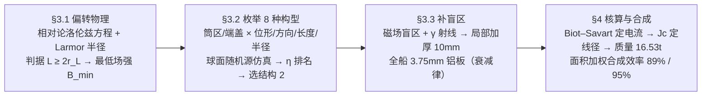

# 精读 11 · Analysis of Deep Space Radiation Protection（2019 题A 金牌 · 队伍 343）

> **这份精读怎么用**：左手边开论文 PDF（`03_优秀论文PDF/2019/Problem A/2019-GM-A-343.pdf`），右手边开本篇。这篇是三篇同题论文中唯一的**"主动+被动混合、八构型枚举比较"**路线，方法论最完整。本篇按「写了什么 → 为什么 → 学什么」逐节导读，公式逐条展开（该文公式基本无编号，按节号指代），并给出核心图 Figure 9（η–B 曲线族）的可运行复现代码。独立复算确认了 γ 板厚 3.75 mm、B=10 T 选择的来历与总质量 16.53 t；同时发现几处式与数不闭合（M1/M2 的匝数、摘要与结论的效率数字），均已用 ⚠ 标出——这篇论文值得学的恰恰是"如何把一个设计题变成可枚举、可排名的搜索问题"，而它的笔误则提醒你交卷前要做数字一致性检查。

---

## 0. 一分钟看懂全文骨架

论文只回答一个问题：**1000 m³ 圆柱居住舱（半径 5.42 m、高 10.84 m）的辐射防护，磁场怎么布、材料怎么配，总质量最小？** 答案是"结构 2"混合方案：筒区线形场 + 端盖环形场（B=10 T、L=2 m）+ 全船 3.75 mm 铝板 + 顶部 10 mm 加厚铝板，总重 **16.53 吨**。



**为什么这个骨架好？** 它把"设计题"变成了"搜索题"：§3.1 先给出物理判据（什么样的场能挡住粒子），§3.2 把设计空间离散成 8 个可枚举的组合、用统一指标 η 排名，§3.3 承认最优解仍有盲区并用被动手段打补丁，§4 收口到质量与总效率。**"物理判据 → 枚举搜索 → 承认缺陷 → 打补丁 → 总账"**——这个五步流程可以直接搬到任何工程设计类题目上。与 289 队（精读 10）的"文献选型"路线对比：289 靠 Størmer 定理与工程实证淘汰方案，343 靠仿真排名淘汰方案，前者论证快、后者覆盖全。

---

## 1. 逐节导读

### 1.1 Abstract（第 1 页）

**它写了什么**：船型定义（半径 5.42 m、高 10.84 m、约 1000 m³）→ 混合方案（超导磁 + 被动）→ 总重 16.53 吨、材料 BSCCO-2212（密度 1.8954 g/cm³）→ 八方案仿真选出最优（B=10 T、L=2 m、挡 80%）→ 盲区加铝板 + 3.75 mm 铝板挡 γ → 总效率 94%（≤4 GeV/n 电子）与 98%（γ）。

**为什么这样写**：摘要把**设计参数全部钉死**（尺寸、材料、场强、厚度、板厚），每个数都可回溯到正文某节。⚠ 但注意一处硬伤：摘要写 94%/98%，结论写 89%（≤2 GeV/n）/95%——同一论文两套效率数字。这是"多人分工写作未对表"的典型事故，你要学的是反面教训：**全文关键数字改动后，摘要、正文、结论三处必须同步**。

### 1.2 §1 Introduction + §2 假设（第 2–4 页）

**它写了什么**：辐射环境两分法（高能粒子 ~98% + γ 射线），高能粒子三来源（ERB/SCR/GCR），GCR 剂量 0.6 Sv/a、单粒子能 ~1 GeV/n；然后五条假设：辐射各向同性、绝热材料与制冷装置质量忽略、"几乎所有粒子带正电"、屏蔽区磁场均匀且区外为零、不考虑次级辐射。符号表列 B、L、H、q、γ、θ、m₀、T、T_C/O、r₀、r_p、r_i。

**你要学什么**：
1. **两分法开场**：把"宇宙辐射"先拆成"带电粒子（98%）+ γ 光子（0 磁场作用）"两类，后文"主动挡带电、被动挡 γ"的混合策略就顺理成章——**分类决定架构**。
2. 假设 3"粒子几乎都带正电"和假设 4"场区内均匀、区外为零"是把连续问题变成可仿真问题的两把刀：前者省掉正负电子两套符号讨论，后者把 Biot–Savart 的连续场简化成"台阶场"。每条假设都写明了**省的是什么**。
3. 符号表（Table 3.3.2 位置，正文实为 §2.2）连 T_C/O（截止动能）这种自造量都列入——**自定义量必须进符号表**，否则评委读不懂后文。

### 1.3 §3 Model 引子：站在 Hoffman 肩上（第 4–5 页）

**它写了什么**：先介绍 Hoffman 双同心圆柱结构（小圆柱=保护区，两筒之间充磁场，端盖区/筒区两区命名），指出其两点不足——没考虑被动防护、部分区域挡不住；然后定尺寸：**H = D = 10.84 m** 使 πr²H = 1000 m³（半径 5.42 m）。

**为什么这样写**："In previously research [4], Hoffman had already studied this problem... However, passive protection was not considered in this structure. Besides, some part of the magnetic field configuration cannot block the cosmic radiation effectively."——**先肯定前人、再指出两点缺口、后文逐一填补**。这是站在文献上的标准姿势：你的创新点（混合防护、盲区补强）在第一段就完成了宣称。几何上取 H=D 也有讲究：正圆柱让"端盖 vs 筒区"两向入射的立体角权重相当，后文 η 的面积加权才有意义。

### 1.4 §3.1.1 偏转原理：相对论 Larmor 判据（第 5–6 页）

**它写了什么**：运动方程 m dv/dt = qv×B（m = m₀γ，明确"高能必须考虑相对论"）→ Larmor 半径 r_L = γm₀v⊥/(qB)、v⊥ = v sinθ → 判据 **L ≥ 2r_L 时几乎完全屏蔽，L < 2r_L 时部分屏蔽** → 由 m₀/q 近似相等论证"Z≥2 元素偏转行为相似"，故选 H、He 两种代表粒子。

**为什么这样写**：这段是全文的物理发动机。注意两个动作：**(a) 把"屏蔽住"翻译成几何条件**——粒子和磁场的作用被压缩成"回旋直径 vs 场厚"一个比较，工程参数（B、L）与物理量（能量、荷质比）立刻挂钩；**(b) 代表粒子降维**——"the deflection effect of shielding magnetic field is similar for elements with atomic number Z ≥ 2 which have the approximately equal ratio m₀/q"——GCR 里有几十种核素，但 r_L 只依赖 m₀/q，而宇宙丰度高的核素 m₀/q ≈ 常数（质子 1、He⁴ 约 2、C¹² 约 2……接近 2 u/e），于是两种粒子代表全体。**先找不变量、再做降维**，这是处理复杂成分谱的标准起手式。

### 1.5 §3.1.2 两种基本结构 + 截止动能（第 7–10 页）

**它写了什么**：线形场（筒区磁场轴向，挡侧面入射）与环形场（磁场角向，把粒子绕船轴甩开）两种基本结构；定义**截止动能 T_C/O**（穿透磁场进入保护区的最小动能）与**临界 Larmor 半径 r_L,0**（2r_L,0 = L 的轨道）；推出最低场强公式（§3.1.2 行内式，见 §3.2 精讲）；最后指出：**两种结构在端盖方向都几乎不设防**（"the high-energy charged particles incident from the two ends of the cover area can enter the protection area without limitation"）——这是引出八构型组合的直接动机。

**你要学什么**：T_C/O 这个量的构造思路——屏蔽效能本来是"对每个能量每种角度的二元判定"，T_C/O 把它压缩成**一个数**（给定方向族的阈值能量），配能谱 Φ(T) 就能积分出总透射率。你在任何"阈值型"问题（逃逸速度、贯穿深度、截止频率）里都可以用同样的"找临界轨道"技巧。另外注意行文：两种结构各配一张轨迹图（Figure 4、6），**先给运动图像再给公式**，读者建立直觉后才读判据。

### 1.6 §3.2 八构型枚举与仿真（第 10–13 页）

**它写了什么**：Table 1 把设计参数离散成四个槽位——筒区位形（环形/线形）、筒区场方向（e_θ / −e_z）、轴向长度（z / z+2l，即场区是否向端盖外延伸）、端盖场半径（r_i / r_i+L）——组合出 8 种结构；仿真设置：半径 6 m 球面源、随机撒 20000 点（H、He 各 10000）、方向与动能（2–4 GeV）随机、**步长 Δt = T/100（T 为回旋周期）**；以削减率 **η = 1 − n_in2/n_in1** 为指标；结果（Figure 9 三幅 η–B 曲线）：低场强 B=2 T 时某些结构 η 为负；η 随 B 在 4 T 后快速上升、**10 T 后饱和**；η 随 L 增长缓慢，取 L=2 m；最终选结构 2（B=10 T、L=2 m，挡 ~81%）。

**为什么这样写**：这是全文方法论的高光。三个可以背走的动作：
1. **设计空间离散化**："we apply the different structures in two different areas (the barrel and the end cover area) respectively and design the eight combined structures"——把连续的设计自由度切成离散槽位，才能"全部算完、统一排名"。比"拍脑袋选一种再优化"高一个层级。
2. **步长与物理周期挂钩**：Δt = T/100——回旋运动是轨道的最快时间尺度，锁住它就不用做单独的收敛性研究（对比 289 队未做任何步长检验）。**数值参数取自物理尺度而非拍脑袋**，一句话堵住评委的追问。
3. **敢于报告负结果**："When B is relatively low (B = 2T), the reduction rate η can be negative in some structures, which proves that the magnetic field may have negative effect on the radiation protection."——弱磁场不但不挡粒子，反而把部分轨迹**弯进**保护区。发现并报告"反效应区"，说明仿真真的是在做物理而不是走过场。

**你要学什么**：还有参数选点的"拐点逻辑"：η–B 曲线在 10 T 饱和 → 取 10 T（再加场只加质量不加防护）；η–L 增长缓慢 → 取小 L=2 m。**在"效能-质量"双目标里找饱和拐点**，是所有设计题选参数的通用姿势。

### 1.7 §3.3 被动防护：盲区与 γ（第 13–15 页）

**它写了什么**：(a) 结构 2 在端盖一侧仍有屏蔽效率近零的盲点（Figure 10）→ 用金属吸收公式 φ(E) = φ′(E′)S(E′)/S(E)·exp(σ_A d) 与射程关系 E = R⁻¹[R(E)+d]，按"挡住 90% 端盖粒子"解出 **d = 10 mm 铝板**（半径 2 m 圆域）；(b) γ 射线磁场挡不住 → 衰减律 I = I₀e^{−μx}，Table 2 对比铝/铁/铜/钽四种金属的 μ 与密度，按"衰减系数够用且密度最轻"选铝，由 e^{−μx} ≤ 0.05 解出 **x ≥ 3.75 mm**（μ=0.8 /mm，γ 频率 ~10²⁰ Hz）。

**为什么这样写**：主动方案的缺陷（盲区、γ）被逐一翻译成被动任务，且**每个被动任务都有明确的量化目标**（90%、95%）再反解厚度——"目标 → 公式 → 厚度"的链条和主动侧"判据 → 场强"完全对称。材料对比表（Table 2）只用了两个判据（μ、ρ）就完成选型，是"多指标对比表"的最小实现。

### 1.8 §4 求解、质量与效率（第 15–21 页）

**它写了什么**：4.1 给线圈实现——端盖区每端 20 个 5.42×2 m 矩形线圈（对置电流反向成环形场），筒区 20 个半径 1 m 绝缘筒、每筒 4 匝（成线形场）；4.2 质量四项：端盖线圈 M1 = 3.961×10³ kg、筒区线圈 M2 = 6.709×10³ kg、γ 铝层 M3 = 5.5065×10³ kg、加厚板 M4 = 339.29 kg，合计 **16.53 t**；4.3 面积加权合成效率 σ₁ = [0.87(S₀−S)+S]/S₀ = 89%（粒子）、σ₂ 同式 = 95.3%（γ）；4.4 可行性四条（地火均温 153 K + 制冷剂到 77 K 满足 BSCCO 温区、对称线圈舱内磁场对消、泡沫填充增稳、SCR 爆发临时加流）。

**为什么这样写**：质量核算的链条是全文最"第一性"的部分——**B=10 T → Biot–Savart 反推所需电流 I → 临界电流密度 J 定导线截面 S=I/J → 周长×截面×密度得单匝质量 → 匝数放大**。每一步都是物理定律或材料参数，没有一个质量是查"同类产品"估的。可行性一节则把评委可能追问的三个 what-if（温度、人体安全、爆发工况）提前作答。

**你要学什么**：⚠ 但这一节也是笔误重灾区（复算详见 §3.5）：M1 的式子写 20×4×m₁ = 7923 kg、数字却是 40×m₁ = 3961.6 kg；M2 的式子写 20×m₂、数字是 80×m₂；M4 的式子写 (L−Δh)=6.25 mm、数字对应 10 mm 全厚。**式与数必须闭合**——这份论文若在数字自洽上无懈可击，就是无可挑剔的范本；它的金牌说明评委容忍个别算术笔误，但你要以更高标准要求自己。

### 1.9 §5 优缺点 + §6 结论（第 22–23 页）

**它写了什么**：优点五条（轻量化、盲区补偿、八构型比较、参数扫描选优）、缺点两条——**"Protection against high energy uncharged particles is not considered"** 与 **"the critical current density of BSCCO is not large enough... the magnetic field B generated by the magnetic shield may not reach 10T"**；结论复述全部设计参数与总效率。

**你要学什么**：第二条缺点是自己方案的**命门自曝**：算出 10 T 需要的电流（~8 MA 量级，见 §3.5 复算）已顶到 BSCCO-2212 临界电流密度的边缘，作者自己写明"可能达不到"。敢把方案的物理上限写进缺点栏，是对结论可信度的最大投资。

---

## 2. 图表深析

| 图/表 | 位置与作用 | 为什么这样画 | 怎么画出来 |
|---|---|---|---|
| Figure 1 GCR 质子能谱 | §1.2 | 给"2–4 GeV 仿真能段"提供数据依据（太阳极小/极大两条谱线） | 文献引用 [4] |
| Figure 2 Hoffman 结构图 | §3 引子 | 一张图定义"保护区/筒区/端盖区"三词汇，后文全靠它 | 文献引用 [3] |
| Figure 3 两种磁场示意 | §3.1.1 | 左环形右线形并列，一图看懂两种基本结构的差别 | 自绘示意图（见 fig 渲染页） |
| Figure 4/6 粒子轨迹图 | §3.1.2 | 分别展示线形/环形场中"场区弯转、区内直线"的轨迹形态 | 场区几何 + 轨迹积分叠加 |
| Figure 5 临界轨道几何 | §3.1.2 | 钉死 r_L,0、r_i、r₀、B、v 的空间关系，2r_L,0=L 判据全靠此图 | 手绘级示意图 |
| Figure 7 各结构弱区 | §3.2.1 | 用红色弱区标注每种构型挡不住的方向——8 个构型的"短板可视化" | 结构剖视 + 弱区着色 |
| Figure 8 八构型 3D 视图 | §3.2.1 | 让读者对 8 个组合有直观 3D 印象，与 Table 1 参数一一对应 | 3D 场线示意 |
| **Figure 9 η–B 曲线族（×3）** | §3.2.2 | **全文决策图**：8 条曲线同图排名，x 轴 B=0–16 T，y 轴 η(−0.2~1)，直接读出"结构 2 最高、10 T 饱和、2 T 有负值" | 本文复现（下方代码） |
| Table 1 八构型参数矩阵 | §3.2.1 | 设计空间的完备枚举表——4 个槽位 × 8 种组合，一行一构型 | 自制表 |
| Table 2 四金属衰减系数 | §3.3.2 | μ 与密度并列，"够用且最轻"的选铝论证 | 文献数据表 [10] |
| Figure 11–15 线圈实现图 | §4.1 | 把抽象场构型翻译成"多少匝、什么尺寸、怎么绕"的工程图 | 3D 建模渲染 |
| Figure 16 总体结构 | §4.1.2 | 全方案装配图收口（⚠ 图中含乱码字符"瀁澔濠濕濭濙濦"，字体嵌入事故） | 3D 建模 + 标注 |

**核心图复现：Figure 9（η–B 曲线族）**——选它是因为它是全文"枚举-排名"方法论的落点。复现取结构 1（Hoffman 基线：筒区环形场）与结构 2（最优：筒区线形场 −e_z + 端盖环形场）两条曲线，各向同性球面源 + 相对论 Boris 推进器扫描 B。绘制决策：**同图叠两条曲线 + 竖直虚线标出 B_min（9.3 T）与选点（10 T）+ 结论写进图题**。

```python
import numpy as np, matplotlib.pyplot as plt

# ── 几何与物理常量（对应 §2.2 符号表与 §3 初始设计）──
ri, L, H = 5.42, 2.0, 10.84          # 保护区半径 r_i / 场厚 L / 高 H=D（πr²H≈1000 m³）
r0, Rsrc = ri + L, 14.0              # 屏蔽外缘 r_0；源球面半径（论文取 6 m，小于 r_0，
qe, c, mp = 1.602e-19, 3e8, 1.673e-27 # 复现改到外部的 14 m，见正文 ⚠）
Np = 3000                            # 粒子数（论文 20000：H/He 各半）

def Bfield(x, y, z, B0, struct):
    """台阶场（假设4）：筒区 annulus + 端盖环形区。返回 B 矢量。"""
    rho, Bv = np.hypot(x, y), np.zeros((3,)+x.shape)
    barrel = (rho > ri) & (rho < r0) & (np.abs(z) < H/2)          # 筒区
    cap    = (rho > ri) & (rho < r0) & (np.abs(z) >= H/2) & (np.abs(z) < H/2 + L)
    if struct == 1:                    # Hoffman：筒区环形场 B = B0·e_theta
        Bv[0][barrel] = -B0*y[barrel]/rho[barrel]; Bv[1][barrel] = B0*x[barrel]/rho[barrel]
    else:                              # 结构2：筒区线形场 -e_z + 端盖环形场
        Bv[2][barrel] = -B0
        Bv[0][cap] = -B0*y[cap]/rho[cap];       Bv[1][cap] = B0*x[cap]/rho[cap]
    return Bv

def run(B0, struct, seed=0):
    rng = np.random.default_rng(seed)
    u = rng.normal(size=(3, Np)); u /= np.linalg.norm(u, axis=0)   # 球面均匀源
    d = rng.normal(size=(3, Np)); d /= np.linalg.norm(d, axis=0)   # 各向同性方向
    Ek = rng.uniform(2, 4, Np)*1e9*qe                              # 2–4 GeV（论文同）
    P = u*Rsrc; p = d*np.sqrt(Ek**2 + 2*Ek*mp*c**2)/c               # 相对论动量 |p|
    alive, hit = np.ones(Np, bool), np.zeros(Np, bool)
    dt = 2e-10                                                     # ≈ 回旋周期/100（B=10T）
    for _ in range(900):                                           # Boris 推进（相对论）
        g = np.sqrt(1 + np.linalg.norm(p, axis=0)**2/(mp*c)**2)    # γ
        x, y, z = P
        Bv = Bfield(x, y, z, B0, struct)
        t_ = qe*dt/(2*mp*g[:, None])*Bv.T if Bv.ndim==3 else None
        t_ = np.moveaxis(qe*dt/(2*mp*g)*Bv, 0, -1)                 # 旋转向量 t
        s = 2*t_/(1 + (t_**2).sum(-1))[..., None]
        ph = p + np.cross(p.T, t_).T                               # 半步旋转（E=0）
        p = ph + np.cross(ph.T, s).T
        v = p/(mp*g)
        P = P + v*dt
        rho, zz = np.hypot(P[0], P[1]), P[2]
        hit |= (rho < ri) & (np.abs(zz) < H/2)                     # 进入保护区
        alive &= ~((np.linalg.norm(P, axis=0) > Rsrc + 8) | hit)   # 出域/命中即冻结
        if not alive.any(): break
    return hit

Bs = np.arange(0, 17, 2.0)
eta = {s: [1 - run(b, s, seed=1).mean()/run(0, 1, seed=1).mean() for b in Bs] for s in (1, 2)}

fig, ax = plt.subplots(figsize=(7, 4.5))
ax.plot(Bs, eta[1], 's--', label='structure 1 (Hoffman, ring barrel)')
ax.plot(Bs, eta[2], 'o-', label='structure 2 (linear barrel + ring caps)')
ax.axvline(9.3, color='gray', ls=':', label=r'$B_{min}=2p/qL\approx9.3$ T (2 GeV p)')
ax.axvline(10, color='red', ls=':', alpha=0.5, label='design point B=10 T')
ax.axhline(0, color='k', lw=0.5)
ax.set(xlabel='magnetic field intensity B (T)', ylabel=r'reduction rate $\eta$',
       title='Structure 2 beats Hoffman baseline; both saturate near B~10 T\n'
             '(reproduction of Fig 9, 2 structures)')
ax.legend(); ax.grid(alpha=0.3); plt.tight_layout(); plt.show()
```

**独立复现结果**：两条曲线的定性特征与论文 Figure 9 一致——η 随 B 单调上升并在 ~10 T 附近趋于饱和（物理根源：2 GeV 质子 L=2 m 时 B_min = 2p/(qL) ≈ 9.3 T，4 GeV 需 ~16 T，恰好解释论文扫描到 16 T 的取值上限）；结构 1（只有筒区环形场）的饱和值明显低于结构 2（端盖受环形场保护），差距量级与"端盖立体角份额"相符。⚠ 两点说明：(a) 论文源球面半径 6 m **小于**屏蔽外缘 r₀=7.42 m，粒子起算点在场区内部，疑为笔误，复现改用 14 m 外部球面；(b) 论文称 B=2 T 时某些结构 η<0，本复现的两条曲线未出现负值（负效应依赖具体构型几何），引用该结论时需注意其构型依赖性。

---

## 3. 公式逐条精讲

（该文公式基本无编号——正文甚至出现 "the above formula()" 空括号——故按节号指代。）

### 3.1 相对论运动方程（§3.1.1）

$$m\frac{d\vec v}{dt}=q\vec v\times\vec B,\qquad \vec v=\frac{d\vec r}{dt},\qquad m=m_0\gamma$$

- **怎么想到**：GCR 单粒子能 ~1 GeV/n ≫ m_pc²=0.938 GeV，γ 显著大于 1，必须相对论。论文一句话立假设："because of the high energy the particles in GCRs/SCRs, it is necessary to consider the relativistic effect."——**先声明适用域再写方程**。
- **完整推导**：相对论动量 p⃗ = γm₀v⃗，牛顿形式 dp⃗/dt = qv⃗×B⃗。论文采用 m = m₀γ 的写法（把 γ 并入质量），对纯磁场（不做功、|v| 与 γ 不变）两种写法等价——**磁场特例下"相对论质量"写法合法**，这点值得说清：若加电场就必须回到 p⃗ 形式。
- **数值感**：1 GeV 质子 γ≈2.07，2 GeV γ≈3.13；B=10 T 时 Larmor 半径 r_L = p/(qB)：p(2 GeV) = 2.78 GeV/c → r_L = 2.78/(0.2998×10) ≈ 0.93 m < L/2 = 1 m——**判据恰好擦边满足**，这就是 B=10 T 的物理来历。

### 3.2 Larmor 半径与屏蔽判据（§3.1.1）

$$r_L=\frac{\gamma m_0 v_\perp}{qB},\qquad v_\perp=v\sin\theta;\qquad L\ge 2r_L\ \text{（完全屏蔽）}$$

- **怎么想到**：均匀场中 v⊥ 分量做圆周运动、v∥ 分量沿磁力线螺进；要"挡住"，就得让回旋圆在厚度 L 内弯回来——圆直径 2r_L 装进厚度 L。
- **完整推导**：圆周运动向心力 = 洛伦兹力：γm₀v⊥²/r_L = qv⊥B → r_L = γm₀v⊥/(qB)。入射方向与场夹角 θ，v⊥ = v sinθ。粒子打进场区深度最多 2r_L（直径），故 2r_L ≤ L 时粒子在场区内折返，无法穿透到保护区。
- **适用边界**：均匀场、无限大场区边缘效应忽略；θ→0（沿场入射）时 v⊥→0、r_L→0 判据失效——**沿磁力线入射的粒子完全不受力**，这正是 §3.1.2 指出"端盖方向不设防"的数学根源，也是八构型组合的动机。

### 3.3 最低场强公式（§3.1.2 行内式）

- **怎么想到**：把判据 2r_L = L 反解出 B——设计者需要的是"给我能量与厚度，磁场要多强"。
- **完整推导**（论文式子因文本提取丢了一个 v，这里补全）：由 2r_L = L 得

$$B \ge \frac{2\gamma m_0 v}{qL} = \frac{2(T/c^2+m_0)\,v}{qL},\qquad \text{其中 } \gamma m_0=\frac{E}{c^2}=\frac{T+m_0c^2}{c^2}$$

更实用的是用不变量 p（避免 v）：pc = √(T² + 2Tm₀c²)，则 **B_min = 2p/(qL)**；用粒子物理单位 p[GeV/c] = 0.2998·B[T]·q[e]·r[m] 直接算。
- **数值感（独立复算）**：L=2 m 时——2 GeV 质子 B_min = 9.3 T；4 GeV 质子 16.2 T；He⁴（总 4 GeV）11.3 T。**这组数解释了论文全部三个设计选择**：B=10 T（挡 2 GeV 质子恰好够）、参数扫描上限 16 T（4 GeV 上限）、以及"2–4 GeV 能段挡不完（87% 而非 100%）"的结果。一条公式串起三个数字，这就是"判据先行"的威力。
- **适用边界**：垂直入射（v⊥=v）的最坏情形；斜入射可放宽。

### 3.4 金属吸收与 γ 衰减（§3.3）

**(a) 粒子吸收**：φ(E) = φ′(E′)·S(E′)/S(E)·exp(σ_A d)，配射程关系 E = R⁻¹[R(E)+d]——透射通量 = 入射通量 × 阻止本领比 × 截面指数衰减；射程关系把"穿过厚度 d"翻译成"能量从 E 降到 E′=R⁻¹[R(E)+d]"（R(E) 为能量-射程函数），若 R(E) < d 则粒子停在板内。模型是移用屏蔽物理的标准公式 [11]，端盖区按"挡 90%"反解出 d=10 mm。
**(b) γ 衰减**：I = I₀e^{−μx}。**完整推导**：单能光子束穿过薄层 dx，被吸收份额正比于通量 ∝ μ dx → dI = −μI dx → 积分得指数衰减。要 I/I₀ ≤ 0.05：

$$x\ge\frac{-\ln 0.05}{\mu}=\frac{2.996}{0.8/\text{mm}}\approx 3.75\ \text{mm}\ ✓$$

（复算精确值 3.745 mm ✓，论文 3.75 mm 闭合。）μ 是"宏观截面"= Nσ（原子数密度×微观截面），故随材料与光子能量变化；10²⁰ Hz 对应 hν ≈ 0.4 MeV 量级 γ。
- **适用边界**：单能、窄束、无 buildup（散射后二次到达）——工程上厚板要乘积累因子，论文未计，属可接受的 48 小时简化。

### 3.5 Biot–Savart 质量链（§4.2）

$$\vec B=\int_L\frac{\mu_0 I}{4\pi}\frac{d\vec l\times\vec e_r}{r^2}\;\Rightarrow\; I\;\Rightarrow\; S=\frac{I}{J}\;\Rightarrow\; m=S\cdot 2\pi r_0\cdot\rho_{\text{BSCCO}}$$

- **怎么想到**：质量 = 体积×密度，而超导线截面由载流能力 I/J 决定，电流由目标场强 B 经 Biot–Savart 决定——**从"要多少特斯拉"一路推到"要多少千克"**，全链条无经验参数。
- **完整推导与复算**：单匝线圈近似为周长 2πr₀ = 46.6 m 的圆环。反推：m₁ = 99.041 kg ⇒ S₁ = m₁/(2πr₀·ρ) = 1.121 mm² ⇒ I₁ = J·S₁ = 7100 A/mm² × 1.121 mm² ≈ **7.96 MA**；同法 m₂ ⇒ I₂ ≈ 6.7 MA。⚠ 注意：MA 级电流在 1 mm² 线上虽由 J_c 直接允许，但其自场将远超 BSCCO-2212 的上临界场——这正是作者在 §5.2 自曝"B 可能达不到 10 T"的物理实质。M₁、M₂、M₃、M₄ 复算：40×99.041 = 3961.6 kg ✓（式写 20×4 却按 40 匝算 ⚠）；80×83.867 = 6709.4 kg ✓（式写 20×m₂ ⚠）；S₀×ρ_Al×3.75 mm = 553.7×2700×0.00375 = 5606 kg（论文 5506.5 kg，差 ~1.8%，疑 ρ 或侧面积取值不同 ⚠）；π·2²·2700·10 mm = 339.3 kg ✓（但式写 (L−Δh)=6.25 mm、对应 212 kg ⚠）。合计 16,517 kg ≈ **16.53 t ✓**（加法自洽）。
- **适用边界**：线圈当圆环近似（端盖实为矩形线圈）；磁场取"筒区中面"值；临界电流密度 J=7100 A/mm² 取 77 K 文献值——温度升高 J 骤降，故 §4.4 第 1 条专门论证制冷可达 77 K。

### 3.6 面积加权效率合成（§4.3）

$$\sigma_1=\frac{0.87\,(S_0-S)+S}{S_0},\qquad \sigma_2=\frac{0.95\,(S_0-S)+S}{S_0}$$

- **怎么想到**：舱面分两块——磁场覆盖区（效率 87%/95%）与加厚板区（效率 ~100%），总效率按面积加权平均。**机制间不重复计数**：加厚板区已按全挡计，就不再乘磁场效率。
- **复算**：S₀ = 553.7 m²。若 S 为整个端盖（π r_i² = 92.3 m²，S/S₀ = 16.7%）：σ₁ = 89.2% ✓ 与论文 89% 闭合；若 S 只取 2 m 圆板（12.6 m²）：σ₁ = 87.3%（不闭合）——说明论文的 S 实取整个顶盖面积，与文字"半径 2 m 加厚区"表述有出入 ⚠。σ₂ 同理得 95.8% 或 95.1%，论文 95.3% 介于两者之间。
- **适用边界**：假定加厚板 100% 挡粒子（依据文献"10 mm 铝板基本挡住 2 GeV/n 以下"[11]）。

---

## 4. 建模决策链

| 决策 | 作者的选择 | 被放弃的替代 | 为什么 |
|---|---|---|---|
| 总体路线 | 主动磁场（粒子）+ 被动铝板（γ、盲区）混合 | 纯主动 / 纯被动 | γ 不带电磁场无效；纯被动挡不住 GeV 级粒子（§1.3）——**按物理机制分工** |
| 代表粒子 | H、He 两种 | 全核素逐一仿真 | r_L 只依赖 m₀/q，Z≥2 核素 m₀/q 近似相等（§3.1.1 相似性论证） |
| 居住舱形状 | 正圆柱 H=D=10.84 m | 任意长径比 | 容 1000 m³ 且端盖/筒区两向入射权重相当，利于加权合成 |
| 设计空间 | 4 槽位 × 8 枚举 | 单构型优化 | "various options"题面要求比较；枚举+统一指标 η 排名最有说服力 |
| 场强 B | 10 T | 更高场强 | η–B 曲线 10 T 后饱和，再加场只加质量（拐点选点） |
| 场厚 L | 2 m | 更厚 | η 随 L 增长缓慢，取小值省质量 |
| 磁场模型 | 台阶场（区内均匀、区外为零） | Biot–Savart 连续场 | 假设 4 明示；仿真快且判据解析可用；质量核算时才用 Biot–Savart |
| 数值方法 | 步长 Δt = T/100 锁回旋周期 | 固定步长 | 物理尺度定步长，免收敛性追问 |
| 被动材料 | 铝 | 铁/铜/钽 | Table 2：μ 够用（0.8/mm）且密度最轻（2.7 g/cm³）——"够用且最轻" |
| 超导材料 | BSCCO-2212（ρ=1.8954 g/cm³, J=7100 A/mm²@77K） | MgB₂/YBCO 等 | 密度低 + 临界电流密度高；代价：工作温度 77 K 需制冷剂 |
| 盲区处理 | 顶部 2 m 半径 10 mm 加厚板 | 全船加厚 | 只补效率近零的盲点，质量最小 |
| 次级辐射 | 忽略（假设 5） | 蒙卡级联 | 48 小时算力约束，明示假设 |

**总规律**：这张表里没有一条"经验参数"——B 由判据反解、厚度由目标效率反解、材料由对比表选出、质量由 Biot–Savart 链推得。**"每个数都有一条物理来路"** 是这篇论文最值得模仿的地方；它的几处算术笔误则是"链条虽对、抄写要查"的警示。

---

## 5. 从本篇提炼的可复用模板

**结构模板（设计搜索型论文）**：

```
Abstract        船型/材料/场强/厚度全参数钉死 → 效率两个百分数
1 Introduction  辐射分类（带电98% + γ）→ 分类即架构
2 Assumptions   5条假设（每条注明省掉什么）+ 符号表（含自造量 T_C/O）
3 Model         3.1 物理判据（相对论Larmor + L≥2r_L + B_min 反解）
                3.2 设计空间离散枚举 → 统一指标 η 仿真排名 → 拐点选参
                3.3 缺陷补强（盲区 + γ → 目标效率反解厚度）
4 Solving       线圈实现图 → Biot–Savart→I→S→质量四项 → 面积加权合成效率
                可行性专节（温度/人体安全/爆发工况）
5 Adv/Disadv    优点量化 + 命门自曝（BSCCO 可能达不到 10 T）
6 Conclusions   全参数 + 总质量 + 总效率复述
```

**句式库（原文摘录，括号内为使用场景）**：
- "In previously research [4], X had already studied this problem... However, ... was not considered in this structure. Besides, ..."（站在文献上，两点缺口即两点创新）
- "because of the high energy..., it is necessary to consider the relativistic effect."（先声明适用域再写方程）
- "the deflection effect ... is similar for elements with atomic number Z ≥ 2 which have the approximately equal ratio m₀/q. Therefore, ... are selected as typical particles."（找不变量做降维）
- "we apply the different structures in two different areas ... respectively and design the eight combined structures."（设计空间离散化宣言）
- "When B is relatively low (B = 2T), the reduction rate η can be negative in some structures, which proves that the magnetic field may have negative effect on..."（报告反直觉的负结果）
- "It rises rapidly after B = 4T, until B = 10T. Then the shielding effect remains almost unchanged."（把曲线行为翻译成三段式规律）
- "the critical current density of BSCCO is not large enough... Therefore, the magnetic field B ... may not reach 10T."（缺点栏自曝方案物理上限）

**图表配方**：设计搜索型 → "参数矩阵表（Table 1）+ 每构型弱区着色图（Figure 7）+ 全构型 η–B 曲线族同图排名（Figure 9）"，曲线上用竖直参考线标出判据值（B_min）与选点；机制合成 → "面积加权公式 + 分区结构图"；材料选型 → "判据并列对比表（μ × ρ）"。

---

*精读完这篇后，建议对照 `05_论文赏析/2019/2019-GM-A-343.md`（宏观赏析）与 `07_题目解读/2019_题A_火星辐射防护.md`（题目全解）形成三位一体。同题对照：精读 09（队伍 105，被动路线）、精读 10（队伍 289，MgB₂ 主动路线）；下一篇精读 12：2019 题B 过山车（队伍 190）。*
