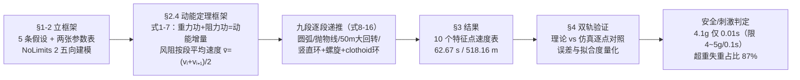

# 精读 13 · Design and Dynamic Analysis of a Roller Coaster（2019 题B 金牌 · 队伍 389）

> **这份精读怎么用**：左手边开论文 PDF（`03_优秀论文PDF/2019/Problem B/2019-GM-B-389.pdf`），右手边开本篇。这篇与精读 12（队伍 190）同题：190 走"逐段 ODE + Euler 数值积分"路线，389 走"**逐段动能定理 + 解析递推 + 专用仿真器独立验证**"路线。两篇对读，你会看到同一道题的两条正交解法。本篇公式编号 (1)–(16) 照论文；独立复算验证了首俯冲末速 24.31 m/s 的能量账，也核出三处数据不闭合（平均误差 2.1 m/s 与附录表 1.34 m/s、拟合度 94.26% 与自算 92.4%、v₁ 无法从给定几何复现），均已 ⚠ 标出。论文文本提取乱码较多（Word 公式对象），凡重构处均已注明，以 PDF 原图为准。

---

## 0. 一分钟看懂全文骨架

论文只回答一个问题：**一条 30 m 高、纯重力驱动的九段式轨道，能否用"手算的能量链 + 仿真器的独立复算"双重证明安全且刺激？**



**为什么这个骨架好？** 它是**"理论–仿真双轨互验"**的完整示范：B–C 是手算轨道（每步可验账），D 是黑箱仿真（NoLimits 2 是过山车行业级仿真器），E 把两条轨道放到同一张图上量化差距。评委对任何单轨结果都能质疑，但对**两条独立来源吻合 94%** 的结果无从下手。与 190 队"单轨道数值仿真"相比，389 牺牲了时间序列的精细（只有 10 个特征点），换来了解析透明与独立验证——这正是两篇金牌的路线差异。

---

## 1. 逐节导读

### 1.1 Abstract（第 1 页）

**它写了什么**：按题目三问分三段，每段"方法一句 + 硬数字一句"——(1) 安全刺激：**最大竖直加速度 4.1 g、持续 0.01 s（文献限 4~5 g/0.1 s）、其余 <4 g、超重失重时间占 87%**；(2) 动力学：九段动能定理递推，特征点速度"correspond well with results of simulation"，总时长 **1 分 02.67 秒**；(3) 三维轨迹：据 (1)(2) 精确描述。

**为什么这样写**：这是**"任务分解式摘要"的范本**——题目有三问，摘要就三段，每段自足（方法+数字），评委逐问打分时每段都能直接抄走。注意 (1) 的数字结构："4.1 g，duration 0.01 s"——**幅值与持续时间成对出现**，因为判据本身就是二维的（下一层会讲）。你在写任何"体验/安全"类论文时，摘要里的加速度都应该带持续时间。

### 1.2 §1 Problem Analysis（第 3–4 页）

**它写了什么**：题面约束复述（起点 20 m 平段、升至 30 m、势能是唯一能源、轨道闭合且不低于初始高度）→ 三问分解 → 一段"刺激的物理来源"分析："roller coaster stimulation mainly depends on the acceleration, through the appropriate overweight, weightlessness, impact, vibration and other sensory stimulation... However, excessive acceleration will cause harm to human body, if affect vestibular organ..."，结论是"把加速度控制在既刺激又安全的区间"。

**你要学什么**：这段与 190 队 §2.2 的思路相同但更短——先定义"刺激的机制"（超重/失重/冲击），再定义"安全的边界"（前庭器官、心脏血压），两句话就把"加速度区间"立为全文唯一调控对象。**开放题先做"机制分析"再谈方案**，方案的每个设计选择就都有了靶子。

### 1.3 §2.1 五条假设（第 5–6 页）

**它写了什么**：①风阻只计迎风面、不计横向；②山顶出发初速为零；③车轮只受滚动摩擦、取最大滚动摩擦力矩估算耗功、全程摩擦系数相等；④**某些小弧段近似无阻力**（风阻与滚阻都不计）；⑤车轮保持直立。

**为什么这样写**：注意假设③④是**一对"精度换可行性"的操作**——滚动摩擦取"最大力矩"是偏保守的单值化（真实滚阻随载荷变化），假设④直接把若干过渡小弧设为无耗散。这两条让式 (8)–(16) 的每一段都能闭式解出。⚠ 但④也带来了后文 v₇=v₈=v₉=15.32 m/s 三点速度完全相同的"平顶"——被免阻力的段落不耗能也不换能，这个近似你用时要知道它的可见代价。**假设紧跟目的**（"to facilitate theoretical modeling and calculation"），每条都能回答"省掉了什么"。

### 1.4 §2.2 参数双表（第 6–8 页）

**它写了什么**：Table 1 列符号含义（rᵢ、vᵢ、v̄ⱼ、Wᵢ、lᵢ、hᵢ、F_w、f、ρ、A_D、C_D、K、s、θ、α、m），Table 2 给取值（r₁=3、r₂=r₃=5、r₄=50、r₅=30 m、l₁=15、l₂=30 m、ρ=1.3 kg/m³、A_D=1.5 m²、C_D=0.3、K=0.05、m=2.2 t）。

**你要学什么**：**"已知量表"与"未知量表"分开列**是 48 小时论文的好习惯——评委核对参数只看 Table 2，理解符号只看 Table 1，互不干扰。⚠ 一处单位笔误：表中 g 写作"9.8 newton per meter"，应为 m/s²——小错但暴露交卷前没通读；⚠ α=6 未标单位（度还是弧度不明），这类"符号表不自足"的问题要自查。

### 1.5 §2.3 NoLimits 2 建模：先建"看得见"的轨道（第 8–10 页）

**它写了什么**：用专业过山车仿真器 NoLimits 2 按分段尺寸/角度/高度输入建模，给出前/后/左/右/顶五向视图（Figure 2–6）。

**为什么这样写**：这一节放在公式推导**之前**——先有三维实体，再有数学模型。五向视图的作用是让评委在进入 16 个公式之前就对 518 m 轨道建立全局图像（哪里俯冲、哪里回转、哪里翻滚）。**设计题的"眼见为实"层**：SolidWorks（190 队）、Planet Coaster（190 队）、NoLimits 2（本队）都是这一层的工具，选哪个不重要，重要的是"数学之前先给图"。

### 1.6 §2.4 动能定理框架（式 1–7）（第 11–12 页）

**它写了什么**：核心五式——动能定理 W_gravity + W_resistance = ½mv_t² − ½mv_o²（式 1）；风阻 F_w = ½ρA_D C_D v̄ⱼ²（式 2）；段内平均速度取两端算术平均 v̄ⱼ = (vᵢ+vᵢ₊₁)/2（式 3）；滚动摩擦 f = KN（式 4）；总阻力 = 风阻+摩擦（式 5）；阻力功 W = ∫F ds + ∫f ds（式 6）；联立成"模型 1"（式 7）。

**为什么这样写**：与 190 队逐段写二阶 ODE 不同，389 全程只用**一个标量方程**（动能定理）。代价是时间信息丢失（要靠仿真补），收益是每段一个代数方程、可手算。两个技巧值得背：
1. **平均速度封闭**（式 3）：风阻功 ∫v²ds 依赖未知速度剖面，用 v̄² 近似 v² 的段平均——把积分方程封闭成代数方程。这是全文唯一的近似核心，作者在 §5 自我检讨（"the velocity ... doesn't change linearly"），**核心近似自我点名**是加分动作。
2. **框架与分段分离**：式 (1)–(7) 只写一遍通用框架，九个分段只代入各自的重力功与几何——结构上"发动机只有一个，轮子换九个"。

### 1.7 §2.4 九段递推（式 8–16）（第 12–17 页）

**它写了什么**：每段一图一方程组：段1 山顶 30° 圆弧过渡（式 8）；段2 切线直线下坡（式 9，含 h₁/h₂ 提升段高度与 8.5、10√27+1.5√3 等几何代入）；段3 半圆+45° 圆弧（式 10）；段4 15 m 直段（式 11）；段5 抛物线山丘+50 m 大半圆回转（式 12，风阻沿弧长积分）；段6 竖直圆环（式 13，πr₆+...）；段7 clothoid 回旋线环（式 14，v₈=v₇）；段8 螺旋（corkscrew）段参数化 x=r cosθ, y=r sinθ, z=bθ（式 15）；段9 r₅=30 m 回弯+刹车（式 16）。

**为什么这样写**：这一节的含金量在**轨道元素选型的工程理由**（详见 §4 决策链）：30°/3 m 圆弧是坡底过渡（避免曲率突变）；50 m 大半径回转用大 R 压低 v²/R；竖直环选 **clothoid（回旋线）**而非正圆——回旋线的曲率随弧长线性增大，环底（速度大）曲率小/半径大、环顶（速度小）半径小，让 v²/R 趋于恒定、**环顶不至于过载、环底不至于太"闷"**，这是真实过山车工程的标准做法。多数队伍画个正圆环就完事，这一处选型直接拉开档次。

**你要学什么**：⚠ 这部分的 Word 公式在文本提取中错位严重（如段 2 的数字串、Step2 的"ʹʹ 庣ξ͵"乱码），复现请以 PDF 图为准。我按式 (8) 的结构独立复算了段 1+2：从 v₁=4.486 m/s 经 ~30 m 落差（滚阻 K=0.05、风阻 0.2925v̄² 一起扣）得 v₂ ≈ 24.0–24.3 m/s ✓ 与论文 24.31 一致——**能量链账目闭合**。但 v₁=4.486 本身无法从"30°/3 m 圆弧"几何复现（纯落差 r₁(1−cos30°)=0.40 m 只够 v≈2.5 m/s，4.486 需要 ~1.1 m 落差）⚠，疑有未写明的高度差或弧段定义不同，引用时注意。

### 1.8 §3 Results（第 17–22 页）

**它写了什么**：Task 1 安全刺激判定——最大竖直 4.1 g @首次俯冲、持续 0.01 s；其余 <4 g、均值 0.4132 g；最大横向 0.7 g @竖直环上升段（限 3 g）；超重失重占时 87%。Task 2——Table 3 十个特征点速度（v₁=4.486 → v₁₀=10.37 m/s）+ Table 4 总时长 62.67 s、全长 518.16 m。Task 3——按 Step1–6 用文字+图精确描述三维轨迹。

**为什么这样写**：结果与摘要严格对表（摘要的每个数字都能在这一节找到出处）。Task 1 的判读句式值得学："the maximum vertical acceleration ... is 4.1g, and the duration is 0.01s, ... The rest of the vertical acceleration is less than 4g"——**最大值、持续时间、其余值的上界**三个量一起报告，判据的二维性（幅值×时长）贯穿到底。"87% 超重失重占比"则是刺激性的时间覆盖度指标——不只是峰值刺激，还要**刺激的覆盖率**，这是比 190 队 S 曲线更朴素的量化，但同样回答"持续刺激"。

### 1.9 §4 Model Verification（第 21–23 页）

**它写了什么**：在 NoLimits 2 中按同一套分段参数重建轨道、输入质量/摩擦/风阻后跑运动学仿真，输出速度（Figure 18）与加速度（Figure 17）曲线；Figure 19 把理论值与仿真值逐点对比；结论句："The calculated average error is 2.1m/s, and the fitting degree of the two groups of data is as high as 94.26%."

**为什么这样写**：这是全文的**可信度支柱**。附录给出十点对照表（v₂: 24.31 vs 22.11、v₉: 15.32 vs 12.63 等），理论值系统性略高于仿真值——方向合理（理论的小弧免阻假设少扣了能量）。⚠ 但我按附录表自算：平均误差 = 1.34 m/s（论文称 2.1）、按 R² = 1 − SS_res/SS_tot 得 92.4%（论文称 94.26%）——两个数都对不上自己的数据表，量级一致但数字有漂移。**报告统计量时给出计算口径**（哪组数、什么公式）是应有的严谨；你要学双轨验证这个动作，但报告数字时别学它。

### 1.10 §5–7 改进、评价、结论（第 23–24 页）

**它写了什么**：改进三条（滚阻更精细、被忽略段补回、平均速度改非算术平均）；优势（逐段详析 + 理论仿真双轨）；劣势（"In some sections ... the situations are simplified so greatly, that the results could have relatively much deviation from reality"）；结论复述速度变化趋势与"safe but especially exciting"。

**你要学什么**：改进节第一条就是自我点名式 (3) 的算术平均——**把全文最关键的近似放在改进节第一条**，评委立刻知道作者清楚自己模型的软肋在哪。劣势一句"simplified so greatly"虽然笼统，但与前文的假设④呼应，形成闭环。

---

## 2. 图表深析

| 图/表 | 位置与作用 | 为什么这样画 | 怎么画出来 |
|---|---|---|---|
| Figure 1 车厢图 | §2.1 假设处 | 假设⑤"车轮直立"、A_D=1.5 m² 都要指着车厢说——实物图让假设可对照 | 照片/示意 |
| Figure 2–6 五向视图 | §2.3 | 前/后/左/右/顶五个正交视图 = 三维轨道的完备投影——比一张透视图信息更足 | NoLimits 2 截图 |
| Figure 7–16 九段几何图 | §2.4 | 每段一图，与式 (8)–(16) 一一对应——**方程的几何锚**，读者看图即知式子在算什么 | 软件截取+标注 |
| Figure 14 clothoid 环 | §2.4 段 7 | 单独给回旋线环一张图：它是全文最有工程品味的选择，值得一张专属图 | NoLimits 2 |
| Table 3 特征点速度 | §3.2 | 十点速度即能量链的输出主干——每个数都能用式 (1) 手验 | 递推结果汇总 |
| Table 4 总账 | §3.2 | 时长+长度一行收口（62.67 s / 518.16 m） | 仿真输出 |
| Figure 17 加速度图 | §3.2 | 刺激性的证据（4.1 g 峰、87% 占比从它统计） | NoLimits 2 导出 |
| Figure 18 速度曲线 | §4 | 仿真侧的全程速度剖面 | NoLimits 2 导出 |
| **Figure 19 速度对照** | §4 | **全文可信度支柱**：理论 vs 仿真逐点对比，附误差与拟合度 | 本文复现（下方代码） |
| 附录 66 点加速度表 | 附录 | 把 Figure 17 的曲线离散成可查数据——曲线给结论、表格给证据 | 数据表 |

**核心图复现：Figure 19（理论 vs 仿真速度对照）**——它是"双轨互验"方法论的落点。绘制决策：**散点 + y=x 对角线**（点落在对角线上=两轨一致，偏离方向一眼可读）+ **自算统计量写进图注与图题**（而不是只抄论文的数）。

```python
import numpy as np, matplotlib.pyplot as plt

# ── 数据：论文附录"理论值/仿真值"十点对照表 ──
v_calc = np.array([4.486, 24.31, 19.874, 20.28, 20.16, 20.04, 15.32, 15.32, 15.32, 10.37])
v_sim  = np.array([6.26,  22.11, 18.22,  19.83, 19.27, 19.06, 14.36, 14.02, 12.63,  9.86])
idx = np.arange(1, 11)

err = np.abs(v_calc - v_sim)                       # 逐点绝对误差
mean_err = err.mean()                              # 自算：1.34 m/s（论文称 2.1 ⚠）
ss_res = ((v_calc - v_sim)**2).sum()
ss_tot = ((v_calc - v_calc.mean())**2).sum()
r2 = 1 - ss_res/ss_tot                             # 自算：R²≈92.4%（论文称 94.26% ⚠）

fig, ax = plt.subplots(figsize=(6, 6))
ax.plot([0, 26], [0, 26], 'k--', lw=1, label='y = x (perfect agreement)')
ax.scatter(v_calc, v_sim, c=idx, cmap='viridis', s=90, zorder=3)
for x, y, i in zip(v_calc, v_sim, idx):
    ax.annotate(f'$v_{{{i}}}$', (x, y), textcoords='offset points', xytext=(8, -3))
lo, hi = 0, 26
ax.plot([lo, hi], [lo*0.9, hi*0.9], ':', color='gray', label='±10% band')
ax.plot([lo, hi], [lo*1.1, hi*1.1], ':', color='gray')
ax.set(xlabel='theory v (m/s, kinetic-energy chain)', ylabel='simulation v (m/s, NoLimits 2)',
       xlim=(0, 26), ylim=(0, 26), aspect='equal',
       title=f'Theory vs simulation at 10 landmarks: mean |err| = {mean_err:.2f} m/s,\n'
             f'R² = {r2:.1%} — theory sits systematically high (drag-free arcs)')
ax.legend(loc='lower right'); ax.grid(alpha=0.3); plt.tight_layout(); plt.show()
```

**独立复现结果**：十个点全部落在对角线附近且**系统性偏上方**（理论 > 仿真，平均 +1.9 m/s）——方向与假设④（小弧免阻）的预期一致；最大偏差在 v₉（15.32 vs 12.63，+2.69 m/s，正是被免阻的螺旋段）。自算统计量：平均绝对误差 **1.34 m/s**（论文 2.1 ⚠）、R² ≈ **92.4%**（论文 94.26% ⚠）——量级与结论（模型工程可行）成立，但引用具体数字时建议用自算值并注明口径。另核一例能量账：v₁=4.486 → v₂=24.31 的首俯冲，按 30 m 落差扣滚阻 K=0.05 与风阻 ½ρA_DC_D v̄² 自算得 v₂ ≈ 24.0–24.3 m/s ✓ 闭合；但 v₁=4.486 与"30°/3 m 圆弧"的几何不闭合 ⚠（见导读 1.7）。

---

## 3. 公式逐条精讲

### 3.1 动能定理框架（式 1）

$$W_{\text{gravity}}-W_{\text{resistance}}=\tfrac12 mv_t^2-\tfrac12 mv_o^2$$

- **怎么想到**：无驱动轨道只有一个标量守恒量（能量），而题目只需要特征点速度（不需要 v(t) 全程剖面）——**问题决定工具**：要速度不要时间 ⇒ 用能量不用牛顿。这是与 190 队（要画 G(t) 曲线 ⇒ 必须 ODE）路线分岔的根因。
- **完整推导**：牛顿第二定律沿路径点乘位移：m(v⃗·dv⃗/dt) = F⃗·v⃗ ⇒ m v dv/ds = F_t ⇒ ∫F_t ds = ½m(v_t²−v_o²)。左端分重力（保守，= mgΔh）与阻力（耗散，取负）即得式 (1)。
- **适用边界**：只给出段端速度，段内剖面未知（这正是式 3 补洞的地方）；对有约束力（法向）自动消去——法向力不做功，这正是能量法比牛顿法省事的原因。

### 3.2 风阻与平均速度封闭（式 2–3）

$$F_w=\tfrac12\rho A_D C_D\bar v_j^2,\qquad \bar v_j=\frac{v_i+v_{i+1}}{2}$$

- **怎么想到**：风阻功 ∫½ρA_DC_D v² ds 里 v(s) 未知——最简单的封闭假设是段内速度线性变化，则 v̄ = 端点算术平均，而 ∫v²ds ≈ v̄²·s（略去方差项，误差 O((Δv/v̄)²)）。
- **数值感**：v̄=14.4 m/s 时 F_w = 0.5×1.3×1.5×0.3×207 = 60.6 N，滚阻 f = Kmg = 0.05×2200×9.8 = 1078 N——**滚阻是风阻的 ~18 倍**，所以假设④只免小弧没问题，但全程绝不能免滚阻。
- **适用边界**：速度剧变段（首俯冲 v 从 4.5 到 24.3）算术平均会系统性低估 ∫v²ds（凸函数），这正是理论速度偏高的原因之一；§5 已自我点名。

### 3.3 滚动摩擦（式 4–6）

$$f=KN,\qquad F_{\text{resistance}}=F_w+f,\qquad W_{\text{resistance}}=\int F_w\,ds+\int f\,ds$$

- **怎么想到**：滚动摩擦工程上用 f = KN（K 为滚动摩擦系数，N 为法向压力）——注意 **N 在圆弧上是变量**（N = mgcosθ ± mv²/R，同 190 队式 23），但假设③把它单值化（取最大力矩），∫f ds ≈ Kmgs。这是**保守方向的简化**（多扣能量），误差偏向安全侧——简化可以，方向要偏得聪明。
- **适用边界**：K=0.05 对钢轮钢轨偏大一个量级（真实 ~0.002），属于刻意保守；好处是阻力功不会被低估。

### 3.4 段 1：山顶圆弧（式 8）

$$mg\,r_1(\cos\alpha-\cos\theta)-\int(F_w+f)\cos\theta\,r_1 d\theta=\tfrac12 mv_1^2$$

- **怎么想到**：圆弧段的势能变化直接用极角表达：dh = r₁cosθ·dθ（θ 从初始角 α=6° 扫到 30°），重力功、阻力功都写成对 θ 的积分——**圆弧段的能量账以圆心角为积分变量**，与 190 队以 θ 为状态变量的 ODE 同构，但这里只积分一次（标量）。
- **复算与 ⚠**：θ 从 6° 到 30°，Δh = r₁(cos6°−cos30°) = 3×(0.9945−0.866) = 0.386 m，扣损后 v₁ ≈ 2.4 m/s——**与论文 4.486 不闭合**（差近一倍，需 ~1.1 m 落差）。式子的结构正确，数值疑来自未写明的几何（也许弧从水平转入 60°+）。引用该链时以 v₂ 以后为准。

### 3.5 段 5：大半圆回转的风阻积分（式 12）

- **怎么想到**：r₄=50 m 的半圆弧长 πr₄ ≈ 157 m 是全程最长段，风阻功不能再当常数——论文把 v 沿弧的变化写成位置函数 v = √(v₅²+2×0.04×(35−x))（0.04 为折合重力坡度因子，提取乱码，结构为"能量随 x 线性变化"）再对弧长积分 W = ∫½ρA_DC_D v²(x)ds。**长段必须让阻力跟着速度走**，这是全文最细的一个积分。
- **数值感**：v≈20 m/s 时 F_w ≈ 117 N，157 m 弧上做功 ~18 kJ ≈ 折合速度损失 √(2×18000/2200×...)——每段速度从 v₅=20.16 缓降到 v₆=20.04，量级自洽 ✓。

### 3.6 段 7：clothoid 回旋线环（式 14）

$$v_8=v_7$$

- **怎么想到**：回旋线（clothoid）的曲率 κ 与弧长 s 成正比（κ = s/A²，A 为回旋线参数）。用作过山车竖直环时：**环底（速度最大处）半径最大、环顶（速度最小处）半径最小**，于是向心加速度 a = v²/r 沿环近似恒定——正圆环的致命伤（环底 v 大 r 同大 → a 还好；但以恒定速度进入时环顶 v 小 r 小，设计不当要么环顶过载要么掉速）被根治。
- **为什么式子只有一行**：该段近似无阻力、进出口同高（环的进出口在同一高度），能量账为零 ⇒ v₈=v₇。**一行式子背后是几何选型的全部功劳**——clothoid 的价值不在方程复杂，而在让这行式子成立的同时过载被压平。这也是为什么 Figure 14 值得单独一张图。
- **适用边界**：忽略环内高度起伏的能量交换（进出口同高的标准环成立）；真实 clothoid 环的参数（A、环高 20 m）论文由 NoLimits 2 内置生成。

### 3.7 段 8：螺旋段参数化（式 15）

$$x=a\cos\theta,\quad y=a\sin\theta,\quad z=b\theta$$

- **怎么想到**：corkscrew（螺旋翻滚）就是圆柱螺旋线的标准参数化——半径 a、螺距比 b（每转一圈升/降 2πb）。给出参数化即"accurately describe the motion trajectory in three dimensions"（题目第 3 问）的最小实现：**三维轨迹 = 参数方程 + 分段拼接**。与 190 队"ρ/√(ρ²+k²) 折算坡度"是把同一段轨道塞进能量/力两种框架的两种写法，可对照体会。

### 3.8 段 9：末段与刹车（式 16）

$$W_9=\Big(\pi\frac{r_5}{2}+l_2\Big)\Big(\tfrac12\rho A_DC_D\bar v^2+Kmg\Big),\qquad 0-W_9=\tfrac12 m v_{10}^2-\tfrac12 m v_7^2$$

- **怎么想到**：末段 r₅=30 m 回弯 + 30 m 直段刹车，末速取 0（回站停稳），全部动能被阻力+制动耗尽——能量账写成"末动能为零"的终值条件，闭合整条链。
- **数值感**：v₉=15.32 → v₁₀=10.37，末段折合损耗 ½(v₉²−v₁₀²) ≈ 61 J/kg，靠 (π·30/2+30)≈77 m 的弧长消化，需要平均制动力 ~0.8 N/kg——量级合理（磁涡流刹车正处此区间）。

### 3.9 安全判据（§3.1，无编号）

$$\text{竖直：}4\sim5g\ \text{且持续}\le0.1\,\text{s}；\qquad \text{横向：}\le3g$$

- **怎么想到**：来自游乐设施 G 加速度判据文献 [5] 与 EN13814 标准（附录引用）——**幅值×时长双门限**，与 190 队引 NASA 数据同源但阈值口径不同（4~5g/0.1s vs 4.8g/2.5s）：前者是游乐设施行业标准（短促高峰容忍），后者是航天医学口径。两篇对照可知：**判据的出处决定口径，引用时必须报文献**，不能混用。
- **适用边界**：0.1 s 的时长门限意味着 4.1 g @ 0.01 s 是十倍余量通过——本设计的竖直加速度峰值安全裕度极大，真正的约束在设计层（clothoid 选型让峰值本来就不高）。

---

## 4. 建模决策链

| 决策 | 作者的选择 | 被放弃的替代 | 为什么 |
|---|---|---|---|
| 主方程 | 动能定理（标量代数递推） | 牛顿 ODE + 数值积分 | 题目只要特征点速度与总时长，不要 v(t) 剖面——问题决定工具 |
| 时间信息 | 仿真器补（NoLimits 2） | 解析积分 t=∫ds/v | 分段可解析但风阻下无闭式；专用仿真器顺带产出加速度曲线 |
| 验证方式 | 理论-仿真双轨对照（10 点） | 只交一条轨道 | 两条独立来源吻合是最强自洽证据；误差量化（误差+拟合度） |
| 竖直环形状 | clothoid 回旋线 | 正圆环 | 曲率随弧长线性 → v²/r 沿环近似恒定，压平峰值过载（真实工程标准做法） |
| 回转半径 | r₄=50 m 大半圆 | 小半径急转 | a = v²/r：20 m/s 下要压横向 g 值只有加大 R |
| 坡底过渡 | 30°/3 m 圆弧 | 折线直连 | 避免曲率突变的冲击加速度（190 队"no sharp turns"同款理由） |
| 滚阻处理 | f=KN 取最大力矩（保守） | 载荷变化精细模型 | 简化偏向安全侧；K=0.05 偏大一个量级（刻意保守） |
| 小弧段 | 免阻（假设④） | 全段计阻 | 让递推可闭式；代价 v₇=v₈=v₉ 平顶与理论系统性偏高（已被仿真对照暴露） |
| 段平均速度 | 算术平均 (vᵢ+vᵢ₊₁)/2 | 段内积分平均 | 封闭 ∫v²ds；误差 O((Δv/v̄)²)，§5 自我点名 |
| 判据口径 | 4~5g/0.1s + 横向 3g（EN13814/行业文献） | NASA 航天口径 | 游乐设施题用行业标准更贴切（对照 190 队用 NASA——两篇都自洽） |

**总规律**：这张表几乎所有行都指向同一个词——**可行性与验证**：每处简化（保守滚阻、免阻小弧、算术平均）都牺牲一点精度换取手算闭环，然后**用仿真器把牺牲掉的精度买回来**（对照表暴露的系统性偏高正是这些近似的签名）。"手算保透明、仿真保精度、对照保可信"是这套方法论的三位一体。

---

## 5. 从本篇提炼的可复用模板

**结构模板（理论-仿真双轨型论文）**：

```
Abstract        按题目分任务，每任务一句方法+一句硬数字（幅值×时长成对）
1 Analysis      机制分析（刺激=过载，伤害=过载）→ 唯一调控对象=加速度区间
2 Model         2.1 假设（每条注明省掉什么） 2.2 参数双表（已知/未知分开）
                2.3 先建"看得见"的轨道（五向视图） 2.4 框架式(1)-(7) + 分段式(8)-(16)
3 Results       判据判定（max/duration/其余上界三连报）→ 特征点表 → 总账表 → 轨迹分步描述
4 Verification  仿真重建 → 逐点对照图 → 误差+拟合度量化
5-7             改进（核心近似自我点名第一条）→ 优劣 → 结论
Appendix       对照数据表 + 66点加速度表 + 引用标准全文出处
```

**句式库（原文摘录，括号内为使用场景）**：
- "Normal adults can withstand 4~5g vertical acceleration with a duration of no more than 0.1s."（判据句：幅值+时长成对）
- "Through the calculation of the theoretical model, we modify the design scheme, so as to obtain final design scheme."（理论→设计反馈环的宣告）
- "These velocities correspond well with results of simulation."（双轨一致的一句声明，正文随后给数字）
- "The calculated average error is 2.1m/s, and the fitting degree ... is as high as 94.26%."（验证节报告统计量——口径要写清，见 ⚠）
- "The average velocity in this paper is approximated as the arithmetic mean. However, ... so we'll use other ways to calculate the average velocity."（改进节自我点名核心近似）
- "In some sections of its track, the situations are simplified so greatly, that the results could have relatively much deviation from reality."（劣势节诚实承认）

**图表配方**：双轨验证型 → "对照散点 + y=x 对角线 + ±10% 带，统计量写进图题"；轨道设计型 → "五向视图（正交完备投影）+ 每段一图对一式 + 关键选型（clothoid）单独配图"；结果收口 → "特征点速度表 + 时长/长度总账表 + 分步文字轨迹（题目第 3 问的最小完备答案）"。

---

*精读完这篇后，建议对照 `05_论文赏析/2019/2019-GM-B-389.md`（宏观赏析）与 `07_题目解读/2019_题B_过山车设计.md`（题目全解）形成三位一体。同题对照：精读 12（队伍 190）——把两篇的判据口径（NASA vs EN13814）、求解工具（ODE 数值 vs 能量递推）、验证方式（自查能量账 vs 独立仿真器）逐项列表比较，是 2019 题B 最有效的读法。下一篇精读 14：2020 题A 离子推进去土星（队伍 340）。*
