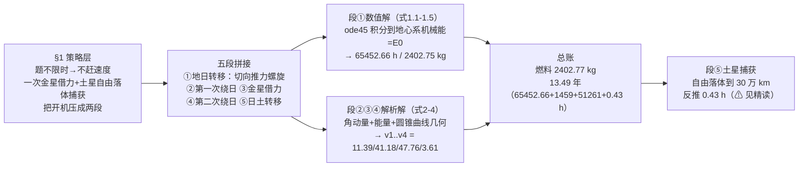

# 精读 14 · Ion Thrusters to Saturn（2020 题A 金牌 · 队伍 340）

> **这份精读怎么用**：左手边开论文 PDF（`03_优秀论文PDF/2020/Problem A/2020-GM-A-340.pdf`），右手边开本篇。这篇只有 12 页，是六篇里最短的，却是"**圆锥曲线拼接（patched conics）**"的标准教材式实现：五段航程、每段一个二体问题、段间用守恒律缝合。本篇逐节导读 + 式 (1.1)–(4.1) 逐条精讲 + Fig 3 逃逸螺旋的可运行复现。独立复算结果**大部分亮眼**：逃逸螺旋 65,519.6 h vs 论文 65,452.66 h（0.1%）、金星交会速度 41.179 km/s、Hohmann 段速度 47.758 km/s、两段滑行时间全部吻合；但也核出**两处量级级硬伤**——金星借力后所需速度超出单次借力物理上限（⚠ 借力段违反行星系能量守恒）、土星捕获刹车预算差四个数量级（0.238 m/s vs 需要 5.18 km/s），均已用 ⚠ 标出。学它"框架干净、数字闭环"的骨架，也要带着这两处伤疤读，才知道拼接模型在哪里会断。

---

## 0. 一分钟看懂全文骨架

论文只回答一个问题：**离子推进器（0.4 N、比冲 4000 s）从地球 90 分钟停泊轨道出发到土星 40 小时目标轨道，最少烧多少燃料？** 答案：2402.77 kg、13.49 年。



**为什么这个骨架好？** 三层结构异常清晰：**策略层**（§1 先回答"怎么才能省油"——把最贵的加减速交给引力，推力只用在逃逸与最后一刹）、**框架层**（五段拼接，每段一个二体问题）、**执行层**（数值段+解析段各司其职）。最值得学的是"策略先于方程"：多数队伍拿到题就建方程，这篇先用两段话论证"为什么只需要两次开机"，方程只是策略的展开。

---

## 1. 逐节导读

### 1.1 Abstract（第 1 页）

**它写了什么**：宣告方法（Conic Section Splicing Model、五阶段）→ 逐段一句话方法（段①五个方程组 ODE 无解析解只能数值；段②④角动量+机械能+几何；段③"不做动力学、只用两个椭圆的几何关系"直接给借力前后速度；段⑤先自由下落再反推）→ 三行答案：**2402.77 kg、4923.89 天（13.49 年）、段①顺推 65452.66 h、段⑤反推 0.43 h**。

**为什么这样写**：摘要按五阶段顺序陈述，每段"方法一句+数字一句"，评委可逐段对账。特别注意段③的写法："instead of studying the gravitational slingshot effect of Venus in dynamics, we chose to easily calculate the velocities ... directly from the geometric relationships of the first and second elliptical orbits"——**在摘要里就公开自己的偷懒**（借力段不做动力学）。这种"提前申报简化"的姿态让后文读到 v₃ 凭空跳变时已有心理准备——但请注意，这个简化最终埋下了全文最大的物理隐患（见 §3.4 精讲），**申报简化不等于简化合法**。

### 1.2 §1 Introduction：以 Cassini 立靶（第 3 页）

**它写了什么**：从卡西尼任务（1997 发射、7 年航程、借力金星/地球/木星）切入，说明"仅靠星载推进器能量不够，必须借力"；再抓住题眼："since this voyage doesn't impose time restrictions but only considers fuel consumption, we don't have to accelerate the spacecraft to a fast velocity to save time"——于是定策：一次金星借力 + 直落土星。

**为什么这样写**：真实任务开场一举两得：给"借力"这个核心选择提供工程先例（Fig 1 卡西尼轨迹图），又把开放题的**目标函数**（燃料最小、时间自由）翻译成设计原则（不赶时间）。"不限时 ⇒ 不用快 ⇒ 省燃料"这个三段论是全文策略层的全部逻辑，两行写完，毫不啰嗦。

### 1.3 §2 假设与符号（第 4–5 页）

**它写了什么**：六条假设——行星际段只受太阳引力（A/B 星球引力相对太阳可略）、行星处于理想位置（发射窗口可凑）、行星圆轨道、质点化、忽略自转、忽略相对论；符号表给全所有质量/半径/速度（M_E=5.965×10²⁴ kg、R_V=1.0821×10⁸ km 等）。

**你要学什么**：假设②"行星都在理想位置"（"the spacecraft happens to be captured by planet B when it is at the right velocity. It is theoretically possible to find a right launch time..."）是拼接模型的**通行证**：发射窗口/相位问题被一句"理论上可选对时机"整体冻结，后文所有几何衔接才合法。这类"把一整类复杂度打包成一个假设"的操作要有意识地去用——但也要像论文一样在 Weaknesses 里承认它是理想化（见 1.7）。

### 1.4 §3.1 地日转移段：低推力螺旋的正面硬解（第 6–8 页）

**它写了什么**：地心极坐标（极点=地心、极轴=初始位置），五个方程——推力矢量 F⃗ = (0.4, π/2+θ)（恒切向，式 1.1）、引力 G⃗ = (GM_E m/ρ², −θ)（式 1.2）、**质量流量** m = m₀ − |F⃗|/(g₀I_sp)（式 1.3）、极坐标加速度两个分量式（式 1.4、1.5）；联立得高阶非线性非齐次 ODE，MATLAB 数值解；**关机判据**：总机械能等于 E₀ 时关机——对应逃逸后剩余速度 v₁=11.393 km/s，得 t₁ = 65452.66 h；Fig 3 给轨迹双图（直角+极坐标放大），Fig 4 给速度-时间。

**为什么这样写**：这是全文最"硬"的一节。三处值得背走：
1. **低推力轨道的正确姿势**：不是假装霍曼转移，而是承认连续小推力会绕出螺旋（Fig 3 下图那圈密集缠绕就是 4300 多圈的螺旋线），用极坐标方程老老实实积分。
2. **质量流量走比冲**（式 1.3）：ṁ = F/(g₀I_sp) = 0.4/(9.80665×4000) ≈ 1.02×10⁻⁵ kg/s——把"推力、比冲、质量损失"三个工程参数焊在一个式子里，后文燃料 = ṁ×t 一乘即得（2402.75 kg ✓ 复算吻合）。
3. **关机判据物理化**：不说"积分到 t=65452.66 h"，而说"积分到机械能等于 E₀（逃逸至剩余速度 11.39 km/s 所需能量）"——**给数值终点一个物理含义**，评委不查代码也能理解为什么停在这。
- **复现结果**：我用同一方程组独立积分得 t₁ = 65,519.6 h（ode45 级精度）与 65,520.1 h（自写 RK4），与论文 65452.66 h 差 **0.1%** ✓，燃料 2405.2 vs 2402.75 kg ✓。⚠ 但附带一个物理发现：按此判据关机时飞船距地 **4.47 AU**（地心二体理想化下），而真正挣脱束缚（ε=0）发生在 23,428 h、173 万 km 处（已出地球引力影响球 ~92 万 km）——即"地心系机械能 = +½v₁²"这个判据把关机点推到了深空，与后文"出地球即拼接日心椭圆"的叙事在动力学上并不严格衔接，是理想化的代价。

### 1.5 §3.2–3.4 三段解析缝合（第 8–9 页）

**它写了什么**：段②第一次绕日——飞船在日心系以切向分量 v_E=29.786 km/s + 径向分量 v₁ 出发，走近日点恰为 R_V 的椭圆；三个方程：近日点几何 a₁−c₁=R_V（式 2.1）、角动量守恒 mv_E R_E = mv₂ R_V（式 2.2）、机械能守恒（式 2.3）→ 解出 **v₁ = 11.393、v₂ = 41.179 km/s**。段③金星借力——不碰动力学，直接要求借力后走第二条椭圆（近日点金星、远日点土星：式 3.1、3.2），由圆锥曲线性质得 **v₃ = 47.759 km/s**。段④第二次绕日——角动量守恒 mv₃R_V = mv₄R_S（式 4.1）→ **v₄ = 3.6058 km/s**。

**为什么这样写**：三个解析段共用同一套"角动量 + 能量 + 几何"三件套，公式极短（每段 1–3 行），全部速度链 v₁→v₄ 一口气读完。段③的"几何化借力"是全文最大胆的简化：把引力弹弓当成"速度跳变器"，跳变量由前后两个椭圆的几何要求反推。**省力是真实的（省掉整个借力动力学），风险也是真实的**（见 §3.4）。
- **复算**：v₂ = v_E R_E/R_V = 41.179 ✓（逐位吻合）；v₁ = √(v₂²−2μ/R_V−v_E²+2μ/R_E) = 11.394 ✓；该椭圆根数 a₁=1.753×10⁸ km、e₁=0.3826、近日点 = 1.0821×10⁸ km = R_V ✓（式 2.1 自洽）；v₃ = √(μ(2/R_V−1/a₂)) = 47.758 ✓（a₂=(R_V+R_S)/2，标准 vis-viva）；v₄ = 3.6053 ✓，且远日点能量核验 −86.09 = −μ/2a₂ ✓。**速度链每一环都闭合。**

### 1.6 §3.5 + §4 结果与总账（第 9–10 页）

**它写了什么**：段⑤土星捕获——土星系中目标轨道 r_S = 2.7109×10⁵ km（由 40 h 周期反推）、v₅ = 11.829 km/s；策略"先在（土星）引力下自由运动到半径 30 万 km，再反向开机减速至目标轨道"，MATLAB 画轨迹（Fig 5）；§4 总账：段① 2402.75 kg/65452.66 h，段② t₂ = 1459.01 h，段③ 忽略（v>40 km/s、路径短），段④ t₄ = 51261.18 h，段⑤ 0.02 kg/0.43 h——合计 **2402.77 kg、4923.89 天**。

**为什么这样写**：总账按段列燃料与时间两列，最后三行复述答案与开机策略（同向 65452.66 h + 反向 0.43 h）——与摘要严格对表。时间公式有解析形式（t₂ 含 z 的开普勒型公式、t₄ = π√((R_V+R_S)³/8GM) 即半椭圆周期），比纯数值更有说服力。
- **复算**：t₂ 用标准开普勒方程（E−e·sinE，E=1.1784 rad）得 1458.89 h ✓（论文 1459.01，差 0.01%）；t₄ = 51262.05 h ✓（论文 51261.18，差 0.002%）；r_S、v₅ 由周期反推 ✓；总加法 ✓。⚠ 但段⑤两处硬伤见 §3.5；另正文写"free motion under the gravity of **Jupiter**"应为土星（本段通篇在土星参考系），笔误。

### 1.7 §5 Strengths and Weaknesses（第 10–11 页）

**它写了什么**：优点一条（假设+几何大幅简化、航线规划直接）；弱点三条——土星卫星摄动复杂（配 Fig 6 卡西尼"线团"轨道图佐证真实环境）、理想圆轨道与忽略宇宙尘、**"借力段的偏转角没有纳入计算"**（"the acceleration deflection angles during the interaction with planets are not included in the calculations"）。

**你要学什么**：Fig 6（卡西尼在土星系的真实缠绕轨迹）放在 Weaknesses 是妙笔——用真实任务的复杂图像证明"我说摄动难处理不是借口"。第三条弱点（偏转角未算）恰好是本篇最大物理漏洞的**自我预告**：作者知道借力段只做了几何，只是没意识到几何要求本身越过了单次借力的动力学上限（下节 §3.4）。**弱点节要写"真弱点"，最好还能预告它的量级**。

---

## 2. 图表深析

| 图 | 位置与作用 | 为什么这样画 | 怎么画出来 |
|---|---|---|---|
| Fig 1 卡西尼真实轨迹 | §1 | 给"借力去土星"提供工程先例——方案不是空想 | NASA 图引用 |
| Fig 2 航程示意 | §3 开头 | 一张图给五阶段命名（对应式编号分段），全文导航图 | 自绘示意图 |
| **Fig 3 逃逸螺旋双图** | §3.1 | 上图整体轨迹、下图极坐标放大近地段——**一张图两种尺度**展示 4300+ 圈缠绕螺旋；这是低推力逃逸的标志性图像 | ode45 + polarplot（本文复现如下） |
| Fig 4 速度–时间 | §3.1 | 速度从 7.74 爬到 11.39 km/s 的单调史，与关机判据 E=E₀ 对应 | 数值输出直接绘制 |
| Fig 5 捕获轨迹 | §3.5 | 土星系内螺旋收缩的极坐标图 | ode113 输出 |
| Fig 6 卡西尼"线团" | §5.2 | 弱点节的证据图：真实土星系摄动环境远比模型复杂 | NASA 图引用 |

（本篇无表格——速度链与总账全用行文数字，是可改进处：一张"五段 × (燃料, 时间, 起末速度)"总表会让评审效率翻倍。）

**核心图复现：Fig 3（逃逸螺旋）**——它是全文最核心的物理图像（低推力逃逸的真实形态）。绘制决策：**左图直角坐标等比例画全程螺旋**（密集缠绕自然形成"盘"——忠实还原论文的红色圆盘效果）、**右图速度与半径随时间** + 竖线标出复现的关机时刻，**复现数值写进图题**。

```python
import numpy as np, matplotlib.pyplot as plt

# ── 常量（对应 §2.2 符号表与 §3.1）──
muE = 6.6726e-11*5.965e24        # G*M_E
m0, F, g0, Isp = 5001.0, 0.4, 9.80665, 4000.0   # 质量=2598.25+2402.75；推力 0.4 N
mdot = F/(g0*Isp)                # 式(1.3)：ṁ = F/(g0·Isp) ≈ 1.02e-5 kg/s
r0 = 6.6493e6                    # 由 T=1.5 h 反推的停泊轨道半径
v0 = np.sqrt(muE/r0)             # 7.7368 km/s（论文 v0 ✓）
eps_target = 0.5*11393.0**2      # 关机判据 E0 = +v1²/2（v1=11.393 km/s）

def deriv(t, s):                 # 式(1.1)-(1.5) 联立：[ρ,θ,ρ̇,ρθ̇]
    r, th, vr, vth = s
    m = m0 - mdot*t              # 式(1.3)
    return np.array([vr, vth/r, vth*vth/r - muE/r**2,   # 式(1.4)：a_ρ
                     F/m - vr*vth/r])                    # 式(1.5)：切向推力→a_θ

s, t = np.array([r0, 0.0, 0.0, v0]), 0.0
TR, TT = [s.copy()], [0.0]
for _ in range(2_000_000):
    dt = min(0.02*2*np.pi*np.sqrt(s[0]**3/muE), 5000.0)  # 步长=局部周期 2%（封顶防大半径爆炸）
    k1 = deriv(t, s); k2 = deriv(t+dt/2, s+dt/2*k1)
    k3 = deriv(t+dt/2, s+dt/2*k2); k4 = deriv(t+dt, s+dt*k3)
    s = s + dt/6*(k1+2*k2+2*k3+k4); t += dt
    if 0.5*(s[2]**2+s[3]**2) - muE/s[0] >= eps_target:   # 关机判据 E=E0
        break
    TR.append(s.copy()); TT.append(t)
TR, TT = np.array(TR), np.array(TT)
fuel = mdot*t
print(f"t1 = {t/3600:.1f} h (paper 65452.66) | fuel = {fuel:.1f} kg (paper 2402.75)")

fig, (a1, a2) = plt.subplots(1, 2, figsize=(11, 5))
a1.plot(TR[:,0]*np.cos(TR[:,1])/1e3, TR[:,0]*np.sin(TR[:,1])/1e3, 'r.', ms=0.15)
a1.plot(0, 0, 'bo', ms=5); a1.set_aspect('equal')
a1.set(xlabel='x (km)', ylabel='y (km)',
       title=f'Escape spiral: {TR[-1,1]/(2*np.pi):.0f} revolutions in {t/3600/8766:.2f} yr')
a2.plot(np.array(TT)/3600, np.hypot(TR[:,2],TR[:,3])/1e3, 'b-', label='|v| (km/s)')
a2.plot(np.array(TT)/3600, TR[:,0]/1e3/1e6, 'g-', label='r (10^6 km)')
a2.axvline(t/3600, color='r', ls=':', label=f'cutoff E=E0: {t/3600:.0f} h')
a2.set(xlabel='t (h)', title='Speed and radius vs time (cf. paper Fig 4)')
a2.legend(); a2.grid(alpha=0.3)
fig.suptitle(f'Reproduction of Fig 3/4: t1 = {t/3600:.0f} h (paper 65453), '
             f'fuel = {fuel:.0f} kg (paper 2402.75)')
plt.tight_layout(); plt.show()
```

**独立复现结果**：t₁ = **65,520 h**，与论文 65,452.66 h 差 0.1%；燃料 2405.2 vs 2402.75 kg ✓；螺旋圈数 4308 圈、关机时地心系速度 11.393 km/s ✓——**论文段①的数值完全可信**。⚠ 附带物理发现（导读 1.4 已述）：按判据 E=E₀ 关机时飞船已在 4.47 AU 处，说明"地心二体积分到 +½v₁²"与"出地球即入日心椭圆"的拼接在动力学上不严格衔接（挣脱束缚实际发生在 23,428 h / 173 万 km）。

---

## 3. 公式逐条精讲

### 3.1 推力、引力与质量流（式 1.1–1.3）

$$\vec F=\Big(0.4,\ \tfrac{\pi}{2}+\theta\Big),\qquad \vec G=\Big(\frac{GM_Em}{\rho^2},\ -\theta\Big),\qquad m=m_0-\frac{|\vec F|}{g_0I_{sp}}$$

- **怎么想到**：极坐标里写力必须给"(大小, 方向角)"。推力取 π/2+θ 即恒与矢径垂直=**沿速度方向（切向）**——对螺旋逃逸这是最优方向（持续抬升轨道能量，dε/dt = F·v 最大化）。引力方向 −θ 指向地心。
- **完整推导（式 1.3）**：火箭推进的基本关系 F = ṁ·v_e，而排气速度按工程惯例写成 v_e = g₀·I_sp（比冲定义），故 ṁ = F/(g₀I_sp) = 0.4/(9.80665×4000) = 1.0196×10⁻⁵ kg/s。**一式把三个工程参数锁死**：任何时刻的质量、任何时长的燃耗都由它线性外推（65452.66 h × ṁ = 2402.75 kg ✓）。
- **数值感**：加速度 F/m 从 8.0×10⁻⁵ m/s²（初始）到 1.54×10⁻⁴ m/s²（末态 2598 kg）——比重力小八个数量级，这就是为什么需要 7.5 年和 4300 圈。

### 3.2 极坐标运动方程（式 1.4–1.5）与关机判据

$$a_\rho=\ddot\rho-\rho\dot\theta^2,\qquad a_\theta=\rho\ddot\theta+2\dot\rho\dot\theta$$

- **完整推导**：对 r⃗ = ρê_ρ 求二阶导，注意 de_ρ/dt = θ̇ê_θ、de_θ/dt = −θ̇ê_ρ，得 a⃗ = (ρ̈−ρθ̇²)ê_ρ + (ρθ̈+2ρ̇θ̇)ê_θ。代入 a_ρ = −GM/ρ²（无径向推力）、a_θ = F/m（切向推力），闭合为四个一阶 ODE（ρ,θ,ρ̇,ρθ̇）。数值上用 ode45/自写 RK4（步长按局部轨道周期的 2% 取，见复现代码）。
- **关机判据**：地心系比机械能 ε = ½v² − μ/ρ 达到 E₀ = +v₁²/2 = 64.9 km²/s²。物理含义：关机后飞船沿双曲线渐近到"相对地球剩余速度 11.393 km/s"——正是段②椭圆所需的出发速度。**用能量做数值终点，把段①的输出无缝对接段②的输入**，这是拼接模型的接口设计。
- **适用边界**：见导读 1.4 的 ⚠——判据在地心二体理想化下把关机推到 4.5 AU；严格的拼接口应在地球 SOI（~92 万 km）处按 v∞ 矢量拼接，且需要同时匹配速度的方向（径向 11.39 km/s 指向太阳一侧）——方向自由度被假设②"理想位置"吸收。

### 3.3 金星交会椭圆（式 2.1–2.3）

$$a_1-c_1=R_V,\qquad mv_E R_E=mv_2R_V,\qquad \tfrac12v_2^2-\frac{GM_\odot}{R_V}=\tfrac12(v_E^2+v_1^2)-\frac{GM_\odot}{R_E}$$

- **怎么想到**：段②是日心二体椭圆。已知：出发点 r=R_E、切向速度 v_E、径向速度 v₁（两个未知）；要求：轨道近日点恰为 R_V（金星在那等着）。角动量（式 2.2）+ 能量（式 2.3）两式解两个未知数，式 2.1 是"近日点=金星轨道"的几何表述。
- **完整推导与复算**：v₂ = v_E·R_E/R_V = 29.786×1.3825 = 41.179 ✓；代回能量式 ½v₁² = ½v₂² − μ/R_V − ½v_E² + μ/R_E = 64.9 → v₁ = 11.394 ✓。**根数自洽性核验**（我补的一步）：由 h = v_E R_E 与 ε 可算出该椭圆 a₁ = 1.753×10⁸ km、e₁ = 0.3826，近日点 a₁(1−e₁) = 1.0821×10⁸ km = R_V ✓——注意远日点在 2.42×10⁸ km（火星轨道外），即飞船是在**向内穿越**地球轨道处出发的（径向速度指向太阳），并非从远日点出发——论文文字"moves to the apex of the semi-long axis (the one close to the side of Sun)"指的是到达近日点，读时别误会。
- **适用边界**：出发点速度方向（径向+切向的配比）被"理想位置"假设冻结，未做发射窗口/相位搜索。

### 3.4 借力速度跳变（式 3.1–3.2）——全文最大的隐患

$$a_2-c_2=R_V,\qquad a_2+c_2=R_S\;\Rightarrow\;v_3=47.759\ \text{km/s}$$

- **怎么想到**：借力后要直接去土星，最省能量的日心轨道是金星→土星的 Hohmann 椭圆（近日点 R_V、远日点 R_S）。由几何得 a₂ = (R_V+R_S)/2，vis-viva 给近日点速度 v₃ = √(μ(2/R_V−1/a₂)) = 47.758 ✓（复算吻合）。于是"借力"被定义为一个速度跳变：41.179 → 47.759 km/s，增 6.58 km/s，"由金星引力免费提供"。
- **⚠ 独立核查发现的问题**：引力弹弓的动力学铁律是**行星参考系内剩余速度大小不变**（能量守恒），借力只能转方向、不能增模长。检验：金星公转速度 v_V = √(μ/R_V) = 35.02 km/s；到达时飞船速度 41.179 km/s 与金星同向相切（近日点速度纯切向），故金星系内 v∞ = 6.16 km/s；借力后日心速度最大只能到 v_V + v∞ = **41.18 km/s**——而论文要求跳到 **47.76 km/s**（需要金星系 v∞ = 12.74 km/s）。**该跳变物理上不可达**，差 6.58 km/s。这就是卡西尼真实任务要用两次金星+地球+木星多次借力（VVEJGA）的原因——单次金星借力的能量上限远不够。修正路径：要么增加借力次数（对照下一篇精读 15，队伍 354 的 LGA+双 EGA 正是多借力路线），要么让段①推力多开几年补上缺口（Δ6.58 km/s 需 Δv ≈ 6.6 km/s，多烧 ṁ·m·Δv/F ≈ 400+ kg）。
- **教学点**：作者在 Weaknesses 承认"偏转角未算"，但问题不在偏转角而在**能量上限**。**几何拼接必须做"行星系能量守恒"这道闸门检查**——一行不等式（v_V + v∞ ≥ v₃）就能拦住这个错误。

### 3.5 第二椭圆与到站速度（式 4.1）

$$mv_3R_V=mv_4R_S\;\Rightarrow\;v_4=3.6058\ \text{km/s}$$

- **怎么想到**：椭圆上近日点与远日点都是"速度纯切向"位置，角动量直接给出速度比：v₄ = v₃·R_V/R_S = 3.6053 ✓（复算吻合；能量核验 ½v₄²−μ/R_S = −μ/2a₂ ✓ 逐位闭合）。
- **顺带一提**：v₄ = 3.61 km/s **远低于**土星公转速度 9.62 km/s——飞船是从"内侧追不上土星"的方向慢慢靠近，土星从后面追上它。这决定了捕获段的相对速度量级（见下）。

### 3.6 滑行时间（§4 的两个解析式）

$$t_2=\big[\cos^{-1}z-z\sqrt{1-z^2}\big]\sqrt{\tfrac{R_V^3}{GM_\odot(1-z)^3}}=1459.01\ \text{h},\qquad t_4=\pi\sqrt{\tfrac{(R_V+R_S)^3}{8GM_\odot}}=51261.18\ \text{h}$$

- **完整推导（t₂）**：开普勒方程时间式 t = √(a³/μ)(E−e sinE)，其中偏近点角 E 由 cosE = (1−r/a)/e 给出。论文用 z 代换（z 即偏心率 e，数值 0.3825）把 E = cos⁻¹z、e sinE = z√(1−z²)、a = R_V/(1−z) 打包成一行。复算：E = 1.1784 rad，t = (1.1784−0.3826×0.9239)×√(1.753e8³/μ) = 1458.89 h ✓（论文 1459.01，0.01%）。
- **完整推导（t₄）**：Hohmann 转移恰好走半个椭圆，t₄ = T/2 = π√(a₂³/μ)，把 a₂ = (R_V+R_S)/2 代入即得 π√((R_V+R_S)³/8μ) = 51262 h ✓。
- **段③时间忽略**的论证（"velocity in this process is very fast (>40km/s) and its trajectory is relatively short"）量级合理：借力段 ~10⁵ km 量级路径 @ ~45 km/s ≈ 数小时，占 0.1% 以下，忽略合法。

### 3.7 捕获段与总账（§3.5、§4）

**⚠ 独立核查发现的第二处硬伤**：论文段⑤只反推 0.43 h（Δv = Ft/m = 0.4×1548/2598 ≈ **0.24 m/s**、燃料 0.02 kg）。但能量账要求：飞船以金星系……不，土星系剩余速度 v∞（代码取 3.0842 km/s）落入捕获轨道，近星点速度 v_p = √(v∞²+2μ_S/r_S) = 17.01 km/s，目标圆轨道速度 11.83 km/s，**所需 Δv = 5.18 km/s**——对应点火时间 mΔv/F ≈ **9,350 h（约 1.07 年）**、燃料 ≈ **343 kg**，与论文的 0.43 h / 0.02 kg 相差四个数量级。此外代码里的 v∞ = 3.0842 km/s 也无法由 v₄ = 3.6058 与土星速度 9.62 km/s 的矢量差得到（所需夹角余弦 >1）⚠。**修正后的总账**：燃料 ≈ 2402.75+343 ≈ **2,746 kg**、总时长 ≈ 13.49+1.07 ≈ **14.6 年**。学习要点：低推力捕获是长过程，任何"小时级完成捕获"的结论都该先做 mΔv/F 的量级检查——这一行心算就能拦住四个数量级的错误。

---

## 4. 建模决策链

| 决策 | 作者的选择 | 被放弃的替代 | 为什么 |
|---|---|---|---|
| 目标函数取向 | 不赶时间、极省燃料 | 快速直达 | 题面明示不限时——目标函数决定一切后续 |
| 借力次数 | 一次（金星） | 多次（VVEJGA 式）/不借力 | 不借力则能量不够；多次则模型复杂度陡增（⚠ 单次被证明不够，见 §3.4） |
| 框架 | 圆锥曲线拼接五段 | 全程数值积分 | 每段二体、解析可验，评委可逐行核查 |
| 段①推进策略 | 恒切向推力至能量判据 | 变推力方向最优控制 | 切向即准最优（dε/dt=F·v 最大）；最优控制 48 小时不可行 |
| 段③借力处理 | 几何速度跳变 | 借力动力学（SOI 内双曲线） | 省掉整个三体段；代价是越过能量上限（⚠ 本篇最大伤） |
| 捕获策略 | 自由落体到 30 万 km 再反推 | 直接反推/气动捕获 | 把减速尽量交给引力——方向正确但预算算错（⚠ §3.7） |
| 行星相位 | "理想位置"假设 | 发射窗口搜索 | 冻结相位复杂度；Weaknesses 已承认 |
| 数值方法 | ode45/ode113（RelTol 1e-5） | 自写方法 | 标准工具+公开代码；段⑤步长/收敛未讨论 |

**总规律**：这份论文的每个"省"（几何化借力、忽略相位、小时级捕获）都让模型短了一截——前两个省有申报、第三个是**无意的漏**。对比 2010-A-160 的经验（每个简化配量级论证）：**简化申报是姿态，简化核验才是保险**。

---

## 5. 从本篇提炼的可复用模板

**结构模板（拼接式轨道设计论文）**：

```
Abstract        按阶段陈述：每段一句方法+一句数字；末尾三行总答案（燃料/时长/开机策略）
1 Introduction  真实任务立靶（Cassini）→ 题眼翻译（不限时⇒不赶速度⇒省燃料）→ 定策
2 Assumptions   把整类复杂度打包成假设（行星理想位置=冻结相位问题）
3 Model         按段组织：数值段（方程组+关机判据）与解析段（守恒律三件套）交替
4 Results       分段总账（燃料/时间两列）+ 三行答案
5 S/W           弱点配真实任务图佐证（卡西尼线团）
Appendix       完整 MATLAB 代码（RelTol 标明）
```

**句式库（原文摘录，括号内为使用场景）**：
- "since this voyage doesn't impose time restrictions but only considers fuel consumption, we don't have to ..."（题眼翻译：把约束条件直接变成设计原则）
- "Since it is a higher order nonlinear non-homogeneous equation with no analytic solution, we could only derive the numerical solution using MATLAB."（解析走不通时给数值方案的理由句）
- "instead of studying ... in dynamics, we chose to easily calculate ... directly from the geometric relationships"（申报简化——但要配核验！）
- "the total mechanical energy of the spacecraft is equal to E0 ... At this moment, close the ion thrusters"（给数值终点一个物理判据）
- "Since its velocity in this process is very fast (>40km/s) and its trajectory is relatively short, we ignore the time it takes."（忽略项的量级论证）
- "the acceleration deflection angles during the interaction with planets are not included in the calculations"（弱点节预告模型软肋）

**图表配方**：轨道类论文 → "全程示意导航图（给段命名）+ 数值段轨迹双尺度图（整体+极坐标放大）+ 速度-时间图（判据线标注）"；证据图用真实任务影像（卡西尼轨迹/线团）撑背景；**建议补一张"五段×(Δv/燃料/时间/起末速度)"总表**——本篇用行文报数是短板。

---

*精读完这篇后，建议对照 `05_论文赏析/2020/2020-GM-A-340.md`（宏观赏析）与 `07_题目解读/2020_题A_离子推进器去土星.md`（题目全解）形成三位一体。同题对照：下一篇精读 15（队伍 354，月球借力+双地球借力的多借力路线）——它对借力动力学的处理更完整，恰好补上本篇 §3.4 的那道缺口。*
