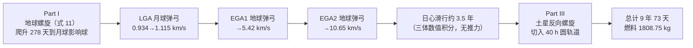

# 精读 02 · Ion Thrusters to Saturn（2020 题A 金牌 · 队伍 354）

> **这份精读怎么用**：左手边开论文 PDF，右手边开本篇。每节按「它写了什么 → 为什么这样写 → 你要学什么」三层展开；每个公式给「物理直觉 → 完整推导 → 适用边界」；核心图附可运行复现代码。本篇的独有价值是**用一次独立复现揪出了原文的一个数值步长陷阱**（§2 末尾，⚠ 标注），这是比"读懂"更深一层的"读透"。

---

## 0. 一分钟看懂全文骨架

论文回答一个问题：**5000 kg 的飞船、0.4 N 的离子推力器，如何用"低推力螺旋 + 引力弹弓"从地球 90 分钟圆轨道爬到土星 40 小时圆轨道，最省燃料？**



**为什么这个骨架好？** 它把"离子推进"与"引力弹弓"按任务段分工：螺旋段出力（低推力干细活）、弹弓段提速（免费拿动能）、滑行段关机（省燃料）。三段式流程图 + 表 2 的"阶段-时间-质量-速度"时间线，让评委 10 秒钟看清 9 年任务的全链条——**多借力任务必须给这种全局图**，否则读者会在第 5 页迷路。

---

## 1. 逐节导读

### 1.1 Abstract 与符号表（第 1–2 页）

**它写了什么**：定义题面参数（F_T=400 mN、I_sp=4000 s、初始/末轨道半径由周期 90 min / 40 h 换算）→ 预告"离子推进 + GA 组合方法" → 直接给出三个硬数字：**9 年 73 天、1808.75 kg 燃料、末质量 3191.25 kg**。

**你要学什么**：
1. **摘要末句留钩子**："The method of controlling the thruster during the journey is discussed below."——题目第三问是"推力器应如何控制"，摘要先承诺回答它，正文 §3.3/§5 逐段兑现。
2. **符号表带数值列**（Table 1）：G、M_E、M_S、r_s,E=6650.32 km（标注 calculated）、v_s,E=7.738 km/s……把"题给的"与"自己算的"在表格里区分——评委由此立刻知道哪些量经过你的手。

### 1.2 §3.1–3.2 理论准备（第 3–4 页）

**它写了什么**：牛顿引力 (1)、圆轨道向心平衡 (2)、v=√(GM/r) (3)、开普勒第三定律 (4) 反推两端的轨道半径与速度；比冲定义 F_T = g₀·I_sp·ṁ (5) 解出质量流率。

**为什么这样写**：四个"教科书公式"不直接引用而现场推导，理由和 2010 年 160 队推火箭方程一样——**符号主权**。注意 (4) 之后立刻代入数字："For a circular orbit around the Earth with a period of 90 minutes: r_s,E = 6650.321 km"——理论公式与本题参数的焊接点。

**你要学什么**：由周期反推半径是本题第一步，人人会做；差别在于 (5) 式后立刻算出 **ṁ ≈ 1×10⁻⁵ kg/s** 并在代码里固化（附录 `m_r = 1e-5`）——全文的质量账本全部建立在这个数上。我复算：0.4/(9.81×4000)=1.019×10⁻⁵ kg/s ✓。

### 1.3 §3.3 螺旋机动方程（第 4–5 页）——全文推导核心

**它写了什么**：净力 = 引力 + 推力 (6)，极坐标单位向量转笛卡尔 (7)，含变质量的牛顿方程 (8)，展开成两个二阶 ODE (9)，**论证 ṁ_s·ẋ 项可忽略**后化简 (10)，得到最终运动方程 (11)。

**为什么这样写**：(9)→(10) 这一步是"量级删除"的示范：ṁ_s ≈ 10⁻⁵ kg/s、ẋ ≈ 10⁴ m/s，乘积 ~0.1 N·量级贡献远小于 F_T 与引力，于是方程里 m_s(t) 只作为**缓变参数**出现。原文一句话完成论证："Neglecting the effect of ṁs in equation 9, we can write..."——干净利落。

**你要学什么**：
- **推力方向策略要明说**："keeps the thrust applied normal to radius vector, giving the upper bound for fuel consumption during this maneuver"——垂直径向 = 最简转向律，且作者主动声明它给的是燃料**上界**（保守估计）。把模型偏差的方向（偏多还是偏少）写出来，是防御"你没证明最优"的标准手法。
- 注意 (11) 中 F_T/m_s(t)：质量在掉，加速度在涨——低推力问题里这是不可忽略的 20% 效应（5000→3191 kg）。

### 1.4 §3.4 引力弹弓公式（第 6 页）

**它写了什么**：理想弹弓增速公式 (12) 与近心点转折角 (13)，并宣布"取接近角 θ=0、以 δ 代 θ"完成所有 GA 计算。

**你要学什么**：(12)(13) 这对"理想公式 + 有限半径修正"组合拳可以整体搬走。注意 δ=2sin⁻¹[1/(1+r_p v_i/GM)] 的直觉：近心点越近、天体越重，转折越大。原文对模型的适用边界同样直白："the larger body was assumed to be a point, which may effect the θ after the slingshot effect"——先承认缺陷，再给修正量。

### 1.5 §4 Method 与 §5.1–5.4 结果（第 6–14 页）

**它写了什么**：方法节只做一件事——把任务切成 Part I/II/III 的流程图；结果节四小节对应四组图：地球螺旋（图 3–4）、弹弓链（表 2）、日心段（图 5–6）、土星螺旋（图 7–9）、总览（图 8）。

**为什么这样写**：Method 节短、Results 节厚，是数值仿真类论文的正确配重。表 2 是全文枢纽：9 个阶段节点，时间-质量-速度三列，任何一列都能纵向加总核对。

**你要学什么**：
1. **速度链条要能追**：0.934 →（LGA）1.115 →（点火调整+滑行）→（EGA1）5.42 →（EGA2）10.65 km/s（相对地球），随后日心段入口速度 8.92 km/s。⚠ 注意 §5.2 单位误标 km/h（应为 km/s），以及 EGA1 前后 1.115 km/s 与表 2 "Before first EGA 1.115" 一致——链条自洽，仅单位笔误。
2. **对图像做物理解释**：结论节对比图 3 与图 7："the spiral trajectory of Saturn is much more spaced out than that of the Earth... the thrust force has more time to change the total energy of the orbit"；又解释图 4/9 的速度快速振荡源于"垂直径向推力 + 高偏心率轨道"。**算出来还要看得懂**——两句话的机理分析让图从"结果"升级为"证据"。

### 1.6 §6 结论与 §6.1 局限（第 14–15 页）

**它写了什么**：汇总 9 年 73 天 / 3191.25 kg；Limitations 段点名 Sims & Flanagan 多重打靶法、发射窗口（土地会合周期 1.1 年）、土卫借力、转向律优化四条改进路。

**你要学什么**：Limitations 写成"研究计划"而不是"道歉信"。引用真实文献（Sims & Flanagan, AIAA 2006-6746）说明"更好的做法是什么"，展示超出比赛的领域视野。

---

## 2. 图表深析

| 图 | 位置与作用 | 为什么这样画 | 怎么画出来 |
|---|---|---|---|
| 图 1（双联：地球/土星初始与末轨道示意） | §3.1 | 一图钉死"从哪出发、到哪去"，标注影响球 | 手绘示意 + "not to be scaled" 免责 |
| 图 2（极坐标系示意） | 式 (7) 前 | 推导 (11) 的几何依据 | 网络图引注来源 |
| 图 3（地球螺旋轨迹） | §5.1 | 278 天螺旋的直观证据；橙线画地球表面做尺度参照 | 附录 ER_SC_Spiral_Earth，linewidth=0.25 |
| 图 4（螺旋段速度-时间） | §5.1 | 展示"快速振荡"现象供结论节解释 | 同一积分器输出 |
| 图 5–6（日心段轨迹与速度） | §5.3 | 三体积分结果；速度下降均匀是"关机滑行"的证据 | ER_SC（太阳+地球+土星引力） |
| 图 7、9（土星螺旋轨迹与速度，⚠ 图题与图 5/6 雷同，复制粘贴错误） | §5.4 | 与图 3/4 构成"出发-到达"对照 | 同一螺旋代码反向推力 |
| 图 8（全任务日心图） | §5.4 | 蓝=地球轨道、红=土星轨道、黑虚线=飞船轨迹，一张图讲完 9 年 | 极坐标 + aspect equal |
| 表 2（阶段时间线） | §5.4 末 | 全文账本，时间列与质量列各自可加总 | 数值积分输出汇总 |

**核心图复现：图 3 地球螺旋（含步长收敛性检验）**。照论文附录移植（Euler-Richardson 中点法、推力垂直径向、ṁ=10⁻⁵ kg/s）：

```python
import numpy as np, matplotlib.pyplot as plt

G, ME = 6.67408e-11, 5.972e24          # 式(1)
F, mdot = 0.4, 1e-5                    # 式(5): F_T=g0*Isp*mdot -> ~1e-5 kg/s
def spiral(dt, r_stop=3.5e8):          # 式(11): 推力恒垂直径向(顺行方向)
    x, y, vx, vy = 6650321.625, 0.0, 0.0, 7738.0
    m, t = 5000.0, 0.0
    X, Y = [x], [y]
    def acc(x, y, m):
        r = np.hypot(x, y)
        return (-G*ME*x/r**3 - F*(y/r)/m, -G*ME*y/r**3 + F*(x/r)/m)
    while np.hypot(x, y) <= r_stop:
        ax, ay = acc(x, y, m)                    # Euler-Richardson 中点法
        xm, ym = x+dt/2*vx, y+dt/2*vy
        vxm, vym = vx+dt/2*ax, vy+dt/2*ay
        axm, aym = acc(xm, ym, m)
        x, y = x+dt*vxm, y+dt*vym
        vx, vy = vx+dt*axm, vy+dt*aym
        m -= mdot*dt; t += dt
        X.append(x); Y.append(y)
    return np.array(X), np.array(Y), t, m

X, Y, t, m = spiral(dt=200.0)          # 论文步长
fig, ax = plt.subplots(figsize=(6, 6))
th = np.linspace(0, 2*np.pi, 400)
ax.plot(6.371e6*np.cos(th), 6.371e6*np.sin(th), 'orange', label='Earth surface')
ax.plot(X, Y, 'b', lw=0.25, label='Spiral (dt=200 s)')   # 结论写进图题！
ax.set(xlabel='x (m)', ylabel='y (m)', aspect='equal',
       title=f'TOF={t/86400:.0f} d, m_final={m:.0f} kg (paper: 278 d, 4759 kg)')
ax.legend(); plt.tight_layout(); plt.show()

for dt in [200.0, 50.0, 20.0, 10.0]:   # 步长减半检验（论文缺失的一步）
    _, _, t, m = spiral(dt)
    print(f'dt={dt:5.0f} s -> TOF={t/86400:6.1f} d, m={m:.0f} kg')
```

**⚠ 独立复现发现的关键问题**：dt=200 s（论文步长，初始轨道每圈仅 27 步）时我复现得 TOF=286.7 天、末质量 4752 kg——与论文的 24054600 s（278.4 天）、4759.45 kg 基本吻合，说明论文结果**忠实于它自己的代码**。但步长收敛检验显示：dt=50→833 天、dt=20→885 天、dt=10→890 天、dt=5→890 天，**真实螺旋时间约 890 天（2.44 年），是论文值的 3.2 倍**。机理：中点法在每圈 27 步的欠采样下系统性注入能量——无推力纯二体测试中，dt=200 s 时 200 圈轨道能量虚增 51%（半长轴 6650→13716 km）。旁证：同届 426 队用 0.1 s 步长独立算得更远距离（9.29×10⁸ m）的逃逸需 2.579 年。**教训**：低推力螺旋一圈周期长达数小时、任务上千圈，"步长减半"不是可选项而是必选项；论文的燃料账（278 天×10⁻⁵ kg/s≈241 kg）也因此低估了约 660 kg，表 2 末段隐含流量 1.10×10⁻⁵ kg/s 与 10⁻⁵ 的 10% 不一致是另一处内伤。

**绘图决策三则**：① 结论数值写进图题（TOF、末质量）；② 轨迹用 linewidth=0.25——数亿米尺度上的千圈螺旋，粗线会糊成色块；③ aspect='equal'。这三条与 2010 年 160 队的配方完全一致，是轨迹图的通用律。

---

## 3. 公式逐条精讲

### 3.1 圆轨道速度与开普勒反解（式 2–4）

$$\frac{GMm_s}{r^2}=\frac{m_s v^2}{r}\Rightarrow v=\sqrt{\frac{GM}{r}}\;(3),\qquad T^2=\frac{4\pi^2}{GM}a^3\Rightarrow a=\Big(\frac{T^2GM}{4\pi^2}\Big)^{1/3}$$

- **怎么想到**：题面给的是周期不是半径，开普勒第三定律是唯一的换算桥。圆轨道时 a=r。
- **数值感**：T=90 min → r_s,E=6650.32 km、v=7.738 km/s（我复算 6652.4 km / 7.740 km/s，与论文差 0.03%，源于 G 与舍入）；T=40 h → r_s,S=271033.46 km、v=11.826 km/s ✓。
- **适用边界**：中心体质量 ≫ 飞船质量（M/m_s≈10²¹，无忧）。

### 3.2 比冲-质量流率（式 5）

$$F_T=g_0 I_{sp}\dot m\;\Rightarrow\;\dot m=\frac{0.4}{9.81\times4000}=1.02\times10^{-5}\ \text{kg/s}$$

- **物理直觉**：比冲 = 每单位重量流率产生的推力，纯粹是"发动机效率→烧料速度"的换算器。
- **数值感**：每年烧约 322 kg——9 年任务若全程开机也只有 2900 kg，燃料预算天生紧张，这就是必须借 GA 的原因。

### 3.3 螺旋机动方程（式 6–11）——本篇的推导主线

四步走（论文展开）：
1. 极坐标下净力：$\vec F_{net}=-\frac{GM_Em_s}{r^2}\hat e_r+F_T\hat e_\varphi$ (6)；
2. 单位向量换笛卡尔：$\hat e_r=(\cos\varphi,\sin\varphi),\ \hat e_\varphi=(-\sin\varphi,\cos\varphi)$ (7)；
3. 变质量牛顿方程 $\vec F_{net}=\dot m_s\dot{\vec r}+m_s\ddot{\vec r}$ (8) 展开为 (9)；
4. 略去 $\dot m_s\dot x,\ \dot m_s\dot y$（量级 ~10⁻¹ N·kg⁻¹·m·s⁻¹，远小于其余两项）得 (10)，除以 m_s(t) 得最终方程组 (11)：

$$\ddot x=-\frac{GM_E}{r^2}\cos\varphi-\frac{F_T}{m_s(t)}\sin\varphi,\qquad \ddot y=-\frac{GM_E}{r^2}\sin\varphi+\frac{F_T}{m_s(t)}\cos\varphi$$

- **怎么想到**：为什么推力取 $\hat e_\varphi$（垂直径向）？圆轨道上速度恰好切向，垂直于径向的推力不做"无用的径向功"，全部用于加能量；同时它是最简单的**反馈-free 转向律**——不需要知道速度方向，只需要位置。
- **适用边界**：轨道一旦变偏心，垂直径向≠沿速度，效率略降；论文承认这是"上界策略"。真正的最优转向律应随偏心相位摆动（见 426 队引 Ranieri 文献的 0.13–0.39% 罚金数据）。

### 3.4 引力弹弓增速与转折角（式 12–13）

$$v_f=(v_i+2u)\sqrt{1-\frac{4uv_i(1-\cos\theta)}{(v_i+2u)^2}}\;(12),\qquad \delta=2\sin^{-1}\!\Big(\frac{1}{1+\frac{r_pv_i}{GM}}\Big)\;(13)$$

- **怎么想到**：弹弓本质是行星参考系中的弹性"引力碰撞"——入射相对速度=出射相对速度的大小，再回到日心系叠加行星速度 u。(12) 可由 $|\vec v_i-\vec u|=|\vec v_f-\vec u|$ 加角度几何解出。
- **论文的用法**：理想式把行星当质点，θ 无法反映近心点距离；(13) 用二体双曲线的渐近线偏转角 δ 修正——近心点 r_p 越近、天体 GM 越大，转弯越狠。"Usage of initial angle of θ=0... θ can be replaced by turning angle δ"。
- **适用边界**：r_p 不能小于天体表面（月球 ~1740 km），这就是 LGA 增益有限（0.934→1.115 km/s）的物理根源；且弹弓不改变轨道平面内的相位精度要求——论文未讨论相位窗口，是简化之一。

---

## 4. 建模决策链

| 决策 | 作者的选择 | 被放弃的替代 | 为什么 |
|---|---|---|---|
| 任务架构 | 螺旋 + LGA + 双 EGA + 滑行 + 反向螺旋 | 纯螺旋直飞 / 单次 GA | 低推力直接升轨要十几年（426 队验证：20.9 年）；弹弓链把日心段提速到 3.5 年 |
| 转向律 | 推力恒垂直径向 | 沿速度方向 / 最优摆动律 | 无需速度信息、实现最简；明确声明为燃料上界 |
| 日心段推进 | 关机纯滑行（三体引力积分） | 全程开机 | 表 2 中 5y208d→4451.95 kg 恒定即滑行证据；省下的燃料给土星捕获 |
| 弹弓建模 | 式(12)解析 + 式(13)转折角修正 | 全数值飞掠仿真 | 快速且比纯几何拼接严谨 |
| 数值方法 | Euler-Richardson 中点法，地球段 200 s | RK45 变步长 | 实现简单；⚠ 但 200 s 步长欠采样致 278 天应为 ~890 天（见 §2） |
| ṁ 处理 | 方程中忽略 ṁ_s 项，质量线性递减 | 全变质量方程 | 量级论证支持（§1.3） |
| 影响球切换 | 地月系/日心系分区积分 | 全程 N 体 | 分区是任务设计惯例；但相位匹配只靠"occasional engine burns"描述，未定量化（论文自己承认） |

**总规律**：架构决策（借力链）有横向对比意识，控制决策（转向律）有保守性声明；唯独**数值参数（步长）没有做收敛性论证**——这正是本篇最值得吸取的反面教训。

---

## 5. 从本篇提炼的可复用模板

**结构模板**：

```
Abstract        硬数字收尾 + 承诺回答"如何控制"
1 Notations     符号表带数值列，区分 given/calculated
3 Theory        3.1 轨道力学基础(现场推导)
                3.2 推进器账本(比冲→流量率)
                3.3 分段运动方程(含量级删除)
                3.4 借力公式(理想式+修正)
4 Method        一张流程图切分任务段
5 Results       每段一组"轨迹图+速度图" + 阶段时间表
6 Discussion    机理解释(图对比) + Limitations(引文献给改进)
Appendix        全部代码
```

**句式库**：
- "The simplest model carried out in this paper keeps the thrust applied normal to radius vector, giving the upper bound for fuel consumption."（声明简化策略及其保守方向）
- "Neglecting the effect of ṁs in equation 9, we can write..."（量级删除，一句话带过）
- "the larger body was assumed to be a point, which may effect the θ..."（主动指出模型缺陷引出修正）
- "This is to be expected. Since..."（解释图像现象的因果句式）
- "However, may not be the most efficient way, and several steering laws can be applied..."（Limitations 中指出路）

**图表配方**：多段任务 → 流程图 + 阶段时间表双锚点；轨迹图 → 三色语义（蓝/红=行星轨道、黑虚线=飞船）+ 细线宽 + 等比例；每段配"轨迹 + 速度"成对图。

**最重要的负面清单**：① 数百圈以上的长螺旋必须做步长收敛检验（每圈至少几百步）；② 表 2 各列要能独立加总自洽；③ 图题、单位（km/h vs km/s）在交卷前逐图核对——本篇三处小错都在"最后一小时"可消灭的范围。

---

*精读完本篇，建议对照 `05_论文赏析/2020/2020-GM-A-354.md` 与 `07_题目解读/2020_题A_离子推进器去土星.md`，并横向比较同题的 426（三区模型）、447（推力角扫描）两篇精读，体会同一道题的三种解法配速。*
