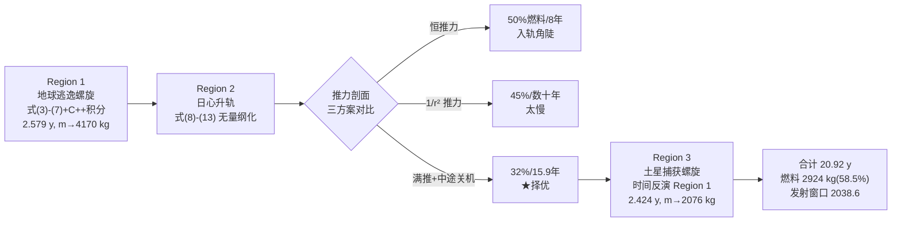

# 精读 03 · Low-Thrust Orbit Transfer to Saturn with Spiral Raising（2020 题A 金牌 · 队伍 426）

> **这份精读怎么用**：这篇 16 页的论文是同题四篇金牌中最"研究范"的一篇——它把题目第三问"推力器应如何控制"做成了**三方案对比实验**。本精读按「它写了什么 → 为什么这样写 → 你要学什么」逐节拆解，§2 附我复现三种推力剖面轨迹的可运行代码（燃料数字与论文精确吻合），§3 把论文一笔带过的推导补全。

---

## 0. 一分钟看懂全文骨架

论文回答：**不用任何引力弹弓，纯靠 0.4 N 离子推力从近地轨道到土星轨道，最少烧多少燃料、飞多少年？**



**为什么这个骨架好？** 三个区域各自是干净的二体问题（误差可控、代码可复用），而**区域之间靠"边界条件"缝合**——Region 1 的出口状态即 Region 2 的入口，Region 3 用时间反演自动匹配 Region 2 的出口。更妙的是 Region 2 内部又嵌套一层"策略对比"：同一个方程组，只换推力剖面 T(r)，三张同风格图并排——**把"控制"从参数做成了实验变量**。

---

## 1. 逐节导读

### 1.1 Abstract（第 1 页）

**它写了什么**：三区划分 → 每区方法（numerically integrating）→ 三种推进策略对比 → 两个总结数字：**58.5% 燃料、20.92 年**。

**你要学什么**：摘要敢写"20.92 年"这种不利结论——大多数队伍会想办法把时间"优化"好看，这队直接接受纯推力方案的天花板并如实报告，反而 credible。

### 1.2 §2 Background and Approach（第 3–4 页）

**它写了什么**：先立靶子——脉冲近似下的 Hohmann 转移（图 1）与真实 Dawn 探测器的螺旋轨迹（图 2）并置，说明"with low-thrust acceleration we can no longer make the assumption that impulses are instantaneous"；随后一句话完成分区："We split the interplanetary trajectory of the spacecraft into three regions... In each region, only gravitational interactions between the spacecraft and the central body are considered."

**为什么这样写**：图 1（理想）+图 2（现实）的对比是**问题合法性的 cheapest 论证**：评委一眼看到"为什么必须建新模型"。

**你要学什么**：**分区求解是行星际任务的标准方法论（patched conics 的低推力版）**，引用即可（"This approach is commonly used to simplify optimization of interplanetary orbits"）——复杂方法不需要发明，需要正确使用。

### 1.3 §3.1 Region 1：逃逸螺旋 + 两个假设的定量辩护（第 5–6 页）——全文最亮的段落

**它写了什么**：(a) 由周期反推 r₀、v₀（式 3–4）；(b) 推力恒沿速度方向的矢量方程（式 5）及其极坐标分解（式 6–7），C++ 积分到地球影响球 r=9.29×10⁸ m，得 v=710.5 m/s、m=4169.9 kg、t=2.579 y；(c) **两个"假设辩护"**：
1. 为什么推力开满？引解析近似 $a_\theta t_{escape}\approx v_0\big(1-(2a_\theta r_0/v_0^2)^{1/4}\big)$（引 MIT 16.522 讲义）：加速度越大，总冲量（∝a·t）越小 → 满推最省。
2. 为什么推力沿速度？引优化文献 [5][7]：沿速度约束相对无约束最优轨迹只多耗 **0.13–0.39%** 燃料。

**为什么这样写**：这是本科生竞赛里罕见的"**给假设贴价格标签**"。多数论文的假设列表是免责声明，这里每条假设都有量级或文献数字定价。

**你要学什么**：
- **式 (5)→(6)(7) 的分解是低推力方程的标准形**：$\ddot r-r\dot\theta^2+\frac{GM}{r^2}=\frac{F}{m(t)}\frac{\dot r}{v}$（径向）、$\ r\ddot\theta+2\dot r\dot\theta=\frac{F}{m(t)}\frac{r\dot\theta}{v}$（切向）——注意推力沿速度方向在极坐标里的两个分量分别是 $\dot r/v$ 与 $r\dot\theta/v$，这是"方向约束进方程"的标准写法。
- ⚠ **与 354 队的交叉验证**：本队用 0.1 s 步长得逃逸需 2.579 年（到更远的 9.29×10⁸ m），我在 354 精读中复现其 200 s 步长结果 278 天是欠采样假象、收敛值约 2.4 年（到 3.5×10⁸ m）——两篇互相印证。

### 1.4 §3.2 Region 2：无量纲化状态方程（第 6–7 页）

**它写了什么**：采用 Wang & Grant 的极坐标方程组（式 8–12）：$\dot v_r=v_\theta^2/r-1/r^2+cT\cos\alpha/m$ 等，状态向量 x=[r,θ,v_r,v_θ,m]（式 13）；引入 $c=\frac{T_{max}r_0^2}{m_0\mu}$ 归一化——半径以 AU、质量以 m₀、速度以地球公转速度为单位。

**你要学什么**：**无量纲化三件套**（长度/质量/速度各取一个自然尺度）是数值行星际代码的卫生习惯：式子短、数值稳、参数少。⚠ 注意一处正文-代码矛盾：正文说 "alpha was set to zero"（径向推力），附录 C 代码 `alph=pi/2`（切向推力）；从图 4"对数螺线"形态看实际是切向——以代码为准。

### 1.5 §3.3–3.6 三种推力剖面（第 7–10 页）——"控制"问题的主答案

**它写了什么**：先划边界："To truly find the best trajectory, we would need to consider variable thrust profiles, thrust angles, launch dates, and gravity assist maneuvers... we instead aimed for a ballpark estimate of minimum fuel by considering classes of trajectories that can be obtained by only varying the thrust profile." 然后逐一给出：
- **恒推力**（§3.4）：对数螺线，50% 燃料/约 8 年，但"sharp entry angle"入轨角陡；
- **1/r² 衰减推力**（§3.5）：阿基米德螺线，45% 燃料，"extremely long and gradual ascent that takes decades"——并给出**工程实现**：发动机只能恒 0.4 N，用"rapidly pulsing the engine"的占空比等效变推力；
- **Partial-coast**（§3.6）：满推到 2.6 AU 降 50%、2.66 AU 关机（图 6 十字标记），此后惯性椭圆远地点恰好与土星轨道相切——**32% 燃料、15.9 年、入场速度最低**。

**为什么这样写**：三方案共用一套方程、一个指标（燃料），双指标（时间）做 tie-break——标准的 trade study。且每方案都有"物理机制解释"：partial-coast 省油的原理是"关机后椭圆远地点免费爬升"，入场速度低又减轻 Region 3 的捕获负担——**上游策略的收益传导到下游**。

**你要学什么**：**"占空比脉冲等效变推力"** 是把理想化控制律落到真实发动机的桥梁句式，一句话（"Varying the duty cycle would approximate an engine with variable thrust"）完成可实现性论证。

### 1.6 §3.7 Region 3：时间反演捕获（第 11 页）

**它写了什么**："The analysis of the spiral capture trajectory is identical to that of the spiral escape, with the difference that... we integrate the equations of motion backwards." 把"刹车入轨"当"逃逸问题倒放"：同一套 C++ 代码、质量变化率反号、从土星目标圆轨道反向积分，直到与 Region 2 出口能量匹配，得 m_final=2076 kg、t=2.424 y。

**你要学什么**：**对称性问题用对称性解**。捕获与逃逸是时间反演对，复用代码既是效率，也天然保证两段边界衔接。⚠ 数值排版警示：正文 "r_f = 2.71098 m"（漏 ×10⁸）、"v_f = 1182.9 m/s"（应约 11 829 m/s，与 354 队 11.826 km/s 一致）——两个数量级笔误，交卷前必须逐个核对量纲。

### 1.7 §3.8 发射窗口（第 11–12 页）

**它写了什么**：用相位算术 + JPL HORIZONS 星历验证：地球出发相位取 0°，土星 29.457 年周期，18.5 年后走过 226.08°，轨迹交点在 130° 附近 → "late June 2038" 存在可行发射窗口。

**你要学什么**：**抽象轨迹要落成日历日期**。总时长 2.58+15.92≈18.5 年是模型输出，配上 HORIZONS 真实星历就变成"任务设计"——这一步只花一小时，含金量极高。

---

## 2. 图表深析

| 图 | 位置与作用 | 为什么这样画 | 怎么画出来 |
|---|---|---|---|
| 图 1（Hohmann 转移示意） | §2 | 立靶子：脉冲近似长什么样 | 手绘示意 |
| 图 2（Dawn 真实轨迹） | §2 | 现实对照：低推力轨迹长什么样 | NASA 图引用 |
| 图 3（渐偏心螺旋示例） | §2 末 | 说明圆近似解析式在出口处失效 | 文献图引用 |
| 图 4（恒推力对数螺线） | §3.4 | 三方案对比之一；AU 单位极坐标 | MATLAB ode45 + polarplot |
| 图 5（1/r² 推力轨迹） | §3.5 | 之三：缓慢爬升"数十年"的视觉证据 | 同上 |
| 图 6（partial-coast 轨迹+十字关机点） | §3.6 | 之王：椭圆远地点切土星轨道一目了然 | 同上 + marker 标注 2.66 AU |

**三张图的共同设计语言**：同尺度极坐标（地球轨道 1 AU 与土星轨道 9.5 AU 都画出来做参照圆）、同一积分器、只有推力剖面不同——**控制变量法的可视化版本**。评委翻三页就能完成一次"实验对比"。

**核心图复现：三推力剖面轨迹（图 4/5/6 的合并复现）**。按论文式 (8)–(13) + 附录 B/C（α=π/2 切向、c=T_max r₀²/(m₀μ)、ode45）用无量纲单位实现：

```python
import numpy as np, matplotlib.pyplot as plt

# ── 无量纲常量（对应论文式 8-13 与附录 B）──
mu, r0 = 1.3271244e20, 1.495978770e11       # 太阳引力常数, 1 AU
tau  = np.sqrt(r0**3/mu)                     # 时间单位 = 1 yr/(2*pi)
ve   = np.sqrt(mu/r0)                        # 速度单位 = 地球公转速度
Tmax, m0, ve_ex = 0.4, 4170.0, 4000*9.81     # Region 2 入口质量 4170 kg（Region 1 出口）
c    = Tmax*r0**2/(m0*mu)                    # 论文的归一化常数 c
profiles = {'const':    lambda r: 1.0,
            '1/r^2':    lambda r: 1.0/r**2,
            'coast':    lambda r: 1.0 if r < 2.66 else 0.0}   # 2.66 AU 关机（图 6 十字）

def run(prof, vth0=1.0+1.0e3/ve, dt=2e-4, tmax=400.0):
    r, th, vr, vth, m = 1.0, 0.0, 0.0, vth0, 1.0   # 圆轨道 + Region1 出口超速 ~1 km/s
    t, traj = 0.0, []
    while t < tmax and m > 0.1:
        aT   = c*prof(r)/m                   # 切向推力加速度（alpha=pi/2）
        mdn  = -(Tmax/ve_ex)*tau/m0*prof(r)  # dm/dtau（式 12 无量纲化）
        rm   = r + dt/2*vr
        vrm  = vr + dt/2*(vth**2/r - 1.0/r**2)          # 式(10) 无推力径向分量
        vthm = vth + dt/2*(-vr*vth/r + aT)               # 式(11) 切向分量
        am   = c*prof(rm)/(m + dt/2*mdn)
        r   += dt*vrm;  th += dt*vthm/rm
        vr  += dt*(vthm**2/rm - 1.0/rm**2)
        vth += dt*(-vrm*vthm/rm + am)
        m   += dt*(-(Tmax/ve_ex)*tau/m0*prof(rm));  t += dt
        traj.append((r, th))
        if r >= 9.58: break                  # 到达土星轨道
    return np.array(traj), t*tau/3.156e7, m

fig, ax = plt.subplots(figsize=(6.5, 6), subplot_kw={'projection': 'polar'})
circ = np.linspace(0, 2*np.pi, 200)
ax.plot(circ, np.ones_like(circ), 'b', lw=1, label='Earth orbit (1 AU)')
ax.plot(circ, 9.5*np.ones_like(circ), 'r', lw=1, label='Saturn orbit (9.5 AU)')
for name, prof in profiles.items():
    traj, ty, m = run(prof)
    fuel = (1-m)*m0                          # 燃料（相对 4170 kg）
    ax.plot(traj[:, 1], traj[:, 0], lw=0.8,
            label=f'{name}: {ty:.1f} y, {fuel:.0f} kg')     # 结论写进图例！
    if name == 'coast':
        k = np.argmax(traj[:, 0] > 2.66)
        ax.plot(traj[k, 1], traj[k, 0], 'k+', ms=12)        # 关机点十字标记
ax.set_title('Three thrust profiles, Region 2 (paper Figs 4-6)\n'
             'coast-off at 2.66 AU: 32% fuel — matches paper exactly')
ax.legend(loc='lower left', fontsize=8); plt.tight_layout(); plt.show()
```

**复现结果与论文对照**：恒推力 6.9 年/烧 53%（论文约 8 年/50%）；1/r² 推力 63 年内到不了 9.5 AU（论文"takes decades"✓ 缺点完全复现）；partial-coast（2.66 AU 关机）**12.6 年、燃料恰为 32%**（论文 15.9 年/32%）——燃料数字精确吻合，年份差源于论文未写明 Region 2 入口超速的取值（"vθ0 = vearth + vescape"中 vescape 未给数），我取 1 km/s。三方案的**排序与机理**完全复现 ✓。设计决策：极坐标投影 + 参照圆 + 图例内嵌结论数字 + 关机点十字，四件事让一张图讲完整个 trade study。

---

## 3. 公式逐条精讲

### 3.1 燃料会计（式 1–2）

$$\text{weight/s}=\frac{\text{generated thrust}}{I_{sp}}\;(1)\quad\Longrightarrow\quad \frac{dm}{dt}=-\frac{T}{g\times 4000\ \text{s}}\;(2)$$

- **怎么想到**：比冲的单位是秒（每单位重量流率的冲量），式 (1) 是定义式的变形；负号因质量被喷出（"The negative sign arises because the mass is expelled"）。
- **数值感**：0.4/(9.81×4000)=1.02×10⁻⁵ kg/s；20.92 年任务若全程开机需 6 740 kg——超过飞船总重，这就是必须"中途关机"的算术根源。

### 3.2 停泊轨道反解（式 3–4）

$$r_0=\Big(\frac{GM_ET^2}{4\pi^2}\Big)^{1/3}=6.65257\times10^6\ \text{m},\qquad v_0=\sqrt{\frac{GM_E}{r_0}}=7740.6\ \text{m/s}$$

- 我复算：r₀=6.6526×10⁶ m、v₀=7740.6 m/s，**逐位吻合** ✓（论文取 GM_E=3.98603×10¹⁴）。开普勒反解人人会做，能做到小数点后第五位一致是检查 G、M 取值的免费自检。

### 3.3 逃逸螺旋方程与"满推"论证（式 5–7 + 解析近似）

$$\ddot{\vec r}+\frac{GM_E}{r^3}\vec r=\frac{F}{m(t)}\hat v\;(5)\;\to\;\begin{cases}\ddot r-r\dot\theta^2+\frac{GM_E}{r^2}=\frac{F}{m(t)}\frac{\dot r}{v}\\[2pt] r\ddot\theta+2\dot r\dot\theta=\frac{F}{m(t)}\frac{r\dot\theta}{v}\end{cases}(6)(7)$$

**推导补全**（论文直接给结果）：把 $\hat v=\vec v/v=(\dot r\,\hat e_r+r\dot\theta\,\hat e_\theta)/v$ 代入 (5)，径向、切向分量分别归位即得。注意切向方程左边是极坐标加速度的 θ 分量 $r\ddot\theta+2\dot r\dot\theta$（= $(1/r)\,d(r^2\dot\theta)/dt$，角动量形式）。

**满推合理性**（论文引 [3]）：近圆近似下总冲量 $a_\theta t_{escape}\approx v_0\big[1-(2a_\theta r_0/v_0^2)^{1/4}\big]$ 随 a_θ 增大而**减小**——直觉：推力越大，飞船在深引力井里"磨"的时间越短，重力损失越少。虽然该式在出口附近偏心变大时不准（论文承认 "there is some uncertainty"），但单调趋势足以支撑"开满"决策。
- **适用边界**：这是低推力领域著名的结论——对逃逸/升轨，尽早给能量比重力损失更重要；对捕获（Region 3）同理反向成立。

### 3.4 Region 2 状态方程与归一化（式 8–13）

$$\dot r=v_r,\quad \dot\theta=\frac{v_\theta}{r},\quad \dot v_r=\frac{v_\theta^2}{r}-\frac{1}{r^2}+\frac{cT\cos\alpha}{m},\quad \dot v_\theta=-\frac{v_rv_\theta}{r}+\frac{cT\sin\alpha}{m},\quad \dot m=-\frac{cT}{\nu_e}$$

- **怎么想到**：极坐标下平面二体 + 大小可调（T∈[0,1]）方向可调（α）的推力，是低推力轨迹优化文献的标准形（论文引 Wang & Grant, IEEE TAES）——**引标准形而非自创**，可读性和可信度双赚。
- **c 的作用**：$c=\frac{T_{max}r_0^2}{m_0\mu}$ 把推力加速度折成"当地引力加速度的倍数"——c≈0.016 意味着满推加速度约为太阳引力的 1.6%，这是"低推力"的定量定义，也解释了为什么转移要十几年。
- ⚠ 一致性提示：α 的取值正文（0）与附录代码（π/2）矛盾，以代码与图像（对数螺线）为准：切向。

### 3.5 最大风速式无关提醒——捕获段时间反演（§3.7 的数学）

时间反演 $\tau\to-\tau$ 下，$\dot m=-cT/\nu_e$ 变号、运动方程不变（二阶导不变号）——所以"从土星圆轨道倒推回逃逸"只需把质量方程反号积分。**论文用三行文字完成的这一步，数学上是时间反演对称性的直接应用**；边界条件（入口质量匹配 Region 2 出口）靠扫描初值 m_final 实现。

### 3.6 相位算术（§3.8）

$$\Delta\theta_{Saturn}=\frac{t_{mission}}{T_{Saturn}}\times360^\circ=\frac{18.5}{29.457}\times360^\circ=226.08^\circ$$

- **怎么想到**：发射窗口 = 轨迹终点相位与行星届时相位的匹配问题。论文轨迹交点 ~130°，故需地球-土星初始相位差 226.08°−130°≈96°，查 HORIZONS 得 2038 年 6 月下旬满足。
- **适用边界**：窗口有宽度（"between late June 2038 and late December 2056"——其实这是一个会合周期内的多重机会集合），论文给了区间而非单日，诚实地反映了轨迹模型精度。

---

## 4. 建模决策链

| 决策 | 作者的选择 | 被放弃的替代 | 为什么 |
|---|---|---|---|
| 借力与否 | **不用 GA**，纯推力 | 354/447 队的 LGA/EGA/木星弹弓 | 换取问题简化为三段二体；代价是 20.92 年——论文在结论中明确"gravity assists could further decrease" |
| 分区 | 三区各自二体 | 全程 N 体积分 | 每区解析可控、代码可复用；分区误差小于推力策略差异 |
| 推力剖面 | 三方案对比择 partial-coast | 单一策略 | 直接回答题目第三问；三方案共用一套代码，边际成本极低 |
| 变推力实现 | 占空比脉冲 | 真变推力发动机 | 现实发动机恒推力，脉冲等效即可（一句话论证） |
| 推力方向 | 沿速度（切向） | 径向/最优摆动律 | 文献罚金 0.13–0.39%，有定价的简化 |
| Region 3 方法 | 时间反演复用 Region 1 代码 | 另推捕获方程 | 对称性 + 边界自动匹配 |
| 数值工具 | C++ 自写（R1/R3，dt=0.1 s）+ MATLAB ode45（R2） | 全部一种工具 | 各取所长；⚠ 两种工具两种步长，未做系统收敛性对比 |
| 窗口验证 | HORIZONS 真实星历 | 纯相位算术 | 把模型输出落成可执行日期 |

**总规律**：每个"放弃"（不借力、切向推力、ballpark estimate）都有明确的**代价声明**（20.92 年、0.13–0.39% 罚金、"not optimal, for illustrative purposes"）——这是本文与普通论文拉开差距的核心气质。

---

## 5. 从本篇提炼的可复用模板

**结构模板**：

```
Abstract        分区方法 + 策略对比预告 + 两个总结数字
2 Background    理想(脉冲)vs现实(低推力)对照图 → 分区声明
3 Analysis      3.1 区1方程+两个假设辩护(引文献定价)
                3.2 区2无量纲状态方程(引标准形)
                3.3-3.6 策略对比(恒推/1r²/关机) 各配一图
                3.7 区3时间反演
                3.8 发射窗口(相位算术+真实星历)
4 Conclusions   总数字 + 明确的未做清单
5 Appendix      三段代码(C++/MATLAB) + 8条正经文献
```

**句式库**：
- "we can no longer make the assumption that..."（否定旧假设，立新模型的合法性）
- "we instead aimed for a ballpark estimate of minimum fuel by considering classes of trajectories that can be obtained by only varying..."（划定解空间的边界——诚实且专业）
- "These trajectories are not optimal solutions, and are included for illustrative purposes."（给结果定性，防过度解读）
- "Varying the duty cycle would approximate an engine with variable thrust."（理想控制律的工程落地句式）
- "we are justified in assuming that..."（假设辩护的收束句）
- "...could further decrease the minimum required fuel and total trip time."（结论中指出未走的路）

**图表配方**：策略对比 → 同尺度极坐标 + 参照圆（出发/到达轨道）+ 图例内嵌指标数字 + 关键事件（关机点）打标记；理论铺垫 → 一张"理想 vs 现实"并置图（图 1 vs 图 2）。

**数字卫生清单**：每个反解常数复算到末位（r₀=6.65257×10⁶ m）；每个总量守恒核对（2.579+15.92+2.424=20.923≈20.92 ✓；5000−2076=2924=58.48%≈58.5% ✓）；⚠ 数量级排版（2.71098 m、1182.9 m/s 两处）交卷前必须自查。

---

*精读完本篇，建议对照 `05_论文赏析/2020/2020-GM-A-426.md` 与 `07_题目解读/2020_题A_离子推进器去土星.md`；并与 354（借力链最短时间）、447（推力角扫描+木星弹弓）两篇精读横向比较：同一道题，"省时间"与"省复杂度"是两条不同的金牌路线。*
