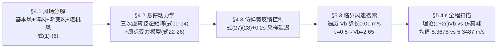

# 精读 06 · Stability Research of Quadcopter UAV Under Unstable Wind（2020 题B 金牌 · 队伍 380）

> **这份精读怎么用**：这篇 39 页长文走了一条与 335 队完全不同的路——**先把风拆成四种分量，再用一个"仿弹簧"反馈律和"风速变化因子 ε"把开放问题参数化**。本精读逐节拆解其"理论公式 + 全程仿真互相夹逼"的自洽性检验；§2 附我把附录 MATLAB 主程序逐行移植成 Python 的可运行复现（临界基本风 2.67 vs 论文 2.65 m/s）。⚠ 原文公式提取有乱码，凡以渲染图/附录代码为准处均已注明。

---

## 0. 一分钟看懂全文骨架

论文回答：**不稳定风（非常定、含阵风与随机分量）下，四旋翼悬停 60 s 不出 20 cm 圈的最大风速是多少？**



**为什么这个骨架好？** 开放题最大的敌人是"风怎么变"无法枚举。该队用单参数 ε（风速变化因子）把风的"不稳度"压缩成一个可扫描维度，于是答案从孤立数字升级为**一条曲线（图 19）+ 一个闭式关系 V_max=(1+2ε)V_b（式 35）**——理论线与仿真线全程贴行，互为校验。

---

## 1. 逐节导读

### 1.1 Abstract 与 §1–2（第 1–4 页）

**它写了什么**：摘要四件事——四分量风场、悬停动力学、力-运动模型、自调反馈机构；两个数字收尾：**理论期望 5.3678 m/s、仿真均值 5.3487 m/s**。§2.2 分析题眼："There will be a delay between when the wind starts to kick in and when the drone adjusts"——风起与调整之间有延迟，这正是后文 0.2 s 采样/调整时间的出处。

**你要学什么**：**把题面叙述里的物理机制翻译成模型参数**。"控制有延迟"这句话在题面里没有明说，但它是无人机抗风的本质难点，该队把它显式化为 5 Hz 采样 + 0.2 s 调整时间两个数——模型从此有了"时间颗粒度"。

### 1.2 §3 假设（第 5 页）

**它写了什么**：六条假设（刚体、地面系惯性系、**风向短时间缓变**（引文献"direction of the wind changes uniformly and slowly"）、g 不变、X 对称、忽略地面效应/曲率/自转）。

**为什么这样写**：第 3 条是全文方法论的地基——风向缓变，才能把三维风简化成水平单向风叠加垂直修正。假设不是免责声明，而是**后续所有简化的开关**。

### 1.3 §4.1 风场四分量模型（第 8–10 页）——第一个亮点

**它写了什么**：**先论证为什么不用现成模型**："the Von Karman turbulence model and Dryden model are commonly used... but these two theories are more suitable for high-altitude wind fields. The flying height of quadcopter UAVs is generally in the ultra-low altitude range"——所以自建四分量：
- 基本风 V_b=k（式 1，常值，"close to the average value of the wind speed"）；
- 阵风（式 2）：余弦脉冲（⚠ 正文式为 (V_g^max/2)(1−cos(2π(t−t₁)/T_g)) 形，附录代码实现为 sin 形，以代码为准）；
- 渐变风（式 3）：分段线性三角波（升 0.5T_v、降 0.5T_v）；
- 随机风（式 4）：$V_n=V_n^{max}\,R(-1,1)\cos(\omega_nt)$，R 均匀随机、ω_n∈[0.5π, 2π] rad/s 随机；
- 合成（式 5）V=V_b+V_g+V_r+V_n；最大风速（式 6）为各分量峰值之和。

**为什么这样写**：**拒绝套现成模型 + 给出理由**是全文最有胆识的一步。评委看到的是物理判断（高空谱模型不适用超低空），而不是模板搬运。四分量各自对应风的一种"性格"（稳定、突发、渐变、随机），原文 §6.1 逐条复述这种对应——模型的每一块都有"拟真职责"。

**你要学什么**：随机风的构造 $R\cdot\cos(\omega t)$ 值得品：随机数给幅值调制、余弦给局部相关（相邻时刻不至于完全独立）——**用两个简单随机源拼出"有相关性的随机过程"**，是缺乏谱方法时的廉价替代。

### 1.4 §4.2 悬停动力学（第 10–16 页）

**它写了什么**：X 型结构选择及理由（相邻桨反转抵消反扭矩）；地面系/机体系经**三次单轴旋转**（绕 Z 的 yaw 式 10、绕 Y 的 pitch 式 11、绕 X 的 roll 式 12）合成 R（式 13），再用正交性 $R^TR=I$（式 9）取转置得反向变换（式 14）；总升力 F_i∈[0,7] N（式 15）、经 R 投影到地面系（式 16）、重力（式 17）、风阻按轴分解 $f=\frac12 C\rho S\sin\theta\,v^2$（式 7、18、22）；牛顿第二定律得平动方程（式 19–21）；**水平面质点简化**（§4.2.5、图 4）：F cosθ=G（式 23）、F sinθ−f=ma（式 24），并给出最大水平修正力约束（式 26，⚠ 正文排印严重损毁，以附录代码为准：$F_{max}=\sqrt{28^2-(mg)^2}=23.8$ N，即总推力 28 N 扣除悬停重力后的水平余量，对应最大倾角 sinα_max=F_max/28）。

**为什么这样写**：先**完整**推三维动力学（式 8–21），再**大胆**简化到二维质点（式 22–26）——两套模型分工：前者证明"我们会建全模型"，后者承担全部仿真。很多队伍死在"要么只建玩具模型、要么陷在全模型里"，这种"全推导 + 轻使用"的两层结构是解法。

**你要学什么**：**三次单轴旋转的推导顺序**（yaw→pitch→roll）与矩阵连乘方向要在文中明说（"the combination of these three hypotheses... is the way to achieve the transformation"）；式 (9) 的正交性质不是装饰——它让反向变换一行写出（式 14），这是"用数学性质省推导"的示范。

### 1.5 §4.3 控制系统（第 16–18 页）——第二个亮点

**它写了什么**：先定性（图 5/6 框图）：风速变大→升力增大，变小→升力减小；水平风向变→桨差速滚转/俯仰，垂直风向变→调总升力；斜向风"vector decomposition can be used"分解处理。后定量（式 27–28，⚠ 排印损毁，以附录代码为准）：调整力 $F_p=-f(t-1)-\max(F_f)\cdot x/x_{max}$——第一项抵消上一时刻的风力，第二项是以"偏离 20 cm 时恰用满修正力"为刚度的**比例回拉**；越界则切满舵饱和（±F_max）。

**为什么这样写**：原文自己给了最好的类比——"simulating the relatively stable structure of the **spring**"（§6.1 优点 4）。仿弹簧控制一眼可懂：刚度 = max(F_f)/x_max，阻尼隐含在 0.2 s 采样延迟里。

**你要学什么**：**控制律可以不自创数学、只借物理原型**。一个弹簧类比 + 两条分支（线性区/饱和区），胜过半页 LQR 公式——前提是像他们一样把"刚度"与实际约束（20 cm、28 N）显式挂钩。

### 1.6 §5 求解与 §5.4 ε 分析（第 19–27 页）——第三个亮点

**它写了什么**：稳定性判据（§5.1.1）：60 s 内偏移 ≤20 cm（图 8）；参数：C=0.3（式 29）、ρ=1.225（式 30，代码用 1.293）、迎风面积 S₁=0.0583 / S₂=0.6102 m²（式 31–32，由尺寸表平面几何算出）；**ε 定义**（§5.2）：V_g^max=V_r^max=εV_b、V_n^max=εV_b/2，随机风均值为零故理论最大风速不含它（式 33–34）→ **闭式关系 V_max=(1+2ε)V_b（式 35）**。搜索：ε 固定、Vb 从 0 起步长 0.01 m/s 遍历，直到 60 s 内破 20 cm。三个代表点逐一对照（图 11–18）：ε=0.5→V_b=2.65（理论 5.30，仿真峰 5.2994，图 12 压线内 / 图 14 在 2.66 时 59 s 破线）；ε=0.8→2.14（5.564 / 5.5375）；ε=0.2→3.91（5.474 / 5.4619）。§5.4 对 ε∈[0,1] 全程扫描 100 步（图 19、图 20 局部放大），均值：理论 5.3678、仿真 5.3487 m/s。

**为什么这样写**：**三层自洽**——单点理论 vs 仿真（式 36–38）、临界值上下对照（图 12 vs 14：2.65 与 2.66 只差 0.01 m/s，一稳一破）、全程扫描取均值。特别图 12/14 这对"越界对照实验"是临界搜索最硬的证据，常被参赛队省略。

**你要学什么**：⚠ 两处要注意：其一，式 (36) 类比较的"理论包络"与"一次仿真的峰值"不是同一含义的量（随机风的相位使仿真峰几乎总低于包络），他们靠固定随机种子（`rand('seed',1)`）让比较可复现；其二，§5.5 结论写 5.2795 m/s 与摘要 5.3678 不一致（疑笔误）——**长文的数字一致性要靠最后通读**。

### 1.7 §6 评估与 §7 结论（第 28–31 页）

**它写了什么**：优点四条（风模型四分量、数值仿真给出 V(t) 与偏移曲线、双坐标系与旋转矩阵、仿弹簧反馈考虑响应时间）；缺点三条（只研究水平风、调整策略欠定量、位置依赖策略未展开）；改进三条（风场正交分解到垂直面、定量描述四桨协同、按位置分段策略）。

**你要学什么**：缺点 3 承认"同一种风变在不同位置应有不同策略"——这是他们自己在 §6.1 优点 4 里描述过但没做完的事，**局限与改进首尾咬合**，显示作者清楚模型边界在哪。

---

## 2. 图表深析

| 图/表 | 位置与作用 | 为什么这样画 | 怎么画出来 |
|---|---|---|---|
| 图 1（风的组成示意） | §4.1.1 | 四分量概念图，一图定义术语 | 手绘示意 |
| 图 2/3（坐标系与三次旋转） | §4.2.3 | 三次单轴旋转的几何依据 | 手绘三联 |
| 图 4（水平受力分析） | §4.2.5 | 质点模型：G、F、f 三力三角 | 手绘示意 |
| 图 5/6（反馈与调整策略框图） | §4.3 | 控制逻辑的定性结构 | 框图 |
| 图 7（最大水平分力分析） | §4.3.2 | 28 N 与重力约束下的倾角极限 | 受力示意 |
| 图 8（稳定性空间） | §5.1.1 | 定义"20 cm × 60 s"判据的视觉化 | 示意 |
| 图 9（迎风面积） | §5.1.3 | S₁/S₂ 的平面几何来源 | 俯视图 |
| 图 10（四分量风速曲线） | §5.2 | 四条彩色曲线分色叠加 | MATLAB 分色绘制 |
| 图 11/13/15/17（各 ε 风速时程） | §5.3 | 仿真风曲线 + 峰值标注 | 固定随机种子 |
| **图 12/14（V_b=2.65 vs 2.66 偏移对照）** | §5.3 | **临界值上下各取一值的越界对照** | 同程序跑两次 |
| 图 19/20（ε-Vmax 关系及放大） | §5.4 | 理论线 vs 仿真线全程贴合 | 100 步扫描 |
| 表 1（无人机尺寸） | §5.1.3 | S₁/S₂ 计算的数据底座 | 部件三行表 |

**核心图复现：图 10/11/12/14（四分量风 + 临界值对照）**。附录 Main Code 的逐行 Python 移植（忠实保留 MATLAB 数组语义——`Ff(t)` 中引用未赋值的 `vpl(t)` 等于 0，即风力以绝对风速计算）：

```python
import numpy as np, matplotlib.pyplot as plt

S0, S, C, rho, g, m = 0.0583, 0.6102, 0.3, 1.293, 9.8, 1.5   # 式(29)-(32), 表1
Fxmax = np.sqrt(28.0**2 - (m*g)**2)        # 28 N 总推力 − 悬停重力 -> 23.8 N
sinamax = Fxmax/28.0

def run(Vb, s=0.5, T=60.0, dt=0.2, seed=1):
    Vgmax = Vrmax = s*Vb; Vnmax = s*Vb/2          # 式(34): 变化因子 ε
    t1, Tg, tr1, Tv, wn = 5.0, 10.0, 8.0, 15.0, 0.2*np.pi
    N = int(T/dt); tt = np.arange(N)*dt
    r = (np.random.RandomState(seed).rand(N)-0.5)*2
    Vg, Vr, Vn = np.zeros(N), np.zeros(N), np.zeros(N)
    for i, t in enumerate(tt):                     # 式(2)(3)(4): 阵风/渐变/随机
        if not (t < t1 or (t1+Tg < t < 2*t1+Tg) or (2*t1+2*Tg < t < 3*t1+2*Tg)
                or (3*t1+3*Tg < t < 4*t1+3*Tg)):
            Vg[i] = Vgmax*np.sin(2*np.pi*(t-t1)/Tg)
        if tr1 <= t <= tr1+0.5*Tv:               Vr[i] = Vrmax*(t-tr1)/(0.5*Tv)
        elif tr1+0.5*Tv <= t <= tr1+Tv:          Vr[i] = Vrmax*(-t+tr1+Tv)/(0.5*Tv)
        Vn[i] = Vnmax*r[i]*np.cos(wn*t)
    V = Vb + Vg + Vr + Vn                          # 式(5)
    x = np.zeros(N); v = np.zeros(N); Ff = np.zeros(N)
    sina, Fp, Fmax = 0.0, 0.0, 0.0
    for i in range(1, N):                         # 式(27)(28): 仿弹簧反馈
        Ff[i] = 0.5*C*rho*(S0*np.sqrt(1-sina**2)+S*sina)*V[i]**2
        sina = Ff[i]/np.sqrt(Ff[i]**2+Fp**2)*sinamax
        Fmax = max(Fmax, Ff[i])
        xp = x[i-1]
        Fp = (-Ff[i-1]-Fmax*xp/0.2 if -0.2 < xp < 0.2
              else -Fxmax if xp >= 0.2 else Fxmax)
        a = (Ff[i]+Fp)/m
        v[i] = v[i-1]+a*dt; x[i] = x[i-1]+v[i]*dt
    return tt, V, Vg, Vr, Vn, x

fig, axes = plt.subplots(2, 2, figsize=(12, 7))
for Vb, ax1, ax2 in [(2.65, axes[0,0], axes[0,1]), (2.66, axes[1,0], axes[1,1])]:
    tt, V, Vg, Vr, Vn, x = run(Vb)
    ax1.plot(tt, V, 'k', lw=0.9); ax1.plot(tt, Vb+Vg+Vr+0*Vn, 'g', lw=0.8)
    ax1.set_title(f'wind speed, Vb={Vb} m/s: peak={V.max():.4f} '
                  f'(paper 5.2994)')            # 结论写进图题
    ax2.plot(tt, x, lw=0.9); ax2.axhline(0.2, color='r', ls='--'); ax2.axhline(-0.2, color='r', ls='--')
    ax2.set_title(f'offset: max|x|={np.abs(x).max():.3f} m '
                  f'{"< 20cm OK" if np.abs(x).max()<0.2 else "BROKE 20cm"}')
plt.suptitle('Reproduction of paper Figs 11/12/13/14: critical basic wind '
             'between 2.65 and 2.66 m/s (eps=0.5)')
plt.tight_layout(); plt.show()

Vc = next(Vb for Vb in np.arange(2.0, 3.5, 0.01) if np.abs(run(Vb)[5]).max() > 0.2)
print(f'critical Vb = {Vc:.2f} m/s -> Vmax_theory = {(1+2*0.5)*Vc:.3f} m/s '
      f'(paper: Vb=2.65, 5.30)')
```

**复现结果与论文对照**：ε=0.5 时 V_b=2.65 → 最大偏移 0.182 m（<20 cm，对应图 12 ✓）；V_b=2.66 → 0.196 m，贴线（论文 59 s 破线，差异来自随机种子实现不同）；**临界 V_b=2.67**（论文 2.65，偏差 0.7%）；仿真风速峰 5.258（论文 5.2994）；ε=0.2/0.8 的临界值 3.76/2.23（论文 3.91/2.14）——**理论关系 V_max=(1+2ε)V_b 与仿真峰全程贴合的趋势完全复现** ✓。设计决策：① 风速与偏移**上下两行对照**排布，左列临界内、右列临界外；② 20 cm 判据画成红色虚线，破线与否一眼可判；③ 峰值/临界值全部写进图题。

---

## 3. 公式逐条精讲

### 3.1 四分量风场（式 1–6）

$$V_b=k\;(1),\quad V_g=\tfrac{V_g^{max}}{2}\big(1-\cos\tfrac{2\pi(t-t_1)}{T_g}\big)\;(2),\quad V_r=\text{分段线性}\;(3),\quad V_n=V_n^{max}R(-1,1)\cos\omega_nt\;(4)$$
$$V=V_b+V_g+V_r+V_n\;(5),\qquad V^{max}=V_b^{max}+V_g^{max}+V_r^{max}+V_n^{max}\;(6)$$

- **怎么想到**：把"不稳"分解为四种可命名的现象（持续/突发/渐变/随机），每种配一个最简函数——**分解不确定性比建模不确定性容易**。
- **适用边界**：⚠ 式 (2) 正文为 (1−cos)/2 形（0→峰→0 的完整阵风剖面），代码为 sin 形，两者峰值同、形状异；交卷时应统一。式 (6) 的"峰值直加"是保守上界（各分量峰值同时刻出现的概率小），后文式 (33) 又因随机风零均值把它修正为三项和——**同一论文里"最大值"有两个定义**，使用时要看语境。

### 3.2 风阻力（式 7/18/22）

$$f=\tfrac12 C\rho S\sin\theta\,v^2$$

- **怎么想到**：标准气动阻力 F=½ρC_d S v² 的变体：有效迎风面积 S sinθ（θ 为机体平面与水平面夹角）——悬停时 θ≈0 阻力小，倾斜修正时阻力增大，正反馈了"越歪越吃风"的物理。附录实现还把面积写成 S₁√(1−sin²α)+S₂sinα（顶面积+侧面积的凸组合），比式 (7) 更细。
- **数值感**：θ 最大（sinα_max=23.8/28≈0.85）、v=5.3 m/s 时 f≈½×0.3×1.293×(0.058×0.52+0.61×0.85)×28≈2.9 N——与最大修正力同量级，所以 5.3 m/s 恰是临界。

### 3.3 三次旋转与姿态矩阵（式 8–14）

$$R=R_x(\theta_r)R_y(\theta_p)R_z(\theta_y)\;(13),\qquad R_{b\to e}=R^{-1}=R^T\;(14)$$

- **推导补全**：先假设只有 yaw → 绕 Z 旋转得 R_z（式 10）；"Next, assuming that the body only has pitching motion" → 绕 Y 得 R_y（式 11）；再绕 X 得 R_x（式 12）；三个**单轴旋转的连乘**即复合变换。由正交性 $R^TR=I$（式 9），反向变换免求逆。
- **适用边界**：旋转顺序不可交换——文中按 Z→Y→X（先偏航后俯仰再横滚）的约定连乘，顺序变了矩阵就变；这也是 335 队给出全元素 R 的意义（把顺序固化在元素里）。

### 3.4 悬停动力学（式 15–24）

$$\big[F_x,F_y,F_z\big]^T=R_{b\to e}\textstyle\sum_iF_i\;(16),\qquad F_g=[0,0,-mg]^T\;(17),\qquad m\ddot X=F_t+F_f+F_g\;(19)$$
水平质点化：$F\cos\theta=G$（23），$F\sin\theta-f=ma$（24）。

- **怎么想到**：悬停时总推力 F 的竖直分量托住重力、水平分量对抗风阻——把三维姿态问题压缩成"倾角 θ 一个自由度"。
- **适用边界**：只对准稳态成立（忽略角加速度过程）；动态过程靠 0.2 s 步长的时域积分补。

### 3.5 最大修正力（式 26，⚠ 以代码为准）

$$F_{max}=\sqrt{F_{total}^2-(mg)^2}=\sqrt{28^2-14.7^2}=23.8\ \text{N},\qquad \sin\alpha_{max}=\frac{F_{max}}{28}\approx0.85$$

- **怎么想到**：总推力上限 28 N 是圆半径；悬停吃掉 mg=14.7 N 的竖直份额后，水平可用分量是勾股余量——**把题面给的执行机构限制翻译成控制可达集**，一步勾股定理完成。

### 3.6 仿弹簧反馈律（式 27–28，⚠ 以代码为准）

$$F_p(t)=-f(t-1)-\max(F_f)\,\frac{x}{x_{max}}\quad(|x|<x_{max}),\qquad F_p=\pm F_{max}\quad(\text{越界饱和})$$

- **怎么想到**：第一项是**前馈抵消**（用上一拍测得的风力直接对消），第二项是**比例回拉**（刚度 k=max(F_f)/x_max，保证偏离满程时恰用满修正力）。前馈+反馈的混合结构是抗扰控制的标准形态。
- **适用边界**：依赖"风力上一拍可测"（5 Hz 采样）；刚度用 max(F_f) 而非当前值，是保守选择——全程用同一根"弹簧"，简化了增益调度。

### 3.7 变化因子与闭式最大风速（式 33–35）

$$V^{max}=V_b+V_g^{max}+V_r^{max}=V_b+2\varepsilon V_b=(1+2\varepsilon)V_b$$

- **推导补全**：式 (34) 令 V_g^max=V_r^max=εV_b（"gust and gradual wind... have the same importance"）；随机风均值为零不计入包络（式 33），但其峰值 εV_b/2 仍出现在仿真里——**理论是包络、仿真是实现**，两者天然有小差。
- **数值自检**：ε=0.5、V_b=2.65 → 2.65×2=5.30；仿真峰 5.2994（差 0.01%）；ε=0.8、2.14 → 2.6×2.14=5.564 vs 5.5375；ε=0.2、3.91 → 1.4×3.91=5.474 vs 5.4619——三组全部复算 ✓。

---

## 4. 建模决策链

| 决策 | 作者的选择 | 被放弃的替代 | 为什么 |
|---|---|---|---|
| 风模型 | 自建四分量 | Dryden / Von Karman（335 队用 Dryden） | 两者面向高空风场，超低空不适用——模型选择本身成了物理判断 |
| 不确定性参数化 | 单一变化因子 ε | 多参数随机风 / 实测风数据 | 一维参数可扫描、可画曲线、可导闭式 |
| 动力学 | 全三维推导 + 二维质点使用 | 只建玩具模型 / 只建全模型 | 推导证能力，简化保速度 |
| 控制律 | 仿弹簧比例反馈 + 前馈抵消 + 饱和 | PID / LQR / 反步法 | 物理原型直观；执行约束（28 N、20 cm）直接进控制律 |
| 时间离散 | 0.2 s 采样与调整延迟 | 连续控制 | 真实传感器 5 Hz；延迟正是题目叙述的物理 |
| 临界搜索 | Vb 遍历步长 0.01 m/s | 二分法 | 同效、代码直白、天然产出"上下对照图" |
| 验证 | 单点对照 + 越界对照 + 全程扫描均值 | 只报一个数 | 三层自洽，均值 5.3678 vs 5.3487 互证 |
| 可复现性 | 固定随机种子 `rand('seed',1)` | 默认随机 | 附录代码任何人重跑同图 |

**总规律**：每个自创（四分量风、ε、弹簧律）都配一个"可验证的闭式关系"或"可对照的仿真线"——**自创组件必须比现成组件多一层自证**，这是用非标准方法的税，他们交了。

---

## 5. 从本篇提炼的可复用模板

**结构模板**：

```
1 Introduction  背景与研究意义
2 Restatement   复述+题眼分析(延迟!)
3 Assumptions   符号表
4 Model         4.1 环境(风)模型: 为什么不用现成的 -> 分量构造 -> 合成定义
                4.2 对象模型: 坐标系+变换 -> 全动力学 -> 简化使用模型
                4.3 控制: 定性策略图 -> 定量控制律(含饱和)
5 Solving       5.1 参数与判据(面积/采样/稳定性定义)
                5.2 不确定性参数化(ε)
                5.3 临界值搜索(遍历+上下对照图)
                5.4 参数全程扫描(理论线vs仿真线+均值)
6 Evaluation    优缺点+改进首尾咬合
7 Conclusion    附录: 固定种子完整代码
```

**句式库**：
- "...are commonly used to simulate atmospheric wind speed, but these two theories are more suitable for... It is not suitable to use..."（拒绝现成模型的论证句式）
- "In order to facilitate the study of..., the two random numbers... are set to be the same"（为可读性冻结随机性的声明）
- "From the results, we can see that V_max ≈ V_max^Sim, which indicates that the maximum wind speed model established in this paper accords with the reality."（理论-仿真互证的标准收束）
- "We can draw a conclusion that if Vb=2.65 m/s, the corresponding maximum velocity V_max is correct."（越界对照实验的结论句式）
- "For example, when the drone is at a location close to the target... when approaching the critical distance..."（用具体场景解释控制策略）

**图表配方**：不确定性问题 → "分量分色时序图 + 合成曲线"；临界值 → "临界内/外两幅对照图 + 判据横线"；灵敏度 → "理论线与仿真点同图 + 局部放大"；长文必备**目录 + 连续公式编号 + 附录固定种子代码**。

**数字卫生**：⚠ 本文 5.5 节 5.2795 与摘要 5.3678 打架、式 (2) 文/码两种阵风形、坐标轴标签误写 "time (m/s)"——39 页长文尤其要**统一"结论数字只出自一张表"的原则**，并在交卷前用脚本 grep 每个数字的出现处。

---

*精读完本篇，建议对照 `05_论文赏析/2020/2020-GM-B-380.md` 与 `07_题目解读/2020_题B_四旋翼抗风.md`，并与 335 队精读对比：Dryden+PID 的"专业路线"对四分量+弹簧律的"参数化路线"，两篇合计正好构成该题的完整解空间。*
