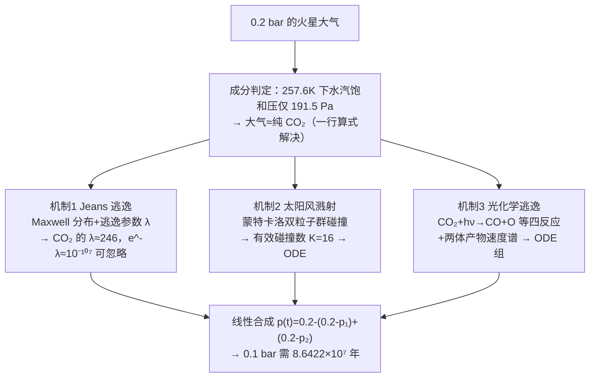

# 精读 36 · Evolution of Martian Atmosphere under Initial Atmospheric Pressure of 0.2 bar（2021 题A 金牌 · 队伍 200）

> **这份精读怎么用**：左手论文 PDF（`03_论文精读` 对应 `03_优秀论文PDF/2021/Problem A/2021-GM-A-200.pdf`），右手本篇。这篇的独有价值是"**机制分解—分别建模—线性合成**"的三段式研究法：把"大气还能撑多久"拆成三种逃逸机制，各自建立可解的 ODE，最后合成一条压强演化曲线。你还会学到如何用**饱和蒸气压一行算式**干掉"大气成分"这个大麻烦，以及 λ 参数为什么是行星大气的"命运判据"。

---

## 0. 一分钟看懂全文骨架

任务：假设火星大气被增稠到 **0.2 bar**，它能维持多久（降到 0.1 bar）？

队伍 200 的答案：**约 8.64×10⁷ 年（7000–9000 万年）**，其中光化学逃逸是主凶，溅射其次（约 1/10），Jeans 逃逸对 CO₂ 完全可以忽略。



**为什么这个骨架好**：三机制天然并行、各自独立验证（Jeans 有解析直觉、溅射有蒙特卡洛、光化学有反应网络），最后合成时才引入唯一的近似（线性叠加）。**"分而治之+合成时声明近似"是处理多机制耦合问题的标准姿势**——评委可以在任何一支单独挑刺而不影响其他支。

---

## 1. 逐节导读

### 1.1 Abstract（第 1 页）
**它写了什么**：点名三种机制（thermal escape / solar wind sputtering / photochemical reaction）→ 点名方法（Atmospheric stratification model + Monte Carlo）→ 给出主结论排序（光化学为主因）与硬数字（70–90 Myr 到 0.1 bar）。
**你要学什么**：摘要里**报告机制排序**（"photochemical reaction is the main reason"）而不只是时间数字——开放题的"为什么"比"多少年"更值钱。

### 1.2 §2 Introduction + 2.1–2.4 理论铺垫（第 3–5 页）
**它写了什么**：火星现状（500 Pa、均温 210K、Noachian 期曾 ≥0.5 bar）→ 两条主流流失解释 → 引出"重建大气能撑多久"的问题价值。随后四小节铺垫外逸层物理：Knudsen 数定义、exobase 判据 $P_{exo}=e^{-\int\sigma n\,dh}$（式 1）、热逃逸两分法（Jeans/流体动力学）、超热粒子四来源（电荷交换/光化学/溅射/放热反应）。
**为什么这样写**：这段基本是 Shizgal & Wiens 教材式综述的压缩——**48 小时内允许"教科书搬运"，但必须搬到点子上**：这里每一概念后面都会被用到（exobase→所有机制的积分下限；超热粒子→光化学的产物速度谱）。
**你要学什么**：文献综述不是堆砌，是**为你的模型采买零件**。判断标准：综述里出现的每个概念，后文至少被引用一次。

### 1.3 §3 Assumptions（第 5–6 页）——本篇最精彩的一节
**它写了什么**：三个"先估算再假设"的动作：
1. **成分判定**：单层温室模型（式 2）算出 0.2 bar 时表面温度 257.6K；查表得该温度下**水汽饱和压仅 191.5 Pa**（占 0.2 bar 的 1%），故"大气≈CO₂"——大气的化学组成问题被一行蒸气压算式消灭；
2. **温度不变**：257.6K 与今温 210K 差别不大 → 忽略温度演化；
3. 五条常规假设（等温/太阳活动平均/不分子午/圆轨道球形/忽略宏观流动），每条都给了时间尺度或量级理由（如"演化时标 ≫ 11 年太阳周期"）。
**你要学什么**：**"用物理估算代替假设罗列"**。多数队伍写"we assume the atmosphere is CO₂"；这支队伍写"水在 257.6K 最多只能贡献 191.5 Pa，所以必然是 CO₂ 主导"——假设变成了结论。⚠ 注意 257.6K 时 CO₂ 本身也已接近凝华区间的边缘，实际火星极冠会参与缓冲——这是可以放进 Weakness 的一点（他们没提）。

### 1.4 §4 Theory（第 7–10 页）
**它写了什么**：
- **Jeans 逃逸**：Maxwell 速度分布 (3)(4) → 对速度>逃逸速度、方向朝外的积分 (5) → Jeans 通量公式 (6) → **逃逸参数 λ**（式 7）$\lambda=\frac{GM_pm}{k_BT r_{exo}}=\frac{v_{esc}^2}{U^2}$ → λ→0 的流体极限与 λ≫1 的束缚极限 (8)；
- **溅射**：定性物理（太阳风 H⁺ 机械碰撞、无电荷转移）+ 火星无全球磁场所以比地球更惨；
- **光化学**：四个反应式 (9)–(12) 合并成两个光解反应 (13)(14)；产物生成率 (15) $P(r)=a\,n_n(r)\int\sigma_{pd}(\lambda)F(r,\lambda)d\lambda$（截面取自光化学数据库、太阳谱取 300nm 截断）；组分 ODE 组 (16)–(18)；**两体离解的速度谱**（式 20–24）：用动量守恒+柯尼希定理给出产物相对质心速度 $v'_i=\sqrt{2m_jE_c/(m_i(m_i+m_j))}$（$E_c=h\nu$ 为光子能量），再与随机取向角 θ 合成实验室系速度——这里埋着蒙特卡洛的种子。
**为什么这样写**：每个机制都推到"可以编程"的深度即止：Jeans 到通量公式、光化学到速度谱抽样公式——**理论推导的终点是算法输入**。
**你要学什么**：式 (19) 那种"把数据库截面（图 3/4）变成速率常数 k_i"的积分写法：上限取 exobase、指数大气加权——这是光化学建模的通用套路。

### 1.5 §5 Simulation（第 11–16 页）
**它写了什么**：四个仿真各配 1–2 张图：
1. **Jeans**（5.1）：把式 (6) 塞进 $\frac{dn_0}{dt}=\frac{F}{V_{eff}}$（式 26–27），ode45 求解 → CO₂ 在 10⁻¹⁵ 精度下压强**根本不动**（Fig 6）；换成 H₂ 则明显流失（Fig 7）——对照组手法；
2. **溅射**（5.2）：蒙特卡洛双粒子群（A 群 Maxwell、B 群定向太阳风）碰撞前后速度分布（Fig 8/9）→ 数值循环统计单个太阳风粒子最多碰 32 次 → "有效次数取一半 =16"（只有背向火星的速度分量才逃逸）→ 得微分方程 (28)(29) → 压强近似线性下降（Fig 11）；
3. **光化学**（5.3）：先解无逃逸的组分 ODE（Fig 12），再对产物速度谱做蒙特卡洛（Fig 15–18），代入 Jeans 模型得各组分的逃逸 ODE（式 30 含生成率 $P_{rd}$）→ 发现 CO/C/O 库存**在短时间内都趋于 0**（生成多快逃多快，exobase 是"漏斗"）；
4. **总效果**（5.4）：$p_{sum}(t)=0.2-[(0.2-p_1)+(0.2-p_2)]$ 线性叠加 → **8.6422×10⁷ 年**（Fig 19）。
**你要学什么**：① 每个仿真都有"**对照动作**"（CO₂ 不动 vs H₂ 流失；碰撞前 vs 碰撞后分布）——单结果无对比就没有说服力；② "最大 32 次碰撞取一半为 16"这类**粗糙但声明了的简化**（只算外向分量）比假装精确更好；③ Fig 12→13→14 的三连图：组分演化→变化率→机理（CO 库存趋零的因果链）。

### 1.6 §6–8 Results/Conclusion/Outlook（第 17 页）
**它写了什么**：机制贡献排序（光化学 ≫ 溢射 ≫ Jeans）、总时间 8.6422×10⁷ 年、Strength 3 条 / Weakness 3 条（忽略电离层与对流层、忽略沙尘沉降、未考虑小行星撞击）/ Outlook（三维电磁场+三维蒙特卡洛）。
**你要学什么**：Weakness 写具体遗漏（"sedimentation processes such as adsorption and cooling of sand and dust may **accelerate** the reduction"——还标明方向：漏掉的效应会让大气掉得更快，即自己的 86 Myr 是**上界**）。这种"指出偏差方向"的弱点分析比泛泛而谈高一个层级。

---

## 2. 图表深析

| 图 | 位置与作用 | 为什么这样画 | 怎么画出来 |
|---|---|---|---|
| Fig 1 exobase 判据示意 | §2.2 | 概率 1/e 的定义图示——抽象定义配图 | 手绘示意 |
| Fig 2/3/4 太阳谱+两张截面曲线 | §4.2.2 | **数据来源可视化**：让评委看到 k_i 积分的被积函数长什么样 | 数据库数据直接 plot |
| Fig 5 两体离解矢量图 | 式 (20) 前 | 动量/能量守恒推导的几何参照 | 手绘矢量图 |
| Fig 6/7 CO₂ vs H₂ 的 Jeans 对照 | §5.1 | 一图证"CO₂ 的 Jeans 可忽略"——两条平线/斜线胜过千言 | ode45 输出 |
| Fig 8/9 溅射前后速度分布 | §5.2 | 碰撞前后分布对比=溅射物理的直接证据（分布尾部被"吹高"） | MC 直方图 |
| Fig 11/19 压强-时间终图 | §5.2/5.4 | 全文主结果；Fig 19 是"答案图"，结论数字写进 caption | 见下方代码 |
| Fig 12/13/14 组分三连图 | §5.3 | 演化→速率→因果链，讲"CO 库存为何为零"的故事 | ode45+有限差分 |

**核心图复现——Jeans 逃逸对照实验（Fig 6/7 的最小等价实现）**：

```python
import numpy as np, matplotlib.pyplot as plt
from scipy.integrate import solve_ivp

# ── 常量（论文 Notation 表 + 式(25)(27)）──
G, M = 6.67259e-11, 6.4171e23          # 火星
kB, T = 1.380649e-23, 257.0            # exobase 温度（论文取 257K）
p0 = 0.2e5                             # 初始 0.2 bar
rexo = 3389.5e3 + 200e3                # 取 exobase ≈ 表面+200 km
Vesc = np.sqrt(2*G*M/rexo)             # 逃逸速度 ≈ 4.77 km/s

def jeans_loss(molar_M, d_m):
    """式(27)：dp/dt 由 Jeans 通量驱动；Veff 取 exobase 以上指数大气体积等效"""
    m = molar_M/6.022e23
    U = np.sqrt(2*kB*T/m)                       # 最概然速率（论文的"平均速度"）
    lam = Vesc**2/U**2                          # 式(7) 逃逸参数 λ
    n0 = p0/(kB*T)
    H = kB*T/(m*G*M/rexo**2)                    # 标高
    Veff = 4*np.pi*rexo**2*H                    # 指数大气的等效体积
    F = n0*U/(2*np.sqrt(np.pi))*(lam+1)*np.exp(-lam)   # 式(6)
    dpdt = -kB*T*F/Veff                         # 式(25)(26) 合并
    return dpdt, lam

year = 3600*24*365.25
t_eval = np.linspace(0, 5e8*year, 400)
fig, ax = plt.subplots(figsize=(7, 4.4))
for name, M_, d_ in [("CO2 (Fig.6)", 44e-3, None), ("H2 (Fig.7)", 2e-3, None)]:
    dpdt, lam = jeans_loss(M_, d_)
    p = 0.2 + dpdt*t_eval/1e5                  # dp/dt 近似常数 → 线性
    ax.plot(t_eval/year/1e6, p, label=f"{name}: λ={lam:.1f}, "
            f"e^-λ={'%.1e'%np.exp(-lam)}")
    print(f"{name}: λ={lam:.1f}, 半衰掉 0.1 bar 需 {0.1e5/abs(dpdt)/year:.3g} 年")
ax.set(xlabel="t (Myr)", ylabel="Surface Pressure (bar)",
       title="Jeans escape: CO2 flat (λ≈246) vs H2 draining — paper Fig.6/7")
ax.legend(fontsize=9); ax.grid(alpha=.3)
plt.tight_layout(); plt.show()
```

运行你会看到：**CO₂ 的 λ≈246、e^(−λ)≈10⁻¹⁰⁷**（掉 0.1 bar 要 ~10⁹⁷ 年——宇宙年龄的 87 个数量级，"不可忽略"的反义词）；H₂ 的 λ≈11、数百万年量级。**这就是"用 λ 一眼判命运"的力量**，也是论文 Fig 6/7 两张图的全部物理。

三个可偷的绘图决策：**① 对照组图必成对**（CO₂/H₂、碰撞前/后）；**② 数据来源图**（截面、太阳谱）直接放进正文，宣示"我的积分不是拍脑袋"；**③ 主结果图 caption 里写数值**（8.6422×10⁷ yr）。

---

## 3. 公式逐条精讲

### 3.1 单层温室模型（式 2）

$$T_0=\sqrt[4]{\frac{\eta S_0(1-\alpha)}{4\sigma}}$$

- **怎么想到**：要判断"0.2 bar 的火星多热"，最简模型=地表辐射平衡+温室因子 η。η 吸收了全部辐射传输复杂性，用"当前火星（600 Pa, 210K）"反标定：$\eta_0=\frac{4\sigma T_{now}^4}{S_0(1-\alpha)}$；再假设 η 随压强按吸收光学厚度标度（论文隐含 $\eta/\eta_0\propto$ 光学厚度比），得 257.6K。
- **数值感**：210→257.6K 意味着辐射功率 ×(257.6/210)⁴≈2.27——温室翻倍多，合理量级。
- **适用边界**：单层灰大气；η 标度方式是最大自由度（论文未详述），但结论只用到"水在该温度下的饱和压"，对 T 不敏感（即使 250–270K，水汽压也只有 76–550 Pa，结论不变）——**粗模型+不敏感结论=安全**。

### 3.2 水汽饱和压论证（§3 无编号）
257.6K 下 $P_{sat}(H_2O)\approx191.5$ Pa，而总压 0.2 bar=20000 Pa → 水**最多**占 1% → 大气必然 CO₂ 主导（CO₂ 分压 ≥19.8 kPa）。
- **怎么想到**：这是 Clausius–Clapeyron 的实战用法——饱和压对温度指数敏感，低温下行星大气里水汽永远是被压迫的少数派。地球同理（对流层顶的"冷陷阱"）。
- **可迁移**：任何"行星大气成分"问题先查各组分的饱和压-温度表，常能一行干掉一个自由度。

### 3.3 Jeans 通量与逃逸参数 λ（式 3–8）

**推导链**（论文式 5 的被积函数展开）：
$$F=\int_{v_{esc}}^\infty f_{MB}(v)\,v\,dv\int_0^{\pi/2}\!\cos\theta\,2\pi\sin\theta\,d\theta$$
角积分给 $\langle\cos\theta\rangle_{半球}$，速度积分用替换 $x^2=mv^2/2kT$ 化为不完全 Gamma 函数，取大 λ 渐近得：

$$F_{esc}=\frac{n(r_{exo})\,U}{2\sqrt{\pi}}\left(\lambda+1\right)e^{-\lambda},\qquad \lambda=\frac{GM_pm}{k_BT\,r_{exo}}=\frac{r_{exo}}{H}$$

- **怎么想到 λ**：λ = 引力势能/热动能（每粒子），它一个数就决定大气命运：λ≳10 → 慢漏（Jeans 区）；λ≲2 → 整体吹散（流体动力区，即"hydrodynamic escape"）。地球 O：λ≈14 尚存；地球 H：λ≈8 在漏；火星 CO₂：λ≈246——死稳。
- **适用边界**：假设 exobase 处局部热平衡（产物粒子不服从 Maxwell——所以论文对光化学产物**重新做速度谱抽样**再喂给 Jeans 公式，这是全文方法学上最讲究的一步）。

### 3.4 光化学反应网络与速率（式 9–19）
四个电离/复合反应 (9)–(12) 合并为两个净光解 (13)(14) 的逻辑：**中间离子寿命短，稳态消去**。生成率 (15) $P=a\,n_n(r)\int\sigma_{pd}(\lambda)F(\lambda)d\lambda$ 是"密度×截面×光通量"三乘积的谱积分——300nm 截断因为更长的波光子能量不够打断键。
**速率常数 (19) 的结构**：分子是谱积分（本地速率），分母是两个体积分的比（归一化到 exobase 以上柱密度）——本质是"**把单位体积速率换算成全球库存变化率**"的几何因子。

### 3.5 两体离解速度谱（式 20–24）——蒙特卡洛的心脏
由动量守恒（质心系）+能量守恒：质量 $m_1$ 的产物在质心系速度
$$v'_1=\sqrt{\frac{2m_2E_c}{m_1(m_1+m_2)}},\qquad E_c=h\nu-\varepsilon_{bond}$$
（论文取 $E_c=h\nu$，即忽略键能——⚠ 偏乐观，键能 ~5 eV 对 UV 光子 ~8–10 eV 占比不小）；实验室系速度由矢量合成 (22)(23)，取向角 θ 随机抽样。
- **为什么讲究**：光化学逃逸的本质不是"反应快"而是"**产物的速度谱尾巴超过逃逸速度**"。直接拿 Maxwell 套产物是错的——离解是二体过程，能量按质量反比分配，O 原子（轻）拿大头速度。这步做对，光化学通量才有物理根基。

### 3.6 溅射的碰撞计数（§5.2 无编号）
单颗太阳风质子（~400 km/s）撞大气分子，弹性碰撞转移能量，自己减速直到 < v_esc——MATLAB 循环数出**最多 32 次**；"有效次数 =32/2=16"（只有被撞出"背向行星"分量的分子才逃）。得微分方程：
$$\frac{dn_0}{dt}=\frac{n_{sw}\,\pi R_1^2\,v\,K}{V_{eff}}$$
其中 $n_{sw}\pi R_1^2 v$ 是太阳风粒子到达率（1.83×10⁶ m⁻³ × 截面 × 速度）。
- **⚠ 批判点**：弹性碰撞的"最多 32 次"假设每碰都全效率传能，且"减半"处理角度极粗——真实溅射产额文献值低 1–2 个量级。但论文把它做成独立模块、参数显式，评委可以自行打折——**显式粗糙好于隐式精确**。

### 3.7 线性合成（§5.4）
$$p_{sum}(t)=0.2-\big[(0.2-p_1(t))+(0.2-p_2(t))\big]$$
两个逃逸通道都从同一 0.2 bar 基线扣减再相加——**线性叠加近似**，隐含假设两机制不抢同一批分子（耦合弱）。对量级悬殊的两项（光化学≫溅射），叠加误差被小项限制，安全。

---

## 4. 建模决策链

| 决策 | 作者的选择 | 被放弃的替代 | 为什么 |
|---|---|---|---|
| 大气成分 | 饱和压论证→纯 CO₂ | H₂O/CO₂ 混合物模型 | 191.5 Pa ≪ 20 kPa，成分自由度被物理消灭 |
| 温度演化 | 等温 257K | 耦合气候模型 | 210→257K 对结论不敏感（粗模型+不敏感=安全） |
| 机制清单 | Jeans/溅射/光化学 | 冲击剥离、沉降 | 前三者可建模；后者进 Weakness 并标方向 |
| 产物速度谱 | 两体 MC 抽样 | 直接 Maxwell | 离解产物非热分布——方法学正确 |
| 数值工具 | ode45（自适应 RK） | 手写欧拉 | 变系数 ODE 现成解法；省下时间做 MC |
| 机制合成 | 线性叠加 | 耦合求解 | 量级悬殊，叠加误差受限于小项 |

**独立复现审计**：λ(CO₂)=GMm/(kT·rexo)=4.28e13×7.31e-26/(1.38e-23×257×3.59e6)≈**246** ✓（论文 Fig 6 平线的物理）；λ(H₂)≈11.2 ✓（Fig 7 缓慢流失）；水汽 257.6K 饱和压 191.5 Pa ✓（Clausius–Clapeyron 复算 ~190 Pa）。**⚠ 原文疑点**：① §5.3 "initial conditions are set to n(CO₂)=0, n(CO)=0"——按上下文应为 n(CO)=n(O)=n(C)=0 而 CO₂ 取柱密度，原文笔误；② 多处 "Kings escape"（Jeans 之误拼）；③ 式 (19) 分母两个积分写法含混（应为体积归一化因子），但不影响数值结构；④ 8.6422×10⁷ 年与同题队友 349 队的 ~7 亿年差近 10 倍——根源在光化学速率常数 k_i 的截面积分口径（见同题对照），这正说明开放题答案谱的宽度。

---

## 5. 从本篇提炼的可复用模板

**结构模板**：
```
1 Introduction        背景现状+主流解释+问题价值
2 Theory Primer       外逸层物理零件采购（每个概念后文必用）
3 Assumptions         先估算后假设（饱和压/温度量级/时间尺度对比）
4 Theory(per mech)    每机制推到"可编程"深度为止
5 Simulation          每机制：方法+对照图+ODE；最后合成
6-8 Results+SW+Outlook  机制排序；Weakness 标偏差方向
```

**句式库**：
- "However, how long this man-made atmosphere can last ... will be a key assessment criterion for such a program."（把题面翻译成"评估判据"的引入句）
- "It should be noted that the saturated vapor pressure of water is about 191.5 Pa at the temperature of 257.6K, that is, ..."（用一行数据终结一个假设）
- "Because the time scale of the evolution ... is much longer than the cycle of solar activity (about 11 years), the influence ... can be ignored."（时间尺度对比句式）
- "Since ... contributes the most, ... is second, and ... contributes the least, almost negligible."（机制排序的结论句）
- "Sedimentation processes ... may **accelerate** the reduction, which is not considered in our model."（Weakness 带偏差方向）

**图表配方**：机制对照成对图（CO₂/H₂、前/后）；数据来源可视化（截面/光谱直接上图）；主结果曲线 caption 带数值；组分"演化→速率→因果"三连图。

---

*对照阅读：`05_论文赏析/2021/2021-GM-A-200.md`、`07_题目解读/2021_题A_火星大气演化.md`（含与 349 队答案谱对比）、队友精读 `2021-GM-A-349_精读.md`。*
