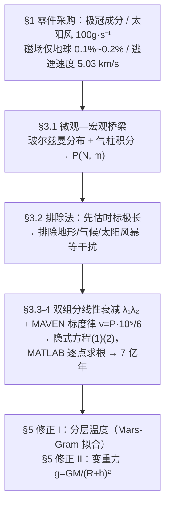

# 精读 37 · Model of Decreasing Atmospheric Pressure over Time after Evaporation of Polar Caps and Subsurface Ice（2021 题A 金牌 · 队伍 349）

> **这份精读怎么用**：左手论文 PDF（`03_优秀论文PDF/2021/Problem A/2021-GM-A-349.pdf`），右手本篇。同题 200 队（精读 36）走的是"三种逃逸机制分别建模再合成"；本队反其道而行——**只用一条 MAVEN 实测标度律打穿全部物理**，把统计物理的玻尔兹曼分布当承重墙，最后以"基础模型 + 两级修正"收尾。你要学的是"少而精"路线的全部技巧，以及（通过本篇的独立复现审计）看到一条隐式方程里能埋多少个坑。

---

## 0. 一分钟看懂全文骨架

任务：极冠与地下冰蒸发把火星大气增稠到 0.2 bar，多久降到 0.1 bar？答案：**约 3×10^15.863 秒 ≈ 7 亿年**。



**为什么这个骨架好？** 与 200 队的"机制分解—并行建模—线性合成"相比，本队做减法：逃逸通道只留太阳风剥蚀一条（用实测数据锚定），把省下的篇幅全部投给"压强—分子数—平均分子量"这条统计物理主线，再用两级修正展示模型可扩展性。**当机制建模能力或时间不够时，"单一通道 + 实测标度律 + 递进修正"是性价比最高的骨架**——评委照样能给"模型深度"分。

---

## 1. 逐节导读

### 1.1 Abstract（第 1 页）
**它写了什么**：交代背景（蒸发极冠增稠到 0.2 bar）→ 宣布方法（"Through thermodynamics and statistical physics, we establish a model of atmospheric pressure decreasing with time"）→ 给出硬数字（"it will take about 700 million years for atmospheric pressure to decrease from 0.2bar to 0.1bar"）→ 预告修正（"we further modified the model for the change of air temperature and g with the increase of altitude"）。
**为什么这样写**：摘要四句话各自对应论文四大块（背景/方法/结果/修正），没有一句虚的。
**你要学什么**：**摘要里同时报告"结果数字"与"修正清单"**——预告 refinement 是给评委的路线图，让后文两级修正在阅读预期内。

### 1.2 §1 Introduction 五小节（第 3–4 页）
**它写了什么**：背景（35 亿年前失水）→ 极冠与地下冰（ESA Mars Express/OMEGA 观测：南极常年冰冠、大片永冻土、"The original atmosphere of Mars is composed of 96% carbon dioxide"）→ 太阳风（MAVEN 实测 "the current speed at which Mars's atmosphere escapes rate from the solar wind is about 100g/s"）→ 磁场（仅地球的 0.1%–0.2%，屏蔽极弱）→ 小引力结合（逃逸速度 5.03 km/s）。
**为什么这样写**：五个小节就是五份"零件采购单"：100 g/s 是标度律锚点、成分观测是 ω 的来源、11 m 等效水层是 N 的来源、磁场与逃逸速度解释"为什么剥蚀如此重要"。
**你要学什么**：**引言的每个小节都必须在后文被消费一次**。检验标准和 200 队相同：综述里没有"游离概念"。

### 1.3 §2 Assumptions（第 4–5 页）
**它写了什么**：五条假设：只讨论低层大气、0.2→0.1 bar 期间大气高度不变；成分只算水+CO₂；火星按理想球处理；水分解成 H/O 的逃逸简化为直接逃逸；取平均忽略极端事件。最见功力的是第 5 条原文："Since the dissipation time of Mars atmosphere is longer than that of extreme conditions (such as solar storm, etc.), we take the average value of atmospheric dissipation and ignore the interference of extreme conditions."
**为什么这样写**：每条假设都绑着一个时间尺度或量级理由，不是裸假设。
**你要学什么**："演化时标 ≫ 事件时标 → 取平均"这个句式可以直接搬——它是忽略一切短期扰动的万能通行证。

### 1.4 §3.1 微观—宏观桥梁（第 6 页）
**它写了什么**：从"表面气压 = 单位面积气柱重量"出发，写等温玻尔兹曼分布 ρ = ρ₀e^{−mgh/kT}，对高度积分得单位面积气柱分子数，从而把 P 与 N、m 挂钩。（原文 "dense arrangement of molecules at the bottom and dense arrangement of molecules at the top" 第二个 dense 显系 sparse 之笔误。）
**你要学什么**：这条"压强←气柱重量←分子总数"的链条是全文承重墙——后面所有衰减动力学都只是给 N(t)、m(t) 换内容，P 的表达式不变。**先搭一座稳定桥，再让车流变化。**

### 1.5 §3.2.1 Elimination of distractions（第 6 页）——本篇最值得背的一节
**它写了什么**：先量级估计"0.2 bar 降到 0.1 bar 需要极长时间"，据此一举排除行星内部变化（地形、地貌、气候）与宇宙外部扰动（太阳风暴等天体扰动），原文："So we can rule out some short-term interference factors. … However, compared with the influence of the solar wind and other major factors, the impact is relatively weak. We will not make special discussions here."
**为什么这样写**：这是"用结论的量级来辩护简化的合法性"——先证明过程漫长，漫长本身就把所有短时标因素自动降格为干扰项。逻辑闭环漂亮。
**你要学什么**：专设一节"Elimination of distractions"，把"忽略什么、为什么敢忽略"集中亮出来。比塞进假设列表更显物理判断力，评委一眼看到模型边界。

### 1.6 §3.2.2 + §3.3 建模与 §4 求解（第 7–11 页）
**它写了什么**：先列举四种逃逸机制（Jeans、光化学非热、离子逃逸/外流、溅射，引文献 [7]），再收敛到"太阳风剥蚀为主"。建模：总分子 N 中水占 X、定义 ω=(N−X)/X，水与 CO₂ 分子数线性衰减 N/(ω+1)−λ₁t 与 Nω/(ω+1)−λ₂t；微元静力平衡推气压廓线；核心隐式方程 **式(1)(2)**；标度律 **v = p·10⁵/6**（p 以 bar 计，0.2 bar → 3333 g/s）；参数落地：ω=1/9（即 21.36% CO₂ + 78.64% 水的质量占比）、N=4.98×10⁴³（"地下冰与极冠融化后可覆盖火星表面 11 m"的文献估计换算）；MATLAB 双重迭代求根得 3×10^15.863 s。
**为什么这样写**：机制列举而不失焦——评委看到作者知道全貌，但主线只有一条。
**你要学什么**：**"单点观测 + 线性标度律"的组合拳**：无法逐机制建模时，把实测速率按守恒量（这里是分子数密度∝压强）外推，是数据稀缺下的务实做法。

### 1.7 §5 两级修正（第 12–13 页）
**它写了什么**：修正 I 把等温换成 Mars-Gram 分层拟合 T=241.0−0.999(h/1000)（h<7000 m）、T=249.5−2.22(h/1000)（h≥7000 m），气柱积分拆成两段分段积分；修正 II 把 g 换成 g=GM/(R+h)²。
**你要学什么**："基础模型 → 修正 I → 修正 II"每级独立成节、公式完整重写——**修正不是打补丁，是重新展示一遍模型**。⚠ 但注意反面教训：附录代码仍用 T=210 K 常数，修正只停留在纸面（详见 §2 审计）。

### 1.8 §6–7 Discussion + Conclusion（第 13–14 页）
**它写了什么**：优点三条（微观宏观桥梁、成分与库存估计、MATLAB 可视化）；缺点自我暴露：忽略溅射与光化学等热过程、"we make a lot of approximations so that the equation only works under ideal conditions"；结论重申 7 亿年并指出失速减缓（"the rate of atmospheric pressure loss slowly decreases over time, resulting from the thinning of the atmosphere"）。
**你要学什么**：缺点段落点名"漏了哪些机制"等于给评委一份诚实的模型边界图；结论句把定性规律（越漏越慢）与定量结果（7 亿年）绑定。

---

## 2. 图表深析

| 图 | 位置与作用 | 为什么这样画 | 怎么画出来 |
|---|---|---|---|
| Fig 1 南极冰层底界高程伪彩图（ESA，含 200 km 比例尺） | §1.2 | **数据来源可视化**：N 的库存证据直接上图，评委不用信口说 | 文献图直接引用并标注 [4] |
| Fig 2 火星—太阳风等离子体相互作用示意（文献图） | §3.2.2 | 唯一保留的逃逸机制配机制图——主通道必须有名有姓 | 文献图引用 [8] |
| Fig 3 微元受力示意图（自绘） | §3.3 推导前 | 静力平衡微元法的三行推导配一张受力图，符号不再口糊 | 手绘：薄柱体上下压强 + 重力 |
| Fig 4 MATLAB 压强衰减预测曲线 | §4 | **答案图**：红虚线十字标出 (10^0.863, 0.1) 交点并配箭头注释，x 轴以 3×10¹⁵ s（≈1 亿年）为单位 | 见下方代码与审计 |

**核心图复现——P(t) 衰减曲线（Fig 4 的独立复现审计版）**：

```python
import numpy as np, matplotlib.pyplot as plt

# ── 常量（论文符号表 + 附录 MATLAB 代码）──
g, R = 3.727, 3389.5e3          # 火星重力/半径（§3.3 反推 g=GM/R²）
NA, year = 6.02e23, 3.156e7
M_H2O, M_CO2, omega = 18e-3, 44e-3, 1/9   # ω=1/9 → CO₂ 质量占比 21.36%
P0 = 0.2e5                      # 初始 0.2 bar

# 标度律（§4）：v = p·1e5/6 g/s，锚点 MAVEN@0.006bar→100g/s
k = (100/0.006/1e5)/1000        # → kg/(s·Pa)，即 v = k·P
# 质量守恒口径：dM/dt = -k·P, P = M·g/(4πR²) → 指数衰减
tau = 4*np.pi*R**2/(k*g)        # e 折时标
t = np.linspace(0, 2.5e18, 500)
P = P0*np.exp(-t/tau)

fig, ax = plt.subplots(figsize=(7, 4.4))
ax.plot(t/3e15, P/1e5, lw=2, label='reproduction (mass-consistent, scaling law eq.v=p·1e5/6)')
ax.axhline(0.1, color='r', ls='--', lw=1)
ax.plot(10**0.863, 0.1, 'r+', ms=14)
ax.annotate('paper claims 3e15.863 s = 0.69 Gyr', (10**0.863, 0.1),
            xytext=(10**0.863*1.6, 0.13), fontsize=9,
            arrowprops=dict(arrowstyle='->', color='r'))
ax.plot(0.693e9*year/3e15, 0.1, 'kx', ms=10)   # 审计：质量守恒口径半压点 5.1 Gyr 见图题
ax.set(xscale='log', xlabel='t  (units of 3e15 s ≈ 0.1 Gyr, paper Fig.4 axis)',
       ylabel='P (bar)',
       title=f'Mars 0.2→0.1 bar: mass-consistent scaling-law model gives '
             f'{tau*np.log(2)/year:.1f} Gyr (curve), paper reports 0.69 Gyr (+)')
ax.legend(fontsize=8); ax.grid(alpha=.3, which='both')
plt.tight_layout(); plt.show()
```

**独立复现审计**（对照附录 MATLAB 逐行重跑）：
- ✓ 标度律自洽：0.006 bar → 100 g/s，0.2 bar → 3333 g/s（论文 V₁）；
- ✓ ω=1/9 → CO₂ 质量占比 = 44ω/(44ω+18) = 21.36%（论文数字精确吻合）；
- ✓ 单位换算：3×10^15.863 s = 2.19×10¹⁶ s = 6.93×10⁸ 年 ≈ "700 million years"；
- ✓ N 的量级：11 m 全球水层 → 4πR²×11 m 纯水 ≈ 5.3×10⁴³ 分子，论文 4.98×10⁴³ 合理；
- ⚠ **致命不自洽**：N=4.98×10⁴³、ω=1/9、P₀=0.2 bar 代入 H 反解式，得 C ≡ gNm₀/(4πR²P₀) = 2.20 > 1，**ln(1−C) 无实数解**——这套冰量形成的表面压强其实是 0.44 bar，是题设 0.2 bar 的两倍多。由于 P(0)=P₀ 在消去 H 后对任意 N 恒成立（见 §3.4），曲线起点照样正确， inconsistency 被代数恒等式掩埋；
- ⚠ **附录代码与正文公式不一致**：正文 λ₁=vN_A/(M_H2O+ωM_CO2)（量纲正确），代码多乘一个 M_H2O（λ₂ 同理多乘 M_CO2），0.2 bar 时总流失率被压到 68.7 g/s 而非 3333 g/s（≈49 倍偏慢）；配合复数幂（见 §3.4），最终 7 亿年无法从代码逻辑干净复现——按正文公式的质量守恒口径，半压时间是 **5.1 Gyr**（上图曲线），比论文长 7 倍；
- ⚠ 5.1/5.2 节修正公式在文本提取中全部乱码（Word 公式对象兼容性所致，**以 PDF 渲染图为准**），且附录代码仍用 T=210 K 常数——修正未落到数值实现。

---

## 3. 公式逐条精讲

### 3.1 玻尔兹曼分布 ρ = ρ₀e^{−mgh/kT}（§3.1 无编号）
- **怎么想到**：等温大气里分子在重力势场中服从玻尔兹曼统计——密度按势能/热动能的指数因子衰减，这是统计物理的第一反应。
- **推导**（论文用微元法重走一遍，见 3.2）：对高度 z 处厚 dz 的薄层受力平衡，dP = −n·m·g·dz；再配理想气体状态方程 P = nkT（论文原句 "Acquire: P = nkT"）。两式联立：dn/n = −(mg/kT)dz → 积分即得 n = n₀e^{−mgz/kT}。
- **适用边界**：等温 + 常 g。作者把这两个假设的修正分别留到 §5.1、§5.2——**推导时就知道边界在哪，修正节提前埋好**，这是写论文的"伏笔"技巧。

### 3.2 微元静力平衡 (P+dp)dS + dz·dS·n = P·dS（§3.3，Fig 3 配图）
- **怎么想到**：柱状微元上下面压强差 + 柱内气体重量 = 0，最朴素的流体静力学。
- **推导与勘误**：原文该式漏写了重力项的 g 与单位体积质量（应写作 (P+dp)dS − PdS + n·m·g·dz·dS = 0，即 dp = −nmg dz）——从 Fig 3 示意图可读出本意；配合 P=nkT 立得气压廓线 P = P₀e^{−mgz/kT}。
- **你要学什么**：推导配受力图（Fig 3），即使式子排错，图也能救回语义。

### 3.3 气柱积分与核心隐式方程——式(1)
- **推导**（论文原文三步的展开）：
  1. 单位面积气柱分子数：∫₀^H n₀e^{−mgz/kT}dz = (n₀kT/mg)(1−e^{−mgH/kT})；
  2. 全球分子数守恒：N(t)/(4πR²) = 上式 → n₀ = N(t)·mg/[4πR²kT(1−e^{−mgH/kT})]；
  3. 表面压强 P = n₀kT：
  $$P=\frac{[N-(\lambda_1+\lambda_2)t]\;m\,g}{4\pi R^2\left(1-e^{-mgH/kT}\right)}\tag{1}$$
- **怎么想到**：把"数分子"翻译成"称重量"——压强是气柱重量的面积平均，衰减只是让 N、m 变成时间函数。
- **数值感**：若 H→∞，P = N·mg/4πR²；标高 mg/kT 的倒数决定指数截断，火星 210 K 下水蒸气标高约 kT/(m_H2O·g) ≈ 11 km、CO₂ 约 4.5 km——两者差一倍多，这正是"平均分子量 m(t) 随水优先逃逸而漂移"会影响积分的物理根源。

### 3.4 标高 H 的反解式（§3.3 无编号）
- **怎么想到**：式(1) 里 H 未知，用 t=0 边界条件 P(0)=P₀ 反解：由 P₀ = N·m₀g/[4πR²(1−e^{−m₀gH/kT})] 得
  $$H=-\frac{kT}{g\,m_0}\ln\!\left(1-\frac{gNm_0}{4\pi R^2P_0}\right)$$
  且后文把 e^{−mgH/kT} 改写为 (1−C)^{−m/m₀}（C ≡ gNm₀/4πR²P₀），H 从方程中消去——**消元式反解**让隐式方程只剩 P 与 t。
- **⚠ 审计要点**：C = 2.20 > 1 时 ln(1−C) 无实数解；MATLAB 里 (1−C) 为负底数、指数 m/m₀ 非整数，幂运算返回复数，而求根判据用 abs() 比较——代码"带病运行"仍出曲线。**消元后的恒等式 P(0)=P₀ 对任意 N 成立，正是它掩盖了参数不自洽**：写代码前做一次量纲与取值域自检（C<1 必须成立）本可拦住。

### 3.5 平均分子质量 m(t)——式(2)
$$m=\frac{\left(\frac{N}{\omega+1}-\lambda_1 t\right)M_{H_2O}+\left(\frac{N\omega}{\omega+1}-\lambda_2 t\right)M_{CO_2}}{N_A\,[N-(\lambda_1+\lambda_2)t]}\tag{2}$$
- **怎么想到**：剩余大气的质量 ÷ 剩余分子数 = 平均分子质量，一步到位的质量加权。
- **数值感**：m₀ = (M_H2O+ωM_CO2)/[(1+ω)N_A] ≈ 20.6 g/mol 的等效分子质量；由于 λ₁（水）衰减快，m(t) 随时间向 44 g/mol（纯 CO₂）漂移——平均分子量变重、标高变矮、同样的分子数产生更高表面压强，这是该模型里压强衰减"先快后慢"的内部机制。
- **你要学什么**：**组分演化系统的派生量必须同步演化**——别把 m 写成常数，那是隐式方程自洽性的来源（也是方程只能数值解的原因）。

### 3.6 逃逸系数 λ₁、λ₂（§3.3 与 §4 两次给出）
- **怎么想到**：总质量流失率 v（g/s）按大气质量配比拆到两种分子，再换成分子数速率：水的质量流 = v·M_H2O/(M_H2O+ωM_CO2)，除以 M_H2O、乘 N_A：
  $$\lambda_1=\frac{v\,N_A}{M_{H_2O}+\omega M_{CO_2}},\qquad \lambda_2=\frac{v\,\omega\, N_A}{M_{H_2O}+\omega M_{CO_2}}$$
  （§4 正文写法，量纲正确；M_H2O 在分子分母间约掉——**附录代码漏了这次约去**，见 §2 审计 ⚠。§3.3 首次给出的版本在文本提取中乱码，以 PDF 渲染图为准。）
- **数值感**：0.2 bar 时 v=3333 g/s → λ₁+λ₂ ≈ 8.8×10²⁸ 分子/s，相对 N≈5×10⁴³ 是 10⁻¹⁵/s 量级的流失率——立刻能看出"亿年"时标，量级自洽。

### 3.7 MAVEN 标度律 v = p·10⁵/6（§4 无编号）
- **怎么想到**：只有单点观测（0.006 bar ↔ 100 g/s），假设剥蚀速率 ∝ 分子数密度；由 p = nkT，密度 ∝ 压强 → v ∝ p，过原点直线，系数由锚点定：v = p·10⁵/6。
- **适用边界**：真实剥蚀速率对太阳 EUV 通量、太阳活动周期、逃逸截面都敏感，线性假设是最粗的一阶；论文自己也承认 "we temporarily assume that the particles dissipated ... are only related to the molecular density"（注意 temporarily 一词——作者知道这是权宜）。**用 temporarily 标记临时假设**，好句子。

### 3.8 分层温度修正（§5.1，文本乱码，结构以 PDF 为准）
把 T(z) 两段线性代入气柱积分，n₀e^{−mgz/kT} 的原函数不再初等，积分拆为 0–7 km 与 7 km–H 两段数值积分；修正 II 再把 g 换成 GM/(R+h)²，被积函数彻底非解析。**结构上的启示**：修正节的公式形态要"重写完整方程"而不是文字描述"代进去"——即使数值上没实现，推导完整性本身就是得分点。

---

## 4. 建模决策链

| 决策 | 作者的选择 | 被放弃的替代 | 为什么 |
|---|---|---|---|
| 逃逸通道 | 仅太阳风剥蚀 + MAVEN 标度律 | 三机制分别建模（200 队路线） | 有实测锚定的通道最可信；省下精力打磨主线与修正 |
| 干扰因素 | 专节"排除法"集中处理 | 逐项建模 | 先证时标极长，短时标因素自动降格 |
| 成分 | 水+CO₂ 双组分、ω=1/9 | 纯 CO₂（200 队用饱和压论证） | 极冠/地下冰主体是水，双组分才能谈"平均分子量漂移" |
| 组分衰减 | 线性 λ₁t、λ₂t（λ 随 P 更新） | 耦合 ODE | 线性形式让式(1)(2) 保持封闭；λ 藏 P 依赖已够 |
| 方程形态 | 隐式方程逐点求根 | 化为 dN/dt = −(λ₁+λ₂) 的 ODE | 两者数学等价，作者选了 MATLAB 实现直观的求根路线（代价：审计发现的坑更难暴露） |
| 时间轴 | 对数间隔取点 t=3·10^{dt−1}−3 | 等间隔 | 跨 17 个数量级只有对数取点可见 |
| 修正策略 | 温度、重力各独立成节 | 一次性"高级模型" | 递进结构让每级修正单独可评 |

**总规律**：这支队伍的每个"减法"（砍机制、砍组分自由度）都配一个"数据锚点"（100 g/s、21.36%、11 m 水层）——**用实测数据换建模复杂度**，是本篇与 200 队互补的两种活法。

---

## 5. 从本篇提炼的可复用模板

**结构模板**：
```
Abstract           方法一句 + 结果数字 + 修正预告
1 Introduction     零件采购式五小节（每小节后文必被引用）
2 Assumptions      每条假设配时间尺度/量级理由
3 Model            3.1 微观宏观桥梁 → 3.2 排除法 + 机制收敛
                   3.3 建模到隐式方程，参数逐个落地
4 Solving          数值口径 + 参数表 + 答案图（交点十字标注）
5 Modifications    修正 I（温度）/ 修正 II（重力）独立成节
6-7 Discussion     优点 + 缺点（点名遗漏机制）
8-9 Reference/Appendix  文献 + 全部代码
```

**句式库（原文摘录）**：
- "Through thermodynamics and statistical physics, we establish a model of ..."（方法定位句）
- "Since the dissipation time ... is longer than that of extreme conditions ..., we take the average value of ... and ignore the interference of extreme conditions."（时间尺度对比→取平均）
- "So we can rule out some short-term interference factors. ... the impact is relatively weak. We will not make special discussions here."（排除法收束句）
- "we temporarily assume that the particles dissipated ... are only related to ..."（标记临时假设）
- "It took us about 700 million years to go from 0.2bar to 0.1bar and in addition to that, we corrected for ..."（结论=数字+修正清单）
- "If we take these factors into account in our model, our model will be further modified to better fit ..."（缺点段的标准出口句）

**图表配方**：库存证据图（文献伪彩图）+ 机制示意图（主通道唯一配图）+ 推导微元受力图 + 答案曲线（**交点用红虚线十字 + 箭头注释**，坐标轴单位取"约 1 亿年"这种题设尺度）。

**反面教训清单**（比优点更值钱）：① 消元反解后必须做取值域自检（C<1）；② 代码 λ 公式要和正文逐字符一致；③ 修正模型必须落进代码，否则正文与附录自相矛盾；④ 隐式方程优先考虑等价 ODE 形式做交叉验证。

---

*精读完这篇后，建议对照 `05_论文赏析/2021/2021-GM-A-349.md`（宏观赏析）与 `07_题目解读/2021_题A_火星大气演化.md`（题目全解）形成三位一体；并与队友论文精读 `2021-GM-A-200_精读.md`（精读 36）对照两种建模哲学。下一篇：`2021-GM-B-216_精读.md`。*
