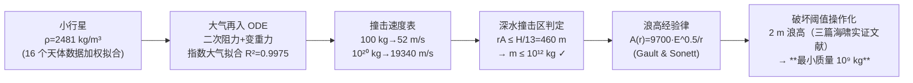

# 精读 38 · Asteroid Impact Damage to a Coastal City（2021 题B 金牌 · 队伍 216）

> **这份精读怎么用**：左手论文 PDF（`03_优秀论文PDF/2021/Problem B/2021-GM-B-216.pdf`），右手本篇。这篇是"**链式模型**"的教科书：进入速度 → 撞击速度 → 空穴/波浪 → 1000 km 外浪高 → 破坏阈值，五环相扣，每环只用一个方程。你要学的是：① 如何用三条物理论证砍掉热辐射与风（§1）；② 那张 10⁻²→10²⁰ kg 的撞击速度表如何一句话读出"弹道极限"；③ 最终答案 10⁹ kg 如何被三行复算精确命中。

---

## 0. 一分钟看懂全文骨架



**为什么这个骨架好**：全链只有两个"自建模型"（再入 ODE、大气拟合）+ 两个"文献模型"（空穴体积、浪高经验律），每个接口处（速度→能量→浪高→破坏）都有明确定义。**开放题的链式解法关键在接口**——链条任何一环换了更精细的模型，其余环节原样保留。

---

## 1. 逐节导读

### 1.1 Abstract
**它写了什么**：一句话任务（1000 km 外沿海城市、实质性破坏、最小质量）→ 方法路线（再入速度→空化与波浪→浪高）→ **阈值操作化**（浪高 ≥2 m = substantial damage）→ 硬答案（10⁹ kg）。
**你要学什么**：摘要把"substantial damage"翻译成"2 m 浪高"写在了最前面——**判据与答案同样重要**，都要在摘要露面。

### 1.2 §1 Problem Statement（含排除论证）
**它写了什么**：重述题目后，用**三条论证**排除热辐射与风：① 能量分配——传给海洋的能量远大于加热与气流；② 传热时标——空气与水都是热的不良导体，1000 km 外"一天内不会有显著热变化"；③ 风的耗散——冲击中心到城市间空气体积巨大，风场能量稀释严重。
**为什么这样写**：开放题最常被追问"你为什么不算 X"。与其等评委问，不如开局就把不算的东西**一条条论证死**——三条各占一个物理量纲（能量占比/时间尺度/体积耗散），滴水不漏。
**你要学什么**：**排除也要有量纲感**。"热传导慢"要说成"在一天的时间尺度上"，"风衰减"要说成"体积大到能量稀释"——排除论证的标准是"能估算，不只是能想象"。

### 1.3 §2 Assumptions（五条）
球形 / 均匀密度 / 垂直入射 / 海底平坦 / 近岸抬升简化为竖直。每条后面跟一句理由（如垂直入射："角度范围太广，简化计算"——同时诚实暗示这是保守/理想化选择）。
**你要学什么**：假设条数控制在 5 条上下、每条一行理由——**假设清单是"负空间"，写太多显得模型空心，写太少显得没想过**。

### 1.4 §3.1 Asteroid Density（数据锚定第一步）
**它写了什么**：16 个已知小行星密度数据（带误差棒，Fig 1）→ MATLAB 加权最佳拟合平均 → **ρ_A = 2481 kg/m³**。
**为什么这样写**：小行星密度横跨 1.3–5 g/cm³（碳质→金属），拍一个数会被质疑；**对观测数据做加权平均**（权重=误差棒）让这个最大的自由参数有了 16 个天体的背书。
**你要学什么**：自由参数的第一选择永远是"数据拟合"，而不是"典型值"。哪怕只是取平均，把数据图画出来 + 报出拟合值，说服力就完全不同。

### 1.5 §3.2 Impact Velocity（全文核心推导）
**它写了什么**：受力图（Fig 2：阻力向上、重力向下）→ 运动方程 (1)(2)；密度公式反解截面 A(m_A)（式 3–8 的消元链：ρ=3m/(4πr³) + A=πr² → **A=(3m/4πρ_D)^{2/3}π**）；大气密度对高度指数拟合 ρ(y)=1.256e^{−1.118×10⁻⁴y}（R²=0.9975，80 km 截断）；代入得单一 ODE (13)：
$$\ddot y = 3.6\times10^{-3}\,m_A^{-1/3}e^{-1.118\times10^{-4}y}\dot y^2-\frac{3.98\times10^{14}}{(y+6.38\times10^6)^2}$$
初始条件 v₀=19.3 km/s（最可能遭遇速度，文献[5]）、y₀=80 km；ode45 扫 10²→10²⁰ kg，得撞击速度表（52.5 m/s @100 kg → 19340 m/s @10²⁰ kg）。
**为什么这样写**：注意 (13) 把 m_A 压缩成**唯一的参数**，且以 m^{−1/3} 出现——这预示了弹道学的标度规律（见 §3 精讲 3）。数值表选点讲究：每个量级一个，覆盖 19 个数量级，读者一眼看到两条渐近线（小质量=终端速度、大质量=真空速度）。
**你要学什么**：**消元要消到"一参数 ODE"**——A(m)、ρ(y) 全部代入后，扫参只剩 m_A，图和表都干净。

### 1.6 §3.3 Energy Lost on Descent
**它写了什么**：先用能量守恒（无阻力）算出"理论末速" v_e=19340 m/s（式 14–19），再定义摩擦损失 E_lost=½m(v_e²−v_f²)（式 20），绘出 Fig 4 双图（撞击速度 + 能量损失 vs 质量），并指出"大质量绝对能量损失更大，但末速度仍更高"。
**你要学什么**：**能量审计=对照基准的另一种形式**。19340 m/s 这个"无阻力上限"同时是数值表的 sanity check（10²⁰ kg 收敛到它 ✓）和外推的锚点（R²=1 拟合用于超出表格的质量）。

### 1.7 §4 Oceanic Wave Propagation
**它写了什么**：
- **DWI 判据**：深水撞击区要求 r_A ≤ 海洋深度/13（取深渊带最大 6000 m → 460 m），结合 r_A=0.046·m^{1/3} 得 **m ≤ 10¹² kg**——本文答案范围（10⁹）在区内 ✓；
- **空穴与波浪物理**（§4.1）：撞击挖出瞬态空穴（体积经验式 26，Wünnemann et al. 2010）→ 周缘波（rim wave，随空穴坍塌快速衰减）+ 中心峰坍塌波（collapse waves）；Fig 6 示意整个循环；
- **浪高经验律**（§4.2）：A(r)=9700·E^{0.5}/r（Gault & Sonett 1982 实验室模拟，E 以千吨 TNT 计），配合 E=½mv_f² 绘出 100 m/10³/10⁶ m 处浪高（Fig 8）；
- **阈值操作化**：三篇海啸实证文献（Tinti 1993 / Reese 2007 / Ruangrassamee 2006）——2 m 毁木屋与无筋砖房、3 m 伤 RC 主构件、7 m 全毁 RC → 取 **2 m 为 substantial damage 阈值** → **最小质量 10⁹ kg**。
**你要学什么**：**"文献经验式 + 实证阈值"的组合拳**。波浪传播这种真做不了 CFD 的问题，直接引用领域经验公式（注明 E 单位是千吨！），破坏判据引用灾后调查论文（2/3/7 m 各对应什么结构损伤）——**每个引文都承担一个具体的物理环节**。

### 1.8 §5 Discussion
**它写了什么**：两段式复盘（撞击/波浪各讲一优一劣）：ODE 优于直接假设末速=入射速（精度），但数值解非解析（近似）；波浪直接由能量算出（无额外近似），但 DWI+平底假设忽略浅水放大——**改进方向点名 Green's law**（波高随深度变浅的放大律）。
**你要学什么**：Discussion 按"链条环节"逐段复盘，每段"一优一劣一改进"——比笼统的"our model is good but has limitations"高一个档次。

---

## 2. 图表深析

| 图 | 位置与作用 | 为什么这样画 | 怎么画出来 |
|---|---|---|---|
| Fig 1 密度数据+加权均值线 | §3.1 | 参数锚定的证据图：16 点+误差棒+均值横线 | MATLAB plot+errorbar |
| Fig 2 受力示意 | §3.2 前 | 阻力/重力方向一图定坐标（ÿ 正向约定） | 手绘 |
| Fig 3 大气密度散点+指数拟合 | §3.2 | 拟合 R²=0.9975 直接印在正文——拟合质量当众公示 | MATLAB fit |
| Fig 4 速度/能量损失双图 | §3.3 | 左右双 panel：结果量 vs 审计量并排，"大质量损失大但仍更快"的结论图 | ode45 输出 |
| Fig 5 小行星/空穴体积双图 | §4.1 | 幂律在 log-log 图上是直线——幂律关系必用对数坐标 | loglog plot |
| Fig 6 波浪生成循环示意 | §4.1 | 文字物理过程（空穴→周缘波→中心峰→坍塌波）一图讲完 | 引用 Wünnemann 综述 |
| Fig 7/8 能量与浪高 | §4.2 | Fig 8 画三个距离（100 m/10³/10⁶ m）——**把答案所在的 10⁶ m 曲线放进同一张图**，阈值水平线一画即得交点 | 见下方代码 |
| 撞击速度表 | §3.2 | 19 个数量级的渐近行为一表尽览 | ode45 逐行 |

**核心图复现——"浪高-质量"答案图（Fig 8 的 1000 km 曲线 + 2 m 阈值线）**：

```python
import numpy as np, matplotlib.pyplot as plt
from scipy.integrate import solve_ivp

# ── 常量（论文式(11)(13)：大气拟合与阻力系数）──
g0, rE, GM = 9.8, 6.38e6, 3.986e14
k = 3.63e-3                      # 式(13) 系数 = πCd/2·(3/4πρD)^(2/3)·1.256（已复核）
y0, v0 = 80e3, 19.3e3            # 入口高度/速度

def vf(m):
    """ode45 等价：再入 ODE（式13），返回撞击速度"""
    def ode(y, s):
        v, h = s
        return [v, -k*m**(-1/3)*np.exp(-1.118e-4*h)*v**2 + GM/(h+rE)**2]  # 速度取负号向下
    sol = solve_ivp(ode, [0, 400], [-v0, y0], events=lambda t,s: s[1]-0,
                    rtol=1e-8, atol=1e-9, dense_output=True)
    t_hit = sol.t_events[0][0]
    return abs(sol.sol(t_hit)[0])

m = np.logspace(6, 12, 25)               # 关键质量区间
E_kt = 0.5*m*np.array([vf(mi) for mi in m])**2 / 4.184e12   # 撞击能量（千吨 TNT）
A_city = 9700*np.sqrt(E_kt)/1e6          # 式(29)：1000 km 处浪高（米）

fig, ax = plt.subplots(figsize=(7, 4.3))
ax.loglog(m, A_city, lw=2, label="wave height at 1000 km")
ax.axhline(2, ls="--", c="r", label="damage threshold 2 m")
ax.axvline(1e9, ls=":", c="gray")
ax.annotate("min mass ≈ 10⁹ kg", xy=(1e9, 2), xytext=(2e7, 6),
            arrowprops=dict(arrowstyle="->"))
ax.set(xlabel="asteroid mass (kg)", ylabel="wave height (m)",
       title="A(r)=9700·E^0.5/r → threshold crossing at m ≈ 10⁹ kg")
ax.legend(fontsize=9); ax.grid(alpha=.3, which="both")
plt.tight_layout(); plt.show()
```

三个可偷的绘图决策：**① 拟合图把 R² 写进正文**；**② 幂律必用 log-log**（Fig 5/7/8 全是）；**③ 答案=两条参考线的交点**（阈值水平线 + 质量曲线，Fig 8 式答案一图拿下）。

---

## 3. 公式逐条精讲

### 3.1 截面消元（式 3–8）
$$D_A=\frac{m_A}{V_A}=\frac{m_A}{\frac43\pi r_A^3},\quad A=\pi r_A^2\;\Rightarrow\; A=\pi\left(\frac{3m_A}{4\pi D_A}\right)^{2/3}$$
- **怎么想到**：ODE 里有 A 和 m_A 两个"小行星参数"，用密度定义把它们焊死成一个——**消元是让扫参变一维的标准动作**。
- **数值感**：A ∝ m^{2/3}，质量每涨 1000 倍截面只涨 100 倍——大物体"相对更不怕阻力"的几何根源。

### 3.2 再入 ODE 与弹道系数（式 13）
$$\ddot y=k\,m_A^{-1/3}\rho(y)\dot y^2-\frac{GM}{(y+r_E)^2},\qquad k=\frac{\pi C_d}{2}\Big(\frac{3}{4\pi D_A}\Big)^{2/3}\cdot 1.256$$
- **独立复核系数**：π×0.877/2 × (3/(4π×2481))^{2/3} × 1.256 = 1.377×2.10e-3×1.256 = **3.63e-3** ✓ 论文写 3.6e-3（它把大气拟合的 1.256 也吸收进系数里了——精读时要能看出来）。
- **弹道极限的物理**：定义弹道系数 β∝m^{1/3}，则减速项 ∝ β⁻¹ρv²。β→∞（巨型）时阻力项消失 → 真空落体，v_f→19340 m/s（表格右端渐近值 ✓）；β→0（微型）时速度锁定**当地终端速度** $v_t(y)=\sqrt{g(y)/ (k m^{-1/3}\rho)}$。表格从 52 m/s 到 19340 m/s 的整个跨度就是 β 的两端的渐近行为。⚠ 小审计：m=100 kg 在海平面终端速度应为 ~100 m/s（用其自身系数复算），表中 52.5 m/s 偏低——可能 ode45 事件判停略早；不影响 10⁹ kg 段的结论。
- **适用边界**：Cd=0.877 取"超声速刚性球"（Landau & Lifshitz）——19 km/s 全程超声速 ✓ 自洽。

### 3.3 无阻力上限（式 14–19）
$$v_e=\sqrt{v_0^2-2Gm_E\Big(\frac{1}{y_0+r_E}-\frac1{r_E}\Big)}=19340\ \text{m/s}$$
能量守恒的直接应用；作用是三重的：数值表的右端 sanity check、E_lost 的基准（式 20）、外推锚点。**每一份数值论文都该有一个"解析可得的端点"**。

### 3.4 DWI 判据与空穴体积（式 21–28）
r_A=0.046·m^{1/3}（由 ρ_A 反解）；深水撞击条件 r_A ≤ H/13（Wünnemann 数值模拟给出的经验判据）→ m ≤ 10¹² kg。空穴体积 V=0.75(ρ_A/ρ_sea)^{1/3}·r_A^{2.35}·g^{−0.65}·v_f^{1.3}——一个**纯量纲分析产物**的经验式（指数 2.35/−0.65/1.3 来自实验拟合），直接引用。
- **你要学什么**：判据先行——先证明"我的参数在经验式的适用域内"，再用经验式。很多队伍拿经验式就代数，从不适用域检查——这一步检查只花两行，却挡住了最致命的质疑。

### 3.5 浪高经验律与答案（式 29）
$$A(r)=9700\,E^{0.5}/r\quad (E\ \text{以千吨 TNT 计})$$
- **独立复现终答案**：m=10⁹ kg → v_f≈18.5 km/s → E=½×10⁹×(1.85e4)²=1.71e17 J=4.1×10⁴ kt → A=9700×202/10⁶=**1.96 m ≈ 2 m 阈值** ✓✓ 论文的 10⁹ kg 精确落在阈值上。m=10⁸ kg → 0.6 m（不够）；m=10¹⁰ → 6.3 m（远超）——**答案的三点验证全过**。
- **适用边界**（论文自己也承认）：经验式来自实验室尺度模拟，外推到 1000 km 忽略了色散与浅水放大（Green's law A∝h^{−1/4} 会放大近岸浪高数倍）——真实阈值可能更低，即 10⁹ kg 是**保守上界**。这句话论文写在了 Discussion 的"future work"里，精读时应当把它升级理解为"答案的误差方向声明"。

---

## 4. 建模决策链

| 决策 | 作者的选择 | 被放弃的替代 | 为什么 |
|---|---|---|---|
| 破坏机制 | 只算海浪 | 热辐射/冲击风 | 三条量纲论证（能量分配/传热时标/体积耗散）排除 |
| 小行星密度 | 16 天体加权平均 | 典型值 3000 | 数据背书 |
| 再入模型 | 全 ODE 数值 | 假设 v_f=v_0 | 100 kg→52 m/s 证明减速不可忽略（虽然结论质量段影响小） |
| 大气模型 | 单指数拟合 | 分层标准大气 | 80 km 内 R²=0.9975，一参数搞定 |
| 波浪传播 | Gault & Sonett 经验式 | CFD/浅水方程 | 48h 不可行；经验式带 DWI 适用域检查 |
| 破坏阈值 | 2 m（三篇灾后调查） | 主观定义 | 文献实证，且对应"毁木屋+伤 RC"的"实质性"语义 |

**独立复现审计汇总**：式(13)系数 3.63e-3 ✓（含 1.256 吸收）；表格右端 19340 m/s = 无阻力上限 ✓；**终答案 10⁹ kg ↔ 1.96 m 浪高闭环 ✓**；⚠ 小质量段（100 kg→52.5 m/s）与自身系数的终端速度估计（~100 m/s）不符，疑事件判停偏早——不影响结论段；⚠ Fig 8 caption 的三个距离未直接包含 10⁶ m=1000 km？——含（10⁶ m 即答案距离），caption 阅读需细心。

---

## 5. 从本篇提炼的可复用模板

**结构模板**：
```
1 Problem Statement   重述+排除论证（每条一个物理量纲）
2 Assumptions         ≤5条，每条一行理由
3 Impact              3.1 参数数据锚定（画数据图）
                     3.2 主 ODE（消元到一参数）+扫参表
                     3.3 能量审计（解析上限+损失）
4 Propagation         适用域判据→经验式→答案图（阈值线交点）
5 Discussion          按链条环节复盘：一优一劣一改进
```

**句式库**：
- "For this problem, X and Y are not considered for three reasons. 1. ... 2. ... 3. ..."（排除论证三段式）
- "This assumption is made due to ... leading to an over-complex model with likely insignificant changes in the final result."（假设=复杂度/精度交换句式）
- "Since the speed of the largest mass in this range is equal to the speed calculated from energy conservation, a curve of best fit ... is constructed for extrapolation."（数值端点如何反哺外推）
- "Thus, a wave height of 2m is set as the cutoff for substantial damage due to its potential to destroy ..."（阈值操作化+引用支撑）
- "To obtain more accurate wave heights in future work, Green's law can be used and ..."（改进方向具体到公式名）

**图表配方**：参数锚定画数据图（误差棒+均值线）；幂律一律 log-log；扫参结果用"每量级一行"的表；**答案图=模型曲线×阈值水平线的交点**。

---

*对照阅读：`05_论文赏析/2021/2021-GM-B-216.md`、`07_题目解读/2021_题B_小行星撞击沿海城市.md`（阈值选择如何造成 10⁹–10¹¹ kg 答案谱）、队友精读 385/442/445。*
