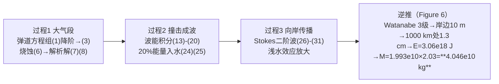

# 精读 39 · Analysis of Asteroid Mass Influences Ocean Impact（2021 题B 金牌 · 队伍 385）

> **这份精读怎么用**：左手论文 PDF，右手本篇。这篇的招牌是"**三过程分解 + 逆推求解链**"：把撞海拆成大气段→成波→向岸三段，各配一个物理模型，再从"破坏等级"倒着解回"小行星质量"。你要学的是它的流程图化解题叙事（Figure 6）；同时本篇也贡献了本套精读里最密集的一组"内部不一致"审计点——教你如何用三行代码给金牌论文挑骨头。

---

## 0. 一分钟看懂全文骨架

论文只回答一个问题：**1000 km 外撞海的小行星，最小要多重才能让沿海城市"实质性破坏"？**



**为什么这个骨架好？** 正向建模（三过程）保证每个环节都有物理出处，逆向求解（Figure 6 流程图）保证答案是一条可回溯的链条——评委既看到"你会建"，也看到"你会解"。三过程之间接口清晰（速度/质量 → 能量 → 波幅），任何一段换更精细的模型（如椭圆余弦波替换 Stokes），其余不动。

---

## 1. 逐节导读

### 1.1 Abstract（第 1 页）
**它写了什么**：先定罪——"tsunami is probably the most devastating type of damage for asteroids [1]"，随后用五段摘要预告三个过程各建什么模型，最后一句给出硬答案 **4.046 × 10¹⁰ kg**。
**为什么这样写**：每段一个过程、段末落到一个模型动词（calculate / create / calculate），摘要本身就是目录的镜像。
**你要学什么**：开放题第一句就要"定罪"——把众多效应里最主要的那个钉死并挂上文献 [1]，后面所有建模的合法性由此建立。

### 1.2 §3 Assumptions（第 4 页）
**它写了什么**：五条假设，每条带一句理由。亮点是第 (1) 条：**"Because causing the tsunami of the same intensity, the iron asteroid needs smaller mass [6], we assume that irregular asteroids are pure iron balls"**——假设直接服务于"求最小质量"的题眼（铁最密→同能量质量最小），而不是无的放矢。
**你要学什么**：假设要和题目目标对齐。"求最小质量"就应该选最小质量的物质组合，假设本身成了求解策略的一部分。

### 1.3 §4.1.1 大气段（第 5–7 页）
**它写了什么**：从**含地球自转的完整弹道方程组 (1)**（六个耦合 ODE：ḣ、θ̇、φ̇、V̇、γ̇、ψ̇，带 ω²r 离心项）出发，令弹道角 γ 与航向角 ψ 均为 0，砍掉全部横向项与科氏项，得 (3) 纯阻力减速；配质量 (4)、指数大气 (5)、Bronshten 烧蚀律 (6)，积分出解析速度衰减 (7) 与质量-速度耦合 (8)。
**为什么这样写**：这是"**从最一般方程显式降阶**"的示范——先把完整方程组摆出来，再当着评委的面丢掉自转项并给理由（假设 2），比直接写简化方程可信得多。
**你要学什么**：一般式 (1) 里 ḣ=Vsinγ 这类运动学方程与 V̇ 的动力学方程是弹道模型的标准组件；降阶时保留哪项（阻力）丢弃哪项（科氏力）要在假设清单里提前声明。⚠ 注：txt 版式 (2)(7) 的分式排版有乱码，结构以 PDF 渲染图为准。

### 1.4 §4.1.2 撞击成波（第 7–10 页）
**它写了什么**：先用平面谐波运动学 (9)–(12) 写出波函数 y(x,t)=Acos[ω(t−x/u)]；再分别积分势能 (13)–(16) 与动能 (17)–(19)，得到经典结果 PE=KE=¼ρgA²，故 **E=½ρgA²=⅛ρgH² (20)**；接着话锋一转——海啸波长远大于水深、能量不满足简谐均分——改用一般积分 (21)；能量注入端取 20% 耦合 (24)–(25)。
**为什么这样写**：(9)–(20) 是教科书波的完整能量推导链，作者明知对海啸不适用仍完整写出，为的是让 (21) 的"换模型"动作有铺垫——**先立后破，破得有据**。
**你要学什么**：20% 这个耦合比来自文献 [6] 的 "10-30%" 取中——区间引用 + 取中值，是处理不确定耦合系数的标准话术。

### 1.5 §4.1.3 向岸传播（第 10–12 页）
**它写了什么**：引入 Stokes 二阶波理论 [7]：控制方程组 (26)（Laplace 方程 + 自由面动力学/运动学边界条件），摄动法解出二阶势函数 (29) 与波面 (30)，最终落到波峰高公式 (31)——含 cosh(2πd/L)、sinh³(2πd/L) 的浅水放大因子。
**你要学什么**：用"更高阶的波理论"处理浅水放大是本题多数队伍的共同选择（对手 445 用 Green 定律、442 用 shoaling 系数 Ks），三种方案答案差数倍——**浅水放大是本题最大的模型自由度**，选哪个理论要能说出名字和出处。

### 1.6 §4.2 Model Solving（第 12–13 页）
**它写了什么**：全文的灵魂——**逆推**。"we solve the problem in reverse"（Figure 6 流程图）：Watanabe 海啸等级表（Figure 7）定"实质性破坏"= 3 级 → 岸边波幅 10 m → 式 (31) 反算 1000 km 处 1.3 cm → 式 (25)(21) 反算波浪能量 → 动能 → 质量 1.993×10¹⁰ kg → 式 (7)(8) 乘 2.03 得入大气前质量 **4.046×10¹⁰ kg**、铁球直径 214.2 m。
**你要学什么**：**把求解方向倒过来写**是"最小质量"类题目的天然结构：从阈值出发逐级反解，每一步引用前文公式编号——Figure 6 那张六框流程图（蓝框紫箭头）值得原样模仿。

### 1.7 §5–6 结论与优缺点（第 13–14 页）
**它写了什么**：Figure 8（四种初速下速度-高度曲线，全近水平——大气减速可忽略）与 Figure 9（初速-最小质量反比平方曲线）；Weaknesses 四条，点名"浅水中 Stokes 误差偏大，椭圆余弦波理论更适用"。
**你要学什么**：负结果也可以进正文：Figure 8 四条曲线几乎重合，恰好证明 11.2–12.4 km/s 初速选择不敏感——一张"没变化"的图也是灵敏度分析。

---

## 2. 图表深析

| 图 | 位置与作用 | 为什么这样画 | 怎么画出来 |
|---|---|---|---|
| Fig 1 三过程总览 | §1 | 正向过程图，与 Figure 6 逆向流程图配对 | SmartArt 绘制 |
| Fig 2/3/4/5 示意图 | §4.1 各段 | 入大气受力、波传播几何、坐标定义，一图一概念 | 手绘/绘图软件 |
| Fig 6 逆推流程图 | §4.2 开篇 | **全文解题路线的视觉主轴**，评委 30 秒抓逻辑 | SmartArt（蓝框+紫箭头） |
| Fig 7 Watanabe 等级表 | §4.2 | 阈值 10 m 的权威背书，−1 到 4 级全列出 | 表格截图 |
| Fig 8 速度-高度曲线 | §5 | 四条曲线几乎重合=初速不敏感的可视化 | 附录代码 1 |
| Fig 9 初速-最小质量 | §5 | m∝v⁻² 的反比平方关系一眼可见 | 附录代码 2 |

**核心图复现——Figure 8 + Figure 9 合板**（常量严格对应式 (7) 与能量链）：

```python
import numpy as np, matplotlib.pyplot as plt

# ── 式(7) 常量（附录代码1原参数）：C=Cd/2=0.5, ρ0/ρM=0.001293/7.8, H=500 km, R=100 km ──
C, p0, pm, H, R = 0.5, 0.001293, 7.8, 500, 100
h = np.arange(0, 500, 10)                          # 高度 km（假设5：大气总高500 km）
fig, (ax1, ax2) = plt.subplots(1, 2, figsize=(10, 4))
for v0 in [11.2, 11.6, 12.0, 12.4]:                # 假设4：入大气速度11.2–12.4 km/s
    ax1.plot(h, v0*np.exp(-0.75*C*(p0/pm)*(H/R)*np.exp(-h/H)), label=f'$v_0$={v0}')
ax1.set(xlabel='altitude h (km)', ylabel='V (km/s)', title='Fig.8 style: V(h), eq(7)\nfour curves nearly flat -> entry speed barely decays')
ax1.legend()

# ── 逆推链：E=3.0625e18 J（式21代码值）→ E0=(E/20%)×10% → m=2E0/v²×2.03（式7,8）──
E  = 3.0625e18
E0 = (E/0.2)*0.1
vf = np.arange(11.2, 12.4, 0.05)                   # km/s
m  = 2*E0/(vf*1e3)**2 * 2.03                       # 注意×1e3换算成m/s（附录代码2漏了这一步）
ax2.plot(vf, m/1e10)
ax2.set(xlabel='impact speed $v_f$ (km/s)', ylabel='min mass (1e10 kg)',
        title='Fig.9 style: m ∝ v$^{-2}$\nat 12.396 km/s -> m = 4.05e10 kg (paper: 4.046e10)')
plt.tight_layout(); plt.show()
```

三个可偷的绘图决策：**① "无变化"的图也值得画**（Fig 8 即灵敏度分析）；**② 逆推链的终点值写进图题**；**③ 附录代码逐行编号并注明对应公式**——评委可直接核数（本文附录 5 段代码全部如此，透明度满分）。

---

## 3. 公式逐条精讲

### 3.1 弹道方程组降阶：式 (1) → (3)
**怎么想到**：单飞行体在旋转球形地球上的标准弹道方程组（含重力、阻力、科氏力 ω 项、离心 ω²r 项）。假设 γ=ψ=0（垂直入射、不偏航）后，横向方程全部退化为零，只剩
$$\frac{dV}{dt}=-\frac{C_d}{2}\,\frac{\rho_{air}V^2A}{M}\qquad(3)$$
**推导细节**：A=πR²、M=4/3·πR³ρ_M（式 4）代入后 A/M=3/(4Rρ_M)——截面与质量被密度焊死，方程里只剩 R 一个小行星参数。**适用边界**：忽略重力的垂直分量（V≫终端速度时合理）与解体（假设 3）。⚠ 式 (2) 的 C 与分式在 txt 中乱码，以 PDF 为准。

### 3.2 解析速度衰减：式 (7)
**怎么想到**：式 (3) 配 dh/dt=−V 与指数大气 (5) ρ=ρ₀e^{−h/H}，变量换成 h 即可分离变量：
$$\frac{dV}{V}=-\frac{C_d}{2}\frac{A}{M}\rho_0 e^{-h/H}\,\frac{dh}{V\cdot(1/V)}\;\Rightarrow\;\frac{V}{V_0}=\exp\Big[-\tfrac{3}{8}C_d\Big(\frac{\rho_0}{\rho_M}\Big)\frac{H}{R}\,e^{-h/H}\Big]$$
（论文把 C_d/2 记作常数 C 写成式 (7) 的 3/4·C 形式；附录代码取 C=0.5。）
**数值感**：指数 ≈ −3×10⁻⁴ → V₀=12.4 → **12.396 km/s**，独立复现 ✓（若从入口 500 km 而非无穷远积分，为 12.3976，差 0.01%）。大气段对铁质大天体几乎透明——这就是 Figure 8 四条平线。

### 3.3 烧蚀耦合：式 (6)(8)
$$\frac{dM}{dt}=-\tfrac12\rho_{air}V^3A\sigma\;(6)\;\Rightarrow\;\frac{dM}{dV}=\frac{VM\sigma}{C_d}\;(8)$$
**推导**：(6)÷(3) 消去 ρ、A、dt，Cd=1 时即 dM/dV=VMσ；分离变量得 M=M₀exp[σ(V₀²−V²)/2]。
**⚠ 独立审计**：代 σ=1.0×10⁻⁷ s²/m²、ΔV²≈9.9×10⁴ m²/s²，质量比 = e^{4.95×10⁻³} = **1.005**，而论文用 **2.03**（"before entering the atmosphere is 2.03 times"）——用其自己的式 (8) 无法复现 2.03，该系数疑来自别处（未展示）。2.03 直接乘进最终答案，属于全文最大的未闭环环节。

### 3.4 波浪能量：式 (13)–(21)
**推导要点**：势能密度 ρg∫₀^η y dy = ½ρgA²cos²ωt（式 13–16 对周期平均后 ¼ρgA²）；动能用线性重力波速度场 (18) 沿水深积分、对周期平均同样得 ¼ρgA²（式 17–19）；合计 **E=½ρgA²=⅛ρgH²**（式 20）。随后正确地指出海啸 λ≫d、均分不成立，改用一般积分 (21)。
**⚠ 独立审计**：附录代码 4 对式 (21) 的实现为 `E=0.5·ρ·c²·(n+5000)+0.5·ρg·(n²−5000²)²`，第二项量纲异常（约等于 ρg·d⁴/2 = 3.06×10¹⁸ J，正是答案的来源项）；按标准浅水波能密度 ρgη² 估算，1.3 cm 波幅的能量密度仅 ~1.7 J/m²——**E=3.06×10¹⁸ J 与 1.3 cm 两个中间量在物理上不兼容**，能量积分实现疑有误（以 PDF 渲染图为准核对代码）。

### 3.5 Stokes 二阶波峰高：式 (26)–(31)
**结构**：(26) 是势流问题的完整定解问题（Laplace + 自由面两条件 + 行波假设）；摄动展开到二阶得波面 (30)，波峰高
$$\eta=\frac{H}{2}+\frac{\pi H^2}{2L}\,\frac{\cosh\frac{2\pi d}{L}\big(\cosh\frac{4\pi d}{L}+2\big)}{4\sinh^3\frac{2\pi d}{L}}\qquad(31)$$
**适用边界**：二阶 Stokes 要求中等相对水深（d/L 不太小）；d=0.3 m、L=100 km 时 d/L=3×10⁻⁶，二阶项系数爆炸至 ~1.8×10⁹ m⁻¹，早已越界——论文 Weaknesses 自认"浅水误差偏大，椭圆余弦波更适用"。**⚠ 审计**：用 d=0.3 m、η=10 m 反解 (31) 得 H=7.5×10⁻⁵ m（附录代码 3 的实际输出），而非 2.6 cm；正文宣称的"1000 km 处 1.3 cm"恰好等于深水（d=5000 m）下 H=2.6 cm 的 H/2（我复算 η=0.01300 m ✓）——中间量 1.3 cm 的来历在正文与代码间脱节。

### 3.6 逆推终点：质量与直径
$$E=3.0625\times10^{18}\to E_0=\tfrac{E}{20\%}\times10\%=1.531\times10^{18}\,\text{J}\to m=\frac{2E_0}{V^2}=1.993\times10^{10}\,\text{kg}$$
$$m_0=2.03\,m=4.046\times10^{10}\,\text{kg},\quad D=2\Big(\frac{3m_0}{4\pi\times7860}\Big)^{1/3}=214.2\,\text{m}$$
**独立复现**：全链算术精确闭环 ✓（1.993×10¹⁰ → 4.046×10¹⁰ → 214.2 m 三项全中）。但注意答案对 E 的依赖是一比一——E 的物理来历（3.4 的审计）才是答案真正的软肋。

---

## 4. 建模决策链

| 决策 | 作者的选择 | 被放弃的替代 | 为什么 |
|---|---|---|---|
| 主害判定 | 海啸 | 热辐射/冲击波/地震 | 文献[1]定罪，一段话完成 |
| 小行星成分 | 纯铁球 ρ_M=7.8 | 岩石/冰 | "同强度海啸铁陨石质量最小"[6]——直接服务"最小质量"题眼 |
| 弹道模型 | 完整弹道组→显式降阶 | 直接写简化式 | 展示"丢了什么、为什么能丢" |
| 大气 | 指数 ρ₀e^{−h/H}，H=500 km | 分层大气 | 与解析积分 (7) 配套 |
| 波浪理论 | Stokes 二阶 | 椭圆余弦波/数值 | 有教科书出处[7]；浅水越界已在 Weaknesses 自认 |
| 阈值 | Watanabe 3 级 = 10 m | 自设浪高 | 国际通行等级表背书 |
| 能量耦合 | 20% 入水、10% 为动能 | 其他比例 | 均取文献区间中值[6] |
| 求解方向 | 逆向（阈值→质量） | 正向扫描 | "最小质量"天然适合逆推 |

**审计汇总**：✓ 12.396 km/s；✓ 1.993e10→4.046e10→214.2 m 闭环；⚠ 2.03 系数与式 (8)+σ=1e-7 矛盾（应≈1.005）；⚠ 1.3 cm 中间量与式 (31)/附录代码 3 输出脱节；⚠ 式 (21) 代码实现量纲异常；⚠ 附录代码 2（Fig 9）速度未乘 1000，纵轴质量偏大 10⁶ 倍（最终答案用的是代码 5，已乘）。

---

## 5. 从本篇提炼的可复用模板

**结构模板**：
```
Abstract      定罪主害 → 三过程各一句 → 逆推预告 → 数值答案
3 Assumptions ≤5条，每条与题眼对齐（最小质量→选最密材料）
4 Model       4.1.1 过程1：一般方程→降阶→解析解
              4.1.2 过程2：教科书推导→指出不适用的地方→换用一般式
              4.1.3 过程3：专业理论（Stokes/Green/cnoidal）
4.2 Solving   逆推流程图（阈值→中间量→能量→质量）
5 Conclusion  "无变化"曲线也当灵敏度分析放正文
6 S&W         弱点点名替代理论（椭圆余弦波）
Appendix      代码逐行编号、注明对应式号
```

**句式库（原文摘录）**：
- "Among the plentiful effects caused by..., tsunami is probably the most devastating type of damage"（定罪句）
- "We divide the course of ... into three processes. Based on the processes, we build physical models to..."（分解句）
- "Finally, we solve the problem in reverse based on the physical models."（逆推宣言）
- "In the case of ..., 10-30% of the energy is transferred to the water. Therefore, we assume that 20%..."（区间引用取中值）
- "In shallow water, the error of ... is slightly larger, and the elliptic cosine wave theory is more adaptable."（弱点点名替代理论）

**图表配方**：过程题标配"正向过程图 + 逆向流程图"一对；阈值类引用等级表原图（如 Watanabe）；"四条重合的曲线"是最便宜的灵敏度分析；附录代码逐行对应式号。

---

*对照阅读：`05_论文赏析/2021/2021-GM-B-385.md`（宏观赏析）与 `07_题目解读/2021_题B_小行星撞击沿海城市.md`（本题 216/385/442/445 四篇金牌的答案谱对比）。*
