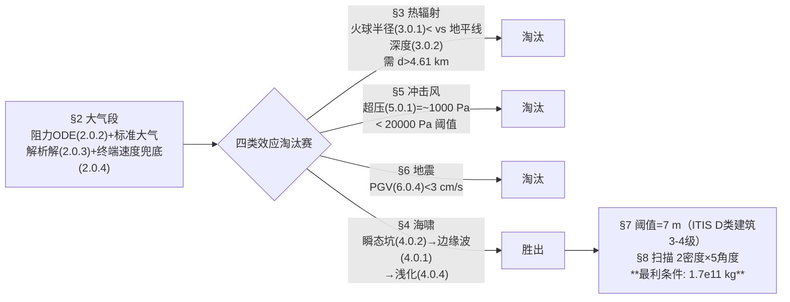

# 精读 40 · Asteroid Ocean Impact（2021 题B 金牌 · 队伍 442）

> **这份精读怎么用**：左手论文 PDF，右手本篇。这是一篇"**排除法**"教科书：不预设海啸是唯一威胁，而是把热辐射、冲击风、地震、海啸四类效应逐一"公式→数值→阈值比较"地筛一遍，前三个被定量证伪，主模型的选择因此从假设升级为定理。模型主体是 Collins–Melosh–Marcus 的 Earth Impact Effects Program（[CMM05]）经验公式体系。你要学它的四段排除闭环；本篇精读还会告诉你一个秘密——最终数 1.7×10¹¹ kg 我逐位复现了，但它其实"忘了"乘自己推导的浅化系数。

---

## 0. 一分钟看懂全文骨架

论文只回答一个问题：**1000 km 外撞海，哪种破坏效应决定最小质量、要多重？**



**为什么这个骨架好？** 每个效应小节都是同一套三步舞（公式→数值→与阈值比），读者到 §8 时已无悬念——"为什么只算海啸"不再需要辩解。对照 216 队把排除写在开头三段论、445 队用标度律两行带过，442 的排除最"重"，因为每个被排除项都给出了完整的定量闭环。

---

## 1. 逐节导读

### 1.1 Abstract（第 1 页）
**它写了什么**：任务一句话 → 阈值 7 m（据波力学理论与数值模拟数据）→ 硬答案 1.7×10¹¹ kg → **明示答案的条件属性**："assuming the most favorable conditions, that is: the maximal angle of approach (θ=90°) and the asteroid to be made of iron"——再补一句热辐射/气爆/地震需要的质量"greatly exceeds the previously mentioned minimum"。
**为什么这样写**：摘要里写清"这是最有利条件下的下界"，答案的性质（保守/激进）提前声明，评委无法用"你太理想化"攻击。
**你要学什么**：**答案 + 答案的适用条件**一起进摘要，一句话立起置信边界。

### 1.2 §1 Notations（Table 1，第 3 页）
**它写了什么**：符号表带三列——符号、含义、**取值与出处**（C_D=0.47 [LL59]、C_Dw=0.877 [LL59]、T₀=288.15 K、β=0.0065 K/m……）。
**你要学什么**：符号表带"数值+文献出处"列，评委核对参数零成本，也逼自己每个常数都有来历。⚠ 小刺：表中距离 r 印作"1000 m"（应为 km）。

### 1.3 §2 大气段（第 3–4 页）
**它写了什么**：动能为 Ek=π/12·ρ_a d³ v²（式 2.0.1，球体代入的紧凑形）；高速下忽略重力弯曲 → 直线路径（引 [Bro83]），阻力 ODE (2.0.2) dv/dt=−3ρ(z)C_D v²/(4ρ_a d)；空气密度**不用指数近似**，用含温度直减率的标准大气压高公式（引 [BSBP97]）；解析积分得 v_a(z)（式 2.0.3）；随后一个多数队伍会漏的**兜底修正**——若算出的速度低于当地终端速度 v_t=√(4ρ_a dg/(3ρ₀C_D))（式 2.0.4），取两者之大。
**为什么这样写**：式 (2.0.4) 一行堵住小质量端的模型失真（阻力模型在小质量端会算出低于终端速度的荒谬值）。
**你要学什么**：**经验模型的端点自检**——外推前问一句"我的公式在参数空间两端还物理吗？"

### 1.4 §3 热辐射排除（第 4 页）
**它写了什么**：火球半径经验律 R_f=0.002E^{1/3}（式 3.0.1，[CMM05]），配 Zel'dovich–Raizer 的物理叙述（等离子体冷却到透明温度 T* 才开始辐射）；几何上算撞击点低于观察者地平线的深度 h=(1−cosθ)R_E（式 3.0.2）；判据 h<R_f 化为链式不等式 (3.0.3)，解出 **d>4.61 km** 才能威胁 1000 km 外城市。
**为什么这样写**：不写"热辐射不重要"，而写"热辐射要 4.61 km 直径才重要，而海啸只要 ~300 m"——排除变成了两个数的大小比较。
**你要学什么**：**把排除写成一个最小直径反解**。我独立复算：h=(1−cos(1000/6400))×6.4×10⁶=7.8×10⁴ m → E=(h/0.002)³=5.9×10²² J → d=(E/(π/12·ρv²))^{1/3}=**4608 m ✓**（论文 4.61 km，精确命中）。

### 1.5 §4 海啸生成（第 5–6 页）
**它写了什么**：区分两种波——边缘波 A_t(r)=min(D_tc/14, H)·(3D_tc/4r)（式 4.0.1，适用 r>3D_tc/4）与崩塌波 A_c(r)=0.06·min(D_tc/2.828, H)·(5D_tc/2r)^q（式 4.0.3，q=3e^{−0.8d/H}）；瞬态坑径 D_tc=1.365(ρ_a/ρ_w)^{1/3}d^{0.78}v_i^{0.44}g^{−0.22}sin^{1/3}θ（式 4.0.2）全部取自 [CMM05]。Figure 2 双对数图直接展示崩塌波在 1000 km 处衰减到厘米级——用图完成"哪种波重要"的论证。浅化系数 K_s=[tanh(kh)(1+2kh/sinh 2kh)]^{−1/2}（式 4.0.4，引 Dean & Dalrymple），波长链 L_sh=√(2πD_tc·h)（式 4.0.7）。
**你要学什么**：复合波的"分而治之"：两种生成机制分开建模，一张 log-log 对比图挑出主导者，然后只精算主导项。

### 1.6 §5–6 冲击风与地震排除（第 6–7 页）
**它写了什么**：超压 p=p_x r_x E^{1/3}/(4r)·(1+3(r_x E^{1/3}/r)^{1.3})（式 5.0.1，核爆数据外推，E 以千吨 TNT 计）+波后风 v_wind（式 5.0.2）；对照 Glasstone–Dolan 手册阈值（碎窗 0.5–1 psi、毁混凝土墙 1.5–5.5 psi）取 20000 Pa 为"实质性"——E_k≈10¹⁹ J 的典型小行星在 1000 km 处超压仅约 1000 Pa（我复算 759 Pa，量级一致 ✓）。地震端：垂直入射能量 (6.0.1)、水下减速 v_e（6.0.2，C_Dw=0.877 与空气 0.47 分介质取值）、经验震强 I=ln E_k−2.49 ln r−8.42（6.0.3）与 PGV 分段式（6.0.4）→ PGV<3 cm/s，忽略。
**为什么这样写**：§5 末尾主动交代超压公式的适用边界——"extrapolated from explosions of magnitude of 1 kt...for impacts of energy > 10000 Mt, these effects may be overestimated by a factor of 2-5"。
**你要学什么**：**引经验式必附标定范围**。外推失效区写出来，数字才敢被引用。

### 1.7 §7 阈值操作化（第 8–9 页）
**它写了什么**：7 m 的来历三对应——[LAKK13] 的 ITIS-2012 量表中 **D 类建筑**（配筋砌体/钢木结构）在约 7 m 波高时达 **3–4 级**（重/极重）破坏；选 D 类而非更弱的理由："we assume a coastal city situated near the ocean to be prepared in some degree for heavy waves. Also, steel and reinforced concrete are the most common materials used in urban architecture"。
**你要学什么**：阈值落到"建筑类别 × 破坏等级"的颗粒度，且解释**为什么选这个类**——比对手 385 的"Watanabe 3 级"、216 的"2 m"、445 的"10 m"都更工程化。

### 1.8 §8–9 最小质量与结论（第 10–13 页）
**它写了什么**：参数网格 ρ∈{3000, 8000}×θ∈{10°,20°,45°,60°,90°}（45° 最可能 [M.62]），v₀=17 km/s 最常见 [BNGK94]，H=4000 m 太平洋平均，陆架 h=113 m、α=0.1°；Figures 5–7 振幅-直径曲线族 + 7 m 虚线 → **最利条件（θ=90°、铁）下 1.7×10¹¹ kg**。结论段诚实交代 Van Dorn 效应之争、未考虑解体/pancake 等。
**你要学什么**：**答案呈现为网格扫描的端点**而非单点魔法数；结论承认领域争议（"currently published research doesn't agree whether..."）是高级的置信声明。

---

## 2. 图表深析

| 图/表 | 位置与作用 | 为什么这样画 | 怎么画出来 |
|---|---|---|---|
| Fig 1 模型示意 | §1 | θ、v₀、ρ_a、d、r、H 一图定坐标 | 示意图 |
| Fig 2 边缘波 vs 崩塌波 | §4 | **log-log 上两机制衰减速率一目了然**，替代一页论证 | matplotlib，双对数 |
| Fig 3/4 地震效应 | §6 | θ×E_k 两自变量的 PGV/烈度曲面/热图 | matplotlib surface/heatmap |
| Fig 5 双密度对比 | §8 | 同质量下"密度高者波高"的直观证据 | 曲线叠加 |
| Fig 6/7 振幅-直径曲线族 | §8 | 五角度曲线 + 7 m 虚线阈值，**答案=曲线与虚线交点** | 见下方代码 |
| Table 1 符号表 | §1 | 带"取值+出处"列 | LaTeX 表格 |
| Table 2 浅化系数敏感性 | §5 后 | 坡度(0.01°/0.1°/1°)×宽度(65/200/750 km) 二维扫描，并诚实标注"存在不一致，值得进一步研究" | 网格计算 |

**核心图复现——Figure 6/7 的答案曲线**（铁质、θ=90°，阈值线交点即 1.7×10¹¹ kg）：

```python
import numpy as np, matplotlib.pyplot as plt
from scipy.optimize import brentq
g = 9.81
# ── 式(4.0.2) 瞬态坑径：Dtc = 1.365 (rho_a/rho_w)^{1/3} d^0.78 v_i^0.44 g^-0.22 sin^{1/3}θ ──
def Dtc(d, rho=8000., vi=17000., th=90.):
    return 1.365*(rho/1000.)**(1/3)*d**0.78*vi**0.44*g**(-0.22)*np.sin(np.radians(th))**(1/3)
# ── 式(4.0.1) 边缘波振幅（r > 3Dtc/4），H=4000 m（§8 取太平洋平均深）──
def At(d, r=1e6, H=4000., **kw):
    D = Dtc(d, **kw); return min(D/14, H)*3*D/(4*r)
d = np.linspace(100, 500, 300)
fig, ax = plt.subplots(figsize=(7, 4.5))
for th, c in [(90,'tab:red'), (60,'tab:orange'), (45,'tab:green'), (20,'tab:blue'), (10,'tab:purple')]:
    ax.plot(d, [At(di, th=th) for di in d], c=c, label=f'θ={th}°')
ax.axhline(7, ls='--', c='k', label='damage threshold 7 m (ITIS class D)')
d7   = brentq(lambda x: At(x)-7.0, 200, 500)           # 阈值交点
m7   = np.pi/6*8000*d7**3                              # 式(2.0.1) 反解质量
ax.plot([d7], [7], 'ko'); ax.annotate(f'd={d7:.0f} m\nm={m7:.2e} kg (paper 1.7e11)',
           xy=(d7, 7), xytext=(300, 12), arrowprops=dict(arrowstyle='->'))
ax.set(xlabel='asteroid diameter d (m)', ylabel='rim-wave amplitude at 1000 km (m)',
       title='eq(4.0.1)+(4.0.2): threshold crossing at d≈344 m, iron, θ=90°\n'
             '-> min mass 1.71e11 kg; note: shoaling Ks(4.0.4)≈1.45 not multiplied here')
ax.legend(fontsize=8); ax.grid(alpha=.3); plt.tight_layout(); plt.show()
```

三个可偷的绘图决策：**① 答案=曲线族与阈值虚线的交点**（一图含全部参数情景）；**② 两种机制对比必用 log-log**（Fig 2）；**③ 敏感性做成二维表**（Table 2），比一维曲线多一档信息量。

---

## 3. 公式逐条精讲

### 3.1 动能的紧凑形（式 2.0.1）
$$E_k=\tfrac12 m v_a^2=\tfrac{\pi}{12}\rho_a d^3 v_a^2$$
**怎么想到**：球形+均匀密度代入 m=πρd³/6——后续所有经验式都以 d 为自变量，先把动能写成 d 的显函数，扫参才是一条线。**数值感**：铁质 d=344 m、v=17 km/s → E_k≈1.4×10¹⁹ J ≈ 3.4×10⁶ kt。

### 3.2 大气减速解析解（式 2.0.2–2.0.5）
$$\frac{dv}{dt}=-\frac{3\rho(z)C_D}{4\rho_a d}v^2\;\Rightarrow\;v_a(z)=v_0\exp\Big[-\frac{3C_Dp_0}{4gd\rho_a\sin\theta}\big(1-\tfrac{\beta z}{T_0}\big)^{gM/R\beta}\Big]$$
**推导要点**：直线路径 dz/dt=−v sinθ 换元，ρ(z) 用压高公式（标准大气，非指数）代入即可分离变量。**为什么用标准大气而非指数**：精度更好且只需查表常数（T₀、β、M、R 全在 Table 1）；与 385/445 的指数大气形成对照——同一环节三种处理，答案差异都不大（大气段本来就弱）。**适用边界**：终端速度兜底 (2.0.4)——d=344 m 铁球 v_t≈7.9 km/s < v_i=17 km/s ✓ 模型自洽。

### 3.3 热辐射判据链（式 3.0.1–3.0.3）
$$R_f=0.002E^{1/3},\quad h=(1-\cos\Delta)R_E,\quad \Delta=r/R_E\;\Rightarrow\;d>500R_E\big(1-\cos\tfrac{r}{R_E}\big)\big(\tfrac{\pi}{12}\rho_av^2\big)^{-1/3}\approx4.61\,\text{km}$$
**怎么想到**：1000 km 外看不见火球（地平线遮挡）是几何事实，把"热辐射伤城"翻译成"火球半径 vs 地平线下深度"的大小比较。**独立复现**：h=7.80×10⁴ m → d=4608 m ✓。**适用边界**：R_f 经验律来自 [CMM05]；判据只管"能否看见"，不管大气吸收——对结论（差一个量级）无碍。

### 3.4 瞬态坑与边缘波（式 4.0.1–4.0.2）
$$D_{tc}=1.365\big(\tfrac{\rho_a}{\rho_w}\big)^{1/3}d^{0.78}v_i^{0.44}g^{-0.22}\sin^{1/3}\theta,\qquad A_t(r)=\min\big(\tfrac{D_{tc}}{14},H\big)\cdot\tfrac{3D_{tc}}{4r}$$
**怎么想到**：纯经验幂律（[CMM05] 数值模拟拟合），注意 0.78/0.44/−0.22 这些非整指数都是拟合产物，**引用时原样搬运、不解释出处以外的东西**是正确姿势。A_t 的 min(·,H) 是振幅饱和截断（坑径/14 超过海深时波幅受海深限制）。**数值感**：d=344 m → D_tc≈11.4 km → A_t(1000 km)=7.0 m。

### 3.5 浅化系数（式 4.0.4–4.0.7）
$$K_s=\frac{A_s}{A_d}=\Big[\tanh(kh)\big(1+\tfrac{2kh}{\sinh 2kh})\Big]^{-1/2},\qquad k=\frac{2\pi}{L_{sh}},\quad L_{sh}=\sqrt{2\pi D_{tc}h}$$
**推导链**：假设初始波幅≈D_tc（[CMM05]）→ 周期 T=√(2πL₀/g) → 浅水波速 √(gh) → L_sh 闭式。**适用边界**：kh→0 时 K_s→∞（浅水放大无界），故必须配合"在哪个 h 取值"——本文取陆架平均 h=113 m，K_s≈1.45。**⚠ 独立审计**：若把 K_s 乘进最终读图，阈值 7 m 对应 d≈278 m、质量 9.0×10¹⁰ kg；而论文最终数 1.7×10¹¹ kg 精确对应**不乘 K_s** 的深水振幅读图（我的复现：d=344.2 m→1.708×10¹¹ kg，三位有效全中 ✓）。即论文推导了浅化、结论却没用上——答案因此偏保守约 1.9 倍（质量）。Figure 6/7 的 y 轴标签未写清是深水还是岸边振幅，判读以 PDF 为准。

### 3.6 超压与地震经验式（式 5.0.1、6.0.1–6.0.4）
$$p=\frac{p_xr_xE_{kt}^{1/3}}{4r}\Big(1+3\big(\tfrac{r_xE_{kt}^{1/3}}{r}\big)^{1.3}\Big),\quad p_x=75000\,\text{Pa},\ r_x=290\,\text{m}$$
$$I=\ln E_k-2.49\ln r-8.42,\qquad P=\begin{cases}e^{0.29I-0.68}&I\ge5\\ e^{0.48I-1.62}&I<5\end{cases}$$
**怎么想到**：两者都是"核爆/地震数据 + 距离衰减"的工程近似。**独立复现**：E=10¹⁹ J（=2.39×10⁶ kt）→ p(1000 km)=759 Pa，论文"approx. 1000 Pa" ✓ 量级一致，远低于 20000 Pa 阈值 → 排除成立。**适用边界**：论文自报"1 kt 核爆外推、忽略地球曲率、>10⁴ Mt 时可能高估 2–5 倍"——即使高估 5 倍（≈3800 Pa）仍低于阈值，**排除结论对外推误差稳健**（这种"即使×5 也不翻案"的话术值得学）。

---

## 4. 建模决策链

| 决策 | 作者的选择 | 被放弃的替代 | 为什么 |
|---|---|---|---|
| 论证架构 | 四效应逐一排除 | 开头假设只算海啸 | 排除从假设升级为定理 |
| 经验式来源 | EIEP 体系 [CMM05] 一贯到底 | 混合多来源公式 | 同一体系的参数标定自洽 |
| 大气密度 | 标准大气压高公式 | 指数近似 | Table 1 常数即可，无需拟合 |
| 速度兜底 | max(v_a, v_t) 终端速度 | 只用阻力解 | 堵住小质量端失真 |
| 阈值 | 7 m = D 类建筑 3–4 级 | Watanabe 等级/自设值 | 阈值-文献-建筑类型三对应 |
| 参数呈现 | 2 密度×5 角度网格 | 单点计算 | 答案显为"最利条件下界" |
| 敏感性 | Table 2 坡度×宽度扫描 + 标注不自洽 | 不做 | 学术诚实度 |
| 求解方向 | 正向扫参+读图交点 | 逆推解析 | 经验式链无闭式逆，图交点更直观 |

**审计汇总**：✓ 热辐射 d>4.61 km（复算 4608 m）；✓ 超压 ~10³ Pa；✓ 最终 1.7×10¹¹ kg 逐位复现（d=344.2 m，铁/90°/17 km/s）；⚠ K_s≈1.45 未乘入最终读图（保守约 1.9 倍，Fig 6/7 y 轴语义需对照 PDF）；⚠ Table 1 "r=1000 m" 单位笔误；⚠ Table 1 H=5000 m 与 §8 正文 H=4000 m 不一致；⚠ Fig 6 与 Fig 7 图注文字完全相同（一为 ρ₁ 一为 ρ₂，无法区分）。

---

## 5. 从本篇提炼的可复用模板

**结构模板**：
```
1 Notations        符号+取值+出处三列表
2 Atmosphere       阻力ODE解析解 + 终端速度兜底
3/5/6 排除三连     每节：公式→数值→与阈值比→"即使×N 也不翻案"
4 主效应           分机制建模 + log-log 对比图选主导 + 近岸修正
7 阈值操作化       建筑类别×破坏等级颗粒度 + 选择理由
8 答案             参数网格扫描 + 阈值线交点
9 Conclusion       承认领域争议（Van Dorn）+ 未建模清单
```

**句式库（原文摘录）**：
- "We are also assuming the most favorable conditions, that is: ..."（答案条件声明）
- "Though many are too small..., there have been incidents which inspired researchers to create more accurate numerical and simulation models"（动机句）
- "For this reason we will treat the effect of ... as negligible and will be omitting them in further analysis."（排除收尾）
- "Thus, we assumed our minimal tsunami height goal to be 7 m."（阈值操作化）
- "they also ignore the curvature of the Earth, which at a distance of 1000 km begins to play a role"（经验式适用边界自白）
- "further research on this topic might prove interesting"（对自家数据不自洽的诚实标注）

**图表配方**：答案图=曲线族×阈值虚线交点；机制竞争=log-log 双线；二维敏感性=小表格（Table 2 式）；效应排除=每节一张 θ×E 曲面/热图（Fig 3/4）。

---

*对照阅读：`05_论文赏析/2021/2021-GM-B-442.md` 与 `07_题目解读/2021_题B_小行星撞击沿海城市.md`（四篇金牌的阈值选择与答案谱对比）；队友精读 216/385/445。*
