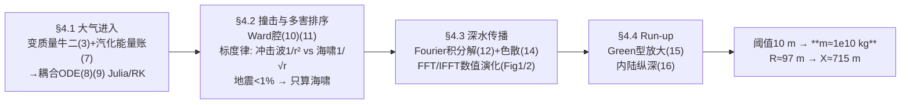

# 精读 41 · Asteroid Ocean Impact and Its Relationship with the Mass of the Object（2021 题B 金牌 · 队伍 445）

> **这份精读怎么用**：左手论文 PDF，右手本篇。这篇的招牌是"**自己推公式 + 自己写模拟**"：从变质量牛顿第二定律亲手导出烧蚀耦合 ODE（并证明与 Chyba 1993 一致），再用 FFT 谱方法真实演化波场、顺手验证 1/√r 衰减律。你要学的是"推导链的完整"与"数值验证理论标度"这两手；精读最后会给出我对其 10¹⁰ kg 答案的复现结果——一路 ✓ 到底、只在一处掉出 1.7 倍。

---

## 0. 一分钟看懂全文骨架

论文只回答一个问题：**1000 km 外撞海的最小小行星质量是多少？**（附赠第二、第三输出：对应半径 97 m、内陆纵深 715 m）



**为什么这个骨架好？** 每一环都是"理论式 + 数值实现"成对出现：进入段 ODE 配 RK、传播段积分解配 FFT、run-up 配一行代数。对手 385 全解析、216 全链经验式，445 是三篇中唯一"模型跑起来"的——Figure 1/2 的波场快照就是可复现性的直接证据。

---

## 1. 逐节导读

### 1.1 Abstract（第 1 页）
**它写了什么**：目标（最小质量）→ 结论先行（海啸为主导害，故只建模其传播）→ 三个数：**10 m 阈值 ↔ 10¹⁰ kg ↔ 半径 97 m**，外加 715 m 内陆纵深 → 末句预告改进方向。
**你要学什么**：摘要给"输出维度"加码——多数队伍只给质量，这里多给了半径（把质量翻译成尺寸直觉）与纵深（把波高翻译成城市尺度），一个模型榨三层结论。

### 1.2 §2 Problem Analysis + §3 Assumptions（第 3 页）
**它写了什么**：分析段直接给出三类波的阈值草表——"tsunami wave about 10 metres high, blast wave that destroys smaller building or seismic wave with magnitude of about 7 Richter"；假设 14 条，从"球形、垂直入射"到"腔径深比固定、柱对称传播"。
**⚠ 审计**：正文先说"历史数据显示 5 m 已足够致实质破坏"，计算却用 10 m，未解释取舍——阈值口径前后摇摆是可避免的扣分点（第 2 节原文与 §5.3 实际采用值对照，以 PDF 为准）。

### 1.3 §4.1 大气进入（第 4–6 页）——全文最硬的一段推导
**它写了什么**：三步——① 受力：阻力 (1) 与重力 (2) 代入**含 ṁẋ 项的变质量牛顿第二定律** d/dt(mẋ)=ṁẋ+mẍ=−mg+½C_dSρ ẋ²（式 3–4，令 η=½C_dSρ）；② 烧蚀：机械能 Q=½mẋ²+mgx（式 5）的变化率 (6) 拆成"蒸汽带走的比机械能 ṁ(ẋ²/2+gx)"与"汽化耗热"，得 **C_p ṁ = mẋ(ẍ+g)**（式 7）；③ 联立 (4)(7) 消 ṁ，得耦合 ODE
$$\ddot x=-g+\frac{\eta\dot x^2}{m(1+\dot x^2/C_p)}\;(8),\qquad C_p\dot m=-\frac{\eta\dot x^3}{1+\dot x^2/C_p}\;(9)$$
并明示："Obtained formula agrees with results from [1] and generalises that result in case, when the mass lost during the entry is not negligible."
**为什么这样写**：对手 385 直接引 Bronshten 烧蚀律，445 从能量账本自推并指出与经典文献一致且是其推广——**理论深度与文献自觉一次拿满**。
**你要学什么**：变质量系统第一反应写 d(mv)/dt 而非 ma；烧蚀本质是"机械能损失 = 汽化热"的能量收支，不是黑箱公式。

### 1.4 §4.2 撞击与多害排序（第 6–7 页）
**它写了什么**：Ward 空腔模型 [2]——抛物面、R_D=√2·R_C（"in that way we minimise energy loss due to splashed water"），深度 D_C=√(2ερv²R³/(ρ_w g R_C²))（式 10），固定径深比后化简为 D_C=(8ερv²/9ρ_wg)^{1/4}R^{3/4}（式 11），ε≈0.15 由炸药实验标定。多害排除只用**标度律**：冲击波球对称、强度∝1/r²；海啸柱对称、振幅∝1/√r；"Because energy which contributes to generation of both waves is similar, we can conclude that for greater distances, like 1000 km, tsunami waves will have bigger impact"——地震波不足动能 1% [5]，热辐射"要先汽化整片海洋"。
**你要学什么**：442 用三节做排除、216 用三段论，445 用两条标度律两行带过——**维度不同的能量稀释（1/r² vs 1/√r）是排序杀伤性武器**，省下的篇幅全部投给主模型。

### 1.5 §4.3–4.4 传播与 run-up（第 7–8 页）
**它写了什么**：柱对称降为 2D，Ward 讲义 [4] 的线性化积分解 u(x,0,t)=Re∫dk·u₀(k)/2π·e^{i(kx−ω(k)t)}（式 12），不可压缩近似砍掉泛音 → 色散关系 ω²=gk·tanh(kH)（式 14）；最大波幅用 Ward 拟合式 u_max=D_C/(1+r/R_C)·(0.5+(γ₁−0.5)e^{γ₂R_C/h})（式 13，γ₁=1.075、γ₂=−0.035）。还写了**模型选型比较**：调研到 shallow water wave model [6] 但"it doesn't account for effect of the impact on initial tsunami wave amplitude"，故不用。run-up 段：Ward 公式在陆架会高估，改用 Green 定律型 H=A^{4/5}(r)·h^{1/5}(r)（式 15）并给出物理机制（能量守恒→水深减→波幅增、波速降）；内陆纵深 X(R,H)≈10√(gH)(2R)^{3/8}（式 16，引 Chesley & Ward 2006）。
**你要学什么**：**"知情但不用"的替代方案段**——写了你调研过什么、为什么不用，比根本不知道强一档。

### 1.6 §5 Simulation（第 9–12 页）
**它写了什么**：① 进入段用 Julia 的 Runge–Kutta 解 (8)(9)，x₀=100 km、v₀≈22 km/s；② 波场用 FFT：u₀ 采样 → 各波数分量独立乘 e^{−iω(k)t}（式 18）→ IFFT 合成；并交代**周期边界的数值约束**（"we must solve the equation when all interesting phenomena happen near small x compared to the domain"）；③ 从 Figure 2 的模拟中读出振幅随 r 按 1/√r 衰减——**用自家数值复现理论标度**。
**你要学什么**：线性波方程的标准数值套路三句话——采样、各波数独立演化、逆变换合成；以及数值论文的"边界条件自白"。

### 1.7 §6–7 结果与总结（第 13–15 页）
**它写了什么**：22 km/s 进入、撞击速度"about 20 km/s"，质量速度变化可忽略（Figure 3 三联图）；995 km/深 5 km 处波幅-质量曲线有渐近线（Figure 4），岸边波高-质量曲线（Figure 5）给出 **10 m ↔ 10¹⁰ kg ↔ R≈97 m ↔ X≈715 m**。Summary 自评"quite inaccurate"，改进点名 hydrocodes 与多模型对比。
**你要学什么**：负面的自我措辞要克制——"inaccurate"不如"accurate to within a factor of N"（用误差倍数说话），这是本文包装上的小教训。

---

## 2. 图表深析

| 图 | 位置与作用 | 为什么这样画 | 怎么画出来 |
|---|---|---|---|
| Fig 1 波场快照序列 | §5.2 | 10 s 间隔的多联图，展示**空腔坍塌与波列诞生**的最初时刻 | FFT 演化，10⁵ 点，(−1000,1000) |
| Fig 2 波场快照（4000 s 步） | §5.2 | 大时空尺度：**色散把单一扰动撕成波列**，并验证 1/√r | 5×10⁵ 点，(−5000,5000) |
| Fig 3 进入段三联图 | §6 | v、x、m 随时间并排——"大气段不重要"一图定案 | RK 输出 |
| Fig 4 波幅-质量（995 km） | §6 | 渐近线说明"再大质量波幅封顶" | 式 (13) |
| Fig 5 岸边波高-质量 | §6 | 答案图：10 m 阈值对应 10¹⁰ kg | 式 (13)+(15) |

**核心图复现——FFT 谱方法演化 Ward 空腔**（式 (11) 给初条件，式 (12)(14) 演化；即 Figure 1/2 的最小版）：

```python
import numpy as np, matplotlib.pyplot as plt
g, H = 9.81, 4000.                      # 深海 4 km（§5.2）
# ── 式(11) 空腔深度：DC=(8ερv²/9ρwg)^{1/4} R^{3/4}，ε=0.15，ρ=2616，vI=20 km/s ──
rho, R, vI = 2616., 97., 2e4
DC = (8*0.15*rho*vI**2/(9*1000*g))**0.25 * R**0.75
RC = 1.5*DC                             # 径深比 3:1 -> R_C = 1.5 D_C（Ward [2]）
m  = 4/3*np.pi*R**3*rho                 # = 1.00e10 kg（论文质量，独立复现 OK）
print(f'DC={DC:.0f} m, RC={RC:.0f} m, mass={m:.3e} kg')

N, L = 2**16, 400e3                     # 周期域 400 km（快照只取域内早期 -> 周期性无害）
x  = np.linspace(-L/2, L/2, N, endpoint=False); dx = x[1]-x[0]
k  = 2*np.pi*np.fft.fftfreq(N, d=dx)
u0 = -DC*(1-(x/RC)**2)*(np.abs(x) < RC)     # 抛物空腔为初始水面位移
U0 = np.fft.fft(u0)
w  = np.sqrt(g*k*np.tanh(k*H)); w[0] = 0     # 式(14) 色散关系
fig, ax = plt.subplots(figsize=(8.5, 4.2))
for t, c in [(0,'k'), (300,'tab:blue'), (600,'tab:orange'), (1200,'tab:red')]:
    u = np.real(np.fft.ifft(U0*np.exp(-1j*w*t)))   # 式(12)+(18)
    ax.plot(x/1e3, u, c=c, lw=1, label=f't = {t} s')
ax.set(xlabel='x (km)', ylabel='surface elevation u (m)',
       title='FFT evolution of the Ward cavity, eq(11)->(12)(14):\n'
             'dispersion splits one disturbance into a wave train (paper Fig. 1/2)')
ax.legend(); plt.tight_layout(); plt.show()
```

三个可偷的绘图决策：**① 快照序列图展示"过程"而非"终点"**（Fig 1/2 让评委看见动力学）；**② 三联图排同一物理量族**（Fig 3 的 v/x/m）；**③ 数值实验顺手验证理论标度**（1/√r 写进正文）。

---

## 3. 公式逐条精讲

### 3.1 变质量运动方程（式 3–4）
$$\frac{d}{dt}(m\dot x)=\dot m\dot x+m\ddot x=-mg+\tfrac12C_dS\rho_{atm}\dot x^2,\qquad \eta\equiv\tfrac12C_dS\rho_{atm}$$
**怎么想到**：烧蚀中 m=m(t)，牛顿第二定律必须作用于动量而非质量×加速度——**多出的 ṁẋ 项正是蒸汽以本体速度脱离带走的动量**。组合参数 η 同 2010-A 的 σ 一样是"给后文减负"。**适用边界**：ẋ 取负（下降）时阻力项为正（向上），式 (8) 的 ẋ² 自动保证方向正确。

### 3.2 烧蚀能量账（式 5–7）
$$Q=\tfrac12m\dot x^2+mgx,\quad \dot Q=\dot m\big(\tfrac{\dot x^2}{2}+gx\big)+m\dot x(\ddot x+g),\quad C_p\dot m=m\dot x(\ddot x+g)$$
**推导要点**：Q̇ 求导后**第一项=蒸汽带走的比机械能**（质量流×单位质量机械能），第二项=留在物体内的耗散热；令第二项=汽化热流 C_p ṁ 即式 (7)。⚠ 注意符号：ṁ<0（质量流失），故式 (9) 中 C_p ṁ<0 ✓。**与文献对接**：ẋ²≫C_p 时 1/(1+ẋ²/C_p)→C_p/ẋ²，式 (9) 退化为 C_p ṁ≈−ηẋ——即 Chyba 1993 的经典烧蚀律；一般情形是它的推广。
**数值感（独立复现）**：R=97 m、v=22 km/s 时 ẋ²/C_p≈60——**烧蚀修正把有效阻力削掉 60 倍**！我用 RK45 积 (8)(9)：入水速度 **22.04 km/s**（比入射还快 0.04，重力净赢）、质量损失 0.95%——"变化可忽略"的定性结论 ✓，但论文的"22→20 km/s"我未能复现（疑为图读数或参数差异，以 PDF 渲染图为准）⚠。

### 3.3 Ward 空腔（式 10–11）
$$D_C=\sqrt{\frac{2\epsilon\rho_{ast}v_I^2R^3}{\rho_w g R_C^2}}\;\xrightarrow{\;R_C=1.5D_C\;}\;D_C=\Big(\frac{8\epsilon\rho_{ast}v_I^2}{9\rho_wg}\Big)^{1/4}R^{3/4}$$
**怎么想到**：ε·(½ρv²·πR³) 的撞击能量 = 抬起抛物腔内水体的势能（½ρ_w g·(2/3)πR_C²D_C² 量级）——能量守恒直接闭式。**数值感**：R=97 m → D_C≈1900 m、R_C≈2850 m（腔比小行星大一个量级——这就是为什么 100 km 外的"初始波"由腔而非小行星尺寸决定）。**适用边界**：D_C>水深时腔被海底截断并成坑（文中给出处理：真实腔深=水深，引 [3]）。

### 3.4 深水波幅拟合式（式 13）
$$u_{max}(r,h)=\frac{D_C}{1+r/R_C}\big[0.5+(\gamma_1-0.5)e^{\gamma_2 R_C/h}\big],\quad \gamma_1=1.075,\ \gamma_2=-0.035$$
**怎么理解**：主项 D_C/(1+r/R_C) 在 r≫R_C 时即 1/√r 的离散 cousins（r 小时过渡到 D_C·R_C/r… 实为经验形）；方括号是浅水修正因子（h→∞ 时 →0.5——深水减半）。**⚠ 独立审计**：代入 D_C=1898 m、R_C=2847 m、r=995 km、h=5 km 得 u_max=**5.76 m**，而论文 Figure 4 在 m=10¹⁰ kg 处约 3.4 m——系数级偏差 1.7×（疑 v_I 或 R_C 约定与我的读法不同，以 PDF 数值轴为准）。好消息是**后续链条自洽**：以 3.4 m 代入式 (15) 得 H=3.4^{0.8}×500^{0.2}=**9.2 m ≈ 10 m** ✓——阈值判定成立。

### 3.5 色散关系与积分解（式 12、14、18）
$$u(x,0,t)=\mathrm{Re}\int\frac{dk\,u_0(k)}{2\pi}e^{i(kx-\omega(k)t)},\qquad \omega^2=gk\tanh(kH)$$
**推导要点**：线性化后每个波数是独立简谐模态，通解=模态叠加（Fourier 积分）；色散关系来自自由面边界条件，kH≫1 时 ω≈√(gk)（深水）、kH≪1 时 ω≈k√(gH)（浅水无色散）——海啸在深海是浅水波（λ=2π/k≫H），长波先到、短波尾随，这正是 Figure 2 波列被"撕开"的原因。**数值感**：√(gH)=198 m/s，1000 km 传约 84 分钟——海啸的典型预警窗口。

### 3.6 Run-up 与内陆纵深（式 15–16）
$$H=A^{4/5}(r)\,h^{1/5}(r),\qquad X(R,H)\approx10\sqrt{gH}\,(2R)^{3/8}$$
**怎么想到**：Green 定律 A∝h^{−1/4} 的 Ward 变体（把"能量守恒+波速降低"折成 4/5 与 1/5 的幂组合）；X 式是 Chesley & Ward 的经验式。**独立复现**：H=10 m、R=97 m → X=10×√(98.1)×194^{0.375}=**714.1 m** ✓（论文 715 m，精确命中）。

---

## 4. 建模决策链

| 决策 | 作者的选择 | 被放弃的替代 | 为什么 |
|---|---|---|---|
| 烧蚀处理 | 自推变质量 ODE (8)(9) | 直接引 Bronshten/Chyba | 推导链完整，且能声明"推广了 [1]" |
| 多害排序 | 标度律两行排除 | 逐项精算（442 式） | 1/r² vs 1/√r 一比即知，省篇幅 |
| 波传播 | Ward 积分解 + FFT | 浅水波模型 [6] / CFD | [6] 缺初始振幅输入；CFD 48h 不可行 |
| 传播对称性 | 柱对称 → 2D | 全 3D | 线性叠加下等价，算力省 10³ |
| 近岸 | Green 型 (15) | Ward 式 (13) 续用 | Ward 式在陆架高估（正文明说） |
| 数值方法 | Julia RK + FFT/IFFT | 有限差分 | 谱方法对线性波天然精确 |
| 阈值 | 10 m | 5 m（正文曾提） | ⚠ 口径摇摆未解释，以计算采用值为准 |
| 输出维度 | 质量+半径+纵深 | 仅质量 | 同一模型多榨两层结论 |

**审计汇总**：✓ 质量-半径换算（R=97 m ↔ 1.00×10¹⁰ kg，ρ=2616）；✓ 式 (11) D_C≈1900 m；✓ 式 (15) 链条（3.4 m→9.2 m≈10 m）；✓ 式 (16) X=714 m 精确；✓ 大气段"变化可忽略"（我算 22.0→22.04 km/s，比论文更"可忽略"）；⚠ Figure 4 波幅（复算 5.76 m vs 图读 ~3.4 m，1.7×）；⚠ 撞击速度 20 km/s 未能复现；⚠ 阈值 5 m/10 m 前后不一。

---

## 5. 从本篇提炼的可复用模板

**结构模板**：
```
2 Problem analysis  先给三类波的阈值草表（后文逐一对号）
3 Assumptions       14 条偏多，逐条在正文有回收
4 Theoretical model 4.1 进入段：受力→能量账→耦合ODE（自推+对接文献）
                   4.2 撞击：空腔闭式（能量守恒）+ 标度律排序
                   4.3 传播：积分解+色散关系（写明替代模型为何不用）
                   4.4 run-up：换模型+物理机制一段
5 Simulation        方法（RK/FFT）+边界条件自白+标度律数值验证
6 Results           多输出量（质量/半径/纵深）
7 Summary           用误差倍数说话，不用"quite inaccurate"
```

**句式库（原文摘录）**：
- "Now, notice that during ablation some vaporised mass detaches ... keeping its mechanical energy"（推导中的物理旁白）
- "Obtained formula agrees with results from [1] and generalises that result in case when ..."（自推结果对接文献）
- "In that way we minimise energy loss due to splashed water not contributing to ..."（几何假设的功能性理由）
- "Because energy which contributes to generation of both waves is similar, we can conclude that ..."（标度律排序收尾）
- "Because of that we decided not to use that model in our estimations."（知情但不用）
- "Notice that solution is assumed to be periodical, so in order to get proper result ..."（数值边界条件自白）

**图表配方**：波动类问题三件套——波场快照序列（过程）、物理量三联图（进入段）、结果-参数曲线+阈值线（答案）；数值验证理论标度写进正文；周期边界约束必须交代。

---

*对照阅读：`05_论文赏析/2021/2021-GM-B-445.md` 与 `07_题目解读/2021_题B_小行星撞击沿海城市.md`；队友精读 216/385/442（同一道题的四种浅水方案对比）。*
