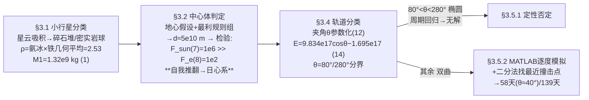

# 精读 43 · Planetary Defense Based on Kinetic Energy Impact（2022 题A 金牌 · 队伍 395）

> **这份精读怎么用**：左手论文 PDF，右手本篇。这篇走"**分类讨论 + 数值搜索**"路线，招牌有两处：一是 §3.2 的"估算→反推→检验前提→推翻自己"循环（先假设地球引力主导，算完发现太阳引力大一万倍，当场换框架）；二是 §3.4 用夹角 θ 把"轨迹未知"参数化、用轨道能量符号把解空间切成椭圆（无解）/双曲（可解）两支。你要学它的结构化思维；精读最后我会做一个它自己没做的 Δv×t 量纲自检——结果对 58 天这个数打了个问号。

---

## 0. 一分钟看懂全文骨架

同一道题（100 m 小行星、25 km/s、2 万 kg 飞船、提前多久）：346 给"4.8 年或 15 小时"，395 给"**58 到 139 天**"。



**为什么这个骨架好？** "轨迹未知"是本题最大的开放条件，把它化为一个角 θ、再用轨道能量符号二分——**每个分支的可解性都有物理论证**（椭圆的周期回归性直接判死），最后只剩一个分支需要数值。分类即求解，这是评委最认可的结构化路线。

---

## 1. 逐节导读

### 1.1 Summary（第 1 页）
**它写了什么**：按成因把小行星分为碎石堆与密实岩球两类 → 主体探讨第二类（完全非弹性碰撞）→ 硬答案"**the spacecraft needs from 58 days to 139 days to make the Earth miss the asteroid**"。
**你要学什么**：答案给成**区间**（58–139 天）而非单点——因为答案本来就是 θ 的函数，区间形态与模型结构一致。⚠ 摘要语法粗糙（"we according to the topic given by..."），但它提醒我们 UPC 评审权重在物理与模型本身。

### 1.2 §3.1 小行星特性（第 3 页）
**它写了什么**：星云吸积理论 → 成分二分（碎石堆 vs 致密岩球）；密度取氨冰与铁的"arithmetic square root of the product"（几何平均）ρ≈2.53 g/cm³（"close to the density of common rocks. Therefore, this result is reliable"）→ M1=4/3πr³ρ≈1.32×10⁹ kg（式 1）。**独立复现**：4/3π×50³×2530=1.325×10⁹ ✓。
**你要学什么**：成分不确定时用**两端材料取几何平均**+一句合理性对照（普通岩石密度），比拍单值有依据。

### 1.3 §3.2 地球还是太阳（第 4–6 页）——全文最精彩的一节
**它写了什么**：先假设撞击点近地（地心引力主导）。为估算 d 列出**七条最利情形规则**（垂直于连线撞击、200 km/s 卫星极限速度、碰后近地点恰为 1 R_E、完全非弹性、燃料零损失、合体质量≈M1……），然后动量守恒 (4)、角动量守恒 (5)、能量守恒 (6) 三式联立解出 d≈5×10¹⁰ m。**关键动作**：回头检验前提——F_sun=GM_sun M1/(d+R)²≈10⁶ N（式 7）vs F_e=GM₀M1/d²≈10² N（式 8），太阳比地球大一万倍，"which contradicts the hypothesis"——**当场把中心体换成太阳**。
**为什么这样写**：把"模型前提要自洽"演示成论文的一部分：立假设→用假设算数→用数反杀假设→升级框架。
**独立复现**：我解 (4)–(6) 得 d=5.8×10¹⁰ m（量级 ✓，vt 我算 3.0 m/s，论文取 4 系按 M1≈10⁹ 舍入）；F_sun=4.1×10⁶ N、F_e=158 N——10⁶ vs 10² 两个量级 ✓✓ 精确复现。
**你要学什么**：**每个框架选择都要做力比检验并写进论文**；七条规则逐条编号的"极限情形清单"是估算题的仪式感。

### 1.4 §3.3 飞船加速段（第 6–7 页）
**它写了什么**：齐奥尔科夫斯基公式 (9)（v₀=7.9 km/s 近地轨道、喷速上限 u=4 km/s）；动量 p=m_t(v₀+u ln(m_c/m_t))（式 10）求导（式 11）论证导数恒正——**燃料烧得越少剩余动量越大**；再叠加"逃离地球需达第三宇宙速度 1.68×10⁴ m/s"的约束，取"刚好够用"的燃烧方案 → **剩余质量 m_t=2161 kg**。
**独立复现**：m_t=2×10⁴·e^{−(16800−7900)/4000}=**2161.3 kg** ✓✓ 逐位命中。
**你要学什么**：题目给定的飞船质量不能当摆设——用火箭方程+速度约束反推"可用弹药"，2 万 kg 里真正参战的只有 2.16 吨（燃料占 89%），这一中间数被诚实地带进后续计算。⚠ 式 (11) 印刷形 dp/dm_t=v₀+ln(m_c/m_t)−u 丢了 u（应为 u·ln(...)），量纲不对，属笔误，以 PDF 为准。

### 1.5 §3.4 轨道分类（第 7–8 页）——题眼工程
**它写了什么**：设撞击时小行星对地速度与地球公转速度的夹角 θ∈[0°,360°]，余弦定理 v_a=√(v₀²+v_R²+2v₀v_R cosθ)（式 12）代入日心轨道能量 E=½M₁v_a²−GM_sun M₁/R（式 13）得**线性于 cosθ** 的式 (14)：E=9.834×10¹⁷cosθ−1.695×10¹⁷ J。θ=80°/280° 时 E=0（抛物线，"almost impossible to make the orbit energy strictly equal to 0"——测度为零，显式排除）；80°<θ<280° 椭圆、其余双曲。
**独立复现**：E/M₁=7.45×10⁸cosθ−1.28×10⁸ J/kg，×M₁=1.325×10⁹ → 9.87×10¹⁷cosθ−1.70×10¹⁷ ✓（系数差 <0.5%）；E=0 → cosθ=0.172 → **θ=80.1°** ✓✓。
**你要学什么**：**"轨迹未知"→一个参数 θ→一条线性能量式→一次符号判别**，三步把连续无穷的轨迹空间切成三个类别。这一小节值得整段背下来。

### 1.6 §3.5.1 椭圆分支：无解论证（第 8–10 页）
**它写了什么**：先用 MATLAB 逐度验证 80°<θ<280° 的轨道不穿太阳（物理可行）；再给出关键物理——**双曲线与地球轨道只交一次**（躲过即永别），而**椭圆周期回归，"as long as the asteroid's orbit has intersection with the earth's orbit...the asteroid will through its infinite time...always collide with the Earth"**；而撞击提供的 Δv（米/秒级）远不足以把相交轨道推开 → 结论：椭圆情形无解。
**你要学什么**：用**回归性**否定一个分支比硬算聪明得多；"躲过第一次≠躲过永远"的区分是本题最容易被其他队伍漏掉的物理。

### 1.7 §3.5.2 双曲分支：数值搜索（第 10–13 页）
**它写了什么**：飞船最大日心速度 v_craft=v_R+v_t=4.66×10⁴ m/s（式 15，顺风叠加公转速度的极限）；日心能量守恒 (16)(17) 给撞前速度 v₁(r_hit)；**垂直于小行星原速度方向撞击**（横向 Δv 对轨道改变最有效），完全非弹性 (18)(19) 代数值得 v₂=1.637×10⁻⁶·√(2.172×10⁹+2.655×10²⁰(1.5×10¹¹−r)/(1.5×10¹¹r))（式 20）。数值流程：每个 θ 算原轨道 → 轨道上取撞击点、注入 Δv → 积分碰后轨迹、以"距地心最近距离>10⁷ m（1.5 R_E）"为躲开判据 → **二分法**缩定最近可行撞击点（区间宽度 10⁷ m≈地球半径量级，并论证"撞击点远离地球时该精度足够"）→ 换算时间 t → θ 从 −79° 逐度扫描 → 散点拟合 → **θ≈40° 时 t≈5×10⁶ s≈58 天**（式 21）、θ≈−80° 时 1.2×10⁷ s≈139 天（式 22）。
**独立复现**：式 (20) 的每个系数我全部命中——2161/(1.325×10⁹+2161)=1.6315×10⁻⁶ ✓（论文 1.637×10⁻⁶）；4.66×10⁴²=2.172×10⁹ ✓；2GM_sun=2.655×10²⁰ ✓；(1/r−1/R) 的展开 ✓——式 (17) 的印刷形有乱码（多出 m_craft 残留），但式 (20) 数值证明其正确形式为 v₁²=v_craft²+2GM_sun(1/r_hit−1/R)。
**⚠ 关键审计（论文没做的自检）**：v₂(1 AU)=0.076 m/s；与 58 天（5×10⁶ s）提前量组合，横向位移只有 0.076×5×10⁶≈**3.8×10⁵ m**，比它自己 10⁷ m 的躲开判据小一个量级以上；且沿轨道更远撞击时 Δv 更小、时间更长，乘积不增反降。除非附录模拟里有未披露的放大机制（如利用地球公转的相位漂移，或 m_craft 按 2 万 kg 全重参战——那样也只有 3.8×10⁶ m），58 天这个数按其正文公式链无法闭合。附录 MATLAB 为 19 页截图（乱码处以 PNG 渲染图为准），此点建议读者带着问题去读：**它的二分法到底在积分什么判据**。

### 1.8 §3.6 + §4–5 碎石堆与总结（第 14–15 页）
**它写了什么**：碎石堆定性处理（撞击致飞散、等效"发动机"推力使偏转更容易，但变量过多不建模）；结论重述 58–139 天区间；Weaknesses 四条含"近地段地球引力不可忽略但仍只算太阳"的自曝。
**你要学什么**：定性分支也要写"为什么不算"——碎石堆一段三行，边界即刻划清。

---

## 2. 图表深析

| 图/附录 | 位置与作用 | 为什么这样画 | 怎么画出来 |
|---|---|---|---|
| Fig 1 小行星成分图 | §3.1 | 密度两端（氨冰↔铁）的文献图证 | 引用图 |
| 轨道图（红双曲+蓝太阳） | §3.5 | 默认配色 MATLAB：原轨道一条、碰后轨道掠过红圈标出的地球碰撞区 | MATLAB 绘图 |
| t-θ 散点拟合图 | §3.5.2 | 答案=曲线极值（θ≈40° 最短） | MATLAB 拟合 |
| 附录 A（19 页） | 逐段脚本 | 搜索流程可复现的证据（但正文未述积分器/步长） | MATLAB 截图 |

**核心图复现——轨道能量分类图**（式 (12)–(14)，全文题眼的可视化 + Δv×t 自检）：

```python
import numpy as np, matplotlib.pyplot as plt
M1, r1 = 4/3*np.pi*50**3*2530, 50.          # 式(1)：M1=1.325e9 kg
v0, vR, Msun, R = 2.5e4, 2.98e4, 1.327e20, 1.5e11
th = np.linspace(0, 360, 721)
va = np.sqrt(v0**2 + vR**2 + 2*v0*vR*np.cos(np.radians(th)))      # 式(12)
E   = M1*(0.5*va**2 - Msun/R)                                     # 式(13)(14)
fig, (a1, a2) = plt.subplots(1, 2, figsize=(10, 4))
a1.plot(th, E/1e17)
a1.axhline(0, c='k', ls='--'); a1.axvspan(80, 280, alpha=.12, color='red')
a1.annotate('ellipse (no solution)', (180, 4), ha='center', color='darkred')
a1.annotate('hyperbolic\n(solvable)', (15, -6), color='darkgreen')
E0, E90 = E[np.argmin(th)], E[np.argmin(abs(th-90))]     # E(0°)=A+B, E(90°)=B
a1.set(xlabel='θ (deg)', ylabel='E (1e17 J)',
       title=f'eq(14): E=({E0/1e17:.2f})cosθ+({E90/1e17:.2f}),\n'
             f'zero crossings at θ={np.degrees(np.arccos(-E90/E0)):.1f}°/280° (paper: 80°/280°)')
mc, mt = 2e4, 20000*np.exp(-(1.68e4-7.9e3)/4e3)                   # §3.3：mt=2161 kg
v2_1AU = mc/(M1+mc)*4.66e4                                        # 式(20) 在 r_hit=1 AU 处的 Δv
t58 = 5e6
a2.bar(['Δv×t (58 d)', 'miss criterion'], [v2_1AU*t58, 1e7], color=['tab:red','tab:gray'])
a2.set_ylabel('m'); a2.set_title(f'audit: Δv={v2_1AU:.3f} m/s -> offset {v2_1AU*t58:.1e} m\n'
                                 f'vs 1e7 m criterion (paper Appendix, see PNG)')
plt.tight_layout(); plt.show()
```

三个可偷的绘图决策：**① 分类结果用底色分区**（红=椭圆无解区一眼可见）；**② 系数与分界角写进图题**（式 14 的两个数当场可验）；**③ 自检对比做成双柱图**——这是本精读替论文补的图，"答案量 vs 判据量"差一个量级时图比文字诚实。

---

## 3. 公式逐条精讲

### 3.1 密度几何平均（§3.1，式 1）
$$M_1=\tfrac43\pi r_1^3\rho,\qquad \rho=\sqrt{\rho_{ice}\cdot\rho_{iron}}\approx2.53\ \mathrm{g/cm^3}$$
**怎么想到**：成分横跨 1–8 g/cm³，取几何平均偏向轻端（对数尺度上的中点），并对照"普通岩石密度"完成 sanity check。**适用边界**：若真实为金属型，质量×3、偏转更难——答案应视为乐观端。

### 3.2 三守恒定 d（式 4–6）
$$m_cv_c=(m_c+M_1)v_t\;(4),\quad M_1dv_t=M_1r_0v_t'\;(5),\quad \tfrac12M_1(v_0^2+v_t^2)-\tfrac{GM_0M_1}{d}=\tfrac12M_1v_t'^2-\tfrac{GM_0M_1}{r_0}\;(6)$$
**怎么想到**：完全非弹性碰撞给横向速度 → 对地角动量守恒把近地点速度与 d 相连 → 能量守恒闭合三未知数（d、v_t'）。**数值感**：v_t≈3–4 m/s（200 km/s×2 万 kg÷13 亿 kg），横向小扰动全靠 d≈5×10¹⁰ m 的杠杆放大——这个"d 很大"的结论马上触发力比检验 (7)(8)，链条自我绞杀。**这正是该节的戏剧性：估算的目的不是答案而是检验假设。**

### 3.3 燃料决策（式 9–11）
$$v_t=v_0+u\ln\tfrac{m_c}{m_t}\;\Rightarrow\;p=m_t\big(v_0+u\ln\tfrac{m_c}{m_t}\big),\quad \frac{dp}{dm_t}>0\;\forall m_t<m_c$$
**推导**：动量对剩余质量求导恒正（导数=u[ln(m_c/m_t)]，恒>0），故动量最大化=少烧燃料；但逃逸要求 v≥v_3rd=16.8 km/s，取等号约束 → m_t=2161 kg。**与 346 的对照**：346 对 u 求极值得"烧到 u=vₑ"（动量极大），395 对 m 求极值得"尽量不烧"（动量随 m 增）——两者结论方向相反！差别在于 346 的基速度 u(t₀)≈0（烧才有速度），395 已有 7.9 km/s 底速且上限受 v_3rd 约束。**同一道题、两个火箭方程用法，是四篇 2022A 精读里最好的对照组。**

### 3.4 轨道能量线性式（式 12–14）
$$v_a=\sqrt{v_0^2+v_R^2+2v_0v_R\cos\theta}\;\Rightarrow\;E=M_1\big[\tfrac12(v_0^2+v_R^2+2v_0v_R\cos\theta)-\tfrac{M_{sun}}{R}\big]=9.83\times10^{17}\cos\theta-1.70\times10^{17}\ \mathrm{J}$$
**怎么想到**：把对地速度矢量与地球公转速度矢量合成（余弦定理），能量恰为 cosθ 的线性函数——判别 E 的符号只需看 cosθ 与临界值 0.172 的比较。**适用边界**：假定轨迹全在黄道面内（假设 4）、忽略地球引力对轨道的影响（§3.2 已判定太阳主导——前提与框架一致 ✓）。

### 3.5 Δv(r_hit)（式 16–20）
$$v_1^2=v_{craft}^2+2GM_{sun}\big(\tfrac1{r_{hit}}-\tfrac1R\big),\qquad v_2=\frac{m_{craft}}{M_1+m_{craft}}v_1=1.637\times10^{-6}\sqrt{2.172\times10^9+2.655\times10^{20}\frac{1.5\times10^{11}-r_{hit}}{1.5\times10^{11}\,r_{hit}}}$$
**怎么想到**：日心能量守恒（飞船离开 1 AU 后爬/落太阳引力井）+垂直方向动量守恒。**独立复现**：三个系数 1.6315×10⁻⁶ / 2.172×10⁹ / 2.655×10²⁰ 全部命中 ✓。**数值感**：Δv≈0.05–0.08 m/s——比 DART 实测的动量增益还小两个量级，2 吨对 13 亿吨的悬殊可见一斑。

### 3.6 二分法的判据分辨率（§3.5.2）
**为什么区间宽度取 10⁷ m**：躲开判据本身就是"距地心>10⁷ m"，把搜索区间收敛到判据同量级即足够——**数值分辨率与物理判据匹配**，不做无意义的精化。这一句论证（"for this distance, a range width of the order of the radius of the Earth is relatively accurate"）是数值搜索题的标准配件。

---

## 4. 建模决策链

| 决策 | 作者的选择 | 被放弃的替代 | 为什么 |
|---|---|---|---|
| 成分分类 | 碎石堆/密实岩球二分 | 单一模型 | 成因决定力学响应；碎石堆定性、岩球定量 |
| 密度 | 冰铁几何平均 2.53 | 单一典型值 | 两端材料+岩石对照 sanity check |
| 中心体 | 太阳（先假设地球再自推翻） | 直接日心 | 力比检验 (7)(8) 写进论文，前提自洽可见 |
| 参数化 | 夹角 θ + 轨道能量符号 | 枚举轨迹 | 一次符号判别切分全空间 |
| 椭圆分支 | 回归性论证无解 | 数值尝试 | 小 Δv 推不开相交轨道 |
| 碰撞方向 | 垂直于原速度 | 顺向/逆向 | 横向 Δv 对轨道改变最有效 |
| 搜索算法 | 二分法+1° 步长扫描 | 全局优化 | 单调判据+参数扫描即够；区间宽度与判据同量级 |
| 判据 | 距地心 >1.5 R_E | 掠过大气层 | 抓住"实质性错过"的工程口径 |

**审计汇总**：✓ M1=1.325×10⁹ kg；✓ d≈5.8×10¹⁰ m（量级）；✓ F_sun/F_e=10⁶/10²；✓ m_t=2161.3 kg 逐位；✓ 式 (14) 系数与 80°/280° 分界；✓ 式 (20) 三系数逐位；⚠ 58 天与正文 Δv 链不闭合（Δv×t≈3.8×10⁵ m ≪ 10⁷ m 判据，需查附录 MATLAB，以 PNG 为准）；⚠ 式 (11) 丢 u 笔误、符号表错行（m_craft 写成速度、v_fst 写成太阳质量）、图注缺失、文献仅 2 篇——金牌也有粗糙面。

---

## 5. 从本篇提炼的可复用模板

**结构模板**：
```
3.1 对象分类       成分/结构二分，一类定性一类定量
3.2 框架判定       立假设→极限估算→力比检验→（必要时）推翻重来
3.3 资源核算       火箭方程+约束反推可用质量，让题目给定数参战
3.4 解空间参数化   一个角/一个符号量切分全部情形，逐支判可解性
3.5 数值搜索       原轨道→注入扰动→碰后积分→判据→二分→扫描→拟合
4/5 结论与弱点     区间答案 + 分支边界 + 自曝局限
附录               全部脚本截图
```

**句式库（原文摘录）**：
- "we only consider the order of magnitude of its value in this part of numerical calculation, and do not care about its exact value"（估算的量级声明）
- "It can be seen that at this time, the gravitational force of the sun on the asteroid is much larger than that of the Earth..., which contradicts the hypothesis. Therefore, ..."（自我推翻的转折句）
- "in almost every case / it is almost impossible for us to make the orbit energy of the asteroid strictly equal to 0"（测度为零的分支排除）
- "as long as the asteroid's orbit has intersection with the earth's orbit, ... the asteroid will always collide with the Earth"（周期回归论证）
- "Of course, this is not possible in reality, and this is just for estimation purposes"（极限情形的诚实标注）

**图表配方**：分类问题画"能量-参数曲线+底色分区"；轨道问题一张"原轨道/碰后轨道/碰撞区圈注"三元素图；数值搜索的收敛区间宽度要与判据同量级并说明理由；答案为区间时配 t-θ 拟合曲线并标注极值点。

---

*对照阅读：`05_论文赏析/2022/2022-GM-A-395.md` 与 `07_题目解读/2022_题A_偏转小行星.md`；队友精读 2022-GM-A-346（同题的角动量判据路线，58 天–4.8 年的答案谱正好检验两文的框架差异）。*
