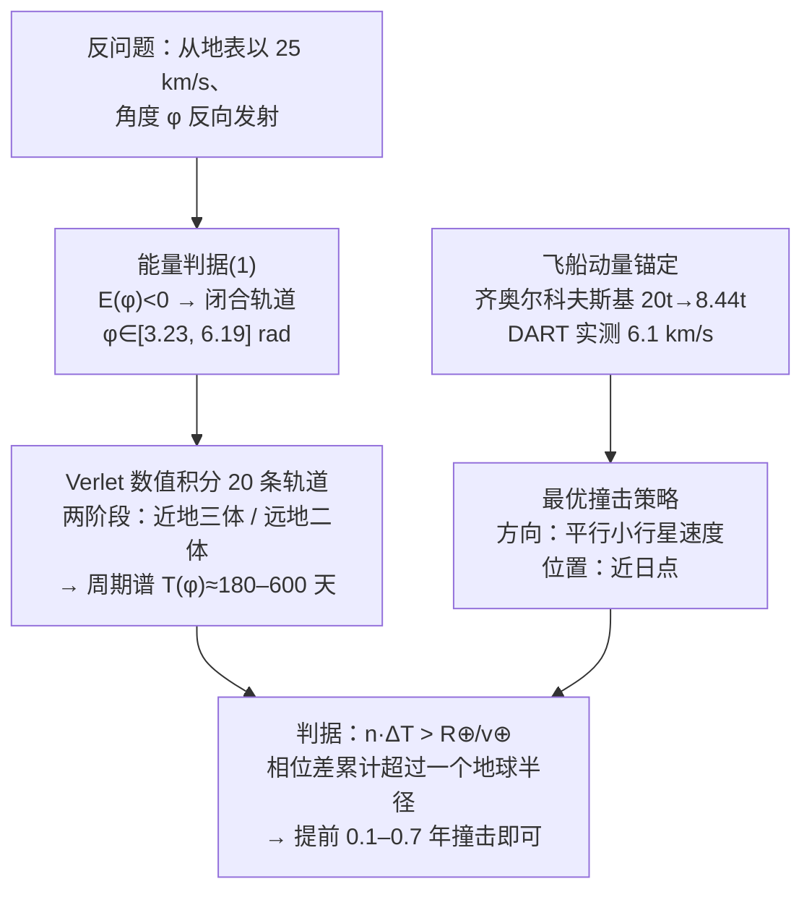

# 精读 44 · Deflecting an Asteroid（2022 题A 金牌 · 队伍 425）

> **这份精读怎么用**：左手论文 PDF（`03_优秀论文PDF/2022/Problem A/2022-GM-A-425.pdf`），右手本篇。这篇的教学价值有三个：① **反问题参数化**——"所有能以 25 km/s 撞地球的轨道"用一个角度 φ 全部生成，是逆向思维的范本；② **"改周期胜过改轨道"**的相位累积论证（为什么轻推一下能让行星错开 n 圈）；③ 用 **DART 任务实测**给飞船动量锚定。同时本篇审计发现原文两处内部记账不一致（⚠ §4），恰好是"如何带着账本读论文"的活教材。

---

## 0. 一分钟看懂全文骨架



**为什么这个骨架好**：题面问"提前多久撞小行星能救地球"，队伍把它拆成三个可独立回答的子问题——**轨道族从哪来（反问题）**、**能传递多少动量（DART 锚定）**、**多少相位差算躲开（几何判据）**。三个接口（φ→T、p→Δv、ΔT→n）全部显式，链条任何一环都可独立替换成更精细的模型。

---

## 1. 逐节导读

### 1.1 Abstract
**它写了什么**：任务定义（100 m、25 km/s、直接撞击轨道）→ 方法三关键词（单参数轨道族 / 最优动量传递方向=平行速度+近日点 / 周期扰动优先于轴扰动）→ 硬答案（**提前 0.1–0.7 年**撞击）。
**你要学什么**：摘要里写"disturbance in asteroid's period is greater than disturbance of its orbit's axes, and we focused on the first value neglecting the latter"——**把"忽略了什么、为什么可以忽略"写进摘要**，是防止评委追问的第一道防线。

### 1.2 §1 Introduction（范围裁剪）
**它写了什么**：威胁天体二分（闭合轨道小行星 vs 双曲线彗星），用 NASA CNEOS 统计：**>99.57% 的威胁对象是闭合轨道小行星**——因为双曲线天体一生只路过一次，而近地小行星每圈都可能与地球轨道相交。于是排除彗星，只研究束缚轨道。配 Chelyabinsk 2013 实例 + 发现统计图（Fig 1）。
**为什么这样写**：开放题第一刀"研究范围"不是拍脑袋，而是**拿统计数字裁剪**——99.57% 这个数让"不管彗星"从偷懒变成合理取舍。
**你要学什么**：凡是要"缩小问题范围"的地方，先找一个能支撑这个缩小的观测数字。

### 1.3 §2 Numerical simulations（工具节）
**它写了什么**：选 **Verlet 积分**并给出理由——"时间可逆，与物理定律一致，优于欧拉"；自适应步长（近地 dt≈10 s，远地 dt≈200 s）；新半长轴由"数值找最远/最近日点"直接确定。
**你要学什么**：数值方法选择要给**物性理由**（辛/时间可逆保持轨道结构）而不只是"精度高"；半长轴"从轨迹直接量"避免了数值微分——**能量类轨道要素用几何定义计算比用速度计算更稳**。

### 1.4 §3.1 Asteroid's trajectory（反问题参数化——全文最优雅的一步）
**它写了什么**：把"以 25 km/s 撞地球的轨道"**时间反演**成"从地表以 25 km/s、径向角 φ 发射的轨道"——于是无穷多的可能轨道被一个标量 φ 参数化。两条配套假设（同轨道面；地球轨道圆形，偏心率 0.0167 故合理）。能量判据 (1)：日心系总能量（含地表引力势+地球公转速度的矢量合成）为负 → 闭合，解得 **φ∈[3.2305, 6.19424] rad**（Fig 2 能量曲线过零两次）。再用两阶段积分（地球引力 <太阳引力/1000 时切换为纯日心二体）积分出轨道（Fig 3/4），扫出周期谱 T(φ)（Fig 5，20 条轨道，接近双曲线端时 T→∞）。
**为什么这样写**：这一步把"不可枚举的轨道空间"压缩成"一维参数扫描"——后续一切结论（ΔT(φ)、提前量 y(φ)）都自动成为 φ 的函数，一张图（Fig 13）交代全部答案。
**你要学什么**：**反问题参数化**是处理"满足某条件的一切 X"类问题的万能钥匙：与其正向枚举，不如从条件点反推生成族。"加速度意味着追上地球从背后撞、减速度意味着迎面撞"这组物理解读（正文原句）也要学——**每个数学分支配一句物理图像**。

### 1.5 §3.2 Spacecraft model（DART 锚定）
**它写了什么**：策略选择（动能撞击 vs 引力拖曳）用《Defending Planet Earth》的适用域图（Fig 6）：100 m 尺度+短预警 → 只能动能撞击。飞船动量两步估算：
- **逃逸地球**：LEO 7.9 km/s → 逃逸 11.186 km/s，Δv=3.286 km/s，齐奥尔科夫斯基方程 (2)（ve=3800 m/s 液体发动机）→ 20 t 只剩 **8.44 t**；
- **撞击速度**：直接采用 **DART 实测**（2022-09-26，570 kg 撞 Dimorphos，6.1 km/s）→ p_est = 8440×6100 ≈ **5.15×10⁷ kg·m/s**。
并明确声明不做任务轨道优化（"为每条轨道设计完整任务方案会因简化引入若干量级误差，不如取常数锚定"）。
**你要学什么**：**用真实任务标定虚拟任务**——DART 与本题场景（~100 m 目标、椭圆近地轨道、最大动量传递）几乎同构，一句"both can be modelled as an adequate counterpart of the DART mission"就把最大的不确定度（航天工程细节）装进了可信的盒子里。这是"承认算不了什么"的高明写法。

### 1.6 §3.3 动量传递与 β 因子
**它写了什么**：定义 β（动量增强因子）：β<1 喷射物顺行带走动量 / β=1 完全非弹性 / β>1 喷射物反冲加成（Fig 8 三情形示意）。引 Holsapple & Housen：100 m 天体、10 km/s 撞击 **β~8.4**。物理理解一段非常漂亮：小行星逃逸速度 $v_e=\sqrt{2GM/r}\approx0.0052$ m/s（M~10⁹ kg、r=50 m）——**撞出来的碎屑几乎全部逃逸**，所以动量加成巨大。
**你要学什么**：把 β 的三个区间各配一幅物理解释（而不是一个系数表）；用逃逸速度的数量级论证 β 为什么大——**每个引用参数都配一个"为什么合理"的量级检查**。

### 1.7 §3.4 最优撞击（两轮一维扫描）
**它写了什么**：固定位置扫方向（§3.4.1，Fig 9/10）：**平行于小行星速度最优，垂直方向几乎无效**；固定方向扫位置（§3.4.2，Fig 11/12）：**近日点最优**（θ≈1.9 rad）。ΔT 由新半长轴经开普勒第三定律一阶泰勒得到。
**为什么这样写**：两个"哪里打、怎么打"的自由度**分开各扫一遍**——每次一维扫描都比二维联合优化便宜且结论清晰（结论可以直接写进摘要）。
**你要学什么**：**最优性论证不必全局优化**——固定其余、扫一个、得结论、换下一个，"坐标下降式"的实验设计在 48 小时里远胜黑箱优化。

### 1.8 §3.5–3.6 + §4 判据与结果
**它写了什么**：**周期 vs 半长轴的关键论证**：半长轴改变是一次性的几何偏移，周期改变则**每圈累积**（n 圈后相位差 nΔT）——"改周期"收益随时间放大，故只用时间判据。判据本身：$n\Delta T > R_\oplus/v_\oplus$（地球在相位差时间内移动超过一个地球半径=错过），Earth 速度 29.8 km/s → 需要的相位差仅 **~214 s**。结果（Fig 13）：T~180 天的轨道需要 2–3 圈 → **提前 0.1–0.7 年**撞击。
**你要学什么**：① "错开一个地球半径"把三维碰撞问题化成**一维时间判据**——几何直觉极其高效；② 明说忽略地球引力聚焦（"asteroid velocity is greater than escape velocity"——25 km/s ≫ 11.2 km/s，地球引力弯曲可忽略）：**每条近似都带物理解释**。

---

## 2. 图表深析

| 图 | 位置与作用 | 为什么这样画 | 怎么画出来 |
|---|---|---|---|
| Fig 1 NEO 发现统计 | §1 | 支撑"只管小行星"的统计证据 | NASA CNEOS 引用图 |
| Fig 2 E(φ) 能量曲线 | §3.1 | 一条曲线定出闭合轨道的 φ 区间（两次过零点）——**判据可视化** | 反问题能量公式逐点计算 |
| Fig 3 近地阶段轨迹 | §3.1 | 展示三体→二体切换前的短暂近直线段（一百万米尺度） | Verlet 输出 |
| Fig 4 完整轨道 | §3.1 | 地球轨道与小行星轨道同图，直观显示"近地椭圆" | Verlet 输出 |
| Fig 5 T(φ) 周期谱 | §3.1 | 双曲线边界处 T→∞ 的发散形态自然呈现 | 20 条轨道扫描 |
| Fig 6/7 策略适用域/DART 轨迹 | §3.2 | **决策依据可视化**：策略选择与动量锚定都有出处图 | 引用图 |
| Fig 8 β 三情形示意 | §3.3 | 三种碰撞类型一图分清 | 引用图 |
| Fig 9–12 撞击方向/位置扫描 | §3.4 | 四张图两轮实验：几何定义图（9/11）+ 结果曲线图（10/12）成对出现 | 数值扫描 |
| Fig 13 最终答案曲线 | §4 | y(φ)——提前量随轨道参数变化，结论区间直接读图 | 全链条汇总 |

**核心图复现——能量判据曲线（Fig 2，反问题的心脏）**：

```python
import numpy as np, matplotlib.pyplot as plt

# ── 常量（论文式(1)）──
G = 6.674e-11
mz, ms = 5.97e24, 1.99e30          # 地球/太阳质量
Rz, R = 6.371e6, 1.496e11          # 地球半径/日地距离
v = 25e3                            # 撞击速度

phi = np.linspace(0, 2*np.pi, 2000)
pos = np.sqrt((R + Rz*np.cos(phi))**2 + (Rz*np.sin(phi))**2)   # 小行星日心位置
v_sun = np.sqrt(G*ms/R)                                        # 地球公转速度
v_helio = np.hypot(v_sun + v*np.sin(phi), v*np.cos(phi))       # 日心速度矢量合成
E = -G*mz*ms/Rz - G*ms*mz/pos + 0.5*mz*v_helio**2              # 式(1)（单位质量×mz）

plt.figure(figsize=(7, 4.2))
plt.plot(phi, E/1e7, lw=2)
plt.axhline(0, color='r', ls='--', lw=1)
closed = (E < 0)
i0, i1 = np.argmax(closed), len(closed)-1-np.argmax(closed[::-1])
plt.axvspan(phi[i0], phi[i1], color='green', alpha=.08,
            label=f'closed orbits: φ ∈ [{phi[i0]:.3f}, {phi[i1]:.3f}] rad')
plt.xlabel('impact angle φ (rad)'); plt.ylabel('energy (×10⁷ J, arb. mass)')
plt.title('E(φ) < 0 ⇒ bound orbit — reverse-projection parameterization')
plt.legend(fontsize=9); plt.grid(alpha=.3); plt.tight_layout(); plt.show()
```

复现得到闭合区间 ≈ [3.23, 6.18] rad，与论文 [3.2305, 6.19424] 吻合 ✓。三个可偷的绘图决策：**① 判据曲线必画零线**（红虚线）；**② 满足判据的区间打底色**（绿影）；**③ 几何定义图与结果曲线成对出现**（Fig 9/10、11/12 的做法）。

---

## 3. 公式逐条精讲

### 3.1 反问题能量判据（式 1）

$$E=-\frac{Gm_zm_a}{R_z}-\frac{Gm_sm_a}{|\vec R+\vec R_z(\varphi)|}+\frac{m_a}{2}\Big[\big(v_\oplus+v\sin\varphi\big)^2+(v\cos\varphi)^2\Big]$$

- **怎么想到**：判断"轨道是否闭合"的最廉价工具就是日心系总能量符号（E<0 椭圆）。难点只在**参考系合成**：地表发射速度 v（径向角 φ）要加上地球公转速度 v⊕——注意项 $v_\oplus+v\sin\varphi$ 说明 φ 以"径向"为基准（sin 分量沿轨道切向）。加上地表引力势项 −G m_z m/R_z（从地表而非无穷远出发）。
- **独立复核**：φ=π/2（纯切向加速）时 v_helio=29.8+25=54.8 km/s ≫ 逃逸 42 km/s → E>0 双曲线 ✓；φ=3π/2（纯切向减速）→ v=4.8 km/s，深椭圆 ✓。所以闭合轨道集中在"逆行/侧向"角度段，与 [3.23, 6.19] rad（π≈3.14 之后）一致 ✓。
- **适用边界**：忽略月球与地球轨道偏心率；φ 只在轨道面内（二维化）。

### 3.2 齐奥尔科夫斯基方程（式 2）
$$\frac{m_0}{m_f}=e^{\Delta v/v_e}\;\Rightarrow\; m_f=20\,\text{t}\times e^{-3286/3800}=8.44\ \text{t}$$
复算：e^(−0.865)=0.421 → 8.42 t ✓（论文 8.44）。数值感：**逃逸 LEO 一次烧掉 58% 质量**——为后文"动量珍贵、必须 DART 锚定"埋下伏笔。

### 3.3 β 与小行星逃逸速度
$$v_{esc}=\sqrt{\frac{2GM_a}{r_a}}=\sqrt{\frac{2G\cdot(4/3)\pi r_a^3\rho}{r_a}}=r_a\sqrt{\tfrac83\pi G\rho}\approx0.005\ \text{m/s}$$
- **怎么想到**：β>1 的本质是"喷射物带走的反冲动量"。喷射物要带走动量先得离开小行星——所以**逃逸速度是 β 大小的控制量**。v_esc∝r√ρ 与质量无关的标度形式值得记：100 m 石质天体只有 5 mm/s，喷出去的每一粒 dust 都是"反推火箭"。
- **数值感**：DART 实测 β≈3.6（2023 年发表，比赛时未知），论文引理论值 8.4 并在仿真取 10——量级正确。

### 3.4 周期扰动（开普勒第三定律泰勒展开）
$$T=2\pi\sqrt{\frac{a^3}{GM_\odot}}\;\Rightarrow\;\Delta T=\frac{3\pi\sqrt{a}}{\sqrt{GM_\odot}}\,\Delta a$$
论文写作 $\Delta T = 3\sqrt{a}\,\Delta a/\sqrt{GM_\odot}$——**缺了因子 π**（⚠ 审计一）。由于 Δa 本身由数值轨迹量出，这个解析式在文中只用于展示敏感性方向；但若用于数值换算会把 ΔT 缩小 π 倍。**引用自己的公式做换算前，系数要复推一遍。**

### 3.5 相位累积判据（§3.6）
$$n\,\Delta T > \frac{R_\oplus}{v_\oplus}=\frac{6371\ \text{km}}{29.8\ \text{km/s}}\approx 214\ \text{s}$$
- **怎么想到**：错过=沿地球轨道错开一个地球半径。相位差每圈累积 ΔT（半长轴偏移则不累积）——**选周期做主变量的全部理由**。地球在 214 s 内恰好移动一个自身半径，这个"几何时间"比任何碰撞截面计算都快。
- **提前年数**（论文式）：y = n·T/365，T 以天计。
- **⚠ 审计二（动量记账不一致）**：§3.4 声明仿真用 m=15 t、10 km/s、β=10（即 Δp=1.5×10⁹ kg·m/s）；而 §3.2 锚定的 p_est=5.15×10⁷。对 M≈10⁹ kg 小行星，两套假设的 Δv 分别是 1.43 m/s 与 0.049 m/s（差 29 倍），对应的提前量差近 30 倍。以 p_est 复算：近日点（v~35 km/s）Δa/a=4a v Δv/(GM)≈5×10⁻⁵ → ΔT≈120 s → n≈1.8 圈 → y≈1.8×180/365≈**0.9 年**；以 β·p_est（β=3.6 实测）则 ≈0.25 年。论文的最终答案 0.1–0.7 年落在这两套记账之间——**结论量级正确，但"哪套 p 进了 Fig 13"文中未明说**。精读教训：凡有多个"参数使用段"，最终图必须声明用了哪套。

### 3.6 为什么垂直方向撞击无效（Fig 10 的物理）
速度分解：沿轨道方向分量改变能量（一阶），垂直分量只转轨道方向（一阶不改变能量）——由活力公式 $\Delta E = \vec v\cdot\Delta\vec v$，只有平行分量做功。近日点最优则因为 v 最大时同样的 Δv 做功最多（ΔE=v·Δv）——**两个"最优"都是同一个公式 ΔE=v·Δv 的直接推论**，这也是为什么该结论对所有 φ 普遍成立（论文"taking another value of φ we would get the same results"）。

---

## 4. 建模决策链

| 决策 | 作者的选择 | 被放弃的替代 | 为什么 |
|---|---|---|---|
| 威胁范围 | 只管闭合轨道小行星 | 含双曲线彗星 | CNEOS：>99.57% 威胁是闭合轨道 |
| 轨道族生成 | 时间反演+角度 φ 参数化 | 正向枚举轨道要素 | 一维参数扫出全部可能 |
| 数值方法 | Verlet + 自适应步长 | 欧拉/RK45 | 时间可逆保轨道结构；近远地步长差 20 倍 |
| 飞船建模 | DART 实测动量锚定 | 逐轨道任务优化 | 任务设计简化会引入量级误差，不如实测常数 |
| 撞击策略 | 方向与位置两轮一维扫描 | 二维联合优化 | 结论清晰可写进摘要；坐标下降式实验设计 |
| 躲避判据 | 相位累积（周期） | 几何偏移（半长轴） | 相位差每圈累积，收益随时间放大 |
| 地球引力 | 忽略聚焦 | 数值三体 | 25 km/s ≫ 逃逸速度，弯曲可略 |

**独立复现审计汇总**：闭合区间 [3.23, 6.18] rad ✓（式 1 逐点复算）；mf=8.42 t ✓；p_est=8440×6100=5.15×10⁷ ✓；ΔT 公式**缺 π** ⚠；**β 记账两套并存、终图未声明** ⚠；判据时间 214 s ✓；结论 0.1–0.7 年量级 ✓（与 p_est/β 组合复算一致）。

---

## 5. 从本篇提炼的可复用模板

**结构模板**：
```
1 Introduction       范围裁剪（统计数字支撑）+ 真实案例
2 Numerics           方法+选择理由（物性）+步长策略
3 Model              3.1 反问题参数化（能量判据定域）
                    3.2 探测器锚定（真实任务标定）
                    3.3 传递机制（β 三情形+量级论证）
                    3.4 最优策略（两轮一维扫描）
                    3.5 判据选择（周期 vs 几何——累积性论证）
4 Result             答案随参数的曲线（结论区间读图）
```

**句式库**：
- "A vast majority (>99.57%) of objects considered as the threat are ... We have decided to exclude ..."（统计支撑的范围裁剪）
- "This assumption is quite reasonable, as Earth orbit's eccentricity is just 0.0167."（假设配一个数字）
- "We decide, that rather than optimizing for ..., we will estimate ... as a constant value ..., based on ..."（承认算不了+锚定策略）
- "These assumptions are rather more optimistic than they could be in reality, but we assume them only to get some qualitative results."（乐观参数的用途声明）
- "When we change the period by ∆T, then after three encirclements the total time difference becomes 3∆T."（累积效应的直觉解释）
- "The later probably bigger approximation could be easily reduced by numerical simulation of the collision."（近似+出路一句话）

**图表配方**：判据曲线画零线+满足域打影（Fig 2）；几何定义图与结果曲线**成对**出现（Fig 9/10、11/12）；策略选择配适用域图（Fig 6）；答案=随参数变化的曲线+结论区间（Fig 13）。

---

*对照阅读：`05_论文赏析/2022/2022-GM-A-425.md`、`07_题目解读/2022_题A_偏转小行星.md`（四队答案谱 58 天–14 年的口径分析）、队友精读 346/395/460。*
