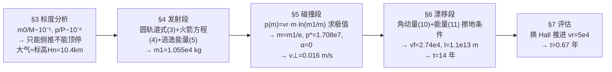

# 精读 45 · Collision Saves the Earth（2022 题A 金牌 · 队伍 460）

> **这份精读怎么用**：左手论文 PDF（`03_优秀论文PDF/2022/Problem A/2022-GM-A-460.pdf`），右手本篇。这篇是 2022 年五篇 A 题金奖中**唯一全程解析、零数值积分**的答卷：发射→碰撞→漂移三段全部用守恒律手算到底。它的教学价值有三：① 先做**标度分析**再建模的纪律；② 把火箭方程"用两次、用反向"（算质量预算、再优化动量）；③ 每步简化都给出定量误差（10⁻³、10⁻¹²、10⁷）——这是"解析流"论文的范本。本篇审计复现了全链条数值（§3），并指出 LEO 初速一处 1.5% 的常数口径偏差。

---

## 0. 一分钟看懂全文骨架

问题：20 t 航天器撞 100 m、25 km/s 来袭的小行星，要提前多久撞才能让它擦着地球飞过去？



**为什么这个骨架好**：三段各有一个"出口量"作为下一段的"入口量"（m₁→p\*→v⊥），接口全部是标量，链条任何一段都可以单独替换成更精细的模型而不动其余两段——这和 425 队"φ→T、p→Δv、ΔT→n"的接口化思路异曲同工，但 460 队连一个数值积分都没用。§3 的标度分析不是走过场：`p/P∼10⁻⁶` 这一行直接决定了后面"α=0、只给横向速度"的全部策略。

---

## 1. 逐节导读

### 1.1 Abstract
**它写了什么**：任务定义→三阶段预告→主结果（vr=4.4×10³ m/s 时 **t=14 年**）→ 灵敏度结论（vr=5.0×10⁴ m/s 时 t=0.67 年）→ 模型自评（"strong in generalizability and clarity... may cost accuracy"）。
**你要学什么**：摘要里写**两个 vr 对应的两个 t**，等于把"答案对什么参数敏感"提前告诉评委；末句主动承认精度代价，是低成本加分项。

### 1.2 §3.1 三阶段划分 + §3.2 标度分析（全文的地基）
**它写了什么**：先划阶段（launching / collision / drifting，并声明"小阶段（如穿大气）将在标度分析基础上定性讨论"）；再算三笔账：(a) vr 取典型液体火箭 4.4×10³ m/s 并注明出处；(b) 由 Figure 1（Britt et al. 小行星密度散点）取 ρ=2.0 g/cm³ → M=1.0×10⁹ kg，于是 m₀/M∼10⁻⁵、p/P∼10⁻⁶，结论"**不可能正面顶回，只能侧推偏转**——将在第二阶段定量证明"；(c) 大气：指数密度式 (1)、二次阻力式 (2)，一个积分证明阻力做功 ∝∫ρdh=H_n，于是取 R=R₀+H_n=6.39×10⁶ m，只保留一位有效数字。
**为什么这样写**：原句 "Therefore, we can deduce that it is impossible for the spacecraft to collide with the asteroid head-on and push it back; instead, the spacecraft needs to give the asteroid a side-push" —— **先用量级否决一条技术路线，再为幸存路线建模**。这句写得好在于：它不是假设，而是从 p/P 推出来的结论，且预告了证明位置。
**你要学什么**：① "等效大气厚度=标高"这个积分论证（W_D∝∫₀^∞ρdh=H_n）一举回答"大气要算多厚"，比拍一个 100 km 强得多；② 标度结论要**回挂到后面的决策**（α=0 的选择），否则标度分析就成了摆设。

### 1.3 §4 发射段（质量预算）
**它写了什么**：设计"短暂加速→惯性漂到撞点→到点刹停"的飞行剖面，两条假设（加速期短到可忽略引力、撞点足够远使引力势能为零——"第二条将在第三阶段验证"）；式 (3) LEO 圆轨道（h=2000 km）得 u₀=6.793×10³ m/s；式 (4) 火箭方程；式 (5) 逃逸能量条件 ½mu²=GM_E m/(R₀+h)；联立得 u=9.607 km/s、**m₁=1.055×10⁴ kg**。
**你要学什么**：① 假设可以"先斩后奏"——第 2 条假设当场声明"this will be confirmed in the third stage"，第三阶段用 l/R∼10⁷ 真的回来闭环了。**埋伏笔+回收**是 48 小时论文里建立可信度的廉价手段；② 火箭方程在这里算"预算"（到撞点还剩多少质量），§5 再"反向"用它优化动量——一个公式两种用法。

### 1.4 §5 碰撞段（全文最优雅的一步：动量最大化）
**它写了什么**：到点后剩余质量 m₁ 全部转为动能再撞？不——航天器还能再喷气加速，于是动量 p(m)=v_r·m·ln(m₁/m)，求 dp/dm=0 得 **m=m₁/e**、p\*=v_r m₁/e=1.708×10⁷ kg·m/s（顺手证明了 §3 用过的 p=v_r m₀/e）。然后式 (6)(7) 动量守恒：v∥=(Mv₀−p\*sinα)/(M+m)≈v₀（相对误差 10⁻³）→ 原句 "**we shouldn't waste any of the spacecraft's velocity on pushing back the asteroid**" → 取 α=0、v⊥=p\*/M=0.016 m/s。再用式 (8) 角动量守恒估计自转：转动动能项 5p\*²s²/(4Mr²) 占比 ~10⁻¹²，反过来证明"小行星当质点"合理。
**为什么这样写**：这一节把"能传多少动量"写成一个**单变量优化**，而不是拍一个撞击速度。m=m₁/e 这个解干净得能进摘要；10⁻¹² 的自转占比论证则示范了"用计算结果反哺假设"。
**你要学什么**：变质量系统里"动量最大"不等于"速度最大"——速度最大要求 m→0，动量却在 m₁/e 处取峰。这是火箭方程最容易被忽略的性质。

### 1.5 §6 漂移段（擦地几何）
**它写了什么**：碰后小行星 v∥=v₀ 指向地球、外加 v⊥=p\*/M；设"恰好擦过"（vf 与地表相切）。式 (10) 角动量守恒 v⊥l=v_f R、式 (11) 能量守恒 ½v∥²−GM_E/l=½v_f²−GM_E/R。先证 25<v_f<27.4 km/s；再由 v⊥/v∥∼10⁻⁷ → l/R∼10⁷ → 丢弃 GM_E/l 项（同时回收 §4 的假设）；得 v_f=2.74×10⁴ m/s、**l=1.1×10¹³ m、t=l/v∥=4.3×10⁸ s=14 年**（ρ 只有两个有效位，l 也只报两位）。
**你要学什么**：① "有效数字跟着输入走"（原文明说 only 2 significant figures are retained）——解析流的诚实记账；② 求解顺序讲究：先用不等式给 v_f 定界，再论证哪些项可舍，最后才代数字。

### 1.6 §7 评估 + §8 结论
**它写了什么**：14 年 vs DART 实战 0.83 年、l=1.1×10¹³ m ≫ 1 AU，"**this result is not satisfying**"；归因（小行星质量太大、vr 太小）；换 vr=5.0×10⁴ m/s（Hall 效应推进器）全链条重算得 t=0.67 年，结论"必须发展高 vr 技术"。
**你要学什么**：敢写"结果不满意"，并立刻给出**参数出路**（vr），等于把负结论转化成技术政策建议——与 2010-160 篇"负结论+出路"同一高级套路。

---

## 2. 图表深析

| 图 | 位置与作用 | 为什么这样画 | 怎么画出来 |
|---|---|---|---|
| Fig 1 小行星直径–密度散点 | §3.2 | 支撑 ρ=2.0 g/cm³ 的取值：**参数取值要有数据图背书** | 文献 Britt et al. (2002) 引用图 |
| Fig 2 碰撞几何（p\*, α, v∥, v⊥, M(+m), ω, s） | §5.2 | 把式 (6)(7)(8) 的每个符号钉在一张图上，推导不再口糊 | 自绘示意；注意正文误写 "Figure 5.1"（应为 Fig 2），校对瑕疵 |
| Fig 3 漂移几何（v⊥, v∥, l, R, v_f 相切） | §6 | "擦地"是一个几何相切条件，一图定义 | 自绘示意 |

**复现代码**：三阶段解析链 + "t 对 vr 的灵敏度曲线"（把 §7 的一句话结果画成全文唯一的结果图——原文没有结果图，这是它视觉上的短板，也是你抄作业时该补的）。

```python
import numpy as np, matplotlib.pyplot as plt

GM, R0, Hn = 3.986e14, 6.3781e6, 1.04e4   # 式(5)地球引力参数; §3.2.3 R=R0+Hn
R, h, m0, rho = R0+Hn, 2e6, 2e4, 2e3      # h=2000km LEO; ρ=2.0g/cm³
M = np.pi/6*100**3*rho                    # M=1.047e9 kg（§3.2.2）
u0, u = 6.793e3, 9.607e3                  # 式(3)、式(4)(5)联立（论文口径）
v0 = 2.5e4

def chain(vr):                            # 三阶段解析链（式4→p*→式10/11）
    m1 = m0*np.exp(-(u-u0)/vr)            # 火箭方程反解 m1
    pstar = vr*m1/np.e                    # §5.2: m=m1/e 处 p 最大
    vperp = pstar/M
    vf = np.sqrt(v0**2 + 2*GM/R)          # 式(11)：l→∞ 时上限，落入势阱加速
    l = vf*R/vperp                        # 式(10)
    return m1, pstar, vperp, l, l/v0/3.156e7

for vr, tag in [(4.4e3,'液体火箭'), (5e4,'Hall推进')]:
    m1,ps,vp,l,t = chain(vr)
    print(f"vr={vr:.1e}: m1={m1:.3e} p*={ps:.3e} v⊥={vp:.4f} l={l:.2e} t={t:.2f}年")

vrs = np.linspace(4e3, 6e4, 200)
ts = [chain(vr)[4] for vr in vrs]
plt.figure(figsize=(6.5,4))
plt.loglog(vrs, ts, lw=2)
for vr,lab in [(4.4e3,'14 yr'),(5e4,'0.67 yr')]:
    plt.plot(vr, chain(vr)[4], 'ro'); plt.annotate(lab,(vr,chain(vr)[4]),
        textcoords='offset points',xytext=(8,4))
plt.xlabel('有效喷气速度 $v_r$ (m/s)'); plt.ylabel('提前撞击时间 t (yr)')
plt.title('t ∝ 1/v_r²（双对偶直线）——$v_r$ 是唯一杠杆\n式(4)(10)(11)解析链复现：vr=4.4e3→14yr, 5e4→0.67yr')
plt.grid(alpha=.3, which='both'); plt.tight_layout(); plt.show()
```

**独立复现审计**：m₁=1.055×10⁴ ✓；p\*=1.708×10⁷ ✓；p=v_r m₀/e=3.24×10⁷ ✓；v⊥=0.0163 ✓；v_f=27 382（论文 2.74×10⁴）✓；l=1.07×10¹³（论文 1.1×10¹³）✓；t=13.6 年（论文 14 年）✓；Hall 组全部数字 ✓。唯一出入：u₀ 用标准 GM_E 复算为 6.897 km/s，比论文 6.793 高 1.5% ⚠（论文内部自洽：u=√2·u₀=9607 精确成立，故只是常数口径差异，不传染结论）。**结论：全文解析链可 100% 手工复现。**

---

## 3. 公式逐条精讲

### 3.1 大气标高论证（式 1–2 与其后积分）
$$\rho_{air}(h)=\rho_{air}(0)e^{-h/H_n},\quad F_D=\tfrac12\rho_{air}v^2C_DA,\quad W_D\propto\int_0^\infty\rho_{air}\,dh=H_n$$
- **怎么想到**：要判断"大气对 25 km/s 小行星有多大影响"，最快的不是算轨迹而是算**总功**：W_D∝∫ρdh 对指数大气解析收敛到 H_n=10.4 km——所以等效大气就是一个标高厚，R=R₀+H_n。
- **数值感**：H_n/R₀≈0.16%，改动地球半径 0.16% 却是"擦地几何"里必须有的 0.16%——因为判据正是 v⊥l=v_f R 里那个 R。
- **适用边界**：阻力做功真正正比于 ∫ρdh 还要求速度沿途近似不变；对 25 km/s、10 km 厚的大气，通过时间 0.8 s、减速可忽略，成立。

### 3.2 圆轨道与逃逸（式 3–5）
$$\frac{u_0^2}{R_0+h}=\frac{GM_E}{(R_0+h)^2}\;\Rightarrow\;u_0=6.793\text{ km/s};\qquad \tfrac12 mu^2=\frac{GM_Em}{R_0+h}\Rightarrow u=\sqrt2\,u_0=9.607\text{ km/s}$$
- **怎么想到**：式 (5) 实为"从 LRO 逃到引力势能零点"的能量守恒；由于初态正是圆轨道，u 自动等于 √2·u₀——**写下这个简比关系=免费自检**（论文数字精确满足）。
- **审计**：用标准 GM_E=3.986×10¹⁴ 复算 u₀=6.897 km/s，比论文高 1.5% ⚠——推测论文用了略不同的 GM/半径组合；链条内部自洽，不影响后续比例结论。

### 3.3 火箭方程的动量形式与极值（§5.2，无式号）
$$p(m)=v_rm\ln\frac{m_1}{m},\qquad \frac{dp}{dm}=v_r\Big(\ln\frac{m_1}{m}-1\Big)=0\;\Rightarrow\;m=\frac{m_1}{e},\quad p^*=\frac{v_rm_1}{e}$$
- **完整推导**：dp/dm = v_r[ln(m₁/m) + m·(−1/m)] = v_r[ln(m₁/m)−1]；零点在 ln(m₁/m)=1 即 m=m₁/e；二阶导 −v_r/m<0 确为极大。
- **数值感**：p\* 恒为 v_r m₀/e 的 (m₁/m₀) 倍——化学火箭 m₁/m₀≈0.53，Hall 火箭 ≈0.95，所以换推进器动量提升 20×0.95/0.53≈20 倍，t 按 1/v_r² 缩（l∝1/v⊥∝1/p\*，t∝l）。
- **适用边界**：假设"到撞点后还能任意调节喷射方向与时长"，忽略了深空导航与姿态的工程约束。

### 3.4 碰撞守恒（式 6–9）
$$Mv_0-p^*\sin\alpha=(M+m)v_{\parallel},\qquad p^*\cos\alpha=(M+m)v_\perp\;\xrightarrow{m\ll M}\;v_\perp=\frac{p^*}{M}$$
- **怎么想到**：α 是 p\* 与"推回方向"的夹角。v∥ 修正量 ~p\*/Mv₀≈10⁻⁶、加上 m/M≈10⁻⁵ → v∥=v₀ 误差 10⁻³ → α 的最优值显然是 0（全部动量横向）。
- **式 (8)(9) 的角色**：p\*s=(I+mr²)ω 与 Ek 分解里转动项 5p\*²s²/(4Mr²)——**不是要用自转，而是用它的占比 10⁻¹² 关掉这个自由度**。用计算结果关闭假设，比直接假设高一个层级。

### 3.5 擦地条件（式 10–11）
$$v_\perp l=v_fR,\qquad \tfrac12v_\parallel^2-\frac{GM_E}{l}=\tfrac12v_f^2-\frac{GM_E}{R}$$
- **怎么想到**："擦着飞过"=近地距离 R 且速度相切 → 对地心的角动量与能量双守恒。注意**入阱加速**：l→R 时动能反而增大（v_f>v₀），上限在 GM_E/l→0 时取得，故 25<v_f<27.4 km/s——先证界再算数。
- **舍项的量级**：v⊥/v∥∼10⁻⁷ ⇒ l/R∼10⁷ ⇒ GM_E/l 比 GM_E/R 小 10⁷ 倍，舍弃毫无悬念——这就是 §4 假设 2 的回收。

### 3.6 时间答案与灵敏度（§6.2、§7.1）
$$t=\frac{l}{v_\parallel}=\frac{v_fR}{v_\perp v_0}\propto\frac{M}{v_rm_1}\quad(\text{vr}=4.4e3: 14\ \text{yr};\ \ vr=5e4: 0.67\ \text{yr})$$
- **怎么想到**：把 t 写成比值立刻看到杠杆：t∝M/(v_r m₁)。M 减不掉，m₁ 上限 m₀，**唯一可动的就是 v_r**——§7 的政策建议直接从标度式里长出来，而不是拍脑袋。

---

## 4. 建模决策链

| 决策 | 作者的选择 | 被放弃的替代 | 为什么 |
|---|---|---|---|
| 总体方法 | 纯解析+守恒律 | 数值积分轨迹 | m/M、p/P 极小，一阶扰动解析就够了；清晰、可复算 |
| 撞击策略 | 侧推（α=0） | 正面减速 | p/P∼10⁻⁶，顶回无效（量级证明） |
| 动量传递 | 完全非弹性+碎片随机飞散 | 弹性/β 动量增强 | 保守；对比 425 队引 β≈8.4，本文少算了反冲加成（改进空间） |
| 大气 | 等效厚度 Hn | 分层大气/穿大气积分 | 一个积分定等效厚度，只留一位有效数字 |
| 漂移判据 | 擦地相切（距离判据） | 相位累积（425 队） | 解析可 closed-form；代价是忽略太阳引力——l≈73 AU 处该假设明显吃紧，论文自己承认可疑 |
| 灵敏度 | 重跑 vr=5e4 全链 | 参数扫描矩阵 | 单杠杆参数一次重算，性价比最高 |

**总规律**：每处"偷懒"都有数量级背书，每处假设都有回收点——这就是评审喜欢的 well-motivated simplification 的纯解析版本。

---

## 5. 从本篇提炼的可复用模板

**结构模板**：
```
Abstract       两参数两答案 + 模型自评
3 General      3.1 阶段划分  3.2 标度分析（否决技术路线 + 等效化简）
4/5/6 三个阶段  每段: 假设(含伏笔) → 守恒律 → 闭式解 → 误差量级
7 Evaluation   结果不满意 → 归因 → 参数出路（重算一组）
```

**句式库（原文摘录）**：
- "we can deduce that it is impossible ... instead, the spacecraft needs to ..."（用量级否决路线）
- "This will be confirmed in the third stage."（假设埋伏笔）
- "we shouldn't waste any of the spacecraft's velocity on pushing back the asteroid"（结论写成行动指令）
- "only 2 significant figures are retained because ρ, thus M, thus v⊥ only has 2 significant figures"（有效数字记账链）
- "Such a long time mainly comes from ... Thus, it is essential that technology that can further increase vr is developed."（负结论→政策建议）

**图表配方**：解析流论文至少要一张**文献数据图**（支撑参数取值）+ 两张**几何定义图**（碰撞、擦地）；再补一张"答案 vs 关键参数"的灵敏度曲线（本篇缺，属于可改进项）。

---

*对照阅读：`05_论文赏析/2022/2022-GM-A-460.md`（宏观赏析）与 `07_题目解读/2022_题A_偏转小行星.md`（四队答案谱：14 年属"最保守/最长提前量"一端）；队友精读 42/43/44（346、395、425 队）。*
