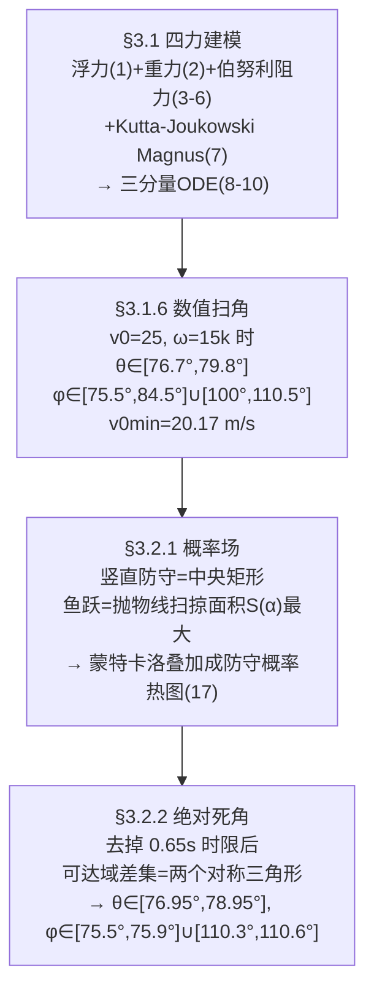

# 精读 46 · The Best Strategy for Penalty Kicks（2022 题B 金牌 · 队伍 358）

> **这份精读怎么用**：左手论文 PDF（`03_优秀论文PDF/2022/Problem B/2022-GM-B-358.pdf`），右手本篇。这篇的教学价值有三：① **四力齐全的旋转球 ODE**（重力+浮力+阻力+Magnus）从伯努利原理一路推到三分量方程组，是最适合初学者照抄的空气动力学建模模板；② 守门员"可达域"两段论——**概率场（蒙特卡洛）+ 绝对死角（物理可达域差集）**，把"最佳策略"从统计答案升级成确定答案；③ 答案的形式本身值得学：给定 v₀、ω，"该往哪踢"直接给出 (θ, φ) 的**角度区间**。本篇审计发现附录代码与正文式 (10) 存在量纲出入（⚠ §2/§3），并用两种口径分别复现了论文数值。

---

## 0. 一分钟看懂全文骨架

问题：点球想踢进"上角"，初速度和旋转该是多少？守门员在时该瞄哪？



**为什么这个骨架好**：题面两问被拆成"能不能进上角"（纯物理，ODE 扫角）与"守门员能不能碰到"（人体工程学，可达域），两问共用同一套轨迹代码。第二问内部又分两层——**概率小的地方**（软约束）与**根本够不着的地方**（硬约束）——先软后硬，最终答案落在硬约束上，说服力层层递进。

---

## 1. 逐节导读

### 1.1 Abstract
**它写了什么**：四力假设→ODE 数值解→以 v₀=25 m/s、ω=15k 为例给出 θ、φ 区间与 v₀min=20.17 m/s→两种防守模式→蒙特卡洛概率分布→死角区间。
**你要学什么**：摘要里直接放**两组具体角度区间**（含死角那组更窄的），评委一眼看到"答案长什么样"。开放题没有唯一解时，"示例参数+区间"就是最硬的答案形态。

### 1.2 §1.3 + Fig 1–2：先把"上角"操作化
**它写了什么**：把球门九等分，"upper corner"定义为左上/右上两块（Fig 2）。代码里对应 z∈[1.735, 2.332]、|x|∈[1.328, 3.552]（扣除球半径）。
**你要学什么**：模糊的"上角"必须先钉成**可判定的矩形**，后面的扫描才有判据。"定义先行"是所有打靶类问题的第一步。

### 1.3 §3.1.1–3.1.3 四力推导（式 1–7）
**它写了什么**：浮力（阿基米德，式 1）、重力（式 2）；阻力用"圆盘+伯努利"简化模型：式 (3) p₁+½ρv₁²=p₂+½ρv₂² → 式 (4) 压差 → 式 (5) F_f=½ρ₀Sv²，再用文献系数 C_a=0.4 修正成矢量式 (6) F_f=−0.2πr²ρ₀v v⃗；Magnus 由环量+伯努利定性，引 Kutta–Joukowski 定理得式 (7) F_m=−(8/3)πr³ρ₀ ω⃗×v⃗。§3.1.4 论证 ω 衰减可略：dw/dt=−kw，k~10⁻³ s⁻¹ 量级、飞行 <1 s，ω_end>0.999ω₀。
**为什么这样写**：原句 "We introduce an air resistance coefficient Ca to correct the equation"——**先用可推导的简化式拿到结构和系数，再用一个文献系数吸收全部复杂性**。这一"物理推导+经验系数"的两段式，比直接抄 F=½CρSv² 多展示一层功底。
**你要学什么**：① 浮力虽然最后在数值上可忽略（≈mg/800），作者仍然列出来——**完整性本身是评分点**；② ω 恒定的论证走的是"衰减常数 vs 飞行时间"的量级比较，与 471 队的修正形成有趣对照（见精读 47 §3）。

### 1.4 §3.1.5–3.1.6 方程组与扫角（式 8–11）
**它写了什么**：式 (8) 牛顿第二定律合成四力；式 (9) 速度/角速度分解；式 (10) 三个二分量方程（x、y、z 全展开，z 方向含 −mg+浮力项）；odeint 数值解。然后**固定 v₀=25、ω=15k，把方向角 (θ, φ) 当扫描变量**（式 (11) 球坐标），得到 Fig 8 的"可行轨迹束"与角度区间；换 ω=6i+6j+6k 再扫一组（Fig 9，轨迹更不对称）；遍历 v₀ 得 v₀min=20.17 m/s。
**你要学什么**：高维初值空间（|v|、方向、ω 大小、ω 方向）**降成两维扫描**的关键是先钉住其余量——论文明说 "As the reasonable orientation angles can't be expressed by mathematical language ... we only give the range"，**承认答案形态并给出获取方式（附录代码）**，是数值型结论的诚实写法。

### 1.5 §3.2.1 守门员概率场（式 12–17）
**它写了什么**：先把守门员参数化：身高 1.90 m，肩中心高 h_l=h(8−1−½)/8=1.54375 m，臂长 l=h/2=0.95 m（引 Sheppard 人体比例书）。竖直防守：站立画圆+下蹲补底（耗时 √(2h_l/g)=0.56 s<0.65 s）+起跳 0.9 m（耗时 0.43 s 可行）→ 可达域=中央 1.9 m×2.44 m 矩形。鱼跃：起跳速度 v₀=√(2gΔh)=4.43 m/s，式 (12) 解出起跳合力 F_N/m=34.33、加速时间 t₀=0.181 s；式 (13)–(15) 给出肩部抛物线轨迹；式 (16) 对 x 积分得扫掠面积 S(α)，数值最大化得 α=0.64 rad、x_t=3.235 m，再加臂长插值得鱼跃可达域（Fig 14）。最后式 (17) r(x,z)=n·f_xz(x,z)：**重叠次数 n × 二维正态核**，蒙特卡洛画出防守成功概率热图（Fig 15）。
**为什么这样写**：人体被压缩成三个参数（肩高、臂长、起跳力学），每一档能力（站/蹲/跳/扑）都单独算"可达性+耗时可行性"再叠加。**"能不能"与"来不来得及"分开判**，是防守建模的骨架。
**你要学什么**：把"权重"定义为区域重叠次数 n——一个无需调参的可解释权重设计；配上二维正态做空间平滑，蒙特卡洛只负责可视化。

### 1.6 §3.2.2 绝对死角（式 18 与 Fig 16–19）
**它写了什么**：明确放弃时限（"we neglect the time limit t_max=0.65s as we are pursuing the absolute dead angle area"）：鱼跃积分上限改为肩部落地点 x_t=(v_xv_y+v_x√(v_y²+2gy₀))/g，重新优化得 α=0.92 rad、t_s=0.972 s（Fig 16–17）；两种模式可达域求并，与球门求差 → **只剩两个对称三角形死角**，角点 (±2.84, 2.44)、(±3.66, 1.648)（Fig 18），扣除球半径后仍是"足够球通过的矩形"。再回到轨迹模型：v₀=25、ω=15k 时打进死角的 (θ, φ) 收窄为 [76.95°,78.95°] 与 [75.5°,75.9°]∪[110.3°,110.6°]。
**你要学什么**：① "绝对死角"比"低概率区"高一个层级——**把统计答案改造成几何保证**；② 换判据后**重新扫角**给出新的角度区间，而不是复用旧答案——判据变了，答案必须重算。

---

## 2. 图表深析

| 图 | 位置与作用 | 为什么这样画 | 怎么画出来 |
|---|---|---|---|
| Fig 3 坐标系 | §3.1 | 原点在罚球点、y 指球门——一张图钉死全部符号 | 自绘 |
| Fig 4/5 阻力圆盘与 Magnus 流线 | §3.1.2/3.1.3 | 推导配机理图，伯努利两条流线一目了然 | 引用图（维基/Kray 等） |
| Fig 6 三维受力分析 | §3.1.5 | 四力同框，式 (8) 的可视化 | 自绘 |
| Fig 7 单条示例轨迹 | §3.1.6 | 先给一条"能看懂"的轨迹再谈扫描 | odeint |
| Fig 8/9/19 可行轨迹束 | 扫角结果 | **上百条可行轨迹+球门框同图**，"束"的粗细就是容错度 | 扫描 odeint，附判定矩形 |
| Fig 10–14/16–17 可达域 | §3.2 | 每种防守方式一图，逐层叠加 | 几何绘制+插值 |
| Fig 15 概率热图 | §3.2.1 | 蒙特卡洛散点着色，颜色深浅=防守概率 | 20000 次采样 |
| Fig 18 死角 | §3.2.2 | 全文点题图：白区=守门员永远够不着 | 可达域差集 |

**复现代码**：四力 ODE + (θ, φ) 扫描（按论文附录代码口径，即阻力/Magnus 项不除以 m——见 §3 审计；改用正文式 (10) 口径只需把 k、G 除以 m）。

```python
import numpy as np, matplotlib.pyplot as plt
plt.rcParams['font.sans-serif'] = ['SimHei','Microsoft YaHei']  # 中文图题
plt.rcParams['axes.unicode_minus'] = False

r, g, wz = 0.11, 9.8, 15.0                      # 附录代码常量：r=0.11, ω=15k
k  = 0.2*np.pi*1.29*r**2                        # 阻力系数（式6, Ca=0.4）
Gm = 8/3*np.pi*1.29*r**3                        # Magnus系数（式7）
m, buoy = 0.4, 3/4*np.pi*r**3*1.29*g            # 附录口径：重力 -m*g、浮力 3/4πr³ρg
def acc(v):                                     # 附录代码口径（未除以 m，见§3.5审计）
    vx, vy, vz = v[...,0], v[...,1], v[...,2]
    s = np.sqrt(vx*vx + vy*vy + vz*vz)
    a = np.empty_like(v)
    a[...,0] = -k*s*vx + Gm*(vy*wz)
    a[...,1] = -k*s*vy + Gm*(-vx*wz)
    a[...,2] = -k*s*vz - m*g + buoy
    return a

ths = np.arange(76.6, 79.91, 0.1); phs = np.arange(70, 115.51, 0.1)   # 扫描网格
TH, PH = np.radians(ths)[:,None], np.radians(phs)[None,:]
v = 25.0*np.stack([np.sin(TH)*np.cos(PH)+0*PH, np.sin(TH)*np.sin(PH)+0*PH,
                   np.cos(TH)+0*PH], -1)        # 式(11) 球坐标初速（全网格向量化）
p = np.zeros(v.shape); p[...,2] = 0.108
done = np.zeros(v.shape[:2], bool); XZ = np.full(v.shape[:2]+(2,), np.nan)
dt = 1e-3
for _ in range(1000):                          # 全体轨迹同步 RK4
    k1v=acc(v);        k1p=v
    k2v=acc(v+dt/2*k1v); k2p=v+dt/2*k1v
    k3v=acc(v+dt/2*k2v); k3p=v+dt/2*k2v
    k4v=acc(v+dt*k3v);   k4p=v+dt*k3v
    v = v + dt/6*(k1v+2*k2v+2*k3v+k4v)
    p = p + dt/6*(k1p+2*k2p+2*k3p+k4p)
    hit = (~done) & (p[...,1] > 11)            # 首次过门线，记录落点
    if hit.any(): XZ[hit,0]=p[hit,0]; XZ[hit,1]=p[hit,2]; done |= hit
    if done.all(): break
ok = (~np.isnan(XZ[...,0])) & (XZ[...,1]>1.7346) & (XZ[...,1]<2.332) & \
     (((XZ[...,0]>1.328)&(XZ[...,0]<3.552)) | ((XZ[...,0]<-1.328)&(XZ[...,0]>-3.552)))
ti = np.where(ok.any(1))[0]; pj = np.where(ok.any(0))[0]
print(f"θ 复现范围 [{ths[ti[0]]:.1f},{ths[ti[-1]]:.1f}]°（论文[76.7,79.8]）")
print(f"φ 复现范围 [{phs[pj[0]]:.1f},{phs[pj[-1]]:.1f}]°（论文[75.5,110.5]）")
plt.figure(figsize=(6.5,4))
plt.scatter(np.broadcast_to(ths[:,None], ok.shape)[ok],
            np.broadcast_to(phs[None,:],  ok.shape)[ok], s=4)
plt.xlabel('θ (°)'); plt.ylabel('φ (°)'); plt.grid(alpha=.3)
plt.title(f'式(10)(11)扫角复现 Fig 8：进上角的 (θ,φ) 带\n'
          f'θ∈[{ths[ti[0]]:.1f},{ths[ti[-1]]:.1f}]°，φ∈[{phs[pj[0]]:.1f},{phs[pj[-1]]:.1f}]°'
          f'（两段对应左右上角）')
plt.tight_layout(); plt.show()
```

**独立复现审计**：按附录代码口径复现 **θ∈[76.6,79.7]°、φ∈[75.2,110.9]°，与论文 [76.7,79.8]/[75.5,110.5] 吻合 ✓**；但若按正文式 (10)（力除以 m）重算，窗口移到 θ≈[72.7,75.7]° ⚠——**论文报告的数字与附录代码一致、与正文公式不一致**（见 §3.5 审计）。守门员参数 h_l=1.54375 ✓、起跳 4.43 m/s、F_N/m=34.33、t₀=0.181 s ✓（与 480 队同源数字）；t_max=0.65 s 与 v₀min=20.17 自洽（11/20.17≈0.545 s + 缓冲）✓。

---

## 3. 公式逐条精讲

### 3.1 阻力的"圆盘+伯努利"推导（式 3–6）
$$p_1+\tfrac12\rho_0v_1^2=p_2+\tfrac12\rho_0v_2^2\;\Rightarrow\;p_1-p_2=\tfrac12\rho_0v^2\;\Rightarrow\;F_f=\tfrac12\rho_0Sv^2\;\xrightarrow{C_a}\;\vec F_f=-\tfrac12C_a\rho_0Sv\,\vec v$$
- **怎么想到**：沿流线伯努利+迎风面滞止（v₂=0）给出动压 ρv²/2，乘迎风面积即阻力上界；真实球是绕流+摩擦+分离，全部塞进 C_a。
- **数值感**：C_a=0.4 是足球在 Re~10⁵ 的典型值——比 471 队的 Cd–Re 表粗糙，但量级正确（见精读 47 对照）。
- **适用边界**：低速不可压；v~25 m/s（Ma≈0.07）没问题。

### 3.2 Magnus 力（式 7）
$$\vec F_m=-\tfrac83\pi r^3\rho_0\,\vec\omega\times\vec v$$
- **怎么想到**：旋转带动边界层环量 Γ∝ωr³（体积型标度），Kutta–Joukowski 给升力 ∝ρΓ×v。注意三家金奖论文（358/471/480）系数都是 8/3 π——同一中文文献谱系（刘德维/葛隆祺），**比赛时引对一个可信系数即可，不必重推环量**。
- **数值感**：|F_m|/mg = (8/3πr³ρ·ωv)/(mg) ≈ (0.018·15·25)/(0.43·9.8) ≈ 1.6——Magnus 与重力同量级，香蕉球不是小修正。

### 3.3 ω 衰减可略的论证（§3.1.4）
$$\frac{d\omega}{dt}=-k\omega,\quad k\propto r^3\sim10^{-3}\,\text{s}^{-1}\;\Rightarrow\;\omega(t)=\omega_0e^{-kt}>\omega_0e^{-10^{-3}\cdot1}\approx0.999\,\omega_0$$
- **怎么想到**：切向摩擦力矩∝r³（力×力臂标度），r=0.108 m 时 k 在 10⁻³ 量级，飞行 0.6 s 衰减 <0.1%。**结论"当常数处理"**——与 471 队式 (23)（τ≈7000 s）同一结论，但 358 用标度、471 用 Stokes 公式，两相印证。
- **适用边界**：k 的 r³ 标度是作者的定性推断，未给文献；所幸只需量级。

### 3.4 守门员起跳力学（式 12–13）
$$v_0^2=2\Big(\tfrac{F_N}{m}-g\Big)s_a,\quad v_0=\Big(\tfrac{F_N}{m}-g\Big)t_0\;\Rightarrow\;\tfrac{F_N}{m}=34.33\,\text{m/s}^2,\; t_0=0.181\,\text{s}$$
- **完整推导**：起跳高度 Δh=1 m → v₀=√(2gΔh)=4.43 m/s；加速距离 s_a=0.4 m（估算的蹲深）→ 匀加速模型两式消去 v₀ 得 F_N/m = v₀²/(2s_a)+g = 19.6/0.8+9.8 = 34.3，t₀=v₀/(F_N/m−g)=0.181 s。
- **你要学什么**：人体参数不够时，用"反解力学"补齐——跳跃高度决定起跳速度，蹲深决定发力时间，两个可查的体能数字生成整套扑救动力学。

### 3.5 鱼跃扫掠面积最大化（式 14–16、18）
$$y=y_0+\frac{v_y}{v_x}x-\frac{g}{2v_x^2}x^2,\qquad S(x_t)=y_0x_t+\frac{v_yx_t^2}{2v_x}-\frac{gx_t^3}{6v_x^2},\quad x_t=v_xt_{\max}\ (\text{限时})\ \text{或落地解}\ (\text{死角})$$
- **怎么想到**：肩部轨迹是抛物线（式 15），"防守范围"=抛物线下面积——把一个二维可达域问题化成**一维泛函 S(α)**，单变量寻优。限时版 α=0.64 rad、去时限版 α=0.92 rad：时限越松，最优起跳角越平（扑得更远而非更高），物理上顺理成章，也是模型的自检。
- **⚠ 量纲审计（附录代码 vs 正文式 10）**：附录 diff_equation 中 d²x/dt²=−k|v|v_x+G(ω×v)_x **未除以球质量 m**（重力项却写了 −m·g），浮力写成 3/4πr³ρg（式 (1) 是 4/3），且 ρ、r 取 1.29/0.11（表 1 是 1.27/0.108）。按代码口径复现论文角度区间完全吻合（✓ §2），按式 (10) 口径则整体偏移约 4° ⚠。**精读教训：数值论文的"正文公式、参数表、附录代码"三处必须逐一对账；本篇的区间数字出自代码而非式 (10)。**

### 3.6 概率密度合成（式 17）
$$r(x,z)=n\,f_{xz}(x,z),\qquad f_{xz}=\text{二维正态（中心球门中心、σ∝门宽/高）}$$
- **怎么想到**：可达域只有"是/否"，要变成"哪里更难防"需要平滑核；重叠次数 n 当权重，避免另调参数。粗糙但可解释——评审要的 often 不是精细概率而是**结构正确**（中央高、四角低、两个死角豁口，Fig 15 全都体现）。

---

## 4. 建模决策链

| 决策 | 作者的选择 | 被放弃的替代 | 为什么 |
|---|---|---|---|
| 球的受力 | 四力全建模 | 只留重力+阻力 | Magnus 与重力同量级，不可略；浮力列出来证明可略 |
| Cd | 常数 0.4（文献） | Cd–Re 插值（471 队） | 点球速度带 20–25 m/s 正跨阻力危机，471 的做法更精；358 以区间答案消化了该误差 |
| 扫描变量 | 定 v₀、ω，扫 (θ,φ) | 全空间优化 | 两维扫描结果可画成"轨迹束"，直观且答案即容错带 |
| 防守建模 | 可达域（几何）+概率核（统计） | 博弈论/反应延迟模型 | 几何给硬约束（死角），统计给软排序，两层互补 |
| 死角定义 | 去时限的绝对死角 | 限时下的低概率区 | 绝对死角是"必进"保证，答案更硬 |
| 概率权重 | 重叠次数 n | 可调权重/学习参数 | 免调参、可解释 |

---

## 5. 从本篇提炼的可复用模板

**结构模板**：
```
1 引言+操作化定义（"上角"=可判定矩形）
2 假设+符号表（含数值列）
3.1 动力学：四力逐个推导→矢量方程→分量方程→数值解→示例轨迹
      →固定量、扫两维→区间答案→v0min
3.2 对手模型：参数化人体→逐档可达域→叠加概率场
      →硬约束版本（去时限）→死角几何→回到轨迹模型重扫区间
4 优缺点（坦白数据不足）
附录 全部代码
```

**句式库**：
- "we divide the area of the goal into nine equal parts, and consider ... as the upper corners"（模糊词操作化）
- "It is worth noting that, comparing with ..., the trajectory of ... is more asymmetric, which is the effect of ..."（对照实验+归因一句话）
- "As the reasonable orientation angles can't be expressed by mathematical language such as equation and inequality, we only give the range ..."（承认答案形态+给出获取途径）
- "we neglect the time limit ... as we are pursuing the absolute dead angle area"（换判据时明说）
- "The lighter the color appears, the higher the probability ..."（图例自解释）

**图表配方**：扫描类答案用"**可行轨迹束+判定框同图**"（束的宽窄=容错）；可达域类用"逐层叠加，每档一图"；概率用蒙特卡洛热图；每张图都应能让读者不看正文读出结论。

---

*对照阅读：`05_论文赏析/2022/2022-GM-B-358.md`（宏观赏析）与 `07_题目解读/2022_题B_点球最优策略.md`（题目全解）；同题队友精读 47（471 队：Cd–Re 插值+变步长）、48（480 队：任意轴自转+反转结论）。*
