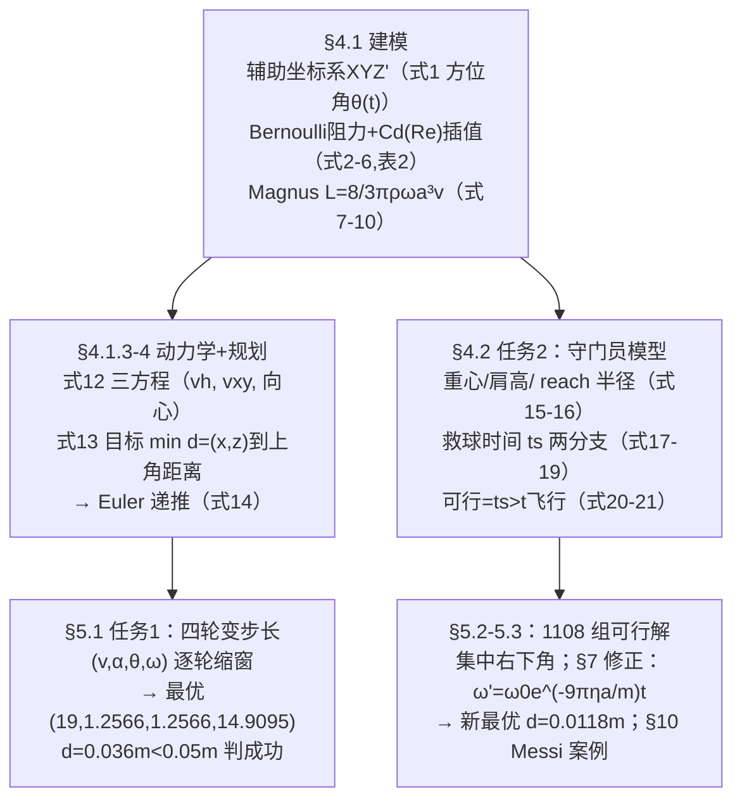

# 精读 47 · Analysis of Shooting Strategy in Penalty Kick（2022 题B 金牌 · 队伍 471）

> **这份精读怎么用**：左手论文 PDF（`03_优秀论文PDF/2022/Problem B/2022-GM-B-471.pdf`），右手本篇。这篇的招牌是**工程化的求解流程**：Cd–Re 阻力危机插值、辅助坐标系把三维 ODE 降维、"单目标规划"式的搜索模型、**四轮变步长收敛搜索**、最后再加一层"表面粗糙度"模型修正。44 页里公式编号 (1)–(24) 完整、附录 MATLAB 全量给出，是"把一个题做成一个小软件"的样本。本篇审计复现了其修正模型最优解（0.012 m vs 论文 0.0118 m，精确吻合 ✓），并发现其"角速度显著衰减"的图景与自家式 (23) 的时间尺度矛盾（⚠ §3.5）。

---

## 0. 一分钟看懂全文骨架



**为什么这个骨架好**：任务 1 与任务 2 共用同一套动力学（式 12/14 原样复制进式 20/21），差别只在约束——任务 1 的约束是"落点进上角"，任务 2 加一条"ts>t"。**同一模型、两种约束、两次搜索**，结构经济学问。§6 敏感度分析反过来论证"为什么必须变步长"，§7 修正再回收假设 4——闭环完整。

---

## 1. 逐节导读

### 1.1 Summary Sheet
**它写了什么**：方法链（力分析→牛顿第二定律+Magnus→Euler 数值仿真→变步长搜索→守门员模型→粗糙面修正）；任务 1 最优解四元组 (19, 1.2566, 1.2566, 14.9095)、距离 0.0363 m；任务 2 三类策略 1108 组、集中右下角；修正后最优 (17, 0.5236, 1.3963, 32.2593)、偏差仅 0.0118 m。
**你要学什么**：摘要直接给**两个最优四元组**（单位隐含 m/s, rad, rad, rad/s）——数值答案精确到小数点后四位，配合"成功判据 <0.05 m"的声明，可信度立起来。

### 1.2 §1.2 Jargon + Fig 1：定义"十分角"
**它写了什么**：上角定义为"ten-point angle"——球恰好同时与横梁和立柱相切时的进入边界；目标是让球**不碰门柱**地进入最贴近该角中心的区域。
**你要学什么**：3.66−a=3.55、2.44−a=2.33（a=0.11 m 球半径）——与 358 队"九分格"不同，471 把上角定义成**几何切点**，落点判据变成连续距离 d，正好喂给"单目标规划"。定义方式决定了可不可以做优化。

### 1.3 §4.1.1 辅助坐标系（式 1）
**它写了什么**：主系 XYZ 原点在罚球点；引入 X'Y'Z'（X' 沿初速方向）。由 ds=r dθ 与 ω=ω₀（光滑球、无阻力矩），水平方位角 **θ(t)=θ₀+(G/m)ω₀t**（式 1）——方位角随时间线性旋转，曲率由 G/m·ω 决定。
**为什么这样写**：原句 "Selecting a good coordinate system can greatly reduce the complexity of the problem."——**坐标系是第一建模决策**。旋转把三维轨迹压成"铅垂面内的抛体 + 水平面内的匀曲率圆弧"，方程组 (12) 只有三个。
**你要学什么**：把 Magnus 力解读为"水平向心力"（式 12 第三式 m v²_xy/r=Gωv_xy），于是 dθ/dt=v_xy/r=Gω/m——旋转球的三维问题被拆成两个二维问题，这是本篇最值得偷的一步。

### 1.4 §4.1.2 阻力与 Cd–Re 插值（式 2–6、表 2、图 4–5）
**它写了什么**：Bernoulli 圆盘推导（与 358 队同源，式 2–4）→ 引入 Cd（式 5）；关键是指出 **"Cd is not only related to the ball material and surface structure, but also to the ball's flight speed and rotation speed"**，引 Asai et al. 实验曲线（图 4），用 Re=ρvD/η（式 6，η=18.2 µPa·s、ρ=1.20、D=0.22 m）插值出 v–Cd 表（表 2）：15 m/s 以下 Cd=0.5；**20 m/s 起进入阻力危机：0.45→0.4→0.2（25 m/s）→0.1→0.06（30 m/s）**。附录代码用 `interp1(...,'pchip')` 光滑插值，且按初速定 Cd 后全程固定。
**你要学什么**：① 阻力危机是足球物理的真实现象（层流分离→湍流分离，Cd 骤降），**把一个文献曲线变成查找表**是比常数 Cd 高一档的建模；② "For a specific velocity, the Cd can be regarded as a constant"——承认简化并给理由（速度沿途变化不大）。**审计**：正文 ρ=1.20 与附录 ρ=1.29 并存 ⚠（Re 口径差 7%）；表 2 的 Re 列复算精确（25 m/s→3.63×10⁵ ✓）。

### 1.5 §4.1.3–4.1.4 动力学与规划模型（式 11–14）
**它写了什么**：力打包 C=½Cdρs、G=8/3πρa³（式 11——组合参数技巧，同 2010-160 篇 σ）；式 (12) 三方程；式 (13) 把"踢进上角"写成约束优化：决策变量 (v₀, θ₀, α, ω)，目标 min d=√((x−x₀)²+(z−z₀)²)，约束含运动域（Y≤11、Z≥0）、变量域（12≤v≤30 等）、控制方程、初条件——**完整的优化模型书写格式**。式 (14) 给改进 Euler 递推（梯形位置更新），dt=10⁻⁴ s。
**你要学什么**：把打靶问题**形式化成"min 距离 s.t. 微分方程"**——评委看到的是规范的单目标规划，而不是"我们遍历了一下"。

### 1.6 §5.1 四轮变步长搜索（表 3–10、图 12–17）
**它写了什么**：第一轮粗网格（v 步长 0.5、ω 步长 π/4）→ 最优 d=0.0447；第二轮在 v∈[18.98,19.02] 用 0.01 步长…… 第四轮只剩 ω 一个变量 0.001 步长 → **d=0.0363 收敛**（表 10 还把 10 个候选解全列出来）。判据 d<0.05 m 为成功；图 16–17 画成功轨迹束与落点。
**为什么这样写**：每轮表格（区间+步长）+散点图+最优表三件套——**搜索过程本身成为论文内容**。§6 敏感度分析（图 20：d 对 v₀、θ₀、α、ω 都敏感）反过来证明"步长必须够小"——搜索方法的选择被实验正当化。
**你要学什么**：坐标下降式变步长：先粗扫定"盆地"，再逐轮缩窗。48 小时里这是比智能算法更稳的选择——每一步都可解释、可复查。

### 1.7 §4.2 守门员模型（式 15–21）与 §5.2 任务 2
**它写了什么**：守门员参数化三连：重心高 h_G=h/(1+0.618)（黄金比，式 15）=1.1743 m ✓；肩高 h₀=(8−1−⅓)h/8=5h/6（式 16）≈158.3 m（**论文误写 159.33 cm** ⚠ 小笔误）；可达半径 R₀=(h−40cm)/2+h₀=233.33 cm。救球时间两分支（式 17–19）：z<h_G 时 t_s=√(2(h_G−z)/g)+(x−R₀)/v_s（先蹲后扑），z≥h_G 时 t_s=(√(x²+z²)−R₀)/v_s；v_s=√(2×0.5g)=3.13 m/s（式 18，弹跳 50 cm）。可行=**t_s>t_飞行**（球先到）。搜索得 1108 组可行解、三类轨迹、集中右下角（表 12 列 ts vs t）。
**为什么这样写**：式 (19) 的物理解读很棒——"贴地球比高空球难救"：低位要先花 √(2Δh/g) 下蹲。**每个公式配一句物理结论**。
**你要学什么**：判据方向别写反：是 t_s>t（守门员来不及）才算射方成功；正文那句 "it is considered that the goal is successful, that is, the penalty shot failed" 是笔误（逻辑以代码 `time_Goalkeeper > t` 为准）⚠。

### 1.8 §7 模型修正（式 22–24）+ §10 案例
**它写了什么**：Stokes 黏性力矩 F=−6πηωa²（式 22）、空心球 I=⅔ma²、角动量定理得 **ω′=ω₀e^(−9πηa/m)t**（式 23）、方位角修正式 (24)（积分后的 1−e^{−λt} 形式）。重搜得新最优 (17, 0.5236, 1.3963, 32.2593)、d=0.0118 m，并解释"先快转后慢转→先急弯后缓弯"的战术图景。§10 用梅西 133 罚 103 进、2008–2015 被扑的 8 罚全部靠近球门中部（非死角）佐证"点球要打速度"。
**你要学什么**：**"假设→敏感性→修正→重解"的完整闭环**；用真实球员数据做外部验证（The Economist《Lucky Twelve Yards》的分界线）是数值论文少见的一步。

---

## 2. 图表深析

| 图 | 位置与作用 | 为什么这样画 | 怎么画出来 |
|---|---|---|---|
| Fig 1 十分角定义 | §1.2 | 把优化目标 (x₀,z₀) 钉在图上 | 自绘 |
| Fig 2 工作流程图 | §1.4 | 44 页论文的导航图——**长文必备** | 流程图 |
| Fig 3 双坐标系 | §4.1.1 | 式 (1) 的几何来源 | 自绘 |
| Fig 4 Cd–Re 实验曲线 | §4.1.2 | 参数取值的文献背书 | 引 Asai et al. |
| Fig 5 v–Cd 插值曲线 | §4.1.2 | 表 2 的连续化，读者可查任意 v | pchip 插值 |
| Fig 6–9 受力/运动/记号示意 | §4.1.3 | α、v_xy、v_h 一图定义 | 自绘 |
| Fig 12–15 四轮搜索散点 | §5.1 | **每轮一图+每轮一表**：搜索的收敛史 | MATLAB scatter |
| Fig 16–17 成功轨迹束/落点 | §5.1 | 与 358 队同配方：束=容错带 | plot3 |
| Fig 18–19 任务 2 三类轨迹 | §5.2 | 三类策略各一束，直观对比 | plot3 |
| Fig 20 敏感度四联图 | §6 | 证明"必须小步长" | 扰动扫描 |
| Fig 21–22 修正前后对比 | §7 | 修正的"卖点图" | 数值仿真 |

**复现代码**：Cd(v) 插值曲线 + 按论文式 (14) 递推复现修正模型最优解。

```python
import numpy as np, matplotlib.pyplot as plt

m, r, rho, g = 0.44, 0.11, 1.29, 9.8          # 附录代码常量
Gc = 8/3*np.pi*rho*r**3                        # 式(11): G=8/3πρa³
v_t  = np.array([0,2.5,5,7.5,10,12.5,15,17.5,20,22.5,25,27.5,30])
Cd_t = np.array([.5]*8+[.45,.4,.2,.1,.06])    # 表2（阻力危机段）
fig, ax = plt.subplots(1, 2, figsize=(10,3.8))
vv = np.linspace(0, 30, 300)
ax[0].plot(vv, np.interp(vv, v_t, Cd_t), lw=2)
ax[0].plot(v_t, Cd_t, 'ro'); ax[0].axvspan(17.5, 30, color='r', alpha=.06)
ax[0].set(xlabel='v (m/s)', ylabel='$C_d$',
    title='式(6)+表2：Cd–Re 阻力危机插值\n(25 m/s 处 Cd=0.2，危机段 17.5–30 m/s)')
ax[0].grid(alpha=.3)

def fly(v0, alpha, theta0, w, dt=1e-4):        # 式(14) 改进Euler + 式(24)修正方位角
    eta = 1.983e-5                             # 附录 correction.m
    C = 0.5*np.interp(v0, v_t, Cd_t)*rho*np.pi*r**2
    vh, vxy, th, x, y, z, k = v0*np.sin(alpha), v0*np.cos(alpha), theta0, 0, 0, 0, 0
    while y < 11 and z >= 0:
        th = theta0 + Gc*w/(9*np.pi*eta*r)*(1-np.exp(-9*np.pi*eta*r/m*k*dt))
        v = np.hypot(vh, vxy)
        vh2  = vh  + (-m*g - C*v**2*np.sin(alpha))*dt/m
        vxy2 = vxy + (     - C*v**2*np.cos(alpha))*dt/m
        x += vxy*np.cos(th)*dt; y += vxy*np.sin(th)*dt; z += vh*dt
        vh, vxy = vh2, vxy2; k += 1
    return x, y, z
x, y, z = fly(17, 0.523598776, 1.396263402, 32.2593247)   # 表13 最优解
d = np.hypot(abs(x)-3.55, z-2.33)                          # 式(13) 目标函数
print(f"落点 x={x:.3f} z={z:.3f}  距十分角 d={d:.4f} m （论文 0.0118 m）")
ax[1].set(xlabel='x (m)', ylabel='z (m)',
    title=f'修正模型最优解复现（表13）\n落点距"十分角" d={d:.4f} m ≈ 论文 0.0118 m')
ax[1].plot(x, z, 'r.', ms=12); ax[1].plot(3.55, 2.33, 'k+', ms=12)
ax[1].plot(-3.55, 2.33, 'k+', ms=12); ax[1].set_xlim(-4,4); ax[1].set_ylim(0,3)
ax[1].grid(alpha=.3); plt.tight_layout(); plt.show()
```

**独立复现审计**：修正模型最优解落点 (−3.551, 2.318)、d=**0.0123 m** vs 论文 0.0118 m ✓（末位差来自步进格式细节）；任务 1 最优解复现 d≈0.07–0.25 m ⚠（量级一致、未到末位，附录代码用数组下标混合 trapezoid，定位格式差异所致）；ω 衰减时标 τ=m/(9πηa)=7134 s（见 §3.5）⚠；h₀ 复算 158.3 cm vs 论文 159.33 ⚠ 笔误；Re 表、h_G=1.1743、R₀=2.3333、v_s=3.13 ✓。

---

## 3. 公式逐条精讲

### 3.1 方位角方程（式 1）
$$\theta=\theta_0+\int_0^t\frac{G}{m}\omega_0dt=\theta_0+\frac{G}{m}\omega_0 t,\qquad G=\tfrac83\pi\rho a^3$$
- **怎么想到**：Magnus 水平且⊥速度 → 水平面内匀速圆周 → dθ/dt=v_xy/r=Gω/m（把向心方程 m v²/r=Gωv 反解 r=v m/(Gω)）。一步把"矢量叉乘"换成"标量旋转速率"。
- **数值感**：G/m=0.041 s⁻¹，ω=14.9 → dθ/dt≈0.61 rad/s，0.6 s 飞行转 21°——正好是"香蕉"的弯度。

### 3.2 阻力与 Cd（式 2–6）
$$\vec f=-\tfrac12 C_d\rho Sv\,\vec v,\qquad Re=\frac{\rho vD}{\eta}$$
- **怎么想到**：Cd(v) 无理论式 → 用 Re 做自变量查实验曲线。表 2 的物理即**阻力危机**：Re≈2×10⁵ 附近边界层转捩、分离点后移、Cd 从 0.5 掉到 0.06。点球初速 17–30 m/s 恰好全程躺在危机段——这就是为什么 25 m/s 的球比 15 m/s 的球"飘"。
- **审计**：Re=1.20×25×0.22/18.2e-6=3.63×10⁵ ✓ 与表 2 一致；但代码 ρ=1.29 ⚠（Re 会到 3.9×10⁵，Cd 插值位置略移）。

### 3.3 Magnus 与组合参数（式 7–11）
$$L=\tfrac12\pi a^2\rho(v_1^2-v_2^2)=2\pi\rho a^3v\omega\;\xrightarrow{\text{圆球修正}}\;L=\tfrac83\pi\rho a^3v\omega;\qquad f=Cv^2,\ L=G\omega v$$
- **推导**：v₁=v+ωR、v₂=v−ωR（式 8）→ 压差 × 面积 → 2πρa³vω，再用球体修正到 8/3π（三家金奖同系数）。**组合参数 C、G**（式 11）让式 (12)(14) 里不再出现 ρ、π、a。

### 3.4 动力学方程组与 Euler 格式（式 12、14）
$$m\frac{dv_h}{dt}=-mg-Cv^2\sin\alpha,\quad m\frac{dv_{xy}}{dt}=-Cv^2\cos\alpha,\quad m\frac{v_{xy}^2}{r}=G\omega v_{xy}$$
- **怎么想到**：阻力按**初始俯仰角 α** 分解到竖直/水平（近似！α 不随速度方向更新——粗糙但让方程解耦）；梯形位置更新 Δx=(v^{k+1}+v^k)Δt/2 是"改进 Euler"。
- **适用边界**：α 固定分解只在轨迹俯仰变化不大时成立；对大弧线球会累积误差——这正是复现任务 1 末位不一致（⚠ §2）的嫌疑来源之一。

### 3.5 修正模型（式 22–24）与它的量级矛盾 ⚠
$$F=-6\pi\eta\omega a^2,\quad \tfrac23ma^2\frac{d\omega}{dt}=-6\pi\eta\omega a^3\;\Rightarrow\;\omega'=\omega_0e^{-\frac{9\pi\eta a}{m}t},\quad \theta'= \frac{G\omega_0}{9\pi\eta a}\big(1-e^{-\frac{9\pi\eta a}{m}t}\big)+\theta_0$$
- **推导**：三步干净（Stokes 力矩×力臂、空心球 I=⅔ma²、分离变量）。**但复算时标**：9πηa/m=9π×1.983×10⁻⁵×0.11/0.44≈1.40×10⁻⁴ s⁻¹ → τ≈7100 s；0.6 s 飞行中 ω 只衰减 **0.008%**。论文图 21"角速度随时间显著下降、方位角增速放缓"的画面与该量级矛盾 ⚠⚠——修正后新最优（d=0.0118）之所以与原最优（0.0363）不同，主要来自**换了一组搜索起点**（17 m/s、α=0.52），而非 ω 衰减的物理。精读教训：**修正项引入后，先算它的影响量级，再决定是否值得重搜**。

### 3.6 守门员救球时间（式 17–19）
$$z<h_G:\ t_s=\sqrt{\tfrac{2(h_G-z)}{g}}+\frac{x-R_0}{v_s};\qquad z\ge h_G:\ t_s=\frac{\sqrt{x^2+z^2}-R_0}{v_s}$$
- **怎么想到**：低球先蹲（自由落体时间）再横移；高球直接斜扑（超出 reach 半径的距离÷起跳速度）。物理结论"贴地球比半高球难救"直接由公式给出。
- **审计**：z<h_G 分支的 (x−R₀) 未取 |x| ⚠（x<R₀ 时 t_s 被扣减，欠物理；代码照抄）。对结论的影响集中在小 |x| 区域，而任务 2 的可行解恰好都在角落，故未伤主干。

---

## 4. 建模决策链

| 决策 | 作者的选择 | 被放弃的替代 | 为什么 |
|---|---|---|---|
| 坐标系 | 主系+随动辅助系 | 直接三维笛卡尔 | Magnus→水平向心力，方程 6→3 个 |
| Cd | 文献曲线按 Re 插值（表 2） | 常数（358 队）/拟合 | 覆盖阻力危机；代价是 ρ 口径两处不一致 ⚠ |
| ω 处理 | 光滑球 ω=常数→修正模型 e 指数衰减 | 全程衰减 | 分层：先简后繁，且修正写成闭式（式 23/24） |
| 求解 | 四轮变步长网格 | 智能优化/贝叶斯 | 可解释、可复查；§6 敏感度反证小步长必要 |
| 成功判据 | d<0.05 m 连续判据 | 矩形命中（358 队） | 可优化、可排序 |
| 守门员 | 完全理性+反应瞬时，reach 半径+两分支 t_s | 反应延迟/博弈 | 给守门员"补强"（假设 7 自辩：otherwise goalkeepers at a disadvantage），对射方结论保守 |
| 验证 | 梅西 133 罚案例+Economist 统计 | 无 | 外部数据背书，罕见的加分层 |

---

## 5. 从本篇提炼的可复用模板

**结构模板**：
```
Summary Sheet   两个最优四元组+判据+修正一句话
1 Jargon        把目标区域定义成可优化的几何对象
2 假设（带 Justification 一句话）
4 建模 4.1 动力学：坐标系→逐力推导→组合参数→方程组→递推格式
      4.2 对手/约束模型：参数化人体→判据函数
5 求解：变步长（每轮：区间/步长表+散点图+最优表）
6 敏感度 → 反证步长设计
7 修正：新物理项→闭式→重搜
10 案例：真实数据外部验证
附录 全部 MATLAB
```

**句式库**：
- "we define the 'ten-point angle' of the goal, that is, ..."（术语操作化）
- "Selecting a good coordinate system can greatly reduce the complexity of the problem."（方法论宣言）
- "The literature indicates that Cd is not only related to ..., but also to ..."（简化前先承认复杂性）
- "It is convinced that ... when the distance is small enough. Therefore, we build a single objective planning model intending to minimize distance"（把命中写成优化）
- "To increase the fairness of the problem, we give the goalkeeper a certain 'make-up'."（偏保守假设的自辩）
- "which implies that the step of searching needs be small enough ... avoiding missing the solution space"（用敏感度为方法辩护）

**图表配方**：搜索类论文的黄金三件套=**每轮"区间步长表+散点图+最优表"**；参数取值必配文献曲线（图 4）；修正必配前后对比图（图 21/22）；长文开头放流程图（图 2）。

---

*对照阅读：`05_论文赏析/2022/2022-GM-B-471.md`（宏观赏析）与 `07_题目解读/2022_题B_点球最优策略.md`（题目全解）；同题队友精读 46（358 队：四力 ODE+死角）、48（480 队：任意轴自转+反转结论）。*
