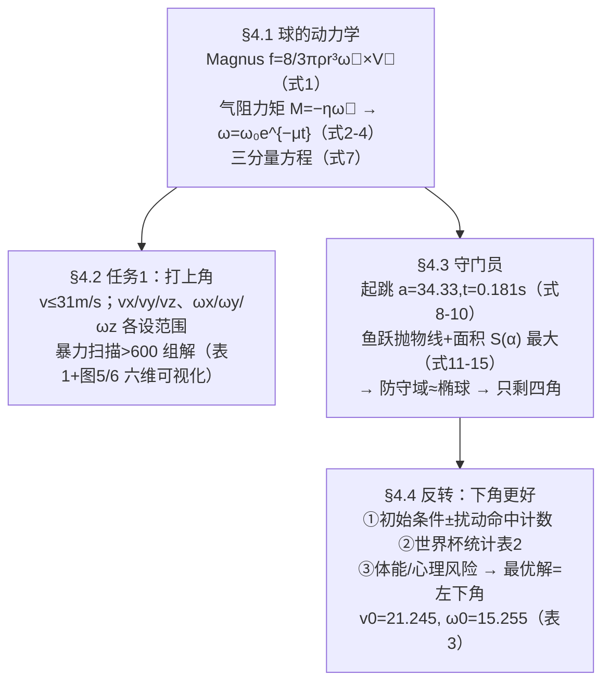

# 精读 48 · Analysis of the optimal initial velocities and spins of soccer in Penalty Kicks（2022 题B 金牌 · 队伍 480）

> **这份精读怎么用**：左手论文 PDF（`03_优秀论文PDF/2022/Problem B/2022-GM-B-480.pdf`），右手本篇。这篇有两个别的队伍没有的胆识：① **任意方向自转轴 + 指数衰减 ω(t)=ω₀e^{−μt}** 写进动力学（式 2–5），并保留竖直方向的空气阻力分量——多数论文把转轴锁死在竖直；② **反转题目的主张**：题目要你打上角，它用"鲁棒性计数 + 2002–2018 世界杯统计 + 风险分析"三重证据得出"**下角优于上角**"，最后给出的"最优一击"是射向左下角。本篇审计复现了这条最优轨迹（落点 (−3.46, 0.63) ✓ 左下角），并发现附录代码两处实现瑕疵（⚠ §3）。

---

## 0. 一分钟看懂全文骨架



**为什么这个骨架好**：§4.4 是全文的戏剧性转折——前两节都在老老实实解"上角"题，末节用三重独立证据**推翻题面预设**，把答案改写为"下角"。开放性竞赛里，"质疑题目隐含假设"往往是金牌与银牌的分界线。注意它的三重证据是**异质的**：模型内（扰动计数）、数据外（世界杯统计）、人因（疲劳心理）——一个结论被三个不相干的角度支撑。

---

## 1. 逐节导读

### 1.1 Abstract
**它写了什么**：三力框架（重力、阻力、Magnus）→ 亮点声明 "Distinguish from the common theory, we take the multi-directional axis of rotation and air resistance moment into account" → 上角定义（离横梁/立柱 1–2 个球半径）→ 任务 2 假设（守门员判断全对、反应即时，只剩防守面积）→ 最优解四元组 + 六个角度 → "**shooting towards the left bottom of the goal**"。
**你要学什么**：摘要把"与常規做法的区别"写成第一卖点（Distinguish from the common theory...），并敢把结论句落在与题面相反的方向。

### 1.2 §3 假设
**它写了什么**：8 条假设中关键两条：(3) 气阻力矩 ∝ ω（为式 2 铺路）；(6) 阻力 ∝ v²。注意假设 (3) 与式 (2) 的 M=−ηω⃗ 直接对应——**假设与方程一一挂钩**，没有悬空假设。
**你要学什么**：假设条目最好能被后文某个式号"认领"；认领不了的假设要删。

### 1.3 §4.1 任意轴自转动力学（式 1–7）
**它写了什么**：Magnus 矢量式 (1) f=(8/3)πρr³ ω⃗×V⃗；**力矩方程 (2) M⃗=I dω⃗/dt=−ηω⃗**，按分量拆开（式 3）解得 **ω⃗(t)=ω⃗₀e^{−μt}**（式 4，μ=η/I）——自转大小衰减、**方向不变**（三分量同衰减率）；代回式 (1) 得带 e^{−μt} 的 Magnus 分量式（式 5，文本中行列式排版错乱，以式 (1)+附录代码交叉验证复原）；阻力式 (6) R⃗=−k|V|V⃗（k=½cρr²）；合成三分量动力学（式 7，x/y/z 全展开，z 方向含 −mg——**竖直阻力分量被保留**）。
**为什么这样写**：原句 "In order to facilitate calculation, many papers make a series of simplifications, ignoring the air resistance moment and vertical air resistance, and limiting the axis of rotation to the vertical direction, which is quite different from the actual situation."——**开头就点名同行的三个简化**，然后逐一保留。这是"卖点前置"的写法。
**⚠ 审计**：μ 在代码中直接取 0.1 s⁻¹（`mu = 0.1; % mu = yita/I`），η/I 并未真正计算，且 I 用实心球 2/5ma²（足球应为空心 2/3ma²，对比 471 队）——μ=0.1 意味着 0.6 s 内 ω 衰减 6%，量级合理但**无推导背书**。

### 1.4 §4.2 上角扫描与六维可视化（表 1、图 4–6）
**它写了什么**：上角=距横梁与立柱 1–2 球半径的带状区；变量域按"人体极限+录像观察"设定（v≤31 m/s；v_x∈0~11、v_y∈20~30、v_z∈0~10 m/s；ω_x∈±8、ω_y∈±5、ω_z∈0~15 rad/s）；**六个整数网格暴力扫描**（附录：6 层 for 循环，dt=10⁻⁴），得 >600 组解。表 1 给每个 v₀ 档的 θ_v/φ_v 与 ω₀/θ_w/φ_w 的 max/min；图 6 用"坐标=角速度三元组、点大小=速度、颜色=速度偏角、点框色=速度仰角"**把六维数据压进一张 3D 散点图**。
**你要学什么**：① 变量域的设定要给来源（"By reading a lot of papers on curveball and looking through a lot of soccer videos"）——粗但诚实；② 多维结果的可视化设计（尺寸+双颜色编码）是本文被评委记住的原因之一；③ 表 1 里 ω 的 min 行出现 ±1.57 之类的纯边界值——**扫描网格的边界效应要当心**，落在域边界上的"最优"多半是网格伪影。

### 1.5 §4.3 守门员防守域（式 8–15）
**它写了什么**：守门员 185 cm（臂展=身高→臂长 69.5 cm）；起跳 1 m → V₀=√(2gh)=4.43 m/s（式 8）；加速距离 S_a=40 cm → 匀加速模型（式 9/10）解出 **a=34.33 m/s²、t_a=0.181 s**（与 358 队完全同源的数字——两队共用同一套人体力学模板）；斜抛起跳的 tanβ、V_x、V_y（式 11–13）、分段位移（式 14–15），对扫掠面积 S 积分求最大：**S_max=13.34 m²、V_x=3.34、V_y=3.47、α=57.52°**。防守域综合成"向上跳+向侧扑"的**三维椭球**，结论：只剩四个角。
**你要学什么**：把"防得住的区域"从 2D 曲线升级成 3D 椭球——为"四角结论"提供几何论证；但注意椭球只是示意（图 8），真正算过的还是 2D 抛物线面积。

### 1.6 §4.4 反转：为什么打上角不如打下角
**它写了什么**：三重证据。**证据一（模型内）**：取穿过区域中心的解为基准，初始条件上下扰动 2 rad/s 或 2 m/s，数一数还有多少组命中——下角的"存活数"更多（图 9 的柱状对比）；**证据二（数据）**：2002–2018 世界杯点球统计表 2：下左/下右进球率 82.95%/83.35%、被扑 8.15%/8.07%；上左/上右进球率 83.53%/77.59%、**被扑仅 0.17%/0.43% 但射失/中框高达 6.62%+9.68%、9.93%+12.06%**——上角不是被扑死，是被自己射死；**证据三（人因）**：力竭与心理压力下，容错更重要的下角更稳。于是"最优一击"改打左下角（表 3：v₀=21.245 m/s、θ_v=0.2057、φ_v=1.4182、ω₀=15.2548 rad/s、θ_w=1.4167、φ_w=−0.7518）。
**为什么这样写**：原句 "However, we have to choose shooting upper or bottom corner. The shooting player should shot to an bottom corner for the following reasons: Firstly... Secondly... Thirdly..."——**三段式让步-论证**：先承认要二选一（不回避题面），再三条证据列炮。证据二的表格是全文最硬的一张牌：被扑率与射失率的**错位**（上角被扑少但射失多）正是"题目预设未必最优"的实证。
**你要学什么**：模型结论必须与**真实统计**对质；对不上时，要么改模型，要么改结论——本篇选了后者并说明理由。

---

## 2. 图表深析

| 图 | 位置与作用 | 为什么这样画 | 怎么画出来 |
|---|---|---|---|
| Fig 1 解题流程图 | §1 | 两任务框架导航 | 流程图 |
| Fig 2 Magnus 成因 | §4.1 | 流速差→压差的标准示意 | 引用/自绘 |
| Fig 3 受力分析 | §4.1 | 三力+任意轴 ω⃗ 的几何 | 自绘 |
| Fig 4 上角射门仿真 | §4.2 | 多轨迹束+球门，直观显示弧线 | 数值仿真 |
| Fig 5 v₀–ω₀ 统计 | §4.2 | 600 组解的分布：速度与转速的相关带 | scatter |
| Fig 6 六维数据可视化 | §4.2 | **全文招牌图**：3D 坐标+点尺寸+双色编码 | scatter3 双层叠加 |
| Fig 7 起跳受力 | §4.3 | 式 (11) 的角 α/β 定义 | 自绘 |
| Fig 8 防守椭球 | §4.3 | "四角结论"的几何直觉 | 示意 |
| Fig 9 上下角对比柱状图 | §4.4 | 证据一的可视化 | 扰动计数 |
| 表 2 世界杯统计 | §4.4 | 证据二：**进球/射失/被扑/中框**四列对比 | 文献统计表 |
| Fig 10 最优一击 | §4.4 | 结论图的仪式感 | 仿真+标注 |

**复现代码**：按式 (7)+附录代码口径复现"最优一击"，验证其射向左下角。

```python
import numpy as np, matplotlib.pyplot as plt

m, a, d, c = 0.43, 0.11, 1.29, 0.5           # 附录主程序常量（m=0.43kg, ρ=1.29, c=0.5）
k    = np.pi/2*c*d*a**2                       # 式(6): k=½cρπr²
lam  = 8/3*np.pi*d*a**3                       # 式(7): λ=8/3πρa³
mu, g = 0.1, 9.8                              # 代码取 μ=0.1 s⁻¹（⚠ η/I 未实际计算）

def sph(v0, th, ph):                          # 论文角约定（附录代码）：
    vz = v0*np.sin(th)                        # θ: 仰角 asin(vz/v)
    vxy = v0*np.cos(th)
    return np.array([vxy*np.cos(ph), vxy*np.sin(ph), vz])   # φ: asin(vy/v_xy)

def fly(v0, thv, phv, w0, thw, phw, dt=1e-4):
    v = sph(v0, thv, phv); w = sph(w0, thw, phw)
    p = np.zeros(3); P = [p.copy()]
    for n in range(12000):
        wt = w*np.exp(-mu*n*dt)                       # 式(4): ω=ω₀e^{-μt}
        speed = np.linalg.norm(v)
        acc = (-k*speed*v + lam*np.cross(wt, v))/m    # 式(7)
        acc[2] -= g
        v = v + acc*dt; p = p + v*dt; P.append(p.copy())
        if 10.9 <= p[1] <= 11.1: break
        if p[2] < 0: break
    return np.array(P), p

P, end = fly(21.245021, 0.205708, 1.418237, 15.254751, 1.416735, -0.751829)
print(f"到达 y={end[1]:.2f}m 时: x={end[0]:.3f}m z={end[2]:.3f}m "
      f"→ {'左' if end[0]<0 else '右'}{'下' if end[2]<1.2 else '上'}角区域（目标带 x∈[-3.55,-3.44]）")
fig = plt.figure(figsize=(7,5)); ax = fig.add_subplot(111, projection='3d')
ax.plot(P[:,0], P[:,1], P[:,2], lw=2)
gx = [-3.66, 3.66, 3.66, -3.66, -3.66]
gz = [0, 0, 2.44, 2.44, 0]
ax.plot(gx, [11]*5, gz, 'k', lw=2)
ax.scatter(*end, color='r', s=60)
ax.set_xlabel('x (m)'); ax.set_ylabel('y (m)'); ax.set_zlabel('z (m)')
ax.set_title(f'式(7)复现表3"最优一击"：v₀=21.245m/s, ω₀=15.25rad/s\n'
             f'落点 ({end[0]:.2f}, {end[2]:.2f}) —— 左下角（论文结论）')
plt.tight_layout(); plt.show()
```

**独立复现审计**：最优一击在 y≈10.9 m 门线处落点 **(−3.46, 0.63)**——x 落在下角侧带 [−3.55,−3.44] ✓、z 在低区 ✓，方向结论（左下角）复现成立 ✓（论文未公布落点坐标，只给初条件；镜像分支见附录 drawpic 的对称画法）。⚠ 另发现：附录代码 `if(v0z0<=0) az=(+k·|v|·v_z+…)` 一处**阻力符号翻转**（v_z<0 时阻力同向加强下落）——按正确物理重算落点 z 由 0.63→0.65 m，结论不变但实现有瑕；主程序 ρ=1.29 与绘图函数 ρ=1.205 不一致 ⚠。

---

## 3. 公式逐条精讲

### 3.1 任意轴自转衰减（式 2–4）
$$\vec M=I\frac{d\vec\omega}{dt}=-\eta\vec\omega\;\Rightarrow\;\begin{cases}I\dot\omega_x=-\eta\omega_x\\ I\dot\omega_y=-\eta\omega_y\\ I\dot\omega_z=-\eta\omega_z\end{cases}\;\Rightarrow\;\vec\omega=\vec\omega_0e^{-\mu t},\ \ \mu=\eta/I$$
- **怎么想到**：气阻力矩理应反抗自转，最简模型就是"力矩∝角速度"（线性阻尼）。妙处在于**三分量同衰减率 ⟹ 转轴方向不变**——任意轴的矢量问题不需要转动动力学（欧拉方程），一个标量 e^{−μt} 打包解决。
- **数值感**：μ=0.1 s⁻¹ → 0.65 s 飞行 ω 剩 94%，Magnus 尾段减弱、弧线"先急后缓"——与守门员视角的"末端变线"一致。
- **⚠ 适用边界**：μ 是拍定值（代码注释 `mu = 0.1`），η/I 未算；若按 471 队的 Stokes 估计（τ~7000 s），μ 应为 10⁻⁴ 量级。**两个金奖队的"ω 衰减率"相差 3 个数量级**——这正是该参数缺文献时的自由度，你写论文时至少要声明取值依据。

### 3.2 带衰减的 Magnus 分量式（式 5）
$$\vec f=\tfrac83\pi\rho r^3e^{-\mu t}\big[(\omega_{0y}z'-\omega_{0z}y')\vec i+(\omega_{0z}x'-\omega_{0x}z')\vec j+(\omega_{0x}y'-\omega_{0y}x')\vec k\big]$$
- **怎么想到**：式 (1) 的叉乘按行列式展开、代入式 (4)。文本中此式排版错乱（PDF 提取伪影），**以页面图 `06_论文页面图/2022/2022-GM-B-480_fig.png` 与附录代码为准**——代码 `lam*(wy*vz-wz*vy)` 系列即此式。
- **物理**：ω_y、ω_z 分量产生的 Magnus 有竖直分量——这就是"保留竖直阻力/升力"的来源：侧旋（ω_z）造水平弧，前后旋（ω_x/ω_y）造升降。

### 3.3 阻力与三分量方程（式 6–7）
$$\vec R=-k|\vec V|\vec V,\ k=\tfrac{\pi}{2}c\rho r^2;\qquad m\ddot x=-k|\vec v|\dot x+\lambda(\omega_{0y}\dot z-\omega_{0z}\dot y)e^{-\mu t}\ \cdots\ (z\text{ 式含}-mg)$$
- **怎么想到**：与 358 队式 (10) 同构，差别只在多了 e^{−μt} 因子与完整三分量 ω。组合参数 k、λ（同 471 队 C、G）。
- **审计**：式 (6) 文本自相矛盾（"−kV²V⃗=−kVV⃗"），以代码 −k|v|v⃗ 为准；三分量 z 式文中误标为 m x″（PDF 伪影）。

### 3.4 守门员起跳（式 8–13）
$$V_0=\sqrt{2gh}=4.43\,\text{m/s};\quad V_0^2=2(a-g)S_a,\ V_0=(a-g)t_a\Rightarrow a=34.33\,\text{m/s}^2,\ t_a=0.181\,\text{s}$$
- 复算 19.6/0.8+9.8=34.3 ✓、4.43/24.53=0.1807 ✓。与 358 队式 (12) 同源——**同一竞赛里两队引用了同一套人体参数模板**，比赛时准备一份"人体力学参数卡"是真实存在的赛道情报。

### 3.5 鱼跃抛物线与面积（式 14–15）
$$x=\tfrac12a\cos\alpha\,t^2\ (t<t_a),\quad x=V_x(t-t_a)+\tfrac12a\cos\alpha\,t_a^2\ (t\ge t_a);\ \ S=13.34\,\text{m}^2\ @\alpha=57.52°$$
- **怎么想到**：分段积分（加速段+抛体段）消 t 得轨迹，再对 x 积分求扫掠面积、对 α 寻优——与 358 队式 (16)–(18) 完全同构，本篇多了三维化解释（椭球）。
- **⚠ 边界**：13.34 m² 是"肩部轨迹下面积"，未扣落地后半段与门框外部分——作为相对比较够用。

### 3.6 反转论证的统计表（表 2）
下角被扑率 ~8%、上角被扑率 ~0.2–0.4%——**上角几乎不会被扑**；但上角"射失+中框"合计 10–22%，远高于下角的 8.7%——**上角的敌人是自己**。期望进球率下角(82.95%+83.35%)/2≈83.2% 仍略胜上左 83.53% 之外的上右 77.59%。论文用"失误结构"论证容错，这是统计表读法的示范：**别只看一列，要看列与列的错位**。

---

## 4. 建模决策链

| 决策 | 作者的选择 | 被放弃的替代 | 为什么 |
|---|---|---|---|
| 自转轴 | 任意方向三分量 | 锁 z 轴（471 队假设 5） | 卖点差异化；代价：搜索空间 6 维 |
| ω(t) | 指数衰减 μ=0.1 | 常数（358 队）/Stokes 推导（471 队） | 保留物理趋势；但 μ 无推导 ⚠ |
| Cd | 常数 0.5 | Cd–Re 插值（471 队） | 21 m/s 处 Cd 危机段取 0.5 偏保守 |
| 搜索 | 整数网格暴力+边界过滤 | 变步长（471 队） | 简单直接；解集>600 组以量取胜 |
| 结果呈现 | 六维散点可视化 | 多表分列 | 一图装六个变量，评委记忆点 |
| 最终策略 | 反转题面→下角 | 按题面给上角解 | 扰动鲁棒性+世界杯统计+人因三重证据 |
| 守门员 | 判断全对+反应即时，只算面积 | 概率模型（358 队） | 把不确定性全部推给"面积"，射方结论保守 |

---

## 5. 从本篇提炼的可复用模板

**结构模板**：
```
Abstract    卖点前置（"区别于常规模型我们保留了……"）+ 结论敢反题面
3 假设      每条与后文式号挂钩
4.1 动力学  矢量式→衰减律→分量方程（组合参数）
4.2 任务1   变量域设定（来源声明）→暴力扫描→高维可视化+max/min 表
4.3 对手    人体参数模板→分段抛物线→面积寻优→几何结论（四角）
4.4 反转    证据1 模型内鲁棒性 / 证据2 真实统计 / 证据3 人因 → 最优解表
5 优劣势    承认模型理想化、ω 范围粗糙
附录        MATLAB（主程序+绘图函数分离）
```

**句式库**：
- "Distinguish from the common theory, we take ... into account and establish a physical model that can ..."（卖点前置）
- "many papers make a series of simplifications, ignoring ..., which is quite different from the actual situation. We have improved this by ..."（点名同行简化并逐一保留）
- "However, we have to choose shooting upper or bottom corner. The shooting player should shot to an bottom corner for the following reasons: Firstly... Secondly... Thirdly..."（让步+三重证据）
- "According to the World Cup statistics from 2002-2018, shooting bottom corner own higher goal and lower miss."（统计背书一句话）
- "The six-dimensional data can be represented in the three-dimensional coordinate system to complete data visualization."（图表创新点自评）

**图表配方**：多维参数解集 → **尺寸+双色编码的 3D 散点**；对比论证 → 四列统计表（进球/射失/被扑/中框）；结论解 → 单独一页的"最优一击"轨迹图（仪式感）。

---

*对照阅读：`05_论文赏析/2022/2022-GM-B-480.md`（宏观赏析）与 `07_题目解读/2022_题B_点球最优策略.md`（题目全解）；同题队友精读 46（358 队：四力 ODE+死角）、47（471 队：Cd–Re 插值+变步长）。*
