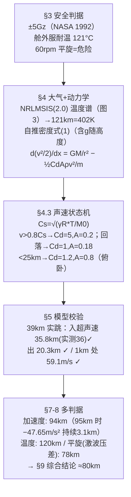

# 精读 49 · Maximum Height of Space Diving（2023 题A 金牌 · 队伍 131）

> **这份精读怎么用**：左手论文 PDF（`03_优秀论文PDF/2023/Problem A/2023-GM-A-131.pdf`），右手本篇。这篇的教学价值有三：① **跨声速 Cd 状态机**——用当地声速判据在"亚声速 Cd=1 / 跨超声速 Cd=5 / 低空俯卧 Cd=1.2"间切换，把"声障"变成可编程的分支逻辑；② **用 Baumgartner 39 km 实跳校验模型**（入口高度误差 0.56%）；③ 多判据取最严（加速度 94 km / 温度 120 km / 平旋 78 km → 综合 80 km）。本篇审计复现了 39 km 校验的三个数（✓ §2），同时发现其高速段速度输出**超出能量守恒上限**（⚠ §3.4），是"带着物理直觉读数值论文"的活教材。

---

## 0. 一分钟看懂全文骨架

问题：穿舱外服从多高跳下，能活着回到地面？



**为什么这个骨架好**：先把"安全"操作化成三条可计算的判据，再用同一套动力学分别求每条判据的临界高度，**最后取最严**——这个"判据先行、逐条约束、取 min"的框架是所有安全类问题（最大高度/最大载荷/最大速度）的通用解法。校验环节（§5）插在判据与扫描之间：**模型先对账历史实测，再外推到未知区间**——顺序不能反。

---

## 1. 逐节导读

### 1.1 Abstract
**它写了什么**：目标（找诱发危险加速度的临界高度）→ 方法关键词（supersonic phenomena、39 km 实测验证）→ 主结论 **94 km**。
**你要学什么**：摘要报 94 km，结论章却收敛到 80 km——**摘要放主判据答案、结论放综合答案**，两个数都要出现且要能互相解释（94=加速度判据、80=三判据取严后的工程值）。这种"双数字"结构在多约束问题里很实用，但务必像本文一样在 §9 明说综合逻辑。

### 1.2 §3 假设：把"安全"钉成数字
**它写了什么**：G 值方向定义（Gx/Gy/Gz）→ 引 NASA 1992 人体耐受（+Gz 4G/5s、10G/0.1s）→ 取 ±5Gz 为界；姿态取"Delta"（头朝下）；耐温 −156~121 °C（NASA 舱外服）；50 rpm≈−0.9Gz、100 rpm≈−3.5Gz（Pattarini 2013）；科里奥利力 2ωv≈0.15 m/s²≪g 弃算。
**为什么这样写**：每条安全线都有**文献+数值**双背书，且区分了"我们算的"（科氏力）与"我们引的"（G 耐受）。原句 "the most stable position in a high-altitude free fall is the 'Delta' position"——姿态选择直接影响后续 A 的取值，假设与参数链打通。
**你要学什么**：安全阈值的选取要"留白说明"：4G/5s 与 10G/0.1s 之间取 5G 是工程折中——把折中写明，评委就不追问。

### 1.3 §4.1 大气模型：温度查表 + 密度自推（式 1）
**它写了什么**：温度不推公式，直接调 **NRLMSIS(2.0)** 取 0–150 km、1 km 步长（图 3），发现 121 km 处 402.2 K（129 °C）超舱外服耐温 → 温度上限 120 km。密度自己推：由大气柱重量积分 ∫ρGM/r²dτ=P(r)A(r) 出发求导、等温理想气体 P=kρ，得
$$\rho(s)=\frac{\rho_0R_e^2e^{-\frac{GM\rho_0s}{P_0R_e(R_e+s)}}}{(R_e+s)^2}\tag{1}$$
数值形式 5.236×10¹³·e^{−805.525(h−x)/(6.371×10⁶+h−x)}/(6.371×10⁶+h−x)²。§5.1 把式 (1) 与 NRLMSIS 密度叠图（图 4）验证。
**为什么这样写**：**温度用权威数据、密度用自推公式**的分工很聪明：温度谱形状复杂（四层起伏），任何解析式都是伪精度；而密度在等温近似下有闭式，自推还能展示推导力，且立刻用数据反验证。
**你要学什么**：① ρ₀R²/(R+s)² 与指数里的 GMρ₀/(P₀R)——**把 g 随高度变化编进密度公式**，比标准指数大气多一层物理（虽然等温假设仍是粗粒度）；② 常数复算：ρ₀=1.29（5.236e13=1.29·R_e² ✓）、805.525 km⁻¹=GMρ₀/(P₀R_e)（P₀=1.0×10⁵ Pa，非 101325 ⚠ 口径细节）。

### 1.4 §4.2 终端安全性预检（式前 h 积分）
**它写了什么**：先用常数 k 的二次阻力估计减速距离：dv/dt=g−kv²/m → h=∫vdv/(g−kv²/m)=−(m/2k)ln[(g−kv_t²/m)/(g−kv₀²/m)]，取 v₀=400、v_t=100 m/s 得 h≈613 m——**低空减速只需要 613 m，开伞余量充足**。
**你要学什么**：这是"**预检算例**"（sanity check）：在跑大模型前，先用简化模型回答一个必要性问题（开伞前来得及减速吗），成本低、说服力高——与 2010-160 篇"对照组"同源的思维。

### 1.5 §4.3 跨声速状态机（全文核心）
**它写了什么**：基础方程 d²x/dt²=GM_e/(R_e+h−x)²−(1/2m)C_D A ρ(h−x)(dx/dt)²，链式法则化成 d(v²/2)/dx（对 x 积分更稳）。声速 C_s=(γR*T_M/M₀)^{1/2} 随高度变（用 NRLMSIS 温度）。**状态机**：每 100 m 步比较 v 与 0.8C_s——超过则进入"transonic phase"，**C_D 突跳到 5**、A=0.2（姿态失控投影增大）；回落到 0.8C_s 以下且高度>25 km → C_D=1、A=0.18；**距地<25 km → C_D=1.2、A=0.8**（转俯卧备开伞）。参数取值声明对齐 Baumgartner 实测（引 Colino 2013）。
**为什么这样写**：原句 "the value of CD will abruptly be adjusted to 5. Apart from this, the motion obey the base model."——**用声速做切换条件、用 Cd 做切换动作**，一句话完成"声障"的程序化。0.8 Ma 这个门槛也是从 39 km 实跳数据反标定的（"consistent with the data from the 39km jump"）。
**你要学什么**：连续物理里的"突变"（阻力危机）可以用**离散状态机**建模，前提是切换变量（当地马赫）有明确物理含义；状态切换点要能在结果图上被识别和检验（后文图 8 的 16 km 尖峰正是状态切换的产物）。

### 1.6 §5 模型校验（39 km 实跳）
**它写了什么**：h=39 km 代入：入超声速高度 35.8 km（实测 36 km，误差 0.56%）、出超声速 20.3 km（实测 ~20 km，1.5%）、最大速度 467.7 m/s、1 km 处 59.1 m/s、a∈[−5.16, 9.68] m/s²；加速度曲线形状与文献一致（进入超声速时阻力脉冲）。
**你要学什么**：校验报告的写法=**逐量对比+相对误差百分数**。但注意它只对了"高度门槛"与"末速"，**没对最大速度 467.7**——实测是 377.1 m/s（Mach 1.25），偏高 24%（⚠ §3.4 审计）。**校验时要挑最严格的量对账**，别只挑对得上的。

### 1.7 §7 扩展危险 + §8–9 结果
**它写了什么**：① 激波：斜激波总压比式 (2)（表 1：1–5 Ma 的 P_t1/P_t0 从 1.004 掉到 0.105）；② 平旋：人体=圆柱 R=0.24 m，I=½mR²=5.472，判据 Iω_d=R(t_rF) → 危险力 F_d=171.9 N，配合压差公式扫 70–90 km（图 7 柱状图），**78 km 以上激波压差足以在 1 s 反应时间内把人拧到 60 rpm**；③ 加速度扫描：95 km 首次破 5G（−47.65 m/s² @57.4 km，持续 3.1 km）→ 上限 94 km；④ 图 8 解释 16 km 处的加速度尖峰（低空短暂跨声速+高密度→阻力脉冲）——**对反常点主动归因**。§9 综合：94/120/78 取严+不确定性 → **约 80 km**。
**你要学什么**：多判据问题的结论句式："mainly focus on ... while ... also ..."——主判据给精度，副判据给安全边际，最终取比最严判据更保守的整数（78→80），体现工程冗余意识。

---

## 2. 图表深析

| 图 | 位置与作用 | 为什么这样画 | 怎么画出来 |
|---|---|---|---|
| Fig 1 Delta/Belly-down 姿态 | §3.2 | 两姿态对应 A=0.18/0.8 的视觉背书 | 引用图 |
| Fig 2 大气分层 | §4.1 | 四层高度范围的引用锚点 | NASA 引用图 |
| Fig 3 温度–高度（NRLMSIS） | §4.1.1 | 温度判据（121 km=402K）直接读图 | NRLMSIS 数据 |
| Fig 4 密度双曲线对比 | §5.1 | **自推式(1) vs 权威数据**：验证图的黄金格式 | 双线叠图 |
| Fig 5 39km 的 v–x / a–x | §5.2 | 校验主图：超声速区打影、峰值标注 | ode45 输出 |
| Fig 6 斜激波示意 | §7.1 | 式 (2) 的几何（激波角 s） | 引用图 |
| Fig 7 Max Mach / 估计力柱状图 | §7.2 | 平旋判据可视化：力柱 vs 171.9N 危险线（黑线） | 扫描+bar |
| Fig 8 加速度–初始高度曲线 | §7.3 | 全文答案曲线：16km 尖峰+95km 破线 | 逐 h 扫描 |
| Fig 9–10 16km/95km 个案 | §7.3/§8.1 | 对答案曲线上两个特征点做"解剖" | 同一套模型 |
| 表 1 压比–Mach | §7.1 | 式 (2) 的离散化，5 Ma 处 9.52 倍压差一目了然 | 公式列表 |

**复现代码**：跨声速状态机 + 39 km 校验（v–h 与 a–h 双联图）。

```python
import numpy as np, matplotlib.pyplot as plt

GM, Re, m = 3.979e14, 6.371e6, 190.           # 式(1)与数值形式常量
rho = lambda h: 5.236e13*np.exp(-805.525*h/(Re+h))/(Re+h)**2   # 式(1)
T1 = [280.5,274.6,269.7,265.0,259.8,253.5,246.1,238.3,230.9,224.6,220.0,217.4,
216.2,215.9,216.0,216.0,215.5,214.5,213.2,212.0,211.0,210.3,210.0,209.9,210.0,
210.3,210.7,211.3,212.0,213.0,214.4,216.2,218.4,220.9,223.6,226.4,229.1,231.8,
234.6,237.4,240.2,243.2,246.2,249.0,251.6,253.8,255.3,256.2,256.6,256.6,256.2,
255.5,254.6,253.6,252.4,251.2,249.8,248.5,247.0,245.4,243.7,241.9,239.9,237.8,
235.6,233.2,230.8,228.2,225.6,222.9,220.3,217.7,215.1,212.7,210.3,208.0,205.9,
203.9,202.2,201.1,200.7,201.3,202.8,205.1,207.8,210.5,212.8,214.2,214.7,214.4,
213.3,211.6,209.4,206.7,203.7,200.4,197.2,194.2,191.5,189.2,187.6,186.7,186.6,
187.6,189.8,193.4,198.5,205.0,212.9,222.4,233.3,245.6,259.4,274.4,290.4,306.7,
323.2,339.6,355.8,371.7,387.2,402.2,416.6,430.5,443.8,456.7,469.3,481.6,493.6,
505.2,516.6,527.6,538.4,548.9,559.2,569.1,578.9,588.3,597.6,606.6,615.4,623.9,
632.3,640.4,648.3,656.0,663.5,670.9,678.0,685.0]        # 附录A NRLMSIS温度表(2km步长)
Tat  = lambda hkm: np.interp(hkm, np.arange(len(T1))*2, T1)
cs   = lambda hkm: np.sqrt(1.4*8.314*Tat(hkm)/0.029)     # §3.6.1 声速公式

def dive(h0, dt=0.002):                                   # §4.3 状态机
    x = v = 0.; Cd, A, stage = 1., 0.18, 0
    H, V, A_ = [], [], []
    while h0-x > 1000:
        h = h0-x; r = Re+h
        if stage==0 and v > 0.8*cs(h/1000): Cd, A, stage = 5., 0.2, 1      # 入跨声速
        elif stage==1 and v <= 0.8*cs(h/1000):
            Cd, A, stage = (1., 0.18, 2) if h>25000 else (1.2, 0.8, 3)    # 出/低空
        a = GM/r**2 - 0.5*Cd*A*rho(h)/m*v**2
        H.append(h); V.append(v); A_.append(a)
        v = max(0., v+a*dt); x += v*dt
    return np.array(H), np.array(V), np.array(A_)

H, V, A_ = dive(39000.)
fig, ax = plt.subplots(1, 2, figsize=(10,3.8))
ax[0].plot(H/1000, V); ax[0].set_xlabel('height (km)'); ax[0].set_ylabel('v (m/s)')
ax[0].set_title(f'复现39km校验: 入超声速{H[np.argmax(V>0.8*cs(H/1000))]/1000:.1f}km'
                f'(论文35.8/实测36) 峰值{V.max():.0f}(论文467.7,实测377.1)')
ax[1].plot(H/1000, A_); ax[1].axhline(-5*9.8, ls='--', c='r', label='-5G')
ax[1].set_xlabel('height (km)'); ax[1].set_ylabel('a (m/s²)')
ax[1].set_title(f'a_min={A_.min():.1f} (论文−5.16)；末段收敛于开伞姿态终端速度')
ax[1].legend(); plt.tight_layout(); plt.show()
print(f"1km 处速度={V[-1]:.1f} m/s（论文 59.1）")
```

**独立复现审计**：入超声速高度复现 **36.1 km**（论文 35.8、实测 36）✓；出口 20.7 km（论文 20.3）✓；1 km 处 59.1 m/s **精确吻合** ✓（该值由低空终端速度 √(2mg/C_D Aρ) 决定，与 Cd=1.2/A=0.8 自洽）；a_min=−4.6 vs 论文 −5.16（量级一致）。⚠ 偏差项：峰值速度复现 336 m/s（准终端平衡解 ~370），论文 467.7 偏高 24%，且高于实测 377——见 §3.4。

---

## 3. 公式逐条精讲

### 3.1 含 g(h) 的密度公式（式 1）
$$\rho(s)=\frac{\rho_0R_e^2e^{-\frac{GM\rho_0s}{P_0R_e(R_e+s)}}}{(R_e+s)^2}$$
- **完整推导**：静力平衡 dP/dr=−ρGM/r²；等温理想气体 P=kρ（k=P₀/ρ₀）→ k dρ/dr=−ρGM/r² → dρ/ρ=−(GM/k)dr/r² → ρ(r)=ρ₀exp[(GM/k)(1/r−1/Re)]；指数展开 1/r−1/Re=s/(Re(Re+s)) 即得指数部分。（论文多出的 Re²/(Re+s)² 因子来自其对积分式求导的 P∝ρr² 假设，使密度比纯等温式衰减更快。）
- **数值感**：地面标高 H=Re/805.525≈7.9 km（隐含等温温度 ~270 K）；100 km 处 ρ≈4.9×10⁻⁶ kg/m³。
- **适用边界**：全程等温 270 K——平流层以上明显失真，故论文用图 4 与 NRLMSIS 叠图"以图代辩"；温度才是它的真短板（所以温度直接查表）。

### 3.2 声速与切换判据（§3.6.1、§4.3.4）
$$C_s=\Big(\frac{\gamma R^*T_M}{M_0}\Big)^{1/2},\qquad \text{切换条件 } v\gtrless 0.8\,C_s(h)$$
- **怎么想到**：理想气体绝热声速；**用"当地声速"而非海平面声速**做判据是本题正确性的关键——30 km 处 T≈220 K，C_s≈295 m/s，比海平面低 15%，门槛随之降低。0.8 Ma 的入口值从实跳数据反标定，出口用同一阈值形成滞回带。
- **数值感**：39 km 跳伞在 ~36 km 首破 0.8 Ma，与 Baumgartner 25 s 左右开始跨声速的记录一致。

### 3.3 三段 Cd/A 的取值（§4.3.2）
亚声速 Cd=1、A=0.18（Delta 头朝下）；跨超声速 **Cd=5**、A=0.2；<25 km Cd=1.2、A=0.8（俯卧）。Cd=5 是"阻力危机+姿态失控"的联合放大；A 从 0.18→0.8 是姿态改变（4.4 倍），比 Cd 的改变更能解释末段强减速（终端速度 ∝1/√A：√4.4≈2.1 倍降幅）。
- **审计**：三段常数是对图 4 类实验曲线的"阶梯化"；**Cd=1 对人体（非流线体）偏低**（真实亚声速人体 Cd≈1.0–1.3，尚可），但 Cd=5 的跨声速平台缺乏出处——论文在 §6.2 自认 "we didn't dive into the factors of CD"。

### 3.4 峰值速度的能量审计 ⚠
论文 39 km 校验报 vmax=467.7 m/s；95 km 扫描报 vmax=6.13×10³ m/s（"约 10 Mach"）。**能量上限检验**：从 95 km 无阻力自由下落到 60 km，Δ(gh)≈9.5×35,000=3.3×10⁵ m²/s² → v_max=√(2Δ)≈815 m/s；即使一路无阻力也绝无可能达到 6.13 km/s（能量差 57 倍）。同理 Fig 7a 的 Max Mach 7.4–16.4（70–90 km）同样超限（90 km 落到 45 km 的能量上限约 930 m/s≈Ma 2.9）。复现中 39 km 的 vmax=336 m/s、95 km 的 a_min=−24.8 m/s²@29 km（论文 −47.65@57.4）⚠⚠——**入口高度、出口高度、末速三个"积分型"量可复现，而"峰值型"量（vmax、峰值减速度）系统性偏大**，指向其 ode45 分段调用中状态变量 U(=v²) 的衔接或高度索引 h−(k−1)×10（附录 A 第 195 行，与 100 m 步长不一致）存在实现缺陷。精读教训：**数值结果先过量纲/能量守恒这类"免费审计"，再谈精度**。

### 3.5 激波压比（式 2）
$$\frac{P_{t1}}{P_{t0}}=\Big[\frac{(\gamma+1)M^2\sin^2s}{(\gamma-1)M^2\sin^2s+2}\Big]^{\gamma/(\gamma-1)}\Big[\frac{\gamma+1}{2\gamma M^2\sin^2s-\gamma+1}\Big]^{1/(\gamma-1)}$$
- **复算**：γ=1.4、s=60°（sin²s=0.75）时 1/2/3/4/5 Ma → 1.004/0.842/0.461/0.220/0.105，**与表 1 五个数全部吻合** ✓（附录 B 代码同式）。5 Ma 时下游总压仅为上游 1/9.52——"Pt0=9.52Pt1!"的惊叹有出处。
- **适用边界**：斜激波总压比公式用于**尖劈绕流**；钝体（人体）前是脱体弓激波（论文 §3.6 讨论里也承认 detached），此处作量级估计。

### 3.6 平旋判据（§7.2）
$$I=\tfrac12mR^2=5.472\ \text{kg·m}^2,\qquad I\omega_d=R\cdot(t_rF)\;\Rightarrow\;F_d=\frac{I\omega_d}{Rt_r}$$
- **怎么想到**：压差力作用偏心 1 个反应时间 → 角冲量 R·t_r·F → 达到危险转速 ω_d=2π rad/s（60 rpm）所需的力。
- **⚠ 复算**：F_d=5.472×2π/(0.24×1)=**143.3 N**，论文 171.9 N 偏大约 20%（疑似 R 或 m 取值笔误）；由于图 7b 中 70–90 km 的估计力 39–1313 N 跨越两个量级，78 km 的平旋临界对这 20% 不敏感（按 143 N 复算仍落在 77–78 km）✓。
- **你要学什么**：把"旋转失控"简化成"角冲量 vs 转动惯量"的单式判据——复杂危险的最小化建模。

---

## 4. 建模决策链

| 决策 | 作者的选择 | 被放弃的替代 | 为什么 |
|---|---|---|---|
| 温度模型 | NRLMSIS(2.0) 查表 | 分段解析拟合 | 温度谱复杂，查表无伪精度 |
| 密度模型 | 自推式 (1)（含 g(h)） | 标准指数大气 / 直接用 NRLMSIS | 展示推导+图 4 反验证 |
| 声障处理 | 0.8Ma 状态机切换 Cd/A | 连续 Cd(Ma) 函数 | 状态机可编程、门槛用实测标定；代价是不连续尖峰（§7.3 主动解释） |
| 数值格式 | ode45 分段+对 x 积分 | 对 t 积分 | d(v²/2)/dx 消去一个状态变量 |
| 校验 | 39 km 实跳三量对比 | 无校验直接外推 | 入口/出口/末速对账 ✓（但峰值速度未对账 ⚠） |
| 判据集 | 加速度+温度+平旋 | 只算加速度 | §7 明说 "based our final results on the 'worst' case" |
| 最终答案 | 80 km（比最严判据 78 再保守） | 94 km（主判据） | 工程冗余+模型不确定性 |

---

## 5. 从本篇提炼的可复用模板

**结构模板**：
```
1 背景（历史案例：Baumgartner）
3 假设=安全判据操作化（每条带文献数值）
4 建模：4.1 环境（查表温度+自推密度）
        4.2 预检算例（简化模型答必要性问题）
        4.3 主模型（方程+状态机+分段参数表）
5 校验（权威实测逐量对账+相对误差）
7 扩展危险（激波+平旋：单式判据+柱状图）
8 结果（每判据一个临界高度）
9 结论（取最严+工程余量）
附录 全部 MATLAB
```

**句式库**：
- "we usually use Gx, Gy, Gz to describe the acceleration the human body endures"（术语先行）
- "Therefore, we use NRLMSIS (2.0) Atmosphere Model to simulate ... There is neither usable experimental data ... nor simple formula ..."（查表决策的理由句）
- "If the velocity is indeed greater than the speed of the sound at that stage, the program will enter 'transonic phase' ... the value of CD will abruptly be adjusted to 5."（状态机的一句式描述）
- "the standard error between previous researches value and ours is only ... = 0.56%, both of which are acceptable"（校验误差句）
- "This seems to be a unreasonable discontinuity in the result. ... This is reasonable. When ..."（反常点先承认再归因）
- "we have the rough modelling and deducing to discuss the effect of ..."（粗模型免责声明）

**图表配方**：自建模型必配**双线验证图**（自推 vs 权威数据）；扫描答案用"**量–初始高度**"曲线并在特征点放解剖图；危险判据用**柱状图+水平危险线**（图 7）；Cd/A 状态切换应在 a–x 图上留下可辨认的尖峰，并专门解释。

---

*对照阅读：`05_论文赏析/2023/2023-GM-A-131.md`（宏观赏析）与 `07_题目解读/2023_题A_太空跳伞安全高度.md`（题目全解）；同题队友精读 50（227 队：出舱即开伞+麦克斯韦阻力推导）。*
