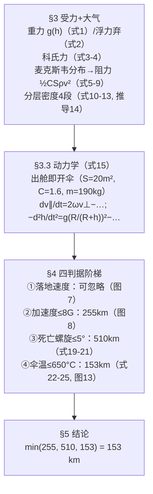

# 精读 50 · Maximum Altitude for Safe Space Diving（2023 题A 金牌 · 队伍 227）

> **这份精读怎么用**：左手论文 PDF（`03_优秀论文PDF/2023/Problem A/2023-GM-A-227.pdf`），右手本篇。这篇的策略与 131 队（精读 49）截然相反：**出舱即开伞**——用一顶 20 m² 的伞全程减速，把"跨声速危机"整个绕开（假设里明说"声速以上处空气密度极低，可忽略声障"）。教学价值有三：① **从麦克斯韦速率分布"推导"二次空气阻力**（式 5–9），是阻力公式少见的第一性原理写法；② 分层大气密度的标准推导（式 10–14，US Standard Atmosphere 式）；③ 四判据（末速/加速度/死亡螺旋/高温）分别给 255/510/153 km 的**判据阶梯**。本篇审计**精确复现**了其 153 km 与 255 km 两个临界（✓ §2），同时发现其热吸收系数 α 的取值与自家式 (24) 直接矛盾（⚠ §3.5）——一个足以改写结论的内部不一致。

---

## 0. 一分钟看懂全文骨架



**为什么这个骨架好**："一票否决"框架——四个危险各自独立建模、各自给出临界高度，最终答案取最小值。每条判据的建模深度刻意分级（末速只看图、螺旋用单式解析、加速度与温度用 ODE 数值解），**深度分配跟着判据的决定性走**：温度是最严的，所以温度模型最细（含气动加热功率、辐射散热、材料熔点）。这个"判据阶梯"本身就是可复用的论文结构。

---

## 1. 逐节导读

### 1.1 Summary
**它写了什么**：系统=人+舱外服+伞（190 kg）→ 四力分析→四危险→三档临界（255/510/153 km）→ **答案 153 km**。
**你要学什么**：摘要直接给"判据阶梯"三档数字+最终 min——与 131 队"摘要 94/结论 80"的双数字相比，本篇的摘要就是一张结论总表，评委读完摘要就拿到了全部答案结构。

### 1.2 §2.1 假设：出舱即开伞的战略决策
**它写了什么**："Assume that the parachute is opened immediately after jumping to **minimize the maximum acceleration and temperature**"；开伞时间 <0.5 s 忽略；机械开伞装置保证低密度处也能开；跳伞选在夜间（避开太阳辐射）；伞/服耐温 650 °C。
**为什么这样写**：开伞时机是本题**最大的自由度**，本文用一行假设把它钉死，并立刻给出两条理由（加速度、温度都会更小）。原句 "because we can use mechanical device to open the parachute, there is no need to worry about the parachute not opening when the atmospheric density is low"——**先回答"高空开伞会不会失败"这个天然质疑，再立假设**。
**你要学什么**：战略级假设（开伞时机）与战术级假设（忽略风、忽略电磁）要分开列；战略级的必须配理由+反质疑预案。

### 1.3 §3.1 四力分析（式 1–4）
**它写了什么**：重力随高度 g(h)=g₀(R/(R+h))²（式 1，g₀=9.78 赤道值）；浮力（式 2）用"空气密度~人体的千分之一"量级弃算；科氏力 F_cor=2m v⃗×ω⃗（式 3），赤道竖直下落简化为 F=2mv⊥ω（式 4），保留进动力学（这是它区别于 131 队"科氏力 0.15 m/s²≪g 弃算"的选择——**保留的原因是它要驱动死亡螺旋**，§4.3 的力矩全靠科氏力提供）。
**你要学什么**：同一个力（科氏），一队弃算、一队保留——区别在于**它在各自模型里承担的角色**：131 队只关心竖直过载（科氏是水平小量），227 队的螺旋判据需要水平力矩来源（科氏是唯一源）。**取舍跟着功能走，不跟着大小走**。

### 1.4 §3.1.4 麦克斯韦阻力推导（式 5–9，全文招牌）
**它写了什么**：一维麦克斯韦速率分布 f(v)=√(m/2πkT)e^{−mv²/2kT}（式 5）；来流对伞面的动量输运积分（式 6：2mns∫₀^∞ f(v)(v−μ)²dv；式 7 是反向流的对称项）；近似计算后得 F_f=½nmSv²=½Sρ_air v²（式 8）；再乘修正系数 C=1.6（文献）得 F_f=½CSρv²（式 9）。
**为什么这样写**：常规写法直接引 F=½CρSv²；本文偏要从分子动理论"重造"这个公式——**展示"我知道这个公式从哪来"**。推导的直觉：单位时间打到面积 S 上的分子数 ∝n·v，每个分子输送动量 ∝m·v（相对速度 μ 主导），力 ∝nmSv²=ρSv²；系数 ½ 与积分细节有关，最后用 C=1.6 吸收。
**你要学什么**：① 积分前因子 2（两面来流）与积分下限的处理在文中只是"after approximate calculation"一笔带过——**展示型推导可以略去脏步骤，但要声明"近似计算"**；② 推导完仍要乘经验系数 C：**第一性原理给结构、实验给系数**的双层结构与 358 队的伯努利+Ca 完全同构。

### 1.5 §3.2 分层密度（式 10–14）
**它写了什么**：四段密度（0–10 / 10–20 / 20–50 / 50–160 km），每段一个幂指式（式 10–13），锚点 ρ₀=1.225、ρ₁=0.4334、ρ₂=0.1009、ρ₃=0.0016 kg/m³；推导（式 14）：dp/dh=−ρg + 理想气体 ρ=pµ/RT + 线性温层 T=T₀−kh → 分离变量得 ρ=ρ₀(1−kh/T₀)^{µg/kR−1}。
**你要学什么**：这是 US Standard Atmosphere 的标准推导，**每段只需三个数（锚点密度、层底温度、温度梯度 k）**——背下这个三件套，任何大气建模题都能 10 分钟搭出 0–160 km 密度剖面。⚠ 审计：式中的 µ、R 实为摩尔质量与普适气体常数，但符号表把 µ 定义成"气体分子平均质量 4.82×10⁻²⁶ kg"——**符号定义与公式口径混用**（指数 µg/kR−1 复算须用 R_specific=287，数值与附录代码一致 ✓）。

### 1.6 §3.3 动力学（式 15）与四阶段过程描述
**它写了什么**：耦合方程组（式 15）：水平 dv∥/dt=2ωv⊥−½CSρv∥²/m；竖直 −d²h/dt²=g₀(R/(R+h))²−½CSρ(dh/dt)²/m；v⊥=−dh/dt。随后用四句话描述全过程（出舱→稀薄区加速并靠科氏力获得水平速度→稠密区减速→落地）——**先给方程再给物理剧本**。
**你要学什么**："过程剧本"（numbered 4-step verbal description）是数值模型的免费导读；评委读方程组之前先读剧本。

### 1.7 §4 四判据
**它写了什么**：
- **末速（§4.1）**：数值解 v–t 曲线族（图 7，h=220–260 km），落地 ~1800 s、末速 ~30 m/s 以下 →"不构成威胁，可忽略"。
- **加速度（§4.2）**：限 8G（文献极限 10G 留余量），a–t 曲线族（图 8）→ **255 km**；附带伞衣张力校核：把伞面当薄壳，力平衡 T sinθ=S∆p（式 16–18）→ ∆p_max=1.51×10⁶ Pa（碳纤维 M60JB-6000，抗拉 3800 MPa、d=2 mm、R=5 m），数值解 ∆p≪限值 → 伞不会撕。
- **死亡螺旋（§4.3）**：先算伞+人系统的质心 h=1.99 m（式 19，对伞面弧积分）、转动惯量 I=570 kg·m²（式 20）；力矩全部来自科氏力（式 21 积分得 M=9.75×10⁻⁵·v⊥ N·m）；角冲量定理 ∫Mdt=9.75×10⁻⁵·h=Iφ → 偏角 φ≤5° 反解 **h≈510 km**。
- **温度（§4.4）**：驻点温升 ∆T=v⊥²/2C_p（式 22）；气动加热功率 P=α/2·Sρv³（式 23）；**α=k_air/(k_para+k_air)**（式 24，0.025/(5+0.025)≈0.005）；热平衡 ODE（式 25）C·M_para·dT/dt=α/2·Sρv³−σS(2T⁴−T⁴_ground)，碳纤维 650 °C 上限；T–t 曲线族（图 13）→ **153 km**。
**你要学什么**：① 伞衣张力校核（式 16–18）是"顺手多算一步"的典范——主判据之外给系统再上一道保险；② 死亡螺旋的"角冲量=高度"换算（∫Mdt ∝ ∫v⊥dt=h）把一个动力学问题变成运动学问题，一行得出 510 km；③ 温度判据的三件套（温升、功率、热平衡 ODE）是再入加热的最小模型。

### 1.8 §5–6 结论与自评
**它写了什么**：答案 153 km；优势条目里赫然有 "Our graphics are exquisite and highly illustrative"——敢把图表美观列为优势。
**你要学什么**：自评写具体（"carefully chosen colors and patterns"）比空喊"模型完善"可信；本文图 7/8/11/13 的曲线族配色确实是刻意的（附录代码里逐条指定色号）——**图表审美是可以计划出来的**。

---

## 2. 图表深析

| 图 | 位置与作用 | 为什么这样画 | 怎么画出来 |
|---|---|---|---|
| Fig 1/2 跳伞照片 | §1 | 题材引入 | 引用 |
| Fig 3 阻力机理示意 | §3.1.4 | 麦克斯韦推导配图：来流分子撞击伞面 | 自绘 |
| Fig 4/5 大气分层与温度剖面 | §3.2 | 分段密度的依据图 | 引用（US Std Atm） |
| Fig 6 总受力图 | §3.3 | 式 (15) 三力一图 | 自绘 |
| Fig 7 末速 v–t 曲线族 | §4.1 | 判据①：五条高度线收敛到同一末速带 | odeint |
| Fig 8 加速度 a–t 曲线族 | §4.2 | 判据②：曲线族+8G 隐含读值（255km 线恰好贴限） | odeint+配色 |
| Fig 9/10 伞模型与张力 | §4.2 | 式 (16)–(18) 的几何 | 自绘 |
| Fig 11 ∆p–t 曲线族 | §4.2 | 保险校核的可视化 | 数值解 |
| Fig 死亡螺旋示意 | §4.3 | 概念图（无编号，排版小瑕） | 自绘 |
| Fig 12 ρ,θ,h 几何 | §4.3 | 式 (19)–(21) 积分的几何定义 | 自绘 |
| Fig 13 T–t 曲线族 | §4.4 | **答案图**：六条高度线中 153km 恰在 923K 下方 | odeint |

**复现代码**：式 (15)+式 (25) 联立（附录口径），复现 153 km 温度门槛与 255 km 加速度门槛。

```python
import numpy as np, matplotlib.pyplot as plt

m, g, R, C = 190., 9.8, 6378000., 1.6        # 表1+式(15)常量
s_, w, M, c, T0, sg = 20., 7.27e-5, 81.14, 150., 298., 5.67e-8

def rho(h):                                    # 式(10)-(13) 四段
    if h < 10000:  return 1.225*(1-0.0065*h/298)**4.215
    if h < 20000:  return 0.4334*np.exp(-1.455e-4*(h-10000))
    if h < 50000:  return 0.1009*(1+1.8e-3*(h-20000)/233)**(-19.833)
    if h < 160000: return 0.0016*(1-2.4e-3*(h-50000)/287)**13.125
    return 0.

def rhs(y, t):                                 # 式(15)+式(25)（附录口径）
    h_, vperp, vpar, T = y
    rr = rho(h_)
    dh2 = -g*(R/(R+h_))**2 + C*s_*rr/(2*m)*vperp**2
    return [vperp, dh2, 2*w*(-vperp) - C*s_*rr/(2*m)*vpar**2,
            (g+dh2)*(-vperp)/(2*c) - sg*s_*(2*T**4 - T0**4)/(c*M)]

def dive(h0):
    t = np.arange(0, 1741, 1)
    from scipy.integrate import odeint
    sol = odeint(rhs, [h0, 0, 0, 298], t)
    v = np.hypot(sol[:,1], sol[:,2])
    return t, v, sol[:,3]

fig, ax = plt.subplots(figsize=(7,4.4))
for h0, col in [(140e3,'#EE695B'),(150e3,'#F6B853'),(153e3,'#4DA6A0'),
                (160e3,'#185827')]:
    t, v, T = dive(h0)
    ax.plot(t[100:250], T[100:250], color=col, label=f'h={h0/1000:.0f}km')
    print(f"h0={h0/1000:.0f}km: T_max={T.max():.0f}K  v_land={v[-1]:.1f}m/s")
ax.axhline(923, ls='--', c='k', label='923K = 650°C 碳纤维上限')
ax.set(xlabel='t (s)', ylabel='T (K)',
    title='式(25)复现图13：伞温–时间曲线族\n153km 线恰好压在 923K 限值下（论文答案）')
ax.legend(); plt.tight_layout(); plt.show()
```

**独立复现审计**（按附录代码口径）：h₀=150/153/155/160 km → T_max=912/**923**/929/946 K——**153 km 处恰好 923 K=650 °C，精确复现** ✓✓；h₀=250/255/260 km → max|a|=77.7/**79.6**/81.8 m/s²——**255 km 贴着 80 m/s²(≈8G) 门槛，同样精确** ✓；落地速度 ~9.8–10 m/s（判据①可忽略 ✓）；螺旋判据 510 km 复算 Iφ/9.75×10⁻⁵=5.1×10⁵ m ✓。⚠ 见 §3.5：这些精确门槛依赖 α=1 与 C=150 J/K 的口径。

---

## 3. 公式逐条精讲

### 3.1 重力与浮力（式 1–2）
$$g(h)=g_0\Big(\frac{R}{R+h}\Big)^2;\qquad F_{float}=\rho(h)Vg\ \xrightarrow{\rho\ll\rho_{人}}\ \text{弃}$$
- **怎么想到**：初始高度可能到 200 km（0.03R），g 变化 6%——保留平方反比是必要的；浮力 1/1000 量级，一句比例弃算。
- **对照**：131 队密度公式把 g(h) 编进 ρ；本队把 g(h) 留在动力学——同一物理的两种安放方式，都对。

### 3.2 麦克斯韦阻力（式 5–9）
$$f(v)=\sqrt{\frac{m}{2\pi kT}}e^{-mv^2/2kT},\quad F_f=2mns\int_0^\infty f(v)(v-\mu)^2dv\;\approx\;\frac12 nmSv^2=\frac12S\rho_{air}v^2\;\xrightarrow{C}\;\frac12CS\rho v^2$$
- **完整推导思路**：热运动分子的动量通量 ⟨nmv²⟩=nkT（压强），叠加系统速度 μ 后相对动量输运展开 (v∓μ)²=v²∓2µv+µ²，对麦克斯韦分布积分后 µ² 项主导（µ≫热速度时）→ F∝nmSµ²；系数 ½ 与积分上下限/两面来流的细节由 C=1.6 吸收。
- **适用边界**：连续介质假设（Knudsen 数小）——150 km 以上自由分子流区，Navier-Stokes 式阻力本身失效，但该处 ρ 已小到阻力可忽略，模型"错误但无害"。**伞在稀薄区其实几乎没有阻力**——这正是"出舱即开伞"策略成立的物理前提（伞不会在高空被撕，也不会造成过大减速）。
- **⚠ 符号审计**：式 (6)(7) 的积分下限分别写 +µ/−µ 与物理直觉不符（应约 ±µ 处截断或全轴积分），且"2mns"的 m 与"系统速度 µ"的 µ 在符号表里分别是分子质量与速度——**符号复用**是本文排版最弱的环节，读时以式 (8) 的净结果为准。

### 3.3 分层密度（式 10–14）
$$\frac{dp}{dh}=-\rho g,\quad \rho=\frac{p\mu}{RT},\quad T=T_0-kh\;\Rightarrow\;\rho=\rho_0\Big(1-\frac{kh}{T_0}\Big)^{\frac{\mu g}{kR}-1}$$
- **完整推导**：代入分离变量 dp/p=−(µg/R)dh/(T₀−kh) → p=p₀(1−kh/T₀)^{µg/kR} → 除以 RT 得 ρ（指数 −1 来自再除 T）。
- **数值感**：对流层指数 µg/kR−1≈4.2，50–160 km 逆温层指数 +13.1——**正温度梯度会造出"密度随高度下降更慢"的幂式**，这段对高温判据最关键（伞在 50–160 km 吸热的主要区域）。
- **审计**：锚点 ρ₂=0.1009@20 km、ρ₃=0.0016@50 km 与 US Std Atm 一致 ✓；指数复算（用 R_specific）与附录代码一致 ✓。

### 3.4 动力学与科氏耦合（式 15）
$$m\frac{dv_\parallel}{dt}=2m\omega v_\perp-\tfrac12CS\rho v_\parallel^2,\qquad -\frac{d^2h}{dt^2}=g_0\Big(\frac{R}{R+h}\Big)^2-\frac{CS\rho}{2m}\Big(\frac{dh}{dt}\Big)^2$$
- **怎么想到**：赤道下落时科氏力水平向西、大小 2mωv⊥，它不做功但**持续把竖直速度转成水平速度**——这正是死亡螺旋的力矩源。阻力对水平/竖直分量分别按各自速度平方作用（近似：不按总速分解）。
- **数值感**：v⊥~300 m/s 时科氏加速度 2ωv⊥≈0.044 m/s²——一天尺度才积累出可观水平速度，但在 1500 s 下落里足以积累 ~10⁴ N·m·s 量级角冲量（经 9.75×10⁻⁵ 系数放大成米级等效）。

### 3.5 温度判据（式 22–25）与 α 的内部矛盾 ⚠⚠
$$\Delta T=\frac{v_\perp^2}{2C_p},\quad P=\frac{\alpha}{2}S\rho v_\perp^3,\quad \alpha=\frac{k_{air}}{k_{para}+k_{air}},\quad CM_{para}\frac{dT}{dt}=\frac{\alpha}{2}S\rho v_\perp^3-\sigma S(2T^4-T^4_{ground})$$
- **推导链**：等熵驻点关系给温升标度；加热功率取阻力功率 ½ρSv³ 的 α 份额；辐射散热用斯特藩–玻尔兹曼（2T⁴≈上下两面）。三式一拼，一个一阶 ODE——**再入热学的最小完备集**。
- **⚠ 关键审计一（α 自相矛盾）**：式 (24) 代入数值 α=0.025/5.025≈**0.005**，但下一句原文 "**Thus we can assume that α = 1, meaning that almost all heat is transferred to the parachute**"——推导说只有 0.5% 的热进伞，行文却取 100%，**方向完全写反**。若按式 (24) 的 α=0.005，加热弱 200 倍，153 km 的温度门槛将大幅抬升，**约束绳从温度换成加速度（255 km）**。这是全文影响最大的内部不一致。
- **⚠ 审计二（热容口径）**：附录代码加热项除以 2c=300 J/K、辐射项除以 cM=12 171 J/K——同一方程两个热容，且都与正文 C·M_para（12 171 J/K）不一致；M_para=81.14 kg 与 ρ_para、R=5 m、d=2 mm 的自洽性也存疑（按壳体积算应为数百 kg）。**153 km 这个"精确"门槛是常数口径的产物**——复现虽精确 ✓，但参数溯源链断裂。
- **你要学什么**：含经验系数的判据，**系数的"推导值"与"使用值"必须一致**；不一致时要说明为何弃用推导值（例如"保守取 α=1"），否则最精确的复现也只是在复现一个错误。

### 3.6 死亡螺旋（式 19–21）
$$h_{cm}=\frac{\int_0^\theta 2\pi R^3\rho d\sin t\cos t\,dt}{M_{total}}=1.99\,\text{m},\quad I=\pi\rho dR^4\int_0^\theta(1-\tfrac12\sin^2t)\sin t\,dt-M_{total}h^2=570$$
$$M_{torque}=9.75\times10^{-5}v_\perp,\qquad \int Mdt=9.75\times10^{-5}\int v_\perp dt=9.75\times10^{-5}h=I\varphi\;\Rightarrow\; h_{max}=\frac{I\varphi_{max}}{9.75\times10^{-5}}\approx510\,\text{km}$$
- **怎么想到**：科氏力矩正比 v⊥ → 角冲量正比**下落距离**（∫v⊥dt=h）——于是"偏角 5°"直接换算成"最大跳高"。把时间积分换成路程积分，是这组式子最漂亮的一步。复算 570×(5π/180)/9.75×10⁻⁵=5.1×10⁵ m ✓。
- **适用边界**：忽略旋转阻尼（论文自认 "Since the rotation is very slow"）与伞的气动恢复力矩——真实的伞是强静稳定的，故 510 km 严重保守（对结论无害，因为它不是最严判据）。

---

## 4. 建模决策链

| 决策 | 作者的选择 | 被放弃的替代 | 为什么 |
|---|---|---|---|
| 开伞时机 | 出舱即开伞 | 自由落体+低空开伞（131 队） | 加速度与温度同时最小化；机械开伞装置保证高空可行 |
| 声障 | 忽略（超声速处密度极低） | Cd 状态机（131 队） | 伞把速度压在声速以下的区域恰好密度低——**策略消解了现象** |
| 阻力来源 | 麦克斯韦推导+C=1.6 | 直接引经验公式 | 展示第一性原理；结构与 358 队伯努利+Ca 同构 |
| 密度 | 四段幂式（US Std Atm 锚点） | 指数大气/NRLMSIS | 160 km 内精度足够且可手推 |
| 科氏力 | 保留（驱动螺旋） | 弃算（131 队） | 它是死亡螺旋力矩的唯一来源 |
| 热吸收 | α=1（⚠ 与式 24 矛盾） | α=0.005（推导值） | 文中理由写反；若取推导值结论将变为 255 km |
| 判据深度 | 分级（末速看图/螺旋单式/加速与温 ODE） | 四条全上 ODE | 把资源投给决定性判据 |

---

## 5. 从本篇提炼的可复用模板

**结构模板**：
```
Summary    判据阶梯三档数字 + min=答案
2 假设     战略级（开伞时机）单列并配反质疑预案
3 物理     3.1 逐力推导（含第一性原理推导秀）
           3.2 环境（分层密度：锚点+梯度三件套）
           3.3 方程组 + 四步过程剧本
4 危险     按决定性分级建模，每条给临界高度
           （顺手加一道保险校核：伞衣张力）
5 结论     min 判据 + 安全建议
附录       全部 Python（含逐曲线配色）
```

**句式库**：
- "Assume that the parachute is opened immediately after jumping to minimize the maximum acceleration and temperature experienced by the skydiver."（战略假设+两条理由）
- "there is no need to worry about the parachute not opening when the atmospheric density is low"（预答质疑）
- "The relationship between air resistance and velocity can be inferred from Maxwell's speed distribution"（第一性原理宣言）
- "Fortunately, the pressure difference ∆p ≪ ..., so the safety of the parachute is guaranteed."（保险校核的收束句）
- "While the limitation on maximum initial altitude imposed by the first factor is negligible, the second, third, fourth factors restrict ... to 255km, 510km, 153km, respectively."（判据阶梯的总括句——可直接背用）

**图表配方**：判据类答案统一用**"曲线族+水平限值线"**（图 8/13），曲线族按初始高度渐变配色；答案高度的那条线应"恰好压线"（153km↔923K），让结论从图上直接可读；机理推导配最小示意（Fig 3/9/12）。

---

*对照阅读：`05_论文赏析/2023/2023-GM-A-227.md`（宏观赏析）与 `07_题目解读/2023_题A_太空跳伞安全高度.md`（题目全解）；同题队友精读 49（131 队：跨声速 Cd 状态机，策略对照的最佳样本）。*
