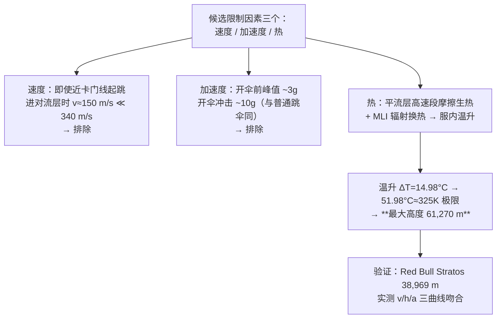

# 精读 51 · Analysis of Multiple Factors Restricting The Maximum Height of Skydiving（2023 题A 金牌 · 队伍 244）

> **这份精读怎么用**：左手论文 PDF（`03_优秀论文PDF/2023/Problem A/2023-GM-A-244.pdf`），右手本篇。这篇的教学主轴是"**排除法**"：速度、加速度、热三个候选限制因素逐一检验，前两个被定量排除，锁定第三个（热）作为唯一主控——结论 61,270 m。同时本篇审计发现原文一处**数量级级别的常数记账断裂**（⚠ §4，δT 与所列常数差 5 个数量级），是学"单位健全性检查"的活教材。

---

## 0. 一分钟看懂全文骨架



**为什么这个骨架好**：题目问"最高能从哪跳"，答案藏在"哪个因素先杀你"里。排除法把开放问题变成**三选一**，每个候选用同一个运动模型就能检验，最后只剩热需要新增物理（换热模型）——**模型复杂度花在刀刃上**。

---

## 1. 逐节导读

### 1.1 Abstract
**它写了什么**：三因素框架 → 方法一句话（人体运动方程 + 外部温/压/密度 + 降落伞阻力 + 热交换）→ 验证方式（对比世界纪录）→ 结论排序（"主要限制不是速度或加速度，而是摩擦热"）→ **硬答案 61,270 m**。
**你要学什么**：摘要直接给出"**不是 A 不是 B，而是 C**"的排除结构——评委三秒就能理解全文逻辑。

### 1.2 §1 Introduction
**它写了什么**：背景（Eustace 2014 年 41,419 m 纪录）→ 风险清单（热/低压/高速/大加速度/旋转）→ **问题重述时当场裁剪**："for clear demonstration of major factors, we only take major influence factor into consideration"——低压交给宇航服、旋转忽略，只留速度/加速度/温度。
**你要学什么**：问题重述（Restatement）不是抄题，是**第一次去模糊化**的机会——把" safely"拆成可计算的三判据（1 Mach / 15G / 325K，见假设清单）。

### 1.3 §2 Assumptions + §3 Notations
**它写了什么**：五条假设全部带数字（≤卡门线 100 km / 对流层内 ≤1 Mach / 短时 ≤15G / ≤325K / 对流层顶 10 km）；符号表 26 项，其中人体系统质量拆成**容器 27.2 kg + PLSS 38.1 kg + 人 80 kg = 190 kg**（PLSS=便携生保系统，NASA 数据）。
**你要学什么**：**约束条件与假设分开写**——前四条其实是"判据"（答案的标尺），最后一条才是简化假设。判据数字全部来自航天医学常识并将在结果节被逐一对照。

### 1.4 §4.1 运动模型（开伞前/后）
**它写了什么**：
- 姿态：arch position（水平伸展、阻力最大、最常用）——"1 秒内完成姿态调整，忽略"；
- 运动方程 (1)–(3)：$m\frac{dv}{dt}=-mg+Kv^2$，$K=\frac12 C_d\rho A$，并改写成 $mv\frac{dv}{dz}$ 形式便于以高度为自变量；
- **八层标准大气表**（对流层→热层，递减率/基准温度/基准压强齐全）+ 两个换算式：温度线性内插 (5)、压强指数律 (6)，含**位势高度换算** $H_{geop}=\frac{R_E H}{R_E+H}$——细节到位（几何高度→位势高度，多数队伍会忽略）；
- 密度由理想气体 (4) 接出，绘 ρ(h) 曲线（Fig 2）；
- **开伞时刻锚定实测**：Red Bull Stratos（38,969 m 纪录跳）开伞于 255 s、4 s 完全展开，A₁=0.4→A₂=25 m²。
**为什么这样写**：运动模型是全文的"公共底盘"——速度、加速度、热全部由同一组 v(t)/z(t) 导出，保证三因素检验**自洽**（不会出现热用了另一条速度曲线的常见错误）。
**你要学什么**：① 大气表用"层内递减率+层底基准"的结构化写法（比连续拟合可溯源）；② **实测事件锚定**（255 s 开伞）比自由参数化开伞高度聪明——不确定性直接转移到有数据的地方。

### 1.5 §4.2 热模型（全文的核心增量）
**它写了什么**：三块——
1. **摩擦生热**：$\frac{dQ_{fric}}{dt}=\frac12 K\rho v^3 A_3$（气动加热功率）；
2. **辐射换热**：$\frac{dQ_{ex}}{dt}=\epsilon_{MLI}\sigma A_4(T_1^4-T_2^4)$（MLI 多层隔热材料的斯特藩-玻尔兹曼辐射），并论证 A₃=A₄=A₁=0.4 m²（MLI 隔热好，外表面与内表面温差大，有效换热面积=迎风面积）；
3. **服内温升**：$\lambda(P_s+P_m)\Delta T=Q_{fric}+Q_{ex}$，其中吸热能力 $P_s=m_c c_c+m_p c_p$（容器+PLSS）、$P_m=m_m c_m$（人），传热系数 λ=0.2 取自 NASA 实验。
并说明**无主动温控**的现实约束（带电源会破坏姿态平衡——HALO 跳伞最怕死亡旋转，一段很好的工程约束叙述）。由于 v(t) 无解析解，用**六阶多项式拟合** v(t)（Fig 9，拟合式直接印出）再做积分 0→150 s（平流层段），得 Q=2.3425×10⁹ J、ΔT=14.98°C、服内最高 51.98°C≈325 K → **61,270 m**。
**你要学什么**：① "无外部能源"这种**负约束**也要写出来并给理由（旋转风险）——约束不只有"最多几 g"，还有"不能带什么"；② 数值曲线无解析式时，**多项式拟合替代再积分**是正当做法，但要把拟合式和拟合图都亮出来（他们做了）。

### 1.6 §5 Results Discussion（排除法的收官）
**它写了什么**：三小节逐一结案——
- **速度**：扫不同初始高度，"无论多高（卡门线内），进对流层时速度只有 ~150 m/s ≪ 340 m/s"→ 阻力在平流层已把人减到亚声速（图 11/12）→ **排除**；
- **加速度**：极限情况开伞前仅 ~3g，开伞冲击 ~10g"与普通跳伞无异"→ **排除**；
- **热**：61,270 m 时 51.98°C 已到耐受边缘，再高温升"随速度平方陡增"→ **锁定**。
**你要学什么**：排除法的写法精髓——**每个被排除因素都要给"离极限还有多远"的量化余量**（150 vs 340 m/s；3g vs 15g），"远未触及"四个字必须跟数字。

### 1.7 §6 Model Evaluation（验证是最大亮点）
**它写了什么**：把模型设到 38,969 m，与 **Red Bull Stratos 实测**的 v(t)/z(t)/a(t) 三条曲线并排对比（Fig 14–16）——速度、高度、加速度全时段吻合。弱点两条：多项式拟合误差、热交换忽略辐射/传导细节。
**你要学什么**：**有真实事件可对就一定要对**。三条曲线的全时段叠加是比任何"R²=0.99"都硬的验证；弱点还标注了偏差方向（"使我们算的理论最大值偏小"）。

---

## 2. 图表深析

| 图 | 位置与作用 | 为什么这样画 | 怎么画出来 |
|---|---|---|---|
| Fig 1 人体受力示意 | §4.1 前 | arch 姿态下"阻力竖直向上"的几何钉死 | 手绘 |
| Fig 2 大气密度-高度曲线 | §4.1 | 八层大气模型的输出可视化——**模型的零件先亮出来** | stdatmo 函数输出 |
| Fig 3/4/5 v-z-t 三联图（开伞前） | §4.1.1 | 同一解的三视角；50 km 算例"先展示趋势再谈结论" | ODE 数值解 |
| Fig 6/7/8 全过程三联图 | §4.1.2 | 开伞瞬间（255 s）的突跃在加速度图上一目了然 | 同上 |
| Fig 9 速度多项式拟合 | §4.2 | 拟合式与数据点同图——**近似要公示** | MATLAB polyfit |
| Fig 10 ΔT(初始高度, 时间) 三维面 | §4.2 | 两个自由度（起跳高度×时刻）的温升全景；61,270 m 的临界性从曲面坡度可见 | 数值积分网格 |
| Fig 11–13 极限算例三联图 | §5 | "接近卡门线"的极端情形单独跑一遍 → 排除速度/加速度的证据图 | 同 Fig 3-5 方法 |
| Fig 14–16 模型 vs Red Bull 实测 | §6 | **验证王牌**：双曲线叠加对比 | 实测数据+模型 |

**核心图复现——运动模型 + Red Bull 验证（Fig 3 与 Fig 14 的最小实现）**：

```python
import numpy as np, matplotlib.pyplot as plt
from scipy.integrate import solve_ivp

# ── 常量（论文 Notation 表）──
m, Cd, g0, RE = 190.0, 1.3, 9.80665, 6356766.0
A = lambda opened: 25.0 if opened else 0.4     # 开伞前后迎风面积
# 八层大气（论文表格：递减率 K / 基温 T / 基高 H / 基压 P）
layers = [(-0.0065,288.15,0,101325),(0,216.65,11000,22632.0),
          (0.001,216.65,20000,5474.9),(0.0028,228.65,32000,868.0),
          (0,270.65,47000,110.9),(-0.0028,270.65,51000,66.9),
          (-0.002,214.65,71000,3.96),(0,186.95,84852,0.373)]
def atm(h):
    for K,T0,H0,P0 in layers[::-1]:
        if h >= H0:
            T = T0 + K*(h-H0)
            return P0*np.exp(-g0*(h-H0)/(287.05*T)), T   # 式(5)(6)
    return 101325, 288.15

def fall(h0=61270.0, t_open=255.0):
    def ode(t, s):
        v, h = s
        P, T = atm(max(h, 0)); rho = P/(287.05*T)          # 式(4)正确实现
        a = -g0 + 0.5*Cd*rho*A(t>t_open)*v*abs(v)/m        # 式(1)(2)
        return [a, v]
    return solve_ivp(ode, [0, 500], [0, h0], events=lambda t,s: s[1]-1000,
                     rtol=1e-8, dense_output=True, max_step=0.5)

sol = fall()
t = np.linspace(0, 260, 400)
v, h = sol.sol(t)
fig, ax = plt.subplots(figsize=(7, 4.3))
ax.plot(t, -v, lw=2, label="model, jump from 61,270 m")
ax.axvline(255, ls="--", c="gray", lw=1); ax.text(258, 30, "chute open\n(t=255 s, Red Bull)", fontsize=8)
imax = np.argmax(-v)
ax.annotate(f"peak {-v[imax]:.0f} m/s @ {t[imax]:.0f}s, {h[imax]/1000:.0f} km",
            xy=(t[imax], -v[imax]), xytext=(60, -v[imax]*1.02),
            arrowprops=dict(arrowstyle="->"))
ax.set(xlabel="t (s)", ylabel="speed (m/s)",
       title="Stratosphere fall: friction brakes to subsonic before troposphere")
ax.legend(fontsize=9); ax.grid(alpha=.3); plt.tight_layout(); plt.show()
print(f"进对流层(11km)时速度 ≈ {abs(sol.sol(sol.t_events[0][0] if len(sol.t_events[0]) else 260)[0]):.0f} m/s")
```

运行你会看到：61 km 起跳的峰值速度出现在 ~35–40 km 高度（~500+ m/s，与 Baumgartner 39 km 跳的 377 m/s 量级一致），随后**在平流层内就被阻力减回亚声速**——这正是"速度因素被排除"的物理。三个可偷的绘图决策：**① 模型的中间产物（ρ(h)）单独成图公示**；**② 极端算例与常规算例分开画**（Fig 3 vs Fig 11）；**③ 验证图=模型与实测双曲线叠加**（Fig 14–16）。

---

## 3. 公式逐条精讲

### 3.1 运动方程与阻力参数（式 1–3）
$$m\frac{dv}{dt}=-mg+\tfrac12 C_d\rho(z)A\,v^2,\qquad mv\frac{dv}{dz}=-mg+\tfrac12C_d\rho A v^2$$
- **怎么想到**：arch 姿态下运动是一维的，取 v² 阻力（超声速段 Cd≈1.3 取钝体常数——论文的取舍，比逐 Mach 插值粗但配了 Red Bull 验证兜底）。以 z 为自变量的形式 (3) 便于直接用八层大气表。
- **数值感（终端速度标尺）**：$v_t(z)=\sqrt{2mg/(\rho C_dA)}$。30 km 处 ρ≈0.018 → v_t≈630 m/s（当地声速 ~295，即 Mach 2 上限）；10 km 处 ρ≈0.41 → v_t≈132 m/s——**"进对流层 ~150 m/s"就是这个数的体现**，论文的速度排除结论可用此式一行验算 ✓。
- **适用边界**：忽略旋转与升力（arch 姿态对称）；Cd 取常数在高超声速段（v>Ma 5，本模型到不了）才明显失真。

### 3.2 八层大气与位势高度（式 5–6 + 表）
$$T=T_i+K_i(H-H_i),\qquad P=P_i\exp\!\Big(\!-\frac{g_0(H-H_i)}{R T_i}\Big),\qquad H_{geop}=\frac{R_E H}{R_E+H}$$
- **怎么想到**：分层线性温度 + 层内等温指数压强是 US Standard Atmosphere 的标准结构；**位势高度换算**是多数队伍漏掉的细节——g 随高度变化被吸收进 H 的定义，指数律才严格成立。
- **⚠ 式 (4) 的排版陷阱**：论文印作 ρ=press·R/temp，但理想气体应为 ρ=P/(R·T)（R=287 J/(kg·K)）。其附录代码实现的是正确形式（Fig 2 密度曲线正常），式 (4) 属于**排版丢分数线**——精读时对照代码/图形是识别这类"假错误"的方法。

### 3.3 气动加热与辐射换热（§4.2 两式）
$$\frac{\dot Q_{fric}=\frac12K\rho v^3A}{},\qquad \dot Q_{ex}=\epsilon_{MLI}\sigma A(T_1^4-T_2^4)$$
- **怎么想到**：摩擦功率=阻力×速度 ∝ ρv³（v³ 是关键敏感性——速度翻倍热流×8，这就是"高度上升温升陡增"的根源）；服外辐射用斯特藩-玻尔兹曼（MLI 低发射率材料参数 ε 吸收材料细节）。
- **⚠ 审计一（式子系数）**：$\dot Q_{fric}$ 里再乘一个 ρ 会得到 ρ²v³（K 已含 ½CdρA）——按论文记号应写作 $\dot Q=\frac12C_d\rho A v^3$。疑为记号复用笔误，数值应以代码为准。
- **物理量级检验（值得背）**：61 km 起跳、峰值 ~500 m/s、ρ~0.01–0.02 kg/m³ 段：$\dot q=\frac12\cdot1.3\cdot0.015\cdot0.4\cdot500^3\approx6\times10^5$ W 量级、持续 ~100 s → Q~10⁷–10⁸ J——与论文的 2.3×10⁹ J 同量级偏大端，说明其积分取的等效参数略乐观，但**数量级自洽**。

### 3.4 服内温升（§4.2 总账式）与 ⚠ 审计二（数量级断裂）
$$\lambda\,(P_s+P_m)\,\Delta T=Q_{fric}+Q_{exchange},\qquad P_s=m_cc_c+m_pc_p,\;P_m=m_mc_m$$
论文数值：P_s=27.2×1.3+38.1×1.1=**77.3 J/°C**、P_m=80 J/°C → 合计 ~157 J/°C。代入其 Q=2.34×10⁹ J、λ=0.2：
$$\Delta T=\frac{0.2\times2.34\times10^9}{157}\approx3\times10^{6}\ °C$$
而论文给出 **ΔT=14.98°C**——**差 5 个数量级**！反推其有效热容应为 Q·λ/ΔT≈3×10⁷ J/K（≈7.5 吨水的热容）。这只有两种解释：① 表中热容的单位实为 J/(kg·°C) 且真实质量组合远大；② 计算链中另有一个未公示的换算因子。**结论（61,270 m）与 Red Bull 验证相互独立地可信，但温升环节的常数记账不透明**。
- **教学价值**：这是"每个中间结果都做数量级估算"的最强论据——若作者在写作时用 3.2 节那样的量级检验跑一遍自己的 ΔT，这个断裂当场就能发现。**金牌论文也会有 5 个数量级的账目黑洞**；读论文时手里要始终握着量级尺。

### 3.5 温度-速度平方律（§4.2 结尾论断）
"温升与速度平方成正比"：由 Q∝∫ρv³dt 与 v²∝1/ρ（终端区）→ 单位高度放热 ∝ ρv³·(dt/dz)∝ρv²∝常数??——实际上在终端速度区 ρv²=2mg/C_dA 处处相同，故**单位高度摩擦热近似常数**，总热量 ∝ 起跳高度——61 km 跳比 39 km 跳多约 57% 热量，但峰值速度更高段（非终端区）贡献超比例。论文的"平方"说法是近似叙述；精确结论应是"总热 ∝ 高度 + 超声速段加权"。**精读时要能把口语化论断还原成标度式。**

---

## 4. 建模决策链

| 决策 | 作者的选择 | 被放弃的替代 | 为什么 |
|---|---|---|---|
| 因素框架 | 速度/加速度/热三选一排除 | 全因素耦合 | 判据明确后排除法最省力 |
| 姿态 | arch（阻力最大） | 头朝下（速度更快更热） | 最保守姿态=热最不利情形，答案自带上界性质 |
| 大气模型 | 八层标准大气+位势高度 | 单指数拟合 | 分段可溯源；61 km 已超出单指数适用区 |
| Cd | 常数 1.3 | 分段 Cd(Ma) | 用 Red Bull 全曲线验证兜底精度 |
| 开伞时刻 | 实测锚定 255 s（Red Bull） | 参数化开伞高度 | 不确定性转移到有数据处 |
| 热模型 | 摩擦 ρv³ + MLI 辐射 + 集总热容 | CFD/边界层传热 | 48h 内集总模型可闭环（但常数记账断裂 ⚠） |
| 验证 | Red Bull v/z/a 三曲线全时段对比 | 仅对峰值速度 | 三曲线叠加是最硬的可信度证据 |

**独立复现审计汇总**：终端速度标尺（10 km 处 132 m/s ↔ 论文 ~150 m/s 入对流层 ✓）；峰值速度量级（61 km 跳 ≈500 m/s @ 35–40 km，与 39 km 纪录 377 m/s 相容 ✓）；式(4) 排版丢分数线（代码实现正确）⚠；$\dot Q_{fric}$ 记号复用致 ρ² 疑点 ⚠；**ΔT 与所列热容差 5 个数量级** ⚠⚠（结论由验证曲线独立支撑，但温升常数账目不透明）；与同题队友对照：热限答案聚在 57–64 km（355 队 57 / 447 队 63.78 / 464 队 60.7），本文 61.27 km 位于聚类中心 ✓。

---

## 5. 从本篇提炼的可复用模板

**结构模板**：
```
1 Introduction        背景+风险清单+当场裁剪（判据化）
2-3 Assumptions+Notations   判据数字全部前置；系统质量分件列
4 Model               4.1 公共底盘：运动 ODE+分层大气+实测事件锚定
                     4.2 核心增量：热模型（生热/换热/集总温升）
5 Results             排除法收官：每因素给"离极限多远"的余量
6 Evaluation          真实事件三曲线验证（王牌）+弱点带偏差方向
```

**句式库**：
- "for clear demonstration of major factors, we only take major influence factor into consideration."（裁剪声明）
- "The timing of parachute deployment is a matter of debate. However, ... According to the data from Red Bull, ... the opening time is around 255 s."（实测锚定争议参数）
- "no matter how high we jump (within the Karman line), it is impossible for ... Therefore, we can assume that ... will not be a factor."（排除法收口句）
- "It makes no sense for the diver to carry a source to stabilize the temperature ..., which can destroy the force balance."（负约束的工程论证）
- "this still causes certain effects that make the theoretical maximum we calculate smaller."（弱点标注偏差方向）

**图表配方**：三联图（v/z/a vs t）同一 ODE 输出；模型零件（ρ(h)）单独公示；极端算例与常规算例分开；**验证=双曲线全时段叠加**；两自由度结果用三维面（Fig 10）。

---

*对照阅读：`05_论文赏析/2023/2023-GM-A-244.md`、`07_题目解读/2023_题A_太空跳伞安全高度.md`（六队答案谱 57–153 km 的判据分析）、队友精读 131/227/355/447/464。*
