# 精读 54 · Maximum Safe Altitude for Space Jumps（2023 题A 金牌 · 队伍 355）

> **这份精读怎么用**：左手论文 PDF（`03_优秀论文PDF/2023/Problem A/2023-GM-A-355.pdf`），右手本篇。六篇同题金牌里，这支队伍给出了**最低的答案（57 km）**，原因是他们选了一个别的队都不敢碰的主控因素——**旋转失控**。你要学的是：① 如何从"五种危险"清单里论证出真正的主控项；② 用**一个真实事件（Baumgartner 2012）的两时刻**标定一个理论模型的两个阈值（失控/复稳）——"以事定参"的典范；③ 原创物理量"旋转耐受特征值 S"的构造逻辑。本篇审计复算了它的 k 阈值与热学账目（⚠ 发现常数表与发表数值差 ~2.5×，但内部自洽）。

---

## 0. 一分钟看懂全文骨架

```mermaid
flowchart TB
    A["五种危险清单<br/>热/开伞冲击/声爆/旋转失控/落地超速"] --> B["运动底盘：三层大气+声速(10)<br/>+Cd(Ma)分段(11) → v-h 曲线族"]
    B --> C["排除①：所有高度起跳<br/>最后 1km 速度曲线重合<br/>→ 开伞/落地与高度无关"]
    B --> D["主控②：旋转失控<br/>滚转力矩模型(式3-7)<br/>→ 失控判据 k=f/m"]
    D --> E["以 Baumgartner 定标：<br/>失控 k₁=2.82 @33.35km<br/>复稳 k₂=12.36 @19km"]
    E --> F["原创量 S=∫k dt（角速度积累）<br/>FB 实测 S₀=644.7 m/s<br/>极限 Sₘ=1.5S₀ → **h_max=57 km**"]
    C --> G["排除③④⑤：开伞冲击3800N/热ΔT=62°C/落地5.5m/s<br/>量级估计均不主导"]
```



**为什么这个骨架好**："清单 → 底盘 → 逐项排除/锁定 → 用真实事件标定 → 原创判据量收束"——把最不确定的因素（人体）交给最可信的数据（Baumgartner 实跳），把可计算的交给物理。**答案最低反而最显功力：他们多算了一个别人不敢算的自由度。**

---

## 1. 逐节导读

### 1.1 Summary（中式论文摘要的合格改造）
**它写了什么**：结论先行（57 km，锁定中间层以下）→ 主控因素一句话讲清因果链（超声速强风阻下能否保持姿态 → 滚转力矩失控 → 高速旋转昏迷）→ 三部分预告（运动修正/旋转模型/其他因素排除）。
**你要学什么**：摘要里"**关键在于……**"句式直接宣告主控因素——评委读摘要就完成了问题定位。

### 1.2 §1.3 Analysis（危险清单与"先算什么"的决策）
**它写了什么**：五种危险编号列出，然后一段"为了分析这五个危险源，我们首先需要 v-h 图像"——**清单驱动出求解顺序**。
**你要学什么**：开放题先列全 hazards 再动手，本身就是得分结构；更重要的是清单里的顺序（热第一、失控第四）与最终结论（失控才是主控）形成戏剧性反转——**让论证有叙事弧**。

### 1.3 §4.1 运动底盘（式 1–11c + Fig 2–5）
**它写了什么**：
- 三层 NASA 式大气（对流层/平流层下层/上层）给出 T(h)、P(h)→ρ(h)（式 3–9），画 ρ-h 曲线（Fig 2）；
- v-h 曲线族（六档高度 30–80 km，Fig 3）→ **关键观察一**：所有曲线在最后 1 km 重合——"开伞状态与起跳高度无关"，一步排除开伞与落地因素；
- **跨声速修正**：声速经验式 (10) + **Cd(Ma) 三段式**（11a 亚声速 0.43 / 11b 跨声速二次峰 / 11c 超声速缓降）→ 修正后曲线（Fig 5）。
**为什么这样写**：先给"未修正"再给"修正后"两版曲线——**让修正的效果可见**，而不是直接给最终版。
**你要学什么**：**曲线族收敛性**是个免费的大结论：六条线尾端重合=系统有"吸引子"（终端速度段），这类观察值得单独写成一段排除论证。

### 1.4 §4.2 旋转模型（全文核心，式 2–17）
**它写了什么**（一条完整链）：
1. **力矩来源**：服面不均/不对称 → 气动滚转力矩 M_A(f,α,S,l)；
2. **线性化**（引火箭助推器稳定下降段文献[1]）：小攻角下 $M_A=Cf\alpha+M_{A0}$（式 3–5，C=kSl），M_A0 为零攻角残余力矩（不对称性的"偏置"）；
3. **平衡条件**（式 6–7）：调攻角 α′=−M_A0/(Cf) 抵消——**f 越小，所需的 α′ 越偏离、且气动调控能力越弱**（高空薄空气既放大所需修正又削弱可用手段）→ 小扰动 Δα 即失控；
4. **失控判据**（式 8–10）：反应时间 Δt 内转角 $\Delta\theta=\frac{Cf\Delta\alpha\,\Delta t^2}{2J}<\pi$（转过半圈即算失控）→ 判据化为 **k=f/m 的阈值**（J=km 质量分布同构假设）；
5. **以事定参**：Baumgartner 失控时刻（h=33,351.5 m、v=312.93 m/s）→ **k₁=2.82 N/kg**；复稳时刻（h=19,007 m、v=201.17 m/s）→ **k₂=12.36 N/kg**；回代验证：预测失控时长 56.1 s vs 实际 52 s ✓（Fig 11/12）；
6. **原创量 S**：$\;S=\int_{t_1}^{t_2}k\,dt\;$（失控→复稳的累积，物理上 ∝ 角速度增量 Δω，式 14）——FB 实测 S₀=644.68 m/s，取极限 S_m=1.5S₀（安全系数，自认弱点）→ 扫高度得 **h_max=57 km**（式 17）。
**为什么这段是金牌成色所在**：把"人会不会转晕"这个看似无法计算的问题，拆成 **力矩模型（文献）+ 实测标定（两时刻）+ 积分判据（原创量）** 三级火箭——每级的假设都显式、都有出处或数据。
**你要学什么**：① **"以事定参"**：与其瞎猜 C、Δα、Δt，不如用一次真实事件把它们的组合效应整体定标——k₁/k₂ 就是这么来的；② 原创量的构造要有**量纲直觉**（∫(f/m)dt=速度量纲，正比于 Δω），并立刻用实测值检验数量级；③ 1.5 倍安全系数**自己承认缺乏实验支撑**（Disadvantage 1）——诚实的弱点声明。

### 1.5 §4.3 其他因素排除（三段量级估计）
**它写了什么**：
- **落地**：从 1.5 m 跳下的安全速度 5.5 m/s（式 18–19）反推伞特征 (SC_d)=100.33——**由安全标准反推装备参数**；
- **开伞冲击**：1500 m 开伞、1 s 特征时间、Δv≈20 m/s → 冲击力 F=mΔv/Δt=3800 N（式 20–21）——"伞能承受即可"；
- **热**（式 22–23）：能量守恒算耗散 $Q=GMm(\frac1{R+h_1}-\frac1{R+h_2})-\frac12mv_{max}^2$，取 α=0.2 进入服装、C=1000 J/(kg·K)、M_suit=50 kg → ΔT=62°C，结论"升温不算太严重"。
**⚠ 注意与队友 244 的戏剧性对比**：244 队以热为主控（ΔT=15°C→52°C 到极限）；本队算出 ΔT=62°C 却说"不严重"——分歧不在计算而在**服装初温与承受口径**（本队隐含高空冷环境起步）。**同题答案的差异往往藏在"判据口径"而非计算本身**——这正是开放题的本质。

---

## 2. 图表深析

| 图 | 位置与作用 | 为什么这样画 | 怎么画出来 |
|---|---|---|---|
| Fig 1 五种危险示意 | §1.3 | 清单可视化（每危险配小图） | 手绘/拼图 |
| Fig 2 ρ-h 曲线 | §4.1 | 大气零件公示 | 三层公式 |
| Fig 3/5 v-h 曲线族（修正前/后） | §4.1 | **两版对照=修正可视化**；六色=六档高度；尾端收敛一眼可见 | 欧拉积分 |
| Fig 4 声速-高度 | §4.1 | Cd(Ma) 的配套零件 | 式(10) |
| Fig 6 开伞后示意 | §4.1 末 | 段落衔接图 | 手绘 |
| Fig 7/8 圆柱近似与旋转示意 | §4.2 | 把人体抽象成"圆柱+力矩"的建模图 | 手绘 |
| Fig 9/10 FB 跳伞的 f-v 图（标 k₁/k₂） | §4.2 | **标定过程可视化**：两条阈值线横切真实轨迹 | 模拟+实测点 |
| Fig 11/12 FB 失控时段回代验证 | §4.2 | 预测 56.1s vs 实际 52s 的双图证据 | 模拟输出 |
| Fig 13 f-t 曲线族 | §4.2 | 引出"峰值更尖但失控时长更短"→ 单一时长不够 → 需要 S | 六档高度 |
| Fig 14/15 57km 的 v-t/v-h | §4.3 | 终答案工况的完整轨迹 | 数值解 |

**核心图复现——v-h 曲线族与"尾端收敛"（Fig 5 的最小实现 + k 阈值审计）**：

```python
import numpy as np, matplotlib.pyplot as plt

m, S, g0, GM, R = 190.0, 0.5, None, 3.986e14, 6.371e6
def T(h):    # 式(4)(6)(8)：三层温度(°C)
    return -131.21+0.00299*h if h > 25000 else (-56.46 if h > 11000 else 15.04-0.00649*h)
def P(h):    # 式(5)(7)(9)：kPa
    if h > 25000:  return 2.488*((T(h)+273.1)/216.6)**(-11.388)
    if h > 11000:  return 22.65*np.exp(1.73-0.000157*h)
    return 101.29*((T(h)+273.1)/288.08)**5.256
def rho(h):  return P(h)*1000/(287.05*(T(h)+273.1))
def sound(h): return 20.05*np.sqrt(max(288-h*6.5e-3, 1e-6))   # 式(10)
def Cd(M):   # 式(11)：分段
    return 0.43 if M < 0.3 else (0.516-0.625*M+1.085*M*M if M < 1.1
                                  else 1.247-0.101*M+0.008*M*M)

def fall(h0):
    h, v, dt, H, V = h0, 0.0, 0.01, [h0], [0.0]
    while h > 2000:
        a = GM/(R+h)**2 - 0.5*0.865*rho(h)*S/m*v**2 * (Cd(v/sound(h))/0.865)  # 修正阻力
        v += a*dt; h -= v*dt; H.append(h); V.append(v)
    return H, V

plt.figure(figsize=(7.2, 4.6))
for h0, c in zip([30000,40000,50000,60000,70000,80000],
                 ['#1f77b4','k','r','#ffaa00','g','m']):
    H, V = fall(h0); plt.plot(V, np.array(H)/1000, color=c, lw=1.2, label=f'{h0//1000} km')
plt.xlabel('v (m/s)'); plt.ylabel('altitude (km)')
plt.title('Six jumps converge below ~5 km: parachute phase height-independent (Fig.5)')
plt.legend(fontsize=9, ncol=2); plt.grid(alpha=.3); plt.tight_layout(); plt.show()

# ── 审计：用论文公开常数复算 k1（FB 失控点 h=33351m, v=312.93 m/s）──
hF, vF = 33351.5, 312.93
k1_repro = 0.5*0.865*rho(hF)*S*vF**2/m
print(f"k1 复算 = {k1_repro:.2f} N/kg（论文 2.82）→ 比值 {2.82/k1_repro:.2f}")
```

复现你会看到六条曲线在低空收拢（Fig 5 的核心结论 ✓）；审计输出 **k₁ 复算 ≈1.2 N/kg，论文 2.82——差 ~2.4×**（详见 §4）。三个可偷的绘图决策：**① 曲线族用同图六色+图例两列**（收敛性一图拿下）；**② 修正前后两版都保留**（Fig 3 vs 5）；**③ 标定过程画"阈值线切真实轨迹"**（Fig 9/10）。

---

## 3. 公式逐条精讲

### 3.1 三层大气与声速（式 3–10）
对流层 $T=15.04-0.00649h$、$P=101.29(\frac{T+273.1}{288.08})^{5.256}$；平流层等温 + 指数压强；上层负梯度幂律。声速 $V=20.05\sqrt{288-0.0065h}$（m/s，h 取 m）。
- **怎么想到**：NASA/标准大气的工程近似式（非微分方程形式，查表即可算），配 Cd(Ma) 必须有**当地声速**——所以声速公式是跨声速建模的必备零件。
- **复算**：h=33.35 km → a=20.05√(288−217)=20.05×8.43=169 m/s？**⚠ 等等**——式(10) 在 33 km 给 a≈169 m/s，但真实声速约 300 m/s。原因：该经验式只在对流层有效（√T 结构外推到平流层会失真）。论文用它配 Cd(Ma) 意味着高空马赫数被**高估**（v=313/169≈1.85 而真实 ≈1.04）——这直接进入 Cd 分段选择！不过：k₁/k₂ 标定用的是 FB 实测（自洽吸收了该偏差），只有**外推到 57 km 时**马赫数失真才影响 Cd 取值。**精读时要能发现"经验式的适用域被悄悄越界"**。

### 3.2 滚转力矩线性化（式 3–5）
$$M_A=Cf\alpha+M_{A0},\qquad C=kSl$$
- **怎么想到**：飞行力学中气动力矩对攻角的导数（m_α）在小攻角线性——这里的巧思是把"不对称偏置"（M_A0≠0）与"恢复/发散梯度"（Cfα）分开，于是**平衡解 α′=−M_A0/(Cf)** 显式可见：f→0 时 α′ 发散——薄空气里"要么够不着平衡角、要么修正手段失效"，失控的物理机制一句话讲清。
- **适用边界**：小攻角线性、准静态（忽略角动力学阻尼的频率依赖）。

### 3.3 失控判据（式 8–10）
$$J\omega=(M_A-M_{A0})\Delta t=Cf\Delta\alpha\,\Delta t,\qquad
\Delta\theta=\tfrac12\omega\Delta t=\frac{Cf\Delta\alpha\,\Delta t^2}{2J}<\pi$$
- **怎么想到**：匀角加速度下"反应时间内转半圈"作为失控的操作性定义——**把生理失控翻译成几何判据**（转角>π）。J=km（质量分布同构）与 Δt、Δα 同水平两个假设，把所有人体参数折叠进一个常数比——**这正是后面能用 FB 定标的伏笔**。
- **⚠ 排版注意**：式(10) 印作 f/J < 2Jπ/(CΔαΔt²)，按推导应为 f < 2πJ/(CΔαΔt²)（排版混入多余 J）——代数自行复推即可发现。

### 3.4 阈值定标 k₁、k₂（式 11–13 + Fig 9/10）
以 FB 实跳的 (h,v) 两时刻读出 f/m：**k₁=2.82 N/kg（33.35 km 失控）/ k₂=12.36 N/kg（19 km 复稳）**，回代预测失控时长 56.1 s vs 实际 52 s（+8%）。
- **物理读法**：失控发生在**中等**气动载荷区（太小无力矩、太大有调控力——两头安全中间危险），所以 f-t 曲线上是一个"窗口"（Fig 11 的阴影区）——这解释了为什么 FB 起跳头几秒和低空都平稳。
- **⚠ 审计 A（常数对不上）**：用论文符号表的 S=0.5 m²、Cd=0.865 复算 k₁：f/m=0.5×0.865×ρ(33.35km)×0.5×312.93²/190 ≈ **1.2 N/kg**，与发表值 2.82 差 **2.4×**；k₂ 复算 4.8 vs 发表 12.36，同为 **~2.6×**。两处比值一致 → 仿真实际用的等效 (S·C_d) 比符号表大约 2.5 倍（可能取了更大迎风面积或跨声速 Cd）。**关键在内部自洽**：k 值由同一条仿真 f(t) 读出，比例不变则 S 的相对比较不受影响——但**符号表与代码一致性**是它该被扣分的地方，也是你写作时要守住的底线（常数表由代码导出，不手抄）。
- **数值感**：k₂/k₁≈4.4——复稳需要的气动载荷是失控阈值的 4 倍多，"失控容易恢复难"，与跳伞员经验一致。

### 3.5 旋转耐受特征值 S（式 14–17）
$$S=\int_{t_1}^{t_2}\frac{f}{m}\,dt\;\propto\;\Delta\omega,\qquad S_0^{FB}=644.68\ \text{m/s},\quad S_m=1.5S_0$$
- **怎么想到**：失控时长与峰值都不能单独当判据（Fig 13 显示更高跳峰值更尖但窗口更短）→ 需要**既含强度又含时长的累积量**——而 dω/dt∝M_A/J∝f/J=k，所以 ∫k dt 正是（正比于）角速度积累。**量纲检验**：∫(N/kg)dt=m/s ✓（"m/s"实为 Δω 的代理量纲）。
- **⚠ 审计 B（1.5 的来历）**：S_m=1.5S₀ 的安全系数无实验依据（论文自认）。FB 是极训跳伞员、且他**没有昏迷**——S₀ 本身是"存活样本"而非"极限"，1.5 的方向对、数值任意。最终 h=57 km 对 S_m 的敏感度：S∝∫fdt 而 57–80 km 段 f 本就极小，主要贡献来自 30–40 km 的窗口——所以答案对 1.5 并不敏感（改成 1.3/2.0 大约给 60/54 km），稳健性尚可。

### 3.6 热学排除账（式 22–23）——独立复算完全吻合
$$Q=GMm\Big(\frac{1}{R+h_1}-\frac{1}{R+h_2}\Big)-\tfrac12 mv_{max}^2,\qquad \alpha Q=C M_{suit}\Delta T$$
复算（h₁=30 km、h₂=57 km、v_max=600 m/s）：比功 = 3.986e14×(6.59e-10) − 180,000 = 262,600−180,000 = 82,600 J/kg → Q=1.57×10⁷ J → αQ=0.2×=3.14×10⁶ → ΔT=3.14e6/(1000×50)=**62.8°C** ✓ 与论文 62°C 逐位吻合。但结论口径（"升温不算太严重"）依赖**服内初温低**的隐含假设——与队友 244 的"51.98°C 即极限"形成口径对照（见 §1.5）。

---

## 4. 建模决策链

| 决策 | 作者的选择 | 被放弃的替代 | 为什么 |
|---|---|---|---|
| 主控因素 | 旋转失控 | 热/开伞冲击 | v-h 曲线族收敛排除开伞；热账 62°C 口径可辩；唯旋转无人敢算 |
| 人体模型 | 圆柱+线性力矩+J=km | 全自由度姿态动力学 | 文献[1]有现成线性框架；参数全部被 FB 标定吸收 |
| 标定策略 | FB 两时刻定 k₁/k₂ | 文献阈值 | 真实事件>一切猜测；回代 52s vs 56.1s 验证 |
| 判据量 | S=∫k dt（累积 Δω） | 峰值或时长 | Fig 13 显示单一量不够 |
| 极限取值 | S_m=1.5×S₀ | 精确生理极限 | 无数据；取保守系数并自认弱点 |
| 其他因素 | 量级估计逐项排除 | 完整建模 | 主控已定，排除只需量级 |

**独立复现审计汇总**：曲线族尾端收敛 ✓（复现）；失控判据代数复推（式 10 排版多一个 J）⚠；**k₁/k₂ 与符号表常数差 2.4–2.6×（内部自洽、外部不可复现）** ⚠⚠；声速经验式越出对流层适用域（高空马赫数失真）⚠；热账 ΔT=62.8°C 逐位复算 ✓；S 量纲（速度代理 Δω）✓；对 1.5 系数稳健性尚可（±0.25 → ±3 km）。**总评：物理创意与定标手法是六队中最亮的；工程细节（常数表一致性、公式适用域）是它换取速度付出的代价。**

---

## 5. 从本篇提炼的可复用模板

**结构模板**：
```
Summary          结论+主控因素+因果链三句话
1 Analysis       危险清单（编号）→ 求解顺序
4.1 运动底盘     分层大气+声速+Cd(Ma)；曲线族两版（修正前/后）
4.2 主控模型     力矩来源→线性化→平衡解→失控判据→实测定标→回代验证→原创判据量
4.3 次要因素     逐项量级排除（落地/开伞/热）
5 Discussion     优点=创新点命名；缺点=自认数据不足
```

**句式库**：
- "This paper believes that the key to limit ... is whether ... so as to avoid ... ultimately ..."（主控因果链句）
- "However, the parameters in the expression we did not have the time and conditions to test experimentally, so we could only approximate the simulation by Felix Baumgartner's real-world measurements."（**以事定参的方法声明**——这句是全文的诚信支点）
- "In order to get the limit ..., we need to define a new physical quantity, which needs to respond to both ... and ..."（原创量的需求驱动定义法）
- "This shows that ... don't heat up too much."（排除结论句）
- "The value of ... lacks the support of sufficient experimental data, so the final result ... is not sufficiently convincing."（自认弱点句）

**图表配方**：**曲线族六色同图看收敛**；修正前后双版对照；标定图=阈值线切实测轨迹；验证图=预测时长 vs 实际时长双图；f-t 曲线族展示"窗口变窄"引出积分判据。

---

*对照阅读：`05_论文赏析/2023/2023-GM-A-355.md`、`07_题目解读/2023_题A_太空跳伞安全高度.md`（六队 57–153 km 答案谱：判据选择如何决定答案）、队友精读 131/227/244/447/464（尤其 244 的热学口径对比）。*
