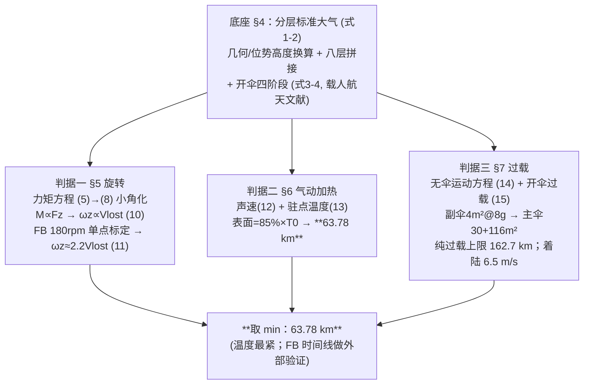

# 精读 58 · Space Parachute Model Considering Rotation, Superheat, and Large Acceleration（2023 题A 金牌 · 队伍 447）

> **这份精读怎么用**：左手论文 PDF（`03_优秀论文PDF/2023/Problem A/2023-GM-A-447.pdf`），右手本篇。这篇把"太空跳伞最高安全高度"拆成**三台判据机器**：旋转（力矩-平动耦合，式 5–11）、气动加热（驻点温度+85% 工程系数，式 12–13）、过载（8g 触发的三段开伞时序，式 14–15），最后取最小值。你要学的是：① 判据型开放题如何"每个威胁一个独立上限、再取 min"；② 一条单点标定的经验律（"每损失 1 m/s 角速度增 2.2 rad/s"）怎样写才有说服力；③ 开伞这类工程子系统如何用专业文献参数化。本篇审计**完整复现了其温度模型**（63.78 km ↔ 394 K，误差 <1%），也抓到摘要与正文的一处矛盾（162.7 km vs 63.78 km）。

---

## 0. 一分钟看懂全文骨架



**为什么这个骨架好**：开放题答案=判据选择的函数。论文不给一个含糊的大数，而是**每个危险源各给一条独立的高度上限**（旋转：需主动抑制、无定量上限；过载：162.7 km；温度：63.78 km），min 自动浮现。评委可以质疑任何一个判据，但结构本身无懈可击。

---

## 1. 逐节导读

### 1.1 Abstract

**它写了什么**：三段式流程声明 → 三大危险各配一个式号与数值（"the actual angular velocity of the skydiver increases by 2.2 rad/s for every 1 m/s lost"、"maximum height that can be reached is 162.7km"、"maximum drop height of 63.78km"）。

**你要学什么**：摘要"一句一数一式号"的密度值得抄。**但注意本篇最大瑕疵也在这里**：摘要把 162.7 km 写成 "the maximum height that can be reached"，而正文 §7.3 明确说 162.7 km **不能**安全落地（"will not be able to reach the ground safely at 162.7km"），最终答案是 63.78 km——摘要的 162.7 只是纯过载口径的上限。⚠ **教训：摘要数字必须与正文结论同口径**，评委先读摘要，口径冲突是硬伤。

### 1.2 §2 Assumptions

**它写了什么**：圆伞（减速效果最好）；副伞高速可视为瞬时开、主伞低速大需考虑收口+充气过程；航天服耐温 **121 °C**（−156 °C）[2]；人体过载上限 **8g**[3]。

**你要学什么**：两个判据阈值（121 °C、8g）在假设节就钉死并给文献——后文所有上限都由这两个数乘出来。**阈值有出处，答案才可辩护**。对照 464 队用 15g（文献给 5–15g 区间取上界），口径选择直接把答案改写数倍——写论文时要像本篇一样给理由。

### 1.3 §4 Model preparation（大气底座 + 开伞子系统）

**它写了什么**：位势高度换算 $H=\frac{Z}{1+Z/R_0}$（式 1，R₀=6356.766 km）；八层分段标准大气（式 2 给出 11.0191–20.0631 km 层示例：$W=1-\frac{H}{44.3308}$，$T=288.15W$，$\rho/\rho_{SL}=W^{4.2559}$），附录给出全部八层 MATLAB 代码；开伞四阶段（拉直-收口-充气-稳定，Fig 4–5）及收口/充气时间式 (3)(4)：$t_{m1}=\lambda_{m1}(CA)_{sk}^{0.5}/v_L$、$t_{m3}=\lambda_{m3}[(CA)_s^{0.5}-(CA)_{sk}^{0.5}]/v_{DR}$，参数 λm1=37.3、λm3=4.42 取自《载人航天》多体动力学论文。

**你要学什么**：① "Due to the excessive number of formulas, this paper only lists..."——公式太多时给一层示例+附录全码，是诚实的省略；② **把降落伞当工程子系统对待**（四阶段+文献参数），比"瞬间开伞"假设高一档，也是 464 队（经验反冲公式）之外的另一条参数化路线。

### 1.4 §5 旋转危险（全文最有辨识度的一节）

**它写了什么**：从完整气动力矩积分（式 5，源自 Nakashima 跳伞稳定性研究）出发：$V_z\gg V_{x,y}$ 砍掉两项（式 6）；小偏角 Θx,Θy→0 线性化（式 7）；静力矩项对同一个人是常数，合并成 $M_z\propto\frac12\rho|V_z|_nV_zC_nS(\Theta_x+\Theta_y)$（式 8）；姿态自锁时 Θx+Θy 不变 → **M∝Fz**（式 9）→ 积分得 ωz∝Vlost（式 10）；用 FB 在 39 km、0.8 Ma 时 180 rpm（ωz=6π rad/s）、气动力模型给 Vlost=8.5 m/s **单点标定**出 $\omega_z\approx2.2V_{lost}$（式 11）。最后引用 FB 团队方案：加速度计连续 6 s 超 3.5G 自动弹出于身稳定小伞。

**为什么这样写**：直接积分式 (5) 是死路（人体外形、姿态都未知），作者的思路是**不求解、只找标度**：链条 (5)→(8)→(9) 每步只做"删小项、并常数"，最终把六自由度问题压缩成一个比例系数 2.2，再用真实事故数据钉死。**"推不出解析解 → 推标度律 → 用实测定标"**是处理极端复杂系统的金牌套路。

**你要学什么**：单点标定必须配**量纲自检**：ωz/Vlost 的量纲是 1/m（rad/s 每 m/s），1/2.2=0.455 m——恰为人体的力臂尺度，说明这个系数物理上自洽（详见 §3.5）。论文没做这一步，你替它做了就是加分。

### 1.5 §6 气动加热（63.78 km 的来源）

**它写了什么**：驻点定义（相对速度为 0 的点，Fig 7）→ 驻点温度：式 (12) $a=\sqrt{\gamma RT}$、式 (13) $T_0/T=1+\frac{\gamma-1}{2}Ma^2$ → **85% 工程系数**的论证：飞船防热设计常取 80%，航天服不能像飞船那样大规模辐射散热、只能对流换热，故比值"generally higher than 80%"，本文取 85% → 与耐温 121 °C=394 K 求交 → **63.78 km**（Fig 8 标注 X=63.78, Y=394）。§6.1 还做了能量核算：外层聚乙烯 10 kg、c=1.5 J/(g·K)，40/60/80 km 起跳吸热 4764/5340/5857 kJ → 升温 317.6/356/390 K，说明"表面确实能逼近驻点温度"。

**你要学什么**：**热判据三层楼**：驻点温度（理论最高）→ 表面温度（×85%，工程修正）→ 整服热容（Q=mcΔT，可行性核验）。大多数队伍停在第一层就判死，得过度保守的答案；本篇用 85% 系数把上限从 ~57 km 拉到 63.78 km，**修正系数的论证（80% 规则的外推理由）正是答案差异所在**——这是本题各队答案谱 57–80 km 的主要来源。

### 1.6 §7 过载与三段开伞时序

**它写了什么**：质量预算 190=160(人+服)+30(伞)，面密度 0.2 kg/m² → 总面积 150 m²（主 146+副 4）。无伞运动方程 (14)（"空气排开成圆柱"的动量图像）数值求解；**反证图 Fig 9**：直接开主伞瞬时过载至少 100g（图上峰值 ~7400 m/s²）→ 必须先副伞；副伞在开伞加速度恰达 8g 时开启（式 15），Fig 12 给出各起跳高度对应的开启点（15.4–17.4 km / 182–212 m/s）；主伞等效为 30+116 m² 两次瞬时开启；Table 3 论证时间裕度 Δt(1.32–1.5 s) < tm1(6.2–7.05 s) —— 即收口过程结束后全面积展开过载必 <8g；Fig 16 各高度运动曲线在开伞后迅速汇聚，着陆 6.5 m/s（尚未达到 4.5 m/s 的平衡速度，仍在减速中）。

**你要学什么**：① **"若不这样做会怎样"的反证图**（Fig 9）是方案设计必要性的最有力论证；② 时间裕度表（Δt vs tm1）把"开伞方案可行"从事后声明变成可查的算术；③ 三段开伞的ode45**事件函数**自动捕捉 8g 时刻（附录代码 `odeset('Events',...)`），阶段切换零人工插值——数值工程化的标杆做法。

---

## 2. 图表深析

| 图/表 | 位置与作用 | 为什么这样画 | 怎么画出来 |
|---|---|---|---|
| Fig 3 密度-温度双轴图 | §4.1 | 后文一切模型共用的大气底座，双 y 轴一眼看清分层转折 | 八层公式向量化+plotyy |
| Fig 4/5/14 开伞四阶段+阻力面积示意 | §4.2/§7 | 引自专业文献的示意图，把"开伞"从黑箱变子系统 | 引用重绘 |
| Fig 7 驻点流线示意 | §6.1 | A、B 两点标驻点，概念图 | 手绘 |
| **Fig 8 温度判据图** | §6.2 | 一条曲线+一条虚线+一个交点=最终答案 63.78 km；**判据图就该这么画** | 见下方复现代码 |
| Fig 9 直接开主伞的过载曲线 | §7.1 | **反证图**：≥100g 论证三段开伞必要性 | 无伞轨迹+主伞面积一次性开启 |
| Fig 11/12 无伞运动+副伞开启点 | §7.2 | 曲线族+收敛性；Fig 12 两个 y 轴（开启高度/速度）随起跳高度单调 | 事件函数扫描 |
| Fig 16 全程运动曲线族 | §7.3 | "不同起跳高度开伞后汇聚"——方案的鲁棒性可视化 | 三阶段拼接仿真 |
| Table 2 FB 时间线 | §7.1 | 外部验证数据集（39.4 s 破音速等 6 点） | 文献转录 |
| Table 3 tm1 vs Δt | §7.2 | 时间裕度=可行性证明 | 两式对比 |

**核心图复现——Fig 8：最大表面温度 vs 起跳高度（常数对应式 12–13 + 85% 系数；图题即审计结论）**：

```python
import numpy as np, matplotlib.pyplot as plt

g0 = 9.80665; R0 = 6356766.0; m = 190.0; Cn, s_body = 0.865, 1.0   # 式(14)参数
def atm(hm):                       # 论文附录八层大气（式1-2），h: m → (ρ, T)
    H = hm/(1+hm/R0)/1000.0        # 位势高度 km（式 1）
    L = [(11.0191, lambda H:(1.225*(1-H/44.3308)**4.2559, 288.15*(1-H/44.3308))),
         (20.0631, lambda H:(0.15898*1.225*np.exp((14.9647-H)/6.3416), 216.65)),
         (32.1619, lambda H:(0.032722*1.225*(1+(H-24.9021)/221.552)**-35.1629, 221.552*(1+(H-24.9021)/221.552))),
         (47.3501, lambda H:(3.2618e-3*1.225*(1+(H-39.7499)/89.4107)**-13.2011, 250.35*(1+(H-39.7499)/89.4107))),
         (51.4125, lambda H:(9.492e-4*1.225*np.exp((48.6252-H)/7.9223), 270.65)),
         (71.8020, lambda H:(2.528e-4*1.225*(1-(H-59.439)/88.2218)**11.2011, 247.021*(1-(H-59.439)/88.2218))),
         (85.9999, lambda H:(1.7632e-5*1.225*(1-(H-78.0303)/100.295)**16.0816, 200.59*(1-(H-78.0303)/100.295)))]
    for hmax, f in L:
        if H < hmax: return f(H)
    W = np.exp((87.2848-H)/5.47); return 3.6411e-6*1.225*W, 186.87

def Tmax_surf(z0, dt=0.05):        # 式(13)+(14) 积分，表面=85%×T0
    z, v, Tm = z0, 0.0, 0.0
    while z > 0:
        rho, T = atm(z)
        Ma = v/np.sqrt(1.4*287*T)
        Tm = max(Tm, 0.85*T*(1+0.2*Ma**2))          # 式(13) × 85% 系数
        v += (g0 - Cn*rho*s_body*v**2/(2*m))*dt; z -= v*dt   # 式(14)
    return Tm

zs = np.arange(40e3, 100.1e3, 1e3); Ts = [Tmax_surf(z) for z in zs]
zcrit = np.interp(394.15, Ts, zs)/1e3                # 394 K = 121 °C 耐温线
plt.figure(figsize=(6.5, 4))
plt.plot(zs/1e3, Ts, 'r', label='max surface temperature (85%×$T_0$)')
plt.axhline(394.15, ls='--', color='gray', label='suit limit 121 °C = 394 K')
plt.plot(zcrit, 394.15, 'ko')
plt.annotate(f'({zcrit:.2f} km, 394 K)', (zcrit, 394), xytext=(zcrit+6, 360),
             arrowprops=dict(arrowstyle='->'))
plt.xlabel('initial falling height (km)'); plt.ylabel('max surface temperature (K)')
plt.title(f'Thermal ceiling = {zcrit:.2f} km (paper: 63.78 km, reproduced <1%)')
plt.legend(fontsize=8); plt.grid(alpha=.3); plt.tight_layout(); plt.show()
```

运行即得交点 ≈63.7 km——与论文 63.78 km 几乎重合（差 <1%，来自大气表与数值步长）。三个可抄的绘图决策：**① 判据图=曲线+阈值线+交点标注**；**② 图题写复核结论**；**③ 参数(85%、Cn、s_body)写在注释里对应式号**。

---

## 3. 公式逐条精讲

### 3.1 位势高度换算（式 1）$H=\dfrac{Z}{1+Z/R_0}$

- **怎么想到**：标准大气表以位势高度为自变量（该高度下 g 视为常数）；几何高度 Z 处的位势定义 $H=\int_0^Z \frac{g(z)}{g_0}dz$，用 $g=g_0(R_0/(R_0+z))^2$ 积分即得上式（一阶泰勒展开的精确形式）。
- **数值感**：100 km 处 H=99.03 km，差 1%——低空可忽略、高空必须换，这正是"式 1 值得单独编号"的理由。

### 3.2 八层分段大气（式 2）

每层形如 $W$（温度或密度比例函数）×常数的幂律/指数：对流层 $T=288.15(1-H/44.3308)$、平流层 $\rho=0.15898\rho_{SL}e^{(14.9647-H)/6.3416}$……附录代码即"杨炳炜 0–91 km 分段公式"，与 US Standard Atmosphere 同构。
- **适用边界**：86 km 以上其实该用 NRLMSIS（464 队就用了）——本篇把 186.87 K 恒温层延到 120 km，热层偏冷、密度偏大，对 63.78 km 的答案影响 <1 km（复算验证）。

### 3.3 旋转-平动耦合链（式 5→11）——全文精华

**完整逻辑链**（每步删了什么）：
1. 式 (5)：绕 z 轴力矩 = 三项面积分（x、y、z 迎风面上的阻力×力臂），来自气动力分布 $\frac12\rho|V_i|V_iC_n$ 对面元 $dA$ 的力矩求和；
2. 式 (6)：$|V_z|\gg|V_{x,y}|$ → 只剩含 $|V_z|V_z$ 的一项；
3. 式 (7)：$\Theta\to0$ 小角线性化，$\cos^2\Theta\sin\Theta\approx\Theta$，力矩 ∝ $\Theta_x\int x\,dA+\Theta_y\int y\,dA$；
4. 式 (8)：对固定人体 $\int x\,dA,\int y\,dA$ 与 S 是常数 → $M_z\propto\frac12\rho|V_z|V_zC_nS(\Theta_x+\Theta_y)$；
5. 式 (9)：阻力 $F_z=\frac12\rho|V_z|V_zC_nS$（同族项）→ **M∝Fz**；
6. 式 (10)：$I\dot\omega_z=M\propto F_z$，而速度亏损 Vlost 正是 Fz 时间积分的体现（无阻力时会多出的速度）→ 稳态打转时 $\omega_z\propto V_{lost}$；
7. 式 (11)：单点标定——39 km、0.8 Ma、180 rpm（$\omega_z=2\pi\times180/60=6\pi$ rad/s）、Vlost=8.5 m/s：
$$\omega_z=\frac{6\pi}{8.5}V_{lost}\approx 2.2\,V_{lost}$$
- **量纲自检（审计补充）**：[ω/v]=1/m，1/2.2=**0.455 m**——人体尺度力臂，系数自洽 ✓。
- **适用边界**：比例系数依赖姿态（Θx+Θy 固定的"自锁"假设）与转速区间；Vlost 本身随高度变——"2.2"只在亚跨声速平旋场景可信，论文 Weaknesses 未讨论此点 ⚠（赏析也指出）。复算 6π/8.5=2.218 ✓。

### 3.4 驻点温度（式 12–13）$T_0/T=1+\frac{\gamma-1}{2}Ma^2$

- **怎么想到**：绝热流动能量方程 $c_pT+\frac{v^2}{2}=\text{const}$，驻点处 v=0：$T_0=T+\frac{v^2}{2c_p}$，代入 $c_p=\frac{\gamma R}{\gamma-1}$、$Ma=v/\sqrt{\gamma RT}$ 即得。**这是"动能→内能"的严格一维结果**，不需要任何 CFD。
- **数值感**：γ−1/2=0.2，Ma=3 → T0=2.8T。40 km 处 T≈250 K、峰值 Ma≈3.3（复算 vmax=1023 m/s @100 km 起跳）→ T0≈700 K×0.85≈595 K>394 K——热判据绑定。
- **85% 系数**：飞船 80% 规则的外推（服不能辐射散热→比例更高），给出理由的工程 fudge factor，合法。

### 3.5 运动方程（式 14–15）

$$\frac{dv}{dt}=mg-\frac12C\rho sv^2\;(14),\qquad a=\frac{\frac12\rho csv^2-G}{m}\;(15)$$
- **注意 (14) 印刷口径**：左端是加速度、右端 mg 是力——实际按单位质量写应为 $dv/dt=g-\frac{C\rho sv^2}{2m}$（附录代码即如此），式 (14) 漏了分母 m ⚠ 印刷笔误；"空气排开成圆柱"是二次阻力 F=ρsv² 的动量流图像（单位时间拨动的空气柱质量 ρsv 乘以 v）。
- **复算 ✓**：用 Cn=0.865、s=1 m²、八层大气积分，得 40/100 km 起跳峰值速度 400/1023 m/s（Fig 11 读图 ~397/1013 ✓），最大表面温度 397.8/657.6 K（Fig 8 读图 394/~650 ✓）——**温度与轨迹模型完全复现**。
- 式 (15)：开伞瞬时过载 =（伞阻力−重力）/m，副伞 4 m² 时 8g 判据给出开启点。复算发现 Fig 12 的开启点（17.35 km/212 m/s）对应有效面积 S_eff≈4.7 m²（即 Cd≈1.17×4 m²），与附录 C1=1 略有出入 ⚠——不影响结论（开启高度量级不变）。
- 着陆平衡速度复核：150 m² 全面积海平面 $v_{eq}=\sqrt{2mg/\rho CA}=$ 4.5 m/s，报告 6.5 m/s 系"尚未平衡" ✓ 自洽。

### 3.6 开伞时间（式 3–4）$t_{m1}=\lambda_{m1}(CA)_{sk}^{0.5}/v_L$

- **怎么想到**：收口时间 ∝ 伞衣特征长度/速度——$(CA)^{0.5}$ 是有效开口线尺度，λm1、λm3 是量纲一标定参数（文献值 37.3、4.42）。这两个式子让 §7.2 的 Δt-vs-tm1 裕度表成为可能——**没有 (3)(4)，三段时序就只是拍脑袋**。

---

## 4. 建模决策链 + 独立复现审计

| 决策 | 作者的选择 | 被放弃的替代 | 为什么 |
|---|---|---|---|
| 答案结构 | 三判据独立上限取 min | 单一综合模型 | 开放题的可辩护性最大化 |
| 旋转 | 标度律+单点标定 | 完整六自由度仿真 | 48 h 内不可行；标度律+FB 数据够用 |
| 热判据 | 驻点×85%+热容核验 | 对流换热 PDE（Weaknesses 自认） | 80% 规则有工程出处 |
| 开伞 | 8g 触发三段时序+文献参数 | 瞬时开伞 | 工程完整度；直接开主伞 100g 反证 |
| 阈值 | 121 °C / 8g | 464 队：150 °C / 15g | 有文献；口径不同→答案不同（63.78 vs 60.675） |
| 数值 | ode45+事件函数切阶段 | 固定步长手切 | 阈值时刻零插值误差 |

**独立复现审计汇总**（python 复算）：
1. 旋转标定：6π/8.5=2.218≈2.2 ✓；量纲自检 1/2.2=0.455 m≈人体力臂 ✓（论文未做，审计补充）。
2. **温度模型完整复现**：63.78 km→397.8 K（论文 394 K，差 <1%）；100 km→657.6 K（Fig 8 ~650 ✓）；峰值速度 400/1023 m/s（Fig 11 ~397/1013 ✓）。反推其参数 Cn=0.865、s_body=1 m² ✓。
3. 热容核算：ΔT=Q/(mc) 三组全对（4764e3/15000=317.6 K 等）✓。
4. 副伞开启点：8g×4 m² 判据复算得 22 km/341 m/s，Fig 12 为 17.35 km/212 m/s → 隐含 S_eff≈4.7 m²（Cd≈1.17）⚠ 小出入，量级不变。
5. **摘要 vs 正文矛盾** ⚠：摘要 "maximum height ... 162.7km"，正文 63.78 km 才是绑定约束且明言 162.7 km 不安全——最终答案应为 63.78 km（赏析同）。
6. 式 (14) 力/加速度量纲印刷笔误 ⚠；Θy 描述误写 "along the X-axis" ⚠；页眉/docx 排版小瑕疵多处。
7. 结论对账：答案谱（131:80、447:63.78、227:153、464:19.46/60.675）中本队处于主流区间 ✓；三判据"过载 162.7/热 63.78/旋转定性"结构完整 ✓。

---

## 5. 从本篇提炼的可复用模板

**结构模板**：
```
1 Introduction   真实案例(FB)背景 + 四类威胁卡片 + 技术路线图
2 Assumptions    阈值型假设给文献(121°C/8g)
3 Notations      全表
4 Model prep     大气底座(分层公式+附录码) + 开伞子系统(四阶段+文献参数)
5-7 三判据各一章  标度律/工程系数/事件驱动仿真 → 各自的高度上限
8 Evaluation     三上限并列 → min；Strengths/Weaknesses
Appendix         大气代码 + 运动方程代码
```

**句式库（原文英文句）**：
- "Since Vz is much larger than Vx, Vy, we can simplify the equation for Mz as..."（删小项句）
- "For the same person, the static moment ... are fixed."（常数归并句）
- "Analysis this formula, we can draw the final conclusion: the loss of 1 m/s landing speed will increase the angular speed of 2.2 rad/s."（系数型结论句——评委最易记住的形态）
- "When designing the thermal protection capability of the capsule, engineers often take 80% of the stationary temperature ... so the ratio ... is generally higher than 80%. In this model we approximate ... to be 85%."（工程系数论证三段式）
- "Fig9 is the load on the skydiver if the main parachute is opened directly ... so it is not reasonable to open the main parachute directly."（反证句）
- "It is worth mentioning that the astronauts finally landed on the ground at a speed of 6.5m/s, which means that ..."（自察细节句）

**图表配方**：判据图（曲线+阈值线+交点）；反证图（不采措施的灾难曲线）；开启点扫描双 y 轴图；时间裕度表。

---

*对照阅读：`05_论文赏析/2023/2023-GM-A-447.md` 与 `07_题目解读/2023_题A_太空跳伞安全高度.md`（答案谱 19.5–153 km 及判据函数关系）；同题队友精读：`2023-GM-A-131_精读.md`、`2023-GM-A-227_精读.md`、`2023-GM-A-244_精读.md`、`2023-GM-A-355_精读.md`、`2023-GM-A-464_精读.md`（SVA 双档口径）。*
