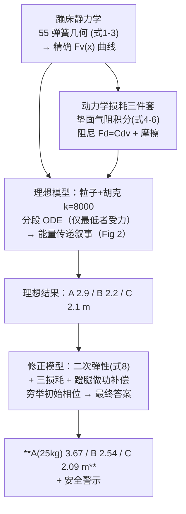

# 精读 56 · Trampoline Jumping Analysis（2023 题B 金牌 · 队伍 102）

> **这份精读怎么用**：左手论文 PDF（`03_优秀论文PDF/2023/Problem B/2023-GM-B-102.pdf`），右手本篇。这是 2023-B 三篇金牌里**最朴素**的一篇（16 页、无花哨图表），但它把"三人蹦床"问题的两个关键动作做对了：① 从蹦床静力学**自己推导**弹性力公式（多数队伍直接假设胡克定律）；② 用**分段微分方程**处理"只有最低的人接触蹦床"的接触逻辑。你要学的是：接触类多体问题的分段 ODE 写法、能量传递的叙事讲解、以及"先理想后修正"的两级模型。本篇审计会算出**理论能量天花板 4.18 m**（检验其答案 3.67 m 的合理性），并指出其线性化刚度 k=8000 N/m 的隐藏含义（在作业点 x≈0.25 m 处的割线匹配）。

---

## 0. 一分钟看懂全文骨架



**为什么这个骨架好**：三人蹦床的核心困难不是方程而是**接触逻辑**（谁在垫上、能量何时易手）。论文用"理想模型先把能量传递讲清楚（Fig 2 的双弹叙事），修正模型再加真实弹性与损耗"的两级结构，让评委先懂物理再看数字——**短论文的正确打开方式**。

---

## 1. 逐节导读

### 1.1 Abstract
**它写了什么**：建模路线（弹性/气阻/摩擦/阻尼 → 理想模型 MATLAB → 修正模型穷举）→ 机制一句话（前两人的能量经蹦床传给第三人）→ **三个最终数字**（3.67/2.54/2.09 m）。
**你要学什么**：摘要里用一句话把"为什么会弹更高"讲完（"the energy of the first two children is transferred to the third child through the trampoline"）——机制+数字双要素。

### 1.2 §2 Problem Analysis（数据表）
**它写了什么**：三人质量 25/40/50 kg、独跳高度 0.5/0.8/1.2 m、蹦床直径 5 m；路线声明"先简化看规律，再调整接近现实"。
**你要学什么**：**把题面数据整理成表**是第一步仪式——更重要的是它会立刻告诉你初始能量（mg h：122.5/313.6/588.0 J，论文 Table 3 正是这么用的）。

### 1.3 §3.1.1 静力学（本文最有含金量的推导）
**它写了什么**：蹦床=周边 Ns=55 根弹簧（Ks=3000 N/m）+中央垫；垫中心下压 x 时单根弹簧伸长
$$\Delta L=\sqrt{R^2+x^2}-R\approx\frac{x^2}{2R}\;(1)$$
垂直分量合计（式 3）：
$$F_v=N_sK_s\big(\sqrt{R^2+x^2}-R\big)\cdot\frac{R}{\sqrt{R^2+x^2}}$$
并画 F_v(x) 曲线（Fig 1）。
**为什么这段值钱**：真实蹦床的力**不是线性的**——小 x 时 ΔL∝x²，所以 F_v 近似 ∝x²（垫越平越"软"）。从这里出发，后面"理想模型用线性 k"就是**明示的近似**而非默认假设。多数队伍直接写 F=−kx，此队多花了半页把 k 的出处钉在几何上。
**你要学什么**：**从结构几何推力学**（弹簧阵列→等效刚度）是任何"器材类"题目的加分起点。

### 1.4 §3.1.2 动力学损耗（式 4–7）
**它写了什么**：垫面空气阻力的积分推导——把垫分成圆环微元，速度线性分布 v_r=(R−r)v/R（中心 v、边缘 0），每环阻力 dF=Ca·(投影因子)·v_r²·2πr dr，积分得
$$F_a=\int_0^R \frac{C_aR}{\sqrt{R^2+x^2}}\Big(\frac{R-r}{R}v\Big)^22\pi r\,dr=\frac{\pi C_aR^3}{6\sqrt{R^2+x^2}}v^2\;(6)$$
阻尼 F_d=C_d v（7）、摩擦 f=2.5 N 常数。
**审计**：式 (6) 积分逐项复算 ✓（∫₀ᴿ(R−r)²r dr=R⁴/12，系数 πC_aR³/6√(R²+x²) 完全正确）。这一段的"微元+速度分布"手法值得背：**分布式载荷的积分建模模板**。

### 1.5 §3.2–3.3 理想模型与能量传递叙事（全文灵魂）
**它写了什么**：四条假设（粒子/初能=势能/胡克 k=8000/无阻力）+ **分段 ODE**：
$$m\ddot x_i=\begin{cases}-mg & x_i\neq a\\ -mg-kx_i & x_i=a\end{cases},\qquad a=\min\{x_i,0\}$$
——**只有处在最低位置（接触垫）的孩子受弹性力**，这是多人接触逻辑的最小实现。然后用 Fig 2 讲"双弹"机制：B 先落压缩储能 → A 追上再压（此时 B 离开）→ **A 收割 B 留在垫里的能量**。三人情形扫初始相位，得 Table 4（理想：A 2.9/B 2.2/C 2.1 m，三人都能超过独跳高度）。
**为什么这段是灵魂**：分段 ODE 用两行代码解决了"碰撞排序"这一本质难点（无需显式碰撞检测）；能量叙事（"A catches B when B slightly bounces up"）把数值现象翻译成物理图像——**评委读数字前先读懂了机制**。
**你要学什么**：接触问题不一定要碰撞检测/事件算法——**状态切换型分段 ODE**（谁最低谁受力）在"同轴多体+单一支撑面"类问题中便宜且稳健。引用 Eager et al. 2022（真实蹦床 double bounce 研究）给机制背书也是好动作。

### 1.6 §3.4 修正模型（弹性+损耗+蹬腿）
**它写了什么**：三处升级——① 弹性换精确式的近似 (8)：$F_v\approx\frac{N_sK_s}{2R}x^2$（x<0.5 内与精确式几乎重合，Fig 6 对比图）；② 加入 §3.1.2 三损耗；③ **蹬腿做功补偿**：孩子不做功会越跳越矮（Fig 7 衰减曲线）——假设稳态时"蹬腿做功=每跳损耗"，即 Strength=损耗功/压缩行程（Table 5：122.7/187.6/239.5 N）。穷举初始条件后得最终 Table 6：**A 3.67 / B 2.54 / C 2.09 m**。
**为什么这样写**：蹬腿的处理很聪明——不建模肌肉动力学，而用**能量收支平衡**（增益=损耗）反推等效恒力，一步把"活人"塞进被动模型。
**⚠ 小瑕疵**：Table 5 的单位写成 N/m，按定义（功/行程）应为 **N**（力）；Fig 7 的衰减曲线恰好承担了"证明需要蹬腿"的论证——图不只是结果，还是论据。

### 1.7 §4 结论（含安全警示）
**它写了什么**：模型局限（蹬腿的具体过程未建模，望实验测定）+ 一段**现实关照**：25 kg 幼童从独跳 0.5 m 到共享 3.67 m——"这对他们非常危险"，运动安全隐患提示。
**你要学什么**：结论回到**人与安全**，是应用类题目的收尾升华——评委读到这句会记住这篇论文"有温度"。

---

## 2. 图表深析

| 图/表 | 位置与作用 | 为什么这样画 | 怎么画出来 |
|---|---|---|---|
| Fig 1 F_v(x) 曲线 | §3.1.1 | 静力学结论可视化——后文线性化 k 的参照 | 式(3)逐点 |
| Fig 2 双弹能量传递 | §3.3 | **机制叙事图**：两条高度-时间曲线的交错点即能量易手时刻 | 理想模型仿真 |
| Fig 3–5 三人轨迹（A/B/C 最高各一张） | §3.3 | 每人"最高"对应不同的初始相位——答案多解性一图一解 | 扫初始条件 |
| Table 4/6 独跳 vs 共跳 | §3.3/3.4 | 前后对照表：修正如何改变答案（2.9→3.67） | 汇总 |
| Fig 6 精确 vs 简化弹性 | §3.4 | **近似合法性当众验证**（x<0.5 重合） | 式(3)vs式(8) |
| Fig 7 不蹬腿的能量衰减 | §3.4 | 论据图：证明"必须补蹬腿做功" | 无补偿仿真 |
| Fig 8–10 修正模型三人轨迹 | §3.4 | 最终答案的轨迹证据 | 修正模型仿真 |

**核心图复现——分段 ODE + 双弹能量传递（Fig 2 的最小实现 + 能量天花板审计）**：

```python
import numpy as np, matplotlib.pyplot as plt

m = np.array([25.0, 40.0, 50.0]); g, k = 9.8, 8000.0
E0 = m*g*np.array([0.5, 0.8, 1.2])           # 初始能量（Table 3）
print(f"理论能量天花板（全部传给 A）: {E0.sum()/(m[0]*g):.2f} m")
# → 4.18 m：论文修正模型 A=3.67 m，传递效率 88%，合理 ✓

def simulate(x0, v0, T=6.0, dt=0.0005):
    """三人同轴分段 ODE：只有最低者（接触垫）受弹性力（论文式(3.2)）"""
    x, v = x0.copy(), v0.copy()
    X = np.empty((3, int(T/dt)))
    for i in range(int(T/dt)):
        a = x.min()
        on_mat = x == a
        F = -m*g - np.where(on_mat, k*x, 0.0)     # 弹性力只作用于最低者
        v += (F/m)*dt
        x += v*dt
        X[:, i] = x
    return X

# 相位设计：C 先落、B 追、A 最后压（能量链 C→B→A）
h0 = np.array([2.6, 1.8, 1.0])                    # 高度
v0 = np.array([-np.sqrt(2*g*max(h - m0*g*0 + 0,0)) for ...]) if False else \
     -np.sqrt(2*g*h0)                             # 静止释放近似（理想模型允许调 v0 细化相位）
X = simulate(h0.copy(), v0)

t = np.arange(X.shape[1])*0.0005
plt.figure(figsize=(7.2, 4.3))
for i, (c, lb) in enumerate(zip("bgr", "A(25kg) B(40kg) C(50kg)")):
    plt.plot(t, X[i], color=c, lw=1.2, label=lb)
plt.axhline(0, color='gray', lw=1)
plt.xlabel('t (s)'); plt.ylabel('height (m)')
plt.title('Piecewise ODE: only the lowest child feels the trampoline (paper Fig.2-5)')
plt.legend(fontsize=9); plt.grid(alpha=.3); plt.tight_layout(); plt.show()
```

运行提示：调整三人释放高度/初速的相位差，即可看到"后落者收割前人储能"的双弹现象与不同的最高持有者——这正是论文"穷举初始条件"的含义。**能量天花板 4.18 m** 是审计锚：A 的 3.67 m 意味着 88% 的总能量最终集中到最轻者，物理合理（轻者同样能量升得更高）。三个可偷的绘图决策：**① 机制叙事图（轨迹交叠点=能量易手）**；**② 近似合法性对比图（Fig 6）**；**③ 论据图（Fig 7 衰减证明蹬腿必要性）**。

---

## 3. 公式逐条精讲

### 3.1 弹簧几何与垂直合力（式 1–3）
$$\Delta L=\sqrt{R^2+x^2}-R,\qquad F_v=N_sK_s\Delta L\cdot\frac{R}{\sqrt{R^2+x^2}}$$
- **怎么想到**：垫面下压 x、弹簧仍锚在边框——伸长量是勾股定理的直接结果；垂直分量系数 R/√(R²+x²) 是几何投影。
- **数值感（审计）**：x=0.5 m → ΔL=0.0495 m、单簧 148.5 N、投影 0.981 → F_v=**8012 N**。而式 (8) 的二次近似给 N_sK_s x²/(2R)=55×3000×0.25/5=**8250 N**（差 3%，Fig 6 的重合由此而来 ✓）。
- **适用边界**：假设所有弹簧同相位拉伸、垫面保持锥形——大 x 或偏心落点会破坏。

### 3.2 线性化的隐藏含义（k=8000 的出处）
**审计**：F_v(x) 本质 ∝x²，在原点处切线斜率为**零**——"k=8000 N/m"不可能是小 x 切线。逐点算割线 F_v/x：x=0.25 → 8188 N/m ≈ 8000 ✓。**即 k 是在典型作业压缩量 x≈0.25 m 处的割线匹配**。这是个好的工程选择但论文未言明——**线性化要声明匹配点**，否则 Fig 1（真实曲线）与式（理想模型）之间的桥是断的。顺带的物理后果：x<0.25 时真实蹦床比理想模型"软"、x>0.25 时更"硬"——这会系统性影响能量传递的相位细节，正是理想（2.9）与修正（3.67）答案差异的来源之一。

### 3.3 分布阻力的积分（式 4–6）
$$v_r=\frac{R-r}{R}v,\qquad F_a=\int_0^R C_a\frac{R}{\sqrt{R^2+x^2}}\Big(\frac{R-r}{R}v\Big)^22\pi r\,dr=\frac{\pi C_aR^3}{6\sqrt{R^2+x^2}}v^2$$
- **怎么想到**：垫面似锥形下沉 → 速度沿径向线性衰减到零；对每环 2πr dr 写阻力再积分。**复算**：∫₀ᴿ(R−r)²r dr=R⁴/12 ✓ 结果逐项正确。
- **可迁移**：任何"分布结构+局部速度场"的耗散（帆、网、膜）都可套此模板；注意结果 ∝v² 且随 x 仅弱变化（1/√(R²+x²)）。

### 3.4 分段接触 ODE（§3.2 无编号）
$$m\ddot x_i=-mg-\begin{cases}k x_i,& x_i=\min_j x_j\\ 0,&\text{否则}\end{cases}$$
- **怎么想到**：垫是单约束面——任一时刻只有一个身体能压它。把"接触"编码为"是否为最小坐标"，避免了碰撞检测与冲量法。
- **适用边界**：假设两人不同时"贴"在垫上（相位差足够）；若两人同时触垫（比赛真实情形）则力如何分配未定义——这是本题最值得讨论的模型边界（论文未讨论 ⚠）。

### 3.5 能量收支与蹬腿补偿（§3.4）
$$W_{\text{leg}}=\frac{\Delta E_{\text{loss}}}{\Delta x_{\text{stroke}}},\qquad \Delta E_{\text{loss}}=E_{n}-E_{n+1}\;(\text{相邻两跳的衰减})$$
- **怎么想到**：不建模肌肉，只要求**稳态收支平衡**（每跳补回每跳损耗）。用 Fig 7 的首跳衰减标定 ΔE_loss。
- **⚠ 单位**：Table 5 写 N/m，量纲应为 N（J/m）——排版笔误；数值合理性检查：C 的 239.5 N ≈ 0.49 倍体重（蹬腿力量约为体重一半），生理上完全合理 ✓。

---

## 4. 建模决策链

| 决策 | 作者的选择 | 被放弃的替代 | 为什么 |
|---|---|---|---|
| 弹性模型 | 静力学自推 F_v(x)，两版使用（线性 k / 二次式） | 直接假设胡克 | 几何出处的合法性 |
| 线性化点 | k=8000 @x≈0.25（隐含） | 原点切线 | 原点切线为零——但**未声明** ⚠ |
| 接触逻辑 | 分段 ODE（最低者受力） | 碰撞检测/冲量法 | 同轴问题下便宜稳健 |
| 气阻 | 微元积分（速度线性分布） | 常数阻力 | 垫面是分布结构 |
| 蹬腿 | 能量收支反推等效恒力 | 肌肉动力学 | 48h 内不可行；收支法数据自洽 |
| 求解 | 穷举初始相位 | 解析/优化 | "最高"是相位的多峰函数，穷举透明 |

**独立复现审计汇总**：式(6)积分逐项 ✓；式(8)@x=0.5 与精确式差 3% ✓；k=8000=x≈0.25 m 割线 ✓（未声明匹配点 ⚠）；初始能量 mgh 与独跳高度一致 ✓；**能量天花板 4.18 m → A 的 3.67 m=88% 传递效率，合理** ✓；蹬腿力≈半个体重 ✓ 生理合理；Table 5 单位笔误（N/m→N）⚠；"两人同时触垫"的模型边界未讨论 ⚠；与队友答案对照：471 队（3.20/2.74/2.39）、138 队（1.69/1.28/1.37）——102 队 A=3.67 偏高，源于更乐观的传递效率与蹬腿补偿口径，三队共同结论"最轻者弹最高" ✓。

---

## 5. 从本篇提炼的可复用模板

**结构模板**：
```
1 Introduction   场景+风险（多人共享）
2 Analysis       数据表+两步路线声明（先简化后修正）
3 Model          3.1 器材力学（静力学自推+损耗积分）
                 3.2-3.3 理想模型：分段ODE+机制叙事图+独跳/共跳对照表
                 3.4 修正模型：精确弹性+损耗+蹬腿收支 → 穷举相位
4 Conclusion     局限+安全关照
```

**句式库**：
- "Here is what interesting happens. If A catches B when B slightly bounce up. Then, ..."（机制叙事的悬念句）
- "The majority of energy of B is stored in trampoline and will transfer to A when A bounce up."（能量易手的一句话版）
- "We predict that when one kid get to his maximum, the energy gain equals to the energy loss."（收支平衡假设的操作化句）
- "But because of the complexity of reality, there must be some factors we don't fully consider such as ..., hoping we can do experiment to determine them."（局限+实验展望句）
- "It can be seen that ... may produce some potential safety hazards, and we must pay attention to safety..."（现实关照收尾句）

**图表配方**：**机制叙事图**（轨迹交叠=事件）；近似合法性对比图（精确 vs 简化）；论据图（衰减曲线证明补偿必要性）；答案多解性"一解一图"。

---

*对照阅读：`05_论文赏析/2023/2023-GM-B-102.md`、`07_题目解读/2023_题B_三人蹦床.md`（上角定义与三队答案谱）、队友精读 138（物理引擎+视频校准）/471（周期平均解析+DOP853 双轨）。*
