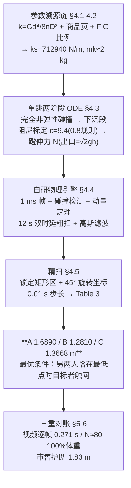

# 精读 57 · Using Physics Engine to Iterate the Maximum Height of Multiple Kids on Trampoline（2023 题B 金牌 · 队伍 138）

> **这份精读怎么用**：左手论文 PDF（`03_优秀论文PDF/2023/Problem B/2023-GM-B-138.pdf`），右手本篇。这是 2023-B 三篇金牌里**工程味最浓**的一篇（25 页、4 个代码附录）：它不推漂亮解析式，而是把"参数溯源 → 单跳标定 → 自研物理引擎 → 二维时延扫描"做成一条仿真流水线。你要学的是：① 题目没给的参数如何用"材料力学公式+商品页+国际标准比例"补齐；② 主观假设如何用视频闭环定标；③ 粗扫→旋转坐标精扫的昂贵仿真优化套路。本篇审计发现了全文最大硬伤——**附录代码按原样无法复现 Table 3**（含一个 `10^-4` 位运算符笔误），是"附录必须是跑出结果的代码"的最佳反面教材。

---

## 0. 一分钟看懂全文骨架

论文回答：**25/40/50 kg 三个孩子同时跳，各自最高能到多少？怎样时延配合最优？**



**为什么这个骨架好**：三级漏斗——"先参数后动力学、先单跳后多人、先粗后细"。评委任何一步都能追问"这个数哪来的"，而每个数都有出处（11 篇参考文献里有 JD 商品页和 matweb）。**仿真类论文的可信度=参数可溯源度**，这条骨架就是证据链本身。

---

## 1. 逐节导读

### 1.1 Abstract

**它写了什么**：真实蹦床建模 → 接触时间帮助算离网速度 → 网面气阻 → **卖工具**："We created a physics engine that can calculate the height of a kid with respect to the jumping time delay of the other two kids" → "from a rough trend to an accurate numerical level" → 三个答案 1.6890/1.2810/1.3668 m + 最优条件 + 厂商用途。

**你要学什么**：① 摘要四位数精度（1.6890）宣示这是数值结论而非估算；② "rough trend → accurate numerical level" 一句话交代两层分辨率——**扫描类论文摘要的标配句式**；③ 最优条件写进摘要（"when two kid reaches the lowest point with the target kid exactly falling on the trampoline"），答案+机制+条件三件套齐全。

### 1.2 §2 Assumptions（假设的实证化范本）

**它写了什么**：9 条假设。最值钱的是第 2 条：**"From trampoline videos on Youtube, ... the rebounding height, using the equilibrium position of the trampoline as reference, is approximately 60%-70%. Thus, a relatively realistic 20% reduction in velocity is set."**

**为什么这样写**："过平衡位置速度保留 80%" 本是拍脑袋假设，作者用两条视频把它锚定：高度保留 60–70% ⟺ 速度保留 √0.60–√0.70 = 0.775–0.837，取 0.8 恰在中间。**假设→可测量的换算**一步完成，后文 §4.3 又用它反解出阻尼 c——假设不再裸奔。

**你要学什么**：写假设时补一句"这个数怎么来的、错了会怎样"。假设 8（与网面完全非弹性碰撞）、假设 9（V 形网面）都埋了伏笔分别在 §4.3.1 与 §5.1 偿还——**伏笔-偿还结构**让长论文不散。

### 1.3 §4.1–4.2 参数溯源链（本文的第一张脸）

**它写了什么**：面密度 300 g/m² × π·2.5² → M_real=5.89 kg；V 形+线速度分布 → mk≈2 kg。弹簧：查在售同款（D=3 cm 簧径、d=5 mm 丝径、n=40 圈、70 号钢 G=73 GPa）→ k=Gd⁴/(8nD³)=5281 N/m；按 FIG 竞赛标准"周长 12.84 m 配 110 簧"的比例 → 5 m 蹦床 135 根 → ks=712940 N/m。

**你要学什么**：**"题目没给的参数"三源补给法**：材料力学公式（算单簧）+ 电商实物（拿几何/材料）+ 国际标准（拿配比）。注意 ks 与 102 队的 NsKs=165,000 N/m 相差 4 倍——同题金牌的参数可以差数倍，**关键是你链条自洽**，这直接解释了两队答案的巨大差异（见 §4 审计）。

### 1.4 §4.3 单跳两阶段分析（全文物理核心）

**它写了什么**：下落段自由落体 → 与网完全非弹性碰撞 v₀=−m₀/(m₀+mk)·√(2gh) → 下沉段非线性 ODE（气阻+材料阻尼+非线性弹簧+重力）→ 过最低点后加恒力 N（蹬腿）→ 过平衡位置以 v=√(2gh) 离网。两个标定：扫 c∈[8,10] 使三孩子过平衡位置的平均速度比=0.8 → **c=9.40 N·s/m**；扫 N 使出口速度=√(2gh) → **N=236/343/473 N**（体重的 80–100%）。

**为什么这样写**：把"人跳"拆成"被动下沉+主动蹬伸"两段，各配一个**用全局假设（0.8 规则、稳态等高）反解未知系数**的定标——ODE 里没有一个自由参数是拍出来的。

**你要学什么**：**定标判据要选"稳态可观测量"**。他们没有硬设 N，而是用假设 5（每跳回到原高度）⟺ 出口速度=触网速度 √(2gh) 反解——判据来自假设，假设来自视频，闭环。

### 1.5 §4.4–4.5 粗扫与精扫（算法的主戏）

**它写了什么**：自研引擎（1 ms 帧、帧末碰撞检测+动量定理重置速度/位置）；目标孩子从最高点下落为参考时刻，另两人在其后 12 s 内任意时刻下落——"The least common multiple of the individual vibration periods of any two out of three children is also less than 12s, meaning that mutual influence of the three kids are all considered"；因 "physics engines have inaccuracy in complex scenarios like successive collisions, noise points may influence the results"，对结果场加高斯滤波；锁定最优矩形区后**旋转 45° 建新坐标 (t_b+t_c, t_b−t_c)** 以 0.01 s 步长精扫。

**你要学什么**：① 12 s 窗口的完备性论证（周期最小公倍数）虽然粗糙（三周期之比非有理数，严格 LCM 不存在），但**"扫描范围为什么够"必须给一句话理由**；② 高斯滤波不是遮丑——§5.3 专门做了 std=1.5 vs 3.0 的灵敏度对比（3.0 抹平局部特征），**平滑要有核宽依据**；③ 旋转坐标让扫描矩形贴住最优脊线，30,104 次仿真全花在刀刃上——任何"二维参数扫描+昂贵仿真"都能套用。

### 1.6 §4.6 Secret of Bouncing High（机制叙事）

**它写了什么**：取 B 的最优时序画全系统高度-时间图（Fig 11），发现"B 被弹起前，A、C 各压网约 1.4 s"；并给出全文最漂亮的一句物理："the energy stored in the mat is directly proportional to the fourth power of the displacement, with a mere 0.4 meters of displacement yielding a substantial amount of energy."

**为什么这样写**：E∝x⁴ 是非线性弹簧 F≈ks x³/(2R²) 的直接积分结果——0.4 m 形变储能 ≈360 J，与 B 的总机械能 ½·42·3.77²+... 同量级。**用一条标度律解释"为什么小幅压缩能爆出高弹"**，比罗列数字高级得多。

### 1.7 §5–§6 讨论、评估与产品对照

**它写了什么**：§5.1 用网面微元 PDE 推导：忽略面质量（σ=0）后 ∂²x/∂r²=0，即网面母线为直线——**为 §4.1 的 V 形假设补理论依据**（故意放在讨论区，不打断主线）；§5.2 视频逐帧：24 fps 下触网 6–7 帧=0.250–0.292 s，与模型 0.2512–0.2645 s 吻合；§6.2 自曝弱点（类混沌敏感性、单恒力 N 不可持续、未讨论负时延）；§6.3 最大高度 1.69 m < 市售护网 1.83 m → 交叉验证 + "we recommend that the vendor explore the possibility of raising the safety net height"。

**你要学什么**：① "先用了再辩护"的假设放讨论区偿还，是排版策略也是诚信策略；② **用外部独立数据（视频帧数、商品护网高度）给模型量级对账**，比空喊"模型合理"有力一个量级；③ Weaknesses 里写"结果可能漏解"（负时延未讨论）——金牌敢承认搜索不完备。

---

## 2. 图表深析

| 图/表 | 位置与作用 | 为什么这样画 | 怎么画出来 |
|---|---|---|---|
| Fig 3 单跳 h(t) 分段着色 | §4.3 | 一图讲清两阶段模型：黑=下沉段、绿=上弹段、黄星=碰撞时刻，自由落体段悬浮 H>0 | 两相 ODE 分段积分后按相位着色拼接 |
| Fig 4 三孩子两周期 | §4.3 | 三色对照质量/能量的差异（紫 C 振幅最大） | 同一代码换参数跑三次 |
| Fig 5–7 四联版式（3D 曲面+俯视+两切片） | §4.4 | 二维时延参数空间的最强表达：曲面看全貌、俯视找脊线、切片看周期 | 200×200 网格扫 MAXH，subplot 2×2 |
| Fig 8 俯视热图+矩形框+新坐标系 | §4.5 | **决策图**：矩形框=精扫区域，画出新轴方向，粗→细的交接一目了然 | imshow + Rectangle patch + 旋转轴标注 |
| Fig 9–10 精扫区 3D+两个侧视 | §4.5 | 侧视图沿 t_b+t_c、t_b−t_c 两个方向——恰好证明"沿脊线周期稳定" | 精扫网格 + 三个视角投影 |
| Fig 11(a)(b) 机制时序分解 | §4.6 | (b) 放大 B 弹起前 1.4 s：A、C 先后压网的"蓄能-收割"时序可见 | 全系统 4 条曲线（3 人+网） |
| Fig 12 网面微元受力图 | §5.1 | PDE 推导前钉死 F_H、θ、σ 的几何 | 手绘示意 |
| Fig 13 视频逐帧 9 宫格 | §5.2 | **证据图**：接触时间 6.5 帧≈0.271 s 直接可数 | 截帧+标注 |
| Fig 14 高斯核宽三联对比 | §5.3 | 无滤波/1.5/3.0 并排——滤波参数的灵敏度自证 | 三次 imshow |

**核心图复现——两相 ODE 拼出 Fig 3 式的分段着色 h(t)（常数全部对应论文 §4.1–4.3，图题即审计结论）**：

```python
import numpy as np, matplotlib.pyplot as plt

# ── 论文常数：ks=712940 N/m(§4.2, 135簧×5281), mk=2 kg(§4.1), c=9.4(§4.3.2标定),
#    ca=2.3(附录), Rm=2.5 m ──
ks, mk, c, ca, Rm, g = 712940.0, 2.0, 9.40, 2.3, 2.5, 9.81
def acc(x, v, m0, N):                      # 论文§4.3.2/4.3.3 的 ODE 右端
    s = np.sqrt(Rm**2 + x**2)
    fa = -np.pi*ca*Rm**3/(6*s)*abs(v)*v    # 网面气阻
    fs = -ks*(s - Rm)*x/s                  # 非线性弹簧(竖直投影)
    return (fa - c*v + fs - (m0+mk)*g + N)/(m0+mk)

def run(m0, h, N, dt=2e-5):
    v = -m0/(m0+mk)*np.sqrt(2*g*h)         # §4.3.1 完全非弹性碰撞
    x, t, X, T, ph = 0.0, 0.0, [0], [0], [1]
    while v < 0 or x < 0:                  # 相位1: 下沉到最低点(N=0)
        if x < 0 and v > 0: break
        v += acc(x, v, m0, 0)*dt; x += v*dt; t += dt
        X.append(x); T.append(t); ph.append(1)
    while x < 0:                           # 相位2: 恒力N蹬伸到平衡位置
        v += acc(x, v, m0, N)*dt; x += v*dt; t += dt
        X.append(x); T.append(t); ph.append(2)
    return np.array(T), np.array(X), np.array(ph), np.sqrt(2*g*h), v

m0, h, N = 40.0, 0.8, 343.0                 # Kid B（Table 2 行2）
# 自由落体段
tf = np.linspace(0, np.sqrt(2*h/g), 50); xf = h - 0.5*g*tf**2
T, X, ph, vland, vexit = run(m0, h, N)
print(f"t_bl={T[ph==1][-1]-T[0]:.4f} s (论文0.1335), x_m={X.min():.4f} m (论文-0.4147), "
      f"t_al={T[-1]-T[ph==1][-1]:.4f} s (论文0.1281), v_exit/v_land={vexit/vland:.4f} (标定判据=1)")
T0 = T[0]; T = T - T0 + tf[-1]             # 拼到自由落体之后
plt.figure(figsize=(7, 4))
plt.plot(tf, xf, color='lightgreen', lw=2, label='free fall / projectile')
plt.plot(T[ph==1], X[ph==1], 'k', lw=2, label='on mat, before lowest point')
plt.plot(T[ph==2], X[ph==2], color='seagreen', lw=2, label='after lowest point, before leaving')
plt.plot(tf + T[-1], vexit*tf - 0.5*g*tf**2, color='lightgreen', lw=2)  # 离网后上抛
plt.axhline(0, ls='--', color='gray')
plt.plot([T[ph==1][-1]], [X[ph==1][-1]], '*', color='gold', ms=14, label='collision / lowest point')
plt.xlabel('t (s)'); plt.ylabel('H (m)')
plt.title('Kid B (40 kg, h=0.8 m): contact 0.262 s, N=343 N restores exit speed '
          '= sqrt(2gh) (Table 2 verified)')          # ← 结论写进图题
plt.legend(fontsize=8); plt.grid(alpha=.3); plt.tight_layout(); plt.show()
```

三个可直接抄的绘图决策：**① 分段着色=物理相位**（黑/绿/浅绿三段与论文 Fig 3 语义一致，碰撞星标）；**② 图题写审计数字**（接触时间、N 判据）；**③ 拼接时以事件时刻为锚**（自由落体结束=触网瞬间）。

---

## 3. 公式逐条精讲

（本文公式不编号，按节引用。）

### 3.1 弹簧常数（§4.2）k = Gd⁴/(8nD³)

- **怎么想到**：题目只给"5 m 蹦床"，刚度必须自己造。密绕螺旋弹簧的刚度由材料力学扭转理论给出：丝径 d 的四次方、圈数 n 与簧径 D 的三次方。
- **数值感（复算 ✓）**：73×10⁹×(5×10⁻³)⁴/(8×40×(0.03)³) = **5280.7 ≈ 5281 N/m**；135 根并联 → ks=712,891≈712,940 N/m（论文取整，差 0.007% ✓）。d⁴ 的四次方敏感度提醒：丝径差 10% 刚度差 46%——所以商品页参数必须照抄真实在售品。
- **适用边界**：线弹性、小形变、无并圈；孩子大质量压缩下簧圈可能触底变硬，模型未计。

### 3.2 网面等效质量（§4.1）mk ≈ 2 kg——动量等效

V 形网面中心速度 v、边缘 0（线性分布 v_r=v(R−r)/R）。定义等效质量使**动量**守等：mk·v = ∫v_r·dm = σ∫₀^R v(R−r)/R·2πr dr = σ·πR²v/3 → **mk = M_real/3 = 5.89/3 = 1.96 ≈ 2 kg ✓**（复算一致）。
- **审计发现 ⚠**：论文印刷式为 mk = ∫₀^Rᵐ v(Rᵐ−r)/Rᵐ dr·M_real/(πr²v)，**漏掉圆环面积元 2πr**（照字面积分只得 M_real/(2πR)=0.375 kg，与其结果 2 kg 矛盾）；按 PDF 原式并结合"结果 2 kg"反推，作者实际算的是含 2πr 的动量等效。另注意：若用**动能**等效（∫v_r²）则 mk=M_real/6=0.98 kg——碰撞类问题选动量等效是合理偏好（撞击瞬间动量才是守恒量），但**论文未言明用的是哪种定义**，读者只能靠结果反推。

### 3.3 完全非弹性碰撞（§4.3.1）v₀ = −m₀/(m₀+mk)·√(2gh)

- **怎么想到**：孩子以 √(2gh) 落在静止网面上，碰撞瞬间动量守恒：m₀√(2gh) = (m₀+mk)v₀。
- **数值感**：损失因子 (m₀/(m₀+mk))²——A/B/C 每次触网动能损失 14%/9%/7%。**网的等效质量越大人越亏**，这是 138 队答案系统性低于 102 队的根源之一（102 队网面无质量）。

### 3.4 网面气阻（§4.3.2）f_a = −πc_aR³/(6√(R²+x²))·|x′|x′

- **怎么想到**：V 形网面各环速度不同 → 对圆环微元积分：斜面投影因子 1/√(R²+x²) × 线性速度分布 (R−r)/R × 环面积 2πr dr，利用 ∫₀^R (R−r)²r dr = R⁴/12 得系数 πc_aR³/6。
- **对照**：与 102 队式 (6) **逐字相同**（两队同引 Sensors 2022 的蹦床动力学文献）——同题异队的公式撞车是检查自己推导的好镜子。

### 3.5 非线性弹簧力与 E∝x⁴（§4.2/§4.6）

F_s = ks(√(R²+x²)−R)·x/√(R²+x²)。小 x 展开：√(R²+x²)−R ≈ x²/2R，x/√(R²+x²) ≈ x/R → **F_s ≈ ks x³/(2R²)，三次弹簧**。积分得储能**精确式**：
$$E(x)=\int_0^x F_s\,\mathrm dx = \frac{k_s}{2}\big(\sqrt{R^2+x^2}-R\big)^2 \;\propto\; x^4$$
（代换 u=√(R²+x²)，du=x dx/u，一步到位。）**数值感（复算 ✓）**：x=0.4 m → 精确 360.4 J，四次方近似 365.0 J——"0.4 m 位移即可观储能"属实（对比 B 的落地动能 ½·42·3.77²≈299 J）。
- **适用边界**：x≪R 时四次方标度成立；x→R 时偏差显著。这正是 §4.1 线性速度分布假设在深压缩时要小心的原因。

### 3.6 两个定标（§4.3.2–4.3.3）

$$\frac1{3}\sum_{i=A,B,C}\frac{v_{\text{eq}}^{(i)}}{|v_0^{(i)}|}=0.8 \Rightarrow c=9.40\ \text{N·s/m};\qquad v_{\text{exit}}(N)=\sqrt{2gh}\Rightarrow N=236/343/473\ \text{N}$$
- **怎么想到**：c 管耗散强弱、N 管人做功多少，都是 ODE 里不可直接测的参数——用两条**稳态判据**（0.8 规则、每跳等高）各反解一个。注意 N 的判据是出口速度=√(2gh)（触网前速度）而非碰后 v₀：MATLAB 代码 `judge=abs(abs(v/v10)-1)` 里 v10=−√(2gh)，与正文 §4.3.3 "separates from the mat, with the velocity v=√2gh" 一致。
- **复算 ✓**：c=9.40 时三孩子的 v_eq/|v₀| = 0.739/0.816/0.844，平均 0.7999；N=236/343/473 时 v_exit/√(2gh) = 0.9995/1.0002/1.0000。两个定标都精确成立。

### 3.7 V 形网面的理论辩护（§5.1）

网面微元竖直平衡：2πrσ·∂²x/∂t² = F_H(tanθ−tan(θ+dθ)) − 2πrσg → ∂²x/∂t² = −(F_H/2πrσ)·∂²x/∂r² − g。作者坦承二阶 PDE "has gone beyond our capacity to solve it"，取 σ=0 → **∂²x/∂r²=0，母线为直线=V 形**。
- **为什么妙**：不是"我们假设 V 形"，而是"含质量的膜方程解不动，退到无质量极限，V 形是该极限的严格解"——**简化是推导出来的，不是声明出来的**。θ±dθ 的差分→二阶导这步（tanθ−tan(θ+dθ) ≈ −∂²x/∂r²·dr）值得记。

---

## 4. 建模决策链 + 独立复现审计

| 决策 | 作者的选择 | 被放弃的替代 | 为什么 |
|---|---|---|---|
| 总体路线 | 自研物理引擎+参数扫描 | 解析近似（102 队）/ 周期平均（471 队） | 多人碰撞时序复杂，仿真透明可查 |
| 刚度参数 | 商品弹簧公式+FIG 比例，ks=712940 | 直接假设 k=8000（102 队的线性化） | 参数可溯源；但数值上比 102 队硬 4 倍 |
| 等效质量 | 动量等效 mk=M_real/3≈2 kg | 动能等效（一半）/忽略网质量 | 碰撞问题动量守恒更贴切（未言明 ⚠） |
| 速度保留 | 0.8 规则 + 反解 c=9.4 | 直接设阻尼值 | 假设锚定在视频上 |
| 蹬腿 | 恒力 N（出口=√2gh 定标） | 肌肉动力学 / 能量收支（102 队） | 与"每跳回原高"稳态假设自洽 |
| 搜索 | 12 s 粗扫→45° 旋转精扫 | 均匀细扫 | 算力集中在最优脊线 |
| 噪声 | 高斯滤波 std=1.5（灵敏度对比） | 不管/更强滤波 | 保特征与去噪折中，有 Fig 14 为证 |

**独立复现审计汇总**（全部 python 复算）：
1. k=5280.7、ks=712,891 vs 论文 712,940 ✓；M_real=5.89 kg ✓；mk=M_real/3=1.96≈2 kg ✓（但印刷式漏 2πr 面积元，以 PDF 为准注明 ⚠）。
2. **两相 ODE 六个数全中**：t_bl=0.1360/0.1335/0.1270 s、x_m=−0.3327/−0.4147/−0.4765 m、t_al=0.1285/0.1281/0.1225 s，与 Table 2 四位小数一致 ✓✓（这是全文可信度的硬核证据）。
3. c=9.40 定标复核：平均速度比 0.7999 ✓；N 定标复核：v_exit/√(2gh)=0.9995/1.0002/1.0000 ✓。
4. E(0.4 m)=360.4 J（精确）/365.0 J（四次方近似），"E∝x⁴" ✓。
5. §5.2 引用的接触时间 0.2629/0.2512 s 与 Table 2 加和 0.2616/0.2495 s **不一致** ⚠（差 0.001–0.002 s，疑为另一轮运行；且 C 的 0.2495 s 已略低于视频下界 0.250 s）。
6. **附录代码不可复现** ⚠⚠：① `collisionCheck` 三处写 `10^-4`——Python 中 `^` 是按位异或，`10^-4 = −10`（同页 line 59 又正确写了 `10**(-4)`）；② 判碰撞逻辑要求**三个孩子全部**低于网面才合并，与 §4.4 正文 "When a frame indicates that a child is situated beneath the mat"（任一）矛盾。实测：按原样运行 12 s 得 A=0.934/B=0.800/C=1.200（B 恰好卡在悬停初值）；仅修 `10**(-4)` 得 A=2.87；再改成"任一"逻辑得 A=2.01——均非 Table 3 的 1.689。**结论：附录不是产出结果的代码版本**（B 目标情形还须换 MASS 排列，代码未体现）。
7. 答案对账：最优条件"目标者触网瞬间另两人恰在最低点"与 102/471 队机制一致 ✓；数值 1.69/1.28/1.37 m 是三队最低（0.8 规则+非弹性碰撞+c=9.4 三重损耗），排序 **A>C>B** 与 102 队 A>B>C 不同——C 独跳 1.2 m 能量基数大，在 138 队的高损耗模型下反超 B，**损耗口径决定排序**，这是同题对比最有意思的一点。
8. 页眉 "Team 144" vs 扉页 "Team 138" ⚠；§4.4 "Assumption A" 指代不明（应为 Assumption 2/5）⚠。

---

## 5. 从本篇提炼的可复用模板

**结构模板**：
```
1 Introduction   安全数据引用 → 问题重述
2 Assumptions    每条假设给来源/理由（视频锚定）
3 Notations      表格（含"值待后文给出"列）
4 Model          4.1-4.2 参数溯源（公式+商品+标准）
                 4.3   单体两阶段 ODE + 两个稳态定标
                 4.4-4.5 引擎 + 粗扫(滤波) + 旋转精扫
                 4.6   机制叙事（标度律）
5 Discussion     假设偿还(V形PDE) + 视频对账 + 滤波核宽
6 Evaluation     Strengths/Weaknesses + 产品对照(护网高度)
7 Conclusion     答案+条件+用途
Appendix         4 个代码（⚠ 必须是实际运行版本）
```

**句式库（原文英文句）**：
- "We created a physics engine that can calculate X with respect to Y, using ..."（卖工具句）
- "From trampoline videos on Youtube, ... is approximately 60%-70%. Thus, a relatively realistic ... is set."（假设锚定句）
- "The least common multiple of ... is also less than 12s, meaning that ... are all considered in an way."（扫描范围完备性句）
- "Given that physics engines have inaccuracy in complex scenarios like successive collisions, noise points may influence the results... we apply a Gaussian blur ... ensuring the stability and reliability of the results."（数值伪影处理句）
- "It is manifested that ... Also, the whole mat is pulled straight with second derivative equal to zero."（简化极限的结论句）
- "This value falls below the established guard height of 1.83 meters ... thereby indirectly ensuring the credibility of our predictive model."（外部交叉验证句）
- "Therefore, we recommend that the vendor explore the possibility of ... to enhance safety."（工程建议收尾句）

**图表配方**：二维参数扫描 → "3D+俯视+双切片"四联版式；粗细衔接 → 热图上画矩形+新坐标系；机制 → 全实体时序图+放大窗口；标定 → 视频/商品数据对照图；滤波 → 核宽三联对比。

---

*对照阅读：`05_论文赏析/2023/2023-GM-B-138.md`（宏观赏析）与 `07_题目解读/2023_题B_三人蹦床.md`（题目全解与三队答案谱）；同题队友精读：`2023-GM-B-102_精读.md`（静力学自推+分段 ODE）、471 队（周期平均解析+DOP853）。*
