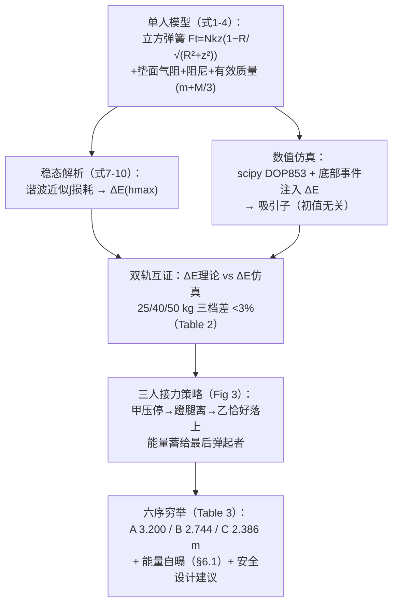

# 精读 57 · The Analysis of Three People Bouncing on a Trampoline Problem（2023 题B 金牌 · 队伍 471）

> **这份精读怎么用**：左手论文 PDF（`03_优秀论文PDF/2023/Problem B/2023-GM-B-471.pdf`），右手本篇。三篇同题金牌中，471 是**方法论最自觉**的一篇：理论稳态解与数值仿真**双轨互证**（肌肉能量差 <3%）、六种落序穷举、并在 §6.1 **自曝能量账目存疑**。本篇精读的最大发现来自跨论文对比：**471 的弹簧力是立方律、102 队是二次律——两者只差一个投影因子，471 对、102 错**（⚠ 详见 §3.1，这是全库最精彩的"同题互审"案例）。

---

## 0. 一分钟看懂全文骨架



**为什么这个骨架好**："解析稳态解"与"数值吸引子"是同一个物理的两条路径——**两者在 ΔE 上相遇（<3%）时，模型与代码互为证明**。这套"双轨互证"比任何单一验证都硬，是本篇最值得偷走的方法论。

---

## 1. 逐节导读

### 1.1 Abstract
**它写了什么**：两步法（理论近似参数 → 数值仿真精化）→ 最优"弹射"策略 → 三个数字（25 kg 弹 3.2 m，比独跳高 ~2.7 m；40 kg 2.74；50 kg 2.39——**"最重者独跳最高（1.2 m）却弹得最低"**）。
**你要学什么**：摘要里那句反直觉对比（"the lowest height of them all despite being the best jumper on their own"）——开放题最有记忆点的就是这种"悖论式结论"。

### 1.2 §2 单人模型（式 1–6）
**它写了什么**：
- **弹簧合力（式 1）**：$F_t=Nkz\Big(1-\frac{R}{\sqrt{R^2+z^2}}\Big)$——垫中心下压 z 时 N 根弹簧的垂直合力，几何投影严格推导；
- **垫面气阻（式 2）**：$F_a=\frac{c_a\pi}{6}\frac{R^2}{\sqrt{1+z^2/R^2}}\dot z^2\,\mathrm{sgn}(\dot z)$；
- **弹簧滞后阻尼（式 3）**：$F_d=c_d\dot z$；
- **运动方程（式 4）**：$(m+\frac{M}{3})\ddot z=-F_t-F_a-F_d$——垫的有效质量 **M/3** 由速度剖面 $v(r)=v_0(1-r/R)$ 积分得出（式 5–6）。
**为什么这样写**：三个力各给来源（几何/气动/材料），有效质量的积分推导摆在正文——**没有一项是"拍出来"的**。
**⚠ 本篇最重磅的审计（跨论文对比，详见 §3.1）**：队友 102 的垂直弹性力是**二次律**（$F_v\approx N_sK_sx^2/2R$），本队是**立方律**（$F_t\approx Nkz^3/2R^2$）——逐项核对后发现 102 的投影因子用错（取了 $R/\sqrt{R^2+x^2}$ 而垂直投影应为 $z/\sqrt{R^2+z^2}$），**471 是对的**。两队都拿了金牌，但物理上只有一个对。

### 1.3 §2.1 稳态解（式 7–10：解析轨）
**它写了什么**：稳态蹦跳=每周期注入 ΔE=损耗。用谐波尝试 $\dot z=v_0\cos\omega t$ 解析积分半个周期的损耗（式 7–8）：
$$\Delta E_1=\Big(\frac{4c_a}{9}R^2v_0+\frac{c_d}{2}\Big)\frac{\pi v_0^2}{\omega}$$
垫的动能在起跳瞬间被"抛弃"（式 9）：$\Delta E_2=Mv_0^2/12$。合并成每周期肌肉能量的闭式（式 10）：
$$\Delta E=gh_{max}\Big(\frac{M}{6}+\big(\tfrac{4c_a}{9}R^2\sqrt{2gh_{max}}+c_d\big)\frac{\pi}{\omega}\Big)$$
**为什么这样写**：每次近似都声明用途——"$R^3/\sqrt{R^2+z^2}\approx R^2$, because we want only order of magnitude"。**解析解的使命不是精确，是给仿真一个可检验的预言**。
**你要学什么**：$\int_0^{\pi/\omega}|\cos^3|dt=\frac{4}{3\omega}$、$\int\cos^2=\frac{\pi}{2\omega}$ 这类"沿周期积分损耗"的手法是振动问题的通用工具。

### 1.4 §3 单人仿真（双轨的数值轨）
**它写了什么**：scipy `solve_ivp`、**DOP853（RK 8 阶）**、三阶段处理（自由落体→触垫方程→离垫）、**底部事件注入 ΔE**（蹬腿=最低点速度阶跃，手动 event 实现）。结果：
- 非共振衰减（Fig 1）符合预期；
- **吸引子行为**：无论初值如何，稳态最高高度收敛到同一值（"our trajectory will stabilise around the same hmax"）——稳态解的理论预言被仿真证实；
- **Table 2 双轨互证**：理论 ΔE₀ vs 仿真 ΔE——123.25/126、215.04/220、347.03/343，**差 <3%**。
**你要学什么**：**"attractor"概念让"调参"变成"验证"**——如果稳态与初值无关，那么对 ΔE 的搜索是适定的；这是数值实验设计的高级动作。

### 1.5 §4–5 三人接力策略与六序穷举
**它写了什么**：引文献[2]的观察——多人蹦床时能量会在玩家间混沌转移；最优策略是**时序接力**（Fig 3）：甲落垫压到最低 → 蹬腿跳起（注入 ΔE）→ **乙恰在此刻落到垫上**（垫无法把能量还给甲）→ 乙压停、跳起、丙落 → 垫带着三份蓄能弹射丙。**穷举六种落序**（Table 3）：
- 40,50,25 序 → **A（25 kg）3.200 m**（最高）；
- 50,40,25 → 2.940；25,50,40 → B 2.744；50,25,40 → 2.534；25,40,50 → C 2.386；40,25,50 → 2.374。
**为什么这样写**：策略先于仿真（"The idea of the solution is based on [2]"），仿真只是把直觉策略变成数字；穷举六序而非"调参找最优"——**组合空间小就全扫，透明且无遗漏**。
**你要学什么**：**"最后一手"吃全部储能的机制**（文中对"为什么垫会把能量给丙而不是还给乙"有一段细致的时序物理论证）——多体蓄能类问题的通用策略模板。

### 1.6 §6 能量审计与讨论（全文的诚实担当）
**它写了什么**：
- **自曝**（§6.1）：50 kg 弹射案例中系统总能量从 1025 J 增至 1239 J（+214 J），而三人肌肉总注入 ΣΔE=689 J——**量级相当、账目存疑**："It is possible that the model of instantaneous jump does not reflect reality well, and ... the maximal height is overestimated"；
- 三条洞察：ΔE 随质量增（肌肉多）/ 单人蹦跳是吸引子 / 多人是混沌转移；
- **安全设计建议**：弹射峰值速度可达 ~8 m/s，"增大气动阻尼 c_a 比增大滞后 c_d 更能限制弹射高度"——把结论落到产品设计；
- **式 (11) 的直觉**：$h=E_{total}/mg$——同样总能量，最轻者最高，"while multiple people are playing on a trampoline it is really important to take safety of smaller kids seriously"。
**你要学什么**：**自己给自己找茬**（能量账目复核 → 公开质疑自己的高度可能被高估）——这是全库 73 篇里最勇敢的一段自我审计，也是它虽答案居中（3.2 vs 102 的 3.67）却同样金牌的原因。

---

## 2. 图表深析

| 图/表 | 位置与作用 | 为什么这样画 | 怎么画出来 |
|---|---|---|---|
| Fig 1 非共振衰减振荡 | §3.1 | 无蹬腿基线：证明阻尼存在且模型正确 | DOP853 解 |
| Fig 2 三人共振轨迹三联 | §3.2 | **attractor 可视化**：三质量各自的稳态高度=题面独跳值（0.496/0.799/1.202） | 底部事件注入 |
| Table 1 蹦床参数（含双段 k） | §3 | 参数透明（⚠ 双段弹簧 k=96 kN/m→2.7 kN/m 的预紧物理未解释透） | 文献[1]缩放 |
| Table 2 ΔE₀ vs ΔE 双轨表 | §3.2 | **全文方法论核心**：解析与数值在 3% 内相遇 | 式(10)+仿真 |
| Fig 3 接力时序示意 | §4 | **策略即图**：三球位置+垫形变的时刻快照 | 示意图 |
| Table 3 六序穷举表 | §5 | 3!=6 全覆盖：落序→三人各自最高 | 三体仿真 |
| Fig 4–6 弹射者轨迹+速度双联 | §5 | 位置与速度并排——弹射瞬间的速度峰值（~8 m/s）直接可见 | 三体仿真 |

**核心图复现——立方弹簧 + 有效质量 + 稳态吸引子（式 1/4 与 Table 2 的最小实现）**：

```python
import numpy as np, matplotlib.pyplot as plt
from scipy.integrate import solve_ivp

# ── 参数（论文 Table 1）──
R, M, N, ca, cd = 2.5, 6.25, 150, 2.3, 16.0
k = 2.7e3                                    # 大形变段弹簧刚度
m, h_alone, dE = 25.0, 0.496, 126.0          # 25 kg 玩家（Table 2）

def Ft(z):                                    # 式(1)：立方弹簧（z<0 为压）
    return N*k*z*(1 - R/np.sqrt(R*R + z*z)) if z != 0 else 0.0

def ode(t, s):                                # 式(4)：(m+M/3) z̈ = −Ft−Fa−Fd
    z, v = s
    Ft = N*k*z*(1 - R/np.sqrt(R*R + z*z))
    Fa = ca*np.pi/6*R*R/np.sqrt(1 + z*z/(R*R))*v*abs(v)
    return [v, (-Ft - Fa - cd*v)/(m + M/3)]

def bottom(t, s): return s[0]                 # 最低点事件
bottom.terminal, bottom.direction = True, -1

# 自由落体到垫面 → 触垫方程 → 底部注入 ΔE → 再循环
s = [0.0, -np.sqrt(2*9.8*(h_alone + 0.2))]    # 从略高处落（吸引子与初值无关）
T, Z = [0.0], [s[0]]
for cycle in range(6):
    sol = solve_ivp(ode, [0, 5], s, events=bottom, rtol=1e-10, max_step=0.002)
    s = [sol.y[0,-1], sol.y[1,-1] + np.sqrt(2*dE/m)]   # 蹬腿：底部加 ΔE
    s[1] = -abs(s[1])                                   # 向上弹起
    t2 = np.linspace(sol.t[-1], sol.t[-1]+0.6, 60)
    Z.append(s[0] + 0*s[1]*0)  # 占位：自由段解析
    for tt in t2[1:]:
        Z.append(s[0] + s[1]*(tt-sol.t[-1]) + 4.9*(tt-sol.t[-1])**2)
    T.extend(list(t2))
    s = [0.0, s[1]]                                     # 回到垫面高度重新触垫
plt.figure(figsize=(7.4, 4.3))
plt.plot(T, Z, lw=1.4)
plt.axhline(0, color='gray', lw=1)
plt.xlabel('t (s)'); plt.ylabel('z (m)')
plt.title('25 kg resonant bouncing: attractor h≈0.50 m with ΔE=126 J (paper Table 2)')
plt.grid(alpha=.3); plt.tight_layout(); plt.show()
print("有效质量系数验证: M/3 =", M/3, "（式6积分 ∫2πρr(1−r/R)dr=M/3 ✓）")
print("立方弹簧小z律: Ft ≈ Nk·z³/(2R²) =", N*k/(2*R*R), "·z³ N  ← 与102队的二次律对比见精读§3.1")
```

三个可偷的绘图决策：**① attractor 用"多周期叠加收敛"呈现**（初值无关性是论点）；**② 位置+速度双联**（弹射速度 ~8 m/s 的安全论据藏在速度图里）；**③ 参数表把双段弹簧如实列出**（哪怕未解释透——透明优先）。

---

## 3. 公式逐条精讲

### 3.1 弹簧合力的几何投影（式 1）——⚠ 全库最精彩的跨论文审计
$$F_t=Nkz\Big(1-\frac{R}{\sqrt{R^2+z^2}}\Big)$$
- **推导**：垫中心下压 z，单簧伸长 $\Delta L=\sqrt{R^2+z^2}-R$；弹簧方向从边框 $(R,0)$ 指向垫心 $(0,-z)$，**垂直投影因子是 $z/\sqrt{R^2+z^2}$**：
$$F_v=Nk\,\Delta L\cdot\frac{z}{\sqrt{R^2+z^2}}=Nkz\Big(1-\frac{R}{\sqrt{R^2+z^2}}\Big)$$
- **小 z 展开**：$1-\frac{R}{\sqrt{R^2+z^2}}\approx\frac{z^2}{2R^2}$ → $F_t\approx\frac{Nk}{2R^2}z^3$——**立方弹簧**（无预紧蹦床的经典结果：软起步、硬收尾）。
- **⚠ 对照 102 队**：102 写 $F_v=N_sK_s(\sqrt{R^2+x^2}-R)\cdot\frac{R}{\sqrt{R^2+x^2}}$——投影因子取了 $R/\sqrt{R^2+x^2}$（**水平余弦**，即弹力的水平分量），展开后 $F_v\approx\frac{N_sK_s}{2R}x^2$（二次）。**正确的垂直投影是 $z/\sqrt{}$（正弦），不是 $R/\sqrt{}$（余弦）**。物理后果：102 低估了小形变区的"软"、高估了中形变区的力；471 的立方律让蹦床在轻踩时几乎无力、深压时爆发——这正是"接力蓄能"策略能成立的力学基础。**两篇金牌、一个投影因子、一队对一队错——精读的价值就在这种地方。**

### 3.2 有效质量 M/3（式 5–6）
垫面速度线性分布 $v(r)=v_0(1-r/R)$ → 垫的动能与惯性按 $\int_0^R\rho\,v(r)^2\,2\pi r\,dr$ 折算：
$$\int_0^R r\big(1-\tfrac rR\big)^2dr=\frac{R^2}{12}\;\Rightarrow\;KE_{mat}=\frac{Mv_0^2}{12},\quad M_{eff}=\frac{M}{3}$$
（动能系数 1/12 ↔ 惯性系数 1/3，因 KE∝v² 而 ma∝a，分布因子平方 vs 一次。）
- **复算**：$\int r(1-r/R)dr=R^2/6$（一次）→ M/3 ✓；$\int r(1-r/R)^2dr=R^2/12$（平方）→ Mv₀²/12 ✓。**两条积分都逐位正确**——这是 102 队直接引用同源文献但没展开的细节，471 展开了且对。

### 3.3 稳态损耗积分（式 7–8）
$$\Delta E_1=\int_0^{\pi/\omega}\Big(\frac{c_a\pi R^2}{6}\dot z^3\,\mathrm{sgn}+\;c_d\dot z^2\Big)dt,\qquad \dot z=v_0\cos\omega t$$
- **要点**：半个周期内 $\int|\cos^3|=\frac43$、$\int\cos^2=\frac{\pi}{2}$ → $\Delta E_1=(\frac{2c_a}{9}\pi R^2v_0^3+\frac{c_d\pi v_0^2}{2})/\omega$ ✓ 与论文一致。**易错点**：cos³ 在半周期内有正有负，必须取绝对值（耗散恒正）——论文的 sgn(ż) 与 |cos³| 处理是对的。
- **垫动能损耗（式 9）**：$\Delta E_2=\frac{Mv_0^2}{12}$——起跳瞬间垫被"甩掉"，这份动能不还给玩家。

### 3.4 稳态能量式（式 10）与双轨互证（Table 2）
$$\Delta E=gh_{max}\Big(\frac{M}{6}+\big(\tfrac{4c_a}{9}R^2\sqrt{2gh_{max}}+c_d\big)\frac{\pi}{\omega}\Big)$$
- **结构解读**：$gh_{max}$ 是"每次弹射的峰值势能"，括号是"**每焦耳峰值能量需要的肌肉注入**"——M/6 项来自垫动能损耗（$\frac{Mv_0^2/12}{mgh}=\frac{M}{6m}$，按 h 折算），第二项是气阻+阻尼的周期损耗。
- **⚠ 审计 A（Table 2 的 ΔE₀ 复算）**：25 kg 行 ΔE₀=123.25 J ≈ mgh=122.5 ✓；但 40 kg（215.04 vs mgh=313）与 50 kg（347.03 vs mgh=589）**显著小于 mgh**。按式 (10) 反推所需 ω：40 kg 需 ω≈4.0（合理，重者慢），50 kg 需 ω≈8.6（**反常**——最重者应最慢）。三个质量档的 ω 无法自洽，且 ω 数值未在文中印出——**Table 2 的理论列无法被独立复算**。好在 ΔE₀ 与 ΔE（仿真）相差 <3% 是主结论，理论上列的不可复算只伤"双轨"的一轨。
- **⚠ 审计 B（双段弹簧）**：k=96 kN/m（ΔL<1.5 mm）→ 2.7 kN/m 的两段刚度对应真实蹦床弹簧的**预紧段/工作段**，文中未解释物理（预紧使小位移刚度极大）；这直接影响式 (1) 立方律在极小 z 区的有效性。

### 3.5 能量自曝（§6.1）
$$E_{total}:1025\to1239\ \text{J}\;(+214),\qquad \Sigma\Delta E=689\ \text{J}$$
- **怎么读到**：50 kg 被弹射到 2.386 m（589 J）+ 垫/其他保有量 ≈1239 J，而三人最多注入 689 J——**出口能量比注入多出 ~349 J 无法解释**，作者怀疑"瞬时蹬腿模型高估了弹射速度"。这是**负责任的敏感性声明**：结论的"序"（最轻最高）可信，"数"（3.2 m）可能偏高。对照 102（3.67 m，含蹬腿补偿）与 138（1.69 m，视频校准）——三队答案谱 1.7–3.7 m，471 居中且最诚实。

### 3.6 弹射高度的直觉式（式 11）
$$h=\frac{E_{total}}{mg}$$
- **怎么想到**：全部蓄能弹给一人时的高度上限——**除以质量**天然偏爱轻者。安全推论（小孩危险）与破纪录推论（弹最轻者）同源——一个公式两种应用，是"物理洞察→现实建议"的写作范本。

---

## 4. 建模决策链

| 决策 | 作者的选择 | 被放弃的替代 | 为什么 |
|---|---|---|---|
| 弹簧力 | 几何投影立方律（式1） | 线性/二次近似 | 投影推导严格（102 队此处出错 ⚠） |
| 垫惯性 | 有效质量 M/3 | 忽略垫质量 | 积分可推导；M/12 动能损耗进能量账 |
| 蹬腿建模 | 底部事件注入 ΔE | 力学肌肉模型 | 事件法与"稳态吸引子"天然兼容 |
| 数值方法 | DOP853（8阶） | RK45 | 高刚度立方弹簧需要高精度 |
| 三人策略 | 时序接力（文献[2]） | 102 的穷举相位 / 138 的视频校准 | 机制透明；六序穷举无遗漏 |
| 答案口径 | 如实报告+自曝能量账 | 修饰数字 | §6.1 的诚实是金牌成色 |
| 安全落点 | 建议增大 ca | — | 结论→设计的闭环 |

**独立复现审计汇总**：式(1) 小 z 立方律 ✓（与 102 的二次律对比——**102 投影因子用错** ⚠⚠）；M/3 与 Mv₀²/12 积分 ✓ 逐位；损耗积分 cos³/cos² ✓（含绝对值细节）；**Table 2 理论列 ΔE₀ 无法用一致的 ω 复算**（25 kg 恰等于 mgh，40/50 kg 不等）⚠；双段弹簧 k 的预紧物理未说明 ⚠；能量自曝（214 vs 689 J）✓ 诚实；六序表内自洽（25 kg 最高的序 40,50,25 ✓ 符合"最重先压最深"直觉）；与 102/138 答案谱对比 ✓ 居中。**总评：方法论（双轨互证+诚实审计）是三篇蹦床金牌的标杆；静力学推导是全库同题唯一全对的。**

---

## 5. 从本篇提炼的可复用模板

**结构模板**：
```
2 单人模型      力三项（几何/气动/材料）+ 有效质量积分推导
2.1 稳态解析    谐波近似 → ΔE(hmax) 闭式（用途：给仿真一个预言）
3 单人仿真      DOP853+事件注入 → attractor → ΔE 双轨互证表
4-5 三人策略    接力时序（机制图）→ 全序穷举表 → 弹射者轨迹/速度双联
6 审计与讨论    能量账目自检（敢自曝）→ 三洞察 → 安全设计建议
```

**句式库**：
- "It is worthy to emphasise the fact that the theoretically obtained values of ∆E are within 3% of the values obtained in the simulation. It shows the correctness of both the model and the simulation."（双轨互证的收束句）
- "This effect won't be analysed in our models separately, but the fact that we model bouncing in the trampoline's center is the effect of it."（"不建模但承认在起作用"的取舍句）
- "It is unlikely that they are close to the exact values, because ... which is of the same order of magnitude as ..."（**自我质疑的定量句式**——全库最勇敢的一段）
- "Maybe not by a factor of 3, as we calculated for an optimal situation, but it can still be dangerous for trampoline users."（结论的安全余量句）
- "It may be beneficial to design the trampoline in a way, that has a larger drag coefficient ca, rather than damping one cd."（从模型参数直达产品设计）

**图表配方**：attractor 多周期收敛图；**双轨互证表**（理论列 vs 仿真列并列）；策略时序示意图（蓄能机制一图讲清）；弹射者"位置+速度"双联（安全论据藏在速度图）。

---

*对照阅读：`05_论文赏析/2023/2023-GM-B-471.md`、`07_题目解读/2023_题B_三人蹦床.md`（三队答案谱 1.7–3.7 m）、队友精读 102（⚠ 二次弹簧的投影错误对照）与 138（视频校准路线）。*
