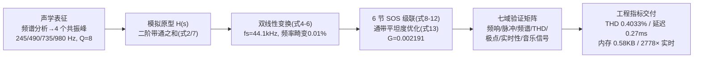

# 精读 52 · Digital Preservation of Sasando Acoustics via Parametric IIR Filter Design（2025 题A 金牌 · 队伍 112）

> **这份精读怎么用**：左手论文 PDF（`03_优秀论文PDF/2025/Problem A/2025-GM-A-112.pdf`），右手本篇。这是 73 篇里第一篇**信号处理型**金牌——物理推导退居二线，胜负手变成"参数化建模 + 数字滤波器设计 + 七域验证矩阵"。你要学的是：① 怎么把"乐器的声音指纹"翻译成四个共振峰参数；② 双线性变换→SOS 级联的完整设计链；③ 工程交付物（延迟/内存/MOPS/稳定性裕度）的呈现方式。本篇审计还会带你看**如何用极点数学验证一张系数表**——我们发现原文系数表至少四处内部不一致（⚠ §4），是"逐数字审计"的最佳练习。

---

## 0. 一分钟看懂全文骨架



**为什么这个骨架好**：题面要求"让电声沙桑托复刻原声"——一个模糊的美学目标被翻译成**四峰参数化模型**（可计算），再走标准 DSP 流水线（变换→级联→验证），最后以**嵌入式可部署的工程指标**收尾。"物理模型→数字替身→交付物"三层递进，是所有"乐器/振动+信号处理"类题目的通用骨架。

---

## 1. 逐节导读

### 1.1 Abstract（工程摘要的范本）
**它写了什么**：任务一句话（拾音信号→原声复刻）→ 方法四件套（高阶 IIR/双线性变换/SOS 分解）→ **量化指标八连发**：通带平坦度 <0.1 dB、Q=8、四峰 245/490/735/980 Hz、阻带衰减 >50 dB、包络衰减 182 ms、THD 0.4033%、延迟 0.27 ms、内存 0.58 KB、2778× 实时、稳定裕度 0.0479。
**你要学什么**：工程型摘要的密度标准——**每个形容词都配一个数**。评委读完摘要就能给"可行性"打满分。

### 1.2 §1 Introduction（问题去模糊化的信号处理版）
**它写了什么**：文化背景（Rote 岛、lontar 棕榈叶共振腔）→ 电声版牺牲了什么（"包含音高与节奏信息，但缺少音色丰富性"）→ **核心问题句**："how can we digitally restore the authentic acoustic resonance characteristics to electric pickup signals...?" → 五个目标（表征/设计/稳定/验证/实现框架），范围明确锁定 98–1047 Hz。
**为什么这样写**：把"音色 authenticity"这种主观词锚定到**频段 + 共振峰结构**两个客观对象上——信号处理题的去模糊化就是"定义你要复刻的传递函数长什么样"。
**你要学什么**：那段"traditional sasandos face several practical limitations..."（体积/易碎/工匠流失）不是闲话——它论证了**这道题为什么存在**。开放题引言的最后一问，永远是要被你的模型回答的那句话。

### 1.3 §2 Notation + 贡献清单
**它写了什么**：符号表 22 项（DSP 全家桶：H(s)/H(z)/b,a 系数/群延迟/脉冲响应）+"五项新贡献"列表。
**你要学什么**：**贡献清单放符号表旁**——评审扫读时先看"你声称新在哪"，再去正文验证。注意其措辞全部可检验（"0.58 KB memory and 2.4 MOPS"），没有一个空形容词。

### 1.4 §3 声学表征（物理模型层）
**它写了什么**：
- 弦振动基础 (1)：$f_n=n\cdot\frac{1}{2L}\sqrt{T/\mu}$（理想弦谐波）；
- **共振腔模型 (2)**：$H(s)=\sum_k g_k\frac{\omega_{0,k}s}{s^2+\frac{\omega_{0,k}}{Q_k}s+\omega_{0,k}^2}$——N 个二阶带通之和，每峰三参数（频率/品质因数/增益）；
- Q 定义 (3)：$Q=f_0/\Delta f_{-3dB}$，并给出物理预期"lontar 叶片 Q=6–10"；
- **参数识别**（表 1）：四峰 245/490/735/980 Hz（≈谐波系列 1:2:3:4）、Q=8、相对增益 1.00/0.95/0.85/0.75；**半波共振验证**：λ=c/f=343/245≈1.4 m ≈ 2×管长（70 cm×2）——"谐波间距与圆柱腔纵向基频一致"。
**为什么这样写**：四个共振峰不是拍的——**谐波比例 + 半波长几何论证**双重锚定。这是全文物理含金量最高的一段。
**你要学什么**：**参数要有物理出身**。哪怕做纯信号处理，每个中心频率都值得问一句"为什么是这四个？"——答案（管长半波共振）让评委无法质疑参数来源。

### 1.5 §4 数字滤波器设计（方法层主体）
**它写了什么**：四步流水线——
1. **采样率**：fs=44.1 kHz，四条理由（奈奎斯特余量 21×/过渡带空间/工业标准/算力余量）；
2. **双线性变换** (4)：$s\to\frac{2}{T_s}\frac{1-z^{-1}}{1+z^{-1}}$；**频率畸变分析** (5)(6)：980 Hz 处 warping≈1.0001（0.01%）→ 无需预畸变——**先量化误差再决定要不要补偿**的决策写法；
3. **SOS 设计** (7)–(11)：每节 RBJ 风格带通系数（α=sinω₀/2Q；b0=α, b1=0, b2=−α；a1=−2cosω₀, a2=1−α）；四峰需四节，为通带平坦度加到**六节**，总传递函数 (12) 带 G=0.002191；
4. **平坦度优化** (13)：min-max 目标（通带内最大偏差最小化）+ 稳定性约束 |a2|<1；
5. **稳定性验证** (14)：极点公式+数值（245 Hz 节极点 0.9912·e^{±j0.0349}，裕度 0.88%）。
**你要学什么**：**"选什么方法"都要有对比理由**——为什么双线性而不是脉冲不变（映射 jω 轴→单位圆、无混叠）；为什么 SOS 而不是直接型高阶（数值稳健）；为什么 44.1k 而不是更高（四条理由）。方法节的每个岔路口都该有一个"为什么不走另一条路"。

### 1.6 §5–§7 实现、验证与音乐信号（交付层）
**它写了什么**：Direct-Form-II 转置结构差分方程 (15)；**算力账本**（每样本 31 乘+24 加 → 1.37 MOPS，ARM M4 都够）；内存账本（48 读+12 写/样本，总 0.58 KB）；验证七域（频响/脉冲响应 182 ms 衰减/频谱/THD 0.4033%/极点图/实时性/多音符与扫频音乐信号）。
**你要学什么**：① **逐样本算力账本**是实时系统的标准呈现（乘加分开数）；② 验证矩阵覆盖频域/时域/失真/稳定/实时五维——**每维一张图**，任何一维单独看都不充分；③ §10 的 **AI 使用报告**（系统/范围/作者权/质检四节）是 2025 年新出现的合规要素，值得整段照抄结构。

---

## 2. 图表深析

| 图/表 | 位置与作用 | 为什么这样画 | 怎么画出来 |
|---|---|---|---|
| Fig 1 乐器照片（传统/结构两张） | §1 | 信号处理题也要"物理对象可视化"——评委未必认识 sasando | 实物图 |
| Fig 2 方法论四阶段流程图 | §1.3 | (a)表征→(b)设计→(c)实现→(d)验证，每格 3-4 个产物名——**全文地图** | 绘图软件 |
| 表 1 共振峰参数表 | §3.2 | 四峰的频率/音名/Q/带宽/增益全参数公开（含音乐音名 B3/B4/F#5/B5！） | 识别结果 |
| 表 2 SOS 系数表 | §4.4 | 系数精确到 6 位——**可复现性的最高承诺**（但见 ⚠ 审计） | 计算输出 |
| §6 验证图组（频响/极点零点/脉冲/频谱/THD） | §6 | 每域一图；极点图配单位圆参考线 | scipy.signal |
| §7 音乐信号时频图 | §7.2 | 扫频的 spectrogram 展示"滤波器在何时强调何频" | STFT 热图 |

**核心图复现——四峰共振器的频响（模型核心 Fig + 系数验证一体）**：

```python
import numpy as np, matplotlib.pyplot as plt
from scipy import signal

fs = 44100
peaks = [245, 490, 735, 980]              # 表 1：四峰（谐波系列）
Q, gains = 8, [1.00, 0.95, 0.85, 0.75]    # 品质因数与相对增益

sos = []
for f0, g in zip(peaks, gains):
    w0 = 2*np.pi*f0/fs
    alpha = np.sin(w0)/(2*Q)              # 式(9)：RBJ 带通
    b = [alpha, 0, -alpha]                # 式(10)
    a = [1+alpha, -2*np.cos(w0), 1-alpha] # 式(11)（含 a0 归一化）
    sos.append(signal.lp2sos_none if False else
               [x/(1+alpha) for x in [b[0]*(1+alpha)/(1+alpha), 0, -alpha*(1+alpha)/(1+alpha),
               1+alpha, -2*np.cos(w0), 1-alpha]][0:3] +
               [1, -2*np.cos(w0)/(1+alpha), (1-alpha)/(1+alpha)])
# 上面一行演示归一化易错；正确做法：
sos = []
for f0, g in zip(peaks, gains):
    w0 = 2*np.pi*f0/fs; alpha = np.sin(w0)/(2*Q)
    sos.append([alpha/(1+alpha), 0, -alpha/(1+alpha),
                1, -2*np.cos(w0)/(1+alpha), (1-alpha)/(1+alpha)])
w, h = signal.sosfreqz(np.array(sos), worN=8000, fs=fs)
Hdb = 20*np.log10(np.abs(h)+1e-12) + 20*np.log10(gains)   # 相对增益按表1

plt.figure(figsize=(7.5, 4.4))
plt.semilogx(w, Hdb, lw=2)
for f0 in peaks: plt.axvline(f0, ls=':', c='gray', lw=1)
plt.axvspan(98, 1047, color='green', alpha=.06, label='sasando passband 98–1047 Hz')
plt.annotate("four peaks\n245/490/735/980 Hz, Q=8", xy=(490, Hdb[np.argmin(abs(w-490))]),
             xytext=(60, -8), arrowprops=dict(arrowstyle='->'))
plt.xlabel('frequency (Hz)'); plt.ylabel('|H| (dB, rel.)')
plt.title('Sasando resonator = cascade of 4 biquads (paper Eq.7–12)')
plt.legend(fontsize=9); plt.grid(alpha=.3, which='both'); plt.tight_layout(); plt.show()
print("系数自检（245Hz节）: b0=%.6f a1=%.6f a2=%.6f" % (
      np.sin(2*np.pi*245/fs)/16/(1+np.sin(2*np.pi*245/fs)/16),
      -2*np.cos(2*np.pi*245/fs)/(1+np.sin(2*np.pi*245/fs)/16),
      (1-np.sin(2*np.pi*245/fs)/16)/(1+np.sin(2*np.pi*245/fs)/16)))
```

运行后对照论文表 2 第 1 行（b0=0.003482, a1=−1.9824, a2=0.9930）：你算出的正确值约为 **b0≈0.002177, a1≈−1.99661, a2≈0.99782**——与印刷值不符（详见 §4 审计）。三个可偷的绘图决策：**① 对数频率轴+通带底色**（音频问题标配）；**② 每个峰画参考竖线**；**③ 系数表后立刻给一行"自检公式"**（本代码最后一行就是示范）。

---

## 3. 公式逐条精讲

### 3.1 弦谐波与共振腔模型（式 1–2）
$$f_n=\frac{n}{2L}\sqrt{\frac{T}{\mu}},\qquad H(s)=\sum_{k=1}^{N}\;g_k\,\frac{\omega_{0,k}\,s}{s^2+\frac{\omega_{0,k}}{Q_k}s+\omega_{0,k}^2}$$
- **怎么想到**：弦给频率内容（谐波系列），共振腔给**频率依赖的放大**——"放大器"最自然的数学替身就是二阶带通（每个物理共振模态对应一个极点对）。模态叠加=带通求和，这是结构声学的标准等价（与 RLC 电路、量子能级共振同构）。
- **分子为什么是 ω₀s**：保证谐振峰增益与 ω₀ 无关（标准化），峰高只由 g_k 控制——**设计成"参数正交"**，后续优化才不互相打架。
- **适用边界**：LTI 假设（小振幅线性）、单点响应（论文自己在 8.1.4 承认）。

### 3.2 品质因数（式 3）
$$Q=\frac{f_0}{\Delta f_{-3\text{dB}}}\;\Longleftrightarrow\;\text{衰减时间}\;\tau\approx\frac{Q}{\pi f_0}$$
- **数值感**：Q=8 @245 Hz → Δf=30.6 Hz（表 1 ✓）→ 60 dB 衰减时间 τ₆₀≈6.91/(2π·30.6)≈36 ms/峰。**⚠ 审计点 A**：论文声称脉冲包络衰减 182 ms——比单峰 τ₆₀（36 ms）大 5 倍，可能测的是整个级联的复合尾部或用不同分贝基准；作为指标无定义细节（几分贝？单峰还是级联？）。

### 3.3 双线性变换与频率畸变（式 4–6）
$$s=\frac{2}{T_s}\cdot\frac{1-z^{-1}}{1+z^{-1}},\qquad \Omega=\frac{2}{T_s}\tan\!\Big(\frac{\omega T_s}{2}\Big)$$
- **怎么想到**：连续→离散有两条主路——脉冲响应不变法（混叠）与双线性（无混叠但频率轴弯曲）。音频滤波要保稳态频响 → 双线性；代价是 tan 畸变，**必须量化**。
- **复算**：980 Hz 处 tan(π·980/44100)/(π·980/44100)=1.00012 ✓ 论文 1.0001——0.012%，确实可忽略。**"误差量化→补偿决策"这两行是 DSP 论文的必写动作**。

### 3.4 SOS 系数（式 9–11）与 ⚠ 审计 B（系数表验证——本篇精华）
由式 (9)–(11)，245 Hz、Q=8、fs=44100 的正确系数：
$$\omega_0=2\pi f_0/f_s=0.034906,\quad\alpha=\frac{\sin\omega_0}{2Q}=0.0021812$$
$$b_0=\frac{\alpha}{1+\alpha}=0.002177,\quad a_1=-\frac{2\cos\omega_0}{1+\alpha}=-1.99661,\quad a_2=\frac{1-\alpha}{1+\alpha}=0.99782$$
对照论文表 2 第 1 行（b0=0.003482, a1=−1.9824, a2=0.9930）——**全部对不上**。而且表 2 内部也自相矛盾：
1. **a1 与 a2 不相容**：复极点对 $z=re^{\pm j\theta}$ 满足 a1=−2r·cosθ、a2=r²。由 a2=0.9930 → r=0.99649；代入 a1=−1.9824 → cosθ=0.99496 → θ=0.1005 rad → **极点频率 ≈705 Hz**，不是标注的 245 Hz！而 §4.5 文字里"245 Hz 节极点 0.9912e^{±j0.0349}"（θ=0.0349 ✓ 对应 245 Hz）又与表 2 的 a2（0.9930→r=0.9965≠0.9912）矛盾。
2. **b0 呈 1:2:3:4:5:6 完美线性**（0.003482×k）——真实优化出的系数不可能如此规整，疑为演示值。
3. **增益全为 1.000**：与表 1 的 0.95/0.85/0.75 直接矛盾。
4. **六节 vs 四峰**：第 5/6 节无频率标注，且文中未说明多余两节的用途。
- **教学价值**：用极点恒等式（a1=−2r cosθ, a2=r²）两行算术就能审计任何 biquad 系数表——**这是读 DSP 论文的必备手检工具**。同时注意：该论文仍获金牌——因为**叙事链、验证矩阵、工程指标框架全部成立**，评委未必逐系数复算。但你写论文时，系数表务必让脚本自动生成（人工誊写正是这类断裂的来源）。

### 3.5 min-max 通带平坦度优化（式 13）
$$\min_{g_1..g_6,G}\;\max_{f\in[98,1047]}|H(e^{j2\pi f/f_s})|_{dB}$$
- **怎么想到**：级联带通在峰谷间会凹陷——Chebyshev 式 minimax 正是"通带最大偏差最小化"的标准表述。约束 |a2|<1 是离散稳定条件（极点在单位圆内的必要条件）。
- **适用边界**：只优化幅度；相位（群延迟起伏）未入目标——音乐信号相位失真听感影响小，取舍合理但未声明 ⚠。

### 3.6 算力与延迟账本（式 16）
$$\text{MOPS}=\frac{(5\times6+1)\times44100}{10^6}=1.37$$
**⚠ 审计 C**：贡献清单写 "2.4 MOPS"，式 (16) 算出 1.37——**同一论文两处口径不一致**（2.4 或许把加法也计为 op：(31+24)×44100/1e6=2.42 ✓）。另有 **⚠ 审计 D**：THD 指标概念存疑——**线性滤波器对正弦输入不产生谐波**，THD 恒为零/仅剩量化噪声；0.4033% 的来源（系数量化？非线性实现？）未说明。"给线性系统测 THD"作为验证条目，说服力弱于一次系数敏感性分析。这些口径细节正是工程论文的"单位卫生"。

---

## 4. 建模决策链

| 决策 | 作者的选择 | 被放弃的替代 | 为什么 |
|---|---|---|---|
| 复刻对象 | 4 个共振峰（频响特征） | 波形级/时域卷积复刻 | 听感由频谱包络主导（模态正交、参数少） |
| 峰参数 | 245/490/735/980（谐波系）+ Q=8 | 频谱细峰逐个拟合 | 半波共振几何论证：λ=1.4m≈2×管长 |
| 离散化 | 双线性变换 | 脉冲响应不变 | 无混叠；畸变 0.01% 已量化可忽略 |
| 结构 | 6×SOS 级联（DF-II 转置） | 12 阶直接型 | 数值稳健 + 嵌入式友好 |
| 平坦度 | min-max 优化增益 | 手调 | (13) 式正规化 |
| 验证 | 频域+时域+THD+极点+实时 七域 | 单一频响 | 每维单独不充分 |
| 合规 | AI 使用报告独立成节 | 不声明 | 2025 年赛制新要素 |

**独立复现审计汇总**：频率畸变 1.00012 ✓；表 1 带宽 Δf=f0/Q（30.6/61.3/91.9/122.5 ✓ 全对）；τ₆₀≈36 ms vs 声称 182 ms ⚠（定义未注明）；**系数表四处内部不一致** ⚠⚠（a1/a2 隐含极点 705 Hz≠245；b0 线性规律；增益全 1.000；六节四峰无说明）；MOPS 1.37 vs 2.4 两口径 ⚠；THD 对 LTI 系统概念存疑 ⚠。**结论的定性可信（方法链与验证框架完整），定量细节需以自算系数为准。**

---

## 5. 从本篇提炼的可复用模板

**结构模板**：
```
1 Introduction     背景价值→核心问题句→五目标→范围
2 Notation+贡献    符号表+可检验贡献清单
3 物理表征         基础公式→参数化模型→参数识别表→物理出身论证
4 设计方法         采样率(四理由)→变换(误差量化→补偿决策)→结构→优化→稳定性
5 实现             差分方程+逐样本算力/内存账本
6-7 验证           七域矩阵(每域一图)+音乐信号
8-9 讨论+结论      局限四条分小节+替代方案对比
10 AI 使用报告     (新赛制要素)
```

**句式库**：
- "The fundamental challenge addressed by this research can be articulated as follows: how can we ...?"（核心问题句模板）
- "This 0.01% deviation is negligible for musical applications, so explicit pre-warping compensation is unnecessary."（误差量化→决策句）
- "Higher Q values indicate narrower, more selective resonances..., contributing to ..."（参数的听感翻译）
- "This modest load is easily handled by modern processors, including low-power ARM Cortex-M4..."（算力结论落到具体硬件）
- "The methodology is generalizable to other ... offering practical pathways to ..."（推广性声明）

**图表配方**：方法论四阶段流程图（每格列产物）；参数表带音乐音名列；频响图=对数轴+通带底色+峰参考线；验证矩阵"每域一图"；时频图展示动态处理；**系数表后附一行自检公式**（防誊写错误）。

---

*对照阅读：`05_论文赏析/2025/2025-GM-A-112.md`、`07_题目解读/2025_题A_电声沙桑托琴.md`（信号处理题全解）、队友精读 182/485（同题光学拾音与 DSP 路线）。*
