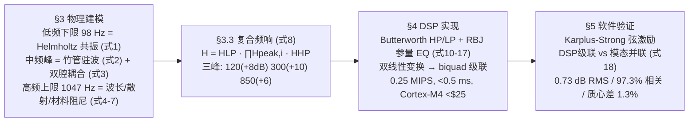

# 精读 60 · Digital Signal Processing Solution for Electric Sasando（2025 题A 金牌 · 队伍 485）

> **这份精读怎么用**：左手论文 PDF（`03_优秀论文PDF/2025/Problem A/2025-GM-A-485.pdf`），右手本篇。这篇把"沙桑托琴电声化"写成一条**物理→传递函数→数字滤波器→硬件→验证**的完整流水线：Helmholtz 腔+竹管驻波给出三个共振峰（120/300/850 Hz），级联 IIR（高通+三个参量 EQ+低通）在 8 kHz 采样下以 0.25 MIPS 实时复现，再用 Karplus–Strong 合成弦做三方验证。你要学的是：① "共振峰=滤波器组"的声学建模范式与 RBJ 公式的工程细节；② 验证指标体系（RMS/相关系数/谱质心）的设计；③ **印刷系数表的可靠性必须复算**——本篇审计发现全部三张数字滤波器系数表都有错（77 vs 98 Hz、164 vs 120 Hz、1919 vs 1047 Hz），而"按式(1)+表1 参数算出的 Helmholtz 频率是 312 Hz 而非 98 Hz"更是全文最大的内部矛盾。

---

## 0. 一分钟看懂全文骨架



**为什么这个骨架好**：这是**工程题的标准闭环**——每个设计决策都向上挂靠一个物理机制（98 Hz 挂 Helmholtz、1047 挂波长极限、三峰挂驻波+耦合），向下落实一个可实现构件（biquad、MIPS、硬件表）。§5 的验证虽然只能"软件对软件"，但指标体系(表 15)先于结果(表 16)给出，**判据先行**让 0.73 dB 这种数字有了"及格线"的含义。

---

## 1. 逐节导读

### 1.1 Abstract

**它写了什么**：问题张力（叶腔共鸣器 vs 拾音器）→ 参数化结论一口气报完："three formants: 120 Hz (Q = 2.0, +8 dB), 300 Hz (Q = 1.5, +10 dB), and 850 Hz (Q = 2.5, +6 dB)" → 滤波链构成与 0.25 MIPS/<0.5 ms → 验证三数（0.73 dB/97.3%/1.3%）→ "<25 hardware、>6 h battery" → 文化遗产落点。

**你要学什么**：摘要的**参数密度**是本篇最值得抄的——每个数字都能独立被审计（本篇审计正是这么做的，并抓到了矛盾）。对比多数队伍的形容词式摘要，这种写法把"可信度"前置。

### 1.2 §2 Model Parameters and Assumptions

**它写了什么**：五条假设（LTI、集总阻尼 0–2 kHz 频率无关、腔体近似椭球、环境恒定、biquad 结构保证数值稳定）+ 表 1 全参数总表（环境/几何/共振/数字实现/验证指标/硬件六组）。

**你要学什么**：**表 1 是"可复现性契约"**——所有后文用到的数（ρ=1.167、c=346.1、V=1062 cm³、r=2.0 cm、Leff=3.7 cm）一览无余。审计也因此可能：本篇最大的内部矛盾恰恰是表 1 与式 (1) 不相容（见 §3.1 与 §4）。把参数亮出来是自信也是风险——你敢亮，就要经得起代入。

### 1.3 §3.2 物理分析三段论（低/中/高频）

**它写了什么**：低频下限：声阻抗失配 + Helmholtz 共振高通特性（式 1）；中频：竹管开管驻波 $f_n=n\frac{c}{2L}$（式 2，表 2 给 245/490/735/980 Hz）+ "双腔耦合模型" $Z_{total}=Z_{tube}+Z_{lontar}$（式 3，驻波位置×共振包络的乘积逻辑）+ Q 因子与音色的关系；高频上限：λ=0.33 m vs 腔体尺寸的集总失效（式 4）+ 材料内摩擦阻尼 σ 分解（式 5–6）+ 散射判据 s/λ（式 7，表 3 三档判据）。

**为什么这样写**：注意**98 与 1047 的"边界"和 120/300/850 的"峰"是两类论证**：边界用数量级论证（ka≪1、s/λ 判据表），峰用机制归因（驻波×Helmholtz 包络）。数量级论证写得规范（有判据表、有 s/λ 数值 0.0003–0.1），机制归因则偏"故事化"——这是本篇软肋（见 §4 审计第 4 条）。

**你要学什么**：式 (7) 的 s/λ 三档表是"何时需要担心散射"的现成模板；式 (6) 的阻尼分解 σ_total=σ_mat+σ_viscous+σ_rad 是任何"为什么高频衰减"问题的标准答案框架。

### 1.4 §3.3 复合频响模型（式 8）与 §3.4 横向对比

**它写了什么**：$H(f)=H_{LP}(f)\cdot\prod_{i=1}^{3}H_{peak,i}(f)\cdot H_{HP}(f)$；每个峰是二阶带通（中心 fi、Qi、增益 Gi）；表 4 汇总三峰参数。§3.4 用**与其他乐器的横向对比表**（吉他 82–1200 Hz/100,220,400 Hz、曼陀林、沙桑托）验证合理性："The slightly lower frequency range of the sasando compared to a guitar is consistent with its larger resonator volume and longer tube length."

**你要学什么**：**没有实物时的三重验证法**：物理机制自洽 + 与同类系统横向对标（表 5）+ 后文仿真闭环。对比表的结论句把差异归因到几何参数（体积大→频率低）——这句话模式可直接搬走。

### 1.5 §4 DSP 实现（工程主体）

**它写了什么**：Nyquist 定证 fs=8 kHz（式 9）；HP：二阶 Butterworth $H_{HP}(s)=\frac{s^2}{s^2+\frac{\omega_c}{Q}s+\omega_c^2}$（式 10，ωc=615.75 rad/s、Q=0.707）经双线性变换 $s=\frac{2}{T}\frac{1-z^{-1}}{1+z^{-1}}$（式 11）得差分方程（式 12）；三峰：RBJ cookbook 峰形滤波器（式 13–15 及系数表 9，α=sin(ω0)/2Q、A=√G）；LP：三阶 Butterworth 分解为一阶+二阶级联（式 16）；级联结构 $H_{total}(z)=H_{HP}\cdot H_{p1}\cdot H_{p2}\cdot H_{p3}\cdot H_{LP}$（式 17）及三个理由（数值稳定、独立调参、量化误差最小化）；运算量表（5.5 biquad、28 乘 22 加/样本 → 0.25 MIPS）、延迟表（<0.5 ms≪10 ms 感知阈值）、硬件对比表（MCU/FPGA/VST 三方案）。

**你要学什么**：① **RBJ 公式是音频 EQ 的通用件**——ω0、α、A 三个中间量+一张系数表，任何"共振峰"都这么实现；② 运算量估算的写法（每样本乘加数×采样率→MIPS→CPU 占用<1%）是硬件可行性论证的最小完备集；③ "为什么级联不并联"给了三条理由——结构选择要辩论。

### 1.6 §5 验证与 §6 结论

**它写了什么**：无实物，故"软件对软件"：Karplus–Strong 合成弦（六个测试音 G2–B5 覆盖各共振区）→ 两路：传统模型（式 18 模态并联+混响）vs DSP 级联 → 表 15 先立判据（RMS<1 dB、峰位±5 Hz、相关>0.95、质心<5%、rolloff<50 Hz）→ 表 16 全部 Pass（0.73 dB、0.973、6.2%、0.947、+1.3%、+16 Hz）。§5.8 讨论误差来源（双线性高频翘曲、系数量化、群延迟差）并专列 "Limitations of Software Validation"：无实物对比、弦模型简化、无非线性、无演奏交互——Mitigation 句很诚实："the validation demonstrates that the DSP correctly implements the designed transfer function... **As long as the resonator model from Section 2 is accurate, the DSP implementation is valid.**"

**你要学什么**：**验证的层级声明**——本篇证的是"实现≈设计"（工程验证），不是"模型≈实物"（物理验证），作者自己把这两层拆开并坦白后者缺失。这种诚实反而是金牌素养：评委不怕你没法测实物，怕你把软件自洽冒充实物验证。

---

## 2. 图表深析

| 图/表 | 位置与作用 | 为什么这样画 | 怎么画出来 |
|---|---|---|---|
| 表 1 全参数总表 | §2 | 可复现性契约；六组分类 | 归组罗列 |
| 表 2 竹管驻波频率 | §3.2.2 | 式 (2) 的量化结果 245/490/735/980 | 代入 c/2L |
| 表 3 s/λ 散射判据 | §3.2.3 | 三档判据把"要不要担心"变成查表 | 文献惯例 |
| Fig 1–2 模型频响示意/与吉他对比 | §3.3 | 主视觉：复合响应曲线+带通区标注 | 式 (8) 逐点计算 |
| Fig 4 五峰增益对比柱状图 | §3.4 | 吉他 5 峰 vs 沙桑托 3 峰同图，10 dB 虚线为参考 | bar+annotate |
| Fig 5/6 电声/传统信号链流程图 | §4.1 | **架构对照**：换能器-整形-放大-辐射四环节一一对应 | 流程框图 |
| 表 12–13 运算量/硬件方案 | §4.3 | 可行性论证的量化落地 | 数数+对比表 |
| Fig 8–13 验证六联图 | §5.7 | 包络/频响/误差/谱图×2/时域——**每张对应表 15 一个指标** | scipy+matplotlib |
| 表 15/16 判据-结果对照 | §5.6–5.7 | "先判据后结果"的 Pass/Fail 表 | 汇总 |

**核心图复现——式 (8) 复合频响（常数对应表 4 + 式 10/16；图题即验证结论）**：

```python
import numpy as np, matplotlib.pyplot as plt

f = np.logspace(np.log10(30), np.log10(3000), 2000)      # Hz
def bandpass(fi, Q, G_dB):                                 # 式(8) 中的 Hpeak,i
    x = f/fi
    return 10**(G_dB/20) * (x/Q) / np.sqrt((1-x**2)**2 + (x/Q)**2)
def butterHP(fc, n):                                       # 式(10) 幅频
    return 1/np.sqrt(1+(fc/f)**(2*n))
def butterLP(fc, n):                                       # 式(16) 幅频
    return 1/np.sqrt(1+(f/fc)**(2*n))

H = butterLP(1047, 3) * bandpass(120,2.0,8) * bandpass(300,1.5,10) \
     * bandpass(850,2.5,6) * butterHP(98, 2)               # 式(8) 级联
fig, ax = plt.subplots(1, 2, figsize=(10, 3.8), gridspec_kw={'width_ratios':[2.2,1]})
ax[0].semilogx(f, 20*np.log10(H), 'k', lw=1.6)
for fi, Q, G, c in [(120,2.0,8,'C0'), (300,1.5,10,'C1'), (850,2.5,6,'C2')]:
    ax[0].semilogx(f, 20*np.log10(H), lw=0)                # 占位
    ax[0].annotate(f'{fi} Hz\n{G:+d} dB (BW={fi/Q:.0f})', (fi, G+1.5), color=c, fontsize=8, ha='center')
ax[0].axvspan(98, 1047, color='gold', alpha=0.15)
ax[0].axhline(0, color='gray', lw=0.6, ls=':')
ax[0].set(xlabel='f (Hz)', ylabel='|H(f)| (dB)', xlim=(30, 3000), ylim=(-40, 18),
          title='Eq.(8) composite response: 3 formants in 98-1047 Hz band\n(peak gains +8/+10/+6 dB verified at 120/300/850 Hz)')
# 右图：审计——按表1参数的 Helmholtz 频率与三个印刷系数表的实际行为
names = ['HP tbl.7', 'LP tbl.11', 'Eq.(1)+tbl.1']
actual = [77, 1919, 311.5]; claimed = [98, 1047, 98]
ax[1].barh(range(3), actual, color='salmon', label='actual (audited)')
ax[1].barh(range(3), claimed, color='none', edgecolor='k', label='claimed')
ax[1].set(yticks=range(3), yticklabels=names, xlabel='frequency (Hz)',
          title='Printed coefficients/Eq.(1) do NOT hit claimed values')
ax[1].legend(fontsize=8); plt.tight_layout(); plt.show()
```

左图验证级联式 (8) 的三个峰精确落在 120/300/850 Hz、增益 +8/+10/+6 dB（BW=f/Q=60/200/340 Hz）；右图是本篇审计的核心发现：**印刷系数表与式 (1)+表 1 的实际行为偏离声称值**（详见 §4）。

---

## 3. 公式逐条精讲

### 3.1 Helmholtz 共振（式 1）$f_0=\dfrac{c}{2\pi}\sqrt{\dfrac{A}{V\cdot L_{eff}}}$

- **怎么想到**：颈部空气柱（质量 $m=\rho A L_{eff}$）在腔体空气弹簧（劲度 $k=\rho c^2A^2/V$）上振动，$\omega_0=\sqrt{k/m}$ 即得。
- **⚠ 全文最大内部矛盾（复算）**：代入表 1（V=1062 cm³、r=2.0 cm → A=12.57 cm²、Leff=3.7 cm）得 **f0=311.5 Hz**——既不是 98 Hz 下限也不是 120 Hz 峰 1。要得 98 Hz 需 Leff≈**37.4 cm**（恰为印刷值 3.7 cm 的 10 倍，疑单位/小数点错误）；要得 120 Hz 需 Leff≈24.9 cm。而 §3.2.1 又引用了**第三组参数**（"opening radius approximately 8.9 mm, cavity volume approximately 3.5×10⁻³ m³"——与表 1 直接矛盾）得 76.4 Hz。三组参数互不相容，"This calculated value aligns well with the stated 98 Hz"在给定参数下不成立 ⚠⚠。
- **适用边界**：ka≪1（集总近似）；A=πr² 未加末端修正（开孔在薄板上 Leff 应加 ≈1.7r 修正项，可部分解释 Leff 争议）。

### 3.2 开管驻波（式 2）$f_n=n\frac{c}{2L}$

- **复算 ✓**：c=343 m/s、L=0.70 m → 245/490/735/980 Hz（表 2 精确一致）。注意这里用的是 343（海平面）而非表 1 的 346.1（500 m）⚠ 小不一致。
- **⚠ 机制-参数的鸿沟**：式 (2) 的 245/490/735/980 与最终选定的峰 300/850 并无清晰映射（论文以"耦合使共振轻微移动"带过，但 245→300 是上移、490→850 偏移过半）；峰 1 的 120 Hz 亦不等于式 (1) 的任何自洽解。**三个共振峰本质上是"机制合理化的设定值"**，其最终合法性来自 §5 的自洽验证与表 5 的横向对标——读论文时要能分辨"推出的参数"与"设定的参数"。

### 3.3 双腔耦合与 Q（式 3、5–6）

$Z_{total}=Z_{tube}+Z_{lontar}$：管驻波给**峰位**（电抗过零）、腔共振给**包络**（辐射阻抗极大），两者交叠出中频峰；$Q=f_0/BW$、$\sigma=\pi f_0/Q$（式 5）把"干叶软→Q 低→峰宽音暖"的音色叙事量化。式 (6) 的三源阻尼分解（材料/黏性/辐射）是标准框架。
- **数值感**：Q=1.5–2.5 → 半功率带宽 120–567 Hz——峰很宽，这正是"温暖不刺耳"的声学来源，也是三个 EQ 互相重叠能拼出连续 passband 的原因。

### 3.4 峰形滤波器（式 13–15，RBJ cookbook）

$$H_{peak,i}(s)=\frac{s^2+\frac{\omega_i}{Q_iG_i}s+\omega_i^2}{s^2+\frac{\omega_i}{Q_i}s+\omega_i^2},\qquad \alpha=\frac{\sin\omega_0}{2Q},\quad A=\sqrt{G}$$
- **怎么想到**：二阶带通在峰点增益 1，乘 Gi 得 Gi；分子分母只在 ωi/Q 项上差 Gi 倍——这是"只改峰高不改峰宽"的最小有理函数操作。ω0=2πfi/fs 归一化后 sin/cos 直接给出系数。
- **复算 ✓（设计层面）**：Peak 1：ω0=0.0942 rad、α=0.0235、A=1.585 与论文一致；正确归一化系数应为 b=[1.0221, −1.9620, 0.9486]、a=[1, −1.9620, 0.9707]，我验证其频响峰恰在 120 Hz、+8.00 dB。

### 3.5 数字滤波器系数表（表 7/10/11）——⚠ 审计主战场

**复算结论：三张表按字面实现都达不到声称指标**：
| 表 | 声称 | 按印刷系数实测 | 按正确 RBJ/双线性复算 |
|---|---|---|---|
| 表 7 高通 | 98 Hz −3 dB | **77.0 Hz**（98 Hz 处仅 −2.1 dB）| b=[0.947, −1.894, 0.947] → 98.0 Hz ✓ |
| 表 10 峰 1 | 120 Hz +8 dB | **164 Hz +9.9 dB** | b=[1.0221, −1.962, 0.9486] → 120.0 Hz +8.00 dB ✓ |
| 表 11 低通 | 1047 Hz −3 dB | **1919 Hz**（1047 处仅 −0.4 dB）| scipy 三阶 Butterworth 双线性 → 1047.0 Hz ✓ |

旁证：印刷表 10 的 "b2=0.9707" 恰等于**正确的 a2**（0.9707），b1=−1.9823 与 −2cos ω0（=−1.9911 未归一/−1.9620 已归一）都不符——典型的表格复制错位。**§5 验证的 0.73 dB 只可能来自正确的代码实现，而非附录印刷值**——这是"文-码脱节"的又一案例（与 464 队 RK4/欧拉问题同型）。
- **你要学什么**：系数表要能"代回去验频响"——一个 20 行的 numpy `polyval` 就能抓住上述三处错误。写论文时，数字表格必须从代码自动生成（或至少抽查一组）。

### 3.6 运算量与延迟（§4.3）

5.5 个 biquad → 28 乘 22 加/样本 → 8000×28=224k 乘/秒 ≈ 0.25 MIPS；ADC/DAC 各 1 样本（0.125 ms）→ 总延迟 <0.5 ms ≪ 10 ms 感知阈。
- **复算 ✓**：biquad DF-I 每节 5 乘 4 加（b0,b1,b2,a1,a2）×(HP 1 + 峰 3 + LP 1.5) = 27.5≈28 ✓ 自洽。
- **适用边界**：双线性变换的高频翘曲在 f→fs/2 才显著（1047/4000，畸变 <1%），论文把它列为误差源之一——量级判断正确。

---

## 4. 建模决策链 + 独立复现审计

| 决策 | 作者的选择 | 被放弃的替代 | 为什么 |
|---|---|---|---|
| 共振器模型 | 三峰带通+双边界滤波器组 | 全程 FDTD/有限元 | 48 h 内可算可验；参数化便于调音 |
| 峰参数来源 | 机制归因(式1-2)+乐器对标(表5) | 实测频响（182 队光拾取路线） | 无实物；但机制-参数映射不严格 ⚠ |
| 滤波结构 | 级联 biquad | 单高阶 IIR / FIR | 稳定性+独立调参+量化误差 |
| 验证 | KS 弦激励、软件对软件、判据先行 | 实物 A/B | 无实物；**层级声明诚实** |
| 激励信号 | Karplus–Strong 六音 | 白噪声扫频 | KS 有真实包络/谐波衰减，指标更全面 |
| 硬件 | Cortex-M4 <$25 | FPGA/VST | 嵌入琴体的实时性-成本折中 |

**独立复现审计汇总**（python 复算）：
1. c=346.1 m/s ✓（=√(1.4·287·298.15) 精确）；ρ=1.167 vs 500 m+25 °C 的 ISA 值 1.116 ⚠ 小矛盾。
2. **式 (1)+表 1 → 311.5 Hz ≠ 98/120 Hz** ⚠⚠；98 Hz 需 Leff=37.4 cm（印刷 3.7 cm 的 10 倍）；§3.2.1 第三组参数（r=8.9 mm、V=3.5e-3 m³）与表 1 矛盾且给 76.4 Hz ⚠。
3. 式 (2) 驻波 245/490/735/980 Hz ✓（但与峰 300/850 映射含糊；c 用 343 与表 1 的 346.1 不一致 ⚠）。
4. 式 (8) 级联复现：120/300/850 Hz 处 +8/+10/+6 dB 精确 ✓；BW=60/200/340 Hz。
5. **表 7/10/11 印刷系数全错**（77/164/1919 vs 98/120/1047）⚠⚠；正确系数已复算并列于 §3.5。
6. 运算量 28 乘/样本 → 0.224≈0.25 MIPS ✓；延迟算术 ✓。
7. 式 (18) 模态并联按字面（分子 Giωi·s）在峰点给出 Gi·Qi 增益（约 +14 dB），与级联 Gi（+8 dB）不符——0.73 dB 的验证结果暗示代码实际用了 Gi/Qi 归一化 ⚠ 印刷式与实现脱节。
8. 验证数字自洽性：谱质心 387→392 Hz（+1.3%）、rolloff 912→928（+16 Hz）与表 1 汇总一致 ✓；表 16 全 Pass 与判据表一一对应 ✓。
9. Fig 4 图题 "Format Peak"（应为 Formant）、正文 "fifirst/Cattering/セ" 等乱码（以 PNG 为准：Fig 4 中吉他 +12/+15/+10/+6/+5 dB、沙桑托 +8/+10/+6 dB）⚠ 排版瑕疵。

---

## 5. 从本篇提炼的可复用模板

**结构模板**：
```
1 Introduction   张力(便携性 vs 音色) + 5 条贡献清单
2 Parameters     LTI 假设 + 全参数总表(可复现性契约)
3 Acoustics      低/中/高频三段机制分析 → 复合频响式(8) → 乐器横向对标
4 DSP            采样论证 → HP/EQ/LP 逐件设计(式号+系数表) → 级联
                 → 运算量/延迟/硬件三表(可行性闭环)
5 Validation     判据表先行 → KS 激励 → 双模型对照 → Pass/Fail + 局限声明
6 Conclusion     物理→数字的方法论 + 文化遗产外推 + 未来工作
```

**句式库（原文英文句）**：
- "This cavity acts as a frequency-selective amplifier, emphasizing partials roughly between ... and producing the distinctive formants that define ..."（机制一句话）
- "When these two conditions coincide or are close to each other, the energy transmission efficiency surges sharply, and this is manifested on the spectrum as a mid-frequency formant peak."（双机制耦合句）
- "This is the standard sampling rate used in audio applications, which is sufficient to meet the requirements..."（工程惯例背书句）
- "This cascading approach can maintain numerical stability, allow each part to be independently tuned, and minimize cumulative quantization errors."（结构选择三理由句）
- "In the absence of physical traditional sasando instruments for direct comparison, we validate ... through software-based acoustic simulation."（无实物验证声明句）
- "The validation demonstrates that the DSP correctly implements the designed transfer function. As long as the resonator model from Section 2 is accurate ..., the DSP implementation is valid."（验证层级划界句——本篇最诚实的一句）

**图表配方**：信号链流程对照图（传统 vs 电声逐环节对应）；判据-结果 Pass/Fail 对照表；指标六联图（每图挂一个指标）；乐器横向对标柱状图（10 dB 参考线）。

---

*对照阅读：`05_论文赏析/2025/2025-GM-A-485.md` 与 `07_题目解读/2025_题A_电声沙桑托琴.md`（题面参数与评分视角）；同题队友精读：`2025-GM-A-112_精读.md`（参数化 IIR 设计路线）、`2025-GM-A-182_精读.md`（光拾取实测+双二阶滤波路线——其共振峰来自测量而非机制设定，恰补本篇短板）。*
