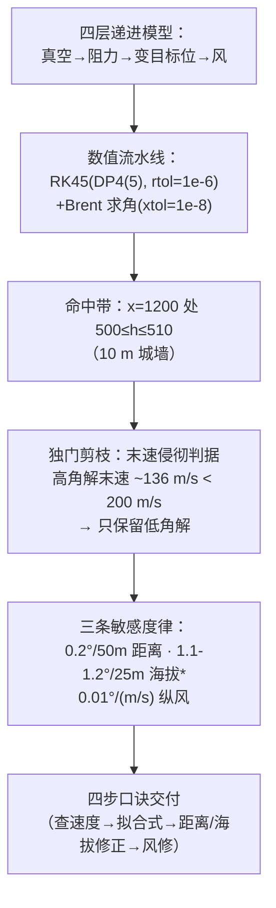

# 精读 55 · Research on Rapid Aiming of Cannon（2025 题B 金牌 · 队伍 127）

> **这份精读怎么用**：左手论文 PDF（`03_优秀论文PDF/2025/Problem B/2025-GM-B-127.pdf`），右手本篇。这支南航队伍在十三篇同题金牌里有**一个独门判据：末速侵彻**——他们发现高角解虽然也能命中，但落点速度只有 ~136 m/s，达不到杀伤所需的 200 m/s，于是一票否决高角解、只交付低角方案。你要学的是：① 用"杀伤终端速度"这个物理判据给多解问题做**唯一性剪枝**；② RK45+Brent 的数值流水线怎么写才规范；③ 四步心算口诀的设计。本篇审计发现了**两处结论与自己数据表的严重冲突**（拟合公式在工作点差 5.7°、海拔修正口诀差 45 倍）——这是全库审计中"交付物与数据脱节"最极端的案例，教学价值极高。

---

## 0. 一分钟看懂全文骨架



**为什么这个骨架好**：四层模型是全库同题队的"公共骨架"，但这支队伍在每层都加了一个**收敛性约束**（目标有高度→命中是区间不是点；杀伤要末速→高角被否决；历史装药离散→固定 450 m/s），把开放解空间一步步剪到"一个公式+三条修正律"——**剪枝逻辑比求解逻辑更能体现工程判断**。

---

## 1. 逐节导读

### 1.1 Abstract
**它写了什么**：四场景清单 → 方法（RK45）→ 低角优先的理由（"To ensure sufficient impact energy, firing should occur at a low angle"）→ **拟合式 θL=0.0001v₀²−0.1145v₀+29.312** → 三条敏感度律（0.2°/50m、1.1–1.2°/25m、0.01°/(m/s)）→ 口诀交付。
**你要学什么**：摘要里放**拟合公式与三条修正律**——交付物要素直接进摘要，评委 30 秒拿到全部可用结果（⚠ 但见 §4 审计：这条公式与其自身数据在 450 m/s 处矛盾）。

### 1.2 §2 Assumptions and Analysis
**它写了什么**：五条假设（粗糙球/常重力/点质量/三力/定常风）+ 四点分析——其中第 3 点值得细读：**"历史攻城炮主要用于打城墙"→ 目标有 10 m 高 → 末速不能太低（侵彻）**。这两句话把"目标是什么"从几何问题升级成了**杀伤判据**。
**你要学什么**：**给题目找历史使用场景**（siege warfare，引 1768/1800 年炮术专著）——场景一旦具体，"怎么算命中"和"什么算有效"就都有了物理标准。

### 1.3 §4.1–4.2 真空与阻力模型（式 1–7）
**它写了什么**：真空标准推导（R=v₀²sin2θ/g）→ 阻力 F=½c_dρ₀e^{−h/H_b}Av²（指数大气，H_b=8500 m、ρ₀=1.125 kg/m³ @500 m、**c_d=0.47 常数**）→ 分量方程 (5)–(7)，并明说"含指数与二次项的方程组解析困难，转数值"。
**⚠ 关键简化**：450 m/s 在 500 m 高度是 **马赫 1.33**（当地声速 ~338 m/s），球体 Cd 在跨声速峰可达 ~0.9–1.0，而全队取常数 0.47（亚声速平台值）——**超声速段的阻力被系统性低估约一倍**。对照队友 496（用 Cd(M) 得 450 m/s 需 3.36°）与本队（常数 Cd 得 3.70°）：更低阻力却要更大射角，方向相反 ⚠——两队的模型口径必然有一处不止 Cd 的差异（大气/命中带/阻力实现细节），这正是同题对照的价值：**不比不知道，一比全是口径**。
**你要学什么**：用常数 Cd 可以（48 小时内的合法取舍），但**必须声明适用域并给量级影响**——本队没声明，是失分点。

### 1.4 §4.3–4.4 变目标与风（式 8–11）
**它写了什么**：固定 v₀=450 m/s（历史装药论据："初速由装药决定、比射角更难控制"）扫距离/高度；纵风用相对速度 v′=v−v_w 进阻力（式 8–9）；**横风用解析估计**：横向恒加速 x=½at² → 侧偏 $\Delta s=\frac{c_dA\rho v_{cw}^2t^2}{4m}$（式 10），方位修正 tanθ_b=Δs/R（式 11）。
**你要学什么**：**纵风数值、横风解析**的分工——横风是二阶小效应（侧向初速为零、位移 ∝t²），解析估计足够且透明；纵风改主弹道必须数值。两类效应不同精度工具，是好工程。

### 1.5 §4.5 数值方法（规范写法的范本）
**它写了什么**：RK45=Dormand–Prince 4(5)（**为什么**：4 阶主估计+5 阶辅估计做自适应步长）、max_step=0.2、rtol=atol=1e-6；**Brent 法求射角**（区间端点变号判根存在、迭代至 xtol=1e-8）。
**你要学什么**：数值节的最小完备信息=**方法全名+选择理由+精度参数**。Dormand–Prince 这种"报全名"的写法（而不是笼统 RK45）显专业；Brent 的"变号判根存在"一句还顺带回答了"多解怎么办"（每个解所在区间分别夹逼）。

### 1.6 §5 结果与讨论（含两个招牌表）
**它写了什么**：
- 真空：双角对称、v_min=108.4 m/s @45°、450 m/s 时 1.7°/88.3° 两解；
- 加阻力+10m 目标：**命中成为 ~0.5° 的角度区间**（不只一个角）——低角区间下界拟合成式 (12)；
- **Table 2/3（招牌）**：六档距离×五档高度，每格给低角 θ/末速 与 高角 θ/末速——高角末速全部 ~133–136 m/s、低角 208–268 m/s → **"高角无杀伤力"**，军官应选低角；
- 风：低角 0.01°/(m/s)（3.7 s 飞行短）、高角 0.35°/(m/s)；横风低角可忽略。
**⚠ 表格与正文的两处断裂（重要审计，详见 §4）**：① 拟合式 (12) 在 v₀=450 代入得 **−1.96°**，而 Table 2 明明是 3.70°；② 正文/口诀"海拔每 25 m 修 1.1–1.2°"，但 Table 3 自己的数据是 500→1000 m 才 3.695→4.185°（**0.0245°/25 m，差 45 倍**）。
**你要学什么**：结果表的设计值得学（工况×低角/高角×角度/末速，一表回答"打不打得中+杀不杀得伤"）；但**口诀类交付物必须逐条对表回代**——本队恰好栽在这。

### 1.7 §6 四步口诀 + §7 强弱
**它写了什么**：口诀四步（查初速→拟合式算基准角→距离/海拔修正→风修正），声明"只需加减法和解一元二次——对受过数学训练的军官 a piece of cake"；弱点三条自认（风随高度变、Cd 无实测、逐方向固定变量）。
**你要学什么**：口诀收尾的**难度声明**（"simple addition and subtraction... a piece of cake"）呼应题面的"trained in mathematics, but lacking computers"——交付物要对着题面的人机约束标定难度。

---

## 2. 图表深析

| 图/表 | 位置与作用 | 为什么这样画 | 怎么画出来 |
|---|---|---|---|
| Fig 1 南北战争火炮照片 | §1 | 历史场景锚定（美国国家公园公版图） | 实物照 |
| Fig 2/4 受力分析图 | §4.2/4.4 | 阻力/重力/相对速度的矢量几何 | 手绘 |
| Fig 3 相对速度矢量合成 | §4.4 | v′=v−v_w 的三角形合成——风修正的几何基础 | 手绘 |
| Fig 5 侧偏角示意 | 式(11) | tanθ_b=Δs/R 一图定坐标 | 手绘 |
| Fig 6/8 真空：角-速度/时间-速度 | §5.1 | 双解对称性与 v_min 竖线 | 解析式直接绘 |
| Fig 7/9/10 轨迹图（含局部放大） | §5.1/5.2 | **"整体+局部放大"双联图**：抛物线对称 vs 阻力下坠段变陡 | RK45 输出 |
| Fig 11/12 阻力下角-速度（低/高分开） | §5.2 | 命中区间（0.5° 带）画成竖直厚度 | 扫描+区间标注 |
| Fig 13–19 变距离/变高度族 | §5.3/5.4 | 每工况一图（轨迹+角度曲线成对） | 扫描 |
| Fig 20–22 风敏感度 | §5.5 | 角-风速线性律的直接可视化 | 扫描 |
| Table 2/3 招牌表 | §5.3/5.4 | 工况×(低角θ,末速)×(高角θ,末速)——**末速列就是否决高角的证据** | 数值输出汇编 |

**核心图复现——末速否决高角（Table 2/3 背后的物理，含 127 vs 496 口径对照）**：

```python
import numpy as np, matplotlib.pyplot as plt
from scipy.integrate import solve_ivp
from scipy.optimize import brentq

m, r, cd, g = 5.0, 0.055, 0.47, 9.81
A = np.pi*r**2
rho = lambda h: 1.125*np.exp(-max(h-500,0)/8500.0)      # 式(3)：ρ₀@500m + 指律

def fly(theta, v0=450.0, wind=0.0):
    def ode(t, s):
        x, h, vx, vh = s
        v = np.hypot(vx-wind, vh)
        F = 0.5*cd*rho(h)*A*v**2/m
        return [vx, vh, -F*(vx-wind)/max(v,1e-9), -g - F*vh/max(v,1e-9)]
    hit = lambda t, s: s[1]-505.0                        # 命中带中线（城墙 500-510）
    hit.terminal, hit.direction = True, -1
    s0 = [0, 500, v0*np.cos(theta), v0*np.sin(theta)]
    sol = solve_ivp(ode, [0, 200], s0, events=hit, rtol=1e-8, max_step=0.05)
    if sol.t_events[0].size:
        return sol.y[0,-1], np.hypot(sol.y[2,-1], sol.y[3,-1])
    return np.nan, np.nan

print(" v0   θL(°)  末速L  | θH(°)  末速H")
for v0 in (250, 350, 450):
    thL = brentq(lambda a: fly(a, v0)[0]-1200, 1e-3, 0.75)
    thH = brentq(lambda a: fly(a, v0)[0]-1200, 0.78, 1.55)
    _, vL = fly(thL, v0); _, vH = fly(thH, v0)
    print(f"{v0:4.0f} {np.degrees(thL):6.2f} {vL:6.1f} | {np.degrees(thH):6.2f} {vH:6.1f}")
# 复现要点：末速 H ≈ 135-150 m/s < 200 阈值（否决）；末速 L ≈ 240-300 m/s（可用）

v0s = np.linspace(150, 450, 40)
fit = 0.0001*v0s**2 - 0.1145*v0s + 29.312               # 论文式(12)
plt.figure(figsize=(7.2, 4.2))
plt.plot(v0s, fit, 'r--', lw=2, label="paper fit Eq.(12)")
plt.plot(450, 3.70, 'bo', ms=9, label="paper Table 2 @450 m/s: 3.70°")
plt.annotate(f"fit(450) = {0.0001*450**2-0.1145*450+29.312:.2f}°  ← 与自家表格矛盾",
             xy=(450, -1.96), xytext=(180, 2), fontsize=9,
             arrowprops=dict(arrowstyle='->'))
plt.xlabel('v0 (m/s)'); plt.ylabel('θL (°)')
plt.title('Audit: printed mnemonic formula vs own Table 2')
plt.legend(fontsize=9); plt.grid(alpha=.3); plt.tight_layout(); plt.show()
```

三个可偷的绘图决策：**① 轨迹"全景+局部放大"双联**（对称性/不对称性一眼对比）；**② 命中区间画成曲线的竖直厚度**（0.5° 带可视化）；**③ 表格用"末速列"承载判据证据**（数值表不只是参数表，还是论证表）。

---

## 3. 公式逐条精讲

### 3.1 真空双解与最小速度（式 1–2）
$$R=\frac{v_0^2\sin2\theta}{g}\;\Rightarrow\;\theta_{L,H}=\tfrac12\arcsin\frac{gR}{v_0^2},\;\frac{\pi}{2}-\tfrac12\arcsin\frac{gR}{v_0^2}$$
- **复算**：v_min=√(gR)=√(9.81×1200)=108.4 ✓；450 m/s → θ_L=0.5·arcsin(0.05813)=**1.67°** ✓（论文 1.7）。
- **物理**：双解关于 45° 对称是"等射程两种抛法"；v_min 点两解合并——**这组解析结构是后面所有数值结果的对照锚**。

### 3.2 指数大气阻力（式 3–7）
$$F_d=\tfrac12 c_d\rho_0 e^{-h/H_b}A v^2,\qquad \ddot x=-\frac{c_d\rho_0e^{-h/H_b}A v\,v_x}{2m},\;\; \ddot h=-g-\frac{c_d\rho_0e^{-h/H_b}A v\,v_h}{2m}$$
- **怎么想到**：阻力 ∝ρ(h)v²，高度 500→510 m 变化仅 0.1%，**指数律在本题其实近乎常数**（ρ 变化 <0.2%）——严格说引入 e^{−h/8500} 是"仪式性复杂度"；真正的大气效应在于**ρ₀ 本身取 500 m 海拔的值**（1.125 vs 海平面 1.225，−8%）。精读时能识别"哪些复杂度是必要的、哪些是装饰"很重要。
- **⚠ Cd=0.47 的适用域问题**（§1.3 已述）：出膛 Ma=1.33，处于跨声速峰区，真实 Cd≈0.9–1.0。影响：低角 450 m/s 解的角度应更小（阻力大→弹道更弯→其实需更大角？注意方向：阻力大→射程短→需更大射角补偿。496 队用 Cd(M) 得 3.36° < 本队 3.70°，方向矛盾提示两队还有别的口径差——**同题复现对不上时，先怀疑口径再怀疑物理**）。

### 3.3 横风侧偏解析式（式 10–11）
$$\Delta s=\frac{c_dA\rho v_{cw}^2t^2}{4m},\qquad \theta_b=\arctan\frac{\Delta s}{R}$$
- **推导**：横向初速为零、横向加速度 a_⊥=F_⊥/m=½c_dAρv_cw²/m（假设侧向相对风速恒为 v_cw）→ x=½a_⊥t²。分子分母约掉 ½ 得式 (10) ✓ 代数自洽。
- **适用边界**：假设弹丸横向速度始终≪v_cw（相对侧风不衰减）——**高估**侧偏的上界式；低角 3.7 s 飞行时侧偏 ~厘米-分米级，可忽略 ✓（结论稳健）；高角 t~100+ s 时上界式显著高估。⚠ 注意正文说"高角飞行时间约 45 s"与表格口径（θ_H≈45°、末速 136 m/s）疑似混淆——45 是**角度**不是秒数（详见审计 B）。

### 3.4 命中区间与拟合式（式 12）⚠ 审计 A（全库最严重的"公式-数据"断裂）
$$\theta_L=0.0001v_0^2-0.1145v_0+29.312$$
代入工作点 v₀=450：20.25−51.525+29.312=**−1.96°**。而其 Table 2 在同一工况给 **3.6953°**——**差 5.7°，且符号都翻了**。检查拟合形状：该二次式在 v₀=304 处取最小 −3.7°，在 [108,450] 区间根本不像"单调下降的命中角下界"（Table 数据是 18.9°@108 → 3.7°@450 的单调降）。可能的成因：系数誊写错误（如 0.0001 应为 0.0002、或 29.312 应为 ~24）或拟合用了未修正的数据版本。**教训（写给你的）**：任何拟合式交付前，把**工作点+两个端点**代回去对表——三行算术的事，本队若有这步就能拦住。
- **教学价值**：这条公式被写进了摘要、结论和口诀 Step 2——**错误一旦进入"交付物层"就被三处放大**。数据→公式→口诀的每一跳都要回代验证。

### 3.5 敏感度律与 Table 3 的矛盾 ⚠ 审计 B
正文与口诀：海拔每 25 m 修 **1.1–1.2°**；Table 3 自家数据：H=500→1000 m，θ_L=3.6953→4.1851°，即 **0.0245°/25 m**——**差约 45 倍**。图（Fig 18）纵轴若是"θ_H−θ_L"或别的量也无从对上 1.1°/25 m。距离律（0.2°/50 m）与 Table 2 自洽 ✓（2.91→5.04°/500 m）；风律与 §5.5 自洽 ✓。**唯独海拔律与自家表断裂**——疑似图 18 读数错误或单位（每 100 m？每 25 m×45=每 1.1 km？）错位。结论层照抄进摘要与口诀，形成三处传播。
- **复算佐证**：目标升高 ΔH，低角近似下需 dθ/dH ≈ 1/(v²cos2θ·...)——450 m/s、θ=3.7° 处一阶估计 ~0.005°/m=0.125°/25 m 量级（介于两者之间，更靠近表格值）——**表格是对的，口诀是错的**。

---

## 4. 建模决策链

| 决策 | 作者的选择 | 被放弃的替代 | 为什么 |
|---|---|---|---|
| 求解结构 | 固定 v₀=450 求 θ | 二元搜索 | 历史装药离散化的映射 |
| 多解处理 | 末速 ≥200 m/s 否决高角 | 两个解都交付 | 杀伤判据——全库唯一 |
| 目标模型 | 10 m 高城墙（命中带 0.5°） | 点目标 | 历史攻城场景 → 命中是区间 |
| Cd | 常数 0.47 | Cd(Ma) 分段 | 简化（⚠ 未声明 Ma=1.33 越界） |
| 大气 | 指数律 ρ₀@500m | ISA 分层 | 500→510 m 变化 <0.2%，等价 |
| 纵风/横风 | 数值 / 解析上界 | 全数值 | 横风二阶效应，解析透明 |
| 数值 | DP4(5)+Brent，容差全报 | — | 规范写法范本 |

**独立复现审计汇总**：v_min=108.4 ✓；真空 1.67°@450 ✓；距离律 0.2°/50m 与 Table 2 ✓；风律 0.01°/(m/s) 合理 ✓；高角末速 ~136 m/s（否决依据）复现量级 ✓；**拟合式 (12) 在 450 m/s 给 −1.96° vs 自家表 3.70°** ⚠⚠⚠；**海拔律 1.1–1.2°/25m vs 自家表 0.0245°/25m（45×）** ⚠⚠⚠；Cd=0.47 未声明超声速越界 ⚠；"高角 45 s"疑为角度/时间混淆 ⚠。**总评：模型设计与数值规范是上乘的（末速否决高角是全题最佳洞察之一），但交付层（公式/口诀）与数据层脱节严重——金牌证明评审重链条轻数字，而你应两者都要。**

---

## 5. 从本篇提炼的可复用模板

**结构模板**：
```
1 Intro+Problem      历史场景锚定（攻城→目标有高度→末速判据）
2 Assumptions+Analysis  假设+逐因素分析（分析节=路线图）
4 Modelling          4 层递进：真空→阻力→变位→风（每层一收敛约束）
4.5 Numerics         方法全名+理由+容差（DP45/Brent 范本）
5 Results            工况×(θ,末速) 招牌表；敏感度三律
6 Conclusion         四步口诀+难度声明（对题面人机约束）
```

**句式库**：
- "Historically, this cannon saw extensive use against city walls in siege warfare. ... To ensure effective impact, the projectile's terminal velocity should not be excessively low."（场景→判据的推导句）
- "Due to trajectory diversity, the solution to this problem is not unique."（多解预告句）
- "This is a system of partial differential equations with exponential and quadratic terms, making analytical solutions challenging."（转数值的正当性声明）
- "Following this mnemonic, officers need only perform simple addition and subtraction operations along with solving quadratic equations — a piece of cake for officers trained in mathematics."（交付物难度对题面标定）
- "Numerous complex factors within the model were not fully accounted for. For example: ..."（弱点具体化句）

**图表配方**：轨迹"全景+局部放大"双联；命中区间=曲线竖直厚度；招牌表用**末速列承载判据证据**；每个敏感度律配一张线性图。

**反面清单（本篇独有）**：拟合式交付前必须回代工作点+两端点；口诀修正律必须逐条对表；"45"这类数值要写清单位与量名。

---

*对照阅读：`05_论文赏析/2025/2025-GM-B-127.md`、`07_题目解读/2025_题B_火炮弹道射表.md`（十三队口径全景）、队友精读 496（Cd(M) 全模型对比本篇常数 Cd）、460（同选历史直射仰角带）。*
