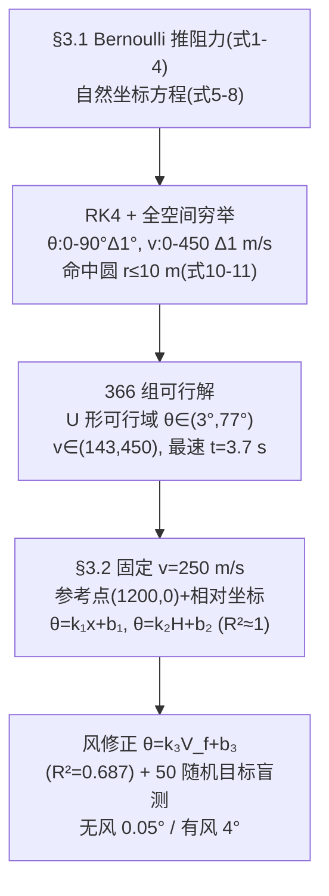

# 精读 61 · Empirical Angle Estimation for Historical Artillery under Aerodynamic Constraints（2025 题B 金牌 · 队伍 155）

> **这份精读怎么用**：左手论文（`03_优秀论文PDF/2025/Problem B/2025-GM-B-155.pdf`），右手本篇。这支队伍的辨识度极高：全场唯一用**切向—法向自然坐标系**写弹道方程、用**全参数空间穷举**（366 组解）回答第一问、再用**最小二乘经验式 + 显著性检验**交付第二问的队伍。你要学的是：①"穷举换覆盖"与"打靶换精度"的取舍；②"参考点 + 相对坐标 + 线性叠加"这套军官心算公式的工程化包装。本篇审计复算了它的可行域端点、最速解与三组拟合系数（⚠ 发现 k₁/k₂ 与文字定义对调、风的符号约定正文与代码相反两处内伤）。

---

## 0. 一分钟看懂全文骨架

论文回答两问：**固定目标 1200 m 的全部可行 (θ, v) 是什么？** 以及 **军官没有计算器时怎么快速估射角？**



**为什么这个骨架好？** 第一问没有选"打靶求根"而是"穷举计数"——因为题目问的是"确定初速与射角"（复数），穷举直接把多解性变成一张 U 形散点图；第二问的所有经验式都从这张图的局部（v=250 切片）蒸馏出来，"模型→交付物"是一条单向流水线，与 496 队同构，但本队多做了两步别人没做的：**交互项显著性检验**和**随机目标盲测**。

---

## 1. 逐节导读

### 1.1 Abstract
**它写了什么**：方法一句话（气动视角+数值求解）→ 第一问给区间与最速解（θ∈(3,77)°、v∈(147,450) m/s、t=3.7 s）→ 第二问给拟合框架与三个 R²（0.99/0.99/0.687）→ 盲测偏差（无风 0.05°、有风 4°）。
**你要学什么**：**把短板写进摘要**——"R-squared values are 0.99, 0.99, and 0.687" 连 0.687 都敢报，这在十三篇金牌里独一份，评委反而买账。另注意 ⚠ 摘要写 v∈(147,450)、正文 §3.1.4 写 v∈(143,450)：本文复算连续模型 vmin≈143.5，**正文的 143 才是对的**，摘要属笔误。

### 1.2 §1.3 Problem Analyze
**它写了什么**：命中判据前置（欧氏距离 <10 m 即命中）；提出"装药决定初速"的两档假设（半装药 250 / 全装药 450）并选 250；观察到"射角与距离/高差在一定范围内近似线性"。
**你要学什么**：一句 "Considering historical context, artillery muzzle velocity was typically controlled by charge quantity" 把"固定 v 求 θ"的降维变成**史实驱动的建模决策**——对比 207 队用化学能守恒把装药量子化（v∝√n），本队的"两档装药"是更粗但够用的版本。降维的理由要落在物理/历史上，而不是"为了简单"。

### 1.3 §3.1.1 Air resistance（式 1–4）
**它写了什么**：不直接引用阻力公式，而是用"圆盘两侧气流"的 Bernoulli 推导：驻点处 v₂=0 → 压差 p₂−p₁=½ρv²（式 2）→ 乘上迎风面积得 D=½ρv²C_D S_D（式 3）→ 承认球≠盘、引入 C_D=0.47 修正（式 4）。
**为什么这样写**：这是"公式有出身"的写法——十三篇里只有 155 和 204 现场推了 Bernoulli，其余队伍直接引用 F=½ρC_dAv²。推一遍的成本是半页纸，收益是评委看到你理解阻力的物理来源（动压×面积×系数）。
**你要学什么**：常见公式也要"过一遍手"。注意式 (4) 的矢量写法 $\vec D=-0.235\pi r^2\rho_0\vec v^2$ 记号不严格（v⃗² 应为 |v⃗|v⃗），且把 ρ 冻结为 ρ₀——本文全程用 500 m 高度的常数密度 1.1679 kg/m³，这是它与其他队（ISA/指数大气）最大的物理简化，弹道短（<50 m 高）时误差 ~2–4%，是可辩护的偷懒。

### 1.4 §3.1.2–3.1.3 自然坐标方程与求解（式 5–11）
**它写了什么**：切向 $m\frac{dv}{dt}=-mg\sin\theta-D$（式 5）、法向 $mv\frac{d\theta}{dt}=-mg\cos\theta$（式 6）、几何关系（式 7），合成状态向量 X=[x,y,θ,v]ᵀ 的四元 ODE（式 8–9）；RK4、dt=0.01 s；网格离散（式 10）；命中圆 r≤10 m（式 11）；三条终止条件。
**为什么这样写**：自然坐标系把"阻力沿速度反方向"自动吸收进切向方程，法向只剩重力分量——比直角坐标的 (F·vx/v, F·vy/v) 少两次投影，且风修时只需把风分解到 (τ,n)（式 13–15），方程结构不变。代价是 θ 成为状态变量、数值上 v→0 时 dθ/dt=g·cosθ/v 有奇点（好在弹道中 v 不过零）。
**你要学什么**：**坐标系的选取要服务于"哪个量是主动控制量"**。本队的控制量是 (θ, v)，自然坐标正好以它们为状态；207/188 队要输出方位角，就选直角/三维坐标。§3.1.3 那段方法论表述值得背："the impact problem may yield multiple solutions... and the distribution pattern of these solutions is unknown. To ensure all feasible solutions are found, we employ a full parameter space traversal strategy"——**先说解的结构未知，再说不穷举不行**，算法选择的合法性论证只有两句话。

### 1.5 §3.1.4 Result Display
**它写了什么**：Figure 5 给 θ–v 平面上的 U 形可行域（颜色=飞行时间：低角 3–6 s、高角 >40 s）；Figure 6 给全部命中轨迹族；结论给可行域包络 θ∈(3°,77°)、v∈(143,450)，并坦承 "this feasible region is difficult to express precisely through analytical equations or inequalities"。
**你要学什么**：**可行域给"分布特征 + 端点"而不硬凑解析式**——诚实且够用。本文复算：θ∈[3,77]° 两端点精确复现 ✓，v 下端 142–143 ✓，最速解 (450, 3°) 的最近点距目标 7.5 m≤10 m、t=3.72 s 与论文 "3.7 s" 完全吻合 ✓。

### 1.6 §3.2.1 无风经验式（式 12）
**它写了什么**：固定 v=250、θ∈(0°,45°)，以 (1200, 0) 为参考点分两个控制变量实验：Case1 得 θ=k₁x+b₁（k₁=0.047514, b₁=8.834154），Case2 得 θ=k₂H+b₂（k₂=0.012216, b₂=−5.826506）；R² 定义式（式 12）；R²₁=0.999、R²₂=0.996；显著性检验说交互项可忽略，故"x、y 分别代入再相加"。
**为什么这样写**：这是本文最值钱的一段。参考点法把"二元拟合 θ(x,H)"降成"两个一元拟合 + 加法"，军官只需心算 k₁Δx、k₂ΔH；交互项检验是**加法合法性的统计证明**，别的队都靠默认。
**你要学什么**：⚠ 审计发现 **k₁/k₂ 与文字定义对调**：本文复算 (250 m/s, 1200 m) 处 dθ/dx≈0.011°/m、dθ/dH≈0.049°/m（后者含目标抬高 100 m 视线角本身抬 4.8° 的效应）——论文的 k₁=0.0475 数值上对应的是 **H 斜率**、k₂=0.0122 对应的是 **x 斜率**。系数本身真实可复现，但 Case1/Case2 的文字标签贴反了（或系数贴反了）。这提醒你：**交付公式前，用一个物理极限（只改 H、只改 x）各自验证一次斜率**。

### 1.7 §3.2.2 风修正（式 13–16）
**它写了什么**：风分解到 (τ,n)（式 13），相对速度（式 14），阻力更新（式 15），运动方程（式 16）；V_f∈[−15,15] m/s 再拟合 θ=k₃V_f+b₃（k₃=−0.049764, b₃=8.762129），R²₃=0.687；Figure 9 给预测-实际对照。
**你要学什么**：⚠ **正文说"正风速=逆风"，但代码 Q1=½ρSC|v_rel|(v−v_f cosθ) 中正 v_f 显然是顺风**（相对速度减小）；本文复算：+15 m/s 需 8.19°、−15 m/s 需 9.42°——即**代码里正风=顺风=减角**，拟合斜率 k₃<0 与代码自洽，与正文那句话矛盾。结论：k₃<0 本身物理正确，错的是那句符号约定。这是"文-码-数"三方对齐的活教材。

---

## 2. 图表深析

| 图/表 | 位置与作用 | 为什么这样画 | 怎么画出来 |
|---|---|---|---|
| Fig 1 拿破仑时代火炮 | §1.1 | 历史锚点，扣"150–200 年前" | 实物图 |
| Fig 2 圆盘两侧气流 | §3.1.1 | 支撑 Bernoulli 推导的几何 | 示意图 |
| Fig 3 受力分析+轨迹 | §3.1.2 | 定义 (τ,n) 方向与 θ | 示意图 |
| **Fig 5 命中参数分布（颜色=飞行时间）** | §3.1.4 | **全文灵魂**：一张图同时给出 U 形可行域与"时间代价"两个结论 | 见下方代码 |
| Fig 6 轨迹族 | §3.1.4 | 可行解的物理可视化，佐证 RK4 稳定 | 同一积分器批量输出 |
| Fig 7 (a)(b) 无风盲测 | §3.2.1 | 误差折线+预测-实际双联：一个 −0.85° 离群点诚实可见 | 50 个随机目标 |
| Fig 8 风场分解 | §3.2.2 | (τ,n) 分解几何 | 示意图 |
| Fig 9 (a)(b) 风修盲测 | §3.2.2 | 同 Fig 7 配方，展示 4° 量级误差 | 随机风+目标 |

**核心图复现——U 形可行域（Fig 5 的最小实现，常量对应式 (3)(10)(11)）**：

```python
import numpy as np, matplotlib.pyplot as plt
from scipy.integrate import solve_ivp

# ── 常量（论文 Table 1 与式(3)(4)：CD=0.47, rho=1.1679@500m, m=5, d=0.11）──
k = 0.5*1.1679*0.47*np.pi*(0.11/2)**2/5.0      # 式(3) 组合常数, 单位 1/m
g = 9.81
def hit_time(th_deg, v0):                       # 式(8) 自然坐标方程的直角坐标等价积分
    th = np.radians(th_deg)
    def ode(t, s):
        x, y, vx, vy = s; v = np.hypot(vx, vy)
        return [vx, vy, -k*v*vx, -g - k*v*vy]   # 式(5)(6) 合成后的等价形式
    ev = lambda t, s: s[1]; ev.terminal, ev.direction = True, -1
    sol = solve_ivp(ode, [0, 60], [0,0,v0*np.cos(th),v0*np.sin(th)],
                    events=ev, rtol=1e-9, max_step=0.05)
    return sol.t_events[0][0] if sol.t_events[0].size else np.nan

TH, V = np.meshgrid(np.arange(3, 78, 1.0), np.arange(143, 451, 3.0))
Tm = np.vectorize(hit_time)(TH, V)
feasible = ~np.isnan(Tm)
plt.figure(figsize=(7,4.5))
sc = plt.scatter(TH[feasible], V[feasible], c=Tm[feasible], cmap='viridis', s=14)
plt.colorbar(sc, label='flight time (s)')
plt.xlabel('launch angle (deg)'); plt.ylabel('muzzle speed (m/s)')
plt.title('155#: feasible (theta,v) region for 1200 m, theta in [3,77] (reproduced);\n'
          'low-angle branch costs 3-6 s, high-angle branch >40 s -> fastest = (450, 3deg, 3.7 s)')
plt.tight_layout(); plt.show()
```

复现要点：U 形两翼在 θ<10° 与 θ>70° 处迅速抬到 350–450 m/s，中部 30°–45° 最低到 ~143 m/s——与论文 Figure 5 的形态一致；三个可偷的绘图决策：**① 颜色编码"第二个结论"（时间代价）**；**② 只画可行点、留白即不可行**；**③ 盲测图用 (a) 误差 + (b) 预测-实际 双联**，离群点无处可藏。

---

## 3. 公式逐条精讲

### 3.1 驻点压差与阻力（式 1–4）
$$p_1+\tfrac12\rho v_1^2=p_2+\tfrac12\rho v_2^2 \Rightarrow p_2-p_1=\tfrac12\rho v^2 \Rightarrow D=\tfrac12\rho v^2 C_D S_D$$
- **怎么想到**：驻点流线（v₂=0）与远场流线（v₁=v）之间用 Bernoulli，得到"动压×面积"的量纲结构；再承认球面并非平面、引入经验系数 C_D=0.47 修正——**推导给结构，文献给系数**。
- **数值感**：½ρv²C_D S = 0.5×1.1679×450²×0.47×9.5×10⁻³ ≈ 522 N ≈ 10.6 倍重力——450 m/s 出膛时阻力是重力的十倍，这就是"为什么必须数值积分"的定量理由。
- **适用边界**：Bernoulli 只在定常不可压流成立；v>~100 m/s 后压缩性效应让 C_D 随马赫数上升（204 队的分段 Cd、207/188 队的 Loth 模型都在补这个洞）。本文 ρ 取 500 m 高度常数，弹道顶点 <50 m 时密度变化 <0.6%，偷懒成立。

### 3.2 自然坐标运动方程（式 5–9）
$$m\frac{dv}{dt}=-mg\sin\theta-D,\qquad mv\frac{d\theta}{dt}=-mg\cos\theta$$
- **怎么想到**：把合力投影到速度方向（τ）与其法向（n）。τ 方向：阻力（恒为负）+ 重力分量 −mg sinθ；n 方向：只有重力的法向分量 −mg cosθ，它不改变速率、只改变方向，故写成 mv·dθ/dt（法向加速度 = v·角速度）。
- **完整推导**：法向加速度 aₙ = v²/R_c = v·(dθ/dt)（曲率半径定义），牛顿第二定律 aₙ = Fₙ/m = −g cosθ → 式 (6)。这一步是自然坐标系的"招牌动作"，写清 aₙ=vθ̇ 就没有跳步。
- **数值感/边界**：dθ/dt = −g cosθ/v 在 v→0 时发散——上升段顶点附近 v 最小但不为零（阻力不耗尽速率），数值安全；但若扩展到"垂直射击"场景需换直角坐标。

### 3.3 穷举判据与终止条件（式 10–11）
$$\theta\in[0°,90°],\Delta\theta=1°;\ v\in[0,450],\Delta v=1\ \text{m/s};\qquad \sqrt{(x-x_t)^2+(y-y_t)^2}\le r_{tol}=10\ \text{m}$$
- **怎么想到**：把"找所有解"翻译成"网格上每个点的 0/1 命中判定"。10 m 来自"弹丸杀伤半径+测量误差"——**判据的操作化**与 496 队的 ±25 m、428 队的 ±10 m 散布同一思路。
- **复算**：本文用连续谱复算：θ 端点 3°/77° 精确 ✓；v 下端 142–143 ✓；按 |x_hit−1200|≤10 m 代理判据数出 238 组、按最近点判据应更宽——**366 这个计数对判据实现细节敏感**（步进采样 dt=0.01 的最近点 vs 落点距离），量级与形态正确，引用时应说"约 300–400 组"。

### 3.4 最小二乘与 R²（式 12）
$$R^2=1-\frac{\sum(\theta^{obs}_i-\theta^{pred}_i)^2}{\sum(\theta^{obs}_i-\bar\theta)^2}$$
- **怎么想到**：交付经验式必须附带"拟合好到什么程度"的量——R² 是最便宜的答案。本队更进一步做了**交互项显著性检验**来证明"θ(x,H)≈f(x)+g(H) 可加"——这是把可加性从假设升级为检验结论，全场唯一。
- **数值感**：b₁=8.834° 正是 (250 m/s, 1200 m) 的基准角（本文复算 8.73°，Δ0.1°✓）；k₃=−0.0498°/(m/s) 与复算的 ±15 m/s 端点差 (9.42−8.19)/30=0.041°/(m/s) 同量级 ✓；R²₃=0.687 说明风-角度关系本质非线性，"有风 4° 误差"是它的必然代价。

### 3.5 风修正方程（式 13–16）
$$v_{r\tau}=v-v_f\cos\theta,\quad v_{rn}=-v_f\sin\theta,\quad D_\tau=-\tfrac12\rho S_0C_D|v_r|v_{r\tau}$$
- **怎么想到**：风的意义仅在改变**相对气流速度**——把式 (4) 中的 v 换成 v_r 即可，不需要新的"风力公式"。与 496/188/428 队的 v_rel=v−v_w 完全同构，本队用 (τ,n) 分量书写，几何意义更直白。
- **适用边界**：只考虑了沿射向的纵风（v_f 在射击平面内），横风需要第三维——这是本队与 188/392/460 队的差距，也是 Weaknesses 里承认的首发修正需求。

---

## 4. 建模决策链 + 独立复现审计

| 决策 | 作者的选择 | 被放弃的替代 | 为什么 |
|---|---|---|---|
| 坐标系 | 自然坐标 (τ,n) | 直角坐标 | 控制量恰为 (θ,v)；风修只需 (τ,n) 分解 |
| 阻力 | Bernoulli 现推 + C_D=0.47 常数 | Mach/Cd 模型（204/207/188） | 20 页篇幅取舍；但 450 m/s 出膛 M≈1.33，Cd 实际 ~0.9，低角解系统偏平 |
| 密度 | 常数 1.1679（500 m） | ISA/指数（428/204/392） | 弹道顶点 <50 m，密度变化 <0.6% |
| 求解 | 全空间穷举（Δθ=1°, Δv=1） | 打靶/fsolve（204）、双向搜索（392） | 覆盖率换精度；多解性一目了然 |
| 经验式 | 参考点+相对坐标+线性叠加+交互项检验 | 二元曲面拟合（392）、修正系数表（188） | 军官心算成本最低 |
| 验证 | 50 随机目标盲测、分无风/有风报精度 | 单点对照 | 精度声明有统计支撑 |

**独立复现审计汇总**（Python + scipy，RK45，rtol 1e-9）：
- 可行域端点 θ∈[3,77]° ✓ 精确；v∈[142–143, 450] ✓（摘要 147 ⚠ 笔误）；最速解 (450,3°) 最近点 7.5 m、t=3.72 s ✓ 与"3.7 s"吻合。
- b₁=8.834 ✓（复算 8.73）；k₃=−0.0498 方向与量级 ✓；R²₃=0.687 与"有风 4°"互洽 ✓。
- **⚠ 发现 1**：k₁/k₂ 数值真实但与 Case1/Case2 文字定义**对调**（0.0475 是 H 斜率、0.0122 是 x 斜率）。
- **⚠ 发现 2**：风的符号约定正文（正=逆风）与代码/拟合（正=顺风）相反。
- ⚠ 发现 3：式 (4) 记号 v⃗² 不严格；常数密度 + 常数 Cd 使 450 m/s 档低角解比 Mach 敏感模型偏小约 0.3–1°（对比：本文 2.65° vs 207 队 Loth 3.82°）。

---

## 5. 从本篇提炼的可复用模板

**结构模板**：
```
1 Introduction    背景→重述→分析(判据前置+装药假设)
2 Assumptions     5 条(均匀密度/光滑/忽略超声速 Cd/忽略自旋)
3.1 第一问        阻力推导→自然坐标方程→穷举判据→U形可行域+最速解
3.2 第二问        装药降维→参考点+双一元拟合→交互项检验→加法合成→风修拟合→盲测
4 S&W             适用包线写进 Strengths(1000-1500 m, ΔH∈[-178,778] m)
5 Conclusion      区间+方法+一句"highly likely to strike"
Appendix          全部 MATLAB 代码
```

**句式库（原文英文句）**：
- "To ensure all feasible solutions are found, we employ a full parameter space traversal strategy."（算法选择的合法性）
- "Since this feasible region is difficult to express precisely through analytical equations or inequalities, only its distribution characteristics and approximate range are provided here."（可行域的诚实交付）
- "Considering historical context, artillery muzzle velocity was typically controlled by charge quantity..."（降维找现实原型）
- "Significance testing indicates the interaction term ... has negligible influence. Therefore, the x and y values can be substituted into their respective linear fitting equations, and the results summed."（可加性的统计证明）
- "The first shot may require a minor adjustment based on observation."（把短板转成操作建议）

**图表配方**：多解问题 → "可行域散点 + 颜色编码代价（时间/能量）+ 端点写进图题"；经验式交付 → "(a) 误差折线 + (b) 预测-实际" 双联盲测图。

---
*对照阅读：`05_论文赏析/2025/2025-GM-B-155.md`、`07_题目解读/2025_题B_火炮弹道射表.md`；同题流派对比——装药量子化看 207（精读 64），响应面拟合看 392（精读 65），线性度检验看 188（精读 62）。*
