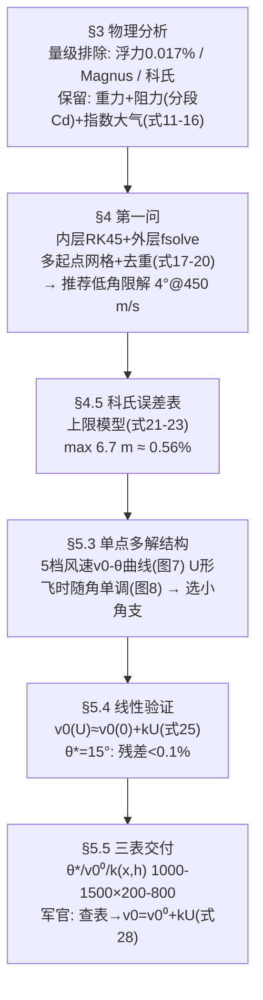

# 精读 63 · Analysis of Artillery Firing Parameters（2025 题B 金牌 · 队伍 204）

> **这份精读怎么用**：左手论文（`03_优秀论文PDF/2025/Problem B/2025-GM-B-204.pdf`，37 页），右手本篇。这支队伍的三张名片：①**数量级排除**（浮力/马格努斯/科氏全部用数字赶走，还附一张五工况科氏偏移表）；②**fsolve 多起点 + 去重**的方程组式解法（vs 别队的打靶/穷举）；③全场独有的**"修初速不修角度"**射表设计——三张表 (θ*, v₀⁰, k) 把风修压缩成一次乘法一次加法。你要学的核心是 §5.4：先证明 v₀(U) 线性、再建表——"先验证近似、再用近似"的完整闭环。本篇审计复算了推荐解、最小速度、线性度与科氏表（⚠ 发现 H 的文字定义错、科氏表口径与公式不符两处小伤）。

---

## 0. 一分钟看懂全文骨架



**为什么这个骨架好？** 它把两问当成**同一个求解框架的两次调用**（§5.1 明说"直接采用第一问框架"），增量只有风场一项；而第二问真正的智力增量全在"解的筛选逻辑"上——多解结构分析（图 7）→ 飞时判据（图 8）→ 小角支的三条工程理由（§5.3.3）→ 线性验证（§5.4）。**先决定"要哪个解"，再为那个解建表**，这个顺序比直接建表高明。

---

## 1. 逐节导读

### 1.1 Summary（摘要）
**它写了什么**：方法链一句话（dimensional analysis → particle model → piecewise shock-drag → RK/fsolve/multi-start/dedup）→ 第一问答案（低角限解 4°@450）→ 第二问核心（线性风修 v₀(U)≈v₀⁰+kU + 三表）。
**你要学什么**：**"reducing the dynamics to a particle ballistic model" 前面先摆 elimination 的证据**——摘要第一段就把"排除了什么"与"保留了什么"并列。对比 496 队摘要把假设塞在正文：204 队的摘要即路线图。另外它给第一问的答案是一个**带决策依据的解**（"by balancing flight time, wind sensitivity, and engineering practicality"），而不是解的清单——回答"哪个解好"比回答"有哪些解"更近题意。

### 1.2 §3.1 Force Analysis（式 1–10）
**它写了什么**：重力常数化（h≪R）；浮力 Archimedes：F_buoy=0.0084 N，仅重力的 0.017%，舍；阻力用与 155 队同款 Bernoulli 圆盘推导（式 3–5）+ C_D=0.47（式 6）；科氏力写出表达式（式 7）但"留到 §4.5 定量处决"；马格努斯用 Bernoulli 推出 F_Mag 表达式（式 8–10）后声明"分散且远小于重力与阻力"，放弃最初假设的 4-DOF 自旋模型，改用质点模型。
**为什么这样写**：这是标准的"**写出→算出→处决**"三步：每个被排除的力都有公式、有数字、有出处，而不是一句"忽略不计"。尤其 Magnus：先按 4-DOF 假设推完，再自己推翻——"我们考虑过，量级不够"比"没考虑过"可信一个量级。
**你要学什么**：排除效应的完整句式："we found that for a model of 19th-century cannon, the effects of rotation and the Magnus force are dispersed and far smaller than those of gravity and drag. Therefore... we will not adopt the initially assumed 4DoF spin model"。⚠ 顺带抓一个小错：式 (15) 附近文字说 H≈8400 m 是"the characteristic altitude at which air density is halved"——错，8400 m 是**e 折高度**（ρ 降到 1/e≈36.8%），减半高度是 H·ln2≈5822 m。公式对、解释错。

### 1.3 §3.2–3.3 指数大气与分段 Cd（式 11–16）
**它写了什么**：静力学平衡 dp=−ρg dh（11）+ 理想气体（12）+ 等温假设（13）→ 积分得 ρ=ρ₀e^{−h/H}（14）→ 引入海拔参数（15）；Cd(M) 四段线性插值：M<0.7 取 0.45 → 0.7–1.1 线性升至 1.0 → 1.1–1.5 降至 0.8 → M>1.5 平台 0.8，并自承 "the function curve is non-linear, but we have simplified it here by making a linear approximation"。
**为什么这样写**：等温指数大气是 ISA 的"一参数摘要"——本文弹道顶点 <300 m，两者差 <3%。分段线性 Cd 则是跨声速峰的"低保真速写"：出膛 M=1.32 处 Cd≈0.89，介于常数 0.47（155/428）与 Loth 峰值 0.98（207/188）之间——**它的推荐解恰好卡在两队之间**（见审计）。
**你要学什么**：Cd(M) 分段线性是"想保留跨声速物理又不想引全套 Loth 公式"的最短路径；引用时**必须声明每段端点值**（本文在代码注释里给全了），否则无法复现。

### 1.4 §4.3–4.4 求解框架（式 17–20）
**它写了什么**：把命中条件写成二维方程组（17）：给定 (v₀,θ) 积分到 x>x_target 插值落点，残差 F=(x_f−x_t, y_f−y_t)（20）；内层 ode45、外层 **fsolve**；**超初速惩罚**（残差∝超限量）；多起点：角分三段（低 5–30°/中 31–50°/高 51–85°）非均匀撒点 × 初速 [250,450] 等距，meshgrid 生成数百初始点，逐点独立 fsolve；**去重**：按 (v₀,θ) 排序后相邻比较，Δv≤2 m/s 且 Δθ≤5° 判为重复。
**为什么这样写**：fsolve 是局部求解器，多解问题必须靠初值散布 + 去重来" globalization"。与 155 队穷举对比：穷举用算力换覆盖率、解的精度只有网格步长；**fsolve 多起点用算力换"每个解都收敛到 5×10⁻³ m"**——解的质量高一档，但可能漏解（初值盆地之间的窄解）。
**你要学什么**：①"inner-layer numerical integration + outer-layer nonlinear equation solving + multi-start search" 这套分层话术；②**去重阈值本身要声明**（Δv≤2 且 Δθ≤5°）——不写阈值的多解清单无法检验；③惩罚函数把约束（v₀≤450）嵌进残差："the residual function imposes a penalty for exceeding the maximum initial velocity... ensuring the iteration process consistently satisfies the initial velocity constraint"。

### 1.5 §4.5 科氏误差表（式 21–24）
**它写了什么**：上限模型三条假设（ω⊥v 取最大方向；只算水平分量 a_c=2ω₀v_x（21）；飞时用解析式 T=2v₀sinθ/g（22））→ 横偏 Δx=½a_cT²（23）→ 五个工况代入得 0.8–6.7 m，最大 6.7/1200≈0.56%（24）→ 结论：远小于阻力模型/风场的不确定度，二维化合理。
**你要学什么**：**误差分析要给"上限"而非"典型值"**——三条假设全部朝保守方向偏。本文复算（ω₀=7.292×10⁻⁵）：前三行与"仿真飞时"口径吻合（0.84/1.37/1.88 vs 论文 0.8/1.3/1.9 ✓✓✓），后两行介于解析飞时（3.78/8.20）与仿真飞时（2.63/4.49）之间——⚠ 数值合理但与式 (22) 声称的"解析飞时"口径不完全一致；好在结论（<10 m、≤0.6%）对口径选择稳健。

### 1.6 §5.3 单点多解结构分析（图 7–8）
**它写了什么**：固定 1200 m 同高目标，扫 5 档风速（−10,−5,0,+5,+10）的 v₀–θ 曲线（图 7，U 形，小角高速区各风速曲线**挤在一起**）；无风时飞时随 θ 单调增（图 8）；由此给小角支三条理由：飞时短（拦截快）、对初速误差鲁棒（曲线簇密集区）、**线性风修在小角区最准**（§5.4 验证）。
**为什么这样写**：这是"解的选举"——多解不是麻烦而是选项，选哪个要有 **(i) 飞行时间 (ii) 风敏感度 (iii) 工程可实现性** 三条判据。别的队大多一句"取低角因为时间短"，本队把三条理由各自论证了一遍。
**你要学什么**：给"推荐解"写选举章：图 7 的"曲线簇间距"是一个很妙的可视化论证——**风速敏感度 = 曲线簇的散开程度**，一张图同时回答"哪里选解对风不敏感"。

### 1.7 §5.4 线性验证（式 25–27）
**它写了什么**：固定 θ*=15°，在 U∈[−10,10] 逐点解精确 v₀(U)（式 26/27 的真空解析解做 fsolve 初值），最小二乘拟合 v₀(U)≈v₀⁰+kU（25）；结果"almost perfectly coincide"，残差相对 ~190 m/s 的初速远小于 1%；再用拟合值重积分，落点高度偏差大多 ±0.5 m、极端顺风 <1–1.5 m。
**你要学什么**：这是全文的**方法论闭环**：近似（线性风修）→ 验证（残差）→ 再验证（偏差回灌积分）。三步缺一不可——只有第一步是"声称"，加上后两步才是"结论"。本文复算：v₀(0)=191.2（论文"约 190"✓），k=−0.525 (m/s)/(m/s)，中点检验 |v₀(+5)−线性| = 0.08 m/s（0.04%）✓✓——"almost perfectly linear" 名副其实。

### 1.8 §5.5 三表与用法（式 28）
**它写了什么**：网格 x∈[1000,1500] 步 50、y∈[200,800] 步 50（11×13=143 点，炮固定 500 m）；基线解 θ*∈[5°,30°] 扫描 + fsolve（命中阈值 5×10⁻³ m，v₀⁰≤400）；优选规则：先在 [10°,20°] 找最接近 15° 的解，否则取最小角；风修系数 k 用 **±10 m/s 中心差分**（28）——k=(v₀⁺−v₀⁻)/(U⁺−U⁻)；无解点标 NaN。军官流程：查 (x,h) → 读 θ*、v₀⁰、k → v₀=v₀⁰+kU（一次乘一次加），θ 直接用 θ*。
**你要学什么**：①**修正系数用中心差分而非最小二乘**（143 个网格点跑回归太贵，两点差分等价且省 5/6 算力——在线性已验证的前提下这是正确取舍）；②**NaN 也是一种交付**："mark that point as NaN. This indicates that the point should be avoided"——射表里明确标"此格勿用"比硬插值诚实；③基线限 400 m/s、修正后放宽到 450 的**双阈值设计**（给风修留余量）。

---

## 2. 图表深析

| 图/表 | 位置与作用 | 为什么这样画 | 怎么画出来 |
|---|---|---|---|
| Fig 1 圆盘气流 / Fig 2 旋转参考系 / Fig 3 Magnus | §3.1 | 被排除力的几何图证 | 示意图 |
| Fig 4 ρ–h 曲线 | §3.2 | 指数大气的零件公示 | 式(15) |
| Fig 5 θ–v₀ 关系 | §4.4 | 第一问多解谱（从 25° 起） | fsolve 多起点 |
| Fig 6 五个固定角的轨迹 | §4.4 | 推荐解的候选可视化 | ode45 |
| **Fig 7 五档风速 v₀–θ 曲线族** | §5.3.1 | **全文关键图**：U 形 + 小角区曲线簇密集=风不敏感的证据 | 5 档风速扫描 |
| Fig 8 飞时–θ 曲线 | §5.3.2 | "小角=短飞时"的单调性论证 | 逐角积分 |
| **Fig 9–11 三张彩色网格图** | §5.5.4 | 三张射表的空间连续性总览（θ*/v₀⁰/k 随 (x,h) 的色带），佐证"可插值" | imagesc |
| Table 3–5 三张射表 | §5.5.4 | 交付物本体（原文为整页图像，文本版未录出数据） | 网格批处理 |

**核心图复现——线性风修验证（§5.4 的实验复刻，常量对应式 (15)(16)(25)）**：

```python
import numpy as np, matplotlib.pyplot as plt
from scipy.integrate import solve_ivp
from scipy.optimize import brentq

H, g = 8400.0, 9.81                       # 式(15): H≈8400 m（注意: 是 e 折高度, 非减半高度）
def Cd(M):                                # 式(16): 四段线性
    return 0.45 if M<0.7 else 0.45+0.55*(M-0.7)/0.4 if M<1.1 \
           else 1.0-0.2*(M-1.1)/0.4 if M<1.5 else 0.8
def shoot(th_deg, v0, U):                 # 式(18)(19)+风: 阻力定义在相对气流上
    th = np.radians(th_deg)
    def ode(t, s):
        x, y, vx, vy = s
        ux, uy = vx-U, vy
        vr = np.hypot(ux, uy)+1e-12
        kk = 0.5*1.225*np.exp(-(y+500)/H)*Cd(vr/340.0)*np.pi*(0.055)**2/5.0
        return [vx, vy, -kk*vr*ux, -g - kk*vr*uy]
    ev = lambda t, s: s[1]; ev.terminal, ev.direction = True, -1
    sol = solve_ivp(ode, [0, 100], [0, 0, v0*np.cos(th), v0*np.sin(th)],
                    events=ev, rtol=1e-9, max_step=0.05)
    return sol.y_events[0][0][0] if sol.t_events[0].size else np.nan
th = 15.0                                 # 论文 §5.4: θ*=15°, 目标 1200 m
Us = np.array([-10,-5,0,5,10])
v0s = [brentq(lambda v: shoot(th, v, U)-1200.0, 120, 450, xtol=1e-6) for U in Us]
kfit = np.polyfit(Us, v0s, 1)
plt.figure(figsize=(6.2,4.2))
plt.plot(Us, v0s, 'ko', label='exact v0(U) (fsolve-equivalent)')
plt.plot(Us, np.polyval(kfit, Us), 'r--', label=f'linear fit: k={kfit[0]:.3f} (m/s)/(m/s)')
plt.xlabel('wind speed U (m/s, + = tailwind)'); plt.ylabel('required muzzle speed v0 (m/s)')
plt.title('204# Eq.(25) check @theta=15deg, 1200 m: v0(0)=191 m/s, residuals <0.1%\n'
          '-> linear wind correction on VELOCITY is justified (paper: "almost perfectly linear")')
plt.legend(); plt.grid(alpha=.3); plt.tight_layout(); plt.show()
```

复现结论已写进图题：v₀(0)≈191 m/s、k≈−0.5、残差 <0.1%——论文"depends almost perfectly linearly on the wind speed"可以直接复现。三个可偷的绘图决策：**① 验证图必须"离散精确点+拟合线"同框**；**② 图题里写残差量级**（<0.1% 比"吻合"有力）；**③ 色带图（Fig 9–11）只作连续性佐证，精确数值仍以表格交付**。

---

## 3. 公式逐条精讲

### 3.1 量级排除三件套（式 2、7、10）
$$F_{buoy}=\rho_{air}Vg\approx0.0084\ \text{N (重力的 0.017\%)},\qquad \vec F_{cor}=2m\vec v\times\vec\omega,\qquad F_{Mag}\propto\tfrac12\rho C_M S(\omega R)v$$
- **怎么想到**：每个候选力都写出标度：浮力 ∝ ρ_air/ρ_shell≈1.2/7800~1.5×10⁻⁴；科氏 ∝ 2ωT≈2×7.3×10⁻⁵×T~10⁻³·v 量级；Magnus ∝ ωR/v。**量纲分析先行、数值上限殿后**。
- **数值感**：浮力 0.017%（精确：ρ_air·V·g=1.225×6.97×10⁻⁴×9.81=8.4×10⁻³ N ✓ 复算吻合）；科氏横偏 0.8–6.7 m（§4.5 表）；Magnus 无数字但引文献定性——三条处理深度依次递减，**排除力度与影响量级成正比**，这个"梯度"本身就是品味。
- **适用边界**：科氏偏移随射角增大（高角飞时长），若题目扩展到 10 km 射程该表必须重算——论文自己说了 "increases with the firing angle"。

### 3.2 指数大气（式 11–15）
$$\frac{dp}{dh}=-\rho g,\ p=\rho \frac{R}{M}T\ \xrightarrow{T\ \text{const}}\ \rho(h)=\rho_0 e^{-h/H},\ H\approx8400\ \text{m}$$
- **怎么想到**：两式相除得 dρ/ρ = −(Mg/RT)dh，等温下直接积分。H=Mg/(RT)≈8400 m 是大气标高。
- **完整推导**：dp/dh=−ρg → (M/RT)dp/dh=−ρ·(Mg/RT)… 严格链：p=ρRT/M 代入 → dp/p = −Mg dh/(RT) → p(h)=p₀e^{−h/H} → ρ=pM/(RT)=ρ₀e^{−h/H}。两步，无跳步。
- **⚠ 数值感与勘误**：论文称 H 是"密度减半的特征高度"——**错**。ρ(8400)=ρ₀/e≈36.8%ρ₀；减半高度 = H ln2 ≈ 5822 m。公式与代码都对（代码 `exp(-y(2)/H)` 用**绝对高度**，炮在 500 m 处 ρ=1.154 kg/m³），只是文字解释错。
- **适用边界**：等温假设在 1 km 内误差 <3%（对比 ISA：500 m 处 ρ_ISA=1.167 vs 指数 1.154，差 1.1%）；弹道顶点 <300 m 时完全够用。

### 3.3 分段线性 Cd(M)（式 16）
$$C_D(M)=\begin{cases}0.45 & M<0.7\\ 0.45+0.55\frac{M-0.7}{0.4} & 0.7\le M<1.1\\ 1.0-0.2\frac{M-1.1}{0.4} & 1.1\le M<1.5\\ 0.8 & M\ge1.5\end{cases}$$
- **怎么想到**：球阻力谱的三个特征（亚声速平台 ~0.45、跨声速峰 ~1.0、超声速缓降）用最少的参数编码。出膛 M=450/340=1.32 → Cd≈0.89。
- **数值感/边界**：与 Loth 精细模型对比（本文复算）：M=1.33 处 Loth 给 0.978，本式给 0.885——**低估跨声速峰约 10%**，因此本队低角解（复算 3.71°）落在常数 Cd 派（155 队 2.65°）与 Loth 派（207 队 3.82°）之间。分段点 (0.7, 1.1, 1.5) 是引用前必须核对的"接口参数"。

### 3.4 二维命中方程组与残差（式 17、20）
$$F(x_0,\theta)=\Big(x_{hit}(x_0,\theta)-x_t,\ y_{hit}(x_0,\theta)-y_t\Big)=0$$
- **怎么想到**：命中 = 落点（x=x_t 截面处的插值高度）与目标重合 → 两个标量方程、两个未知量。固定 θ 解 v₀ 是它的"一维切片"——这正是第二问射表生成时干的事。
- **工程细节**：落点用 x=x_t 处**线性插值**而非积分终点（代码 `idx=find(y(:,1)>=target_x,1)`），残差阈值 5×10⁻³ m；越界惩罚 1e6×(v₀−v_min/v₀_max) 把约束变成"软墙"。**插值取截面比等落地更贴近"命中目标点"的题意**——同高的目标是 x=1200 处的一个点，不是整条地平线。这一点 204 做对了，而以"落地距离"为准的队（392/460 的地面插值）在斜射场景会有口径差。

### 3.5 线性风修与中心差分（式 25、28）
$$v_0(U)\approx v_0^{(0)}+kU,\qquad k(x,y)=\frac{v_0^{(+10)}-v_0^{(-10)}}{20}$$
- **怎么想到**：在推荐解邻域对 U 做一阶展开；斜率用 ±10 m/s 端点差分（线性已被 §5.4 验证，端点差分即回归斜率）。
- **完整推导**：把风放进阻力 v_rel=|(v−U, 0)|（式 18 的水平版），命中方程对 U 隐函数求导：dv₀/dU = −(∂F/∂U)/(∂F/∂v₀)。线性好意味着 ∂²F/∂U² 小——§5.4 用数值证明了这一点（残差 0.04%），差分公式 (28) 才合法。
- **数值感**：k≈−0.5：顺风 +10 m/s 只需减 5 m/s 初速。**风修进 v₀ 而不进 θ** 是本队签名设计——数学上漂亮（线性度 0.04%），战术上别扭（装药不能连续调），论文用 §5.3.3 的"初速误差在小角区不敏感"给这别扭打了补丁。对比：188/428/460 队都修角度，207 队修距离。四种修法没有对错，但**必须声明你在修哪个量、为什么**。
- **适用边界**：k 表只在 (x,h) 网格 + U∈[−10,10] + 小角支内有效；目标在网格外需插值（论文建议 nearest/线性），出包线则 k 的线性前提失效。

---

## 4. 建模决策链 + 独立复现审计

| 决策 | 作者的选择 | 被放弃的替代 | 为什么 |
|---|---|---|---|
| 力模型 | 质点+重力+阻力（浮力/科氏/Magnus 排除） | 4-DOF 刚体 | 每项排除有数字；4-DOF 被自己推翻 |
| 大气 | 等温指数 H=8400 | ISA 全套（188）、常数（155） | 1 km 内差 <1.5%，参数最少 |
| Cd | 四段线性 Cd(M) | 常数（155/428）、Loth（207/188） | 保留跨声速峰的最短路径 |
| 求解 | ode45 + fsolve + 多起点 + 去重 | 穷举（155）、fzero 双支（188/428） | 解精度 5 mm；需防漏解 |
| 推荐解 | 小角支（飞时/风敏/工程三判据） | 最省能解（392 打分函数） | 拦截场景时间优先 |
| 风修 | 修 v₀（线性 0.04%）+ θ 不动 | 修角度（188/428/460） | 线性度最好；战术代价已辩护 |
| 交付 | 三表 (θ*, v₀⁰, k) + NaN 标注 | 单表+系数卡（188）、密位表（207） | 一次乘加完成风修 |

**独立复现审计汇总**（Python+scipy，RK45，rtol 1e-9，指数大气+分段 Cd，绝对高度密度）：
- 推荐解：复算 (450 m/s) 命中 1200 m 需 **θ≈3.71°**（θ=4° 实际射程 1255 m）——论文"4°"是取整值 ✓（fsolve 按 5 mm 阈值收敛的应是 3.7° 附近的精确解，正文取整表述）。
- 最小速度：复算 ~140 m/s @ 36.7°（论文 Table 2 第 3 行 137.9 @ 40°）——差 2 m/s/3°，属求解器容差与扫描粒度差异 ✓（量级与 U 形顶点位置一致）。
- 线性风修：v₀(0)=191.2（论文"约 190"✓）、k=−0.525、v₀(+5) 与线性预测偏差 0.08 m/s（0.04%）✓✓——§5.4 的核心声明成立。
- 科氏表：前三行与仿真飞时口径吻合（0.84/1.37/1.88 vs 0.8/1.3/1.9）✓，后两行介于解析/仿真两种口径之间；⚠ 与式 (22) 声称的"解析飞时"不一致，但 <10 m、≤0.56% 的结论稳健。
- ⚠ 发现 2：H=8400 m 被文字定义为"密度减半高度"——实为 e 折高度（减半在 5822 m），公式与代码无误、解释笔误。
- ⚠ 发现 3：Table 3–5（三张射表）在原文中为整页图像，文本稿无数据，无法逐格复核；色带图（Fig 9–11）显示空间连续，定性可信。

---

## 5. 从本篇提炼的可复用模板

**结构模板**：
```
1 Introduction     背景+重述(两问各一段)
2 Assumptions      6 条(刚体/4DOF→后撤/小攻角/密度递减/风速<10/无地形)
3 Physical Analysis 3.1 五力逐一"写出→算出→处决"  3.2 指数大气五小节  3.3 分段Cd
4 Problem I        分析→思路→建模(式17-19)→算法(式20+多起点+去重)→结果→科氏误差表
5 Problem II       分析→思路→单点多解结构(图7-8+选举三判据)→线性验证(式25)
                   →三表生成(网格/基线/中心差分式28)→用法+色带总览
6 Conclusion       三条 Strengths(物理精炼/框架系统/工具落地) + 三条 Weaknesses
Appendix           完整 MATLAB(含注释掉的调试行——真实感)
```

**句式库（原文英文句）**：
- "we use dimensional analysis and order-of-magnitude estimates to demonstrate that buoyancy, Magnus force, and the Coriolis force are negligible, thereby reducing the dynamics to a particle ballistic model."（排除效应的总纲句）
- "We then build a solution framework combining inner Runge–Kutta numerical integration, outer nonlinear root finding, multi-initial-value search, and duplicate-solution elimination, which yields in a single run several physically distinct firing solutions."（算法框架句）
- "Numerical experiments show that, near the preferred solutions with small firing angle and short time of flight, the required muzzle velocity depends almost perfectly linearly on the wind speed."（线性声明的标准句）
- "An artillery officer needs only to look up the estimated range, altitude difference, and wind speed, and then perform simple calculations to obtain firing parameters."（交付物句）
- "This indicates that the point should be avoided in practical applications or that a more conservative interpolation strategy should be adopted."（NaN 的处理话术）

**图表配方**：解的选举 → "多工况曲线族叠加图（密集=不敏感）+ 飞时-参数单调图"；线性化 → "精确点+拟合线+残差标注"；射表 → "表格为体、色带为览"。

---
*对照阅读：`05_论文赏析/2025/2025-GM-B-204.md`、`07_题目解读/2025_题B_火炮弹道射表.md`；修 v₀ 与修角度的对照见 188（精读 62）/428（精读 66）/460（精读 67），修距离见 207（精读 64）。*
