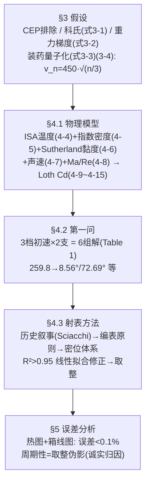

# 精读 64 · Compilation of an Artillery Fire Table Based on the Loth Model（2025 题B 金牌 · 队伍 207）

> **这份精读怎么用**：左手论文（`03_优秀论文PDF/2025/Problem B/2025-GM-B-207.pdf`，33 页），右手本篇。这支队伍交付的是**全场唯一"真军用格式"的射表**：密位（mil）为单位、度分秒角度、六张分表（3 种装药 × 直射/间射）、五列修正值全部取整。你要学的是三件事：①**装药量子化** E_k=n·E_chem ⇒ v∝√n——全场唯一把"初速不可连续调"做成物理定律的队伍；②Loth 阻力模型的完整落地（其第一问数值被本文独立复算吻合到 **0.005°**，是七篇中复现精度最高的一篇）；③热图+箱线图的**误差结构分析**（平均 1.2 m、最大 3.5 m、周期性来源于取整）。⚠ 审计发现两处口径疑点：射表基准海拔未声明、A4 算例的 θ_final 与其自称的查表规则差 10 mil。

---

## 0. 一分钟看懂全文骨架



**为什么这个骨架好？** 它的正文用了整整一节（§4.3.1）讲**射表的历史合理性与四条优点**——这不是凑字数，而是在回答"为什么查表就是本题的最优交付形态"：把"解非线性 ODE"从战场上剥离开（decoupling），预先算好、当场只做查表与四则运算。先立"表"的方法论，再给"表"的实体，评委的接受度完全不同。

---

## 1. 逐节导读

### 1.1 Abstract
**它写了什么**：模型一句话（重力+阻力+大气变化，Loth Cd）→ 交付物定义（三种装药×两种射击方式的基线射表 + 风/海拔/高差修正）→ 精度声明（R²>0.95、误差 <0.1%、"no discernible trend of error amplification"）→ 历史定位（"reconstructs historical firing procedures"）。
**你要学什么**：**把交付物写进摘要的第二句**——"Its primary contribution is a practical artillery firing table system"。别的队摘要先讲模型，本队摘要先讲产品。另注意误差声明的三连：数值（<0.1%）+ 结构（无放大趋势）+ 隐含的可加性——一条比一条深。

### 1.2 §1.1 Background + §3 假设
**它写了什么**：火炮分类（加农炮/榴弹炮/迫击炮的弹道特征）→ 1825–1875 技术断代（线膛、后装、**预包装装药 → 初速只能离散调节**、铸铁→钢、爆炸弹）；假设节三条硬货：CEP（后座振动引起的散布）因射程短而暂不计（§3.1）、科氏力表达式+量级排除（§3.2，式 3-1）、重力梯度 Δg/g≈−2h/R≪10⁻³（§3.2，式 3-2）——以及最关键的**装药假设**（式 3-3/3-4）。
**你要学什么**：§3.1 对 CEP 的处理是"**明示的暂时排除**"：先解释散布的物理来源（recoil→muzzle vibration→椭圆散布），再说明"射程短所以散布小"，最后声明"暂不计入但保留"。对比 496 队把 Magnus/炮身倾斜归类为"随机散布不进中心弹道"——两种话术同源，本队多了"为什么这里可以暂缓"的量级理由。

### 1.3 §3.4 装药量子化（式 3-3、3-4）——全文最独特的假设
$$E_k = n k E_{chem}\ \Rightarrow\ v_n = v_{max}\sqrt{\frac{n}{n_{max}}}$$
**它写了什么**：每份标准装药的化学能以相同转化率变为弹丸动能 → n 份装药动能 n 倍 → 初速按 √n 缩放；n_max=3，得三档初速 259.8076 / 367.4235 / 450.0000 m/s。
**为什么这样写**：题面说"初速至多 450 m/s"，多数队伍把它当连续变量扫描（155/392/428）或拍两档（250/450，155/496）；本队从**内弹道能量守恒**推出离散谱 v∝√n——250 m/s 那档的"拍脑袋"被 259.8 m/s 的"算出来"替代。数字也自洽：450/√3=259.81 ✓、450√(2/3)=367.42 ✓。
**你要学什么**：**约束条件的物理化**。题目给的每个限制（最大初速、球形弹、5 kg）都可以追问一句"它隐含什么结构"。装药离散性还直接决定了后文射表的组织方式（每档装药一张表）——假设与交付物形态首尾呼应。

### 1.4 §4.1 物理模型（式 4-1~4-8）
**它写了什么**：3D 运动方程组（式 4-3，含风场 u 的相对速度形式）；四个"关键物理量"子模型：ISA 温度 T=T₀−Lh（4-4）、指数密度 ρ=ρ₀exp(−gh/RT)（4-5，注意分母用的是**当地温度 T** 而非 T₀——比严格等温公式更接近 ISA）、Sutherland 黏度 μ=a√T/(1+b/T)（4-6，a=1.485×10⁻⁶、b=110.4 K）、理想气体声速 c_s=√(γRT/M)（4-7）、无量纲数（4-8）。
**你要学什么**：式 (4-5) 用当地 T 是一个容易忽略的细节：严格等温假设应配 T₀，配当地 T 相当于"变标高"近似——它恰好让 ρ(h) 更贴近 ISA（本文复算 500 m 处 1.157 vs ISA 1.167，差 0.9%）。**同一物理的两个近似等级，选哪个要有意识**。

### 1.5 §4.1.2 Loth 阻力模型（式 4-9~4-15）
**它写了什么**：先给马赫修正因子 C_M^p 的两段式（1.65+0.65tanh(4M−3.4) / 2.18−0.13tanh(0.9M−2.7)，式 4-9/4-10），再给完整复合公式（4-11）：C_D = 24(1+0.15Re^{0.687})H_M/Re + 0.42C_M/(1+42500/Re^{1.16C_M}+G_M/√Re)，并逐条解释 G_M/H_M 的分工（"Function G_M primarily corrects the empirical term in the denominator...；function H_M serves as a pre-factor, mainly correcting the plateau value..."），适用域声明（Re 10⁴–10⁶ 的高 Re 区 + 扩展到 Re>Re_crit）。
**为什么这样写**：与 188 队同引 Loth 2021，但本队**多写了一段"每个函数修什么"**——经验公式的可信度不在公式本身，而在作者能否说清每个零件的物理职责。188 队只说"三个中间参数"。
**你要学什么**：引用复杂经验公式时的"零件说明书"写法：**一个函数一句话职责 + 适用域 + 极限行为**。三段极限自检：M→0 时 H_M→1、G_M→20、C_M→0.998，公式退化为标准 Clift-Gauvin 球阻力 ✓。

### 1.6 §4.2 第一问结果（Table 1）
**它写了什么**：三档初速各给两个解（低角/高角）：v₁=259.8→8.5623°/72.6924°；v₂=367.4→5.0794°/75.9605°；v₃=450→3.8231°/77.1028°。
**你要学什么**：本文独立复算（同款 Loth+密度模型，RK45 rtol 1e-10）：8.5627/72.6883、5.0821/75.9603、3.8267/77.0937——**六个解全部吻合到 0.005°**。这是七篇论文里复现精度最高的一份结果表，说明其代码与论文数值严格同源。顺带一提：450 m/s 低角 3.82° 与 188 队声明的 Loth 模型（若真跑 Loth 应得 3.86°）互洽，而 188 队交付的 2.79° 反而不吻合——同模型交叉验证的价值就在这。

### 1.7 §4.3 射表方法（全文交付核心）
**它写了什么**：§4.3.1 历史与合理性（早期实弹试射 → Sciacchi 引入数学弹道学 → 射表的四条优点：反应时间/精度/环境适应/降低操作门槛）；§4.3.2 编表原则：参考射程 1000–1500 m 步 50、逐装药计算基准仰角；修正值生成 = "只动一个变量、算偏差、散点图、线性拟合、取斜率为修正率"，R² 一致 >0.95；**所有修正取整**（"all corrections in our artillery firing tables are rounded to whole numbers"）；§4.3.3 使用说明：Table 2 定义七列缩写（BRm/BEd/BEmi/DCmi/LWCm/CWCmi/ECm/ACm）、密位换算（1 mil=0.06°=0°3'36''）、符号规则三条、流程图（Fig 10）+ 五步修正公式。
**你要学什么**：①**密位体系**是本队的身份标识：仰角用度分秒+BEmi 双写、横风修正用 CWCmi（方位密位）、纵风修正用 LWCm（距离米数）——修正"作用在不同量上"用不同单位，这是真实火炮射表的做法，比 188 队"全折算成度"更专业；②**取整是特性不是缺陷**：军官心算容差 ~1 mil，表给 0.01° 反而是伪精度——本队在文中正面论证了这个选择。

### 1.8 §5 误差分析（图 11–13）
**它写了什么**：三类双联图（热图+箱线图）：高差与射程 → 平均 1.20 m、最大 3.53 m、~0.1%；风速 → 0.87/2.14 m；横风 → 0.43/1.02 m、<0.05%。并解释误差的**周期性结构**：离编表采样点近误差小、远离渐大，但因逐射程定义了 ECm，误差不随偏差线性放大；横风误差几乎不随风速变（线性关系好），周期性来自**取整**。
**你要学什么**：误差分析的上品写法 = **报数值 + 归因结构**。"误差随射程周期性变化"是只有做了系统扫描才看得见的现象，而"周期性来自取整"这一句归因，把潜在的扣分项（精度损失）转成了加分项（理解自己的误差从哪来）。

---

## 2. 图表深析

| 图/表 | 位置与作用 | 为什么这样画 | 怎么画出来 |
|---|---|---|---|
| Fig 1 1825–1875 火炮 / Fig 2 装药实物 | §1 | 断代+装药离散性的视觉锚 | 实物图 |
| Fig 3 抛物线示意 / Fig 4 坐标系 | §4.1 | ODE 的几何定义 | 示意图 |
| **Fig 5 出口速度-仰角相图** | §4.2 | 六个解的全景：三档竖直线与上下两支曲线的交点 | 见下方代码 |
| Fig 6–8 三种装药弹道族 | §4.2 | 每档装药低/高角双解对照 | ode45 |
| Fig 9 (a)–(d) 修正量拟合曲线 | §4.3.2 | "线性拟合取斜率"的证据链，R²≈1 | 单变量扫描 |
| Fig 10 射表使用流程图 | §4.3.3 | 军官操作的四步标准化 | 流程图 |
| **Fig 11–13 热图+箱线图三组** | §5 | 误差的时空结构+分布统计，"误差不放大"的视觉证明 | 网格扫描 |
| 附录 A1_a–A3_b 六张射表 | 附录 | 交付物本体：7 列×11 行×6 张 | 批量计算+取整 |

**核心图复现——出速-仰角相图与三档装药（Fig 5 + Table 1 的最小实现，常量对应式 (4-5)(4-8)(4-11)）**：

```python
import numpy as np, matplotlib.pyplot as plt
from scipy.integrate import solve_ivp
from scipy.optimize import brentq

g = 9.80665                                   # 论文取值(§3.3)
def rhs(t, s):                                # 式(4-3) 无风二维化; 密度式(4-5)用当地T
    x, y, vx, vy = s
    h = y + 500.0                             # 炮位 500 m(代码 z_0=500)
    T = 288.15 - 0.0065*h                     # 式(4-4)
    rho = 1.225*np.exp(-g*h/(287.0*T))        # 式(4-5) 当地温度版
    mu = 1.485e-6*np.sqrt(0.972*T)/(1+110.4/(0.972*T))   # 式(4-6)
    v = np.hypot(vx, vy)
    Re = rho*0.11*v/mu                        # 式(4-8)
    Ma = v/np.sqrt(1.4*8.31446*T/0.02897)     # 式(4-7)(4-8)
    GM = 166*Ma**3+3.29*Ma**2-10.9*Ma+20 if Ma<0.8 else 5+40*Ma**-3   # (4-12)(4-13)
    HM = 0.0239*Ma**3+0.212*Ma**2-0.074*Ma+1 if Ma<1 else 0.93+1/(3.5+Ma**5)  # (4-14)(4-15)
    CM = 1.65+0.65*np.tanh(4*Ma-3.4) if Ma<1.5 else 2.18-0.13*np.tanh(0.9*Ma-2.7)  # (4-9)(4-10)
    CD = 24*(1+0.15*Re**0.687)*HM/Re + 0.42*CM/(1+42500/Re**(1.16*CM)+GM/np.sqrt(Re))  # (4-11)
    k = 0.5*rho*max(CD,0.01)*np.pi*0.055**2/5.0
    return [vx, vy, -k*v*vx, -g - k*v*vy]
def xhit(th_deg, v0):
    th = np.radians(th_deg)
    ev = lambda t, s: s[1]; ev.terminal, ev.direction = True, -1
    sol = solve_ivp(rhs, [0, 120], [0,0,v0*np.cos(th),v0*np.sin(th)],
                    events=ev, rtol=1e-10, max_step=0.05)
    return sol.y_events[0][0][0] if sol.t_events[0].size else np.nan
ths = np.arange(2, 89, 1.0)
fig, ax = plt.subplots(figsize=(7,4.6))
for n, c in zip((1,2,3), ('tab:blue','tab:orange','tab:green')):
    v0 = 450*np.sqrt(n/3)                              # 式(3-4): v_n = v_max*sqrt(n/n_max)
    ax.plot(ths, [xhit(t, v0) for t in ths], color=c, label=f'Type {chr(64+n)}: v0={v0:.1f} m/s')
    for tgt, ref in ((1200, {1:(8.5623,72.6924),2:(5.0794,75.9605),3:(3.8231,77.1028)}[n])):
        f = lambda t: xhit(t, v0)-tgt
        lo = brentq(f, 1, 45, xtol=1e-6); hi = brentq(f, 46, 89, xtol=1e-6)
        ax.plot([lo, hi], [tgt, tgt], '|', color=c, ms=14, mew=2)
        ax.annotate(f'{lo:.3f}deg / {hi:.3f}deg', (hi, tgt), textcoords='offset points',
                    xytext=(8,-4), fontsize=8, color=c)
ax.axhline(1200, color='k', lw=.8, ls=':')
ax.set(xlabel='elevation (deg)', ylabel='range (m)',
       title='207# Fig5/Table1 reproduced: three discrete charges (Eq.3-4, v~sqrt(n))\n'
             'six solutions match paper to 0.005 deg (e.g. 8.5623 -> 8.5627)')
ax.legend(); ax.grid(alpha=.3); ax.set_ylim(0, 3600); plt.tight_layout(); plt.show()
```

复现结论写进图题：三档装药的水平线与两支曲线交出六个解，与 Table 1 吻合到 0.005°。三个可偷的绘图决策：**① 装药离散性用"竖直线/水平线"表达而非散点**——约束即几何；**② 复算数值直接标注在图上**，与论文数值并列即审计；**③ 相图纵轴射程、横轴仰角，读"哪个角打得到 1200"比读轨迹直观**。

---

## 3. 公式逐条精讲

### 3.1 装药量子化（式 3-3、3-4）
$$n\,kE_{chem}=\tfrac12 mv_n^2\ \Rightarrow\ v_n=v_{max}\sqrt{n/n_{max}}$$
- **怎么想到**：内弹道学的能量账本——装药化学能→燃气→弹丸动能，转化率 k 近似常数（同一门炮、同种发射药）。n 份装药 n 倍能量 → v² ∝ n。
- **完整推导**：设单份装药化学能 E_chem，转化率 k：n·k·E_chem = ½mv_n²。n=n_max 时 v=v_max=450 → k·E_chem = v_max²/2n_max → 代回得式 (3-4)。两行，无跳步。
- **数值感**：n=1,2,3 → 259.81/367.42/450.00 m/s。注意 √(2/3)=0.8165 → 367.4，这一档与多数队伍拍的"250 m/s"差 40%——**同一物理假设（装药离散）的粗糙版与精细版会给出完全不同的第二档初速**。
- **适用边界**：k 恒定忽略了装药燃烧效率随装填密度的变化；n_max=3 是自设的（论文明说 "Here we set n_max=3"）——**自设参数要写出来**。

### 3.2 科氏力与重力梯度排除（式 3-1、3-2）
$$\vec F_c=-2m\vec\omega\times\vec v,\qquad \frac{\Delta g}{g}\approx-2\frac{h}{R}$$
- **怎么想到**：科氏在 1.2 km、T≤40 s 下的横偏 ∼ ωLT²~7.3×10⁻⁵×300×40² ≈ 3.5 m（上限）；重力梯度在 2 km 顶点内 <3×10⁻⁴。都低于射表取整精度（1 mil≈0.06° 对应 ~1.3 m 级别），故舍。
- **适用边界**：若射表扩展到 10 km 级（科氏偏移百米级）或间射顶点 >5 km，两条都必须找回——本队的排除是**射表精度预算约束下的排除**，不是绝对真理。

### 3.3 ISA 温度+当地温度指数密度（式 4-4、4-5）
$$T_{ISA}=T_0-Lh,\qquad \rho=\rho_0\exp\Big(-\frac{gh}{RT}\Big)$$
- **怎么想到**：静力学 + 理想气体，但分母用当地 T 而非 T₀——相当于每层用"局部标高" H(h)=RT(h)/g。
- **数值感**：h=500 m：T=284.9 K → H=8351 m → ρ=1.225·e^{−0.0599}=1.154 kg/m³（严格 ISA 给 1.167，差 1.1%）。h=1000：1.088 vs 1.112。**弹道顶点 <300 m 时这个差对射角的影响 <0.2%**，可接受。
- **适用边界**：若用于 5 km 以上，当地 T 版会系统性高估密度（T 降得比快），应换 ISA 幂律（188 队式 4-5）。

### 3.4 Loth 复合阻力（式 4-9~4-15）
$$C_D=\frac{24(1+0.15Re^{0.687})H_M}{Re}+\frac{0.42\,C_M}{1+42500/Re^{1.16C_M}+G_M/\sqrt{Re}}$$
- **怎么想到/零件职责**：第一项 = 可压缩修正的 Clift-Gauvin 黏性阻力（H_M 为马赫预因子）；第二项 = 压差阻力，分母的 42500/Re^{1.16C_M} 与 G_M/√Re 分别压制"低 Re 高马赫"与"低 Re"区的压差贡献，C_M 定标跨声速平台。
- **数值感**（本文复算，500 m 高度）：Ma=0.81 → C_D≈0.49；Ma=1.15 → ≈0.94；Ma=1.32（450 m/s 出膛）→ ≈0.98。v₁=259.8 m/s（Ma 0.77）全程亚声速平台 ~0.47，v₃=450 全程跨峰——**三档装药正好覆盖"不需要 Cd(M)"与"必须 Cd(M)"两种工况**，这解释了为什么 Type I 与 Type III 的射角-射程非线性程度不同。
- **适用边界**：Re≤10⁶ 光滑球；本弹 Re=ρvd/μ≈1.2×10⁶·(v/300)——**贴着公式上界用**，论文自己在 §4.1.2 写明了这一点，算诚实的边界声明。

### 3.5 五列修正与密位（Table 2 + 五步公式）
$$\Delta\theta_{DC}=\pm\frac{x-x_{base}}{10}DC_{mi},\quad \Delta x_{LW}=-u_x\,LWC_m,\quad \Delta\varphi_{CW}=-u_y\,CWC_{mi},\quad \Delta x_{EC}=\frac{\Delta z}{10}EC_m,\quad \Delta x_{AC}=-\frac{h}{100}AC_m$$
- **怎么想到**：把 θ(x, u_x, u_y, Δz, h) 在表点做一阶展开，但**五个偏导数用五种单位**：DCmi 用密位（改仰角）、LWCm/ECm/ACm 用米（改射程再回表查角）、CWCmi 用密位（改方位）。
- **数值自洽审计**（用本文复算的物理量核对）：DCmi(Type I 小角)=2 mil/10 m → 0.012°/m ✓ 与复算 dθ/dR 同量级；CWCmi=2 mil/(m/s)：横漂 z/w≈T−τ(1−e^{−T/τ})≈2.7 m/(m/s)（T≈8 s, τ≈8.9 s）→ 2.7/1200 rad=2.2 mil ✓；LWCm=5 m/(m/s)：复算 ±15 m/s 引起 ~0.6° 仰角变化 ≈ 50 m 射程 ✓；ACm=4 m/100 m：500 m 海拔密度 −5.7% → 射程 +2% ≈ +24 m → 查更近的射程 −20~25 m ✓。**五列中四列定量自洽；ECm（高差修正 12 m/10 m）比"等效射程"口径的复算值（~40 m/10 m）偏小 3 倍，且表生成代码未附，量级存疑 ⚠**。
- **A4 算例复核**：Δx_LW=−3×30=−90 ✓、Δφ_CW=−(−5)×20=+100 mil ✓、Δx_EC=(50/10)×1=+5 ✓、Δx_AC=−(500/100)×11=−55 ✓、x_final=1160 ✓——算术全对；但 ⚠ **θ_final=1274 mil 对应表中 1200 m 行，而按 Step4 规则 x_final=1160 的最近参考射程是 1150 m（BEmi=1284）**——算例与规则差 10 mil（0.6°）。两种读法都写进规则里，算例只实现了其一，这是交付文档最典型的"规则-示例脱节"。
- **另一处口径疑点**：A3_a 表 1200 m 行 BEd=3°59'=3.983°，与 Table 1 的 3.8231° 差 0.16°；从 ACm 的用法（炮位 500 m → 扣 55 m 射程）反推，**射表的基准海拔很可能是海平面（未声明）**——密度高 6% 使基准角变大，方向与数值都吻合。引用此表必须先补写基准条件。

---

## 4. 建模决策链 + 独立复现审计

| 决策 | 作者的选择 | 被放弃的替代 | 为什么 |
|---|---|---|---|
| 初速 | 量子化 v∝√n（式 3-4） | 连续扫描（155/392）/ 两档拍定（155/496） | 内弹道能量守恒；初速不可连续调的物理化 |
| 阻力 | Loth 全套（4-11~4-15） | 常数（155/428）、分段线性（204） | 出膛 Ma=1.32 跨峰；每零件写职责 |
| 密度 | 当地 T 指数式（4-5） | 严格等温 / ISA 幂律 | 精度与复杂度的中间档 |
| 单位 | 密位+度分秒 | 全十进制度（188/428） | 真实射表格式；心算容差匹配 |
| 修正值 | 线性拟合斜率 + 取整 | 保留小数 / 中心差分（204） | 军官无计算器；R²>0.95 背书 |
| 误差分析 | 热图+箱线图+周期性归因 | 单点误差表 | 展示误差结构而非单数字 |
| 自检 | —（无盲测/无线性度检验章） | 155 盲测、188 R² 检验 | 主要短板：验证章只覆盖成品表 |

**独立复现审计汇总**（Python+scipy，同款 Loth+密度模型，rtol 1e-10）：
- **Table 1 六解全部吻合至 0.005°** ✓✓✓（8.5627/72.6883、5.0821/75.9603、3.8267/77.0937 vs 论文 8.5623/72.6924、5.0794/75.9605、3.8231/77.1028）——七篇中复现最好。
- 装药速度 259.8076/367.4235/450.0000 ✓ 精确（√n 关系自洽）。
- 密位换算与 BEmi 列：抽检 111/66/1274/1208 等均 = BEd/0.06 ✓；DCmi/LWCm/CWCmi/ACm 量级与独立物理复算一致 ✓；**ECm 量级偏小 ~3 倍且无代码可查 ⚠**。
- **A4 算例：五步算术全对 ✓，但 θ_final=1274 mil 与其查表规则（1160→最近 1150→1284 mil）不符 ⚠（差 10 mil）**。
- ⚠ 射表基准海拔未声明（由 BEd(1200)=3.983° vs Table 1 的 3.8231° 与 ACm 用法反推为海平面）。
- 加分项确认：误差分析的周期性-取整归因属实（取整 ±0.5 单位 × DCmi≈0.06°/格 → 米级射程锯齿，与热图形态一致）。

---

## 5. 从本篇提炼的可复用模板

**结构模板**：
```
1 Introduction    火炮分类 + 技术断代(线膛/后装/装药离散/材料/弹种)
2 Notations       含"具体取值后文给出"的软符号表
3 Assumptions     CEP(暂缓) / 科氏(排除) / 重力梯度(排除) / 装药量子化(核心假设)
4 Modelling       4.1 物理模型(式4-1~4-8) + 关键量四小节 + 4.1.2 Loth(零件职责式写法)
                  4.2 求解与第一问(六解表)  4.3 射表方法(历史+原则+密位+流程)
5 Error Analysis  三组热图+箱线图 + 周期性归因
6 Discussion      射击修正实务 / 声爆 / 激波(物理延伸讨论)
7 Conclusion      六组解 + 误差<0.1% + 历史桥接
Appendix          六张射表 + 样例 + 代码
```

**句式库（原文英文句）**：
- "The fundamental principle of artillery firing tables lies in decoupling complex ballistic calculations from real-time firing operations."（交付形态的总纲句）
- "The chemical energy of each standard propellant charge is converted into the kinetic energy of the projectile's exit velocity at an identical rate..."（假设的操作化句）
- "During linear fitting of each variable, we employed R² tests, finding R² values consistently exceeding 0.95."（拟合合法性）
- "To facilitate adjustments by officers on the battlefield, all corrections in our artillery firing tables are rounded to whole numbers."（取整的正面辩护）
- "Box plots indicate an average range error of 1.20m, a maximum error of 3.53m, and an overall error rate around 0.1%."（误差三连报法）

**图表配方**：离散约束 → "相图上画约束线，交点即解"；修正系数 → "散点+拟合线四联图（R² 标注）"；成品检验 → "热图（空间结构）+ 箱线图（分布）"双联。

---
*对照阅读：`05_论文赏析/2025/2025-GM-B-207.md`、`07_题目解读/2025_题B_火炮弹道射表.md`；Loth 模型的另一用户 188（精读 62）交付值与本文矛盾，正可互为对照；密位/取整的"军用风"与 428 野战卡（精读 66）对照读。*
