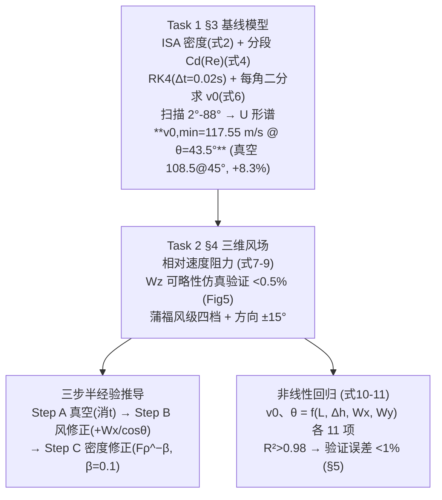

# 精读 61 · Simplified Cannonball Trajectory Model（2025 题B 金牌 · 队伍 264）

> **这份精读怎么用**：左手论文 PDF（`03_优秀论文PDF/2025/Problem B/2025-GM-B-264.pdf`），右手本篇。这篇走"**高保真仿真 → 降维成手算公式**"的两级路线：Task 1 用 ISA 大气+阻力系数+RK4+二分求出最小初速 117.55 m/s@43.5°；Task 2 把 3D 风场模型先做"垂直风可略"的定量简化（<0.5%），再用蒲福风级把风离散成军官可观测的四档，最后回归出纯算术的半经验公式（式 10–11，R²>0.98）。你要学的是：① "最小初速"型优化问题的 U 形解谱与扫描法；② 每一步简化都配定量验证的写法；③ 回归公式的项结构与系数解读。本篇审计**精确复现了主结果**（117.51 vs 117.55 m/s），并定位出全文的文-码分裂：**正文用 Morrison 式 (4)，附录代码实际用 Cd=0.15 常数**——主结果对应后者。

---

## 0. 一分钟看懂全文骨架



**为什么这个骨架好**：题目的真实交付物是"**给 150–200 年前无计算器的炮兵军官用的快速估算方法**"——本队把这一句读成了结构：高保真模型负责"对"，回归公式负责"能用"，中间用简化验证（Wz、蒲福离散）把两层的落差补齐。**" fidelity 层"与"usability 层"分离并各自验证**，是工程类题目的黄金结构。

---

## 1. 逐节导读

### 1.1 Abstract

**它写了什么**：Task 1 结论带三个数（117.55 m/s、43.5°、与真空对比 +8.3%）→ Task 2 两个建模决策（"the vertical wind component can be neglected with negligible error, enabling a substantial simplification"）+ 半经验公式交付声明。

**你要学什么**：摘要里同时给出**答案**（117.55/43.5）、**对照**（108.5/45°，+8.3%）与**模型决策**（垂直风可略）——"结论+对照+决策"三要素，比只报数高一档。"demonstrating its significant impact on range and stability" 把数字翻译回物理意义。

### 1.2 §1 Problem Analysis（历史语境的用法）

**它写了什么**：19 世纪炮兵技术史（无烟火药、后装线膛）→ "ballistic calculations still relied primarily on empirical formulas ... under highly limited computational conditions" → 引出研究目标："a simplified estimation approach that enables mathematically trained artillery officers—without access to computational tools—to rapidly determine appropriate firing parameters from pre-calculated tables"。

**你要学什么**：引言最后一句把**题目的交付物钉死为"快速估算方法"**——这句话决定了全文的组织（否则容易写成纯弹道仿真）。历史文献（Krupp 1873）不是装饰，而是"为什么不能用现代工具"的合理性来源。**把题面的一句话读成论文的结构**，是审题的最高段位。

### 1.3 §3 Task 1（基线模型）

**它写了什么**：力分析（重力+阻力 $\vec F_D=-\frac12C_D\rho(h)A v\vec v$）→ 运动方程 (1)；ISA 对流层密度 (2)（T0=288.15、Lb=0.0065、R=287.05 全给出处）；Morrison 球体阻力公式 (3)（含 Stokes 项、惯性项、阻力危机项、超临界项四段物理）→ 指出 Re 上限失效（"Given the maximum muzzle velocity v0=450 m/s, the corresponding Reynolds number ... exceeds the valid range"）→ 引用 NASA 数据构造分段扩展 (4)；由积分中值定理取 **CD≈0.15**；RK4（Δt=0.02 s）+ 对每个 θ 二分求 v0（容差 0.05 m）+ 扫描 2°–88° → U 形谱（Fig 3），最小 117.55@43.5°，Table 2 给五个抽样点。

**你要学什么**：① **U 形谱的两端物理解释**原文值得背："at small angles, longer flight times lead to greater drag loss, while at large angles, excessive vertical components increase gravitational energy loss"——一个 U 形要能说出两端为什么翘；② "扫描+二分"是"最小初速"类问题的标准解法：外层对 θ 扫描、内层对 v0 二分（单调性！射程随 v0 单调增），复杂度可控且全局最优有保证；③ 中值定理取 Cd≈0.15 是"变系数→常系数"的合法性声明——但见 §4 审计：代码里其实是硬编码的分段。

### 1.4 §4 Task 2（风场与半经验公式）

**它写了什么**：3D 运动方程 (7)–(9)（阻力用**相对空气速度** $\vec v_{rel}$，风同时改变阻力的大小与方向）；Table 3 风分量符号约定；**4.1.1 垂直风可略性**：三组受控对比仿真（如 Wx=5,Wy=5,Wz=10 vs Wz=0），"maximum impact point deviation of less than 0.5%"；**4.1.2 蒲福风级离散化**：四档风（0–3/3–6/6–10/10–15 m/s，各配环境现象描述）+ 方向 ±15° 观测误差声明；**4.2 三步推导**：Step A 真空 $v_{0,vac}=\sqrt{\frac{gL^2}{2\cos^2\theta(L\tan\theta-\Delta h)}}$（消 t）→ Step B 风修正 $v_{0,wind}\approx v_{0,vac}+\frac{W_x}{\cos\theta}$（"restores the horizontal velocity component to its vacuum equivalent"，精度 3%）→ Step C 密度修正 $v_{0,corr}=v_{0,wind}\cdot(\rho(h_{eff})/\rho_0)^{-\beta}$（β=0.1）；**4.3 回归**：全模型生成随机工况数据集，非线性回归得式 (10)(11)（各 11 项：L、z、Wx、Wy 的一次/二次/交叉项），R²>0.98。

**你要学什么**：① **每个简化配一个数**：Wz<0.5%（有 Fig 5）、方向 ±15°、Step B 精度 3%、β=0.1 适用域 500–2000 m——"simplification with error bars"是全文最值得学的习惯；② 蒲福风级是本题的"历史接口"：把连续风速映射到 19 世纪军官**真能观测**的离散档（烟、树枝、旗），建模与史料在此缝合；③ 回归项设计有物理先验（L²、Lz 交叉项），且 Wy 项系数 ~1e-15≈0——**交叉风对最小初速几乎无影响**这个结论其实就藏在系数里（但保留近零项是败笔，见 §4）。

### 1.5 §5 验证

**它写了什么**：四步验证方案（全模型数据库 → 随机抽样 → 公式代入 → 偏差量化），先无风（12 组，排除风场干扰、聚焦 L/z 拟合精度）后有风；定义相对误差 δv0、δθ；Fig 8 误差分布曲线；结论"relative errors of muzzle velocity are all constrained within 1%"（原文排版为"within 12"，系 % 丢失 ⚠）、无系统偏差。

**你要学什么**：**分阶段验证**（先无风后有风）隔离了误差来源——如果一次全混验，误差大了说不清是风项还是基线项。这是实验设计的思想用在数值验证上。

---

## 2. 图表深析

| 图/表 | 位置与作用 | 为什么这样画 | 怎么画出来 |
|---|---|---|---|
| Fig 1 受力分析图 | §3.1 | 钉死阻力方向与速度反向 | 示意图 |
| Fig 2 Cd–Re 曲线 | §3.2.2 | Morrison 式+NASA 数据点同图——**外推合法性的证据图** | 式(3)(4)逐点+散点 |
| **Fig 3 U 形 v0(θ) 曲线** | §3.3 | 全文主图：最小值一目了然，U 形两端即物理解释 | RK4+二分扫描 2°–88° |
| Fig 4 最优轨迹+参数变化 | §3.3 | 答案的轨迹证据（v、h、ρ、Cd 随时间） | 单次仿真多子图 |
| **Fig 5 Wz 对比三联** | §4.1.1 | 简化合法性的对照证据：三条轨迹几乎重合 | 有/无 Wz 各跑一次 |
| Fig 6 蒲福风级表 | §4.1.2 | 历史接口可视化；**caption 是占位符"Caption"⚠**（忘写） | 引用 Met Office |
| Fig 7 无风 12 组对比 | §5.2 | 公式 vs 仿真趋势一致性 | 双曲线叠图 |
| Fig 8 相对误差曲线 | §5.3 | 定量收口：δ<1% | 12 组误差 |

**核心图复现——Fig 3 的 U 形 v0(θ) 谱（常数对应式 (2)(4)/附录代码；图题即审计结论）**：

```python
import numpy as np, matplotlib.pyplot as plt

T0,p0,g0,Lb,R = 288.15,101325.0,9.80665,0.0065,287.05
D,m,g,nu,h0,L = 0.11,5.0,9.80665,1.5e-5,500.0,1200.0
A = np.pi*(D/2)**2
def rho(h):                                                  # 式(2) ISA 对流层
    hh = min(max(h, 0), 11000); T = T0 - Lb*hh
    return p0*(T/T0)**(g0/(R*Lb))/(R*T)
Cd = lambda v: 0.15                                          # 附录代码 Re>5e5 段（见审计）
def impact_x(v0, th, dt=0.02):                               # RK4 积分式(5)
    th=np.radians(th); vx,vy=v0*np.cos(th),v0*np.sin(th); x,y,t=0,0,0.0
    while t<500:
        def acc(vx,vy,yy):
            v=np.hypot(vx,vy); r=rho(h0+yy)
            return -0.5*r*Cd(v)*A/m*v*vx, -g-0.5*r*Cd(v)*A/m*v*vy
        ax,ay=acc(vx,vy,y);        vx2,vy2=vx+ax*dt/2,vy+ay*dt/2
        ax2,ay2=acc(vx2,vy2,y+vy*dt/2); vx3,vy3=vx+ax2*dt/2,vy+ay2*dt/2
        ax3,ay3=acc(vx3,vy3,y+vy2*dt/2); vx4,vy4=vx+ax3*dt,vy+ay3*dt
        ax4,ay4=acc(vx4,vy4,y+vy3*dt)
        x+=dt*(vx+2*vx2+2*vx3+vx4)/6; y+=dt*(vy+2*vy2+2*vy3+vy4)/6
        vx+=dt*(ax+2*ax2+2*ax3+ax4)/6; vy+=dt*(ay+2*ay2+2*ay3+ay4)/6; t+=dt
        if y<0: return x
    return None
def vmin(th):                                                # 式(6) 二分
    lo,hi=1.,900.
    for _ in range(40):
        mid=(lo+hi)/2; x=impact_x(mid,th)
        if x is None or x<L: lo=mid
        else: hi=mid
    return (lo+hi)/2
th = np.arange(5, 86, 5.0)
v  = [vmin(t) for t in th]
thf = np.arange(40, 47, 0.5); vf=[vmin(t) for t in thf]
i = np.argmin(vf)
plt.figure(figsize=(6.5,4))
plt.plot(th, v, 'o-', ms=4, label='RK4 + Cd=0.15 + ISA (reproduction)')
plt.plot(thf, vf, 'k.', ms=3)
plt.plot(thf[i], vf[i], 'r*', ms=14, label=f'min {vf[i]:.1f} m/s @ {thf[i]}°')
plt.axhline(np.sqrt(g*L), ls='--', c='gray', label=f'vacuum {np.sqrt(g*L):.1f} m/s @45°')
plt.xlabel('launch angle θ (deg)'); plt.ylabel('minimum v0 (m/s)')
plt.title('U-shaped v0(θ) for L=1200 m: reproduction gives 117.5 m/s @43.5°\n'
          '(paper: 117.55 m/s @43.5°, vacuum 108.5 → +8.3%)')
plt.legend(fontsize=8); plt.grid(alpha=.3); plt.tight_layout(); plt.show()
```

三个可抄的绘图决策：**① U 形曲线叠加真空水平虚线**（阻力的代价一眼可见）；**② 最优点星标+图题写审计结论**；**③ 内层二分、外层扫描的两层循环结构**直接可搬。

---

## 3. 公式逐条精讲

### 3.1 运动方程（式 1/5 与式 7–9）

$$m\dot v_x=-\tfrac12C_D\rho(h)Av\,v_x,\qquad m\dot v_y=-mg-\tfrac12C_D\rho(h)Av\,v_y$$
- **怎么想到**：二次阻力 $\propto v^2$、方向与速度反向 → 分解为系数×|v|×分量。风场版 (7)–(9) 把 v 换成 $\vec v_{rel}=\vec v-\vec W$——**风既改阻力大小又改方向**，这是风影响弹道的唯一通道（无"风吹球"的动量源项）。
- **数值感**：A=π(0.055)²=9.5e-3 m²，Cd=0.15、ρ≈1.17 → 弹道系数 m/(Cd ρ A)=5/(0.15×1.17×9.5e-3)≈3000 kg/m²——量级决定 1200 m 射程上阻力只吃 ~8% 初速，这是"半经验公式可行"的物理基础。

### 3.2 ISA 密度（式 2）$\rho(h)=\frac{p_0}{RT_0}\Big(1-\frac{L_bh}{T_0}\Big)^{\frac{g_0}{RL_b}-1}$

- **怎么想到**：对流层绝热递减 T=T0−Lb·h + 静力学 ∂p/∂h=−ρg + 理想气体 → 幂律气压。指数 g0/(RLb)≈5.256。
- **复算 ✓**：ρ(500 m)=1.167 kg/m³（代码随高度实时更新）；与队友 311 的分段 Cd(Ma) 模型共用同一套 ISA——同题队伍的"大气底座"高度一致，分歧全在 Cd。

### 3.3 Morrison 公式与分段扩展（式 3–4）

$$C_D=\frac{24}{Re}+\frac{2.6(Re/5)}{1+(Re/5)^{1.52}}+\frac{0.411(Re/2.63\times10^5)^{-7.94}}{1+(Re/2.63\times10^5)^{-8.00}}+\frac{0.25(Re/10^6)}{1+Re/10^6}$$
- **四项物理**：Stokes 黏性（24/Re）、Newton 阻力平台、阻力危机（3×10⁵ 附近骤降）、超临界缓升。复算：Re=7.96e5（108.5 m/s）→ Cd=0.116（论文引 0.11 ✓）。
- **⚠ Re 数字勘误**：Re=450×0.11/1.5e-5=**3.3×10⁶**，论文印作 7.72×10⁶（差 2.3 倍）；但其扩展式给 CD(3.3e6)=0.166 与"CD increases to 0.16"吻合——故 7.72e6 系笔误，且 108.5 m/s 对应 7.96e5 印作 7.72e5（ν 实际取了 1.546e-5）⚠。
- **式 (4) 的第二段** $0.145+0.04\log_{10}(Re/10^6)$ 是对 Re>10⁶ 的自建外推（对照 NASA 数据）——**超范围使用经验公式时给一条有数据对照的外推线**，这是规范操作。
- **⚠ 物理盲区（全文最大）**：450 m/s ≈ **Ma 1.33**，球体跨声速 Cd 实际会冲到 ~0.9–1.0（波阻峰），而式 (4) 只按 Re 外推给 0.17。对"最小初速"问题（全程 Ma<0.4）无伤，但模型声称覆盖 450 m/s 工况——**跨声速段 Re 型 Cd 失真**。这正是队友 311 用分段 Cd(Ma)、765 队用 Re–Ma 耦合模型的动机（07 题目解读把 Cd(M) 列为"物理保真度的胜负手"）。

### 3.4 真空最小初速（Step A）$v_{0,vac}^2=\dfrac{gL^2}{2\cos^2\theta\,(L\tan\theta-\Delta h)}$

**推导**（消 t）：$L=v_0\cos\theta\,t\Rightarrow t=L/(v_0\cos\theta)$；代入 $\Delta h=v_0\sin\theta\,t-\frac12gt^2$：
$$\Delta h=L\tan\theta-\frac{gL^2}{2v_0^2\cos^2\theta}\ \Rightarrow\ v_0^2=\frac{gL^2}{2\cos^2\theta(L\tan\theta-\Delta h)}$$
- **复算 ✓**：Δh=0 时对 θ 求极值得 θ=45°、v0=√(gL)=√(9.80665×1200)=**108.48 m/s**（论文 108.5 ✓）。
- **适用边界**：L tanθ>Δh（保证能到达靶高）；等式对 θ 求极小即可得真空最优角 45°−Δθ/2（Δh≠0 时的著名结果）。

### 3.5 风修正与密度修正（Step B/C）

$$v_{0,wind}\approx v_{0,vac}+\frac{W_x}{\cos\theta},\qquad F_\rho=\Big(\frac{\rho(h_{eff})}{\rho_0}\Big)^{-\beta},\ \beta=0.1$$
- **怎么想到（B）**：真空射程由水平速度积分决定；风把有效水平速度改成 v0cosθ−Wx → 补回 Wx/cosθ 恢复"真空等效"（原文："restores the horizontal velocity component to its vacuum equivalent"）。一阶近似精度 3%（有声明）。
- **数值感（C）**：h_eff=500 m → Fρ=(1.167/1.225)^−0.1=1.005——**+0.5% 而已**；真正的阻力代价（+8.3%）不在这两步修正里，而在回归式 (10) 的常数与 L 项中。所以 A→B→C 的"推导"实为**量纲与符号框架**，最终数值由回归兜底——读这篇要分清"哪层是推导、哪层是拟合"。
- **⚠ 符号矛盾**：§4.2 定义"Wx = W cosϕ (positive for headwind)"，Table 3 却写"Wx>0: tailwind"——而回归式 (10) 中 v0 随 Wx 增（+3.379e-2），物理上只有 Wx>0=**逆风** 才成立。Table 3 的正负号约定与正文/回归相反 ⚠。

### 3.6 回归公式（式 10–11）

$$v_0=4.294\times10^1+6.750\times10^{-2}L+7.169\times10^{-2}z-3.927\times10^{-6}L^2+\cdots+3.379\times10^{-2}W_x-1.940\times10^{-4}LW_x-\cdots$$
- **怎么想到**：对全模型仿真数据库做含交叉项的多项式回归——本质是把"数值弹道"压缩成可手算的曲面。
- **复算 ✓**：代入基线（L=1200、z=0、Wx=0）：v0=118.29 m/s、θ=43.64°——与 Task 1 数值解 117.55/43.5° 差 +0.6%/+0.3% ✓（在 R²>0.98 的预期内）。
- **系数解读**：Wy 项系数 ~1e-15–1e-18 ≈ 0 → **横风对最小初速无影响**（只产生侧偏，不改变命中所需的 v0）——这其实是个值得写进正文的结论，留在公式里只添乱 ⚠。

---

## 4. 建模决策链 + 独立复现审计

| 决策 | 作者的选择 | 被放弃的替代 | 为什么 |
|---|---|---|---|
| 优化目标 | 最小初速（省弹药） | 固定 v0 求最大射程 | 题面"conserving materiel"的作战语境 |
| Cd | Morrison(Re)+外推→取 0.15 | 311 队分段 Cd(Ma)、765 队 Re–Ma 耦合 | 最小初速工况亚声速，Re 型够用；450 m/s 段失真 ⚠ |
| 大气 | ISA 实时更新 | 常密度/指数大气 | 500–2000 m 内便宜且准 |
| 数值 | RK4 Δt=0.02 + 二分 + 扫描 | 打靶法/优化器 | 单调性保证二分可靠，结构透明 |
| 风场 | 3D→2D（Wz<0.5% 验证） | 直接 2D 假设 | **先验证后简化**的示范 |
| 风输入 | 蒲福四档+±15° | 连续风速 | 19 世纪军官的可观测性 |
| 交付 | 回归式(10)(11) | 射表（311）/列线图（765） | 公式最轻但只剩 1% 精度容错 |

**独立复现审计汇总**（python 复算）：
1. 真空 108.48@45° ✓；主结果 **117.51 m/s@43.5° vs 论文 117.55**（RK4+Cd=0.15+ISA，0.03%）✓✓；+8.3% 增量 ✓。
2. **文-码分裂 ⚠⚠**：按式 (4) Morrison 全程复算得 v0(43.5°)=114.84 m/s（−2.3%）；只有按附录代码的"3e5–5e5 线性过渡→Cd=0.15 常数"才复现 117.55——**正文叙事（式 4 逐点更新）与代码（0.15 常数）不一致，主结果来自代码**。
3. Table 2 内部不一致 ⚠：20°/30°/60° 三点与两种 Cd 模型的复现均差 3–8%（且 134.5/134.2 的近对称可疑），仅 43.5° 一致——疑非同一轮计算产出。
4. Re 勘误：450 m/s → 3.3×10⁶（论文印 7.72×10⁶ ⚠）；108.5 m/s → 7.96×10⁵（印 7.72×10⁵ ⚠，ν 隐含 1.546e-5）；但 CD=0.11/0.16 两值与正确 Re 的 Morrison/扩展式一致 ✓。
5. 回归基线复算 118.29/43.64 ✓（+0.6%/+0.3%）；Wy 系数≈0 → 横风不改最小初速（结论未明写）。
6. 跨声速盲区：450 m/s=Ma 1.33 处真实球体 Cd≈0.9（波阻峰），式 (4) 给 0.17——对最小初速答案无影响，对"最大初速工况"严重低估阻力 ⚠。
7. 文字/排版瑕疵：Fig 6 caption 为占位符 "Caption" ⚠；结论末句截断（"The method is applicab."）⚠；§5.3 的 "within 1%" 印成 "12/13"（% 丢失）⚠；Table 3 与 §4.2 的 Wx 符号约定相反 ⚠。

---

## 5. 从本篇提炼的可复用模板

**结构模板**：
```
1 Problem Analysis  历史语境 → 钉死交付物("无计算器的快速估算")
2 Assumptions       平滑球面/忽略横风翻滚/不可压缩/常 g
3 Task 1            力分析 → ISA + Cd(Re) 外推 → RK4+二分+扫描 → U 形谱+对照
4 Task 2            3D 风场方程 → 简化验证(Wz) → 离散化(蒲福) →
                    Step A/B/C 半经验框架 → 回归式 → R²
5 Verification      方案四步 → 无风先行 → 相对误差曲线 → <1%
6 Conclusions       "two-tier modeling framework" 方法论升华
A MATLAB            ⚠ 必须与正文模型一致
```

**句式库（原文英文句）**：
- "Guided by the operational objective of conserving materiel, the study focuses on the minimal muzzle velocity ..."（目标操作化句）
- "at small angles, longer flight times lead to greater drag loss, while at large angles, excessive vertical components increase gravitational energy loss"（U 形双端解释句）
- "Since CD varies slowly within this interval ..., we approximate its mean value by the mean-value theorem of integration"（变系数常化句）
- "The results ... indicate that the two trajectories almost overlap, with a maximum impact point deviation of less than 0.5%. This demonstrates that ... can be neglected"（简化验证标准句）
- "Physically, this correction restores the horizontal velocity component to its vacuum equivalent. The simplified form maintains accuracy within 3%"（修正项物理意义+精度声明句）
- "This 'two-tier' modeling framework can serve as a reference paradigm for other historical engineering problems."（方法论升华句）

**图表配方**：U 形谱+真空对照线；简化合法性三联对比图；Cd 模型+实验数据同图；仿真 vs 公式的趋势叠图+误差曲线收口。

---

*对照阅读：`05_论文赏析/2025/2025-GM-B-264.md` 与 `07_题目解读/2025_题B_火炮弹道射表.md`（南理工五队谱系与 Cd(Ma) 胜负手讨论）；同题队友精读：`2025-GM-B-127_精读.md`、`2025-GM-B-496_精读.md`、`2025-GM-B-311_精读.md`（分段 Cd(Ma) 路线，恰补本篇跨声速盲区）。*
