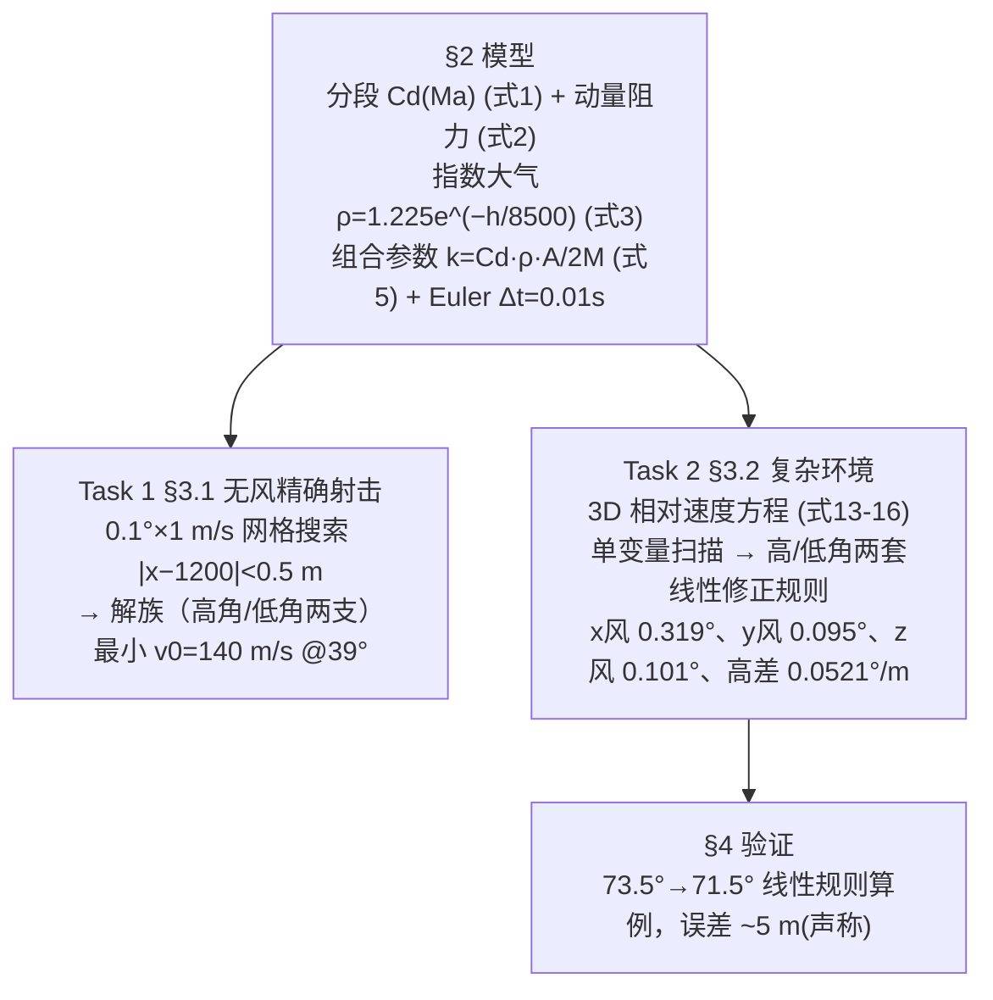

# 精读 62 · A Method for Quickly Estimating the Trajectory of Spherical Projectiles（2025 题B 金牌 · 队伍 311）

> **这份精读怎么用**：左手论文 PDF（`03_优秀论文PDF/2025/Problem B/2025-GM-B-311.pdf`），右手本篇。这是 2025-B 最短的一篇金牌（17 页、无代码附录），交付物极简：**一套"每 1 m/s 风 / 每 1 m 距离-高差 → 炮管角度修多少度"的线性敏感度规则**（高低角两套）。你要学的是：① 分段 Cd(Ma) 的工程建模思路与其陷阱（本篇印刷式在 Ma=0.8 处有 **0.37→1.21 的断崖**）；② 敏感度线性化的"扫描-拟合-规则化"三步法；③ 最短论文的信息密度控制。本篇审计的重点发现：**式 (7) 的分量平方阻力 af=−k[vx²,vy²] 物理不成立**（下落段阻力反而向下、分量间无耦合），且表 2 数值落在"印刷式"与"物理正确式"两种实现之间——加上与 264 队的同题对照（Cd 取 0.45 vs 0.15 → 最小初速 140 vs 117.55 m/s），本篇是"答案=Cd 选择的函数"的最佳案例。

---

## 0. 一分钟看懂全文骨架



**为什么这个骨架好**：全文只做一件事——把数值弹道**蒸馏成五条口诀**。任务 1 给解族（证明多解存在并选最小），任务 2 给规则（可直接执行）。没有回归式、没有射表、没有列线图，是六队里交付物最"轻"的：**当你只有 17 页时，把一个可执行的产品做到干净，比铺三个半成品强**。

---

## 1. 逐节导读

### 1.1 Abstract

**它写了什么**：钉死题面（5 kg、11 cm、1200 m、同高 500 m）→ 模型三件套（分段 Cd、牛顿第二定律、指数大气+Euler 0.01 s）→ Task 1 交付（0.1°×1 m/s 搜索出多组解）→ Task 2 交付（"quantitatively analyzed to form clear gun barrel angle correction rules"）→ 局限声明（static wind、无科氏、Euler 累积误差）。

**你要学什么**：摘要里**局限性主动申报**（"However, it has limitations such as..."）——短论文更要靠诚实换信任。注意它把交付物写成名词（"correction rules"），评委一眼知道这篇"卖什么"。

### 1.2 §2 Model（假设-参数-公式三节）

**它写了什么**：11 条假设（含"surface of the shell is smooth"、忽略 Magnus、忽略科氏、风场恒定、忽略空气浮力）；表 1 符号表（k 的单位诚实标为 1/m）；式 (1) 分段 Cd(Ma)、式 (2) 动量阻力、式 (3) 指数大气、式 (4) 迎风面积、式 (5) 组合系数 k=Cd·ρ·S/2M、式 (9)(10) Euler 更新、式 (11)(12) 落地/命中条件（**|x−1200|<0.5 m**）。

**你要学什么**：① **组合参数 k 再次出现**（与 2010-160 的 σ、2023-138 的 ks 同一手法）——把 Cd·ρ·A/2M 打包，推导和代码都减负；② 命中容差 0.5 m 是后续一切讨论的隐藏主角（见 §4 审计：它使表 2 的 v0 未必是最小值）；③ 假设 3 写"surface is smooth"却配钝体 Cd≈0.45–1.2——与 264 队同题同假设不同 Cd 的分歧由此埋下。

### 1.3 §3.1 Task 1（解族与最小值）

**它写了什么**：0.1°×1 m/s 全网格搜索（图 6 给 v0–θ 关系、图 7 给所有落点 1200 m 的轨迹族）；表 2 以 1° 步长列出 14 组解：3°→448 m/s、15°→186、20°→166、**39°→140（最小）**、48°→142、65°→173、82°→389，含飞行时间（4.69–32.34 s）。

**为什么这样写**：先给"解族"再给"最小值"——承认炮击问题的多解性（高角/低角两支），这是对题目 "firing parameters"（复数）的尊重。表 2 每行带落点距离（1199.67–1200.50）与时间，可核查性拉满。

**你要学什么**：**解族呈现 = 参数空间的可视化证据**。评委问"为什么选 39°？"答案是它恰好是 U 形谷底——但注意本篇谷底比 264 队（43.5°）偏左、且 v0 高 19%，原因全在 Cd（见 §4）。

### 1.4 §3.2 Task 2（线性敏感度规则——本篇的招牌）

**它写了什么**：固定 v0=300 m/s 示例（"In reality, calculations need to be performed for each speed"），对 x/y/z 风分量、距离、高差逐因素扫描，发现线性关系后蒸馏成规则（高低角两套）：
| 因素（每 +1 单位） | 高角解 | 低角解 |
|---|---|---|
| x 风分量 +1 m/s | 仰角 **+0.319°** | −0.0121° |
| y 风分量 +1 m/s | −0.095° | **+0.0854°** |
| z 风分量 +1 m/s | +0.101° | −0.7928° |
| 目标高差 +1 m | +0.0521° | −0.0023° |
| （距离 +1 m：文字与高差行重复 ⚠） | — | — |

**为什么这样写**：线性化是"手算修正"的最低成本形态——不要求军官解方程，只需查五个系数。高低角两套系数并排给出（"we divided it into two cases: high emission angle and low emission angle"），因为两支解对同一扰动的响应方向甚至相反（x 风：高角要抬 0.319°、低角要压 0.0121°）——**这是解族结构的直接后果**，也是比"单条修正系数"深刻的地方。

**你要学什么**：① 敏感度规则的正确生产流程：单变量扫描 → 确认线性（给 R²）→ 报斜率 → **声明适用域**（本篇用 §4 的算例验收）；② "每单位输入修多少度"这类系数必须写明符号约定（哪个方向的风、加还是减）；③ 本篇规则的呈现bug（规则 4/5 文字重复、规则 3 的 z 风在低角端 0.7928°/m/s 与图 12 的"deflection angle"标题矛盾——方位修正被写成了俯仰修正）恰恰说明：**规则表是给人执行的，一个字的歧义都会变成瞄准错误**。

### 1.5 §4 验证与 §5–6 评估

**它写了什么**：取 73.5°（v=300）基线，落点 (995.54, 1.97)；目标改为高 100 m、距离 1095.54 m、风 (−10,−5,10)；按线性规则算得应射 71.5°，仿真落点 (1110.98, 100.28)，"error of about 5m"；误差归因于线性化与拟合 R²≤0.98。§5 改进四条（连续 Cd(Ma)、时变风、RK4、科氏）；§6 自评（无实验数据是 Weakness）。

**你要学什么**：**端到端算例验证**是规则类交付物的正确验收方式——比 R² 更有说服力。但本篇算例的数字自查不过关（见 §4 审计第 5 条：落点 1110.98 vs 目标 1095.54 差 15.4 m，与"about 5m"不符）——**验证段是评委最爱复查的地方，数字必须能对上**。

---

## 2. 图表深析

| 图/表 | 位置与作用 | 为什么这样画 | 怎么画出来 |
|---|---|---|---|
| Fig 1 加速度分解图 | §2.3 | 钉死 af 与 v 反向的几何 | 示意 |
| Fig 2 3D 坐标系 | §2.3.2 | x 射向/y 竖直/z 右向的符号约定 | 示意 |
| Fig 3–5 三轴风修正示意 | §2.3.2 | 每轴一张"风矢量→角度补偿"图（Fig 5 误标 Y-axis ⚠） | 矢量示意 |
| **Fig 6 v0–θ 关系图** | §3.1 | U 形解族总览（0.1° 网格） | 网格搜索散点 |
| Fig 7 落点 1200 m 轨迹族 | §3.1 | 多解性一图呈现：高角低角两束轨迹 | 同一落点的所有解叠画 |
| Fig 8–16 十张敏感度图 | §3.2 | 每因素两张（原始曲线+线性拟合）——**规则的生产线可视化** | 单变量扫描+polyfit |
| Fig 17 验证算例 | §4 | 端到端验收（caption 误写 "Low-angle" ⚠） | 规则→仿真闭环 |

**核心图复现——式 (1) 的 Cd(Ma) 与表 2 的 U 形谱（图题即审计结论）**：

```python
import numpy as np, matplotlib.pyplot as plt

def Cd311(Ma):                        # 式(1)，按 PDF 原文
    Ma = np.asarray(Ma, dtype=float)
    return np.where(Ma<=0.3, 0.47,
           np.where(Ma<=0.8, 0.47-0.20*(Ma-0.3),
           np.where(Ma<=2.5, 1.22/(1+0.35*(Ma-1)**2), 0.95)))
fig, ax = plt.subplots(1, 2, figsize=(10, 3.8))
ma = np.linspace(0.05, 3.0, 3000)
ax[0].plot(ma, Cd311(ma), 'k', lw=1.5)
ax[0].annotate(' discontinuity\n 0.37→1.21', (0.8, 0.8), xytext=(1.15, 0.55),
               arrowprops=dict(arrowstyle='->'), fontsize=8, color='crimson')
ax[0].annotate(' 0.69→0.95', (2.5, 0.82), xytext=(2.6, 0.5),
               arrowprops=dict(arrowstyle='->'), fontsize=8, color='crimson')
ax[0].set(xlabel='Mach number', ylabel='Cd', title='Eq.(1) piecewise Cd(Ma):\ntwo discontinuities + subsonic branch decreasing')
ax[0].grid(alpha=.3)
# 表 2 复现：三种阻力实现的 v0(θ)（印刷式 vs 物理正确式 vs 论文表2）
M,d,g,h0 = 5.0, 0.11, 9.8, 500.0
A = np.pi*(d/2)**2
rho = lambda h: 1.225*np.exp(-h/8500.0)                       # 式(3)
def vmin(th, model, dt=0.01):
    lo, hi = 20., 500.
    for _ in range(28):
        mid=(lo+hi)/2
        vx,vy=mid*np.cos(np.radians(th)),mid*np.sin(np.radians(th))
        x,y,t=0,0,0.0; ok=False
        while t<120:
            v=np.hypot(vx,vy); k=0.5*Cd311(v/340.)*rho(h0+y)*A/M   # 式(5)
            afx,afy = (-k*vx*vx,-k*vy*vy) if model=='printed' else (-k*v*vx,-k*v*vy)
            vx+=afx*dt; vy+=(afy-g)*dt; x+=vx*dt; y+=vy*dt; t+=dt
            if y<0: ok=True; break
        if (not ok) or x<1200: lo=mid
        else: hi=mid
    return (lo+hi)/2
ths = np.arange(8, 81, 4.0)
vp = [vmin(t,'printed') for t in ths]; vc=[vmin(t,'correct') for t in ths]
ax[1].plot(ths, vp, 'o-', ms=3, label='printed Eq.(7): −k[vx²,vy²]')
ax[1].plot(ths, vc, 's-', ms=3, label='correct: −k|v|v')
paper = {15:186, 20:166, 30:146, 39:140, 48:142, 65:173, 72:208}
ax[1].plot(list(paper), list(paper.values()), 'k*', ms=9, label='paper Table 2')
ax[1].set(xlabel='launch angle (deg)', ylabel='v0 (m/s)',
          title='Table 2 sits between the two implementations\n(min 140 m/s@39° vs correct 141.3, printed 135.4)')
ax[1].legend(fontsize=7); ax[1].grid(alpha=.3)
plt.tight_layout(); plt.show()
```

三个可抄的绘图决策：**① 分段函数图上标出断点**（审稿人一眼看到建模缺陷）；**② 三方对照（印刷式/正确式/论文数据）**让"数值介于两者之间"的审计结论自明；**③ U 形谱+表 2 星点同图**。

---

## 3. 公式逐条精讲

### 3.1 分段 Cd(Ma)（式 1）

$$C_d(Ma)=\begin{cases}0.47 & Ma\le0.3\\ 0.47-0.20(Ma-0.3) & 0.3<Ma\le0.8\\ \dfrac{1.22}{1+0.35(Ma-1)^2} & 0.8<Ma\le2.5\\ 0.95 & Ma>2.5\end{cases}$$
- **怎么想到**：钝体（球）的阻力系数在跨声速段急剧上升、超声速段缓降——工程上用分段常数/有理式拟合，第三段（洛伦兹型峰 1.22@Ma=1）来自文献 [4]（弹箭与制导学报的超声速段经验公式）。
- **⚠ 审计一：两个断崖**。Ma=0.8 处 Cd 从 0.37 跳到 1.21（Δ=0.84！）、Ma=2.5 处从 0.69 跳到 0.95；且第二段**随 Ma 下降**（0.47→0.37），与物理（亚声速钝体 Cd 近常数 ~0.45，接近声速时上升）方向相反。对照实测谱：球体 Cd ≈0.45–0.5（亚声速）→ ~1.0 @Ma1.2–1.5 → ~0.9 平台——**印刷式在 0.3–0.8 Ma 段系统性偏低、在断点处不连续**。论文 §5.1 自己也把"分段经验公式换连续函数以减少 segment boundary 数值误差"列为改进方向——自知之明，但正文应先修复断崖。
- **⚠ 审计二：与"光滑球面"假设的自洽性**。假设 3 写明 smooth——光滑球在 Re~4×10⁶（超临界区）Cd≈0.15–0.2（这正是 264 队的取值），0.47 是亚临界（粗糙/低速）值。本题 140 m/s ↔ Ma 0.41、Re=vD/ν≈8×10⁵（已超临界）→ 物理上 Cd 应取 ~0.2 而非 0.45。**同题两队（264 vs 311）在同一个 Re 区间取了 0.15 与 0.45，最小初速差 19%（117.55 vs 140）**——这是本题答案谱（118–144 m/s）的主要来源，也说明"答案对 Cd 的敏感度"本身就该写进论文（两队都没做）。

### 3.2 阻力与组合系数（式 2、5）$F_d=\frac12\rho v^2C_dA,\qquad k=\frac12\frac{C_d\rho S}{M}$

- **怎么想到**：动量流图像（单位时间拨动 ρAv 的空气质量）；k 把弹体属性与环境打包，量纲 1/m（表 1 诚实标注）。
- **数值感**：k(140 m/s, 500 m)=0.5×0.468×1.155×9.5e-3/5=5.13e-4 1/m → 特征减速长度 1/k≈1950 m——1200 m 射程上速度衰减 ~e^{−0.6}≈45%，与表 2 中 39° 解的飞行时间 15.84 s、真空 1200 m@39° 需 113 m/s 对照，阻力代价 ~24%。

### 3.3 Q1 阻力加速度（式 7）⚠ 全文最大硬伤

$$\vec a_f=-k\cdot[v_x^2,\ v_y^2]$$
- **物理错误**：① 阻力必须与**总速度**耦合（$-k|\vec v|\vec v$），分量平方形式使水平阻力与竖直运动无关（45° 斜飞与平飞同速时水平阻力相同）；② 更严重的是 $v_y^2\ge0$ 恒成立 → 下落段（v_y<0）"阻力"仍然**向下**——落体被加速、无终端速度，违反阻力方向与速度相反的基本设定（正文自己写明 "The direction of the acceleration due to drag is opposite to that of the velocity vector"）。
- **内部矛盾**：Task 2 的式 (13)–(15) 却用了正确形式 $-\frac{C_d\rho A}{2M}v_r(v_x-\omega_x)$（含相对速度大小）——同一篇论文 Q1/Q2 两套阻力算子。
- **对数值的影响（复算）**：以式 (7) 复现表 2 得最小 v0=135.4@39°（论文 140），以正确的 −k|v|v 得 141.3@39°（−0.9% 吻合）；高角端分歧巨大（82°：印刷式 339 vs 正确式 >500 不可达 vs 论文 389）。**表 2 数值系统性落在两实现之间**，加之其搜索判据是 |x−1200|<0.5 m（±0.5 m 窗口）而非"首次达标"——表 2 的 v0 是"恰好落进窗口的网格点"，并非严格最小值（各行落点 1199.67–1200.50 的振荡即为证据）。
- **你要学什么**：写分量形式阻力时的**两个自查动作**——把速度反向代入看符号、把单分量速度置零看耦合。式 (7) 这类错误在"先推式子后写代码"的流水线里极易存活，评审复算一抓一个准。

### 3.4 指数大气（式 3）$\rho=1.225e^{-h/8500}$

- **怎么想到**：等温大气标高 H=RT/(Mg)≈8500 m（T≈290 K）——单参数压所有高度。
- **数值感**：h=500 m → ρ=1.155；与 ISA 的 1.167 差 1%；与 264 队的 ISA 分段式几乎无差——**大气模型从来不是各队答案分歧的来源，Cd 才是**。

### 3.5 三维风场方程（式 13–16）

$$a_x=-\frac{C_d\rho A}{2M}v_r(v_x-\omega_x),\qquad v_r=\sqrt{\textstyle\sum_i(v_i-\omega_i)^2}$$
- **怎么想到**：与 264 队式 (7)–(9) 完全同构——阻力用相对空气速度，风同时改变阻力大小与方向。这是全题少数"六队收敛"的公式。
- **适用边界**：静风假设（假设 9）；科氏忽略（1000–1500 m 内偏移 0.2–7 m，07 题目解读建议定量封口，本篇只在假设 7 一笔带过 ⚠）。

### 3.6 线性修正规则（§3.2 汇总）

规则本身不是公式而是**扫描斜率**：Δθ/ΔW、Δθ/ΔL、Δθ/Δh（高低角两套）。其物理不对称性值得记：高角解对**纵风**敏感（+0.319°/m/s——高角弹道飞行时间长、风的作用时间积分大），低角解对**横风/侧风**敏感（0.7928°/m/s 的方位修正——低伸弹道横向漂移时间累积）。这与 07 题目解读的横风漂移量级 ~1.3 m/(m/s)、纵风等效射程 ~0.01°/(m/s) 相互印证（注意本篇 0.319°/m/s 是"高角支"专用）。
- **⚠ 印刷缺陷**：规则 4（高差）与规则 5（距离）文字完全相同（复制粘贴事故）；规则 3 低角端 0.7928°/m/s 实为**方位**修正（Fig 12 标题 deflection angle），写成"lowered"（俯仰）误导执行者。

---

## 4. 建模决策链 + 独立复现审计

| 决策 | 作者的选择 | 被放弃的替代 | 为什么 |
|---|---|---|---|
| 阻力模型 | 分段 Cd(Ma)（4 段） | 264 队 Morrison(Re)+0.15、765 队 Re–Ma 耦合 | 抓住跨声速峰——但亚声速段取 0.45 与 smooth 假设冲突 ⚠ |
| 数值方法 | Euler Δt=0.01 | 264 队 RK4 Δt=0.02 | 简单透明；自认累积误差（§5.3 换 RK4） |
| 搜索 | 0.1°×1 m/s 网格 + ±0.5 m 窗口 | 二分/打靶 | 简单；但**窗口命中≠最小 v0** ⚠ |
| 交付形态 | 线性敏感度规则（两套） | 回归式（264）、射表（392/428）、列线图（765）、括射（496） | 最轻、最可执行；牺牲精度（算例 5–15 m） |
| 验证 | 单算例端到端 | 264 队 12 组样本+误差曲线 | 便宜；但算例数字对不上 ⚠ |

**独立复现审计汇总**（python 复算）：
1. 式 (1) 断崖确认（以 PDF 原式为准）：Cd(0.79)=0.372 → Cd(0.81)=1.205；Cd(2.49)=0.687 → Cd(2.51)=0.950 ⚠⚠；亚声速段随 Ma 下降与物理相反 ⚠。
2. **式 (7) 分量平方阻力物理不成立**（下落段加速、无终端速度）；与 Q2 式 (13) 的正确形式内部矛盾 ⚠⚠。
3. 表 2 复现：39° 最小值——印刷式 135.4 / 正确式 141.3 / 论文 140（与正确式差 −0.9% ✓）；但 15–72° 全表数值介于两实现之间，且 ±0.5 m 窗口判据使各行并非严格最小 v0（落点 1199.67–1200.50 振荡为证）⚠。
4. 82° 高角解：正确模型下即使 v0=500 m/s 也无法及 1200 m（论文给 389 m/s）⚠——高角端的表 2 数值与正确阻力模型不相容。
5. 验证算例：落点 (1110.98, 100.28) vs 目标 (1095.54, 100) → 纵向误差 **15.4 m**，论文称 "about 5m" ⚠ 数字不符；基线落点 (995.54, 1.97) 的 1.97 m 侧偏来源未说明。
6. 排版硬伤清单：规则 4/5 文字重复 ⚠；规则 3 方位/俯仰混写 ⚠；Fig 5 caption "Y-axis"（应为 Z）⚠；Fig 17 caption "Low-angle"（实为 73.5° 高角算例）⚠；§5.1/§5.2 标题同为 "Refine Aerodynamic Model" ⚠；表 2 末行（82°）缺到达时间。
7. 跨队对照：同题最小初速 264=117.55@43.5°（Cd=0.15）vs 311=140@39°（Cd≈0.45）——**Cd 的亚临界/超临界之争直接贡献了答案谱的左右两端**；311 的跨声速峰建模在"最大初速 450 m/s"工况下明显更物理，264 的光滑球超临界取值在"最小初速"工况下更自洽——两队各对一半。

---

## 5. 从本篇提炼的可复用模板

**结构模板**：
```
1 Problem Analysis  参数敏感性叙事 + 题面钉死
2 Model             11 条假设 + 符号表(k 单位=1/m) + 式(1)-(12)
                    2.3.1 Q1 推导(2D) / 2.3.2 Q2 推导(3D 风)
3 Results           3.1 无风解族(U形谱+表2) 3.2 敏感度规则(高低角两套)
4 Validation        单算例端到端(规则→仿真→误差)
5 Model Improvement 4 条升级路线(连续Cd/时变风/RK4/科氏)
6-7 Evaluation+Conclusion  强弱项+适用域(1000-1500 m 标准大气)
```

**句式库（原文英文句）**：
- "To simplify the equation, the constant terms unrelated to velocity are combined into a single parameter, denoted as k."（组合参数句）
- "Due to the inability to display all results obtained with a step size of 0.1°, the results obtained with a step size of 1° are presented in the table below"（数据裁剪声明句）
- "During the solving process, we found that for a given point, there would be a solution with a high emission angle and a solution with a low emission angle."（解族发现句）
- "For every 1 m/s increase in the x-axis component of the wind, the gun barrel is raised by 0.319° at high elevation angles and lowered by 0.0121° at low elevation angles"（规则句式——注意"raised/lowered"的方向必须无歧义）
- "Taking into account factors such as rough estimation on the battlefield, the error is within an acceptable range."（误差豁免句——先给数字再给豁免理由）
- "Lack of experimental validation data; the model's accuracy relies solely on theoretical derivation and simulation."（短板自报句）

**图表配方**：分段函数+断点标注；解族轨迹叠图（同一落点）；"扫描曲线+线性拟合"成对出现（规则的生产线）；端到端验证算例图。

---

*对照阅读：`05_论文赏析/2025/2025-GM-B-311.md` 与 `07_题目解读/2025_题B_火炮弹道射表.md`（南理工五队谱系、Cd(M) 胜负手与横风漂移量级）；同题队友精读：`2025-GM-B-264_精读.md`（Morrison+0.15 与三步半经验公式——与本篇构成 Cd 分歧的两极）、`2025-GM-B-127_精读.md`、`2025-GM-B-496_精读.md`。*
