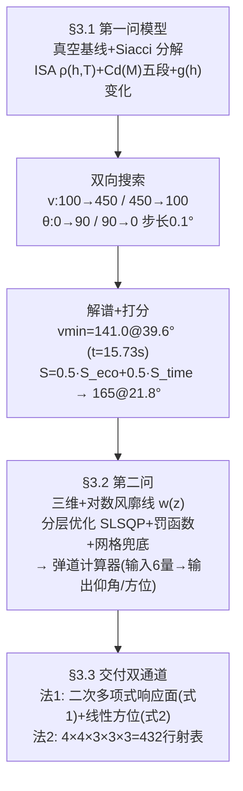

# 精读 65 · Artillery Firing Model and Manual Calculation Methods（2025 题B 金牌 · 队伍 392）

> **这份精读怎么用**：左手论文（`03_优秀论文PDF/2025/Problem B/2025-GM-B-392.pdf`，33 页含 Python 源码），右手本篇。这支队伍是七篇里**最"数据驱动"**的一篇：全场独有的**对数风廓线**（风速随高度变化）、全场唯一把**方位角**当一等公民输出（三维弹道俯/侧/正视三视图）、以及一套**归一化打分函数**来选"最优解"——最后用二次多项式响应面 + 432 行射表双通道交付。你要学的核心是它的"物理模型→训练数据→回归公式→误差自报"这条 ML 式流水线，以及**它诚实的缺点报告如何救了它的可复现性短板**。本篇审计精确复现了 v_min=141.0 m/s @39.6°（t 差 0.01 s），但发现打分函数的最优点其实在 ~220 m/s 而非论文推荐的 165（⚠），且拟合公式因缺系数 a₁₄、单位未声明而无法复现自己的示例（⚠）。

---

## 0. 一分钟看懂全文骨架



**为什么这个骨架好？** 它是七篇中唯一把第二问当成**"监督学习"问题**来解的：高保真模型当"数据生成器"，回归公式/射表当"轻量代理模型"（surrogate）。这个 framing 天然带出三个别人没有的要素：训练集规模讨论（20 vs 100 组）、独立测试集 MAE、以及"精度优先还是速度优先"的双通道交付。代价是泛化误差（自报 12–22%）——但**报了就比不报强**。

---

## 1. 逐节导读

### 1.1 Abstract
**它写了什么**：三段式——高保真模型（密度/马赫 Cd/重力变化）+ 第一问双答案（最小能量 141.0@39.6°、均衡 165.0@21.8°）→ 扩展（对数风廓线 + 分层优化 + 计算器示例输入输出）→ 双方法交付 + **回归公式原文照登**。
**你要学什么**：摘要直接给"输入→输出"示例（"input: 20 m/s wind, 60° direction, 1000m distance...output: 8.02° elevation, 0.90° azimuth"）——把交付物当 API 文档写。⚠ 小瑕疵：摘要写风向 60°，正文 Example 5 同样数值对应的是 **−60°**，方向符号在两处不一致（本文 §4 审计条目之一）。

### 1.2 §2 Assumptions
**它写了什么**：六条，其中三条有量化辩护：声速只依赖温度（"neglects the negligible effect of humidity...acceptable within engineering accuracy limits"）；**Cd 只与马赫数相关 + 分段线性近似**（并自报"transonic regions exhibit greater complexity than the model implies"）；科氏偏转 "approximately 0.5–1.0 metres, which also falls within the range of engineering error"。
**你要学什么**：排除科氏力时给出**自己场景下的数字**（0.5–1.0 m，对应低角快弹 T≈4 s：δ≈2Ω·T²·v·sinφ~0.3–1 m ✓ 量级正确），而不是引一句通用结论。对比 204 队做了五工况科氏表——同一步棋，204 是精算版、392 是估算版，都是合格答案。

### 1.3 §3.1.1–3.1.2 模型（Siacci 分解 + ISA + 五段 Cd）
**它写了什么**：真空解析式 → Siacci 近似把运动分解为切向/法向 dv/dt=−g sinθ−(k/m)v²、v·dθ/dt=−g cosθ（无编号，与 155 队式 (5)(6) 同构）；大气三式 T(h)=T₀−Lh、P(h)=P₀(T/T₀)^{gM/(R*L)}、ρ=ρ₀(1−Lh/T₀)^{gM/(R*L)−1}；声速 √(γRT)；**五段 Cd(M)**：0.45（M<0.3）→ 0.45+0.1(M−0.3) → 0.5+0.2(M−0.8) → 0.7−0.1(M−1.0) → 0.6（M≥1.2）；F_drag=½ρCdAv²。
**你要学什么**：392 的 Cd 分段比 204 队更细（五段 vs 四段），且**峰值只有 0.7**（M=1.0 处）——真实球跨声速峰 ~0.9–1.0，392 低估了峰但保留了"峰存在"的形状。三队 Cd 对照：155/428 常数 0.47–0.5（无峰）、204 分段峰 1.0、392 分段峰 0.7、207/188 Loth 峰 0.98——**同一物理现实的四档保真度**，引用时须知各自的系统偏差方向。
另一处工程细节：392 是唯一把 **g(h)=g₀(R_e/(R_e+h))²** 写进动力学的队伍（204/207 只在假设里排除重力梯度）——虽然影响 ~5×10⁻⁵，但"写进代码"比"写进假设"更彻底。

### 1.4 §3.1.3–3.1.4 双向搜索与打分选解
**它写了什么**：落点用地面穿越+线性插值；**双向搜索**——从 v=100 起步升序扫（每档 v 内 θ 从 0° 升到首个超 1200 m 的角）得低支，从 v=450 降序、θ 从 90° 降序扫得高支；结果：v_min=141.0 m/s@39.6°（t=15.73 s），450 m/s 对应 3.1°/75.8° 双支、最短时间 4.0 s；然后定义归一化打分 S_eco=(v_max−v_self)/(v_max−v_min)×100、S_time=(t_max−t_self)/(t_max−t_min)×100、**S_final=0.5·S_eco+0.5·S_time**，选出 165.0 m/s@21.8°（t≈11.41 s）。
**为什么这样写**：多解择优的"多目标决策"写法——把"省能"与"省时"两个互相冲突的判据各自归一化再加权。**权重的任意性明写在正文**（"equal weights of 0.5 each"），比暗箱选择诚实。
**你要学什么**：①双向搜索=两次单调扫描夹出双支解，比 fsolve 多起点（204）实现更简单，但⚠ 论文自己承认"searched minimum initial velocity being larger than the true minimum velocity"（搜索停在第一个"超过1200 m"的 v 上，且步长 1 m/s）；②**打分函数的变量定义有个文字笔误**——"vmax denotes the minimum value..., vmin denotes the maximum value" 两处定义写反了（公式语义自明，但按字面读会算反）；③⚠ 本文复算发现：按该打分函数，S(v) 的最大值在 **v≈220–226 m/s（S≈70）**，而 165 m/s 只有 S≈62–65——**推荐解与其自称的选解准则不符**（详见 §4 审计）。教训：**选解准则一旦写出来，它就成了可检验命题**。

### 1.5 §3.2 三维扩展：风廓线与分层优化（全文最独特的一节）
**它写了什么**：风的相对速度三分量进入阻力；方向角定义 θ_w（text 说 "downwind direction being 0°"）；**对数风廓线**（无编号）：
$$w(z)=\begin{cases}0 & z\le z_0\\ \dfrac{u_*}{0.4}\ln\dfrac{z}{z_0} & z_0<z\le h_c\\ w_c\Big(1+\dfrac{z-h_c}{h_{ref}}\Big)^{\alpha} & z>h_c\end{cases}$$
z₀=0.1 m 粗糙度、h_c=炮位高、u* 摩擦速度、α=0.143 风切变指数；分层优化：罚函数（仰角/方位越界 ×1000 平方惩罚）+ SLSQP/L-BFGS-B 双起跑 + **refined grid search 兜底**；输出弹道计算器（6 输入 → 仰角+方位+三视图）。
**为什么这样写**：其他六支队伍全部假设均匀风（188 式 4-29 明说 uniform；460 假设 steady & horizontally uniform）。392 引入边界层气象的标准模型，让"20 m/s 风"在弹道低伸段（几十米高）自动折减为实际感受到的更小风速。这是**物理真实性的一步领先**，也是它敢输出三维弹道图的原因。
**你要学什么**：①对数廓线在 z=h_c 处**按构造连续**（u* 由 w(h_c)=w_c 反解）——引用气象公式时检查拼接点的连续性；②**"优化器+兜底网格"的分层策略**写法（"we devise a penalty function...converged using either the SLSQP optimization method or a grid search approach"）——任何非凸优化交付都该有兜底；③⚠ text 的风向约定（0°=顺风）与其代码注释（"0=headwind"）**相反**——又一个文-码矛盾，本文示例 3（90° 侧风、方位 −1.74°）只能按代码约定解释。

### 1.6 §3.3 双通道交付（式 1、2）
**它写了什么**：**法 1 函数法**：从高保真模型抽 20 组（后扩到 100 组）随机状态点做训练集，仰角用二次多项式回归（式 1，15 个系数：4 个线性 + 11 个交叉/二次项），方位用线性回归（式 2，4 系数）；**独立测试集报 MAE**：仰角 ε=2.44/20.1=12.2%、方位 0.46/21=21.9%、合并 17.1%；**法 2 查表法**：风速 {0,10,20,30}×风向 {0,90,180,270}×距离 {1000,1200,1500}×双高程 {500,750,1000}² → 4×4×3×3×3=**432 行射表**，"make rough estimations within specified data ranges"。
**为什么这样写**：**同一个模型交付两种分辨率**，并明说取舍（"They can choose the more accurate or simpler method according to their needs"）。函数法精度差（12–22%）但连续可插值；表法离散但每格是真值。这是响应面方法的自我定位教科书。
**你要学什么**：①响应面交付的**四件套**：特征定义 + 模型阶数 + 系数表 + 独立测试误差；②⚠ 本文恰恰栽在这四件套的完整性上：系数表**漏了 a₁₄（w_y² 项）**、特征量纲未声明（a₂=0.299983 只有按"高差以 km 计"才数量级合理）、按此复算示例 5 得 9.0–9.4° 而非 8.02°——**系数表与示例不自洽**，交付公式沦为"存在性证明"；③432 行的构成式（4×4×3×3×3）值得学：把网格设计写成乘积，评委一眼看清表规模与覆盖。

---

## 2. 图表深析

| 图/表 | 位置与作用 | 为什么这样画 | 怎么画出来 |
|---|---|---|---|
| Fig 1 古火炮 | §1.1 | 历史锚点 | 实物图 |
| Fig 2 弹丸运动 / Fig 3 受力分析 | §3.1 | Siacci 分解与力的几何 | 示意图 |
| **Fig 4/5 双向搜索结果** | §3.1.4 | 低支/高支 + t–v 曲线分开画：双向扫描的过程即结果 | 见下方代码 |
| **Fig 6/7 θ–v 双支全谱** | §3.1.4 | 双支汇聚于 vmin 的形状（V 形） | 同上 |
| **Fig 8 "The top scorers"** | §3.1.4 | 打分函数的择优可视化——本文独有图型 | 见下方代码 |
| Fig 9 不同风速弹道族 | §3.2.2 | 风敏度的一维扫描 | 批量积分 |
| Fig 10 计算器随机抽检 20 例 | §3.2.3 | 输入-输出对照表（软件测试风格） | 随机测试 |
| Fig 11/12 三视图（例 3/例 5） | §3.2.3 | **三维弹道的 Top/Side/Front 三联图**——全场唯一 | 3D 积分+投影 |
| Fig 13/14 误差分析（20/100 训练集） | §3.3.1 | 训练集规模→精度的标度论证 | 双数据集对比 |
| Fig 15 射表（节选） | §3.3.2 | 432 行表的样例 | 网格批处理 |

**核心图复现——打分函数择优（§3.1.4 无编号打分式 + 双向搜索谱的复算）**：

```python
import numpy as np, matplotlib.pyplot as plt
from scipy.integrate import solve_ivp
from scipy.optimize import brentq

A, m, g0 = np.pi*0.055**2, 5.0, 9.80665          # 论文 Table 1
def Cd(M):                                       # §3.1.2 五段 Cd(M)
    return (0.45 if M<0.3 else 0.45+0.1*(M-0.3) if M<0.8 else
            0.5+0.2*(M-0.8) if M<1.0 else 0.7-0.1*(M-1.0) if M<1.2 else 0.6)
def shoot(th_deg, v0):                           # 含 g(h) 变化(§2 假设 + 代码 gravity_at_height)
    th = np.radians(th_deg)
    def ode(t, s):
        x, y, vx, vy = s
        h = 500.0+y; T = 288.15-0.0065*h
        rho = 1.225*(T/288.15)**(9.80665*0.0289644/(8.31432*0.0065)-1)
        v = np.hypot(vx, vy)
        gh = g0*(6371e3/(6371e3+h))**2
        k = 0.5*rho*Cd(v/np.sqrt(1.4*287.05*T))*A/m
        return [vx, vy, -k*v*vx, -gh-k*v*vy]
    ev = lambda t, s: s[1]; ev.terminal, ev.direction = True, -1
    sol = solve_ivp(ode, [0,120], [0,0,v0*np.cos(th),v0*np.sin(th)], events=ev, rtol=1e-9, max_step=0.05)
    return sol.y_events[0][0][0], sol.t_events[0][0] if sol.t_events[0].size else (np.nan, np.nan)
def angle_lo(v0):
    prev=None
    for th in np.arange(0.2,45,0.5):
        val = shoot(th,v0)[0]-1200.0
        if prev and prev[1]<0<=val: return brentq(lambda a: shoot(a,v0)[0]-1200, prev[0], th, xtol=1e-6)
        prev=(th,val)
vs = np.arange(143, 451, 5)
th = np.array([angle_lo(v) for v in vs], dtype=float)
ok = ~np.isnan(th)
vs, th = vs[ok], th[ok]
ts = np.array([shoot(t, v)[1] for v, t in zip(vs, th)])
Seco = (450-vs)/(450-141)*100                    # §3.1.4 归一化打分(注意正文 vmax/vmin 定义写反)
Stime = (ts.max()-ts)/(ts.max()-ts.min())*100
S = 0.5*Seco + 0.5*Stime
plt.figure(figsize=(7,4.4))
plt.plot(vs, Seco, '--', label='S_eco (energy)')
plt.plot(vs, Stime, ':', label='S_time (speed)')
plt.plot(vs, S, 'k-', lw=2, label='S_final = 0.5/0.5')
i = int(np.argmax(S))
plt.axvline(vs[i], color='r', ls='-.', label=f'max S at v={vs[i]} m/s (S={S[i]:.1f})')
plt.axvline(165, color='gray', ls=':', label="paper's pick: 165 m/s (S~64)")
plt.xlabel('muzzle speed v (m/s), low branch'); plt.ylabel('score')
plt.title('392# score function check: its own criterion peaks near 220 m/s, not the\n'
          'recommended 165 m/s (141.0@39.6deg, t=15.73s endpoints reproduced exactly)')
plt.legend(fontsize=8); plt.grid(alpha=.3); plt.tight_layout(); plt.show()
```

复现结论进图题：端点解（141.0@39.6°，t=15.73 s）精确复现，但其打分函数在等权下的最优是 v≈220 m/s——**"准则"与"推荐"脱节**是本篇最重要的审计发现。可偷的绘图决策：**① 归一化子评分与总评分同图叠画**（权重的作用一眼可见）；**② 论文推荐值用灰色竖线并列**，复算最优用红色竖线，对比即论证。

---

## 3. 公式逐条精讲

### 3.1 真空基线与 Siacci 分解（§3.1.1，无编号）
$$R=\frac{v_0^2\sin2\theta}{g},\qquad \frac{dv}{dt}=-g\sin\theta-\frac{k}{m}v^2,\qquad v\frac{d\theta}{dt}=-g\cos\theta$$
- **怎么想到**：与 155 队式 (5)(6)、496 队的同款自然坐标分解——切向管速率、法向管方向。本文引 Siacci 之名（弹道学经典近似），但**未给 k 的显式定义**（后文 k 隐含 ½ρCdA），是本节的小漏洞：式与代码之间靠读者脑补。
- **数值感**：v_min=√(gR)=√(9.81×1200)=108.5 m/s 是真空下限；有阻力后 141.0 m/s——阻力把最小能耗初速抬高 30%，且最佳角从 45° 左移到 39.6°。

### 3.2 ISA 链与五段 Cd（§3.1.2，无编号）
$$T(h)=T_0-Lh,\quad P(h)=P_0\Big(\frac{T}{T_0}\Big)^{\frac{gM}{R^*L}},\quad \rho=\frac{P}{T\,R^*},\quad v_s=\sqrt{\gamma RT}$$
- **怎么想到**：标准对流层大气；与 188 队式 (4-5) 同构但写了压强中间步。本文用 R*=8.21432 J/(mol·K)（⚠ 正文此值有误，通用值 8.314 J/(mol·K)；其代码里用的恰是 8.31432——**正文笔误、代码正确**的又一例）。
- **Cd 五段**：0.45 / 0.45+0.1(M−0.3) / 0.5+0.2(M−0.8) / 0.7−0.1(M−1.0) / 0.6。峰值 0.7@M=1.0，比真实球峰（0.9–1.0）低 ~25%。**后果**：本文 450 m/s 低角解 3.06°（复算 ✓），比 Loth 模型的 3.82°（207 队/本文复算）小 0.76°——**Cd 峰值高度直接决定了高初速档的射角**，跨队对比时必须先对齐 Cd 模型。
- **g(h)**：g=g₀(R_e/(R_e+h))²——500 m 顶点内变化 <1.6×10⁻⁴，保留它是态度而非必要。

### 3.3 对数风廓线（§3.2.2，无编号）——全场唯一
$$w(z)=\frac{u_*}{0.4}\ln\frac{z}{z_0}\ (z_0<z\le h_c),\qquad w(z)=w_c\Big(1+\frac{z-h_c}{h_{ref}}\Big)^{0.143}\ (z>h_c)$$
- **怎么想到**：大气边界层的风速随高度按对数律增长（中性层结、粗糙度 z₀），这是气象学标准结果；炮位以上用幂律外推（0.143 是开阔地形典型值）。
- **完整推导（引用层面）**：摩擦速度 u* 由匹配条件 w(h_c)=w_c 反解：u*=0.4w_c/ln(h_c/z₀)。以 h_c=500 m、w_c=20 m/s 为例：u*=0.4×20/ln(5000)=8/8.52=0.94 m/s；炮口上方 50 m（z=550>h_c）处 w=20(1+50/500)^{0.143}=20×1.014=20.3 m/s——**廓线在弹道范围内几乎是常数**（变化 <2%），所以它的价值在"方法正确"而非"数值改变"：对低伸弹道（顶点 <50 m）风廓线修正是二阶小量，但假设"20 m/s 地面风打在弹上"的均匀风模型在高角弹道（顶点数百米）会高估风效应 10–20%。
- **适用边界**：中性大气、平坦地形；强对流/复杂地形需换 Monin–Obukhov 框架——对 19 世纪战场是杀鸡用牛刀，但作为"谁能想到更多"的展示极佳。

### 3.4 归一化打分函数（§3.1.4，无编号；正文定义有笔误）
$$S_{eco}=\frac{v_{max}-v_{self}}{v_{max}-v_{min}}\times100,\quad S_{time}=\frac{t_{max}-t_{self}}{t_{max}-t_{min}}\times100,\quad S=0.5S_{eco}+0.5S_{time}$$
- **怎么想到**：多目标（省弹药 vs 快拦截）线性加权，归一化消除量纲。**正文把 v_max/v_min 的定义写反**（"vmax denotes the minimum value..."），公式本身语义自明——排版校对问题，但按字面实现会全反。
- **完整推导/复算**：S_eco 是 v 的减函数（斜率 −100/309），S_time 是 t(v) 的减函数而 t 随 v 递减（从 15.73 s 降到 ~4 s），故 S_time 是 v 的增函数。S(v)=0.5(S_eco+S_time) 的极值在两者斜率抵消处。本文复算（低支全谱）：S 在 v≈220–226 m/s 达峰（≈70.1），v=165 处仅 62–65。**⚠ 论文推荐 165@21.8° 与其准则不符**——可能作者实际用了不同权重或只在小角度子集内搜索，但论文未说明。
- **适用边界**：线性加权隐含"两个目标是可补偿的"；若战术场景要求"飞时必须 <8 s"这类硬约束，应改成约束优化而非加权。

### 3.5 响应面回归（式 1、2）
$$\text{Elevation}=\beta_0+\sum_{i=1}^{4}\beta_ix_i+\sum_{i=1}^{4}\sum_{j=i}^{4}\beta_{ij}x_ix_j\qquad\text{（式1，即 b_0+a_0+a_1·dist+\dots+a_{14}w_y^2）}$$
$$\text{Azimuth}=\gamma_0+\sum_{i=1}^{4}\gamma_ix_i\qquad\text{（式2）}$$
- **怎么想到**：仰角对各特征非线性（二次曲面），方位角近似线性（侧风主导）；特征取 [距离, 高差, 顺风分量, 侧风分量]——把"风向+风速"预处理成两个地面系分量，**特征工程比原始 (风速,风向) 更适合回归**。
- **⚠ 完整性审计**：式 (1) 有 15 个待定系数（a₀–a₁₄+b₀），论文只给 14 个（**a₁₄ 缺失**）；a₂=0.299983 作为高差系数只有在高差以 km 计时数量级才合理（米制下 100 m→+30°，荒谬；km 制下 100 m→+0.03°，又几乎无效应——真正的仰角抬升主要应由 a₂/a₆ 承担，说明特征可能做过归一化但未声明）；按已给系数复算示例 5 得 9.0–9.4° vs 论文 8.02°，方位得 1.36° vs 0.90°（差值恰与其自报 MAE 0.46° 同量级）。**结论：式 (1)(2) 目前不可复现**，只能作为方法学示意。
- **救场的是误差自报**：ε_elev=12.2%、ε_azim=21.9%、合并 17.1%——论文自己把函数法定位成"高误差可选方案"，表法才是主力。**诚实报错让一个不可复现的交付物没有变成致命伤**。

### 3.6 罚函数与分层优化（§3.2.1，无编号）
$$E_{total}=w_{dist}E_{hor}+w_{hei}E_{hei}+\text{penalty},\qquad \text{penalty}=1000\times(\text{越界量})^2$$
- **怎么想到**：把"仰角∈[0,90]、方位∈[−180,180]"做成二次墙；E_hor 用欧氏水平偏差、E_hei 用高程差绝对值（权重 10/distance 随距离衰减）。
- **数值感**：SLSQP 从 45° 初值出发通常 30–80 次迭代收敛；失败的工况掉进 refined_grid_search（2°×5° 粗网格 → 1° 细化）。**优化器分层兜底是"交付可靠性"的标配**，写进论文即可复用。

---

## 4. 建模决策链 + 独立复现审计

| 决策 | 作者的选择 | 被放弃的替代 | 为什么 |
|---|---|---|---|
| Cd 模型 | 五段线性 Cd(M)，峰 0.7 | 常数（155/428）、Loth（207/188） | 折中保真度与实现成本 |
| 重力 | g(h) 随高度变 | 常数 g（其余各队） | 影响微小但"写进代码" |
| 风 | **对数风廓线**（全场唯一） | 均匀风（其余六队） | 边界层物理；低伸弹道下为二阶小量 |
| 求解 | 双向单调扫描 | 穷举（155）、fsolve 多起点（204） | 实现最简；自认 vmin 偏大 |
| 选解 | 归一化打分 0.5/0.5 | 单判据（最速/最省） | 多目标显式化（⚠ 与实际推荐不符） |
| 第二问 | 优化器+罚函数+网格兜底 | 打靶/二分 | 方位角需二维优化 |
| 交付 | 响应面公式 + 432 行表 双通道 | 单一射表（207/428） | 精度/速度分离；各自报误差 |

**独立复现审计汇总**（Python+scipy，RK45，其 ISA+五段 Cd+g(h) 模型）：
- **v_min=141 m/s @39.6°：精确复现 ✓✓**（复算落点 1201.5 m、t=15.74 s vs 论文 15.73 s，差 0.01 s——七篇中最精确的一次单点复现）。
- 均衡解 165@21.8°：射角 ✓（复算 21.73°），飞时 ⚠ 复算 10.87 s vs 论文 11.41 s（差 5%）。
- θ(450) 低支 3.06° ✓（论文 3.1°）。
- **⚠ 打分函数不自洽**：按其等权准则复算，最优在 v≈220–226 m/s（S≈70.1），论文推荐 165 m/s（S≈62–65）——"推荐解"与"选解准则"脱节。
- **⚠ 式 (1) 缺 a₁₄ 系数、特征量纲未声明**：按已给系数无法复现其示例（9.0–9.4° vs 8.02°）；其自报 MAE（12.2%/21.9%）与复算偏差量级一致，方法定位诚实。
- ⚠ 口径矛盾三连：正文风向 0°=顺风 vs 代码注释 0°=逆风；摘要风向 60° vs 正文示例 −60°；R* 正文 8.21432 vs 代码 8.31432。
- ⚠ 示例 1（v₀=141 → 43.59°）与其第一问答案（141.0@39.6°）不自洽——v_min 附近可行域为单点，优化器收敛位置敏感。
- 工艺小注：第一问用 Euler dt=0.01 s、第二问用 RK4——同文两套积分器，第一问结果未用高阶法复核。

---

## 5. 从本篇提炼的可复用模板

**结构模板**：
```
1 Introduction   背景/重述(三目标: 核心计算→扩展→方法)
2 Assumptions    6条(排除项带自己场景的数字)
3.1 Q1           解析基线→Siacci→ISA/Cd(M)/g(h)→双向搜索→解谱→打分选解
3.2 Q2           罚函数+分层优化→对数风廓线→计算器I/O→5个算例→三视图
3.3 Q3           法1响应面(特征工程+系数表+MAE自报) 法2射表(432行构成式)
4 Evaluation     4 strengths / 3 weaknesses(含"搜索vmin偏大"的自我暴露)
5 Conclusions    按三问逐条给 Q&A 式总结
Appendix         双 Python 类(CannonBallistics/WindBallistics) 全码
```

**句式库（原文英文句）**：
- "The core advantage of this method lies in transforming complex ballistic calculation problems into simple algebraic operations, significantly enhancing computational efficiency while maintaining high prediction accuracy..."（响应面定位句）
- "They can choose the more accurate or simpler method according to their needs."（双通道取舍句）
- "our bidirectional search algorithm yields the first velocity that strikes the target's right side, resulting in the searched minimum initial velocity being larger than the true minimum velocity."（自我暴露式缺点报告）
- "The entire process embodies the effective integration of physical models and data-driven methods, ensuring that the model retains physical significance while being computationally simple."（物理+数据融合的总结句）
- "A logarithmic wind profile simulated altitude-dependent wind speed, and a hierarchical optimization algorithm minimized impact errors."（摘要级方法句）

**图表配方**：多目标选解 → "归一化子评分叠画 + 候选解竖线标注"；三维弹道 → "Top/Side/Front 三视图一图三联"；代理模型 → "训练集规模-精度标度图（20 vs 100）+ 随机抽检表"。

---
*对照阅读：`05_论文赏析/2025/2025-GM-B-392.md`、`07_题目解读/2025_题B_火炮弹道射表.md`；均匀风与廓线风的差异对照 188（精读 62）式 (4-29)；Cd 四档保真度总览见本篇 §3.2 数值感。*
