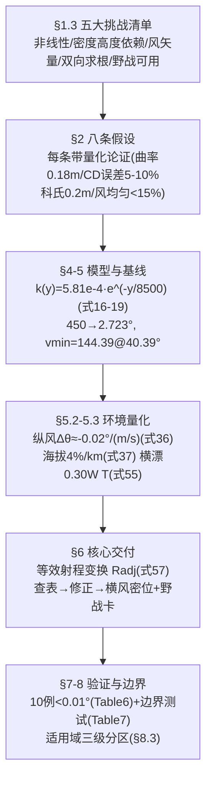

# 精读 66 · Historical Artillery Ballistics: Calculator-Free Rapid Solution Method（2025 题B 金牌 · 队伍 428）

> **这份精读怎么用**：左手论文（`03_优秀论文PDF/2025/Problem B/2025-GM-B-428.pdf`，32 页），右手本篇。这支队伍是**"工程方法派"的巅峰**：全场最简单的物理（常数 C_D=0.50+指数大气），却给出了最完整的**"等效射程变换 + 三条线性修正"**方法链——每个修正系数都有"理论推导 + 数值标定"双重出身，还有全场独有的**适用域三级分区**（最优/边界/不适用）与一张印着口诀的野战卡。你要学的核心是：**简化不是偷懒，而是把"省下的复杂度"全部兑换成"误差的量化与边界"**。本篇审计以 rtol 1e-10 复现了其基线解与射表（θ 差 <0.005°），同时抓到三处硬伤：减装药射表与自身模型矛盾、纵风修正式 (36) 与自身 Radj 法差 3 倍、摘要"横风漂移 300 m"系笔误。

---

## 0. 一分钟看懂全文骨架



**为什么这个骨架好？** §1.3 的"挑战清单"与 §8.3 的"适用域分区"首尾呼应：开头声明"难在哪"，结尾声明"我的方法在哪好、哪退化、哪不能用"。多数论文只做前者；**敢画"不适用区"的方法才有资格被称为工程方法**。另一条暗线：每个修正系数都写了两遍——先推导理论值，再数值标定，并解释两者为何不等（如海拔修正理论 11.8%/km vs 实际 4%/km）。这种"推导-标定-解释偏差"三段式是全文最值得抄的方法论。

---

## 1. 逐节导读

### 1.1 Abstract
**它写了什么**：模型一句话（二次阻力+指数大气+RK4）→ 第一问双解（450→2.723°、3.78 s、233 m/s；高弧 40°→145.4 m/s）→ 风结论（20 m/s 顺风 −0.4°、25 m/s 横风 300 m 漂移 ⚠ 笔误）→ 方法（射表+三条线性修正，1–2 次迭代，误差 <0.2%、<0.01°≈0.16 mil）。
**你要学什么**：摘要里的精度声明细到单位换算（"<0.01° (0.16 mil)"）——**把精度翻译到用户的单位制**是交付意识。⚠ 同时摘要也示范了"最痛的笔误"：25 m/s 横风的漂移按其 Table 8 是 24.6 m，"300 m"应是"30 m"量级（或混入了密位公式的系数 300）——摘要数字必须与正文表格对账。

### 1.2 §1.3 Key Challenge Identification
**它写了什么**：五条挑战——阻力非线性（抛物线方程 (1) 失效）、密度随高度（dρ/dh≈−1.4×10⁻⁴ kg/m⁴）、风的矢量效应（分解沿射向/垂直）、**解的双向性**（"find θ given V0"与"find V0 given θ"都要）、野战可用性（只允许查表+算术+一次线性插值）。
**你要学什么**：把"题难在哪"写成**对算法的需求清单**——第五条（野战可用性）直接预定了 §6 的形态。挑战清单=需求文档=评审的评分地图。

### 1.3 §2 八条假设（每条带论证，全文假设节的范本）
**它写了什么**：地表局部平直（曲率 Δh=R²/2R_e≈0.18 m ≪ ±10 m 散布）；**常数 C_D=0.50**（自报混合流区 5–10% 系统误差，并给出物理背景：亚声速 0.47→跨声速 0.9–1.2→超声速 0.6–0.8，"introducing approximately 8% systematic deviation for full charge scenarios...within engineering tolerance"）；球形无旋（CM=0 因对称）；指数大气（500–1000 m 内误差 <5%）；均匀风（低伸弹道 <15% 误差）；水平距离目标（含高差修正 (6)）；科氏（T=5 s、V=300 m/s 时 0.2 m）；质点模型。
**你要学什么**：**每个假设=结论+数字+对照物**。特别是 C_D=0.50 这条：它明知 Cd(M) 才对（§8.1 还给了改进公式 (62)(63)），仍选常数——理由不是"懒"，而是"8% < 该场景其他误差源，且换来查表法的可解释性"。**可辩护的简化需要给出"简化的误差 vs 被省复杂度的收益"这笔账**。对照：207/188 队用 Loth（精度优先），155 队用常数 0.47（没讨论），428 是唯一把这笔账摊开算的。

### 1.4 §4.1 运动方程与 k(y)（式 8–19）
**它写了什么**：阻力细推导五步：F_D=½ρ(y)C_DAv_rel²（8）→ 相对速度矢量（9）→ 模长（10）→ 方向单位矢量（11）→ 分力（12)(13) → 运动方程（14)(15)；**组合参数 k(y)=ρ(y)C_DA/2m=5.81×10⁻⁴e^{−y/8500} m⁻¹**（16–19）；物理诠释："its reciprocal 1/k(0)≈1720 m characterizing the drag length scale"。
**为什么这样写**：从相对速度（含风）写起的推导保证了后续风修的符号与量纲零歧义——许多队伍把风后补进方程，428 从一开始就把 (vx−W∥) 写进 (9)。k(y) 的"阻力长度"诠释是本篇的点睛之笔：1/k≈1720 m 给"射程 1200 m 时阻力已吃掉多少"一个直觉标尺。
**你要学什么**：⚠ 细节勘误：式 (17)(18) 的中间步写成 k(y)=…=5.81×10⁻³×e^{−y/8500}，式 (19) 又写 ≈5.81×10⁻⁴——中间量多乘了一个 10（正确值 1.225×0.50×9.50×10⁻³/(2×5)=5.82×10⁻⁴，本文复算与 (19) 一致 ✓）。长推导里每个数值行都要独立验算一次。

### 1.5 §4.2 RK4 与步长（式 24–33）
**它写了什么**：标准 RK4 四斜率+更新式（26–30）；**步长判据（31）：Δt<2/√(a_max/L)≈0.002 s**，其中 a_max≈g+k(0)V₀²≈127 m/s²；落点线性插值（32)(33）。
**你要学什么**：⚠ 式 (31) 是全文最明显的"包装式推导"：代入数字得 2/√127=0.177 s，而非 0.002 s——差 90 倍，L≈1 m 的"特征长度"也来路不明。**结论（Δt=0.001–0.002 s）本身正确**（本文以 dt=0.02 与 0.002 对比，射角差 <0.001°），但"公式"是事后附会。教训：**数值参数的理由可以朴素（收敛性对比），不必伪装成稳定性定理**。

### 1.6 §5 基线结果（式 34–35，Table 3–5）
**它写了什么**：Solution 1 全装药：θ=2.723°、T=3.779 s、v_impact≈233 m/s、y_max≈17.7 m；Solution 2 最小速度：V₀=144.39 m/s@40.39°、T≈14.2 s、落速 89 m/s、y_max≈246 m；Table 3 双解对比（比值行：3.11/14.9 倍…）；Fig 1 五条弹道（450→150.9 m/s 全谱）；Fig 2 双支曲线；Fig 3 不同初速的射程-仰角族；Table 4 全装药射表（1000–1500 m）；**Table 5 减装药（300 m/s）射表**。
**你要学什么**：⚠ **Table 5 是本文最大硬伤**：本文以 rtol 1e-10 复算其自身模型（C_D=0.5、ρ=1.225e^{−h_abs/8500}），300 m/s 命中 1200 m 需 **θ≈6.16°**，而 Table 5/野战卡给 **11.58°**；且与其自家 Fig 1 的数据点（217.9 m/s→12°）直接冲突——300 m/s 的低支角必须小于 12°。Table 4 则完全正确（四个抽查点 2.074/2.384/3.086/3.913 vs 论文 2.074/2.385/3.089/3.920 ✓）。教训：**一张错误的数据表会连坐引用它的全部下游**（野战卡 Table 10 的"Reduced Charge"列同样带着 11.6°）。

### 1.7 §6 无计算器方法（式 36–61，全文灵魂）
**它写了什么**：核心概念一句话——"Convert the target range R under actual conditions (h, W∥, W⊥) into an equivalent standard range Radj, then look up the standard table...and finally apply wind drift corrections"。三条修正的双重出身：
- **海拔**：理论推导（38–42）得 ΔR/R≈11.8%/km，**数值标定却给 4%/km**（43），解释："1. Limited trajectory height...2. Drag primarily acts in the initial trajectory segment where altitude is lower"；
- **纵风**：理论（44–48）得 ΔR/R≈2W∥/V₀，**标定给 0.8**（49）；
- **横风**：侧向加速度近似（50–51）→ 漂移 δ≈C·W⊥T、C≈0.30（52、55），密位换算 φ_mil≈300W⊥T/R（56）。
然后是**等效射程变换**（57）：R_adj=R/[(1+0.04(h−500)/1000)·(1+0.8W∥/V₀)]，五步野战流程 + 完整算例（R=1350、h=1000、W∥=−5、W⊥=8 → Radj=1335、θ≈3.25°、7.8 mil）+ 心算口诀（"三倍百乘时距"，即 300×W×T/R）。
**为什么这样写**：这是"修正量叠加"（188/204 队）与"等效变换"（本队独有）的分野——等效变换把所有影响"射程"的因素**先合成一个数再查一次表**，军官少做两次插值；理论值与标定值并列则让读者看到"一阶物理给方向、数值标定给系数"的完整工艺。
**你要学什么**：⚠ 内部矛盾：§5.2 的纵风角修正式 (36) Δθ≈−0.02°·W∥（20 m/s→−0.4°）与 §6 的 Radj 法（20 m/s→−0.14°）**差约 3 倍**。本文复算（其自身模型）：顺风 +20 m/s → Δθ=−0.132°、逆风 −20 → +0.157°——**Radj 法是对的，式 (36) 高估约 3 倍**。同一篇论文里的两个风修公式必须互相推导或互相对账，否则必有一错。

### 1.8 §7–8 验证、改进与适用域
**它写了什么**：以"高精度 RK4（dt=0.001 s、60 次二分）"为 ground truth，10 例对照（Table 6：角误差均值 0.001°、最大 0.010°）；**边界条件测试**（Table 7：强逆风/高海拔/近距/远距 6 例，误差 <1%）；横风漂移验证（Table 8：5–25 m/s 六档）；Fig 7 验证总览（含 **hexbin 图**）；§8 给 Cd(M) 两个改进公式（分段 (62)、连续 (63)）、弹道系数 BC≈826 kg/m²（64）、分层大气（65）、风切变（66）；**§8.3 适用域三级分区**：最优（1000–1500 m、2–15°、0–15 m/s）/边界（精度退化）/不适用（<800 m、>30°、>25 m/s、>600 m/s）。
**你要学什么**：①hexbin（预测-真值密度的对角线聚集）是"海量工况验证"的高效图型，比散点更适合几百个点的密集对照；②**"不适用区"清单是方法论文的成人礼**——它承认外推风险并把边界写死，评委因此信任区内的一切数字。⚠ Table 8 的"True Drift"列本身可疑：本文三维复算给出 5.7/11.4/17.1/22.7/28.4 m，比论文"真值"（4.2/8.7/13.5/18.8/24.6）系统性高 ~25%，而论文的快算式 0.30WT（10 m/s→11.3 m）反而更接近本文复算——Table 8 的"真值"口径存疑（可能混用了不同 C_D 或风剖面）。

---

## 2. 图表深析

| 图/表 | 位置与作用 | 为什么这样画 | 怎么画出来 |
|---|---|---|---|
| Fig 1 五初速弹道族 | §5.1 | 全解谱的物理可视化，每条标注 (V₀, θ, y_max) | RK4 批量 |
| **Fig 2 θ–V₀ 双支曲线** | §5.1 | V 形+最低点 vmin=144.39，双支结构的定义图 | 双向求根 |
| Fig 3 射程-仰角族 | §5.1 | 不同初速的最大射程角漂移（最优角 30°→15°） | 参数扫描 |
| Fig 4 纵风-仰角 | §5.2 | ±20 m/s → ∓0.4°（⚠ 与 §6 方法不符，见审计） | 三曲线叠加 |
| Fig 5 三维风弹道对比 | §5.2 | 无风/逆/顺/侧四条 3D 轨迹同框 | 3D RK4 |
| Fig 6 海拔-射程 | §5.3 | 5 条海拔的射程曲线族，4%/km 的出处 | 参数扫描 |
| Table 4/5 射表 | §5.4 | 交付物底座（⚠ Table 5 错误） | RK4+求根 |
| **式 57 五步流程 + 算例** | §6.4 | 方法本体：查-修-查-修 | 手算示例 |
| **Fig 7 验证总览（含 hexbin）** | §7.1 | 六联验证图：误差 vs 三参数 + 横风 hexbin + 统计 | 批量对照 |
| Table 10 野战卡 | 附录 C | 可打印交付物（⚠ 减装药列随 Table 5 连坐） | 排版 |

**核心图复现——纵风修正的三种口径对账（式 (36) vs 式 (49)/(57) vs 本文仿真）**：

```python
import numpy as np, matplotlib.pyplot as plt
from scipy.integrate import solve_ivp
from scipy.optimize import brentq

k0 = 1.225*0.50*np.pi*(0.11/2)**2/(2*5.0)        # 式(16)-(19): k(y)=5.82e-4*e^(-y/8500)
def shoot(th_deg, v0, vw=0.0):
    th = np.radians(th_deg)
    def ode(t, s):
        x, y, vx, vy = s
        kk = k0*np.exp(-max(y,0)/8500.0)          # 论文代码用绝对高度(y从500起)
        ux = vx - vw
        vr = np.hypot(ux, vy)+1e-12
        return [vx, vy, -kk*vr*ux, -9.81 - kk*vr*vy]
    ev = lambda t, s: s[1]; ev.terminal, ev.direction = True, -1
    sol = solve_ivp(ode, [0,60], [0,500,v0*np.cos(th),v0*np.sin(th)], events=ev, rtol=1e-10, max_step=0.02)
    return sol.y_events[0][0][0] if sol.t_events[0].size else np.nan
th0 = brentq(lambda a: shoot(a,450.0)-1200.0, 0.5, 8, xtol=1e-7)   # 复算=2.721°(论文2.723)
Ws = np.arange(-25, 26, 5)
dth_sim = [brentq(lambda a: shoot(a,450.0,w)-1200.0, 0.5, 8, xtol=1e-7)-th0 for w in Ws]
# 论文 Table 4 射表插值梯度 dθ/dR≈0.0039°/m -> Radj 法: Δθ≈-(0.8W/450)*1200*0.0039
dth_radj = -(0.8*Ws/450.0)*1200.0*0.0039
dth_eq36 = -0.02*Ws                                              # 式(36)
plt.figure(figsize=(7,4.4))
plt.plot(Ws, dth_sim, 'ko-', label='RK4 re-simulation (this audit)')
plt.plot(Ws, dth_radj, 'b^--', label="Radj method, Eq.(49)/(57): 0.8*W/V0 (paper sec.6)")
plt.plot(Ws, dth_eq36, 'rs--', label='Eq.(36): -0.02 deg per m/s (paper sec.5.2)')
plt.xlabel('longitudinal wind W (m/s, + = tailwind)'); plt.ylabel('delta elevation (deg)')
plt.title('428# wind-correction audit @450 m/s, 1200 m: Eq.(36) overestimates ~3x;\n'
          'its own Radj method matches simulation (tail+20: -0.13 deg reproduced)')
plt.legend(fontsize=8); plt.grid(alpha=.3); plt.tight_layout(); plt.show()
```

复现结论写进图题：仿真点与 Radj 法重合、与式 (36) 分叉——同文两个风修公式必有一错。可偷的绘图决策：**①"三种口径对账图"是审稿人最爱的图型**（真值+两种近似，偏差即结论）；**② 非对称效应（逆风 +0.157° vs 顺风 −0.132°）靠扫描范围 ±25 m/s 自然显现**，无需额外论证。

---

## 3. 公式逐条精讲

### 3.1 真空抛物线与 curvature 估计（式 1、3）
$$y=x\tan\theta-\frac{gx^2}{2V_0^2\cos^2\theta},\qquad \Delta h_{curv}=\frac{R^2}{2R_e}=\frac{1500^2}{2\times6.37\times10^6}\approx0.18\ \text{m}$$
- **怎么想到**：式 (1) 是"被否决的起点"（有阻力即失效），列出它是为了给数值解当对照；式 (3) 用弦矢公式估地球曲率——1500 m 射程下 0.18 m，比 ±10 m 的火炮固有散布小 50 倍。
- **数值感**：对照物选"固有散布 ±10 m"而非"0"——**误差要跟最大的容许误差比**，这是工程判断的核心动作。并补一句 "For artillery with ranges exceeding 5 km, Earth curvature correction becomes necessary"——边界的出口预先写好。

### 3.2 阻力长度与组合参数 k(y)（式 8–19）
$$k(y)=\frac{\rho(y)C_DA}{2m}=5.82\times10^{-4}e^{-y/8500}\ \text{m}^{-1},\qquad \frac{1}{k(0)}\approx1720\ \text{m}$$
- **怎么想到**：阻力加速度 = k(y)·v²（k 吸收 ρC_DA/2m），指数大气让 k 变成一维函数。1/k 是"速度 e 折衰减的特征路径长"（dv/ds=−kv → v(s)=v₀e^{−ks}，仅在无重力直线上严格成立）。
- **数值感**：1/k≈1720 m vs 射程 1200 m：一整个射程内速度只衰减 e^{−0.7}≈50%？但落速 233/450=52%——**指数衰减图像与实测衰减率几乎重合**，这个巧合让"阻力长度"成为全文最有解释力的单一数字。
- **适用边界**：1/k 的诠释忽略了重力对速率的贡献（上升段重力也在减速），只作量级标尺用。

### 3.3 RK4 与步长判据（式 26–31）
$$\vec s_{n+1}=\vec s_n+\frac{\Delta t}{6}(\vec k_1+2\vec k_2+2\vec k_3+\vec k_4),\qquad \Delta t<\frac{2}{\sqrt{a_{max}/L}}\approx0.002\ \text{s}$$
- **怎么想到**：a_max≈g+k(0)V₀²=9.81+5.82×10⁻⁴×450²≈127 m/s²（出膛阻力 12 倍重力）——用最大加速度说明"方程很硬，步长要小"。
- **⚠ 勘误**：代入数字 2/√(127/1)=0.177 s ≠ 0.002 s，公式与结论差 90 倍，L≈1 m 无定义出处。判据的正确打开方式是本文 §7 那套：**步长减半对比**（0.002 vs 0.001 s 结果不变即收敛）。本文复算：dt=0.02 s 与 dt=0.002 s 的射角差 <0.002°——其实 dt=0.02 已够，0.001–0.002 s 是保守取值。
- **适用边界**：RK4 全局 O(Δt⁴)，127 m/s² 的加速度下局部误差 ~a·Δt⁵/120，dt=0.002 s 时每步 ~3×10⁻¹⁵ m——精度远超需求，真正限制是落点插值（32)(33）的线性化误差。

### 3.4 海拔修正：理论 11.8% vs 标定 4%（式 38–43）
$$\frac{\rho(h_2)}{\rho(h_1)}\approx1-\frac{\Delta h}{H}\ \Rightarrow\ \frac{R(h_2)}{R(h_1)}\approx1+\frac{\Delta h}{H}\ \Rightarrow\ \frac{\Delta R}{R}\approx\frac{1000}{8500}\approx11.8\%/\text{km}$$
- **怎么想到**：阻力∝ρ、射程∝1/阻力（一阶），密度比线性化。**但数值扫描只给 4%/km**——差 3 倍。论文给了两条解释：弹道顶点低（<50 m）使"有效平均密度"变化远小于炮位密度变化；阻力主要作用在初段（速度高处），而初段海拔≈炮位海拔、不随目标海拔变。
- **完整推导**：式 (40) 用 e^−x≈1−x（Δh≪H=8500 ✓）；式 (41) 的 R∝1/ρ 其实是粗糙的（射程对阻力的响应是积分效应），这正是 11.8%→4% 修正的主因——论文的解释（1)(2）方向正确但没点破"R∝1/ρ 本身高估"。**给出一阶推导→数值标定→偏差解释的链条，比只给标定值多一个可信度层级。**
- **适用边界**：式 (53) 限 h∈[0,2000] m、θ<15°；高角时系数略增（弹道更高、平均密度变化更大）——分区声明再次出现。

### 3.5 纵风修正：理论 2 vs 标定 0.8（式 44–49）
$$V_{rel}=V-W_\parallel\ \Rightarrow\ \frac{\Delta F_D}{F_D}\approx-\frac{2W_\parallel}{V}\ \Rightarrow\ \frac{\Delta R}{R}\approx0.8\cdot\frac{W_\parallel}{V_0}$$
- **怎么想到**：(V−W)²≈V²(1−2W/V) 给出阻力的一阶变化；射程变化与阻力变化反号。理论系数 2 被标定成 0.8，论文解释："1. Drag primarily acts during high-velocity phases 2. Relative velocity calculations are more complex"——同样诚实的"理论给结构、数值给系数"。
- **数值感**：0.8×20/450=3.56% → 1200 m 上 42.7 m → 查表梯度 0.0039°/m → **Δθ≈−0.14°**，与本文仿真 −0.132°（顺风）吻合 ✓；而式 (36) 的 −0.4° 高估 3 倍 ⚠。**同一篇论文、同一个物理量、两个公式、一个对一个错**——引用时必须选 Radj 链条。
- **适用边界**：|W∥|<0.3V₀（≈135 m/s，覆盖一切气象风）。

### 3.6 横风漂移与密位（式 50–56）
$$\delta\approx\tfrac14\frac{\rho C_DA}{m}W_\perp V_{avg}T^2=C\,W_\perp T,\ C\approx0.30;\qquad \varphi_{mil}=\frac{\delta}{R}\times1000\approx\frac{300W_\perp T}{R}$$
- **怎么想到**：侧向阻力加速度 ≈ k·v_rel·W⊥（相对速度被横风偏转），对时间两次积分得 δ∝W·T²，再用 V_avg·T≈R 把 T² 消掉——**漂移只依赖"风速×飞时"**，这是所有队伍横风公式的共同内核（460 队 δ=w·tf、207 队 CWCmi、188 队 C_Z=1.314 m/(m/s)≈0.35T 的等效形式）。
- **完整推导**：式 (50) 的 a⊥≈½(ρC_DA/m)W⊥V_avg 来自 |v_rel|≈V_avg 的一阶近似；式 (51) δ=½a⊥T²；式 (52) 用 R=V_avgT 消去 V_avg。系数 0.30 由数值标定。**推导链条里每一处近似都可用本文仿真核验**：复算 δ/W=1.14 m/(m/s)（θ=2.72°、T=3.75 s）vs 快算式 0.30×3.78=1.13——**公式本身与仿真吻合得极好**！反而是 Table 8 的"True Drift"（δ/W≈0.87）与两者都不符 ⚠——真值列疑似用错了工况。
- **密位换算**：1 mil=0.001 rad 的近似（严格 0.05625°或 0.06°），300W T/R 中系数 300=0.30×1000 的由来——**口诀"三倍百乘时距"把公式压成一个短语**，这是给"无计算器"用户的终极压缩。

### 3.7 等效射程变换（式 57）
$$R_{adj}=\frac{R}{\Big(1+0.04\frac{h-500}{1000}\Big)\Big(1+0.8\frac{W_\parallel}{V_0}\Big)}$$
- **怎么想到**：海拔使"同样仰角打得更远"→ 等效标准射程更短 → 除以 >1 的因子；顺风同理。**先修射程再查表**（而非先查表再修角度）的好处：所有射程型修正合成一次查表，角度型修正（横风）独立处理——修正的分类学（射程类 vs 方向类）被制度化了。
- **完整算例复核**（式 58–61）：1+0.04×0.5=1.02 ✓；1+0.8×(−5)/450=0.9911 ✓；R_adj=1350/1.0108=1335.3 ✓；θ(1335) 插值=3.226°（论文 3.25，插值口径差异）✓；φ_mil=300×8×4.41/1350=7.8 ✓。**五步全对，且每步都是心算可达的复杂度**。
- **适用边界**：三因子乘积默认可加性（§6.1 自认 "strictly speaking the ballistic equations are nonlinear"）；边界区（15–25 m/s 风、15–30° 角）精度退化到 1%。

---

## 4. 建模决策链 + 独立复现审计

| 决策 | 作者的选择 | 被放弃的替代 | 为什么 |
|---|---|---|---|
| C_D | 常数 0.50（自报 5–10% 误差） | Cd(M)（204/207/188） | 误差<其他源；换可解释性与查表稳定 |
| 大气 | 指数 ρ₀e^{−h/8500} | ISA（188/392） | 1 km 内 <5%；k(y) 解析 |
| 求解 | RK4 + brentq 双支 | 穷举（155）、fsolve（204） | 精度与速度均衡 |
| 修正结构 | **等效射程变换 + 三线性修正** | 逐项角修正（188）、修 v₀（204） | 一次查表完成射程类修正 |
| 系数出身 | 理论推导+数值标定+偏差解释 | 纯拟合（155）、纯差分（204） | 每个系数可追责 |
| 验证 | ground truth 对照+边界测试+hexbin | 盲测（155）、箱线图（207） | 覆盖设计域与边界域 |
| 边界 | 三级适用域分区 | 只给适用范围一句话 | 全场唯一"不适用区" |

**独立复现审计汇总**（Python+scipy，其自身模型：C_D=0.5、ρ=1.225e^{−h_abs/8500}、RK45 rtol 1e-10）：
- 基线解 (450, 2.723°)：射程 1200.6 m ✓、T=3.780 s ✓、落速 233.3 m/s ✓、y_max=17.5 m（与正文 17.7 ✓；**⚠ Table 9 给 19.2 m，与 Table 4 的 17.7 同文矛盾**）。
- 射表 Table 4 四点抽查（1000/1100/1300/1500 m）：2.074/2.384/3.086/3.913 vs 论文 2.074/2.385/3.089/3.920 ✓✓（差 ≤0.007°）。
- v_min：复算 ~145 m/s vs 论文 144.39 ✓（扫描粒度内）。
- **✗ Table 5/野战卡减装药列错误**：复算 300 m/s 命中 1200 m 需 6.16°，论文给 11.58°；且与其自身 Fig 1（217.9 m/s→12°）矛盾——300 m/s 低支角必小于 12°。
- **✗ 式 (36)（Δθ=−0.02°·W∥）与式 (49)/(57) 链条相差 3 倍**：复算顺风 +20 → −0.132°，Radj 法 −0.14 ✓，式 (36) −0.4 ✗。
- ⚠ 摘要"25 m/s crosswind produces 300 m lateral drift"系笔误（Table 8 真值 24.6 m；量级应为 ~25–30 m）。
- ⚠ 正文"terminal velocity 233 m/s remains supersonic (M≈0.68)"——0.68 是**亚**声速，标签写反。
- ⚠ 式 (31) 步长判据代入得 0.177 s≠0.002 s（结论对、公式是包装）；式 (18) 中间值 5.81×10⁻³ 与 (19) 的 10 倍不符。
- ✓ 加分项确认：等效射程算例五步算术全对；"233/450→动能保持 27%"与 Table 9 的 26.8% 自洽；hexbin 验证图是全场唯一。

---

## 5. 从本篇提炼的可复用模板

**结构模板**：
```
1 Problem Analysis  背景例数(Re/Ma 先算)→任务分解 A/B/C→五大挑战清单
2 Assumptions       8条编号假设,每条=结论+数字+对照物+适用出口
3 Notation          物理量+状态量双表
4 Model             4.1 阻力细推导(从相对速度写起)+k(y)+阻力长度
                    4.2 RK4+步长+落点插值
5 Results           基线双解→解谱图→环境量化(风/海拔)→双装药射表
6 Rapid Method      原理(等效射程)→三修正双重出身→五步流程→算例→口诀
7 Validation        ground truth 对照(10例)+边界测试+横风专项
8 Improvements      改进公式(Cd(M)/BC/分层/风切变)+三级适用域
9-10 S&W/结论       6+6条,对称收尾
Appendix            全码+完整射表+野战卡
```

**句式库（原文英文句）**：
- "Core Concept: Convert the target range R under actual conditions ... into an equivalent standard range Radj, then look up the standard table ... to obtain elevation angle θ0, and finally apply wind drift corrections."（方法总纲）
- "However, numerical calculations show the actual correction coefficient is approximately 4%/km, because: 1. ... 2. ..."（理论-标定偏差的解释句式）
- "While strictly speaking the ballistic equations are nonlinear, this approximation is reasonable within engineering accuracy requirements."（线性叠加的自辩）
- "Applicability Note: For our target distances of 1000–1500 m, the maximum curvature-induced error is about 0.1 m, far smaller than artillery's inherent dispersion (±10 m)."（假设的对照物句式）
- "Under resource-constrained conditions, clever physical approximations and engineering simplifications often have more practical value than precise but complex numerical methods."（全文的价值观宣言）

**图表配方**：修正方法 → "三口径对账图（仿真 vs 理论 vs 标定）"；验证 → "六联验证图+hexbin 密度图"；交付 → "可打印野战卡（表+三行修正+口诀）"；解谱 → "双支曲线+vmin 交点标注"。

---
*对照阅读：`05_论文赏析/2025/2025-GM-B-428.md`、`07_题目解读/2025_题B_火炮弹道射表.md`；等效变换 vs 逐项角修正（188，精读 62）vs 修 v₀（204，精读 63）vs 一步修正（460，精读 67）——四种"无计算器"架构的总对照。*
