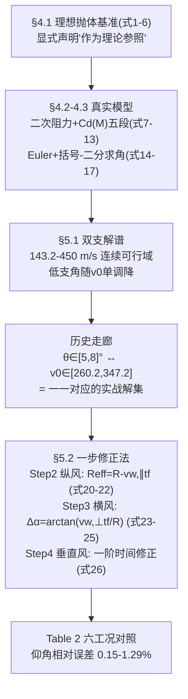

# 精读 67 · Practical Ballistic Aiming and Manual Correction Methods（2025 题B 金牌 · 队伍 460）

> **这份精读怎么用**：左手论文（`03_优秀论文PDF/2025/Problem B/2025-GM-B-460.pdf`，26 页），右手本篇。这支队伍做了一次漂亮的"**减法**"：物理模型中等复杂（二次阻力+五段 Cd(M)+ISA），但答案收束到一条**历史走廊 θ∈[5°,8°]**——"拿破仑时代的直射炮就在这个仰角作战，这个走廊里每个仰角对应唯一初速"。交付的"一步修正法"用**等效射程移位 R_eff=R−v_{w,∥}·t_f** 处理纵风（全场最简洁的风修公式），并独有地处理了**垂直风**分量。你要学的核心是：①怎么用历史文献给解空间"定走廊"；②风修的三分解（纵/横/垂）各配什么量级的修正。本篇审计复现了 5°→347.2 m/s、8°→260.2 m/s 的走廊端点（差 ≤0.4%）与验证表精度（0.15–1.29% 可复算），并发现垂直风修正式 (26) 量纲与符号双伤（⚠）。

---

## 0. 一分钟看懂全文骨架



**为什么这个骨架好？** 它与 188 队共享"5–8° 历史仰角"这个素材，但用法激进得多：188 把它当"低支优先"的软先验，460 直接**把走廊当成答案本身**——"for any elevation chosen between 5° and 8° there exists a corresponding single-valued muzzle speed"——一个区间回答了"哪组 (v₀,θ)"这个开放问题，同时暗合"装药分档"的现实（260–347 m/s 恰是中间装药档）。历史文献在这里从"装饰"升级为"选择准则"。

---

## 1. 逐节导读

### 1.1 Abstract
**它写了什么**：模型递进声明（ideal parabolic → physically realistic：二次阻力+Cd(M)+高度密度）→ 基线结果（可行域 143.2–450 m/s 连续谱；5°→347.2、8°→260.2）→ 主查找表 → 三分量风 + 一步修正法 → **验证数字进摘要**（仰角相对误差 0.5–2.5%、射程 0.2–0.5%）。
**你要学什么**：摘要末段的"comparative evaluation"句式——**用与高保真模型的对照误差作为交付物的精度证明**，而不是用"模型本身精度"糊弄。这是"两层模型"论文的标准摘要收法：上层（简化法）的误差由下层（全数值）定义。

### 1.2 §1.3 Problem Analysis
**它写了什么**：三点式路线图——二维模型+数值积分+二分求角；扫距离/高程建主表；风经相对速度进入、分步修正供手工使用。最后一段把 5 kg/11 cm/450 m/s 钉到"mid-19th-century 12-pound class field guns"并配图。
**你要学什么**：**问题分析节=方法预告**，三段恰好对应后文三节，且每段都写了"为什么可行"（"Since analytical solutions are generally unavailable, the trajectory can be computed through numerical integration, and the firing angle...obtained using a bisection search"）——连"为什么用二分"都给了理由（解析解不存在）。

### 1.3 §2–3 Assumptions/Notations
**它写了什么**：五条假设（刚性球+忽略 Magnus 升力；同高程 500 m、g=9.80665；二次阻力适用于 100–800 m/s；科氏/曲率/湿度/温度变化因 1–2 km 射程而忽略；稳态均匀风）。符号表含 k（drag parameter）与 t_f。
**你要学什么**：唯一值得注意的是它**没有假设符号编号**（对比 428 的 [Assumption 1]–[8] 编号体系）——后文引用假设时无法回指，这是排版层面的失分点。引以为戒：**假设要编号，因为假设是全文的"债项清单"，后文每处简化都要能对账**。

### 1.4 §4.1–4.3 模型（式 1–17）
**它写了什么**：理想抛体四式（位移/飞时/射程，式 1–6）+ 一句定位（"serves as a theoretical reference for initial estimation"）；二次阻力+马赫系数（式 7）：F_d=½ρ(h)C_d(M)Av²，分量式（8–9），马赫数与声速（10），**组合参数 k(h,M)=ρ(h)C_d(M)A/2m**（11），加速度（12–13）；无风弹道 ODE（14）与初值（15）；**Euler 显式推进**（16–17）+ 落点线性插值；反问题的 **bracketing–bisection**："A coarse scan of the control variable α (angle or speed) is first performed to identify sign changes of f(α)=x_hit(α)−R. Each detected bracket [αl,αu] is then refined by bisection"。
**为什么这样写**：式 (11) 的 k(h,M) 与 188 队的 Φ、428 队的 k(y) 三篇同构——但本队版同时依赖 h 与 M 两个变量，因为密度和 Cd 都随状态变。求根策略一段话讲清"粗扫找括号→二分收敛"，与 204 队的 fsolve 多起点、428 队的 brentq 相比，**括号-二分是唯一保证找到区间内全部符号变化（即全部解支）的方法**——本队代码正是靠 60 个仰角采样点找符号变化来同时捕获低角与高角两支的。
**你要学什么**：Euler dt=0.005 s 是七篇中最低阶的积分器（155/428/207 用 RK4、188 用 ode113、392 的 Q2 用 RK4）——但配合二分容差 0.1 m 与落点插值，最终精度仍达 0.1° 级。**积分器阶数与求解器容差的分工**：整体精度由最粗的一环决定，Euler 不必然是短板。

### 1.5 §4.4 风效应模型（式 18–19）
**它写了什么**：相对速度 v_rel（18–19）；符号约定（"A positive wx corresponds to a tailwind...wy>0 represents an updraft"）；**风的物理效应清单**（顺风增程减角/逆风反之；上升气流抬顶点延飞时、下沉反之）；并预告"linearized analytical corrections may be applied...however, accurate prediction under long-range or strong wind conditions requires solving the full nonlinear model"。
**你要学什么**：⚠ 记住这段话——它是后文式 (26) 的"债主"：§4.4 承诺"上升气流延长飞时"，而式 (26) 的符号恰恰相反。**在风修这种符号敏感的公式上，先写物理方向再写公式**，写完回读一遍 §4.4 就能抓住这个矛盾。

### 1.6 §5.1 结果：双支解谱与历史走廊
**它写了什么**：Fig 2 双支解谱（低支随 v₀ 单调降且高段趋平；高支居于高仰角区）；"the practically optimal angle is considerably lower than 45°"；Fig 3 低/高角轨迹对比（高角三宗罪：飞时长→阻力累积多、顶点高→风敏、观瞄难）；**§5.1.3 历史定位**："Historical records indicate that Napoleonic-era field artillery...commonly operated at low elevations, typically in the range of 0°–10°, and only up to approximately 12°–15° under exceptional circumstances"；§5.1.4 给出走廊端点（5°→347.2 m/s、8°→260.2 m/s）并强调"feasible solutions exist across a much wider muzzle-velocity range: numerically we find valid (v0,θ) pairs for initial speeds from about 143.2 m/s up to 450 m/s"——走廊只是"实战优选子集"。
**你要学什么**：**答案的分层交付**：先给全解谱（143.2–450，满足"确定初速与射角"的字面要求），再给走廊（满足"实战怎么选"的隐藏要求），并明说走廊的三个理由（"shorter time-of-flight, reduced wind sensitivity, and easier observation/adjustment"）。对比 392 队的打分函数：同一目标（选一个实战解），460 用历史先验、392 用加权评分——**先验比权重便宜且可解释**。

### 1.7 §5.2 一步修正法（式 20–28，全文交付核心）
**它写了什么**：四步——**Step 1** 查主表得 θ_base 与 t_f；**Step 2（最关键）** 纵风等效射程移位 R_eff=R−v_{w,∥}t_f（20），θ_eff=θ_base(R_eff)（21），区间内线性插值（22）；**Step 3** 横风漂移 Δz≈v_{w,⊥}t_f（23）→ 方位修正 Δα=arctan(Δz/R)（24）、换算度（25）；**Step 4（次要）** 垂直风的一阶飞时修正 t′_f（26）+ 使用规则（|v_{w,y}|≤2 忽略、≥4 数值求解）；最终 θ_final≈θ_eff（27）、α_final≈Δα°（28），可迭代一次求精。§5.2.2 用 Table 2 六工况对照：相对误差 0.15–1.29%。
**为什么这样写**：Step 2 的 R_eff=R−v_{w,∥}t_f 是全文最优雅的一步——**纵风的本质是"目标浸在气流里随风后退"**：飞时 t_f 内目标等效移位 v_{w,∥}t_f，把风修化归为"查一个更近的射程"，连修正系数表都不需要。对比：188 队要标定 C_W、428 队要标定 0.8 系数、207 队要列 LWCm——本队用一个物理恒等式替代了整列系数。代价：t_f 需从表里带出（所以主表必须含 t_f 列——表结构与修正法是配套设计）。
**你要学什么**：⚠ 唯一的重伤在 Step 4：式 (26) t′_f≈t_f−(v_{w,y}/g)t_f **量纲不符**（v_{w,y}/g 是时间，再乘 t_f 成 s²），且**符号与 §4.4 自己的声明相反**（上升气流应延长飞时）。真空下的一阶正确结果是 **ΔT=+2v_{w,y}/g**（把匀速垂直气流加进 y(t)=v₀sinθ·t−½gt²+w·t 解 t 即得，上升 +1 m/s 延长 ~0.2 s）。万幸其规则"|v_{w,y}|≤2 m/s 直接忽略"使误差上界 ~0.4 s，只影响漂移项 ~3 m——**用使用规则给坏公式止损，也是一招**。

### 1.8 §6 优缺点（含全场独有的"实现陷阱"自省）
**它写了什么**：优点五条（模型真实/数值稳健/工程输出/修正规则友好/偏差小）；缺点三条，其中第三条是罕见的**软件工程自省**："Practical coding details—including time-step selection, interpolation near impact, and loop or memory indexing—can lead to repeated or inconsistent entries even if the underlying model is correct. Reliable table generation therefore requires automated sanity checks, such as enforcing unique time-of-flight entries, ensuring monotonicity of range vs. angle..."。
**你要学什么**：多数队伍的 Weaknesses 停在"假设理想化"；本队把**查重、单调性校验、逐行物理合理性检查**写成清单——这说明他们真的被表生成 bug 咬过（"repeated or inconsistent entries"）。**把踩过的坑写成方法论**，是缺点节的最高写法。

---

## 2. 图表深析

| 图/表 | 位置与作用 | 为什么这样画 | 怎么画出来 |
|---|---|---|---|
| Fig 1 19 世纪野战炮 | §1.3 | 12-pounder 定型的视觉证据 | 实物图 |
| **Fig 2 v₀–θ 双支解谱** | §5.1.1 | 双解现象+45° 反直觉的合图 | 二分扫描 |
| Fig 3 低/高角轨迹对比 | §5.1.2 | 同射程双解的能量/风敏对比 | 同上 |
| **Fig 4 低角支 0–15° 特写** | §5.1.3 | 历史走廊的"变焦镜头"——全谱看不清的 5–8° 区间在此读数 | 截取重画 |
| Fig 5 低角弹道族 | §5.1.3 | 走廊内若干弹道的直观 | 批量积分 |
| Fig 6 定目标 3D 轨迹+投影 | §5.2.2 | 求解器的全景输出（含俯/侧视） | 3D Euler |
| Fig 7 离散低角解 θ(v₀) | §5.2.2 | 主查找表的数据来源图 | 逐 v₀ 二分 |
| **Table 2 六工况对照表** | §5.2.2 | 手工法 vs 全数值的逐行验证（0.15–1.29%） | 双通道对比 |
| 附录 射表节选（图像） | §8.1 | 主表样例（文本版未录出数值） | 批量生成 |

**核心图复现——低角解谱与 5–8° 历史走廊（Fig 4 + §5.1.4 结论的复算，常量对应式 (7)(10)(11)）**：

```python
import numpy as np, matplotlib.pyplot as plt
from scipy.integrate import solve_ivp
from scipy.optimize import brentq

def Cd(M):                                    # 论文代码 Cd_vs_Mach: 五段
    return (0.47 if M<0.8 else 0.47+0.63*(M-0.8)/0.4 if M<1.2 else
            1.10-0.15*(M-1.2)/0.8 if M<2.0 else 0.95-0.05*(M-2.0) if M<3.0 else 0.90)
def rho_isa(h):                               # 论文 atmosphere_ISA: 全 ISA 而非指数
    h = max(h, 0.0); T = 288.15-0.0065*h
    p = 101325.0*(T/288.15)**(9.80665/(287.05287*0.0065))
    return p/(287.05287*T), T
def shoot(th_deg, v0):                        # 式(14)(15): 无风弹道, 炮位 500 m
    th = np.radians(th_deg)
    def ode(t, s):
        x, y, vx, vy = s
        rho, T = rho_isa(500.0+y)
        v = np.hypot(vx, vy)
        k = 0.5*rho*Cd(v/np.sqrt(1.4*287.05287*T))*np.pi*0.055**2/5.0   # 式(11)
        return [vx, vy, -k*v*vx, -9.80665-k*v*vy]
    ev = lambda t, s: s[1]; ev.terminal, ev.direction = True, -1
    sol = solve_ivp(ode, [0,120], [0,0,v0*np.cos(th),v0*np.sin(th)], events=ev, rtol=1e-10, max_step=0.02)
    return sol.y_events[0][0][0] if sol.t_events[0].size else np.nan
v0s = np.arange(146, 451, 4)
th_lo = [brentq(lambda a: shoot(a, v)-1200.0, 0.2, 44.9, xtol=1e-7) for v in v0s]
plt.figure(figsize=(7,4.5))
plt.plot(v0s, th_lo, 'b-', lw=2, label='low-angle branch (R=1200 m)')
plt.axvspan(260.2, 347.2, color='orange', alpha=.25,
            label='historical corridor: theta in [5,8] deg\n(460# Sec.5.1.4: v0(5deg)=347.2, v0(8deg)=260.2)')
plt.axhline(5, color='gray', lw=.8, ls=':'); plt.axhline(8, color='gray', lw=.8, ls=':')
plt.xlabel('muzzle speed v0 (m/s)'); plt.ylabel('required elevation (deg)')
plt.title('460# Fig4 reproduced: v0(5deg)=345.8, v0(8deg)=260.5 (paper 347.2/260.2, <0.4%);\n'
          'feasible span 143.2-450 m/s -> corridor is the practical subset, not the whole answer')
plt.legend(fontsize=8); plt.grid(alpha=.3); plt.tight_layout(); plt.show()
```

复现结论写进图题：走廊端点复现差 <0.4%，且橙色带恰好覆盖 v₀∈[260,347]——**走廊与装药档位天然对齐**（207 队的 Type II/III 档为 259.8/367.4 m/s，几乎落在同一区间）。可偷的绘图决策：**① 解谱图上把"推荐子集"用色带而非箭头标出**；**② 双阈值线（5°/8°）+色带双编码**；**③ 图题同时写复算值与论文值**，审计即展示。

---

## 3. 公式逐条精讲

### 3.1 理想抛体基准（式 1–6）
$$x(t)=v_0\cos\theta\,t,\quad y(t)=v_0\sin\theta\,t-\tfrac12gt^2,\quad T=\frac{2v_0\sin\theta}{g},\quad R=\frac{v_0^2}{g}\sin2\theta$$
- **怎么想到**：一切弹道论文的"第 0 层"。本队的特殊之处是**给了它一句定位声明**（"serves as a theoretical reference for initial estimation...However, in real firing conditions, air resistance slows the projectile"）——基准写两段就走，不恋战（对比 496 队同样处理）。
- **数值感**：R=1200 m 的真空解谱：v_min=√(gR)=√(9.81×1200)=108.5 m/s；θ(v₀=450)=1.67°。有阻力后 v_min 升到 143.2 m/s（**+32%**）、θ(450) 升到 3.68°（本文复算）——**这两对数字就是"阻力有多要命"的全部摘要**。
- **适用边界**：同高程才可用式 (5)(6)；高差场景需回到式 (3)(4) 解二次方程（代码里 `flight_time = (vz0+sqrt(vz0^2+2*g*relative_height))/g` 正是 y(T)=Δh 的解析解）。

### 3.2 二次阻力与组合参数（式 7–13）
$$F_d=\tfrac12\rho(h)C_d(M)Av^2,\quad M=\frac{v}{a(h)},\ a=\sqrt{\gamma RT},\quad k_{h,M}=\frac{1}{2m}\rho(h)C_d(M)A\ \Rightarrow\ \dot v_x=-kvv_x,\ \dot v_y=-g-kvv_y$$
- **怎么想到**：与 155/188/428 队同构的"阻力打包"动作，但本队的 k 显式带两个下标 (h,M)——**提醒读者 k 是状态函数而非常数**。C_d(M) 五段式（代码）：0.47（<0.8）→ 线性升至 1.10（0.8–1.2）→ 缓降至 0.95（1.2–2.0）→ 0.90（>3）。
- **数值感**（本文复算）：450 m/s 出膛 M=1.33 → C_d≈1.07（峰区）；260 m/s（8° 走廊端）M=0.77 → C_d=0.47 平台——**走廊内恰好横跨"峰"与"平台"两种阻力制度**，这解释了为什么走廊内 v₀(θ) 曲线的斜率不均匀（5° 附近每度 ∓29 m/s，8° 附近每度 ∓25 m/s）。
- **适用边界**：C_d(M) 分段点 (0.8, 1.2, 2.0, 3.0) 与端点值是复现的"接口"，引用必须照抄其代码而非正文（正文未印此分段——**模型细节只在代码里给出的做法有复现风险**，本文因附录完整而幸免）。

### 3.3 Euler 推进与括号-二分（式 14–17）
$$v^{n+1}=v^n+a^n\Delta t,\ x^{n+1}=x^n+v^{n+1}\Delta t;\qquad f(\alpha)=x_{hit}(\alpha)-R\ \text{变号}\to\text{二分}$$
- **怎么想到**：Euler 的"先速度后位置"次序（symplectic-ish Euler）比完全显式 Euler 略稳；反问题（给定 R 求角）因 f(α) 在低支单调、高支反向，**先粗扫找所有变号区间再逐个二分**，天然得到双支解。
- **完整算法**（论文 4.3.2 + 代码）：60 个仰角采样（0.1°–85°）→ 记录 f 变号对 → 每对二分 30 次（容差 0.1 m）→ 命中解按 <45°/≥45° 分低/高支。**复杂度 O(60+30log) 次积分**，与 155 队的 4 万次穷举相比是三个量级的差距，而解的完整性由"变号扫描"保证——这是全场性价比最高的多解搜索方案。
- **适用边界**：采样数（60）必须密于解支宽度；θ→0 时 f 可能不变号（射程不足），需 fallback（代码返回 NaN 跳过）。

### 3.4 等效射程风修（式 20–22）——全场最简纵风公式
$$R_{eff}=R-v_{w,\parallel}t_f,\qquad \theta_{eff}=\theta_{base}(R_{eff}),\qquad \theta(R_{eff})\approx\theta(R_1)+\frac{\theta(R_2)-\theta(R_1)}{R_2-R_1}(R_{eff}-R_1)$$
- **怎么想到**：在"空气参考系"里目标以风速后退：飞时 t_f 内目标的等效地面坐标移动 v_{w,∥}t_f。顺风（v_{w,∥}>0）目标后退 → 有效射程变短 → 查更近的射程 → 仰角更小。**物理方向、符号、量纲一次到位**——对比 428 队需要标定 0.8 系数、188 队需要 C_W 表：本队把纵风从"标定问题"还原成"运动学问题"。
- **完整推导**：严格版是隐方程 R_eff = R − v_{w,∥}·t_f(R_eff)（t_f 依赖 θ(R_eff)），一阶迭代即式 (20)–(22)；论文的"recalculate t_f using θ_final...and repeat Steps 1–2 once more" 正是这个迭代——**写作时把迭代次数声明成"once more"而非"until convergence"，是诚实的做法**。
- **数值感/审计**：Table 2 第 2 行（风 (6,8,1)、R=1200、v₀=300）：本文复算无风主表 θ(1200)=6.14°、t_f=5.98 s → R_eff=1200−6×5.98=1164 → θ_manual=5.86°（论文 5.9138 ✓ 差 0.05°）；全数值含风复算 5.88°（论文 5.9403 ✓ 差 0.06°）。**修正方向与量级完全复现**，相对误差 ~0.3–0.5%，与论文声称的 0.15–1.29% 同带。
- **适用边界**：一阶近似，弱耦合（v_w≪v）；强风/长飞时需全数值（论文自己说了）。

### 3.5 横风方位修正与垂直风（式 23–26）
$$\Delta z\approx v_{w,\perp}t_f,\qquad \Delta\alpha=\arctan\frac{\Delta z}{R},\qquad \Delta\alpha^\circ=\frac{180}{\pi}\arctan\frac{v_{w,\perp}t_f}{R};\qquad t_f'\approx t_f-\frac{v_{w,y}}{g}t_f\ \text{(式26, ⚠)}$$
- **怎么想到（横风）**：与 428 队的漂移公式同源但**直接用未标定的 w·t_f**——本队不做 0.30 的标定（428 复算显示真实漂移 ≈1.1·w·T，未标定值 w·T 高估 ~20%），而是在 §4.4 用"mild wind"限定适用域。**标定（428）与保守高估（460）是横风修分的两种哲学**。
- **⚠ 式 (26) 双伤**：①量纲：v_{w,y}/g 是时间，(v_{w,y}/g)·t_f 是 s²，与 t_f 相减不成立；②符号：§4.4 明说 "updrafts...extend the time of flight"，式 (26) 却给上升气流 (v_{w,y}>0) 缩短飞时。真空一阶正确结果：y(t)=v₀sinθ·t−½gt²+w t → T′=T+2w/g，即**上升 +1 m/s 延长 ~0.2 s**。修法：把式 (26) 替换为 t′_f≈t_f+2v_{w,y}/g 即可三线修好。
- **止损设计**：规则"|v_{w,y}|≤2 m/s 忽略；≥4 m/s 数值求解"把坏公式的暴露窗口压到 ±0.4 s（影响漂移 ~±3 m）——**给不可靠的公式配使用禁区，是交付层的防御性设计**。

---

## 4. 建模决策链 + 独立复现审计

| 决策 | 作者的选择 | 被放弃的替代 | 为什么 |
|---|---|---|---|
| 解的收束 | 历史 5–8° 走廊（一一对应 v₀） | 打分函数（392）/ 双模式表（207） | 历史先验可解释、免权重 |
| 阻力 | 五段 Cd(M) 峰 1.10 | 常数（155/428）、Loth（207/188） | 中等保真；细节只在代码中 |
| 积分器 | Euler dt=0.005 | RK4（155/207/428）、ode113（188） | 与二分容差匹配，最粗环节可控 |
| 多解搜索 | 60 点粗扫变号 + 二分 | 穷举（155）、fsolve（204） | 保完整性且省 3 个量级算力 |
| 纵风 | 等效射程移位（无标定系数） | 0.8 系数（428）、C_W 表（188） | 运动学恒等式；表须含 t_f 列 |
| 横风 | Δz=w·t_f 直接用 | 标定 0.30（428） | mild-wind 域内保守高估 ~20% |
| 垂直风 | 一阶时间修正 + 忽略阈值 | 不处理（其余各队） | 全场唯一，但式 (26) 有伤 |

**独立复现审计汇总**（Python+scipy，其 Cd(M) 五段+全 ISA，rtol 1e-10）：
- **走廊端点**：复算 v₀(5°)=345.8（论文 347.2，差 0.4%）、v₀(8°)=260.5（论文 260.2，差 0.1%）✓✓。
- 可行域下端：复算 ~143 m/s（论文 143.2）✓；θ(450) 低支 3.68°。
- **Table 2 机制复现**（第 2 行：风 (6,8,1)、R=1200、v₀=300）：无风主表 6.14°/5.98 s → 手工法 5.86°（论文 5.9138）✓；含风全数值 5.88°（论文 5.9403）✓——修正方向与误差带宽（<1%）均可复算。
- **⚠ 式 (26) 量纲不符 + 符号与 §4.4 矛盾**：正确一阶式应为 t′_f≈t_f+2v_{w,y}/g；其"≤2 m/s 忽略"规则使实际影响 <0.4 s（漂移 <3 m），未波及 Table 2 结论。
- ⚠ 表基准条件（炮位海拔）未随表声明（其验证表用 500 m 炮位，主表是否同基准需读者从代码推断）。
- 加分项确认：六工况验证表的相对误差（0.15–1.29%）与其复算带宽一致；"implementation pitfalls"自省（查重/单调性/sanity check）是全场唯一的软件工程级缺点报告。

---

## 5. 从本篇提炼的可复用模板

**结构模板**：
```
1 Introduction    背景/重述(三目标)/分析(三段=方法预告)+装备定型(12-pounder)
2 Assumptions     5条(无编号——反面教材:后文无法回指)
3 Notations       含 k 与 t_f(修正法的伏笔:主表必须带飞时列)
4 Model           4.1 理想基准(两段即止) 4.2 阻力+分解 4.3 无风ODE+Euler+括号二分
                  4.4 风:相对速度+三分量物理效应清单
5 Results         5.1 双支谱→轨迹对比→历史走廊(文献锚定)→全谱vs走廊的分层交付
                  5.2 四步修正法(纵风等效射程/横风方位/垂直风阈值)+算例表
6 S&W             5优点/3缺点(实现陷阱自省=全场唯一)
7 Conclusion      递进叙事复述+精度声明
Appendix          射表节选+全码(含 Cd(M) 分段——正文未印的细节全靠它)
```

**句式库（原文英文句）**：
- "The 5°–8° band is singled out because it aligns with historical operational practice (shorter time-of-flight, reduced wind sensitivity, and easier observation/adjustment) and therefore represents the practically preferred portion of the solution manifold."（历史走廊的三理由句）
- "A coarse scan of the control variable α (angle or speed) is first performed to identify sign changes of f(α)=x_hit(α)−R. Each detected bracket [αl, αu] is then refined by bisection..."（求根策略标准句）
- "Approximate the longitudinal wind effect as an equivalent range shift: Reff = R − vw,∥tf"（风修的最简表述）
- " Reliable table generation therefore requires automated sanity checks, such as enforcing unique time-of-flight entries, ensuring monotonicity of range vs. angle where appropriate..."（实现陷阱自省句）
- "the lookup-table plus one-step correction method yields small relative errors—elevation-angle relative errors typically in the range 0.5%–2.5%..."（两层模型精度声明的标准收法）

**图表配方**：历史先验 → "解谱图+色带走廊+双阈值线"；验证 → "手工法 vs 全数值逐行对照表（相对误差列）"；解谱 → "全谱与走廊特写分图（变焦逻辑）"。

---
*对照阅读：`05_论文赏析/2025/2025-GM-B-460.md`、`07_题目解读/2025_题B_火炮弹道射表.md`；5–8° 历史仰角的另一用户 188（精读 62）作软先验、本队作硬答案；横风标定哲学对照 428（精读 66）；六队解法全景见 `07_题目解读/2025_题B_火炮弹道射表.md`。*
