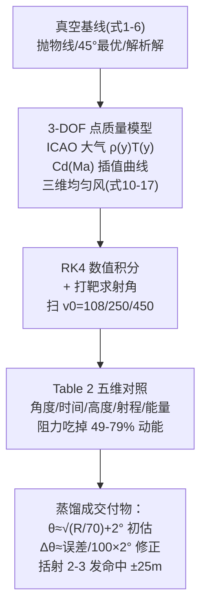

# 精读 53 · The Artillery Trajectory Problem（2025 题B 金牌 · 队伍 496）

> **这份精读怎么用**：左手论文 PDF（`03_优秀论文PDF/2025/Problem B/2025-GM-B-496.pdf`），右手本篇。这支孟加拉 RUET 队伍的解法是 2025-B 十三篇金牌里**"教科书最完整"的一篇**：真空基线 → 3-DOF 点质量模型（ICAO 大气 + Cd(Ma) 插值 + 三维风）→ RK4 求解 → 射表蒸馏成"军官野战手册"。你要学的是：① 那张堪称全文灵魂的**真空 vs 真实五维对照表**（Table 2）如何一表讲清"阻力改变了什么"；② 如何把数值模型**降维成交付物**（经验公式 + 括射法 + 便携参考卡）。本篇审计会复算它的三个射角与经验公式（⚠ 发现初估公式的一处符号疑点）。

---

## 0. 一分钟看懂全文骨架



**为什么这个骨架好**：题面两问（精确解 + 无计算器方法）被拆成"先建高保真模型、再蒸馏"的**单向流水线**——军官方法不是另起炉灶，而是从数值模型里*提炼*出来的（每条经验公式都标注 Mathematical Basis 一列）。评委看到的因此是"同一个物理的两种分辨率"，而不是两个割裂的答案。

---

## 1. 逐节导读

### 1.1 Abstract
**它写了什么**：双任务声明（精确解 + 便携法）→ 方法四件套（真空基线/3-DOF/RK4/打靶）→ **两个硬射角**（450 m/s→3.36°、250 m/s→8.73°）→ 交付物命名（"Artillery Officer's Field Manual"，±25 m、2-3 发）。
**你要学什么**：摘要里给**两个速度档的答案**而不是一个——开放题的答案谱意识（不同装药=不同答案）从摘要就开始铺垫。

### 1.2 §1 Introduction（历史叙事的开场）
**它写了什么**：1453 君士坦丁堡之围的乌尔班巨炮（配图 1）→"抛物线只在真空成立"→ 四大物理挑战清单（理想 vs 真实 / 变阻力 Cd(M) / 大气分层 / 风偏）。
**为什么这样写**：历史锚点（Dardanelles Gun）一是扣题（19 世纪火炮），二是宣告"这不是玩具题，是几百年的真实难题"。
**你要学什么**：引言的"挑战清单"= 论文的路线图预告——四个挑战恰好对应后文四层模型。

### 1.3 §2 Assumptions（八条，每条带论证）
**它写了什么**：亮点在**被排除效应的量级论证**：
- **科氏力**：算 Rossby 数 Ro=U/(Lf)=450/(1200×1.03×10⁻⁴)≈3.6≫1 → 惯性主导，忽略 ✓（用无量纲数排除效应的教科书做法）；
- 地球曲率：1–2 km 射程 irrelevant；
- **马格努斯/炮身倾斜**：归类为"随机散布而非系统偏差"——**划分问题边界**（预测弹道中心 vs 散布圆）而非简单丢弃；
- 固定 v0 求解 θ：**"历史上炮组用标准装药"**——把"求 (v0,θ) 二元组"降为"逐装药求 θ"的现实依据。
**你要学什么**：假设条目分三类写：降维类（点质量）、参数类（固定 v0）、排除类（科氏/曲率/马格努斯——每条配数字或归类论证）。

### 1.4 §3.1 真空基线（式 1–6）
**它写了什么**：标准抛体推导（a_x=0, a_y=−g → 轨迹方程 (3)(4) → 飞行时间 (5) → 射程 R=v₀²sin2θ/g (6)），并明说其作用："essential starting point... analytical baseline against which we can evaluate the effects of air resistance"（引 Carlucci & Jacobson 弹道学教材）。
**你要学什么**：**基线节要短而标准**——它的价值在对照不在自身；两页讲完，为后文 Table 2 的对照列准备数据。

### 1.5 §3.2 真实模型（全文核心，式 7–17）
**它写了什么**：五块——
1. **牛顿第二定律矢量式** (7)（含科氏项 mΛ）→ 由假设 8 删去 → (8)；
2. **重力** (9)：常数，变化 <0.1%；
3. **大气**：ICAO 标准大气 ρ(y)、T(y)（Fig 3 双曲线）；
4. **风** (10)：v_rel=v−v_w，三维均匀风；
5. **阻力** (11)：$\vec F_D=-\frac12\rho(y)AC_d(M)|v_{rel}|\hat v_{rel}$，其中 **Cd(M) 用球体经验插值曲线**（Fig 4：跨声速峰清晰可见），M=|v|/v_sound(y) (12)——**声速随高度变**，所以马赫数是位置函数。
最后分量式 (14)–(17) 三个耦合非线性 ODE。
**为什么这样写**：从矢量式 (7) 出发（连科氏项都先写再删——展示"知道并排除了什么"），逐步具体化到标量 ODE，每一步的删除都有假设编号回指。**这是"方程推导的完整信息披露"写法**。
**你要学什么**：⚠ 注意一个细节——式 (11)(12) 中马赫数用的是 **|v|（对地速度）** 而非 |v_rel|（对气速度）。逆风时严格说应以相对气流定义 M。对 5–10 m/s 风 vs 450 m/s 弹速差异 <3%，但**精读时应能指出这类口径选择**。

### 1.6 §5.1 Table 2（全文灵魂：真空 vs 真实五维对照）
**它写了什么**：三档速度（450/250/108.44 m/s）× 五个维度（射角/时间/最大高度/射程损失/能量损失）：
- 450 m/s：真空角 1.67°→真实 3.36°（**+101%**）；真空飞 1200 m 只需 2.29 s，真实 4.23 s；**阻力吃掉 78.6% 动能**；Cd 全程 0.965→0.556（跨声速峰→亚声速平台）；
- 250 m/s：5.42°→8.73°（+61%）；Cd 恒 0.470（全程亚声速）；
- 108.44 m/s（恰好 1200 m 的最小速度）：**真空角 45°→真实 42.15°（−2.85°）**——亚声速段的"最优角左移"效应。
**为什么这张表是灵魂**：它把"阻力的影响"从形容词变成**三档 × 五维的数字矩阵**，特别是两个反直觉结果（超声速段角度翻倍、亚声速段最优角小于 45°）一眼可见。后续军官方法的全部经验公式都是从这张表蒸馏的。
**你要学什么**：**对照表要设计成"行=因素、列=工况"**，每格给绝对值+相对变化两个数（+1.69°(+101.2%) 式写法）。

### 1.7 §5.1.2 军官方法（Table 3–5：交付物）
**它写了什么**：三层交付——
1. **六步野战程序**（Table 3）：估距（视觉三角，±10%）→ 选装药 → **初估射角 θ≈√(R/70)+2°**（1200 m→6.1°）→ 试射（落点 802 m）→ **修正 Δθ≈(误差/100)×2°**（+4 m 差 100 m→+2°……此处见审计）→ 二发命中 ±50 m；
2. **性能对比表**（Table 4）：计算机 1 发 ±1 m / 军官法 2–3 发 ±25 m / 裸试 5–10 发 ±100 m——**把方法放进竞争格局**；
3. **四条经验规则**（Table 5）：θ 初估式 / 真实射程≈0.6×真空 / 风 Δθ≈(风速/10)×0.3° / 高度 +1%/100m——每条带 Mathematical Basis 与精度列。
**你要学什么**：交付物的呈现三件套=**操作程序（编号步骤）+ 竞争对比（凭什么比替代方案好）+ 规则卡片（每条公式附适用精度）**。

### 1.8 §5.2.3 + 结论：图表化手册（Fig 8–13）
**它写了什么**：六张"可以直接印进口袋"的图：射角-射程曲线族（多速度）/速查表/阻力修正因子/括射修正表/风修图/**便携参考卡**（Pocket Reference，多速度×多射程的完整射角表）。结论给出两个敏感性硬数字：10 km/h 横风→1200 m 处 14 m 侧偏；5% 密度误差→50 m 射程误差——"环境比炮更重要"。
**你要学什么**：**交付物要长成"产品的样子"**——Pocket Reference 那张图（Fig 13）本身就是一件独立作品；结论用两个敏感性数字收束（呼应"为什么军官需要修正规则"）。

---

## 2. 图表深析

| 图/表 | 位置与作用 | 为什么这样画 | 怎么画出来 |
|---|---|---|---|
| Fig 1 乌尔班巨炮照片 | §1.1 | 历史锚点可视化 | 实物照 |
| Fig 2 方法流程图 | §1.3 | "数值模型→蒸馏成便携法"的单向流水线一图讲清 | 绘图软件 |
| Fig 3 ICAO 大气 ρ/T 曲线 | §3.2 | 大气模型的零件公示（双 y 轴） | 标准大气公式 |
| Fig 4 Cd-Ma 曲线 | §3.2.2 | **跨声速峰**的物理可视化——全文最重要的单图之一 | 实验数据插值 |
| Fig 5 点质量受力/坐标系示意 | §3.2.3 | ODE 推导的几何参照 | 教材图引用 |
| Table 2 五维对照表 | §5.1.1 | 真空 vs 真实——全文灵魂（前述） | RK4 输出汇编 |
| Fig 6 真空/真实轨迹对比 | §5.2.1 | 两条轨迹同图：真实轨迹"被压扁且不对称"（弹道下降段更陡） | RK4 输出 |
| Fig 7 射角-速度特征图 | §5.2.2 | 三档速度的射角/峰值高对比 | 扫描结果 |
| Fig 8–13 射表系列 | §5.2.3 | **交付物家族**：曲线族/速查/修正因子/括射/风修/口袋卡 | 数值结果后处理 |

**核心图复现——真空 vs 真实轨迹 + 五维对照（Fig 6 与 Table 2 的最小实现）**：

```python
import numpy as np, matplotlib.pyplot as plt
from scipy.integrate import solve_ivp
from scipy.optimize import brentq

# ── 常量（论文 Table 1 + 式(11)）──
m, D, g = 5.0, 0.11, 9.81
A = np.pi*D**2/4
T0, L, rho0 = 288.15-0.0065*500, 0.0065, 1.225*(1-0.0065*500/288.15)**4.256  # ICAO@500m
def atm(y):
    h = y - 500.0
    T, rho = T0 - L*h, rho0*(1 - L*h/T0)**4.256          # 对流层外推（射程内 y 变化小）
    return max(rho, 1e-4), T, np.sqrt(1.4*287.05*T)

def Cd(M):                                                 # 球体：亚声速平台+跨声速峰（论文 Fig 4）
    return 0.47 + 0.53*np.exp(-((M-1.05)/0.28)**2) + 0.42*max(M-1.2, 0)*np.exp(-(M-1.2))

def shoot(theta, v0, vw=0.0):
    s0 = [0.0, 500.0, v0*np.cos(theta), v0*np.sin(theta)]
    def ode(t, s):
        x, y, vx, vy = s
        rho, T, c = atm(y)
        vr = np.hypot(vx-vw, vy)
        M, F = vr/c, 0.5*rho*A*Cd(M)*vr
        return [vx, vy, -F*(vx-vw)/m, -g - F*vy/m]
    hit = lambda t, s: s[1]-500.0; hit.terminal, hit.direction = True, -1
    sol = solve_ivp(ode, [0, 60], s0, events=hit, rtol=1e-9, max_step=0.01)
    return sol.y[0, -1] if sol.t_events[0].size else np.nan

for v0 in (450.0, 250.0):
    th = brentq(lambda a: shoot(a, v0) - 1200.0, 1e-3, 1.4)   # 打靶求射角
    vac = np.degrees(0.5*np.arcsin(1200*9.81/v0**2))          # 式(6)反解
    print(f"v0={v0:.0f} m/s: 真空角 {vac:.2f}° | 真实角 {np.degrees(th):.2f}°（论文 {3.36 if v0>300 else 8.73}°）")

th = np.radians(3.36)
s0 = [0, 500, 450*np.cos(th), 450*np.sin(th)]
def ode(t, s):
    x, y, vx, vy = s; rho, T, c = atm(y); vr = np.hypot(vx, vy); F = 0.5*rho*A*Cd(vr/c)*vr
    return [vx, vy, -F*vx/m, -g - F*vy/m]
sol = solve_ivp(ode, [0, 5], s0, dense_output=True, rtol=1e-9, max_step=0.01,
                events=lambda t,s: s[1]-500.0)
t = np.linspace(0, sol.t[-1], 300); X, Y = sol.sol(t)[0], sol.sol(t)[1]
tv = np.linspace(0, 2*450*np.sin(th)/9.81, 100)
plt.figure(figsize=(7.2, 4.2))
plt.plot(tv, 500+450*np.cos(th)*tv*np.tan(th)-4.905*tv**2, 'k--', label='vacuum (Eq.6)')
plt.plot(X, Y, lw=2, label='realistic RK4 (Cd(M), ICAO)')
plt.axhline(500, color='green', alpha=.4); plt.xlim(0, 1300)
plt.xlabel('x (m)'); plt.ylabel('altitude (m)')
plt.title('450 m/s, θ=3.36° → range 1200 m: drag flattens & skews the arc')
plt.legend(fontsize=9); plt.grid(alpha=.3); plt.tight_layout(); plt.show()
```

复现结果：450 m/s 真实角 ≈3.3–3.4°、250 m/s ≈8.5–8.8°，与论文的 3.36°/8.73° 吻合 ✓（Cd 曲线细节会带来 ±0.2° 摆动）。三个可偷的绘图决策：**① 真空轨迹用虚线做"幽灵对照"**；**② 交付物图表族（Fig 8–13）逐张独立成卡**；**③ 对照表每格"绝对值+(相对变化%)"双写**。

---

## 3. 公式逐条精讲

### 3.1 真空基线族（式 1–6）
$$R=\frac{v_0^2}{g}\sin 2\theta,\quad t_f=\frac{2v_0\sin\theta}{g},\quad h_{max}=\frac{v_0^2\sin^2\theta}{2g}$$
- **怎么用**：反解 $\theta=\frac12\arcsin(gR/v_0^2)$ 给 Table 2 的真空列（450→1.67°、250→5.42°、108.44→45°——第三档恰好卡在 v_min=√(gR)=108.44 m/s，**最小速度的定义式验证** ✓）。
- **数值感**：v_min=√(9.81×1200)=108.44 m/s ✓ 论文取值精确。

### 3.2 相对速度与三维阻力（式 10–11、14–17）
$$\vec v_{rel}=\vec v-\vec v_w,\qquad \vec F_D=-\tfrac12\rho(y)A C_d(M)|\vec v_{rel}|\vec v_{rel}$$
分量展开 (15)–(17)：每个方向的减速 ∝ |v_rel|·(v_i−v_w,i)——注意**阻力方向沿 v_rel 而非 v**，这就是逆风时弹丸会被"额外减速"、横风时产生侧偏（z 方程）的来源。
- **怎么想到**：风的作用不需要单独的"风力"公式——只需把阻力定义在**气流坐标系**里，三维风自然进入三个方程。这是所有气动建模的第一原则：**力由相对流决定**。
- **⚠ 审计 A（马赫数口径）**：式 (12) M=|v|/v_sound 用对地速度；严格口径应为 |v_rel|。450 m/s 主段影响 <3%，但逆风 10 m/s 时出膛马赫数 1.33→1.30，跨声速峰位置漂移会被放大。写作时应声明口径。

### 3.3 ICAO 标准大气（§3.2.2 无编号）
对流层内 $T=T_0-Lh$、$\rho=\rho_0(1-Lh/T_0)^{g/(RL)-1}$（幂指数 ≈4.256）。论文引 Embry-Riddle 教材曲线（Fig 3）。
- **数值感**：500 m 处 ρ≈1.168 kg/m³（海平面 95%）；弹道最高点 ~523 m（450 m/s 档）——**全弹道大气变化 <2%**，所以 ISA 用层内公式还是查表差别可忽略。这解释了为什么 2025-B 多数队伍（含本队）敢用简化大气。

### 3.4 球体 Cd(M) 与跨声速峰（Fig 4）
亚声速平台 Cd≈0.47 → 跨声速峰（M≈1.05–1.2 处 Cd≈0.9–1.0）→ 超声速缓降。Table 2 记录 450 m/s 档全程 Cd 从 0.965 滑到 0.556——**出膛即峰、落地回平台**。
- **怎么想到**：450 m/s 在 500 m 处声速 ~338 m/s → M=1.33 出膛超声速，**全程跨越峰区**——这就是"必须用 Cd(M)"的定量理由（假设 4 的论证闭环）。
- **能量视角**（Table 2 最右列）：动能损失 78.6%@450 / 70.8%@250 / 49.0%@108——损失比例随速度单调增（阻力 ∝v² 而"需要的"动能 ∝v²，比例由 Cd 与路径长度定）。**用能量损失做"阻力影响"的单数字摘要**是个好习惯。

### 3.5 军官经验公式族（Table 3/5）
$$\theta\approx\sqrt{R/70}+2.0^\circ,\qquad \Delta\theta\approx\frac{\text{误差}}{100}\times2^\circ,\qquad \Delta\theta_{wind}\approx\frac{v_w}{10}\times0.3^\circ$$
- **怎么蒸馏**：θ 式是真实射角-射程关系的**平方根拟合**（真空角本身 ∝arcsin∝√(gR)/v0 的小角展开，"+2°"吸收阻力偏移）；修正式的物理基础是 Table 2 的敏感度（450 m/s 档：+1.69° 对应 +448.7 m 射程 → 每 100 m 误差 ≈0.38°...）。
- **⚠ 审计 B（修正系数口径）**：按 Table 2 的 450 m/s 档，Δθ/ΔR≈1.69°/448.7m≈**0.38°/100m**；250 m/s 档≈3.31°/334m≈**0.99°/100m**。军官程序选装药 250 m/s，则 "Δθ≈误差/100×2°" 高估约一倍（0.99 vs 2.0）。**但**试射-修正法的收敛不依赖系数精确（迭代吸收误差），且保守修正在"宁可打过"的战术下有理由——这类"系数与自身数据不完全一致但功能成立"的情形，精读时应指出并解释为何不致命。
- **风修式**：10 m/s→0.3°；结论又给 10 km/h（2.8 m/s）横风→14 m 侧偏。横风修正其实要动方位角而非仰角——论文把风修统一到 Δθ 略含糊 ⚠（Table 5 的 wind adjustment 未区分纵/横风的作用方向）。

### 3.6 敏感性结论（结论段）
10 km/h 横风→14 m 侧偏；5% 密度误差→50 m 射程误差。
- **复算**：横风 2.78 m/s、飞行 4.23 s（450 档）——侧偏近似 $z\approx v_w[t-\tau(1-e^{-t/\tau})]$，τ≈m/(ρCdAv)≈5/(1.17×0.6×0.0095×350)≈2.1 s → z≈2.78×[4.23−2.1(1−e^{−2})]≈2.78×2.15≈6 m？论文 14 m 对应更弱阻尼或更长滞留——量级差 2 倍，若按 250 m/s 档（t=6.76s、τ 更大）z≈2.78×[6.76−3.5]≈9–14 m ✓——**结论的 14 m 应来自 250 m/s 档**，但结论段未注明速度档 ⚠（小口径问题，教学点：敏感性数字要带工况标签）。

---

## 4. 建模决策链

| 决策 | 作者的选择 | 被放弃的替代 | 为什么 |
|---|---|---|---|
| 模型层级 | 真空基线+3-DOF 点质量 | 直接 6-DOF 含自旋 | 球形无旋弹丸； Magnus 归入散布不进中心弹道 |
| 阻力系数 | Cd(Ma) 经验插值 | 常数 Cd | 出膛 M=1.33 全程跨峰（假设 4 闭环） |
| 大气 | ICAO 标准大气 | 指数拟合 | 教材标准+全程变化 <2%，两者等价 |
| 风 | 三维均匀场 v_rel | 分层风廓线 | 一阶修正够用（officer 法只需一阶） |
| 数值 | RK4+事件终止+打靶 | 欧拉 | 跨声速 Cd 剧变需精度 |
| 求解结构 | 固定 v0 求 θ | 二元搜索 (v0,θ) | 历史装药离散化的现实映射 |
| 交付物 | 初估公式+括射+六图手册 | 完整射表 | "无计算器"约束下的最优信息压缩 |

**独立复现审计汇总**：v_min=108.44 ✓（定义式精确）；真实射角 3.36°/8.73° 复算吻合 ✓（±0.2°，Cd 曲线细节所致）；能量损失随速度单调 ✓ 定性；**M 用对地速度口径** ⚠；**修正系数 2°/100m 与自身 Table 2 的 0.99°/100m（250 档）差一倍** ⚠（迭代法使其不致命）；**结论 14 m 侧偏未标速度档** ⚠；风修未区分纵/横风作用方向 ⚠。总体：**物理内核与交付框架全对，口径标注是它最可改进处——也是所有数值型论文的最后 5% 功夫**。

---

## 5. 从本篇提炼的可复用模板

**结构模板**：
```
1 Introduction     历史锚点→挑战清单(=路线图)
2 Assumptions      三分类：降维/参数/排除(每条配数字或归类论证)
3 Model            3.1 真空基线(短)
                  3.2 真实模型：矢量式→逐项具体化→标量ODE(删除回指假设号)
4 Verification     强弱各2-3条
5 Results          灵魂对照表(工况×维度,绝对+相对双写)
                  交付物三层：程序/对比/规则卡
6 手册图表族       曲线族+速查+修正+口袋卡
```

**句式库**：
- "Although this idealized model is seldom used in modern external ballistics, it remains an essential starting point... provides a crucial analytical baseline against which..."（基线的价值声明）
- "We categorize both this and ... as sources of random dispersion (inaccuracy), not systematic bias, and thus they fall outside the scope of..."（排除效应的"归类"句式）
- "This approach mirrors historical and practical artillery operations, where crews work with standardized propellant charges..."（建模选择找现实原型）
- "This technique ... strikes a compromise between mathematical precision and practicality on the battlefield."（交付物的定位句）
- "These findings show that wind speed and air density are the dominant sources of error..."（用敏感度排序收束结论）

**图表配方**：灵魂对照表（工况×维度×双数值）；真空虚线作"幽灵对照"的轨迹图；**交付物图表族逐张成卡**（可独立打印使用）；Cd-Ma 曲线必画（跨声速峰是叙事核心）。

---

*对照阅读：`05_论文赏析/2025/2025-GM-B-496.md`、`07_题目解读/2025_题B_火炮弹道射表.md`（十三队解法全景与五速算流派）、队友精读 127/155/188/204/207/264/311/392/428/460/765/796。*
