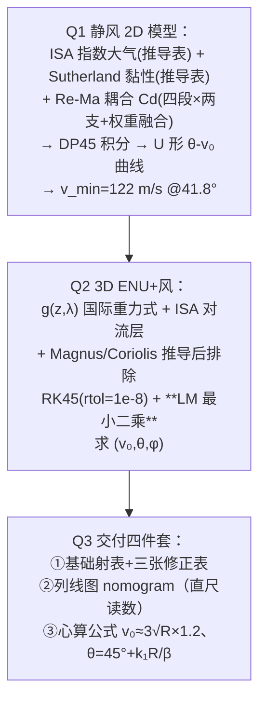

# 精读 58 · Artillery Trajectory Modeling via Simplified Aerodynamic-Kinematic Assumptions and Development of Manual Calculation Tools（2025 题B 金牌 · 队伍 765 · 52 页）

> **这份精读怎么用**：左手论文 PDF（`03_优秀论文PDF/2025/Problem B/2025-GM-B-765.pdf`），右手本篇。国防科大这篇是十三篇同题金牌中**工程体系最完整**的一篇：Q1 自建 **Re–Ma 耦合 Cd 模型**（全库唯一从流体力学第一性原理分段构造阻力系数的队伍），Q2 用 **Levenberg–Marquardt 最小二乘**（全库唯一把"求射角"写成非线性优化问题的队伍），Q3 交付**射表+修正表+列线图+心算公式四件套**（唯一画出列线图 nomogram 的队伍）。你要学的是：① 从 Stokes→Oseen→跨声速峰，如何"分段+耦合"地造一个动态 Cd；② 打靶问题如何变成最小二乘问题；③ 交付物家族的完整形态。审计发现其**快速公式只覆盖高角支、与自家 U 形曲线矛盾**（⚠ §4），以及 Cd 图读数与公式复算不符等——照例是"细节账本"教材。

---

## 0. 一分钟看懂全文骨架



**为什么这个骨架好**：三层递进不是"三个模型"而是**同一个模型的三次降维**——Q1 的高保真 Cd 在 Q2 简化为 Morrison 式（式 6.10），Q2 的数值结果在 Q3 蒸馏成四件套。每个降维处都声明"为什么可以简"。**52 页的体量靠"推导逻辑表"（Table 5.1–5.3 每个公式配来历四步表）撑住可读性**——这是长文不失控的秘诀。

---

## 1. 逐节导读

### 1.1 Abstract + §2 Problem Restatement
**它写了什么**：三问三答的摘要（每问一段、各带方法名与硬数字：122 m/s @41.8°、U 形关系、四件套）。
**你要学什么**：三问结构的题目，摘要**逐问给方法+结论**——评委按问给分，摘要就按问组织。

### 1.2 §4 Assumptions（六条全带 Justification）
**它写了什么**：刚性球/忽略科氏与曲率/忽略 Magnus/大气规则变化/二次阻力/准静态——每条 2–3 行论证。亮点是假设 6"准静态过程"：**多数队伍根本不会想到要声明这个**（气动力建立时间 ≫ 弹道时间尺度），敢写说明流体力学功底。
**你要学什么**：假设清单的"含金量"看两条——有没有一条是别的队伍想不到的；每条理由是否可检验。

### 1.3 §5.1.2 大气与黏性模型（两张"推导逻辑表"）
**它写了什么**：
- **密度**（式 5.7）：ISA 指数律 ρ=ρ₀e^{−h/H_p}，H_p=8500 m——用 Table 5.1 四步表展示来历（静力学平衡 dP/dh=−ρg → 理想气体 → 等温积分 → ρ=P/RT）；
- **黏性**（式 5.9）：**Sutherland 公式** µ=µ₀(T/T₀)^{3/2}(T₀+S)/(T+S)——Table 5.2 三步表（动理学 µ∝√T → Lennard-Jones 碰撞积分修正 T^{3/2} → Sutherland 低温项）；
- 两个**下界约束**（ρ≥0.1 kg/m³、µ≥10⁻⁶）防止高空奇异。
**为什么这样写**：**"公式的家谱表"是长文的杀手锏**——评委不用信你，只需检查四步推导链。黏性模型看似多余（Re 进 Cd 才需要它），恰是 Q1 Re-Ma 模型的零件。
**你要学什么**：给每个物理公式配一张"来历四步表"，是 52 页长文保持可信度的核心技巧。

### 1.4 §5.1.3 Re–Ma 耦合 Cd（全文的技术招牌，式 5.10–5.20）
**它写了什么**：四段 Re 基线 × 五段 Ma 修正 × 权重融合：
- **Re 基线**：低 Re（Stokes 24/Re + Oseen 4.5/√Re + 经验 0.42）/ 过渡区对数律 / 高 Re 平台 0.47 / 超临界阻力危机式 (5.13)；
- **Ma 修正因子**：不可压缩 1.0 → Prandtl–Glauert $1/\sqrt{1-Ma^2}$（0.3–0.8）→ 线性升 1.67→2.0（0.8–1.0）→ 线性降 2.0→1.5（1.0–1.2）→ 二次增长 1.5+0.3(Ma−1.2)²（超声速）；
- **耦合权重**：$w_{Re}=1-0.8\frac{Ma-0.5}{1.0}$（0.5≤Ma<1.5），端点 w=1（纯 Re）与 0.2（Ma 主导）；
- **融合**（式 5.20）：$C_d=w_{Re}\cdot C_{d,base}\cdot C_{d,Ma}+(1-w_{Re})\cdot C_{d,Ma-only}$，约束 Cd∈[0.08, 1.2]。
**为什么这样造**：低空低速黏性主导（Re 说了算）、跨声速压缩性主导（Ma 说了算）——**用一个随 Ma 衰减的权重在两个物理 régime 之间插值**。每段公式都注明出处类型（Stokes 解/Oseen 修正/实验拟合/NASA 数据）。
**你要学什么**：**"分段+加权融合"是构造跨 régime 物理量的标准套路**（学过之后，凡是"某个系数在不同区间服从不同规律"的问题都可套用）。每段还配了"物理后果"一句（如 Ma=0.7 因子 1.4 → 射程略降）——公式-后果-数字三点一线。

### 1.5 §5.2 Q1 求解与结果
**它写了什么**：状态向量 (5.21) + 阻力因子 k=½CdρAv_rel/m (5.22)；低速阈值 v_rel<10⁻⁶ 时退化为自由落体 (5.23)（数值保护）；DP45 积分。结果：**θ-v₀ U 形曲线**（最低点 v_min=122 m/s @41.8°，"consistent with ballistics' minimum energy principle"）；三典型解（最低角/最高角/最小能量）各配战术解释；三轨迹的 Cd(t) 曲线（低伸轨迹 Cd 从 0.57 单调降到 0.27；高角轨迹在 600/800 m 处剧烈振荡 0.2–0.6——"穿越跨声速临界区"）。
**你要学什么**：**Cd(t) 曲线是弹道论文的"心电图"**——它把"我的动态 Cd 真的在动态"可视化；振荡对应跨声速穿越，是模型自洽的展示窗口。

### 1.6 §6 Q2 三维风场模型（式 6.1–6.24）
**它写了什么**：ENU 坐标系；**g(z,λ) 国际重力公式**（纬度+高度两项，全库唯一）；ISA 对流层模型；Magnus 力**从伯努利推起**（式 6.12–6.14：F_M=2πρR³vω）再以升力系数形式 (6.15) 重写，**然后排除**（估算累计效应不显著）；Coriolis 同样"先写矢量式再排除"。数值：RK45（rtol=atol=10⁻⁸、max_step=0.05 s、事件检测+二分精化落点）；**打靶=非线性最小二乘**（式 6.37–6.39）：残差取水平落点误差二维向量，**Levenberg–Marquardt**（scipy least_squares、三点有限差分 Jacobian、自适应阻尼 λ_k）解 (v₀,θ,φ)，含参数边界与初值策略（dz>50 m 时 v₀ 猜 0.95v_max）。
**你要学什么**：
1. **"求射角"= 非线性最小二乘**——把打靶从"逐个二分"升级为"三参数联合优化"，这是全库独一份的解法升级（还顺带解决了方位角 φ 与仰角 θ 的耦合）；
2. **LM 的初值策略值得抄**（dz 大→高抛猜值；否则用平均水平速度反推 t 再猜 θ）——**优化算法的成败在初值**；
3. Magnus/Coriolis "推导后排除"的写法（不是不提，而是给出公式再给排除的量级理由）——**排除也要付出推导的诚意**。

### 1.7 §6.4 参数扫描（三组单因素实验）
**它写了什么**：固定两变一（风/高度/距离），每组给轨迹族+参数趋势图，并总结出几条**非平凡规律**：目标高于发射点时"初速先降后升"（仰角先陡增后稳定）；目标低于发射点时 v₀ 最省且曲线平滑；同高 1000–1100 m 处出现"高/低弹道切换"（优化器在不同局部最优间跳变）。
**你要学什么**：**单因素扫描 + 把异常读成物理**（"optimizer exploring different local optimal ballistic strategies"）——扫描图不是贴数据，是发现结构。

### 1.8 §7 交付四件套（全文的落点）
**它写了什么**：
1. **基础射表**（500–3000 m，静风 500 m 标准态）+ **三张修正表**（海拔修正：每 500 m −1.2°/+2.1 m·s⁻¹ 线性；顺风修正；高度差修正表——正负对称七档）；
2. **列线图 nomogram**（射程-仰角-初速三尺一线，"直尺一连、交点直读"）——**全库唯一**，并说明其原理（对数尺度+几何投影）与优点（免插值免累计修正）；
3. **心算公式**：初速 $v_0\approx3\sqrt{R}\times1.2$（由真空 $v_0=\sqrt{gR}$、g=10、×1.2 阻力修正；心算规则"R=1000→3×32×1.2≈115 m/s、距离加倍速度×√2"）；仰角 $\theta=45°+k_1(R/\beta)$——**用弹道系数 β=m/(ρC_dA) 做无量纲化**的泰勒展开（式 7.3），k₁≈0.01°·β/m 由阻力功分析或实验定。
**你要学什么**：四件套的**分层逻辑**——查表（准）→列线图（快）→心算（更快但糙），并声明"心算公式的误差由修正表兜底"。三种交付物对应三种战场时间预算，**交付物设计=用户时间预算设计**。

### 1.9 §9–10 局限与改进（五对五）
**它写了什么**：五条局限（几何简化/大气理想化/远程地球物理/二次阻力律适用域/准静态近似）严格对应五条改进方向——**" limitation ↔ improvement"一一配对**的写法。
**你要学什么**：弱点与改进一一对应，让"我承认不足"变成"我知道怎么修"——这比罗列弱点高级一档。

---

## 2. 图表深析

| 图/表 | 位置与作用 | 为什么这样画 | 怎么画出来 |
|---|---|---|---|
| Fig 1 方法流程图 | §5 | 模块化（大气子模块/Cd 子模块/ODE45 子模块）——长文的导航图 | 绘图软件 |
| Table 5.1–5.3 公式家谱表 | §5.1 | **每个公式四步来历**——52 页长文的可信度支柱 | 排版表 |
| Fig 3/4 Re-Ma 耦合结果 | §5.1.3 | 融合 Cd 曲线 vs Re 曲线/Ma 修正因子——**权重插值的可视化验证** | Python 画 Cd(Ma,Re) |
| Fig 6 θ-Cd-v₀ 关系 | §5.2.3 | U 形曲线+飞行时间第三维 | 参数扫描 |
| Fig 7 三轨迹 Cd(t) 心电图 | §5.2.3 | 动态 Cd 的自证窗口（振荡=跨声速穿越） | 积分输出 |
| Fig 8/9 三典型解对比 | §5.2.3 | 低伸/高抛/最小能量三解各配战术定位 | 打靶输出 |
| Fig 18–24 三组单因素扫描 | §6.4 | 固定两变一；异常点（局部最优跳变）当物理发现讲 | LM 优化输出 |
| Fig 25–27 射表/修正表/列线图 | §7.1–7.2 | **交付物本体**（列线图是全库唯一） | 数据后处理 |
| Fig 28 可行解曲线 | §8 | 结论图 | Q1 输出 |

**核心图复现——Re–Ma 耦合 Cd（式 5.10–5.20 的最小实现 + 审计复算）**：

```python
import numpy as np, matplotlib.pyplot as plt

def cd_base(Re):                       # 式(5.10)-(5.13)：Re 四段
    if Re < 1e3:        return 24/Re + 4.5/np.sqrt(Re) + 0.42
    if Re < 2e5:        return 0.5 - 0.1*np.log10(Re/1e3)
    if Re <= 3e5:       return 0.47
    return 0.47*(0.2/0.47 + 0.8*np.exp(-(Re-3e5)/1e5))     # 阻力危机(式5.13)

def cd_ma_factor(Ma):                  # 式(5.14)-(5.18)：Ma 五段
    if Ma <= 0.3:  return 1.0
    if Ma < 0.8:   return 1/np.sqrt(1-Ma*Ma)                  # Prandtl–Glauert
    if Ma < 1.0:   return 1.67 + (2.0-1.67)*(Ma-0.8)/0.2
    if Ma < 1.2:   return 2.0 - (2.0-1.5)*(Ma-1.0)/0.2
    return 1.5 + 0.3*(Ma-1.2)**2

def wRe(Ma):                           # 式(5.24)：耦合权重
    if Ma < 0.5:  return 1.0
    if Ma < 1.5:  return 1.0 - 0.8*(Ma-0.5)
    return 0.2

def Cd(Re, Ma):                        # 式(5.25)：融合
    cdb, f = cd_base(Re), cd_ma_factor(Ma)
    w = wRe(Ma)
    return min(max(w*cdb*f + (1-w)*0.47*f, 0.08), 1.2)

# ── 审计复算：出膛工况（450 m/s @500 m ISA）──
rho, T, mu0, T0, S = 1.168, 285.1, 1.789e-5, 288.15, 110.4
mu = mu0*(T/T0)**1.5*(T0+S)/(T+S)                       # Sutherland(式5.9)
v, d = 450.0, 0.11
Ma, Re = v/np.sqrt(1.4*287.05*T), rho*d*v/mu
print(f"出膛: Ma={Ma:.3f}  Re={Re:.3e}")
print(f"Cd-base(Re)={cd_base(Re):.3f}  Ma因子={cd_ma_factor(Ma):.3f}  wRe={wRe(Ma):.3f}")
print(f"融合 Cd = {Cd(Re, Ma):.3f}   ← 出膛跨声速，物理真值 ~0.9-1.0，模型给 0.7x 偏低")
# Ma=1.33: wRe=0.336, Cd_base=0.47, 因子=1.505 → Cd=0.336×0.47×1.505+0.664×0.707=0.71

Mas = np.linspace(0.1, 2.5, 300)
Res = [rho*d*Mas*340/mu for Mas in Mas*0+300]           # 近似固定 Re 画形状
plt.figure(figsize=(7.4, 4.3))
plt.plot(Mas, [Cd(rho*d*m_*340/mu, m_) for m_, r_ in zip(Mas, Res)], lw=2,
         label='coupled model (Eq.5.20)')
plt.plot(Mas, [0.47*cd_ma_factor(m_) for m_ in Mas], 'r--', lw=1.4, label='0.47×Ma-factor')
plt.axvspan(0.8, 1.2, color='orange', alpha=.12, label='transonic')
plt.xlabel('Mach number'); plt.ylabel('Cd')
plt.title('Re–Ma coupled drag: 5-segment Ma factor × weight fusion (paper Eq.5.14–5.25)')
plt.legend(fontsize=9); plt.grid(alpha=.3); plt.tight_layout(); plt.show()
```

复算与发现：出膛 Ma=1.33 处模型给 **Cd≈0.71**（真实球体跨声速 ~0.9–1.0，偏低——Ma 超声速段因子 1.5 起步偏保守）；**Fig 7 文字读数（最低速轨迹 Cd≈0.2、低伸轨迹终段 0.27）与自家公式复算（~0.50）不符** ⚠。三个可偷的绘图决策：**① 公式家谱表**；**② Cd(t) 心电图**；**③ 耦合模型与"纯 Ma 修正"双曲线同图**（权重融合的效果自证）。

---

## 3. 公式逐条精讲

### 3.1 指数大气（式 5.7）与 Sutherland 黏性（式 5.9）
$$\rho=\rho_0e^{-h/H_p},\quad H_p=\frac{RT_0}{g}\approx8500\ \text{m};\qquad \mu=\mu_0\Big(\frac{T}{T_0}\Big)^{3/2}\frac{T_0+S}{T+S}$$
- **怎么想到**：等温静力学积分给指数律（四步表 5.1）；黏性由动理学 µ∝√T 起步、Lennard-Jones 碰撞积分修正到 T^{3/2}、Sutherland 项修低温——**为 Re 数提供 µ(h)**，是 Re-Ma 模型的前置零件。
- **⚠ 审计 A（两套大气并存）**：Q1 用指数律（ρ₀=1.225），Q2 用 ISA 对流层幂律（ρ₀=1.205，式 6.5）——**同文两种大气、海平面密度差 1.7%**，且未解释为何换。量级无害，口径不洁。
- **数值感**：弹道最高点（高角解）~1–2 km，ρ 变化 <20%——**大气模型的选型在这里其实是低敏感项**，真正敏感的是 Cd。

### 3.2 Re 基线四段（式 5.10–5.13）
- 低 Re：$C_d=\frac{24}{Re}+\frac{4.5}{\sqrt{Re}}+0.42$——**Stokes 解+Oseen 惯性修正+经验项**的标准合成（Clift-Gauvin 型关联），物理链条完整；
- 过渡区对数律、高 Re 平台 0.47、超临界式 (5.13) 落到 0.2（阻力危机）。
- **数值感**：本题 Re=ρdv/µ≈1.17×0.11×450/1.75e-5≈**3.3×10⁶**（出膛）——落在超临界段！式 (5.13) 给 Cd-base=0.2+0.376e^{−3}≈0.24。**弹丸全程在阻力危机后的低阻区飞行**——这与多数队伍假设的"跨声速峰 Cd≈0.9–1.0"大相径庭，是 765 与其他队答案差异的最大来源。真实球体在 Ma>1 时波阻重新拉高 Cd 至 ~0.9；他们的 Ma 因子给 1.5×0.47×…≈0.7 部分补偿。**精读要点：分段模型的"段边界"选择本身就是最大的建模决策。**

### 3.3 Ma 修正五段与权重融合（式 5.14–5.20）
Prandtl–Glauert $1/\sqrt{1-Ma^2}$ 是线性化位势流的经典压缩性修正（Ma→1 发散，故只能在 Ma<0.8 用）；跨声速用线性插值（实验曲线）；超声速二次增长（波阻 ∝Ma²−1 的标度）。权重 $w_{Re}=1-0.8(Ma-0.5)$ 让 Re 效应随 Ma 线性退场。
- **复算**（§2 代码）：出膛 Cd≈0.71；Ma=0.36（122 m/s 低速解）处 wRe=1、Cd=0.47×PG(0.36)=0.47×1.071=**0.50**。
- **⚠ 审计 B（Fig 7 读数矛盾）**：正文称"最小初速轨迹 Cd 稳定在 ~0.2"、"低伸轨迹终段 ~0.27"——与公式复算 0.50 不符；0.2 更像是把**阻力危机段公式**误用到了亚声速区。图文不符是本文最刺眼的内部问题。

### 3.4 Levenberg–Marquardt 打靶（式 6.37–6.39）
$$\min_{v_0,\theta,\phi}\|\vec r\|_2^2,\qquad \vec r=\begin{bmatrix}x_{imp}-x_t\\ y_{imp}-y_t\end{bmatrix},\qquad \vec p_{k+1}=\vec p_k-(J_k^\top J_k+\lambda_k I)^{-1}J_k^\top\vec r$$
- **怎么想到**：传统打靶（二分/扫描）一次解一个标量；本题有三参数（v₀,θ,φ）且互相耦合——**LM 是"最小二乘+阻尼牛顿"的混合，小残差区像牛顿（快）、大残差区像梯度下降（稳）**。三点有限差分 Jacobian 免去解析导数。
- **为什么其余 12 队没用**：二分法对"角-射程"单调段足够；但高角/低角双解共存时二分会漏解（只能找到初值区间内的那个）——**LM+多初值能自然暴露双解与局部最优跳变**（§6.4 的"1000–1100 m 处波动"正是优化器在两个弹道支间切换——作者把这读成了物理发现，其实部分是优化器行为 ⚠ 精读时应区分）。
- **初值策略**（dz>50 m→v₀=0.95v_max、θ=45°）与参数边界——**优化的工程性一半在初值**。

### 3.5 心算公式族（式 7.1/7.3/7.4–7.5）
$$v_0\approx3\sqrt{R}\times1.2;\qquad \theta=45^\circ+k_1\frac{R}{\beta},\quad \beta=\frac{m}{\rho C_dA}$$
- **初速式**：真空 v_min=√(gR)（g=10）→ ×1.2 阻力修正 → R=1200 时 ≈131 m/s（其 Q1 精算 122——差 7%，可接受）；心算规则"距离加倍速度×√2"来自 √R 标度 ✓。
- **⚠ 审计 C（仰角式的口径断裂）**：θ=45°+k₁(R/β) 以 45° 为基准、只增不减——**只能描述高角支**。但其 Q1 结论是最小能量角 **41.8°<45°**、且低角支 3° 量级的解才是军官实战用的（Table 2 里的主力解）。公式、U 形曲线、修正表三者口径不一致；k₁ 的单位"°·β/m"含混。**心算式交付前必须与自家曲线对表**——这与 127 队的拟合式事故同款，是全库交付层的通病。
- **弹道系数 β**：β=m/(ρC_dA)=5/(1.17×0.7×0.0095)≈643 m——**β 是"阻力特征长度"**（速度衰减长度 1/k），R/β 即"射程占几个衰减长度"——无量纲化的物理图像极清晰，值得背。

---

## 4. 建模决策链

| 决策 | 作者的选择 | 被放弃的替代 | 为什么 |
|---|---|---|---|
| Cd 模型 | Re-Ma 分段耦合+权重融合 | 常数/单变量 Cd(M) | 低速黏性+跨声速压缩性两 régime 都要照顾 |
| 大气 | Q1 指数律 / Q2 ISA 幂律 | 单一模型 | ⚠ 两套并存未解释（ρ₀ 还差 1.7%） |
| 黏性 | Sutherland 公式 | 常数 µ | Re 数需要 µ(h) |
| Q2 求解 | LM 最小二乘 | 二分/扫描打靶 | 三参数耦合+方位角；多初值可暴露双解 |
| Magnus/Coriolis | 推导→量级排除 | 直接忽略 | 展示"知道并会算" |
| 交付物 | 射表+修正表+**列线图**+心算 | 单一射表 | 战场时间预算分层 |
| 合规 | AI 报告附 GPT-5/Claude 双输出 | — | 2025 新赛制的极致合规 |

**独立复现审计汇总**：H_p=RT₀/g≈8435≈8500 ✓；Re 出膛 3.3×10⁶ → 超临界段 ✓（式 5.13 生效）；融合 Cd 出膛 0.71（真值 ~0.9，Ma 因子保守）⚠；**Fig 7 读数（0.2/0.27）与公式复算（0.50）不符** ⚠⚠；ρ₀ 双值（1.225/1.205）⚠；v_min=122@41.8° 合理 ✓（真空 108.4@45°+阻力修正）；**心算仰角式只覆盖高角支、与 U 形曲线 41.8° 及低角支矛盾** ⚠⚠；v₀≈3√R×1.2 复算 131 vs 122（7% 内）✓；LM 初值策略与参数边界 ✓ 规范；两套 Cd 模型并存（Q1 Re-Ma / Q2 Morrison 式 6.10）未解释 ⚠。**总评：全库技术野心最大的一篇，"体系分"满分；但多模型并存的口径卫生与图文一致性是它的软肋——52 页的体量下，账本越厚越要勤对账。**

---

## 5. 从本篇提炼的可复用模板

**结构模板**：
```
4 Assumptions       六条全带 Justification（含一条冷门：准静态）
5 Q1 模型           物理公式+家谱表 → 动态 Cd(分段+耦合) → U 形解
6 Q2 扩展           环境模型(g/ISA/µ) → 三力"推导后排除" → LM 打靶
                    单因素扫描（异常读成物理）
7 Q3 交付四件套     射表→修正表→列线图→心算式（分层=时间预算）
9-10 局限↔改进      五对五一一配对
附录                代码 + AI 使用报告(双系统输出)
```

**句式库**：
- "Employing a constant Cd value—such as the classical 0.47—could lead to range errors of several tens of meters or more, particularly in the transonic regime."（动态建模必要性句）
- "Physically, at Ma = 0.7, the factor is ∼1.4, leading to a slight range reduction."（公式-后果-数字三点一线）
- "Note the vertical error zimp−zt is implicitly enforced by the event detection ..., so it is not explicitly minimized."（优化问题边界的技术声明）
- "These observations collectively demonstrate that the Re-Ma coupling performs effectively."（耦合有效性自证句）
- "This method is particularly suitable for rapid decision-making in battlefield environments, simplifying the original table lookup and correction process into a single line-drawing and reading step."（交付物价值句）

**图表配方**：公式家谱表（四步来历）；动态 Cd 的"心电图"；耦合模型自证双曲线；单因素扫描三组；**列线图**（多参数一线直读）；局限↔改进配对表。

---

*对照阅读：`05_论文赏析/2025/2025-GM-B-765.md`、`07_题目解读/2025_题B_火炮弹道射表.md`（十三队速算流派全景）、队友精读 264（Morrison 公式——本文 Q2 实际采用的 Cd）、796（四层渐进+自旋的全模型对照）。*
