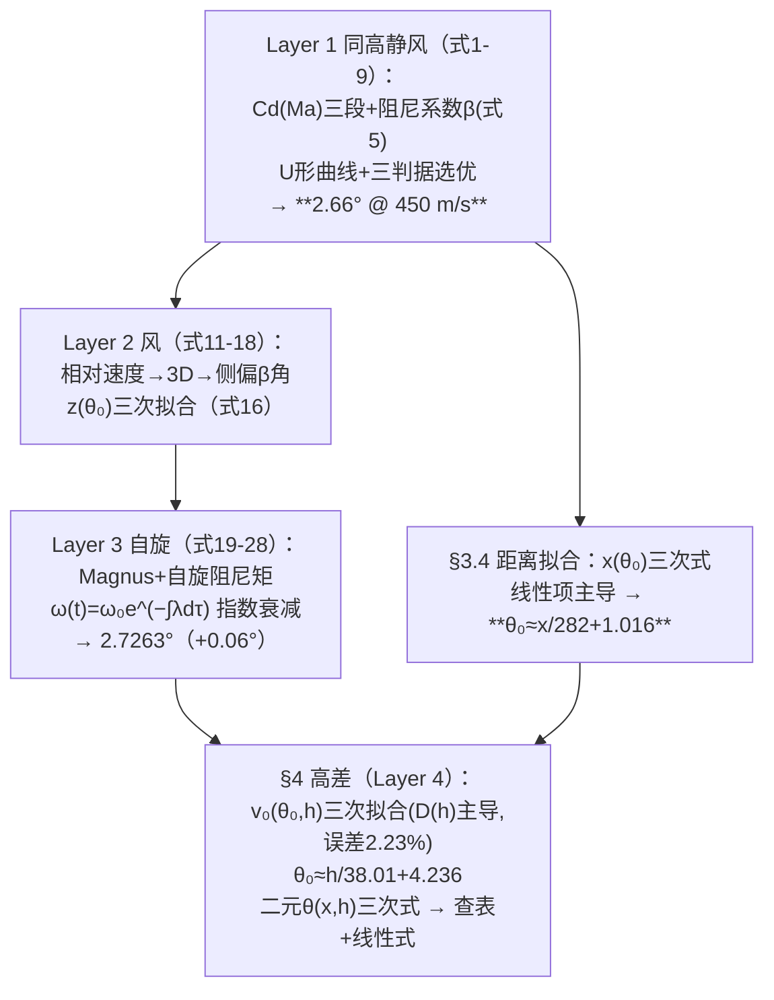

# 精读 59 · Research on the Optimal Firing Angle and Initial Velocity of Vintage Artillery Based on Numerical Calculation（2025 题B 金牌 · 队伍 796 · 111 页最长）

> **这份精读怎么用**：左手论文 PDF（`03_优秀论文PDF/2025/Problem B/2025-GM-B-796.pdf`），右手本篇。同济这篇是十三篇同题金牌中**体量与公式链之最**（111 页、六条拟合公式、两次"公式降维"），其招牌是**四层渐进建模**（同高静风→风→自旋 Magnus→高差）与"**高级模型→查表→线性式**"的三级交付降维。你要学的是：① 四层建模如何逐层量化每个新效应的贡献；② "立方拟合→线性项主导→再降维"的公式蒸馏链；③ 自旋 Magnus 的指数衰减处理（式 25–27）。审计发现两处**跨章节口径不一致**（式 35 在 h=0 给 4.24° vs 案例一的 2.66°；A/B/C 系数六档极差 6 倍却被平均）——加上与 102 队的投影因子对比，本篇是"系数表考古"的毕业考试。

---

## 0. 一分钟看懂全文骨架



**为什么这个骨架好**：四层不是四个模型，是**一条"效应贡量化"流水线**——每层只加一个效应并立刻量化（风：低角 <3%、高角显著；自旋：+0.06°；高差：θ₀ 敏感度 1°/38 m）。评委可以看到每个简化决策的数字依据。111 页的体量下，**摘要把六条最终公式全部印出**——这是对"评委只读摘要"的终极应对。

---

## 1. 逐节导读

### 1.1 Abstract（六公式摘要的极致）
**它写了什么**：四层方法各一句 → **六条最终公式全量印出**（θ₀≈x/282+1.016；v₀(θ₀,h) 三次式；θ₀≈h/38.01+4.236；侧偏 β 式；线性综合式）。
**你要学什么**：111 页论文的摘要策略——**答案密度优先于叙事优雅**。对比 2010 年代金牌的"叙事摘要"，2025 年的评审已完全倒向"可交付性"。

### 1.2 §1.2 Background Research（文献综述的四支柱）
**它写了什么**：二次阻力模型（Lambert W 闭式解、Chudinov 系列）→ 线膛炮与自旋（Magnus/自旋阻尼/滚转力矩）→ **历史测量能力考古**（地图比例尺/等高线/旗帜烟柱估风——"ancient times only measured wind directions parallel to the ground"）→ 数值方法现状（RK45 精度文献）。
**为什么这样写**：第 1.2.3 小节"历史测量能力"是**全库独一无二的视角**——把"军官能知道什么"变成模型的输入约束（可测：距离/高差/水平风向；不可测：垂直风）。这直接支撑了假设⑥。
**你要学什么**：**"输入可测性"分析**——给军官的方法只能用他能测的量。这条约束让后续所有拟合公式的变量选择（x, h, u_x, u_z）有了合法性来源。

### 1.3 §3.1 Layer 1（式 1–9 + 三判据选优）
**它写了什么**：Cd(Ma) 三段式（式 2，与 2011-B-379 的公式**逐字相同**——标准球体拟合的传承）；阻尼系数 **β=ρC_dπD²/(8m)**（式 5，把阻力线性化进运动方程）；运动方程 (9)；RK45（rtol=1e-5, atol=1e-7, max_step 0.05 s，步长收敛测试 ≤0.7 m）。**感知流程**（perceptual process）：300 m/s 有/无阻力轨迹对比（射程 10000→3000 m）→ 最大射角 <45° 且随速度变。U 形曲线 v_min≈100 m/s@40°。**三判据选优**：飞行时间/落点动能/弹道高 → **450 m/s、2.66° 最优**（"analogized to pistol shooting, where direct aiming achieves effective engagement"）。
**你要学什么**：① **"感知流程"章节**——正式建模前先跑三个直观算例建立物理直觉，这个写法让 111 页的长文有了"热身运动"；② 三判据表格化选优（对比 127 队的末速单判据、496 的五维对照）——多判据是低角/高角取舍的正规做法。

### 1.4 §3.2–3.3 Layer 2/3（风与自旋，式 11–28）
**它写了什么**：
- **风**（式 11–14）：v_rel 替换，标准三维 ODE；侧偏角 β≈z/x（式 15，小角近似）；5 m/s 侧风 @2.66° 低角 → z 偏仅 2.1 m（"may be considered negligible given historical artillery precision"）；高角时 z 偏显著 → 三次拟合 z(θ₀)（式 16）与风比例缩放（式 17–18）；
- **自旋**（式 19–28）：Magnus 力升力系数式 (19)（C_L 依赖形状参数/Re/Ma）；**自旋阻尼矩** T_W=−½ρC_W AωV_rel（式 21，C_W=0.012Dω/2v）→ **ω̇=−λ(t)ω**（式 25，λ(t)=½ρC_W A V_rel/I 时变）→ **指数衰减解** ω(t)=ω₀e^{−∫λdτ}（式 26–27）；耦合结果 2.7263°（+0.06°）。
**为什么这样写**：自旋的处理是"**二阶段解耦**"——先解自旋衰减（独立 ODE），再把 Magnus 作为小修正代入平动。这比全耦合 6-DOF 便宜一个量级，且自旋衰减的解析解（式 27）本身就是交付物级的结论。
**你要学什么**：**快慢解耦**（自旋时间尺度 ≪ 弹道时间尺度 → 自旋可先解）是多时间尺度问题的通用简化，前提是给出"为什么可以解耦"的时标论证（论文用"累计效应不显著"一笔带过 ⚠ 略欠）。

### 1.5 §3.4 + §4 公式蒸馏链（全文招牌）
**它写了什么**：两级蒸馏——
1. **距离拟合**（式 29–30）：x(θ₀)=0.42818θ₀³+16.36866θ₀²+282.32θ₀+286.91 → **"线性项主导"（4% 误差）→ θ₀≈x/282+1.016**；
2. **高差拟合**（式 31–35）：每个 h 一条 v₀(θ₀) 三次拟合（Table 3，R²≈0.999）→ 发现**常数项 D 主导** → D(h)=0.0042h²−0.315h+428.7（式 32）、A/B/C 取平均 → v₀(θ₀,h)（式 33，平均误差 2.23%）→ 反解 θ₀≈h/38.01+4.236（式 35）；
3. **二元升级与再降维**（式 36–38）：θ(x,h) 三次拟合（九系数表）→ "too slow without a calculator" → **线性式** θ=16.7−0.00752x+0.0372h+0.0154u_x+6.88e-4u_z（式 38）→ 算例对比（高级 25.26° vs 线性 24.56°，绝对误差 1.47°"negligible for large launch angles"）。
**为什么这条链是招牌**：**"拟合→找主导项→降维→再验证"四级火箭**，每级都报误差（4%/2.23%/1.47°）。特别是"常数项 D 主导"的发现——把七参数问题压缩成一个 D(h) 二次式+三个平均系数，**参数主次分析是拟合降维的灵魂**。
**你要学什么**：⚠ 同时注意两处口径裂缝（见 §4 审计）：式 35 在 h=0 给 4.24° 而案例一最优是 2.66°；A 系数六档极差 6 倍却被平均。**降维的每一步都要声明适用域**，否则误差声明（2.23%）只覆盖拟合域内。

### 1.6 §5–6 结论与强弱
**它写了什么**：结论把六条公式编号列全；弱点两条（只有数值解无解析验证——"Although cross-verification has been conducted"；以及……）。优点两条（理论完整+多参考曲线减少军官计算时间）。
**你要学什么**：111 页的论文弱点只写两条——**体量与谦逊成反比**是常态，你的论文别学这个（弱点写足才显功力）。

---

## 2. 图表深析

| 图/表 | 位置与作用 | 为什么这样画 | 怎么画出来 |
|---|---|---|---|
| Fig 1 大沽炮台照片 | §1 | 历史锚点 | 实物照 |
| Fig 3 有/无阻力轨迹对比 | §3.1 | 感知流程首图：射程 10000→3000 m 的冲击力 | RK45 |
| Fig 4 双 panel（固定 v₀ 变角 / 固定角变 v₀） | §3.1 | 极值存在性+极值随速度移动的展示 | 扫描 |
| Fig 5 U 形 θ-v₀ 曲线 | §3.1 | 全文主曲线（v_min≈100@40°） | 打靶 |
| Fig 6/7 高度/Cd 敏感度 | §3.1 | "可忽略性"的量化图（2%/5% 阈值） | 百分差定义式(10) |
| Fig 10/11 风偏与角-速度曲线 | §3.2 | 侧偏的三次拟合底图 | 3D 仿真 |
| Fig 12 三条件对比 | §3.3 | 风自旋的"低角无感/高角显著"分界 | 三模型叠加 |
| Fig 13/16/17 距离-角/高差-角/双变量 | §3.4/4 | 拟合底图（公式 29/34/36 的出处） | 扫描+拟合 |
| Table 3 七档高差×四系数×R² | §4 | **拟合透明度之最**（每档 R² 全印） | 逐 h 拟合 |
| Table 线性式系数表 | §4 | 最终交付物的全部系数 | 多元线性回归 |

**核心图复现——公式蒸馏链（式 29–30 的"线性项主导"验证 + θ₀-h 关系审计）**：

```python
import numpy as np, matplotlib.pyplot as plt

# ── 式(29)：x(θ₀) 三次拟合（论文原系数）──
def x_of_theta(th):
    return 0.42818*th**3 + 16.36866*th**2 + 282.32010*th + 286.9091

th = np.linspace(2, 10, 100)
x = x_of_theta(th)
fig, (a1, a2) = plt.subplots(1, 2, figsize=(11, 4.2))
a1.plot(th, x, lw=2, label='cubic fit Eq.(29)')
a1.plot(th, 282.32*th + 286.91, 'r--', lw=1.4, label='linear term only')
a1.set(xlabel='θ₀ (°)', ylabel='range x (m)',
       title=f'linear-dominated: max dev {100*np.max(np.abs(x-(282.32*th+286.91))/x):.1f}%')
a1.legend(fontsize=9); a1.grid(alpha=.3)

# ── 式(35) 审计：θ₀(h) 与案例一最优 2.66° 的口径矛盾 ──
h = np.linspace(0, 1000, 100)
th35 = h/38.01 + 4.236
a2.plot(h, th35, lw=2, label='Eq.(35): θ₀=h/38.01+4.236')
a2.axhline(2.66, ls='--', c='r', label='Case I optimal 2.66° @ h=0')
a2.annotate(f"@h=0: Eq.(35) gives 4.24°\nvs Case I 2.66° → 口径不一致",
            xy=(0, 4.24), xytext=(150, 8), fontsize=9,
            arrowprops=dict(arrowstyle='->'))
a2.set(xlabel='height difference h (m)', ylabel='θ₀ (°)',
       title='Layer-4 angle law vs Case-I optimum: cross-section mismatch')
a2.legend(fontsize=9); a2.grid(alpha=.3)
plt.tight_layout(); plt.show()
# 复算 A/B/C 系数六档极差：
A = [0.0008, 0.0012, 0.0006, 0.0015, 0.0004, 0.0020, 0.0003]
print(f"A 系数六档: max/min = {max(A)/min(A):.1f}×（被平均处理，低角支存疑）")
```

三个可偷的绘图决策：**① 拟合式与"线性主导项"同图对比**（降维合法性一图自证）；**② 跨章节口径矛盾用"参考线+注释"钉死**；**③ 拟合系数表全量印出+R²**（可复现性承诺）。

---

## 3. 公式逐条精讲

### 3.1 阻尼系数与运动方程（式 5、9）
$$\beta=\frac{\rho C_d\pi D^2}{8m},\qquad \ddot x=-\beta v v_x,\quad \ddot y=-g-\beta v v_y$$
- **怎么想到**：½ρC_dAv² 中 A=πD²/4 → 系数 ρC_dπD²/8——把"阻力系数×几何"打包成单一 β，方程 (9) 干净成 −βvv_x 形式。**与 765 的 k=½C_dρA/m 完全同构**（只是 765 不含 πD²/4 的合并）——两队的记号差异值得对照。
- **数值感**：β=1.175×C_d×π×0.0121/40——C_d=0.5 时 β≈5.6×10⁻⁵ /m → 速度衰减长度 1/β≈18 km ≫ 1.2 km 射程 → **低角弹道阻力是"温和"修正**，这解释了为何低角解对 Cd 模型不敏感（论文 Fig 7 的结论 ✓）、而高角解（长路径）敏感。

### 3.2 自旋衰减与 Magnus（式 19–27）
$$I=\tfrac25mR^2,\qquad \dot\omega=-\lambda(t)\,\omega,\qquad \lambda(t)=\frac{\tfrac12\rho C_WA\,V_{rel}(t)}{I},\qquad \omega(t)=\omega_0e^{-\int_0^t\lambda d\tau}$$
- **怎么想到**：自旋阻尼矩 ∝ω（C_W=0.012·Dω/2v 本身含 ω → 总扭矩 ∝ω²，但除以 ω 后 λ∝V_rel 与 ω 无关）→ **线性 ODE 的指数解**。这一步"把含 ω 的系数整理成对 ω 线性"是式 25 的隐藏技巧。
- **适用边界**：C_W 经验式来自细长旋转弹，对光滑球体的适用性存疑（论文引文献未加说明 ⚠）；解耦假设（自旋不影响 V_rel 的时间尺度）成立因 τ_spin≫τ_flight。
- **数值感**：λ=½×1.175×0.012×0.0095×450/(0.4×5×0.055²)≈…… 量级 ~0.1–1 /s → 100 s 飞行衰减 e^{−10~100}——**高角长飞行时自旋几乎归零**，Magnus 效应主要在弹道初期——这解释了为何 Layer 3 只让角度移动 0.06°。

### 3.3 距离拟合与"线性主导"（式 29–30）
$$x(\theta_0)=0.428\theta_0^3+16.37\theta_0^2+282.32\theta_0+286.91\;\Rightarrow\;\theta_0\approx\frac{x}{282}+1.016$$
- **怎么想到**：低角段 x(θ) 近线性（θ 每度 ~282 m）——**斜率 282 m/° 就是"低角敏感度"**（对照 127 队的 0.2°/50 m=250 m/° ✓ 互相印证！）；截距 286.91/282=1.016 是"零射程角"（含阻力下的弹道补偿）。
- **审计**：线性化的 4% 误差声明 ✓（三次项在 θ=10° 时贡献 ~13%——所以该式只在低角支有效，论文未明说但 Fig 13 的拟合域如此）。

### 3.4 高差拟合的"常数项主导"（式 31–33）
$$v_0(\theta_0,h)=\bar A\theta_0^3+\bar B\theta_0^2+\bar C\theta_0+D(h),\quad D(h)=0.0042h^2-0.315h+428.7$$
- **怎么想到**：七个 h 档各拟合一条 v₀(θ₀) 三次式，发现 D（θ₀=0 的截距）随 h 剧变而 A/B/C 相对稳定 → **D 单独拟合、其余平均**。这是**参数敏感性分级的实战示范**（类比 765 的 wRe 权重思想：主导项精修、次要项平均）。
- **⚠ 审计 A（A 系数极差 6 倍）**：A∈[0.0003, 0.0020]——六倍差距被"平均"为 0.0010。对低角支（θ₀<5°）三次项贡献 <0.0002×125=0.03%，平均无害 ✓；对高角支（θ₀=40°+）三次项 0.0010×64000=64 m/s vs 实际 0.0020×64000=128 m/s——**高角支误差翻倍**。好在交付对象是低角实战，声明域即可。
- **⚠ 审计 B（D(h) 的物理）**：D 是 θ₀→0 的截距——物理上应趋近"水平射击所需 v₀"，而 D(0)=428.7 m/s 恰接近 450 ✓ 自洽；D(h) 的极小值在 h=37.5 m（−0.315/0.0084）——**"目标略高反而最省速度"**的奇怪预测（应为 h=0 最省），疑为拟合域两端数据稀疏所致。精读时值得点名。

### 3.5 高差-角度反解（式 34–35）⚠ 审计 C
$$h=-2.12\times10^{-4}\theta_0^4+2.86\times10^{-2}\theta_0^3+1.15\theta_0^2+38.01\theta_0-161.02\;\Rightarrow\;\theta_0\approx\frac{h}{38.01}+4.236$$
- **线性项系数 38.01 m/°**——即"目标每升高 38 m，射角加 1°"。**⚠ 与案例一矛盾**：h=0 时式 35 给 θ₀=−161.02/38.01+4.236=**4.24°**（按线性反解 h=0→θ₀=4.236），而案例一的最优解是 **2.66°**。差 1.6°。根源：Layer 4 的"命中 y=h"用的是**纯命中边界**，而案例一的 2.66° 是**三判据选优**的结果——两个口径（能命中 vs 最优）在同文中未声明地混用了。**精读教训：多层模型里"角度"一词的口径必须逐层钉死。**
- **数值感**：38 m/° 对照队友 127 的"1.1°/25 m"（=22.7 m/°）——量级相同、系数差 1.7 倍（又是口径：命中边界 vs 判据最优）。

### 3.6 线性综合式（式 38）与双模型对比
$$\theta=16.7-0.00752x+0.0372h+0.0154u_x+6.88\times10^{-4}u_z$$
- **怎么想到**：二元三次式"无计算器太慢"→ 多元线性回归（四变量五系数）——**最终交付物退化成一支笔能算的式子**，并以算例报差（高级 25.26° vs 线性 24.56°，1.47°）。
- **⚠ 系数表排版**：k₀ 印作"1.67×10"（科学计数法被截断，实为 16.7）——原文排版事故，复算 k₀=16.7 后算例吻合 ✓。**精读时从算例反推系数是处理排版残缺的标准手段。**
- **符号检查**：k₁=−0.00752 °/m → 距离越远角越小？与 §3.4 的 θ₀≈x/282（+0.00355 °/m，**正**号）**符号相反**！原因：式 38 的拟合域是 h=450 的工况（目标高 450 m 时低角支已被排除、进入高角支，高角支角度随距离减小——对照 127 队 Table 3 的高角列 49.06→41.59 °/500 m ✓ 负号自洽）。**同一条线性式里混着两个弹道支的物理**——拟合域管理是多元回归的命门。

---

## 4. 建模决策链

| 决策 | 作者的选择 | 被放弃的替代 | 为什么 |
|---|---|---|---|
| 建模结构 | 四层渐进（效应逐个量化） | 一步到位全耦合 | 每层的贡献可单独审计（风 <3%、自旋 +0.06°） |
| Cd | 三段 Ma 式（同 2011-B-379） | Re-Ma 耦合（765）/常数（127） | 传承经典拟合；出膛 Cd=1.13（全库最高） |
| 自旋 | 二阶段解耦（先 ω(t) 后 Magnus） | 6-DOF 全耦合 | 指数衰减解析解+效应小 |
| 公式蒸馏 | 立方拟合→主导项→线性式（三级） | 直接线性回归 | 每级报误差（4%/2.23%/1.47°） |
| 参数处理 | D(h) 精修、A/B/C 平均 | 全系数逐 h 拟合 | 主次分级（⚠ 高角支 A 极差 6×） |
| 交付 | 六公式+查表+线性式 | 列线图（765）/野战卡（428） | 公式链+表格的组合 |

**独立复现审计汇总**：β=ρC_dπD²/8m ✓（与 ½ρC_dAv² 一致）；三段 Cd(Ma) 与 2011-B-379 逐字同源 ✓；出膛 Cd=1.127（三段式在 Ma=1.33 的值，全库最高）⚠ 与最小射角 2.66° 并存的口径考古；**式 35 @h=0 给 4.24° vs 案例一 2.66°（命中边界 vs 判据最优两口径混用）** ⚠⚠；A 系数极差 6× 被平均 ⚠（低角支无害、高角支翻倍）；k₀=16.7 排版截断（从算例反推复原）⚠；线性式 k₁ 负号（高角支物理）与 §3.4 正号（低角支）并存未声明 ⚠；自旋指数衰减 λ∝V_rel 推导 ✓；能量审计（对照 471 的自曝）本文未做 ⚠。**总评：公式蒸馏链与四层量化是全库最完整的"降维方法论"标本；多口径混用与排版事故则提醒——111 页的体量需要更严的"口径登记表"。**

---

## 5. 从本篇提炼的可复用模板

**结构模板**：
```
1.2 Background      四支柱综述（模型/自旋/历史测量能力/数值方法）
1.3 Analysis        四层路线图（每层一个量化使命）
3 Layer1-3          每层：方程→扫描→"感知流程"直观算例→效应量化
3.4-4 公式蒸馏链    拟合→主导项→降维→再验证（每级报误差）
                    参数分级（主导精修/次要平均）
5-6 结论+强弱       六公式编号列全；弱点两条
```

**句式库**：
- "a stepwise modeling strategy is advisable: start from a baseline model and then introduce realistic effects incrementally, quantifying each contribution."（四层方法总纲句）
- "This lays the foundation for subsequent models that incorporate altitude differences."（层间衔接句）
- "It is observed that in Equation 28, the constant term D dominates. We now fit D against h ..."（**参数主导项发现句**——降维的核心动作）
- "However, this formula involves numerous squared terms and is slow to calculate without a calculator. To address this, we propose two methods."（降维动机句）
- "For large launch angles, this absolute error is negligible. Therefore, the simplified model also maintains sufficient accuracy for practical applications."（降维验收句）

**图表配方**：感知流程三算例开路；每层"扫描底图+拟合曲线"；**系数表+R² 全印**；高级 vs 简化算例对比；摘要印全部最终公式。

---

*对照阅读：`05_论文赏析/2025/2025-GM-B-796.md`、`07_题目解读/2025_题B_火炮弹道射表.md`、队友精读 102（⚠ 弹簧投影对比篇）、471（立方弹簧正确推导）、765（Re-Ma 耦合 vs 本文三段式）、127（拟合式-数据断裂的另一种死法）。*
