# 48 小时作战手册 —— UPC 比赛时间线与分工

> 依据 73 篇金牌论文的结构共性逆推出的执行方案。比赛从周五 20:00（美东）开始，周日晚截止。**最大的失败模式不是算不出来，而是 40 小时在建模、8 小时在写作。**

## 0. 赛前准备（比赛前一周）

- 装好工具链：LaTeX（Overleaf 或本地 + 本库 `LaTeX模板/main.tex`）、Python（numpy/matplotlib/scipy）或 MATLAB、文献检索入口（NASA ADS / Google Scholar）。
- 打印/熟读 `08_物理模型综述/08_方法论与数值算法总论.md` 与本手册，队伍三人各背一块：A=力学/轨道，B=流体/热学，C=数值+写作。
- 约定协作规则：共享代码仓库、图统一由一人出（风格一致）、公式编号规范当场定（章.序号）。

## 1. 时间线总览

```mermaid
gantt
    title 48 小时分配（按 12 个时段）
    dateFormat X
    axisFormat %H
    section 开局
    读题+选题         :0, 2
    去模糊化+路线图    :2, 4
    section 建模
    基准方案(解析)     :4, 8
    主模型推导         :8, 20
    数值实现           :14, 26
    section 深化
    修正项+扩展        :26, 34
    验证三件套         :30, 38
    section 收官
    图表精修           :36, 41
    写作+摘要          :20, 46
    交叉互查+提交      :46, 48
```

## 2. 逐阶段任务单

### T0（第 0–2 小时）：读题与选题
- 两道题各自 15 分钟独立读 → 队内各写 3 行：考什么物理、要交付什么、最大风险。
- 选题判据：**离你们的"主场模型"更近**（UPC 评审不奖励难题，奖励自洽）；A 题偏航天/建模深度，B 题常偏工程/数据处理，参考 `07_题目解读/` 历年两题风格。
- ❌ 不要选"看起来好写"但你们都不熟的领域——48 小时学不完新物理。

### T1（第 2–4 小时）：去模糊化 + 作战路线图
- 把题面每个模糊词（significant / quickly / safely / damage…）翻译成**可计算判据**，写成一页"判定标准清单"（学 2010-A 的 20% 燃耗、2021-B 的"2 m 涌浪高度"）。
- 画出建模路线图（真空→主修正→扩展，参考 `图表配方库` 配方 8 的 roadmap 图——它也可以直接进论文）。
- 列数据需求清单：哪些参数要查文献（提前查！越晚查越慌）。
- ✅ 里程碑 1：一页纸作战图（判据+层级+分工+数据清单）。

### T2（第 4–8 小时）：基准方案（必须解析）
- 先算一个**闭式可得的对照情形**：真空抛体 / 纯燃料减速 / 无阻力轨道……
- 它的作用：①给主模型提供量化参照；②当数值出 bug 时当 sanity check；③论文第 1 节现成素材。
- ✅ 里程碑 2：基准的数值+公式（如 95.15% 燃耗这类"锚数字"）。

### T3（第 8–20 小时）：主模型推导（白天主力时段）
- 从守恒律/牛顿第二定律出发写主方程；每个假设旁边用一句话+一个量级数字自辩。
- **组合参数打包**（Define σ≡…）让方程干净。
- 每推完一块立刻编号，写作时直接引用。
- ⚠️ 中点检查（第 14 小时）：如果主方程还没落地，立即降级模型复杂度——评审宁可要完整闭环的简单模型，不要半成品复杂模型。

### T4（第 14–26 小时，与 T3 并行）：数值实现
- 写主积分器（RK45 或步长受控欧拉），初值/边界/终止条件一次写全。
- **先跑通一条轨迹再谈参数扫描**。
- 出第一版"结论进图题"的图（配方 1）。

### T5（第 26–34 小时）：修正项与扩展
- 按量级表逐项决定：必须建模 / 可忽略（写一行数字证明）/ 有余力再上。
- 常见扩展方向（按性价比排序）：灵敏度龙卷风图（配方 3，半天）> 一个失败模式分析 > 更精细的物理修正。

### T6（第 30–38 小时）：验证三件套（金牌与银牌的分水岭）
1. **收敛性**：步长减半，报有效位数（配方 4）。
2. **极限情形**：关掉阻力/令质量→∞，数值必须退回基准解析解。
3. **灵敏度**：核心参数 ±20% 扫描（配方 3）。
- ✅ 里程碑 3：三张验证图 + 误差声明段落。

### T7（第 36–41 小时）：图表精修
- 每张图过 checklist：有编号？被正文点名？轴标签带单位？结论进图题？配色语义全文一致？
- 用 `图表配方库` 的 8 个配方对照自查，缺哪类补哪类。

### T8（第 20–46 小时，贯穿）：写作
- **写作与建模并行**：每完成一节推导当天就写成英文初稿，最后 6 小时只做整合润色。
- 按模板结构逐节填：Abstract 最后写，但**必须带数值结论**。
- 摘要句式、模糊词自辩句式直接查 `写作句库.md`。

### T9（第 46–48 小时）：交叉互查与提交
- 三人互换只读摘要+图：能否 5 分钟复述结论？不能→改摘要。
- 查重式自查三件事：①每张图被引用；②每个符号有定义；③每 5 个公式至少有 1 处与文字/图的交叉引用。
- 提交前导出 PDF 检查字体嵌入与页码，**提前 2 小时交**（官网截止不等人）。

## 3. 三人分工模板

| 角色 | 主责 | 兼职 |
|---|---|---|
| 物理推导手 | 主模型方程、量级论证 | 摘要与结论初稿 |
| 数值实现手 | 积分器、参数扫描、验证三件套 | 全部图表输出（风格统一） |
| 写作整合手 | 逐节成文、句库运用、参考文献 | 数据查找与锚点核对 |

三人每晚（第 24 小时）对一次表：路线图有没有偏、判据有没有变。

## 4. 危机预案

| 症状 | 处方 |
|---|---|
| 第 20 小时主模型仍不收敛 | 立刻切到"简化模型+完整验证"路线，把已做的复杂尝试写进 discussion |
| 数值结果与基准差 3 个量级 | 先查单位（90% 是单位），再查初值符号，再查坐标系手性 |
| 摘要写不出数字 | 说明没算完 → 回 T6 砍扩展项保闭环 |
| 队友方向分歧 | 用"哪条路线能让验证三件套更完整"做裁决标准 |
