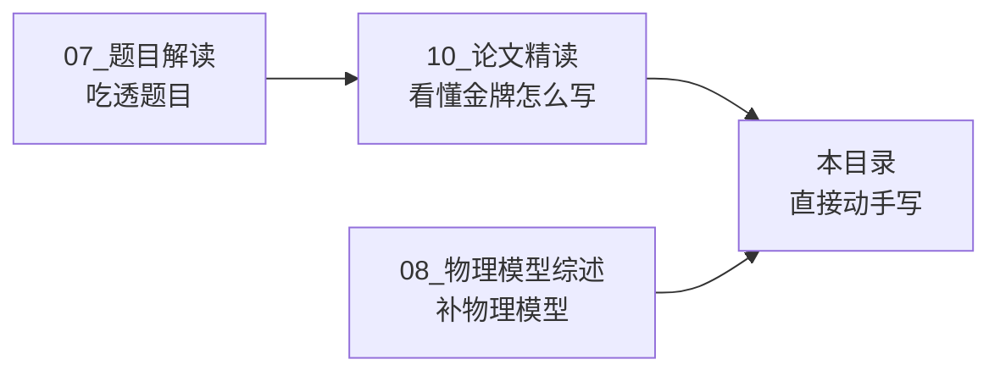

# 11_论文模板与工具 —— 从 73 篇金牌论文提炼的实战工具包

> 与 `10_论文精读/` 配套：精读教你"看懂每一篇"，本工具包教你"写出一篇"。

## 目录

| 文件/目录 | 内容 | 用法 |
|---|---|---|
| `LaTeX模板/main.tex` | 金牌风格论文骨架（标题页/一页摘要/章.序号公式/三线表/附录代码/参考文献样式） | 复制为起点，逐节替换；摘要有注释教你写 |
| `图表配方库/matplotlib_recipes.py` | 8 类金牌核心图的可运行配方（轨迹图/可行域/龙卷风/收敛双曲线/Pareto/多子图/射表热力图/建模路线图），每条注明出处论文与设计要点 | `python matplotlib_recipes.py` 生成预览；写论文时按需 import 单个函数 |
| `写作句库.md` | 按论文部位分类的英文句式（摘要/基准/建模/数值/结果/局限/结论），每句注明金牌出处 | 写作卡壳时查表套句 |
| `建模决策树.md` | 拿到题后的第一张决策流程图 + 五条主干原则 + 常见效应量级速查表 + 模型分层模板 | 开赛后第 2 小时对着走 |
| `48小时作战手册.md` | 逐时段任务单、三人分工模板、危机预案 | 赛前打印，贴墙执行 |
| `提交前终检checklist.md` | 按 7 条评审不变量组织的 40+ 项打勾清单 + "评委三分钟视角"模拟 | 交卷前三人各过一遍 |
| `中译英润色库.md` | 五步润色法、30 条中式表达对照、动词升级表、时态规范、74 篇论文短语频次实证 | 中文草稿改英文时逐段过 |
| `AI提示词包.md` | 11 条分任务提示词（选题/建模/数值/写作/评审/复盘），内置评审标准与上下文包说明 | 整段复制给任意 AI 使用 |
| `一篇金牌论文的完整历程.md` | 从拿到题目到交卷的全流程叙事（每步做了什么、为什么） | 第一次参赛前通读一遍 |

## 与其他目录的关系

## 快速上手（模拟赛建议流程）

1. 挑一道历年题（推荐 2023-A 太空跳伞：六篇金牌可对照）；
2. 按 `建模决策树.md` 走完 Q1–Q5；
3. 用 `LaTeX模板/main.tex` 起稿，图表用 `图表配方库` 出；
4. 卡表述就查 `写作句库.md`；
5. 48 小时按 `作战手册` 时间线走；
6. 交卷前跑一遍 `checklist`；
7. 与对应金牌论文（`03_优秀论文PDF`）+ 精读对照复盘。
