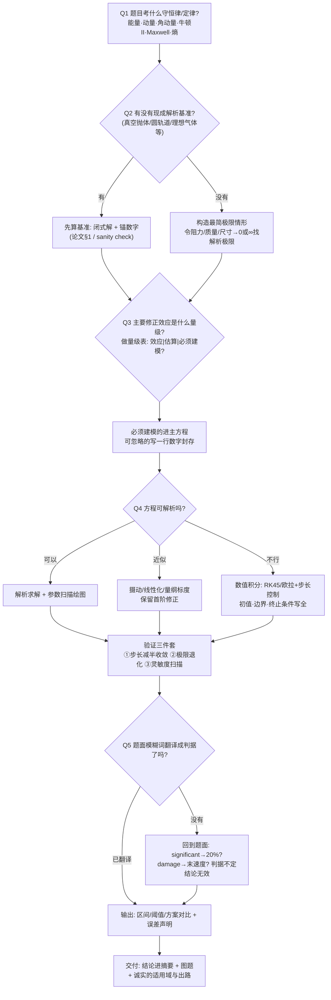

# 建模决策树 —— 拿到任何 UPC 题目后的第一张图

> 综合 73 篇金牌的建模路径归纳。打印贴墙，从 Q1 开始走。



## 五条主干原则（73 篇金牌的最大公约数）

1. **判据先于计算**——先回答"算到什么程度算成功"，再动手（Q5 若为"没有"，一切计算白费）。
2. **基准先于模型**——没有 95% 燃耗那个锚，就没有"省了 75%"的震撼。
3. **量级先于精度**——量级表决定哪些效应值得建模；对可忽略项写一行数字比建模它更专业。
4. **验证先于美化**——三件套做完才轮到配色。
5. **负结论也是结论**——论证扎实的"不建议"比硬凑的"可行"分更高。

## 常见物理效应量级速查（$v\sim10^2$ m/s、$L\sim10^3$ m 场景）

| 效应 | 量级估计 | 对结果的影响 | 出处案例 |
|---|---|---|---|
| 空气密度随高度（指数大气） | 每 8–11 km 掉一个 e（地球） | 主导（不能忽略） | 2023-A 全部 |
| 地球曲率 | $L/R_E \sim 10^{-4}$ | 射程 <10 km 可忽略 | 2025-B 多队论证 |
| 科氏力 | $2\Omega v \sim 10^{-2}$ m/s² | 长射程横向偏移米级，短程可忽略 | 2025-B-204 |
| 马格努斯力 | $~\rho v \omega r^3$ 量级 | 旋转球体的**主项** | 2011-B/2015-B/2022-B |
| 浮力（气体中） | $\rho_{air}/\rho_{obj}$ | 密度差 >100 倍即忽略 | 2018-B |
| 太阳光压 | $~4.5\times10^{-6}$ N/m² | 对 m/kg 级帆板是**主项** | 2017-A/2018-A |
| 行星磁场对带电排气 | 洛伦兹力 vs 动量流 | 决定束流偏转半径 | 2017-B |

> 使用规则：把这张表的方法（不是数字）搬进你的论文——每个"忽略"都要有这样一行估算。

## 模型分层模板（直接抄进论文目录）

```
Level 0  理想基准        ——闭式解，给锚数字
Level 1  主修正          ——量级表中最大的那项，进主方程
Level 2  次级修正        ——风/高度/曲率…,逐项论证后选择性加入
Level 3  扩展/工程化     ——方案对比、交付物(射表/准则/列线图)
```
