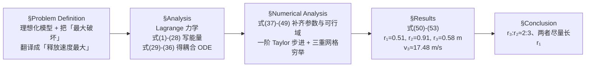

# 2010-GM-B-210（2010 题B · 队伍 210 · 26 页）

## 来自赏析

### 论文速览

这是 UPC 首届（2010）题 B 的唯一金牌论文，由圣路易斯大学的单人队伍（John Sanders）完成。问题要求：配重 5000 kg、初始举高 2 m，求使投石机抛射体"破坏力最大"的最优臂长 $r_1$、$r_2$ 与皮兜（sling）长度 $r_3$。论文把投石机简化为"均质细杆 + 两个质点 + 无质量定长吊索"的双自由度系统，用 Lagrange 力学导出耦合非线性二阶微分方程（式 33、36），再用一阶 Taylor 展开自编 C++ 程序数值积分并在参数空间 $dr=0.01$ m 网格上穷举寻优，得到 $r_1\approx 0.51$ m、$r_2\approx 0.91$ m、$r_3\approx 0.58$ m、释放速度 $v_3\approx 17.48$ m/s（式 50–53），并总结出"吊索与长臂之比约 2:3、二者合计尽量长、配重短臂应更短"的设计法则（式 50–53 附近的 Results 讨论与 Conclusion）。

### 获奖密码

1. **建模完整且"开放可扩展"**：$I_{zz}$ 特意保留符号（式 18 后的说明），使模型天然适用于任意截面/材料；参数全部符号化，最后才代入数值。这种"一般性优先"的意识正是评委想要的物理建模素养。
2. **优化被约束在物理可行域内**：式 47–49 的几何界限来自"不触地、可建造"的真实约束，而不是纯数学自由搜索，体现了对问题情境的忠实。
3. **全程自洽性检验**：主动检验细杆近似的长细比（5:1），并说明替代方案（换精确转动惯量）；对 $v_3=17.48$ m/s 做了量级合理性判断（"不大也不小"）。
4. **彻底的可复现性**：求解程序、绘图程序、原始数据、R 脚本全部公开在附录中，参数可改、结果可重算——在 2010 年的参赛论文里这种透明度很突出。
5. **诚实的结论边界**：摘要与结论都明确说"该 2:3 法则仅对所选参数成立，推广需更多仿真与实机验证"，避免过度解读；同时把模型缺陷（摩擦、吊索弹性、结构强度）逐条列出。评委对这种"知道自己模型边界在哪"的论文给予金奖并非偶然。

### 可借鉴清单

1. **把"最大破坏"这类模糊目标先转译成可计算的代理量**（本文：释放时平动动能最大 + 释放时刻定义为配重首次到达最低点），并在文中明说这是定义选择。
2. **推导时保留关键符号**（如 $I_{zz}$、$\rho$、$A$），最后一步才代入数值，可让模型一键迁移到其他参数情形，也方便做参数讨论。
3. **从物理可行性反推参数搜索域**：先写出几何/制造约束（式 47–49），再定网格步长 $dr$，避免优化出"物理上造不出来"的解。
4. **数值方法要配套"自检"**：说明近似（细杆、$dt$、容差 0.05 rad）各自何时失效、如何升级（如直接积分精确 $I_{zz}$）。
5. **附录放全套代码 + 原始数据**，正文给关键结果与解释，是低成本高收益的可信度投资。
6. **摘要末尾加一段 strengths/weaknesses 自评**——UPC 摘要评分明确看重"对模型局限的认知"，这个模板今天仍然好用（图表务必比本文做得更精细：默认 R 散点图在当下已是明显短板）。

## 来自精读

### 全文骨架

论文只回答一个问题：**配重 5000 kg、举高 2 m 的投石机，三个长度参数（配重臂 r₁、抛臂 r₂、吊索 r₃）取多少，弹丸出速度最大？**



**为什么这个骨架好？** 它是"解析推到推不动为止，再用最朴素的数值法收尾"的经典样板：Lagrange 推导占了全文一半篇幅（式 1–36 一气呵成），数值部分却只用一阶 Taylor（就是显式欧拉）——因为作者明白，**精度瓶颈在模型简化（无摩擦、无索质量），不在积分器**。把力气花在推导的完整性与可复现性（附录 A–D：程序、数据、绘图脚本全公开）上，这正是 48 小时竞赛的正确资源分配。

---

### 建模决策链

| 决策 | 作者的选择 | 被放弃的替代 | 为什么 |
|---|---|---|---|
| 力学框架 | Lagrange 方程 | 牛顿受力分析（需解约束力：支点反力、索张力） | 保守系统 + 只关心运动 → 约束力自动消失 |
| "最大破坏"的定义 | 释放平动速度最大 | 动量最大 / 落点动能最大（需算飞行段） | 质点假设下动能∝v²；飞行段引入射角等新自由度，超出题意 |
| 释放时刻 | φ₁=π（配重首达最低点） | 索张力为零自然脱索 / 角度最优释放 | "To be definite"：把无法优化的时机钉死成可检测的事件 |
| 梁的模型 | 均质细杆 + 平行轴，I_zz 保留符号 | 精确截面惯量 / 无质量梁 | 长细比 5，细杆够用；保留符号则"换梁只需换一数" |
| 搜索策略 | 0.01 m 网格三重穷举 | 梯度法 / 遗传算法 | 可行域小（~10⁶ 组合）、目标函数可能多峰，穷举最稳且天然给出全局图景 |
| 数值积分 | 一阶 Taylor（欧拉）dt=0.01 s | RK4 | 朴素够用（作者判断），但欠步长收敛性检验——本文最大软肋 |
| 优化变量牵连 | m₂、I_zz、r̄、φ₁(0) 全部写成 (r₁,r₂,r₃) 的函数 | 冻结 m₂ 不变 | 梁质量 ∝ 总长；固定它会让"r₁ 贴下界"的边界解失真 |
| 吊索 | 无质量、定长、全程张紧 | 弹性索 / 松弛-张紧切换 | 松弛模型需事件检测，复杂度陡增；假设未论证是可批评点 |

**总规律**：这篇论文的每个"偷懒"都伴随一个升级接口（I_zz 留符号、参数化程序、附录全套数据），唯独**欧拉步长没有做收敛声明**——对照 2010 年题 A 金牌（做了步长减半），可以看到同届论文的共同风格与个体差异。

---

### 可复用模板

**结构模板（可直接映射成论文章节）**：

```
Abstract          假设清单 → 方法 → 四个数值结论 → strengths/weaknesses 自评
Problem Def.      几何定义(图) → 理想化 → 模糊目标操作化("To be definite, ...")
Analysis          广义坐标 → 坐标/速度 → 分部件动能势能 → L → E-L → 耦合 ODE
                  （推到解析推不动，明说"cannot solve analytically"）
Numerical         参数补齐(式37-38) → 初值由题设反解(式39) → 消元显式化(40-41)
                  → 步进格式+停止条件 → 物理可行域(47-49) → 网格步长自辩
Results           最优值编号成式 → φ(t)行为图 → 读边界解 → 量级合理性 → 拒绝过度推广
Appendix A–D      求解程序 / 出数据程序 / 原始数据 / 绘图脚本（全链公开）
```

**句式库（原文摘录，括号内为使用场景）**：
- "Since we are treating the projectile as a point mass ..., we must maximize its translational speed"（把模型假设立即转化为目标函数）
- "To be definite, we will take the point of release to be ..."（钉死欠定义的选择）
- "Unfortunately, we cannot solve (33) and (36) analytically; however, we can solve them numerically."（解析→数值的合法过渡句）
- "we will leave it as I_zz for now so that our results will generalize to ..."（保留符号=留升级接口）
- "Since we presumably don't need to be accurate to a millimeter, we can let ..."（为离散化步长自辩）
- "it is neither astronomically small nor astronomically large"（量级合理性判断）
- "However, we should not be quick to make a generalization based on one simulation."（拒绝过度推广）

**图表配方**：双自由度机构问题 → 「几何标注图（钉死全部符号与角度基准）+ φ₁(t)/φ₂(t) 双联图（释放条件画参考线）」；数值结果 → 把最优值编号进正文公式（式 50–53），让结论可以像公式一样被引用。反例教训：R/MATLAB 默认样式要花十分钟美化（格式化轴标签、加参考线），这篇论文的朴素图放在今天会失分。

---

*精读完这篇后，建议对照 `05_论文赏析/2010/2010-GM-B-210.md`（宏观赏析）与 `07_题目解读/2010_题B_投石机动力学.md`（题目全解）形成三位一体。同届对照：`10_论文精读/2010/2010-GM-A-160_精读.md`（步长收敛性检验的正例）。*
