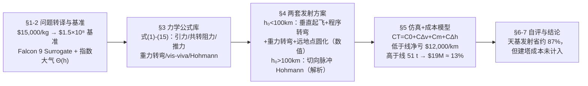

# 2011-GM-A-352（2011 题A · 队伍 352 · 14 页）

## 来自赏析

### 论文速览

中佛罗里达大学队（Frye, Liang, Hardy）把"从不同高度塔顶发射 10,000 kg 载荷入轨的成本"拆成两个物理上截然不同的 regime：100 km Kármán 线以下用"仿真 F9 Surrogate（对标 Falcon 9 的虚构两级火箭）"做含阻力、推力与重力转向的全轨迹数值积分；100 km 以上改用切向点火的理想火箭做 Hohmann 转移，只算所需 $\Delta v$ 与燃料质量。再配一个成本模型 $C_T=C_0+C_{\Delta v}+C_m+C_{\Delta h}$ 把 $\Delta v$ 与"每提升一公里的电费"折算成美元。结论：低于 Kármán 线的塔不省钱（提升成本 \$17,000/km 大于 $\Delta v$ 节省 \$5,000/km，净亏 \$12,000/km）；而 100–300 km 的天基水平发射因火箭总质量骤降至约 51,000 kg（仅为地面发射 407,000 kg 的约 12%），成本约 \$19M，即 \$1,900/kg，比 \$15,000/kg 的基准便宜约 87%。

### 获奖密码

1. **按物理本质分 regime 建模**：Kármán 线两侧采用完全不同的发射方案与数学工具（数值积分 vs 解析 Hohmann），而不是一个模型硬套到底——这正是评委眼中"物理洞察力"的体现。
2. **高度写实**：真实 Falcon 9 参数、真实发射程序（垂直段-程序转弯-重力转向-远地点圆化）、WGS84 常数与共转大气，论文在 Strengths 中自证"与真实卫星入轨流程一致，结果可与现行成本直接对比"。
3. **经济学闭环**：不只答"省多少 $\Delta v$"，而是把 $\Delta v$、提升能耗、载具质量全部折成美元，并用边际成本反推法（\$6.1M/4 km/s）为无法直接定价的量定标——问题问的是 cost，论文回答的就是 cost。
4. **中间结论也有物理判断**："低于 100 km 的塔不划算（\$12,000/km 净亏）"是个负结果，但恰恰证明模型在回答"哪种塔值得建"这个真问题，而非只报喜。
5. **图 5 的沟通设计**：burnout $\Delta v$ 与 burnout $v$ 两条曲线之差把"重力+阻力损耗"可视化，让外行也能看懂节省从何而来。
6. **规范的 Weaknesses/Strengths 自评章节**，逐条给出改进方向（3D、变质量），展示对模型边界的清醒认知。

### 可借鉴清单

1. **对混合问题先切 regime 再选工具**：连续段数值积分、脉冲段解析公式，天然分工，省时且各自精度可控。
2. **虚拟对标载具法**：设计一个" surrogate "（对标真实型号取参数），既有真实性又可自由修改，成本结论还能与公开报价对照。
3. **把非物理量定标到可查证的市场数据**：边际成本从公开的 LEO/GEO 差价反推、提升成本引自太空电梯文献，任何经济参数都注明来源或推算。
4. **用状态判据衔接飞行阶段**（如"$E,L$ 使 $r_a=300$ km 即关机"），比固定时间关机更稳健，也是真实的制导逻辑。
5. **负结果照写**：证明某方案不划算同样是完整答案，且体现批判性。
6. **一图多曲线 + 详尽图注**（如 Figure 5）承载主要结论，评委读图即可复述你的论证链；同时务必校对摘要错别字。

## 来自精读

### 全文骨架

论文只回答一个问题：**从高度 h₀ 的塔顶把 10,000 kg 载荷送入 300 km 圆轨道，塔建多高才划算？**



**为什么这个骨架好？** 全文最重要的判断在 §4 开头一句话："We consider two regimes of tower heights and design a distinct launch strategy for each of them."（我们按塔高分两个 regime，各设计一套发射策略。）卡门线（100 km）以下大气是主角→用含阻力与重力转弯的数值积分；以上大气消失→切向脉冲 Hohmann 全解析。**一个物理判据切开两套数学工具**，而不是一个模型硬套到底——这是评委眼中"物理洞察力"的直接证据。再往下，所有物理量（Δv、质量、能耗）都被折算成美元，问题问 cost，论文就答 cost。

---

### 建模决策链

| 决策 | 作者的选择 | 被放弃的替代 | 为什么 |
|---|---|---|---|
| 总体架构 | 以卡门线分两个 regime | 单一模型全高度硬套 | 两侧物理主导项不同（大气 vs 无大气），工具自然分化 |
| 载具 | Falcon 9 Surrogate（对标真实参数） | 完全虚构 / 完全照抄 | 有出处又可改；成本结论还能与公开报价对照 |
| 大气模型 | 指数 + Θ(h) 硬截断 | 分层实测大气表 | Δv 是积分量，对廓线细节不敏感；截断误差 ≪ C_D 不确定度 |
| 阻力参考系 | 相对共转大气（式 4） | 惯性系速度 | 赤道差 465 m/s，6% 量级不可忽略 |
| 发射程序（<100 km） | 10 s 垂直→0.5°/s 至 8.5°→重力转弯 | 最优控制/攻角调度 | 手工调参足够（作者明说 manual fine tuning），省下时间做成本层 |
| 关机判据 | 状态判据（E,L 使 r_a=300 km） | 固定时间关机 | 状态判据对塔高扰动稳健，也是真实制导逻辑 |
| 二级 | 远地点脉冲近似 | 有限燃烧时长仿真 | 脉冲误差远小于其他不确定度，且换来闭式解 |
| 天基发射方向 | 切向（水平） | 垂直 | 无阻力时垂直起飞纯浪费（重力损失），一句物理论证完成决策 |
| 成本表达 | Δv、势能、质量全部折 \$/kg | 只报告 Δv 节省 | 题目问 cost；且 \$/kg 可与市场数据互检 |
| 项的删除 | 天基情形删 C_m、C_Δh | 保留全部四项 | 两项总变化 <\$2 M，小于定标不确定度——量级论证支持的简化 |

**总规律**：每个"换工具/删项/截断"的决定都附带一个量级论证或物理判据，这正是 regime 切分式建模的完整礼仪。

---

### 可复用模板

**结构模板（可直接映射成论文章节）**：

```
1 Interpretation   把题目基准($/kg)钉死；列出待比较方案
2 Assumptions      替身载具表 + 环境模型(式1+Θ) + 常数出处
3 Mechanics Library引力/阻力/推力/转弯/轨道公式一次推完（式1-15）
4 Design           按 regime 给发射程序：程序段+关机判据+脉冲化
5 Numerical+Cost   轨迹族图 → Δv-高度汇总图 → 成本模型与两项删除
6 Discussion       Weaknesses(逐条+改进方向) / Strengths(对比式自证)
7 Closing          总结论 + 不可忽略的现实约束(建塔成本)
```

**句式库（原文摘录，括号内为使用场景）**：
- "We consider two regimes of ... and design a distinct ... for each of them."（切 regime 总起句）
- "This marks the end of the 'sensible atmosphere' for our purposes"（给截断阈值起名并自辩）
- "The values of the pitch rate and threshold pitch were determined by manual fine tuning."（诚实交代调参）
- "we chose to base our model on SpaceX's Falcon 9 ... We name our fictitious spacecraft Falcon 9 Surrogate"（替身载具法）
- "The tower thus does not save money below the Kármán line."（负结果一句话定论）
- "Although the incredible costs and engineering challenges of building a tower extending into space cannot be understated, the savings of nearly 90% ..."（结论不忘现实约束）

**图表配方**：混合 regime 问题 → "双分支同图 + regime 边界竖线 + 每条曲线注明方法来源"；轨迹族 → "双参考系各画一张（共转系看形状、惯性系看自转贡献）"；飞行剖面 → "a/v/h/α/m 五联时序图"；成本结论 → "统一折算 \$/kg 再对比"。

---

*精读完这篇后，建议对照 `05_论文赏析/2011/2011-GM-A-352.md`（宏观赏析）与 `07_题目解读/2011_题A_太空塔发射成本.md`（题目全解）形成三位一体。姊妹篇：`10_论文精读/2010/2010-GM-A-160_精读.md`（火箭方程的完整动量守恒推导）。*
