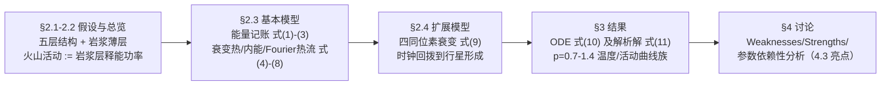

# 2012-GM-A-449（2012 题A · 队伍 449 · 17 页）

## 来自赏析

### 论文速览

上海交通大学队（李彦蓉、唐一鹤、邓希瓦）问的是：质量 0.5–3 倍地球的类地行星，火山活动如何随时间演化。他们把行星切成"内核-外核-幔-壳 + 幔壳间的薄岩浆层"五层结构，以能量守恒为主线：核内放射性衰变（$^{238}$U 及扩展模型中的 $^{40}$K、$^{235}$U、$^{232}$Th）供热，经 Fourier 热传导把功率 $P_{vol}=B(T-700)$ 注入岩浆层，$T<700$ ℃ 即火山熄灭。由此导出一阶非齐次 ODE（式 10）并解析求解（式 11），对 $p=r/R_\oplus=0.7$–1.4（对应 $\xi=p^3=0.5$–3）扫描出温度与活动曲线（Figures 4–5）。校验漂亮：模型算出水星只剩约 15 亿年火山寿命、地球约 50.7 亿年，"相当合理"；扩展模型还复现了地球早期"先升温后降温"的热史转折。最终结论：行星越大，火山活动持续越久（$\xi=0.5$ 比地球短 17.4 亿年，$\xi=3$ 长 47.6 亿年）。

### 获奖密码

1. **把"火山活动"定义成功率而非事件**：$\eta=P_{vol}/Q$ 的连续化定义让 $10^8$ 年尺度问题变成可解的 ODE，绕开了对喷发细节的无知——处理"信息稀少的大尺度问题"的示范。
2. **双模型递进**：单同位素基本模型给解析解，四同位素扩展模型揭示"先升后降"的新特征（Figure 3.3），扩展不是堆料而是产生新物理结论。
3. **用太阳系内天体做外部校验**：水星与地球两个锚点让评委相信外推可信，这是天文题最重要的自洽性证据。
4. **罕见的参数灵敏度小节（4.3）**：主动回答"你的结果对估计参数有多敏感"，并把最脆弱的假设（$\lambda$、$d$）摊开在桌面上。
5. **Weaknesses 写得具体**：不是套话，而是逐条指出"熔岩层厚度查不到""高温高压下的比热只能近似""步长 $10^{13}$ s 过大"。
6. **能量守恒骨架 + Fourier 定律 + 衰变律**三个本科级定律拼出复杂系统，证明"简单定律组合 + 好假设"胜过晦涩的大模型。

### 可借鉴清单

1. **"定义观测量"先行**：遇到"活动水平/强度"这类模糊量，第一件事是给出可计算的代理定义（本文：岩浆层释能功率），并在文中显式声明。
2. **极端案例校验法**：拿题目情境中的已知成员（水星、地球）检验模型端点，再谈外推；成本极低、说服力极高。
3. **专设 "Dependence of Results on Parameters" 小节**：挑含估计值的组合参数做扰动实验，报告结果偏移，评委对"知道自己软肋"的论文格外宽容。
4. **用 $\sqrt[3]$ 标度律迁移地球数据**：厚度、半径按 $\xi^{1/3}$ 缩放（如 $d=d_0\sqrt[3]{0.5}=31$ km），一条相似律贯穿全参数空间。
5. **页眉写 "Page N of 17"** 并在页眉显示当前小节，方便评委翻阅定位——低成本的专业感。
6. **避免本篇的失误**：小节号重复、个别语法粗糙（如 "mess" 误用）提醒交稿前须做一轮格式与文字通读；附录代码也应与正文公式逐项核对一致。

## 来自精读

### 全文骨架

论文只回答一个问题：**质量 0.5–3 倍地球的超级地球，火山活动强度如何随时间演化、能持续多久？**



**为什么这个骨架好？** 面对一个几乎无数据的天文问题（谁也没测过超级地球的岩浆层），作者的策略是"**用定义换数据**"：把"火山活动"定义为岩浆层的能量释放功率（η=P_vol/Q），于是离散的喷发事件被连续化，10⁸ 年尺度的问题变成一阶 ODE。骨架呈"基本模型 → 扩展模型"两级火箭：基本模型给出解析解与量级，扩展模型（四同位素 + 回拨时钟）产生新物理（先升后降）——扩展不是堆料，而是产出新结论。

---

### 建模决策链

| 决策 | 作者的选择 | 被放弃的替代 | 为什么 |
|---|---|---|---|
| 观测量定义 | 火山活动 := 岩浆层释能功率（η=P_vol/Q） | 喷发次数统计/VEI 指数 | 无事件数据；功率可从能量守恒算出，Q 只是常数缩放 |
| 空间模型 | 零维盒模型（分层但整体平均） | 一维径向热传导 PDE | 一阶 ODE 有解析解；PDE 的初边值数据不存在 |
| 地温/物性 | 分段线性/分段常数（文献锚点） | 连续函数拟合 | 数据只有界面值；近似精度匹配数据精度 |
| E_received | 论证后归零 | 保留并建模地壳热流 | 39→31 km 玄武岩隔热，热流 ≪ 衰变源 |
| 衰变源 | 基本：²³⁸U 单源；扩展：四源叠加 | 一开始就四源 | 先给解析解（基本），再叠加出新物理（先升后降）——两级火箭 |
| 地震/火山合并 | E_vol=λ_vr·E_rel，取 λ_vr=1 | 分别建模 | 线性常数不改定性结论，归一简化 |
| 参数空间 | p=r/R⊕，ξ=p³ 相似律 | 逐行星重新建模 | 一族曲线覆盖 0.5–3 M⊕ |
| 校验 | 水星 + 地球双锚点 | 无校验/仅内部自洽 | 已知天体钉住模型端点，外推才有底气 |
| 灵敏度 | §4.3 专节扰动 B | 只列 weaknesses | 主动指出最脆弱参数并给等效换算 |

**总规律**：**"信息贫乏 → 用定义与守恒律造出可算的量 → 用已知天体校验 → 用灵敏度小节画边界"**——四步走完，一个几乎无数据的问题就有了可辩护的答案。

---

### 可复用模板

**结构模板（贫信息大尺度问题）**：

```
Abstract          物理定律清单 + 定性结论
Introduction      对象定义 + 观测量代理定义预告
Model             2.1 假设（每条配理由）
                  2.3 基本模型：能量流图 → 记账方程(1)(2)(3) → 物性子模型(4)-(8)
                  2.4 扩展模型：更全的源项(9)，回拨时钟
Results           ODE(10) → 解析解(11) → 曲线族(4/5) → 已知天体校验 → 新物理(6)
Discussion        Weaknesses(具体到参数) / Strengths / §参数依赖性(扰动+等效换算)
Appendix          代码紧邻其输出的图
```

**句式库（原文摘录，括号内为使用场景；英文按 _dec 版校读）**：
- "we define the volcanic activity as a quantity proportional to ..."（开头即定义代理量）
- "Since we do not have any idea about how ... we assume ..."（承认无知作为假设理由）
- "This is quite reasonable. We will give the reason in latter section."（预告论证）
- "we do not distinguish them. We think that they are at least in proportion."（合并同类现象的辩护）
- "As for the Earth, it has 1.6×10¹⁷ s ... which is quite sound."（用已知天体自证）
- "will severely influence the result"（灵敏度结论直白收尾）
- "Though this model is kind of rough, we show a satisfying trend ... This is the biggest victory of the modeling."（为量级模型定调）

**图表配方**：参数扫描 → "同图曲线族 + 阈值横线 + 关键点打叉"；演化叙事 → "单曲线 + 今日竖线 + 峰值标注"；证据链 → "先放文献实测图再声明近似"（Figure 2 的顺序不能反）；代码组织 → "附录代码与它生成的图放在一起"。

---

*精读完这篇后，建议对照 `05_论文赏析/2012/2012-GM-A-449.md`（宏观赏析）与 `07_题目解读/2012_题A_超级地球火山.md`（题目全解）形成三位一体。姊妹篇：`10_论文精读/2011/2011-GM-A-352_精读.md`（同样是"指数衰减源 + 冷却平衡"的 ODE 结构）。*
