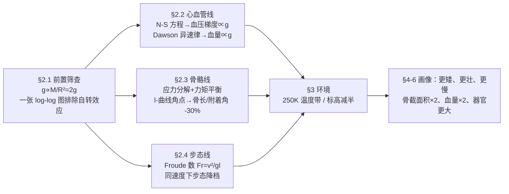

# 2013-GM-B-611a（2013 题B · 队伍 611a · 23 页）

## 来自赏析

### 论文速览

华盛顿大学圣路易斯分校队（Endsley、Kreisch、Stein）研究 $M=8M_\oplus$、$R=2R_\oplus$（表面重力恰为 $2g$）、表面温度 250 K 的系外行星上四足动物的身体构造。路线：先算出 $g\propto M/R^2=2g$ 并用对数图（Fig. 2.1.1）排除行星自转离心效应；再分三条主线建模——心血管系统用 Navier-Stokes 方程（层流、柱坐标简化后积分得 Poiseuille 型速度剖面）论证"血压梯度 ∝ 重力"，结合 Dawson 异速生长律得"血容量 ∝ $g$"（2g 下翻倍）；肌肉骨骼系统把骨应力分解为正应力与剪应力，用力矩平衡导出等应力曲线 $l\propto 1/(g\sin\theta)$，从"l-曲线"（Fig. 2.3.1）角点读出最优骨长与附着角在 2g 下均缩短约 30%、骨截面积翻倍；步态用 Froude 数 $Fr=v^2/(gl)$ 分析：同一速度下 Fr 减半，"地球上在飞奔、系外行星上只是小跑"。叠加 250 K 低温与标高减半的大气压分析后，总结出"更矮、更壮、更慢、心脏与器官更大、血量翻倍"的完整外星生物画像。

### 获奖密码

1. **多系统分工 + 双模型收敛**：心血管（血压梯度限制身高与附肢）与骨骼（应力限制身高）两条独立建模路径得出同一形态学结论，论文明确以"两模型相互印证"作为可信度论据——这是开放性题目中最有力的自洽性论证。
2. **先做排除法再建模**：用 Fig. 2.1.1 正式排除自转效应，并说明为何只选心血管、骨骼、大气三个约束——"为什么建这些模型、不建那些"本身给出了论证。
3. **l-曲线的巧思**：把"骨长"与"附着角"两个待定量放进一张等应力曲线图，用"演化最小化肌应力"这一条生态假设把二维选择压成角点，定量读出 30%——抽象假设落成可测数字。
4. **真实生理常数锚定**：股骨剪切强度 51.6 MPa（实验值 [10]）、人体参数（附录 1）、Alexander 的 Fr 阈值，全部硬数据；使"外星生物"这种最容易被批"编故事"的答案有了实验地基。
5. **模型失效域的自觉**（$V\propto g$ 发散、N-S 数值不可解、角点假设可替代）写进 Weaknesses，展示研究生级的严谨态度。
6. **回答了题目的每一个示例问题**：多大（更矮壮）、什么形状（柱状腿、浅附着角）、多快（Fr 减半 → 更慢），外加温度与气压两个题目未明说但 250 K 暗示的维度。

### 可借鉴清单

1. **"双独立模型收敛"策略**：对开放性预测题，用两条物理上独立的论证路径逼近同一结论，并在 Strengths 中点明——比单一模型说服力翻倍。
2. **先用一张图排除干扰变量**（自转、潮汐、磁场……），把建模范围论证清楚，避免评委问"为什么不考虑 X"。
3. **等值线图 + 生态最优假设 = 定量预言机**：把两个待定量画成约束曲线族，用一条演化/经济性假设选点，即可输出具体数字（本文 30%）。
4. **生物类题目务必引入真实解剖/生理常数**（骨强度、步态阈值、人体质量），并为附录准备参数表——把科幻题做成生物物理题。
5. **标高/异速律这类 $g$ 的幂律是超重力题的万能工具**：血量 ∝ g、标高 ∝ 1/g、Froude ∝ 1/g，一张 $g$ 换算表能快速覆盖多个子系统。
6. **可复用本篇的收尾结构**：Results Summary 把各模型结论拼成一幅完整画像（更矮、更慢、更壮），让评委在最后一页得到"一句话答案"；但注意图表编号与小节号保持一致（本文 Fig. 3.3.1 的错位是小污点）。

## 来自精读

### 全文骨架

论文回答一个问题：**在 8M⊕、2R⊕（表面重力恰为 2g）的行星上，动物会长成什么样？**



**为什么这个骨架好？** 三条建模主线（心血管、骨骼、步态）物理上互相独立，却**收敛到同一个形态学结论**（矮、壮、短肢）——作者在 §5.2 明确把这种"双模型交叉验证"当最大卖点。对开放性预测题，两条独立证据链胜过一条精细的证据链。另外注意 §2.1 只用了半页就"请走"了自转这个干扰变量——先做排除法，再建模，是本题最值得抄的起手式。

---

### 建模决策链

| 决策 | 作者的选择 | 被放弃的替代 | 为什么 |
|---|---|---|---|
| 主变量 | 只追 g 的影响 | 温度/大气/磁场全套 | 一张 log-log 图证明自转需 10 倍转速才显著，其余扰动相对 2g 是小量 |
| 心血管模型 | N-S 定性推论 + Case 1/2 | 全数值求解 N-S | 论文自承数值解不动；定性梯度关系已足够支撑形态学预言 |
| 血量标度 | 借 Dawson 异速律 | 自建微循环模型 | 数据稀缺，借定律一行到位；失效域（g→∞）主动标注 |
| 骨骼模型 | 应力分解 + 力矩平衡 + l-曲线 | 有限元骨骼模型 | 48 小时不可能；解析曲线已能读出 30% 定量结论 |
| 角点选择 | 演化最小化肌应力 | 扫描整条曲线族 | 一条生态假设把二维选择压成一个点；敏感性在 Weaknesses 补偿 |
| 步态 | 无量纲 Fr + 经验阈值 | 肌肉功率极限模型 | Fr 结论与体型解耦，自动适配"等效地球动物"假设 |
| 环境层 | 温度带 + 标高两条独立小模型 | 忽略环境 | 250 K 是题面唯一环境输入，不榨干等于丢分 |
| 工具 | ROOT（CERN C++ 框架） | MATLAB/Mathematica | 团队顺手；全部代码入附录保证可复现 |

**总规律**：这是一篇"零数值模拟"的金牌论文——所有定量结论都来自守恒律、量纲分析与文献标度律。它证明 UPC 评委要的是**物理判断力**而不是算力。

---

### 可复用模板

**结构模板**：

```
Abstract        方法链 + 逐条结论（每个模型挂一个数字）
1 Interpretation 界定等效性假设（"same functionality as earth animal"）
2 Model
  2.0 前置筛查   一张图排除干扰变量（自转/潮汐/磁场）
  2.1 主线 A     PDE → 定性推论 → Case 两端讨论
  2.2 主线 B     守恒/平衡方程 → 约束曲线 → 生态假设选点
  2.3 主线 C     无量纲数 + 经验阈值
3 Additional    把题面每个环境参数榨出独立小模型
4 Results       以"一只动物"为载体拼装画像
5 Discussion    Weaknesses（含失效域）/ Strengths（含双模型收敛）
6 Closing       一句话画像
Appendix       参数表 + 全部绘图代码
```

**句式库（原文摘录）**：
- "We deem it probable that ... will show a combination of the alterations in Cases 1 and 2."（两端讨论后取折中）
- "the exoplanet would have to be rotating at least 10 times faster than earth for ... to factor significantly"（用图定量排除干扰项）
- "This value is nearly constant between different species."（论证借用跨物种常数的合法性）
- "a conclusion which seems both sensible and reassuring"（安心结论也要明说）
- "The independent modelling of ... led us to the same conclusions ..., which indicates their efficacy in solving this problem."（双模型收敛=自证）
- "then volume approaches infinity in the limiting case, indicating that this relationship fails at higher ..."（主动标注失效域）

**图表配方**：排除干扰 → log-log 幂律直线；双自由度选优 → 约束曲线族 + 角点十字线 + 结论进图题；g 依赖类问题 → 1g/2g 同图双曲线、颜色语义全文统一。

---

*精读完这篇后，建议对照 `05_论文赏析/2013/2013-GM-B-611a.md`（宏观赏析）与 `07_题目解读/2013_题B_超重力生物结构.md`（题目全解）形成三位一体。*
